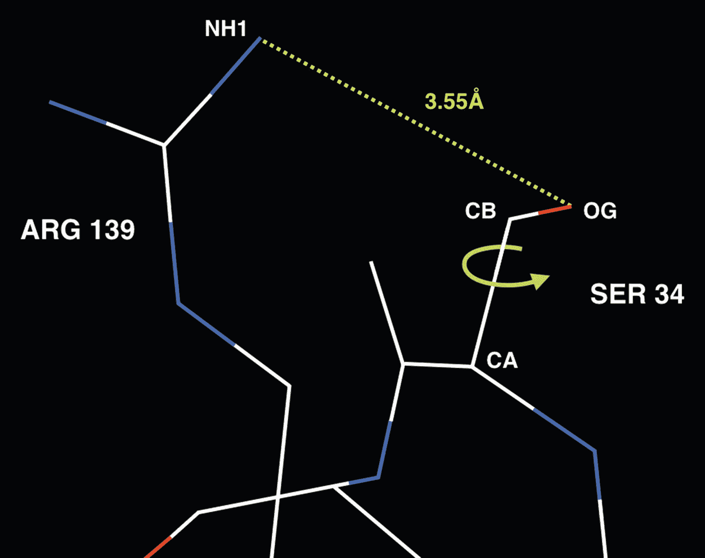
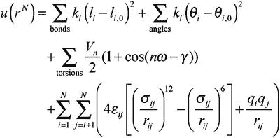
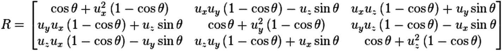
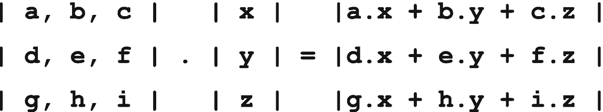
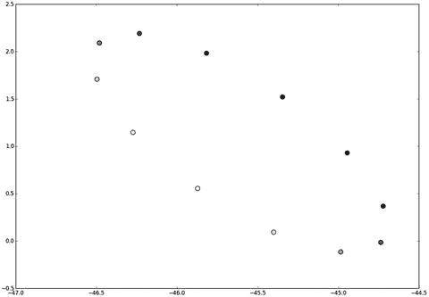
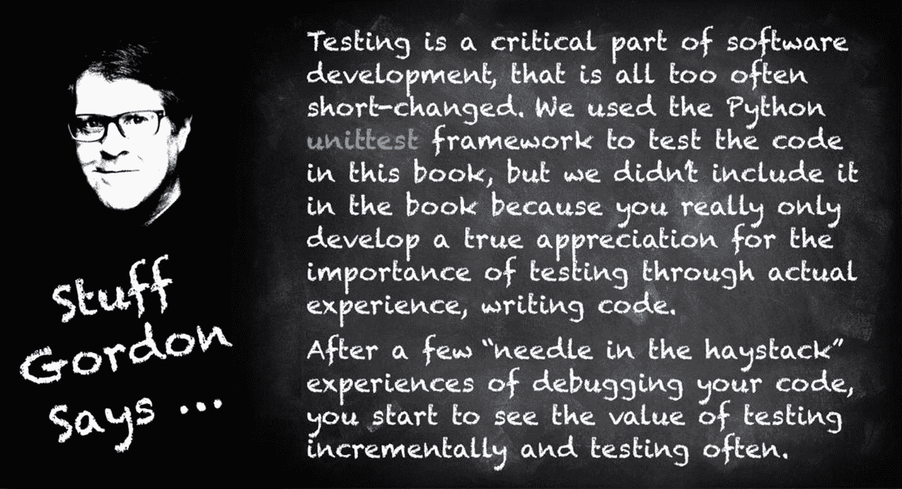
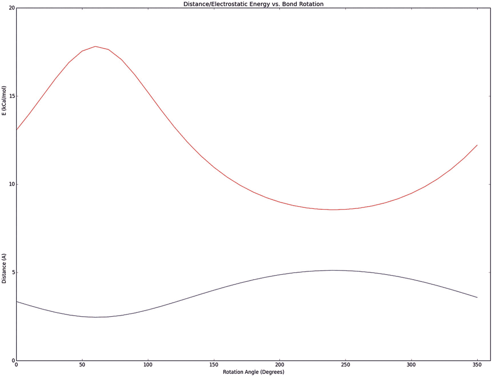

*结构生物学的数学与线性代数*

 |
*“天哪！一个会说话的棋子，”爱丽丝说。*
*“不只是随便一个棋子，”棋子生气地说。“我是女王，而你是个无礼的小姑娘。”*
*“对不起，”爱丽丝说，“但你吓了我一跳。”*
*“吓了你一跳？”棋子说。“啊，是的——请再提醒我一次你的三维世界有多美妙，而我以及所有我的棋子同伴只有一个二维网格可以移动。没有什么比多一个维度更能让人有优越感了！”*
*“对不起，”爱丽丝说，“我不知道。”*
*“相信我，当棋子没什么好处，”棋子说，“主要是因为一开始就没有‘上’。你我之间说说，我想告诉你，有时我对此感到非常沮丧，只是对我们来说也没有‘下’。”*
*“也许你可以为此感到不知所措，”爱丽丝试图帮忙说。*
*“没人喜欢自作聪明的人，”棋子面无表情地回答。*

 |
*`Matplotlib`，`sciPy`，`numPy`，类，`unittest`*

 |
*分子结构，共价键旋转，线性代数，蛋白质数据库（PDB），蛋白质结构，静电学，半经验能量计算，分子力学/动力学，促红细胞生成素，原子电荷，阿伏伽德罗常数，库仑，矢量*

# 现代生物学的一大讽刺之处在于，它已越来越成为对构成生物系统的“无生命物质”的研究。

本章正是关于这些“无生命物质”的。它从“生物学”视角出发，探讨在足以研究生命系统 的最小尺度上的生物学。

生物学向来是对生命系统的研究，但早期生物学家感兴趣的现象主要是宏观的，且更具纯粹“生物学”特征——因为这些现象正是将生命体与宇宙中其他所有“无生命物质”区分开来的东西：适应、生长、繁殖等等。如今，我们的科学技术已发展到现代生物学家能在分子水平上研究生命体的程度。在这一水平上，生命系统本质上与其他通常不被视为生物学研究对象的“无生命物质”一样，受相同的物理和化学定律支配。

这种看似矛盾的状况，从纯粹的唯物主义视角来看，实际上是一种一致的方法论，因为它将生命系统视为遵循相同物理和化学普遍定律的、复杂且高度组织化的常规物质集合体。这种方法无需假设存在某种特殊的“活力”或“生命原理”来赋予生命以活力，并将生命体在概念上与非生命物质区分开来。在这种视角下，生命被视为这些物理和化学普遍定律在极其复杂的物质集合体中涌现出的属性——但它们表现为宏观得多的尺度，即那些我们称之为“生物学”的现象得以显现的尺度。分子层面的生命看起来更像是化学而非生物学。

所有这些啰嗦的开场白，其实是想表明：本章中出现的大量内容，读者可能会觉得更像纯粹的物理学和化学，因为它涉及在原子和分子水平上，将 `Python` 应用于生物学。

## 旋转分子键

我们在本章将要探讨的例子，展示了如何利用 `Python` 来操作和分析三维分子结构——具体而言，我们将研究蛋白质中氨基酸侧链绕化学键的旋转。这个例子将演示如何实现基本的线性代数，以使用向量和矩阵进行三维变换，以及如何利用分子力学进行一些基本的分子能量计算。与本书中的所有示例一样，我们力求将示例尽可能简化，以免示例本身的复杂性成为理解 `Python` 编程实现的障碍。



**图 11-1** 人类促红细胞生成素蛋白的三维结构

那么，闲话少叙，这就是我们要探讨的示例。图 11-1 中的示意图显示了通过 X 射线晶体学解析出的**人类促红细胞生成素**蛋白（[蛋白质数据银行 ID 1EER](http://www.rcsb.org/pdb/explore.do%253FstructureId%253D1EER)^(¹³²)）三维结构中，与第 34 位丝氨酸相邻的一些氨基酸。为清晰起见，图中已移除所有氢原子。氨基酸丝氨酸具有最简单的侧链之一，它可以存在不同的[旋转异构体形式](https://en.wikipedia.org/wiki/Conformational_isomerism)（即仅在自由旋转键的旋转角度上存在差异的构象变体）。对于丝氨酸，如图中旋转箭头所示，其侧链末端氧原子（`OG`）可以绕丝氨酸主链 α 碳（`CA`）与侧链 β 碳（`CB`）之间的碳-碳单键旋转。从图中还可以看出，该丝氨酸氧原子距离精氨酸 139 侧链上的一个氮原子（`NH1`）仅略超过 3 Å。尽管位于多肽序列上精氨酸 139 与丝氨酸 34 相距甚远，但由于蛋白质的三维折叠结构，二者最终在空间上相邻。

当蛋白质处于近似中性 pH 的环境中时，丝氨酸氧原子和精氨酸氮原子都将带净负电荷，这意味着这两个原子之间存在相互排斥的[静电力](https://en.wikipedia.org/wiki/Coulomb's_law)。当然，在这两个原子所处的蛋白质环境中，还有大量其他作用力共同决定着这些侧链相对于彼此的构象——虽然我们*不会*实现计算所有这些作用力的算法，但快速了解一下通常用于[分子能量计算](https://en.wikipedia.org/wiki/Molecular_mechanics)的半经验力场函数的一般形式，也不无裨益。



**图 11-2** 半经验力场函数

由于我们无法对除双原子分子之外的任何更复杂体系求解[薛定谔方程](https://en.wikipedia.org/wiki/Schr%25C3%25B6dinger_equation)，化学家和生物学家便使用图 11-2 所示的这类半经验力场函数来模拟分子的行为。该函数实质上是一个用于描述所研究体系内分子内部及分子间共价键与非键相互作用的力学模型。我们可以将函数中的各项归为三组：

1.  *第一行*中的***键长***项和***键角***项，分别将键长伸缩和键角振动视为弹簧力，其作用是将平衡键长和键角恢复。

2.  *第二行*（***二面角***）是一个描述绕键旋转的二面角能量的项。该项取决于旋转基团的几何结构，例如，甲基围绕旋转轴具有三重对称性，因此余弦项会包含 `n` = 3 的数值，以反映绕旋转键能量极大值和极小值的三重对称排列。

3.  *最后一行*代表所谓的*非键*或*非共价*能量项，其中包括[范德华力](https://en.wikipedia.org/wiki/Van_der_Waals_force)、[偶极矩](https://en.wikipedia.org/wiki/Dipole%2523Molecular_dipoles)以及前面提到的静电力。

### 分子力学还是动力学？

（构成第一行和第二行的这三个术语统称为*键合*或*共价*能量项，因为它们都适用于包含一个或多个[共价键](https://en.wikipedia.org/wiki/Covalent_bond)的原子集合。）

此处展示的力场函数可通过两种不同的方式使用。对于[分子力学](https://en.wikipedia.org/wiki/Molecular_mechanics)，它可用于计算所考察系统中分子能量组分及其力向量。随后可对这些分量求和，并针对系统中每个原子计算能量最小化图景。然后每个原子会沿着局部最强能量最小值方向进行微调，并且我们重复此过程。当然，一旦所有原子都达到其可及的局部能量最小值，这种能量最小化的过程就会收敛——这些局部最小值可能（或更可能不会）对应于系统整体层面的任何全局最小值。

第二种更强大但计算成本更高的方法是[分子动力学](https://en.wikipedia.org/wiki/Molecular_mechanics)模拟，其中系统中的每个原子会根据与所模拟系统温度相对应的玻尔兹曼能量分布被赋予速度和方向。在此情景下，原子能量及其向量的计算方式与之前相同，但这次，每个向量都被应用于一个根据其预设速度运动的原子，具体方法是通过求解牛顿运动定律。计算出一个新的速度，并据此计算原子在该速度下经过适当时间步长运动后的新位置。

力场函数中键长和键角项所涉及的极短飞秒（*femto* = 10^(–18)）振动时间尺度，本质上决定了分子动力学模拟中合适时间步长的长度，因此该步长必须在飞秒量级。**换言之，对于所研究系统中的每个原子，这些能量和速度必须针对每个飞秒时间步长重新计算**。即使进行百万次这样的计算循环，也只相当于对系统动态行为进行了皮秒（*pico* = 10^(–12)）级别的分子动力学模拟。

### 亲自动手体会效率的重要性

因此，不难看出代码效率在此处为何至关重要。关于这一点，我们稍后会有更多阐述。

另一个影响模拟代码性能的因素是必须考虑的非键相互作用的数量。这些相互作用的数量通常比共价项高出数个数量级，因为它们必须在更大的范围内进行计算。例如，通常需要计算给定原子周围 10 Å 球体内所有其他原子的静电相互作用。在大型蛋白质中，或任何通过将原子集合置于水分子体积内模拟水性环境的分子系统中，需要计算的非键相互作用数量可能非常庞大。同样，代码的性能在这方面会产生巨大影响。

那么，我们为何如此强调代码性能这个问题呢？

因为本章将要给出的示例纯粹是为了演示如何在 `Python` 中实现这类三维能量计算——但在实际应用中，你会使用那些用 C 语言编写并编译以便与 `Python` 配合使用的高度优化且快速的数学库。这些库包括我们在本书中已提及的`SciPy`^(¹³³)和`NumPy`^(¹³⁴)——它们能高效地执行在 `Python` 中实现分子建模所需的所有线性代数和能量计算——甚至还有专门的定制[Python 分子建模库](http://dirac.cnrs-orleans.fr/MMTK/)^(¹³⁵)可供使用（其中大部分实际上都使用了`SciPy`和`NumPy`）。

我们本可以直接告诉你这些库的存在，并教你如何将它们集成到（更高级的）`Python` 代码中来实现分子建模方法，但那样你就永远无法学会如何实现三维向量和旋转矩阵，以及如何执行实际能量计算。你也无法看到如何利用面向对象编程，以清晰且一致的方式创建这类数学库，从而使你的代码易于编写、使用和维护。此外，根据我们的经验，总有一天，你最喜欢的那款强大库偏偏缺少项目所需的关键组件，而更糟的是，你可能不得不自己动手编写代码！

我们**完全清楚**，本章中的算法可以用 `NumPy` 和 `SciPy` 更轻松、更高效地实现。但我们的目标是教你如何用 `Python` 编写代码，而不是如何使用 `Python` 的数值和科学库。在本章末尾，你会找到一份延伸阅读和资源列表，其中会指引你找到此类库及其全部文档。

### 进入三维数学矩阵世界

作为对实现分子建模所需三维数学运算的低级 `Python` 代码的一个极简演示，我们将实现一个算法，用于绕共价键执行旋转、计算两个原子之间的距离，以及计算这两个原子之间的静电能量。我们还将使用前几章介绍的面向对象编程方法，实现一个用于处理三维向量和旋转矩阵的简单数学库。

#### 首先，我们来看绕键旋转。

定义绕任意三维轴旋转的矩阵 **R** 的一种通用形式如图 11-3 所示。



**图 11-3** 定义绕三维轴旋转的矩阵

```

这是一个归一化的旋转矩阵，用于绕单位向量旋转`θ`（弧度）。如果你对该矩阵的推导过程感兴趣，可以在本章末尾列出的参考资料中找到更多信息。我们示例中的旋转轴对应于将要旋转的化学键。因此，该轴的向量就是键两端原子位置的差向量。如果你查看前面的结构图，可以看到我们将绕丝氨酸的`CA`到`CB`键旋转丝氨酸的氧原子，所以旋转轴本身将由丝氨酸`CA`和`CB`原子之间的向量来定义。

## 键旋转的实现

那么，我们先来处理键旋转的部分。让我们使用本书前面学过的面向对象编程（OOP）方法来定义表示三维向量和矩阵的对象，并编写相应的对象方法来实现我们操作它们所需的线性代数。秉承本书的理念，为了使示例足够简单，避免其复杂性成为理解Python实现的障碍，我们假设该库仅处理三维空间中的向量和矩阵，而不会将其推广到更高或更低维度的空间。

在代码清单11-1中，是三维矩阵的类定义。

```python
class Matrix3D:
    def __init__(self,a,b,c,d,e,f,g,h,i):
        self.a = a
        self.b = b
        self.c = c
        self.d = d
        self.e = e
        self.f = f
        self.g = g
        self.h = h
        self.i = i
    def transform3DVector(self,vector):
        tx = self.a * vector.x + self.b * vector.y + self.c * vector.z
        ty = self.d * vector.x + self.e * vector.y + self.f * vector.z
        tz = self.g * vector.x + self.h * vector.y + self.i * vector.z
        return Vector3D(tx,ty,tz)
```
Listing 11-1 三维矩阵的类定义

很明显对吧？我们将矩阵表示为一个3x3的值数组，它可以应用于列向量`(x,y,z)`以生成一个变换后的向量，如图11-4所示。



图 11-4 向量变换方程

你会注意到`transform3DVector`方法返回了一个我们尚未定义的`Vector3D`类的实例，因此在代码清单11-2中，我们添加了该类的代码（运行这段代码需要先执行代码清单11-1中的代码）。

```python
import math
class Vector3D:
    def __init__(self,x,y,z):
        self.x = x
        self.y = y
        self.z = z
    def magnitude(self):
        return math.sqrt(self.x * self.x + self.y * self.y + self.z * self.z)
    def unitVector(self):
        m = self.magnitude()
        xu = self.x / m
        yu = self.y / m
        zu = self.z / m
        return Vector3D(xu,yu,zu)
    def rotationMatrix(self,degrees):
        radians = math.radians(degrees)
        u = self.unitVector()
        sa = math.sin(radians)
        ca = math.cos(radians)
        a = ca + u.x * u.x * (1 - ca)
        b = u.x * u.y * (1 - ca) - u.z * sa
        c = u.x * u.z * (1 - ca) + u.y * sa
        d = u.y * u.x * (1 - ca) + u.z * sa
        e = ca + u.y * u.y * (1 - ca)
        f = u.y * u.z * (1 - ca) - u.x * sa
        g = u.z * u.x * (1 - ca) - u.y * sa
        h = u.z * u.y * (1 - ca) + u.x * sa
        i = ca + u.z * u.z * (1 - ca)
        return Matrix3D(a,b,c,d,e,f,g,h,i)
```
Listing 11-2 `Vector3D`类定义

由于我们将使用Python的[`math`](https://docs.python.org/2/library/math.html)模块中的一些方法（例如，在`rotationMatrix`方法中将角度转换为弧度），我们显然需要`import`这个模块。`__init__`方法中向量的定义本身是不言自明的。我们还在`Vector3D`类中包含了一个用于计算向量模长的方法`magnitude`，因为计算单位向量需要用到它，而单位向量的计算则由（意想不到吧？）`unitVector`方法完成。最后，`rotationMatrix`方法计算绕当前向量旋转`degrees`度的矩阵。我们本可以将该函数实现为直接接受以弧度为单位的旋转角度，但由于以度数（而不是弧度的分数）来处理微小增量旋转在概念上更简单，因此我们决定接受以度数为单位的旋转角度，然后在方法内部转换为弧度。你会注意到，该方法不执行任何变换。它只是生成必要的旋转矩阵，随后可以使用`Vector3D`类中的`transform3DVector`方法将该矩阵应用于某个向量，该方法将这个旋转矩阵作为输入。

## 我们分子系统的Python表示

在测试我们的绕键旋转代码之前，我们需要一些实际的原子，所以让我们用Python编码我们的示例分子系统——本章开头结构图中所示的小片段[人促红细胞生成素蛋白结构](http://www.rcsb.org/pdb/explore/explore.do%253FpdbId%253D1EER)。我们将再次采用面向对象编程方法，创建一个非常简单的`Atom`类，并包含我们在本章中需要的一些基本方法，如代码清单11-3所示。

```python
class Atom:
    def __init__(self,name,x,y,z,q):
        self.name = name
        self.x = x
        self.y = y
        self.z = z
        self.q = q
    def distance(self,other):
        xd = self.x - other.x
        yd = self.y - other.y
        zd = self.z - other.z
        return math.sqrt(xd * xd + yd * yd + zd * zd)
    def electrostatic(self,other):
        r = self.distance(other) * 1.0e-10
        q1 = self.q * 1.6e-19
        q2 = other.q * 1.6e-19
        return 0.000239 * (9.0e9 * 6.02e23 * q1 * q2) / (4.0 * r)
```
Listing 11-3 原子的类定义

首先，我们需要四个参数来定义一个原子，以便能够运行本章中的Python演示程序：三个空间参数（显然）`x`、`y`和`z`，以及一个用于表示[部分或净原子电荷](https://en.wikipedia.org/wiki/Partial_charge)的值`q`。这个静电电荷值源于原子中电子的不对称分布，这是它们参与原子化学键的结果，并以[元电荷](https://en.wikipedia.org/wiki/Elementary_charge)为单位表示（*e* = 1.602×10^(–19)库仑，即一个电子所带的电荷）。当我们在本章后面进行静电能量计算时，会用到`q`。

其次，我们注意到有两个类方法——一个简单的（毕达哥拉斯）方法`distance`，用于确定当前原子与另一个原子（作为方法的附加参数提供）之间的距离；以及`electrostatic`方法，用于计算由当前原子与另一个原子靠近所产生的静电能量。你会注意到，我们在`electrostatic`方法中实际使用了`distance`方法，因为`electrostatic`能量项是依赖于距离的。

关于`electrostatic`方法的一些简要说明：你会看到距离被缩放为埃（10^(–10)米），因为[PDB](http://www.rcsb.org/pdb/home/home.do)文件中空间坐标使用的单位是埃。我们还对能量项进行了缩放，使其以千卡每摩尔为单位计算。这不是严格的SI单位（其SI等效值为每摩尔4.184千焦），但千卡每摩尔在历史上被广泛用于化学中的热力学量。

让我们分解`electrostatic`方法中的数字。
```python
r = self.distance(other) * 1.0e-10
```
（这将我们的距离单位缩放为埃。）
```python
q1 = self.q * 1.6e-19
```
（这将电荷相对于*e*（单个电子的电荷）进行缩放。）在下面一行中：

# 电力计算与原子类

```
return 0.000239 * (9.0e9 * 6.02e23 * q1 * q2) / (4.0 * r)
```

项 `0.000239` 将能量从千焦缩放为千卡（kcal）；`9.0e9` 是电力或[库仑常数](https://en.wikipedia.org/wiki/Coulomb%2527s_constant)；`6.02e23` 是[阿伏伽德罗常数](https://en.wikipedia.org/wiki/Avogadro_constant)，用于将计算缩放为 1 摩尔。总之，`electrostatic` 方法将返回以千卡每摩尔为单位的、相当于 1 摩尔相互作用的原子的能量。

现在我们有了一个 `Atom` 类，它可以存储我们所需的空间和电荷参数，并且可以计算两个原子之间的距离和静电能量，让我们用它来编码我们演示所需的原子（首先执行代码清单 11-3 中的代码）。

```python
serCA = Atom('CA',-44.104,2.133,-16.495,0.07)
serCB = Atom('CB',-45.239,1.307,-17.044,0.05)
serOG = Atom('OG',-44.722,0.368,-18.048,-0.66)
argNH1 = Atom('NH1',-45.692,1.823,-20.906,-0.8)
```

我们在这里使用的原子位置直接来自前面提到的[人促红细胞生成素的蛋白质数据库 (PDB) 文件](http://www.rcsb.org/pdb/explore/explore.do%253FpdbId%253D1EER)，净原子电荷来自创建和维护流行分子建模包的研究组所建立的力场参数在线存储库。你可以在本章末尾找到这些网站的列表。严格来说，为本章中非常简单的示例创建一个 `Atom` 类几乎是不必要的，但在真正的分子建模应用中，每个原子都可能具有许多不同的属性需要存储和操作，远不止此处显示的四个参数。在你感兴趣建模的典型分子集合中，原子数量也几乎肯定会远远超过四个，因此在 Python 实现中，面向对象编程方法可能是跟踪所有内容的最简单方式。

## 使用 Matplotlib 可视化我们的 3D 数学

有了运行演示所需的原子，我们现在可以通过将点绕轴以 30 度增量旋转并应用结果来测试我们新的三维数学例程，并使用我们首次在第 10 章中遇到的 `matplotlib` 库绘制结果。我们将绘制旋转原子位置 x 和 y 值的非常简单的二维图，这相当于沿着 z 轴查看旋转的原子。我们还可以使用简单的技巧，根据给定的属性（在本例中是它们在 z 轴上的位置）对原子进行着色。那么我们应该看到的是原子的投影圆（因为我们没有直接沿着旋转轴观察它们），并根据其 z 轴位置进行着色。

作为附加测试，我们将计算每个旋转的丝氨酸 OG 原子到其旋转所围绕的丝氨酸 CB 原子的距离。如果我们的旋转矩阵是正确的，`每个旋转的 OG 原子到 CB 原子的距离在此变换下应保持不变`，忽略因数学运算产生的微小舍入误差。这是两个非常简单的测试，我们可以轻松地进行，以确认我们的键旋转代码按预期工作。当我们第一次编写此代码时，我们实际上将旋转后的原子保存到了一个蛋白质数据库 (PDB) 文件中，该文件可以读入用于制作本章开头附近出现的结构图的瑞士 PDB 查看器分子图形程序（提供关于如何使用任何特定分子图形软件的教程超出了本书的范围，但你可以在本章末尾找到如何下载这个免费分子图形程序及其文档的详细信息）。这样，我们就能够在三维中动态查看旋转的原子，以确保它们的位置正确。

好了，现在我们准备开始绘图！代码清单 11-4 是我们简单测试的 Python 代码（应首先执行代码清单 11-2 中 `Vector3D` 类的代码）。

```python
import math
import matplotlib.pyplot as plt
serCA = Atom('CA',-44.104,2.133,-16.495,0.07)
serCB = Atom('CB',-45.239,1.307,-17.044,0.05)
serOG = Atom('OG',-44.722,0.368,-18.048,-0.66)
argNH1 = Atom('NH1',-45.692,1.823,-20.906,-0.8)
posx = []
posy = []
posz = []
dist = []
rotationAxis = Vector3D(serCA.x - serCB.x,serCA.y - serCB.y,serCA.z - serCB.z)
positionOG = Vector3D(serOG.x-serCB.x,serOG.y-serCB.y,serOG.z-serCB.z)
for angle in range(0,360,30):
    rotMat = rotationAxis.rotationMatrix(float(angle))
    xyzOG = rotMat.transform3DVector(positionOG)
    px = xyzOG.x+serCB.x
    py = xyzOG.y+serCB.y
    pz = xyzOG.z+serCB.z
    posx.append(px)
    posy.append(py)
    posz.append(pz)
    dist.append(math.sqrt((px-serCB.x)**2 + (py-serCB.y)**2 + (pz-serCB.z)**2))
for d in dist:
    print("%.5f" % d, end=' ')
print()
plt.scatter(posx, posy, c=posz, s=100)
plt.gray()
plt.show()
```

`Listing 11-4 三维数学的可视化`

这段代码输出一些数字，然后绘制一个图表。在介绍输出结果并展示图表之前，我们先分解一下代码。仔细观察代码，你会发现这里包含了所需的 `import` 语句，只是为了提醒自己需要哪些 Python 模块——尽管实际上，我们在编写类和方法的代码时已经导入了这些模块。

正如我们在第 10 章首次描述的那样，我们使用 `import matplotlib.pyplot as plt` 的形式来访问 `pyplot` 命令。接下来看代码主体。我们首先声明了四个空列表，分别用于存储旋转原子位置的 `x`、`y`、`z` 坐标，以及它们与作为旋转中心的静态 CB 原子之间的距离。如果一切顺利，这些距离值应该都相同。接着，我们将旋转轴定义为 CA 和 CB 原子之间的向量（注意，我们创建了一个 `Vector3D` 类的实例，这样我们就可以使用它的 `rotationMatrix` 方法来计算所需的旋转矩阵）。

接下来，我们需要即将变换的三维向量，在本例中，就是对应于 CB-OG 键的向量。现在我们已经有了旋转轴和待旋转的向量，接下来设置一个 `for` 循环，从 0 度迭代到 360 度，步长为 30 度。对于每次旋转，我们计算围绕 CA-CB 键向量的轴向旋转矩阵 `rotmat`。

代码块末尾的距离不变性测试：

```python
for d in dist:
    print("%.5f" % d, end=' ')
print()
```

输出如下：

```
1.46868 1.46868 1.46868 1.46868 1.46868 1.46868 1.46868 1.46868 1.46868 1.46868 1.46868 1.46868
```

看起来不错。所有使用从 CA-CB 轴导出的旋转矩阵变换位置的 OG 原子，与原始 OG 原子到作为旋转中心的静态 CB 原子的距离（精确到小数点后五位）相同。在继续之前有一件事值得注意：我们根据 CA-CB 键的轴向量计算出的旋转矩阵，并未考虑旋转轴在三维空间中的实际位置。它实际上是一个围绕键轴的旋转，且该轴被平移至通过原点。这就是为什么我们必须将 OG 原子围绕其旋转的 CB 原子的坐标，加回到计算出的旋转后 OG 原子的坐标上。

清单 11-4 中的最后一部分代码：

```python
plt.scatter(posx, posy, c=posz, s=100)
plt.gray()
plt.show()
```

执行一个快速的视觉测试，以确认旋转后的原子是否按预期分布在一个圆上。图表如图 11-5 所示。



`图 11-5 旋转原子的位置`

如前所述，这是一个非常粗略的视觉测试，但结合距离不变性测试，它让我们确信我们用于执行绕键旋转的算法是正确的。我们图表设置中的 `c=posz` 参数告诉 Matplotlib 根据每个点在 z 轴上的位置使用灰度为其着色——这让我们能够以非常基础的方式在二维图表中可视化第三维。

## 测试，测试，一二三...

在我们继续并通过计算 `OG` 原子围绕 `CA-CB` 键旋转时产生的静电能量变化来结束本章之前，让我们花点时间讨论一下测试代码，以及为什么增量式测试几乎总是一个好主意。我们即将给出的建议听起来可能有些显而易见，但你会惊讶地发现有多少程序员会忘记它，或者一开始就没有遵循它。想象一下，在写完代码后，我们直接跳过去测试旋转丝氨酸 `OG` 原子对其与相邻精氨酸 `NH1` 原子相互作用能的静电分量的影响。如果计算出的能量结果杂乱无章且毫无意义，我们应该从代码的哪里开始排查问题？如果旋转后的原子位置错误，计算出的静电能量自然毫无意义，但即使旋转算法正确，而静电能量计算中存在错误，情况也会如此。对于像这里这样的小型玩具问题，这似乎有些琐碎，但一旦你的代码变得复杂且包含许多活动部件，追踪这些错误就会像大海捞针一样困难。

本着完全公开的原则，我们在编写本章代码时，为了避免这个问题，对每个类和方法都编写了详细的测试，这些测试出现在相关文件中。在软件领域，这被称为单元测试，甚至有一个专门的 Python 模块（不出所料）叫`unittest`，它包含了创建此类测试所需的所有工具。虽然对 Python 单元测试的详细讨论超出了本书的范围，但我们强烈建议你考虑学习并使用`unittest`，用于任何需要超过几行代码的 Python 项目。请查阅标准 Python 库文档中的[unittest 部分](https://docs.python.org/2/library/unittest.html)^(¹³⁷)。



## 计算静电相互作用

我们说到哪儿了？哦，对了，我们现在准备测试我们的静电能量计算。我们要做的是像之前一样旋转丝氨酸的 `OG` 原子围绕 `CA-CB` 键，但这一次，对于每个增量旋转位置，我们将计算距离和静电能量，并将它们与旋转角度一起存储在列表中，以便我们可以使用`matplotlib`绘制这些量。在清单 11-5 中，我们不再重复代码中的`import`语句，因为假定此时你已经执行了该段代码之前的所有代码（来自清单 11-1、11-2 和 11-3）。

```python
angleData = []
distData = []
eData = []
incRot = 10
for angle in range(0,360,incRot):
rotMat = rotationAxis.rotationMatrix(float(angle))
xyzOG = rotMat.transform3DVector(positionOG)
rotOG = Atom('OG',xyzOG.x+serCB.x,xyzOG.y+serCB.y,xyzOG.z+serCB.z,-0.66)
dist = rotOG.distance(argNH1)
elec = rotOG.electrostatic(argNH1)
angleData.append(angle)
distData.append(dist)
eData.append(elec)
print(angle,dist,elec)
plt.title('Distance/Electrostatic Energy vs. Bond Rotation')
plt.plot(angleData,eData,"red",angleData,distData,'blue')
plt.axis([0,360,0,20])
plt.xlabel('Rotation Angle (Degrees)')
plt.ylabel('Distance (A)                         E (kCal/mol)')
plt.show()
```

**代码清单 11-5** *计算静电相互作用*

在剖析了键旋转和能量计算的代码之后，这段新代码的大部分内容应该不言自明。我们将以 10 度为增量，围绕丝氨酸的 `CA-CB` 键旋转其 `OG` 原子，并存储计算出的与相邻精氨酸 `NH1` 原子之间的距离和静电能量分量。

你会注意到，我们还通过 `matplotlib` 代码将两组数据绘制在同一坐标轴上——图的 *x* 轴是旋转角度（以度为单位），*y* 轴同时用于绘制 `OG-NH1` 距离（蓝色）和静电能量分量（红色，单位为 `kcal/mol`），因为这两个量的数值大小恰好相近。你可以在图 11-6 中看到最终的 `matplotlib` 绘图结果。



**图 11-6** 距离与静电能量随键旋转变化的曲线图

从图 11-6 可以看出，随着键的旋转，丝氨酸 `OG` 与精氨酸 `NH1` 之间的原子间距离在约 2 Å 的范围内变化，静电能量分量也随之在 13 到 18 kcal/mol 之间波动。我们还可以看到，在较小距离下，静电能量分量随距离变化的单位距离变化量更大。在真实世界的分子建模应用中，我们当然会计算半经验力场函数中的所有能量项，并对所考虑的分子集合中的所有原子进行求和。在这个例子中，为了简洁明了，我们只计算了两个原子之间的单个能量项。

再次强调，对于本章展示的线性代数以及分子建模与模拟，都有现成的、高效的、高度优化的 Python 库。你可以在本章末尾的参考资料和进一步阅读部分找到这些资源的指引。

在下一章中，我们将离开纯粹的生物物理学领域，转而研究基因启动子的生物化学动力学，届时我们将使用 `NumPy` 库来辅助可视化。

## 参考文献与进一步探索

### 参考文献

*   Arthur Lesk, [*Introduction to Protein Science*](https://global.oup.com/ukhe/product/introduction-to-protein-science-9780198716846) (Oxford University Press, 2016)。 这是 Lesk 的《*Introduction to Protein Architecture*》（Oxford, 2001）的新版本，该书以出色的三维可视化效果为特色。这本新扩充的版本也侧重于生物信息学和基因组学方法。

*   Andrew Leach, [*Molecular Modelling: Principles and Applications*](https://www.pearsonhighered.com/program/Leach-Molecular-Modelling-Principles-and-Applications-2nd-Edition/PGM251961.html) (Pearson, 2001) (第二版)

*   Tamar Schlick, [*Molecular Modeling and Simulation: An Interdisciplinary Guide*](http://www.springer.com/us/book/9781441963505) (Springer, 2010) (第二版)

*   Jenny Gu 和 Philip E. Bourne (编辑), [*Structural Bioinformatics*](http://www.wiley.com/WileyCDA/WileyTitle/productCd-0470181052.html) (Wiley-Blackwell, 2009) (第二版)

*   前面提到的出色的 [NumPy](http://www.numpy.org/) 和 [SciPy](https://www.scipy.org/) 库，适用于你所能想象的几乎所有定量科学计算。

### 分子建模软件

*   [Python Molecular Modeling Toolkit](https://pypi.python.org/pypi/MMTK)，一个用于模拟分子和分子集合的完整 Python 框架。

*   [Swiss PDB Viewer](http://spdbv.vital-it.ch/)，一个免费的分子建模和可视化软件包，可下载为适用于 Mac、Linux 和 Windows 的预编译即用型二进制文件。

*   优秀的开源 [PyMOL](https://www.pymol.org/) 程序，它扩展了 Python 语言，并且可被 Python 语言扩展。`PyMOL` 由 Warren DeLano 编写，他是一位才华横溢的科学家和程序员，积极而有效地倡导在生命科学领域更广泛地采用开源实践，但不幸英年早逝。

### 分子力场参数

这些主要作为用于分子模拟的力场参数的在线存储库列出，但在每种情况下，这些平台也可能包含用于分子模拟和分析的软件工具套件，以及用于不同应用（例如，模拟聚糖或复杂脂质）的更专业化的力场参数库：

*   [CHARMM](https://www.charmm.org/) 平台

*   [AMBER](http://ambermd.org/) 平台

# 12. 打开和关闭基因

*使用 Matplotlib 可视化生化动力学*

*   [NAMD](http://www.ks.uiuc.edu/Research/namd/) 平台
*   [GROMACS](http://www.gromacs.org/) 平台

### 在线结构数据库与结构分析工具

*   [RCSB 蛋白质数据库](http://www.rcsb.org/pdb/home/home.do)
*   [SCOPe（蛋白质结构分类）](http://scop.berkeley.edu/)

## 脚注


> “嗯，”爱丽丝一边说着，一边把平底锅在双胞胎头上戴好，然后退后一步，“这样就差不多了。现在你们都准备好了，这次你们能让我从这条路过去吗？” “除非我的另一个兄弟同意，”双胞胎中的一个用闷声闷气的声音说道，听起来像是在一个巨大的回声室里。 “我另一个兄弟说的，”第二个双胞胎低沉地说道，声音听起来像是在一个水下洞穴里。 “哦，天哪，”爱丽丝翻了个白眼，“又一个这样令人困惑的逻辑僵局？” 厌倦了这些愚蠢的把戏，爱丽丝走上前去，把他们都推倒了。 当他们倒下时，双胞胎都喊道：“好吧，这种事迟早会发生。” 爱丽丝只是小心翼翼地跨过他们，继续赶路。


> `numpy` 库, 数组, `numpy.arange()`, `matplot loglog()`, `annotation()`, `legend()`


> 基因转录, 动力学, 协同结合, 转录因子, 启动子, 操纵基因, 阻遏蛋白, Lac 操纵子
