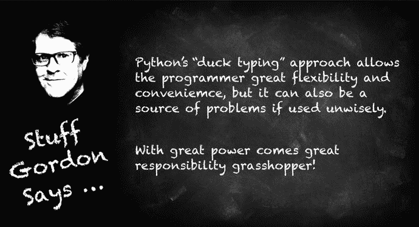

# 1. Python 入门

*做好使用 Python 的准备*

|  | *小瓶子上贴着一张标签，上面写着一套简单的说明：“喝掉我。”**“嗯。一个既自安装又可自文档化的可执行文件，”爱丽丝端详着瓶子，喃喃自语。“一旦打开它，谁知道它会如何改变一切，而且很可能没有简单的方法回到以前的状态，”她想。**在对打开小瓶子的后果的焦虑，与对瓶子可能带她去往美妙地方的兴奋之间，爱丽丝犹豫了片刻，足以让她关闭所有打开的应用程序，并努力回想自己上一次备份文件系统是多久以前的事了。**然后她打开小瓶子，深深喝了一口。* |
|  | *Python 网站；Python 版本；下载 Python；在 macOS、Linux 和 Windows 上安装 Python；IDLE；安装* `pip` *；其他 Python 库，* `numpy` *；Python 编辑器* |
|  | *本章没有太多生物学内容* |

## 在你的电脑上获取 Python

对于本书的读者来说，这显然是第一步，这样才能运行你的 Python 代码。至于代码编辑，有很多选择，包括使用你可能已经在电脑上拥有的纯文本编辑器。这绝非最佳方案，但在我们处理了在电脑上真正获取 Python 发行版的主要问题之后，我们将进一步讨论你可能想要用来编辑和管理 Python 代码的工具。

为了便于讨论，我们假设你的电脑是运行苹果 [macOS](https://en.wikipedia.org/wiki/MacOS) 操作系统的 Apple Mac，或采用 PC 架构、运行微软 [Windows](https://en.wikipedia.org/wiki/Microsoft_Windows) 操作系统的平台，或是运行 [GNU/​Linux](https://en.wikipedia.org/wiki/Linux) 操作系统众多版本之一的机器。截至本书撰写之时，这大约占全世界正在使用的台式机和笔记本电脑的 95%。

就本书而言，我们并不特别讨论智能手机和平板电脑等移动平台。这些计算平台也有 Python 的一些发行版，但大多数还相对不成熟，而且无论如何，移动计算平台都带有触摸屏、加速度计和 GPS 等各种附加功能，任何移动编程语言都必须解决这些问题，但这超出了本书的范围。不过，本书中涵盖的所有基本 Python 同样适用于这些平台上的 Python 发行版。如果你对使用 Python 进行移动计算感兴趣，不妨看看非常有趣的 Kivy^(¹⁷) Python 平台。

等等——Python 不止一种？

此时，有必要对现有的不同 Python 版本稍作说明。需要明确的是，我们这里讨论的并不是所有替代官方发行版的那些 Python 变体和实现。我们只讨论可以在 [Python 网站](https://www.python.org/)^(¹⁸) 上找到的官方 Python 发行版。

早在 2008 年，Python 的一个新的主要版本，3.0 版，就发布了。它包含了一些（很大程度上是细微的）语言更改，不幸的是，这些更改破坏了 Python 与许多人在代码中使用的众多流行代码库的兼容性。这对科学和技术社区的影响尤其大，因为其中一些库（如 [`NumPy`](http://www.numpy.org/) ^(¹⁹)) 是全世界 Python 社区所使用的大量科学和技术 Python 代码的核心组件。

因此，最初很大一部分 Python 社区成员迟迟不愿采用任何 3.x 版本的官方 Python 发行版，而是更愿意停留在最后一个官方 Python 2.x 版本，即 Python 2.7 上。然而，随着 Python 2.7.x 在 2020 年被逐步淘汰，大多数坚持使用旧版本的用户要么已经转换，要么计划在淘汰日期之前转换（在第一版中，我们也是那些坚持者之一——现在不了——这应该会让 [Guido](https://en.wikipedia.org/wiki/Guido_van_Rossum) 感到高兴）。

**归根结底，本书中的 Python 代码现在已移植到使用 Python 3。** **随着 Python 2.7 即将停止支持，读者应下载并使用 Python 3 来编写和运行本书中介绍的代码。**（如果你碰巧已经学过 Python 2.x，那么从 Python 3.x 开始迁移是一个渐进的过程，主要涉及学习这两个主要版本之间一些细微的语法和行为差异。）

如果你足够好奇，想了解更多关于 Python 版本分支的信息，在官方 Python 网站上甚至[有一个专门讨论这个问题的页面](https://wiki.python.org/moin/Python2orPython3)。该页面反映的官方观点是，现在每个人都应该使用 Python 3.x，尤其是因为许多最重要且广泛使用的第三方代码库现在都已更新以支持它。不过，也承认在本书撰写之时，并非所有这些问题都已解决，并且仍然有一些人出于合理的原因继续使用 Python 2.x。

## 为你的电脑下载 Python 发行版

**先别**这样做！

我们是认真的——真的——**别**这样做！

你的机器上很可能已经有一个 Python 发行版了，尤其是如果你使用的是 Mac 或 Linux 机器。所以，在**贸然**从官方 Python 网站下载 Python 之前，请务必查看以下部分，它们描述了在你的电脑上获得可用 Python 发行版的最佳途径。如果阅读了适用于你电脑类型（或者如果你的电脑不属于这里描述的三种主要台式机/笔记本电脑平台）的部分后，你认为确实需要下载并安装一个 Python 发行版，你可以在 Python 网站的[下载](https://www.python.org/downloads/)^(²⁰) 页面上找到官方 Python 发行版的下载和安装说明。另外，请记住，在选择要下载的版本时，我们建议使用 Python 3.x 版本。


## 在 macOS 电脑上安装 Python

如果你使用的是苹果 Mac 电脑，好消息是你的机器上已经预装了 Python 发行版。不过，默认版本是 Python 2.7，因此你需要额外安装 Python 3，与现有版本共存。首先，你需要访问 Python 官网，下载^(²¹)最新的 macOS 版安装程序，并像安装其他标准 macOS 软件包一样运行它。安装完成后，进入你的 *应用程序* 文件夹，打开 *实用工具* 子文件夹。在该文件夹中，你应该能找到 *终端* 应用，打开它会在桌面显示一个命令行窗口。

如果在命令行输入 `python3`，你应该会在终端窗口中看到一条欢迎信息，后面跟着 Python 提示符，表示 Python 解释器已准备好接收输入——类似于这样：

```
Python 3.7.2 (v3.7.2:9a3ffc0492, Dec 24 2018, 02:44:43)
[Clang 6.0 (clang-600.0.57)] on darwin
Type "help", "copyright", "credits" or "license" for more information.
>>>
```

如果只是想快速验证 Python 发行版是否正常工作，可以尝试在 Python 提示符（`>>>`）下输入以下两行代码，每输入一行后按回车键。

```
>>> a = 4
>>> print(a)
```

你应该会看到类似这样的结果：

```
>>>
```

**给 macOS 用户一句重要的提醒——** 你的 Mac 上的 Python 发行版实际上被 macOS 操作系统用于各种系统维护任务，因此用不同版本的 Python 替换它是不明智的。另一种优雅的安装 Python 3.x 的方法是创建一个[虚拟环境](https://en.wikipedia.org/wiki/Virtual_environment_software)，在其中运行新的 Python 发行版，这样就不会影响机器上现有的任何 Python 发行版或库。为 Python 创建虚拟环境超出了本书的范围，但如果你好奇如何操作，可以查阅 Python 的 [virtualenv](https://pypi.python.org/pypi/virtualenv)^(²²) 工具的文档。

## 在 Linux 电脑上安装 Python

如果你运行的是主流 [Linux](https://en.wikipedia.org/wiki/Linux) 发行版（例如 [Ubuntu](http://www.ubuntu.com/)、^(²³) [Fedora](https://getfedora.org/)、^(²⁴) [Debian](https://www.debian.org/)^(²⁵)），几乎肯定已经预装了 Python 2.7.x，但你可能需要单独安装 Python 3（通常这是一个名为 `python3` 的独立软件包，可以与 Python 2.7 并行安装——就像 macOS 一样）。由于大多数 Linux 用户对 Unix 命令行已经有一定了解，这些说明不像针对其他操作系统那样逐步详细。此外，不同 Linux 发行版打包和安装软件的方式差异很大，几乎无法提供全面的指南。简而言之，要充分利用本书，你应该使用 Linux 软件包管理器安装以下额外软件包：`matplotlib`（用于绘图）、`NumPy`（数值计算 Python 库）和 `pip`（用于从 PyPI 仓库安装软件包，请参见下一节）。例如，在 Fedora 中，相关软件包是 `python3-matplotlib`、`python3-numpy` 和 `python3-pip`。每个发行版都有图形化软件包管理工具，搜索这些软件包应该能快速找到目标。通过命令行安装通常也相当简单。例如，在 Fedora 中，你可以运行：

```
$ sudo dnf install python3-matplotlib python3-numpy python3-pip
```

对于 Ubuntu 和 Debian，`apt-get` 是等效的工具，尽管软件包名称可能略有不同。

## 在 Windows 电脑上安装 Python

不幸的是，Microsoft Windows 不像 Mac 和 Linux 平台那样预装 Python 发行版。不过幸运的是，python.org 的好心人提供了一套易于使用的 Windows 安装程序，几乎涵盖了你能想到的任何现有 Python 版本。正如目前有多个 Python 版本在使用一样，当前也有多个 Windows 版本在使用。为了本书的目的，我们假设你没有被困在 [*侏罗纪公园*](https://en.wikipedia.org/wiki/Jurassic_Park)，使用一台 400 MHz、64MB 内存、运行 [Windows 98](https://en.wikipedia.org/wiki/Windows_98) 的 PC。我们提供的说明将基于在本书写作时的当前 Windows 版本（即 [Windows 10](https://www.microsoft.com/en-us/windows-10)）^(²⁶) 下的安装。

要在 Windows 平台上获取 Python，我们的第一站当然是 [Python 官网](https://www.python.org/)。Python 官网首页中央有一个非常大的菜单栏，其中包含一个指向 **下载** 页面的便捷链接。点击此链接，浏览器会显示一个弹出菜单，提供下载当前 Python 3.x 版本的选项。选择 Python 3.x 选项后，下载将自动开始。根据 Windows 系统的配置方式，文件（名称类似 `python-3.x.y.exe`）通常会保存在“下载”文件夹中，以备需要时再次查找。

文件下载完成后，运行它以开始安装。如果你对 Windows 机器拥有管理员权限，请允许“为所有用户安装 Python”的默认选项，并且建议勾选“将 Python 3.x 添加到默认 `PATH`”的复选框。选择这些选项后，在安装程序菜单中点击“立即安装”，并在询问是否允许 Python 安装继续时回答“是”。Python 安装过程中，你会看到一个带有绿色进度条的“安装进度”指示，显示安装进度；如果一切顺利，你会看到“安装成功”的消息。安装完成后，点击消息窗口中的小“关闭”按钮退出安装程序。

为确保 Python 3.x 安装成功，使用 Windows 开始菜单打开 **命令提示符** 应用，并在提示符下输入 `python`。如果安装正确，你应该会进入一个 Python shell，并看到类似这样的 Python 启动信息：

```
Python 3.7.3 (v3.7.3:ef4ec6ed12, Mar 25 2019, 21:26:53) [MSC v.1916 32 bit (Intel)] on win32
Type "help", "copyright", "credits" or "license" for more information.
>>>
```

要退出 Python shell 并返回 Windows 命令提示符，只需输入 `quit()`。

给 Windows 用户一句忠告——你需要单独安装我们将在本书多个章节中使用到的优秀 Python 绘图库 `matplotlib`^(²⁷)。你可以查看本章后续关于[如何安装附加 Python 模块](https://docs.python.org/2.7/installing/)的章节，了解如何使用 Python 包管理器 `pip` 等工具进行安装；但如果你想要一个真正“电池齐全”的 Python 发行版，它自带大量有用且额外的功能包，那么你可能想了解 WinPython^(²⁸)（但如果你想与本书中的代码示例完全同步，可能需要确保下载并安装 WinPython 3.x）。


## 使用 IDLE Python Shell

`IDLE`（https://docs.python.org/2/library/idle.html）是一个 Python 图形用户界面（GUI），其运行 Python 代码的方式与 Linux 或 Mac 的终端窗口或 Windows 命令行工具允许你运行输入其中的 shell 命令类似。`IDLE` 甚至允许你将 Python 代码保存到文件中，并加载和运行这些文件。此外，大多数版本的 `IDLE` 还会对 Python 代码进行颜色编码，以突出显示 Python 关键字、字符串、方法名称等内容，使代码更易于阅读和理解。

因此，`IDLE` 本身就是一个非常简洁、最基本形式的集成开发环境（IDE）（https://en.wikipedia.org/wiki/Integrated_development_environment）。Python 有许多非常优秀的 IDE，其中一些甚至是免费的（就像 Python 本身一样）。如果你开始着手更大、更具雄心的代码项目，这些更高级的 IDE 可以帮助你管理代码，处理诸如版本控制（https://en.wikipedia.org/wiki/Version_control）和打包代码以便分发等问题。即使是超越这些高级问题，它们也能提供一个非常舒适便捷的框架来管理代码，通过实时突出显示语法和其他错误，帮助你管理模块之间的依赖关系，当然还有代码测试。还有很多非常优秀的代码编辑器，它们本身并非真正的 IDE，但可以配置成功能类似 IDE 的工具。在下一节中，我们将简要提及一些可以替代使用 `IDLE` 的方案。我们也会给出一些自己的建议，但归根结底，最适合你、让你感到最舒适便捷的开发环境，很可能很大程度上取决于你的个人性格和工作风格。

在 Mac 上启动 `IDLE`，打开 Mac 终端窗口（如果桌面上没有，可以在 `应用程序` 的 `实用工具` 文件夹中找到 `终端`），然后输入 `idle`。

在 Linux 计算机上启动 `IDLE`，打开一个终端窗口并输入 `idle`。在一些流行的 Linux 发行版（如 Ubuntu）中，`IDLE` 包含在 Python 发行版中，但默认未安装。如果是这种情况，当你输入 `idle` 时，会收到一条错误消息或一条类似这样的友好提示信息：

```
程序 'idle' 当前未安装。您可以通过输入以下命令来安装：sudo apt install idle
```

如果你收到这样的消息，只需执行 `sudo apt install idle`（如果你使用的是 Fedora，则执行 `sudo dnf install python3-tools`），然后输入管理员密码即可快速完成 `IDLE` 的安装。如果收到消息说完全找不到 `IDLE`，你可能需要按照我们刚才描述的方式自行安装。

一旦安装好 `IDLE`，你可以重新在终端窗口中尝试输入 `idle`，一切应该就能正常工作了。

要在 Windows 计算机上启动 `IDLE`，只需在“开始”菜单的搜索框中输入 `idle`，如果你按照上一节的说明安装了 Python，你应该能够点击搜索结果中的 `IDLE (Python GUI)`。

一如既往，我们建议你查阅 Python 官方网站上的详尽文档，其中包括关于 `IDLE`（https://docs.python.org/2/library/idle.html）的详细章节。

## Python 开发环境

如果你正在为 Python 寻找不同的开发环境，有许多 `IDLE` 的替代方案，从像 `vim`（http://www.vim.org/）这样的代码编辑器，到标志性的 `emacs`（https://www.gnu.org/software/emacs/）编辑器（它本身实际上也是一个代码解释器），再到功能齐全、应有尽有的 IDE，例如 Eclipse IDE（带有 PyDev 扩展）、`PyCharm` 和 GitHub 的 Atom。其中一些编辑器如 `emacs` 编辑器（深受各地电脑极客喜爱），如果你以前从未使用过，学习曲线会相当陡峭。有些则过于庞大，感觉像有点大材小用。

你对 Python 开发环境的选择将在很大程度上取决于你的个性、品味和特定的工作风格。说到 Python 开发环境，我们想说 *萝卜白菜各有所爱*，但如果你想要一些指导，我们非常喜欢 `PyCharm` 开发环境，它不仅易于安装和使用，只要你愿意使用免费的社区版（https://www.jetbrains.com/pycharm/features/editions_comparison_matrix.html），它甚至是免费的。社区版缺少一些更高级的专业软件开发功能，但完成本书中描述的所有 Python 项目，你不需要其中的任何一个。最棒的是，`PyCharm` 社区版适用于 Mac、Linux 和 Windows。这只是我们的一点浅见，请随意忽略我们的建议，找到属于你自己的开发 Python 代码的理想环境。为了帮助你，本章末尾的资源部分提供了一个托管在 Python wiki 上的 Python IDE 列表链接。

## 安装 Python 包管理器：pip

在本节中，我们将介绍设置便捷的 Python 包管理器 `pip` 的步骤。一旦你能够通过终端访问命令行提示符，无论你是在 macOS、Linux 还是 Windows 上运行，这些步骤都应该是相同的。`pip` 是你通往 Python 包索引（`PyPI`，https://pypi.python.org/）提供的核心库之外更广阔的 Python 包世界的门户。尽管我们的书主要侧重于仅使用核心 Python 和标准库的示例，但也有一些地方使用了这些外部包。首先，你可能已经安装了 `pip`（特别地，如果你正在运行 Linux，你应该已经安装了一个类似于 `python3-pip` 的包）。*由于我们使用的是 Python 3，你需要确保使用的是 `pip` 的 Python 3 版本，而不是 Python 2 版本，这可以通过使用* `pip3` *命令来指定*。要进行检查，请在命令行中运行以下命令：

```
$ pip3 -V
```

（在某些系统上，你可能需要使用 `python3-pip` 作为命令 `pip`。）如果你看到类似这样的信息：

```
pip 18.1 from /usr/lib/python3.7/site-packages/pip (python 3.7)
```

恭喜！你已经安装了 `pip`，无需再进行下一步操作。如果没有，你可以使用 `easy_install`（它是 Python 工具的一部分）来安装 `pip`：

```
$ easy_install-3.7 --user pip
```

请注意我们使用了选项 `--user`，这很重要，因为它会将 `pip` 安装在*用户*账户下，而不是系统 Python 安装目录下，用户通常无法访问系统 Python 目录，除非他们是管理员。使用 `pip` 安装包非常简单，例如：

```
$ pip3 install --user <包名>
```

这将使该包在用户的 Python 程序中可用（再次注意 `--user` 选项的使用）。关于 `pip` 和安装包的更多细节，请参阅 *Python 打包用户指南*。`pip` 的实际使用示例会在各个章节中首次使用特定包时记录（例如第 8 章），但如果你想立即开始，这里有一行命令可以一次性安装两个最常用的外部包 `NumPy` 和 `matplotlib`：

```
$ pip3 install --user numpy matplotlib
```


## 获取示例代码

本书中展示的所有代码均可在我们便捷的 GitHub 仓库中找到^(³⁹)：

*   [`https://amberbiology.github.io/py4lifesci/`](https://amberbiology.github.io/py4lifesci/)

上述网站提供了所有当前代码示例的链接，格式包括 `.zip` 和 `tar.gz`。如果你选择 `.zip` 文件，下载后会将所有代码示例解压到你选择的位置。macOS 系统会自动完成此操作，Windows 用户可能需要下载像 [WinZip](http://www.winzip.com/) 这样的归档管理工具。^(⁴⁰) Linux 用户可能更习惯使用 `.tar.gz` 格式。

你也可以在此处预览所有代码示例（同样从上述网站链接而来）：

*   [`http://github.com/amberbiology/py4lifesci`](http://github.com/amberbiology/py4lifesci)

对于已经熟悉 `git` [命令行工具](https://git-scm.com/book/en/v2/Getting-Started-The-Command-Line)^(⁴¹)的高级用户，可以通过将仓库直接*克隆*到你选择的目录来保持代码最新：

```
$ git clone https://github.com/amberbiology/py4lifesci.git
```

（你也可以安装并使用 [GitHub Desktop](https://desktop.github.com/)^(⁴²) 来克隆仓库。）

每章的文件名格式如下：

```
PFTLS_Chapter_.py
```

有些章节包含多个 Python 文件，在这种情况下，我们会附加一个子章节编号，如下所示：

```
PFTLS_Chapter__.py
```

因此，可以很容易地找到相关的示例，例如，第二章的代码为：

```
PFTLS_Chapter_02.py
```

要运行此代码，只需打开你选择的终端，切换到解压上述代码的目录，然后运行该示例：

```
cd  
./PFTLS_Chapter_02.py
```

在上述文本中，我们描述了如何使用“pip”安装包，但在你“克隆”仓库后，你也可以通过运行以下命令，从 PyPI 下载并安装运行所有示例所需的全部包：

```
cd  
./setup.py develop
```

这样做还有一个额外的好处，即设置好环境以便运行所有单元测试：

```
./setup.py test
```

## 实验室中的 Python

*Python 语言基础*

|  | *“我是渡渡鸟教授，很高兴认识你，”渡渡鸟说道，他的声音以及倚靠手杖的姿态都透露出他的虚弱与疲惫。* *“我也很高兴认识你，”爱丽丝说。“你真的还在用计算器和电子表格做所有的数值工作吗？”她问道。* *“哦，我亲爱的孩子，不然你以为我为什么总是这么疲惫？”渡渡鸟回答说。“我要做实验、写经费申请、准备演示文稿。在这些事情中，你觉得我还能从哪里挤出时间来分析我研究实验室每天产生的大量数据呢？”* *“恕我冒昧，”爱丽丝带着几分忐忑说道，“您了解‘灭绝’这个概念吗？”* |
|  | *声明变量，* `print` *；注释；缩进代码与代码块；数值变量；整数；浮点数；指数；字符串；类型；鸭子类型；条件语句；函数；整数与十进制算术；布尔变量；* `True` *，* `False` *，* `if` *，* `elif` *，* `else` *；比较运算符* |
|  | *生物化学，缓冲液，摩尔浓度，分子量，摩尔体积* |

Python 绝对是你在实验室中的好朋友，因此我们将从那些简单的日常实验室工作开始，过去你可能会为此掏出电子计算器，其微小的按钮仿佛是为那些对算术都漠不关心的小孩子的手指设计的。如今，你更可能伸手去拿智能手机，但你也可以把它收起来（那局暂停的《帝国冲突 III》在你下次喝咖啡休息时依然会等着你）。


## 在 Python 中声明变量

让我们通过查看如何声明要使用的变量来进入 Python。首先，这里有一堆简单的数值变量声明，演示了 Python 的变量声明语法和基本的 Python 数字格式。它们也展示了 Python 中可接受的变量名类型——例如，你很快会通过惨痛教训发现，Python 变量名不能以数字开头。^(⁴⁶)

```
### 声明数值变量
h2oOxygens = 1
h2oHydrogens = 2
h2o_density_in_grams_per_liter = 1000
oxygenMass = 15.9994
hydrogenMass = 1.00794
avogadro = 6.023e23
```

这里有几个值得注意的点：

在 Python 中，一行文本中跟在 `#`（井号或“磅”号）后面的任何内容都被视为注释，Python 解释器会忽略它，即使该文本包含语法正确且合理的代码——如果井号不存在，Python 本可以运行这些代码。这不仅适用于为代码编写文档，还适用于暂时阻止程序中的代码行被执行——例如在测试代码时。你可以在行首使用井号使整行成为注释，也可以在一行中任何 Python 代码之后使用它，为那段代码添加注释。

在本书中，我们将使用以下方案来处理进入 Python 编辑器或开发环境的所有内容，以便于区分 Python 注释、Python 代码、Python 输出和 Python 错误消息，如下所示：

**Python 注释：**

```
### oxygenMass = 15.9994
```

**Python 代码：**

```
print(oxygenMass)
```

**Python 输出：**

```
15.9994
```

**Python 错误消息：**

```
NameError: name 'oxygenMars' is not defined
```

需要注意的是，如果你选择的编辑器或 IDE 具有自动为 Python 输入和输出添加颜色标记的功能，它不一定会使用这种特定的配色方案。

我们的示例展示了 Python 用于[实数](https://en.wikipedia.org/wiki/Real_number)的三种基本格式：

*   **整数**：`h2oOxygens = 1`
*   **浮点数**：`hydrogenMass = 1.00794`
*   **指数形式**：`avogadro = 6.023e23`

Python 变量名可以包含字母、数字和下划线字符，如 `h2o_density_in_grams_per_liter` 所示。但它们不能以数字开头，也不能包含空格。

Python 变量名也是**区分大小写**的，因此以下都是不同的变量：

```
myvariable = 1
MyVariable = 3.172
MYVARIABLE = 'Undefined'
```

换句话说，随后指定 `myvariable = 2` 不会影响 `MyVariable` 或 `MYVARIABLE` 的值。

类似地，我们可以通过在单引号或双引号中括起声明的值来声明 Python 中的字符串变量。在 Python 中，单引号和双引号可以互换使用，但它们必须成对出现——你不能用单引号开始一个字符串，然后用双引号结束它。然而，这确实允许你在字符串内部使用单引号和双引号（如下面的 `jfk` 示例所示）。

```
### 声明字符串变量
buffer = 'Tris'
buffer = "MES"
jfk = "I'm proud to say 'Ich bin ein Berliner'"
carbonMass = "12.0107"
```

考虑这些例子中的最后一个：`carbonMass = "12.0107"`。

你认为它是一个数字还是一个字符串？

它实际上是一个字符串，因为它被引号括起来了，如果你试图用它做任何数学运算（比如将它乘以另一个数字），结果将不是你期望的那样。稍后会详细介绍，但在我们将所有这些变量投入实际的 Python 代码中使用之前（是的，马上就来），让我们考虑一个与 Python 变量相关且重要的问题。

在 Python 中还有一种声明字符串变量的方法，它允许你在字符串中包含换行符。例如，这对于将文本段落声明为字符串非常有用。要使用它，你必须在**三引号**中括起字符串本身，如下所示：

```
limerick = """ Said a young researcher named Spode
Having reached the end of his road
'I have far too much data
For this hand calculator
If only I knew how to code!' """
```

从这个例子中可以看出，三引号字符串不仅可以包含换行符，还可以包含单引号和双引号。顺便提一下，如果需要对 Python 代码的整个部分进行注释（例如出于测试目的），使用三引号也是一种非常有用的方法。

## Python 处理所有类型

那些使用过 Java 或 C 等其他编程语言的人可能习惯于看到一种包含变量**类型**的变量声明语法。例如，在 C 中，你必须在代码中使用变量*之前*声明它的类型 —— 就像这样：`int myvariable;` 这将 `myvariable` 设置为一个整数，以便可以在代码中适当处理它。

用计算机极客的说法，Python 不要求其变量是**显式类型化**的。Python 使用一种称为[鸭子类型](https://en.wikipedia.org/wiki/Duck_typing)的动态类型化方法，其核心理念是：**如果它走路像鸭子，说话像鸭子，那么它就是鸭子**！例如，当 Python 看到变量值被引号括起来时，如 `buffer = 'Tris'`，它会将该变量视为字符串，即使字符串的内容看起来像一个数字，如 `carbonMass = "12.0107"`。同样，对于数值变量，如果变量的值符合 Python 数值格式之一的语法，它会将该变量视为一个数字。

这种鸭子类型化方法使 Python 极其灵活，因为变量可以根据需要即时引入，甚至可以在代码执行过程中改变类型。

例如，在 Python 代码中声明 `a = 11`（一个整数）以及稍后声明 `a = "One greater than 10"`（一个字符串）是完全允许的。不过请注意——如果管理不当，这种灵活性也可能导致后续在理解和调试代码时出现问题。例如，如果你有一段代码用 `a` 进行算术运算，但在该代码执行之前你已经将 `a` 重新声明为字符串，那么结果可能不太理想。

此时，你们中可能有些人想跳进去编写一些 Python 代码，这些代码不仅仅是给变量赋值，而其他人可能仍然对 Python 变量声明语法有疑问。变量名可以有多长？我可以在变量名中使用其他字符吗？在变量名中使用大小写字符的 Python 最佳实践是什么？等等，不一而足。



细心的读者们，别担心！Python 网站包含一个丰富的文档库，其中有 Python 语言参考^(⁴⁷)，甚至还有 Python 风格指南。^(⁴⁸) 这两份文档的大部分内容在目前对你来说可能意义不大，因为我们的 Python 之旅才刚刚开始，但当你阅读本书的各个章节时，它们是非常好的参考资料。我们的目标是提供足够的背景知识让你开始使用 Python，而官方 Python 网站^(⁴⁹)上的在线文档是补充你在本书中所学内容的绝佳资源。

闲话少说……


## 我们的第一段真正的 Python 代码

```
### 计算水分子质量并输出到控制台
h2oOxygens = 1
h2oHydrogens = 2
oxygenMass = 15.9994
hydrogenMass = 1.00794
h2oMass = h2oOxygens * oxygenMass + h2oHydrogens * hydrogenMass
print('H2O 的分子量 = ',h2oMass)
```

借用一位爱穿宽大[垮裤](https://en.wikipedia.org/wiki/MC_Hammer)的 1980 年代嘻哈歌手的话来说，咱们来“拆解一下”。

清单 2-1 中的第一行是一条 Python 注释。提醒一下，Python 代码中任何出现在井号（`#`）后面的字符都会被当作注释，不会作为代码执行。注释甚至可以附加到可执行代码行的末尾，就像这样：

```
oxygenMass = 15.9994       # 标准原子量
```

你可以用注释来注解代码，以提醒自己或告知他人某段代码的功能、工作原理、存在的问题，或你希望在该代码段中包含的任何其他信息。

第二行只是使用我们之前声明的变量计算水分子的质量，并将其赋值给变量 `h2oMass`。

第三行引入了向 Python 控制台的输出。控制台是代码输出的默认流，包括 `print()` 函数调用的内容以及任何 Python 错误消息。当你运行前面的代码时，第 3 行的 `print()` 函数会在 Python 控制台中产生如下输出：

```
H2O 的分子量 =  18.01528
```

如果你将此代码输入到 Python 编辑器中并运行，并在 Python 控制台中看到了此输出，请为自己鼓掌。你刚刚运行了你的第一个小型 Python 程序！

#### Python 函数

与几乎所有编程语言一样，你可能希望将代码组织成整洁、清晰的代码块，以便于维护和理解。那么，我们直接开始学习如何在 Python 中定义函数吧，因为在本书中我们将编写的代码里，函数将是一个相当普遍的特性。稍后，我们将开始把函数称为方法，以配合 Python 对[面向对象](https://en.wikipedia.org/wiki/Object-oriented_programming)代码的支持，不过关于这一点，后面还有更多（很多很多）内容要讲。

目前，理解 Python 函数的最佳方式就是看它们如何运作，下面就是清单 2-2 中的一个函数。

```
### 一个计算摩尔体积的简单函数
def calculateMolarVolume(mass,density):
volume = mass/density
return volume
```

如果你曾经用 BASIC 或 Java 等主流编程语言写过代码，那么这段代码片段会看起来非常熟悉。不过，Python 有一个特别显著的特性值得在此一提：

**Python 代码中的缩进具有语法意义，而不仅仅是为了美观。**

在许多编程语言中，鼓励程序员缩进代码块以使代码更具可读性，但这是一种美学选择，程序员可以忽略它而不会影响代码本身的执行。

**但在 Python 中并非如此……**

在 Python 中，缩进用于指示特定代码块的开始和结束位置。如前面的示例所示，Python 函数内部的所有代码必须缩进，以定义其属于该函数。为了更清楚地说明这一点，请看清单 2-3 中的代码。

```
def explainIndentedCode():
print('这个缩进的行属于函数的一部分')
print('这一行也是')
print('这个未缩进的行不属于函数的一部分')
```

如果你在代码中调用 `explainIndentedCode()` 函数，函数声明下方所有缩进的 `print()` 函数调用都将被执行，但该函数调用本身不会执行后面那个未缩进的 `print()` 函数。在 Python 中，有各种可以执行代码块的地方，这些代码块甚至可能出现在其他（已经缩进的）代码块内部（例如函数）。稍后当我们讲到 Python 的 `if` 语句时，就能看到实际的用例。

但让我们先回到我们的 `calculateMolarVolume()` 函数。

我们可以看到，函数定义包含了两个参数，`mass`（质量）和 `density`（密度），它们在函数内部用于计算 `volume`（体积），即摩尔体积。函数末尾的 `return` 语句指定了函数结束时返回的内容（如果有的话）。没有 `return` 语句的函数与具有空 `return` 语句的函数相同，即不返回任何内容。Python 实际上有一个表示“无”的特殊值，叫做 `None`，我们稍后会看到更多相关内容。不过现在，你可能会好奇 Python 为什么要费心搞一个表示“无”的特殊值。原因之一是它允许你在代码中测试一个变量是被赋值为“有”，还是“无”。但暂时不必过于担心——后续章节会讲清楚的。

让我们做个小测试，运行我们的 `calculateMolarVolume()` 函数，看看执行清单 2-4 中的代码会得到什么结果。

```
def calculateMolarVolume(mass,density):
volume = mass/density
return volume
h2oMolarVolume = calculateMolarVolume(h2oMass,h2o_density_in_grams_per_liter)
print('1 摩尔 H2O 的体积 = ',h2oMolarVolume,'L')
```

确保你事先已经包含了我们之前列出的变量声明。如果你运行这两行代码，应该会看到以下内容：

```
1 摩尔 H2O 的体积 =  0.01801528 L
```

正如生物化学教科书所指出的，1 摩尔水的体积确实约为 18 毫升。

现在我们渐入佳境，再来创建另一个函数，用于计算 1 升体积内某种物质的分子数量。为此，我们再次需要用到刚才看到的摩尔体积计算，但现在我们将在新函数内部通过引用之前编写的函数来重用该函数，如清单 2-5 所示。

```
### 一个计算每升分子数的函数
def moleculesPerLiter(mass,density):
molarVolume = calculateMolarVolume(mass,density)
numberOfMolarVolumes = 1.0/molarVolume
numberOfMolecules = avogadro * numberOfMolarVolumes
return numberOfMolecules
```

再次注意，我们将相同的两个参数 `mass`（质量）和 `density`（密度）传递给新函数，并且在函数的第一行，我们使用了之前的函数，并将返回的结果赋值给变量 `molarVolume`（摩尔体积）。

和之前一样，我们将把水的质量和密度传递给该函数。不过这次，我们要计算的不是水的摩尔体积，而是 1 升水中的分子数量。那么，现在让我们运行这个新函数（再次确保包含了之前赋值的变量声明，我们假设你已经在 Python 会话中包含了它们），看看会得到什么结果。

```
h2oMoleculesPerLiter = moleculesPerLiter(h2oMass,h2o_density_in_grams_per_liter)
print('1L 中 H2O 的分子数 = ',h2oMoleculesPerLiter)
1L 中 H2O 的分子数 =  3.343273043771731e+25
```

我们的第二个函数与第一个函数具有非常相似的特征——一个需要两个参数的函数定义，一些数学运算，以及一个返回的结果。这确实展示了函数如何在 Python 代码中被重用，甚至在其它函数内部使用。诚然，我们的第一个函数只是一个相当简单的例子，它本身很容易简化为单行代码，但你已经明白了其中的道理。一个真正的 Python 函数可能包含几十、几百甚至几千行代码。


## 在 Python 中使用整数和小数

在本章结束前，我们还要再创建一个函数。不过在此之前，先花点时间看看那些曾让许多 Python 新手栽跟头的算术陷阱。

第一个陷阱与整数运算有关。

尝试在你的 Python 编辑器中运行代码清单 [2-6](https://example.com) 中的代码，看看结果如何。

```
a = 3
b = 6
print('a/b = ', a/b)
```

运行这段代码，你应该会得到：

```
a/b = 0.5
```

重要的是要认识到，Python 2.7 的行为与此完全不同。在 Python 2.7 中，结果会是零。这是因为在前述代码中，`a` 和 `b` 都被定义为整数，因此当我们执行 `a/b` 运算时，Python 2.7 返回了一个整数结果。由于 3/6 的实际结果是 0.5，Python 2.7 并未将这个小数作为整数返回——它只返回了结果的整数部分，也就是零。这让 Python 新手们陷入了困境。例如，你明知代码某部分需要处理浮点数，于是初始时将相关变量赋值为浮点值。然而在代码的其他部分，这些变量又被重新赋值为整数——于是乎，你本想得到一个十进制小数，结果却得了个零。

在 Python 3 中，这个怪癖已经被消除，代码现在会按你期望的方式运行——无论输入变量是否为整数，都会自动将结果转换为浮点数。这一点很重要，尤其是在将代码从 Python 2 迁移到 Python 3 时。

因此，例如下面的示例现在都能按预期工作：

```
print('b/a = ', b/a)
b/a = 2.0
print('12/5 = ', 12/5)
12/5 = 2.4
```

你仍然可以通过手动将它们指定为浮点数来进行运算，如下例所示，不过现在已无必要。

```
a = 3.0
b = 6.0
print('a/b = ', a/b)
a/b = 0.5
```

作为给读者的小练习，尝试探究一下在代码运算中混合使用整数和浮点数会发生什么。

在进入本章最后一个（也是最实用的）函数之前，还有一个 Python 小陷阱需要了解……

尝试代码清单 [2-7](https://example.com) 中的代码。

```
a = 6.0
b = 3.0
c = 5.0
print('a/b+c = ', a/b+c)
print('a/(b+c) = ', a/(b+c))
```

你应该会得到这个结果：

```
a/b+c = 7.0
a/(b+c) = 0.75
```

这只是善意地提醒你，不要忘记计算机极客们所说的 [运算符优先级](https://en.wikipedia.org/wiki/Order_of_operations)，这其实是一个花哨的说法，指的是如果你不自己指定运算顺序（例如，通过使用括号强制让加法运算符在除法运算符 *之前* 执行，而除法通常优先级更高），算术运算符的执行顺序。

对于算术运算符以及任何其他 Python 特性，如果你需要更多关于 Python 工作原理的细节，python.org 上的在线文档库是你的好帮手——特别是关于运算符优先级的专门章节。

### 条件语句

好了——现在我们准备用最后一个函数来结束本章，该函数将计算一些常用实验室缓冲液的简易储备液配方。在这个最后的函数中，我们将介绍 Python **条件语句**。条件语句是计算机编程的核心，其基本形式为：

- **如果**：*条件为真*
- *则执行某些操作*

让我们看看最后一个函数的代码，并在代码清单 [2-8](https://example.com) 中实际体验一下。

```python
### 用于计算缓冲液配方的函数，使用了条件语句
def bufferRecipe(buffer, molarity):
    if buffer == 'Tris':
        grams = 121.14
    elif buffer == 'MES':
        grams = 217.22
    elif buffer == 'HEPES':
        grams = 238.30
    else:
        return 'Huh???'
    gramsPerLiter = grams * molarity
    return gramsPerLiter
```

函数 `bufferRecipe` 接受两个参数：`buffer`——缓冲液的名称——以及 `molarity`——你想要配制的储备液的摩尔浓度。根据你提供的缓冲液名称，它将相应的值赋给变量 `grams`，并返回配制 1L 溶液所需的缓冲液重量（以克为单位）。

我们可以在该函数中看到条件语句的运用。

```python
if buffer == 'Tris':
    grams = 121.14
```

Python 条件语句的形式为：

```
if <条件>:
    <代码块>
elif <条件>:
    <代码块>
...
else:
    <代码块>
```

我们的示例中第一个条件是提供的缓冲液名称等于字符串 `'Tris'`，通过 Python 相等运算符 `==` 表示。请注意相等运算符与用于变量赋值的等号之间的区别。

```
buffer == 'Tris'
```

**判断**变量 `buffer` 的值是否等于字符串 `'Tris'`，而

```
buffer = 'Tris'
```

**设置**变量 `buffer` 的值为字符串 `'Tris'`。

Python 的相等运算符可能看起来不像，但它实际上是一种返回“真”或“假”的函数，分别由 Python 特殊值 `True` 和 `False` 表示。`if` 语句随后根据接收到的真或假值，决定是否执行一个缩进的代码块。

**代码块？**

是的。Python 中的条件语句也使用缩进语法来确定条件满足时应执行什么操作。代码清单 [2-9](https://example.com) 中的示例最能说明这一点。

```python
something = 6
anotherThing = 6
if something == anotherThing:
    print('这条语句会被打印')
    print('这条也会')
print('无论怎样，这条语句都会被打印')
```

让我们实际运行一下。执行上述代码，我们会得到：

```
这条语句会被打印
这条也会
无论怎样，这条语句都会被打印
```

但如果我们将前述代码中的变量改为：

```python
anotherThing = 4
```

则会得到：

```
无论怎样，这条语句都会被打印
```

Python if 块中的 `elif` 子句和 `else` 子句是可选的，但它们提供了更多选项，包括即使所有条件子句都不满足时也能执行某些操作。例如，请参见代码清单 [2-10](https://example.com) 中的代码和输出。

```python
something = 10
if something == 6:
    print('something 是 6')
elif something == 4:
    print('something 是 4')
else:
    print('something 完全是别的值')
```

输出：

```
something 完全是别的值
```

如果你只有一条语句需要基于条件为 `True` 来执行，你也可以使用不带缩进块的简写语法，像这样：

```python
if something == 11: print('它比 10 大 1')
```

与其他编程语言一样，Python 中的相等运算符只是一组**比较运算符**中的一员，它们如下所示：

- `==` 等于
- `!=` 不等于
- `>` 大于
- `<` 小于
- `<>` 大于或小于（即不等于）
- `>=` 大于或等于
- `<=` 小于或等于


除了这些比较运算符外，任何条件语句都可以通过在开头加上`not`语句来取反。例如：

```
not (something == anotherThing)
```

逻辑上等同于：

```
something != anotherThing
```

Python 中的条件语句还可以通过`and`和`or`子句链接在一起，以创建更复杂的条件，不过我们将在另一章中讨论这些。

因此，掌握了 Python 条件语句的知识后，我们现在可以理解最新函数的工作原理。如果传递给`buffer`参数的是三个已识别的缓冲区之一，函数会返回相应的配方，否则返回`'Huh???'`。

```
print('Recipe for 0.1M Tris = ',bufferRecipe('Tris',0.1),'g/L')
Recipe for 0.1M Tris =  12.114 g/L
print('Recipe for 0.5M MES = ',bufferRecipe('MES',0.5),'g/L')
Recipe for 0.5M MES =  108.61 g/L
print('Recipe for 1mM HEPES = ',bufferRecipe('HEPES',1.0e-3),'g/L')
Recipe for 1mM HEPES =  0.2383 g/L
print('Recipe for 1.0M Goop = ',bufferRecipe('Goop',1.0),'g/L')
Recipe for 1.0M Goop =  Huh??? g/L
```

注意，我们现在直接在`print`函数中调用`bufferRecipe`函数，而不是将其分配给变量并单独打印。在本书中，有时我们会以更冗长、不太 Pythonic 的方式编写新介绍的 Python 特性，只是为了在开始时让它们更清晰。

与此相关的是，实际上有一种更好的方法来编写`bufferRecipe`函数，即使用 Python 字典，我们将在第 3 章中介绍。字典是 Python 最棒的特性之一，稍后我们将看到，它们为我们提供了一种更优雅的实现`bufferRecipe`函数的方式。

