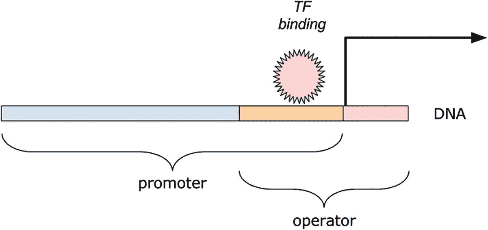
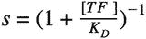
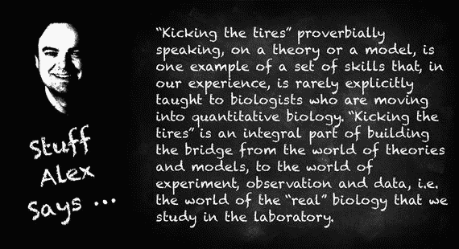
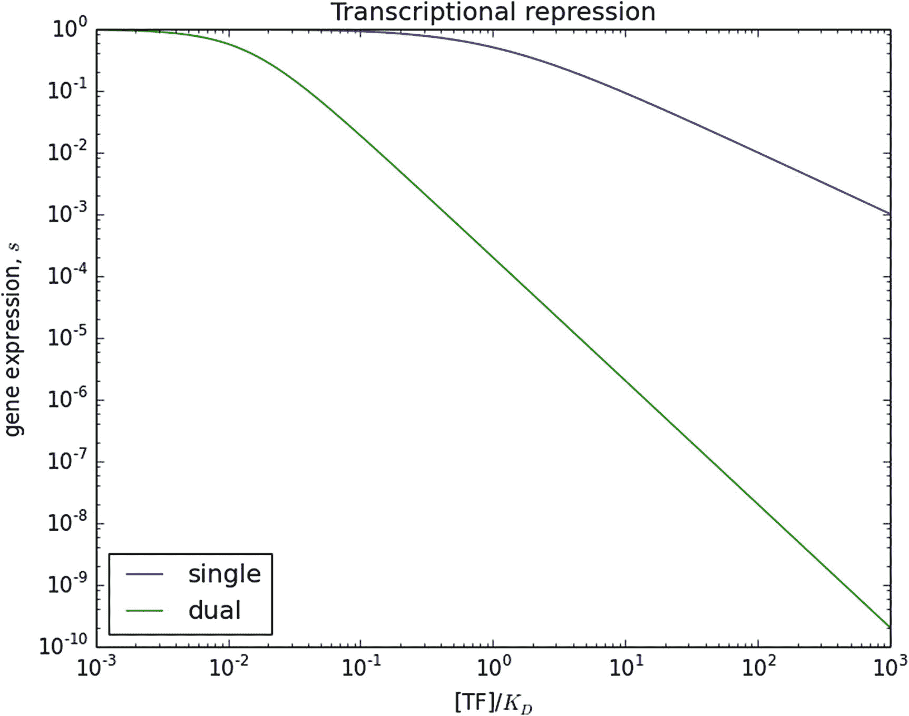
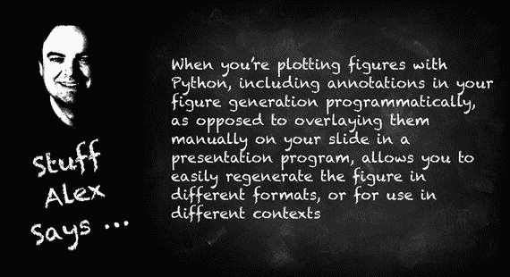
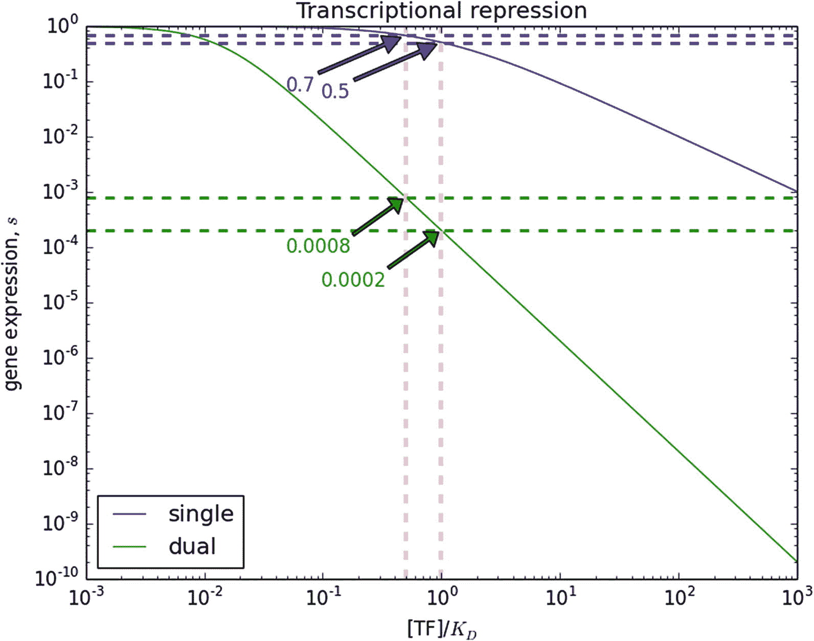

# 第 12 章 使用 Python 进行简单的基因调控建模

在第 11 章中，我们使用 Python 探索了三维结构生物学的世界。我们向你展示了如何使用 Python 研究旋转键对分子结构的影响。现在，我们将沿着复杂性的阶梯向上攀升，从近乎纯粹的物理和化学领域，转向那些更明显具有*生物学*特征的领域。当所有这些分子以大规模或小规模聚集在一起时会发生什么，这正是[生化动力学](https://en.wikipedia.org/wiki/Enzyme_kinetics)的研究主题。但更有趣的是，分子在细胞内聚集并执行某种生物学功能的过程。在本章中，我们将向你展示如何使用一些更高级的`matplotlib`函数来可视化[转录因子](https://en.wikipedia.org/wiki/Transcription_factor)蛋白的*浓度*与其在细胞中主要生物学功能（即启动从 DNA 到信使 RNA 的转录过程，也就是*开启*或*关闭*基因）之间的关系。

我们从最基本的转录调控形式之一开始：**阻遏蛋白调控基序**。阻遏型基序由基因下游启动子区域中的 DNA**结合位点**组成，当`TF`结合到该位点时，它会阻断 RNA 聚合酶接近基因以启动转录。这些 RNA 聚合酶的被阻断会*抑制*基因表达，即*关闭基因*。与生物学中的许多情况一样，实际情况比这个高度简化的图景要复杂得多，但它大致描述了像*大肠杆菌*这样的细菌中发生的情况。

### 简单的转录抑制：Lac 操纵子

让我们来看一种最简单的抑制形式，其中***单个结合位点***（有时称为操纵基因）与核心启动子重叠，如图 12-1 所示（这是*大肠杆菌*中[Lac 操纵子](https://en.wikipedia.org/wiki/Lac_operon)的一种风格化版本）。



**图 12-1** Lac 操纵子

启动子中与操纵基因位点（**粉色**）重叠的部分（**蓝色**）显示为**橙色**。如前所述，当`TF`结合到此位点时，它会阻断 RNA 聚合酶接近启动子。直观地说，随着*游离* `TF`浓度的增加，`TF`结合到该位点的可能性*也越大*。这反过来又会*降低*基因的表达速率。我们将得到的基因表达速率称为`s`。`TF`浓度与基因抑制程度之间的确切关系可以从占据状态的热力学和统计力学模型中推导出来，但幸运的是，亲爱的读者，我们不会在此深究这个难题！（关于这方面的良好论述，我们在此示例中有所借鉴，请查阅本章末尾列出的 Bintu 等人（2005）的参考文献）。

从这个推导中，我们得到了一个简单且相当直观的方程，它描述了图 12-2 所示简单阻遏情况下的关系。



**图 12-2** 简单阻遏子的基因表达速率

在前述方程中，`[TF]`是***转录因子浓度***，`K[D]`是结合的 TF-操纵基因分子复合物的***解离常数***。在我们将其编码到 Python 中之前，让我们先“试试这个方程的水温”，以确保它通过生物学合理性的基本“嗅探测试”。



一个特别有用的技能是考虑[极限情况](https://en.wikipedia.org/wiki/Limiting_case_%2528mathematics%2529)。首先，你可以看到，如果转录因子浓度为零（即`[TF] = 0`），抑制程度`s = 1`。这应该是直观的：如果没有 TF 漂浮在周围结合到操纵基因位点并妨碍其工作，RNA 聚合酶就可以接近基因。事实上，`s`永远不会大于 1：`s = 1`是*完全没有抑制*的基础情况。从这里开始全是下坡路；然而，一旦你开始*增加*`TF`浓度，`s`就会*降低*：抑制已经开始了！其次，`K[D]`如何影响事情？嗯，如果你还记得基础酶动力学，解离常数衡量的是化学复合物解离的速率。从图 12-2 的方程中你可以看到，当你*增加`K[D]`*时，这会有*增加`s`*的趋势。这同样是有道理的：如果 TF 更容易从 DNA 上解离，RNA 聚合酶就越容易接近，基因表达就越多。耶！

### 介绍`NumPy`以及`from ... import`

背景知识足够多了，让我们来看看如何使用两个外部 Python 库的组合来可视化这种关系。这里我们将使用`NumPy`库以及`matplotlib`。`NumPy`，我们在**序言**和第 11 章中简要提到过，是一个为科学和数学目的而优化的数据结构和库（如果你还没有安装`numpy`，请回顾第 1 章的安装步骤）。尽管我们为了保持可控性而很大程度上避免了外部库，但`NumPy`是一个特例，因为它广泛可用、维护良好，并包含许多高效的数据结构以及常与`matplotlib`结合使用的特性。代码清单 12-1 展示了相关代码。

```
from numpy import arange
import matplotlib.pyplot as plt
### transcription activation function for a single repressor
def single_repressor(TF_concentration_1, K_D1):
    F = 1/(1 + TF_concentration_1/K_D1)
    return F
fig1 = plt.figure()
K_D1 = 7.9E-10 # dissociation constants
TF_concentration_1  = arange(0.001, 1000, 0.001) * K_D1
plt.loglog(TF_concentration_1 / K_D1,
    single_repressor(TF_concentration_1, K_D1),
    basex=10, color="blue")
plt.xlabel("[TF]/$K_D$")
plt.ylabel("repression, $F$")
plt.title('Transcriptional repression')
plt.show()
```

**代码清单 12-1** 使用`NumPy`和`matplotlib`可视化简单基因抑制

你首先会注意到`import`语句的格式有点不同：`from numpy import arange`。这是怎么回事？嗯，`arange`是外部模块`numpy`中包含的一个函数，所以我们可以简单地`import`该模块，但那样当你使用`arange`函数时，你还必须包含该模块名：

```
import numpy
numpy.arange(0.001, 1000, 0.001)
```

这样也能正常工作，但每次都输入`numpy.arange`很快就会变得繁琐，特别是如果你想在 Python 程序中反复使用它的话，而且你可能会发现自己会想，为什么不能只导入这个函数*一次*呢？这正是使用`from`语句与`import`结合所实现的目的：

```
from numpy import arange
```

我们已经将 `arange` 函数导入到了*本地*命名空间中，因此不再需要每次使用时都额外加上 `numpy` 前缀。这是我们在第 7 章首次遇到的命名空间简写用法的一个示例。现在，我们可以毫无顾虑地直接使用 `arange` 了！太好了！

# 抑制方程与基因表达调控

接下来，我们定义一个名为`simple_repression()`的函数，该函数实现了我们之前介绍过的抑制方程：给定一个`TF_concentration`和`K_D1`（解离常数），它会计算输出的抑制水平`F`。（注意：我们在`K_D1`的变量名中使用了“`1`”，因为稍后我们会引入一个双重抑制子。）将其定义为一个函数而不是简单地将代码内联是很有用的，因为我们在后续计算中会再次用到它。接着，我们使用`matplotlib`的`figure()`函数来初始化图形，然后定义解离常数`K_D1`。接下来，我们使用`arange(0.001, 1000, 0.001)`来创建绘图点：从0.001开始，以0.001为步长，递增到1000。`arange`函数是基于基础Python中的`range`函数建模的，但允许更精细的控制，并返回一种新的数据类型：`数组`。当使用大量数值时，NumPy的数组比等效的标准Python列表更高效。此外，`matplotlib`（我们在第10章介绍和讨论过）已经“理解”NumPy数组。我们还将结果数组乘以`K_D1`以得到`TF_concentration`——这是因为我们将绘制`[TF]/K[D]`的`比值`而非`[TF]`的绝对值，并且我们希望图表显示整齐的整数数量级（10⁻³到10³）。整齐的整数数量级是很棒的！

现在我们已准备好绘制图表本身：`matplotlib`的`loglog()`函数用于创建[双对数图](https://en.wikipedia.org/wiki/Log%25E2%2580%2593log_plot)，这样我们可以轻松地在很广的TF浓度范围内可视化抑制程度。`loglog`函数的第一个参数是`x`轴，即我们之前创建的NumPy数组，第二个参数是`y`轴。对于这第二个参数，我们使用`simple_repression`函数将数组转换为输出。注意在`loglog`调用中内联使用了`simple_repression`函数，这避免了仅为`y`轴创建一个单独的变量。我们还指定了双对数图使用以10为底的对数（`basex=10`）和颜色（`color="blue"`）。

最后几行基本不言自明：我们使用`xlabel`、`ylabel`和`title`设置轴标签和标题，最后调用`show()`。`matplotlib`的一个很棒的特性是，在标签中位于美元符号内的任何文本都会被当作LaTeX数学公式处理。`matplotlib`会将这些表达式转换为格式精美的版本，例如，轴标签`$K_D$`和`$s$`分别被渲染为K[D]和s（更多细节请参阅文档）。（如果你不知道LaTeX是什么，别担心，你完全不需要为此烦恼，但了解一下LaTeX所产生的精美排版还是值得的）。

在图12-3中，我们展示了绘制的图表！

`../images/476668_1_En_12_Chapter/476668_1_En_12_Fig3_HTML.jpg`

`图 12-3` 基因表达抑制随转录因子浓度变化的图表

现在我们可以看到，随着TF分子浓度的增加，转录抑制在实际中是如何进行的。你会注意到图表跨越了六个数量级，在比值达到0.1到1之间之前，抑制并没有真正以任何有意义的方式开始。

## 双相互抑制子：两个优于一个

但生物系统如果不狡猾的话就不是生物系统了。在原核生物和某些真核生物（如酵母）中，对DNA进行相对简单的调整，例如通过突变（我们将在第19章对进化进行建模，但先不要操之过急），可以在原始结合位点附近引入另一个结合位点。一个新的抑制子基序的引入带来了一个新的调控可能性：一个操纵子，其中结合到该位点的转录因子相互交互，从而在相同相对数量的TF情况下增加抑制程度。让TF的投入产出比更高。这在数量上与简单抑制子情况相比如何？

`../images/476668_1_En_12_Chapter/476668_1_En_12_Fig4_HTML.jpg`

`图 12-4` 具有双相互抑制子的启动子

让我们回到分子生物学层面。图12-4显示的是控制某个基因的启动子。同样，我们有一个操纵子（粉红色），在橙色区域部分重叠了启动子（蓝色）。不过这次有`两个`相邻的结合基序。一种常见的情况是，TF在与DNA操纵子位点`结合`之前先形成`二聚体`（`两个`相同类型的分子副本形成一个`单一`复合体），如上图所示。此外，这两对二聚体，由于它们从DNA上突伸得更多，现在更有可能与`彼此`相互作用。这种两组分子之间的相互作用被称为[协同结合](https://en.wikipedia.org/wiki/Cooperative_binding)，并且`增加`了当两个结合位点都被TF占据时，它们`保持`结合在启动子上的概率，相比于只有两个位点中的一个被占据的情况。所以现在我们有两种情况：`两个`TF可以`单独`结合，也可以`一起`结合。另外，我们设TF之间的相互作用强度为`w`（如上图所示）。这被称为`双相互抑制子`。那么，在相同的TF浓度下，我们现在能获得多少转录抑制？

同样，该公式可以从基本原理出发，沿着与简单抑制子相同的思路推导出来（详见Bintu等人，2005年），但直奔主题，我们在图12-5中展示了该公式。

`../images/476668_1_En_12_Chapter/476668_1_En_12_Fig5_HTML.jpg`

`图 12-5` 两个相互抑制子的基因表达速率

这里我们有两个转录因子，它们各有单独的浓度（`[TF[1]]`、`[TF[2]]`）和解离常数（`K[D1]`、`K[D2]`）。同样，即使不对公式进行任何详细的推导或解释，公式的结构也应该在直观上有些道理。它几乎与之前的公式相同，只是除了`第一`项之外，我们现在为第二个TF浓度增加了一个`第二`项（代表仅由第二个TF单独导致的抑制），以及一个`第三`项，考虑到两种TF浓度和抑制强度`w`的存在，该项显然代表了由TF之间`协同`相互作用所带来的额外抑制。

那么，这与简单抑制子情况相比如何呢？让我们先假设两个TF是相同的，因此它们的浓度`[TF[1]] = [TF[2]] (= [TF])`。然后我们可以很容易地将该公式编码到Python中，并在与简单抑制子情况相同的坐标轴上绘制抑制因子`F`。在代码清单12-2中，我们展示了代码。

```
if (condVar > someVal) {console.log("xxx")}
```

# Python代码示例：转录抑制可视化

```python
from numpy import arange
import matplotlib.pyplot as plt

### 单一阻遏物的转录激活函数
def single_repressor(TF_concentration_1, K_D1):
    F = 1/(1 + TF_concentration_1/K_D1)
    return F

### 双重阻遏物的转录激活函数
### 其中阻遏物以强度 w 相互作用
def dual_repressor(TF_concentration_1, TF_concentration_2, K_D1, K_D2, w):
    F = 1/(1 + TF_concentration_1/K_D1 + TF_concentration_2/K_D2 + ((TF_concentration_1/K_D1) * (TF_concentration_2/K_D2))* w)
    return F

fig1 = plt.figure()
K_D1 = 7.9E-10    # 解离常数
K_D2 = 25 * K_D1  # 解离常数

### 单一阻遏物
TF_concentration_1 = arange(0.001, 1000, 0.001) * K_D1
plt.loglog(TF_concentration_1 / K_D1,
           single_repressor(TF_concentration_1, K_D1),
           basex=10, color="blue", label="single")
plt.xlabel("[TF]/$K_D$")
plt.ylabel("repression, $F$")

### 双重阻遏物
w = 200
TF_concentration_2 = arange(0.001, 1000, 0.001) * K_D2
plt.loglog(TF_concentration_2 / K_D2,
           dual_repressor(TF_concentration_2, TF_concentration_2, K_D1, K_D2, w),
           basex=10, color="green", label="dual")
plt.title('转录抑制')
plt.legend(loc='lower left')
plt.show()
```

清单 12-2 将两个基因表达关系叠加在单个图上

此代码结构与之前的代码几乎相同，在这一点上应当相当不言自明。我们创建了另一个函数`dual_repressor()`，用于编码前述公式。我们进一步将`K_D2`设置为`K_D1`解离常数的25倍（详情参见 Bintu et al. (2005b)）。在`loglog`调用中，我们还额外提供了一个`label`参数。随后，matplotlib的`legend`调用会利用该参数为彩色线条创建图例。我们还将图例放置在左下角（`loc='lower left'`），以避免遮挡图形。另请注意，我们只需一次创建*x*和*y*轴标签。

好了，现在我们可以准备在图12-6中比较阻遏物了！



图 12-6 比较单一阻遏与双重阻遏对基因表达的影响

显然，双重阻遏物在关闭基因方面效率更高。在相同转录因子浓度下，能实现更多的转录抑制。这张图确实能帮助生物学家直观感受在大范围转录因子浓度下的调控变化。

## 相同浓度，更强抑制：注释图表

好了，假设你正面向一群持怀疑态度的听众进行展示。对某些人来说，双对数图可能不像对其他人那样直观。假设你非常想向那些需要看到*具体数值*的人强调一个观点：双重阻遏确实能产生显著差异。这时，叠加文本注释以及图表上的垂直与水平线就会派上用场。

假设我们想要比较当转录因子浓度加倍时，*绝对*抑制量如何变化。我们首先在两个不同的转录因子浓度水平上覆盖水平线和垂直线，然后添加文本框，并用箭头指向每种情况下的抑制水平。在清单12-3中，我们展示了Python代码（你需要从之前的清单中定义`single_repressor`和`dual_repressor`函数）。

```python
def draw_points(TF_ratio, repression, color):
    plt.axhline(repression,
                linestyle='dashed',
                color=color,
                linewidth=2)
    plt.annotate("%.1g" % repression,
                 xy = (TF_ratio, repression),
                 xytext = (TF_ratio*0.1, repression*0.1),
                 color=color,
                 arrowprops=dict(facecolor=color, width=2, frac=0.2, shrink=0.05))

for TF_ratio in [0.5, 1.0]:
    plt.axvline(x=TF_ratio, linestyle="dashed", color="pink", linewidth=3)
    TF_value = TF_ratio * K_D1  # 将比率转换为转录因子浓度
    repression = single_repressor(TF_value, K_D1)
    draw_points(TF_ratio, repression, "blue")
    TF_value = TF_ratio * K_D2
    repression = dual_repressor(TF_value, TF_value, K_D1, K_D2, w)
    draw_points(TF_ratio, repression, "green")
```

清单 12-3 向 matplotlib 图表添加注释



我们从一个函数`draw_points()`开始。该函数首先使用matplotlib的`axhline()`函数，在给定的`repression`水平上绘制一条颜色为`color`的虚线水平线。然后使用`annotate`函数绘制抑制水平，并用箭头指向图上的精确点。`xy`关键字是*图上实际点*的位置，而`xytext`是*文本框*的位置。`arrowprops`关键字会创建一条从标签到该点的箭头，颜色同样为`color`。请注意，在`xytext`中，我们将提供给`xy`的坐标乘以了0.1，这样能使标签与箭头末端略微错开。

接下来，我们为`TF_ratio`（0.5和1.0，即浓度加倍）添加一个`for`循环。在每次循环迭代中，我们首先使用`axvline`在指定的`TF_ratio`处绘制一条垂直线。然后将`TF_ratio`转换为实际的`TF_value`，并调用`single_repressor`获取`repression`水平，接着将其提供给`draw_points()`函数。然后，我们对`dual_repressor()`重复相同的过程。请注意，我们还会匹配原始曲线的颜色：蓝色代表单一阻遏物，绿色代表双重阻遏物。

现在，让我们将整个程序整合起来，生成图形。完整的代码见清单12-4。

```python
from numpy import arange
import matplotlib.pyplot as plt

### transcription activation function for a single repressor
def single_repressor(TF_concentration_1, K_D1):
    F = 1/(1 + TF_concentration_1/K_D1)
    return F

### transcription activation function for a dual repressor
### where repressors interact with strength w
def dual_repressor(TF_concentration_1, TF_concentration_2, K_D1, K_D2, w):
    F = 1/(1 + TF_concentration_1/K_D1 + TF_concentration_2/K_D2 + ((TF_concentration_1/K_D1) * (TF_concentration_2/K_D2)) * w)
    return F

def draw_points(TF_ratio, repression, color):
    plt.axhline(repression,
                linestyle='dashed',
                color=color,
                linewidth=2)
    plt.annotate("%.1g" % repression,
                 xy = (TF_ratio, repression),
                 xytext = (TF_ratio*0.1, repression*0.1),
                 color=color,
                 arrowprops=dict(facecolor=color, width=2, frac=0.2, shrink=0.05))

fig1 = plt.figure()

### dissociation constants
K_D1 = 7.9E-10
K_D2 = 25 * K_D1

### single repressor
TF_concentration_1 = arange(0.001, 1000, 0.001) * K_D1
plt.loglog(TF_concentration_1 / K_D1,
           single_repressor(TF_concentration_1, K_D1),
           basex=10, color="blue", label="single")
plt.xlabel("[TF]/$K_D$")
plt.ylabel("repression, $F$")

### dual repressor
w = 200
TF_concentration_2 = arange(0.001, 1000, 0.001) * K_D2
plt.loglog(TF_concentration_2 / K_D2,
           dual_repressor(TF_concentration_2, TF_concentration_2, K_D1, K_D2, w),
           basex=10, color="green", label="dual")

for TF_ratio in [0.5, 1.0]:
    plt.axvline(x=TF_ratio, linestyle="dashed", color="pink", linewidth=3)
    TF_value = TF_ratio * K_D1  # convert ratio into TF concentration
    repression = single_repressor(TF_value, K_D1)
    draw_points(TF_ratio, repression, "blue")
    TF_value = TF_ratio * K_D2
    repression = dual_repressor(TF_value, TF_value, K_D1, K_D2, w)
    draw_points(TF_ratio, repression, "green")

plt.title('Transcriptional repression')
plt.legend(loc='lower left')
plt.show()
```

**列表 12-4** 生成带有注释的基因表达抑制图表的完整代码

在图 12-7 中，我们展示了该图！



**图 12-7** 带有图例的注释图，展示了单抑制子和双抑制子的基因抑制情况

你可以清晰地看到，单抑制子基序仅将基因表达抑制了 1.4 倍（=0.7/0.5），而双抑制子基序则实现了四倍的抑制（=0.0008/0.0002）。将这些`matplotlib`注释功能牢记于心是非常有用的，因为它们能为图表增添非常高效的元素。

因此，可视化转录因子结合的动力学开始更像是真实的生物学了。接下来，在第 13 章中，我们将沿着生物复杂性的阶梯继续向上，使用 Python 挖掘一个数据集，该数据集包含了连接到简单单细胞生物——酿酒酵母细胞内它们所控制基因上的所有转录因子。然后，在第 14 章中，我们将所有内容整合在一起，创建一个基于 Python 的简单`仿真模型`，用于探索相互作用的基因通过本章介绍的双相互作用抑制子基序相互调节的动力学。

## 参考文献与深入阅读

- James A. Goodrich 和 Jennifer F. Kugel, *《分子生物学家的结合与动力学》*^(¹⁶⁴) (冷泉港出版社, 2007)

- Bintu, Buchler, Garcia, Gerland, Hwa, Kondev, 和 Phillips (2005a). 转录调控的数字化：模型.^(¹⁶⁵) *《遗传学与发展当前观点》*, **15**, 116–124

- Bintu, Buchler, Garcia, Gerland, Hwa, Kondev, Kuhlman, *等* (2005b). [转录调控的数字化：应用.](https://www.ncbi.nlm.nih.gov/pmc/articles/PMC3462814/)^(¹⁶⁶) *《遗传学与发展当前观点》*, **15**, 125–135

## 脚注
