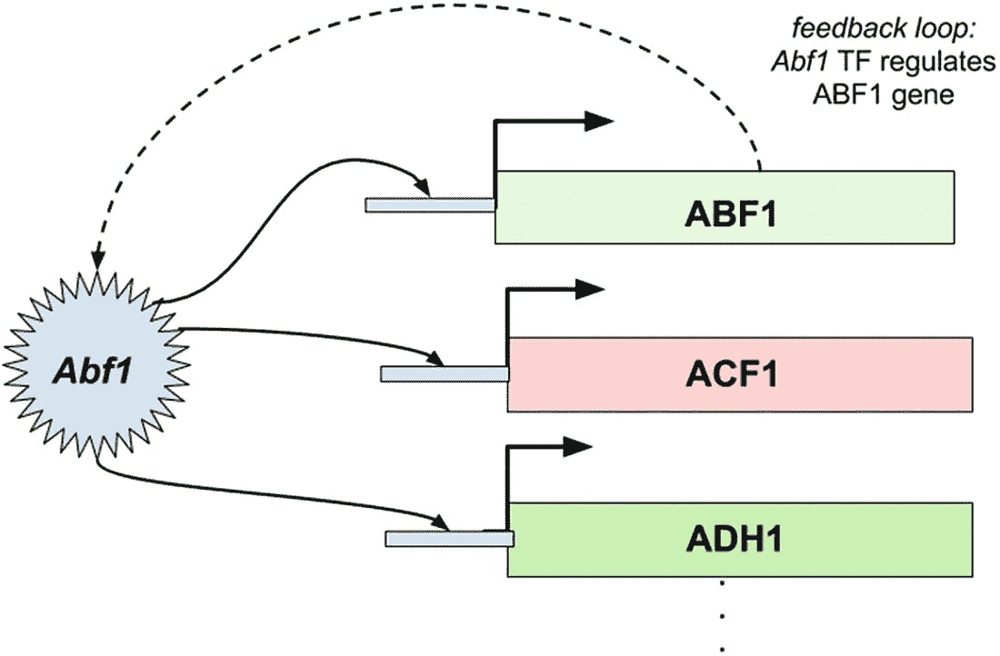
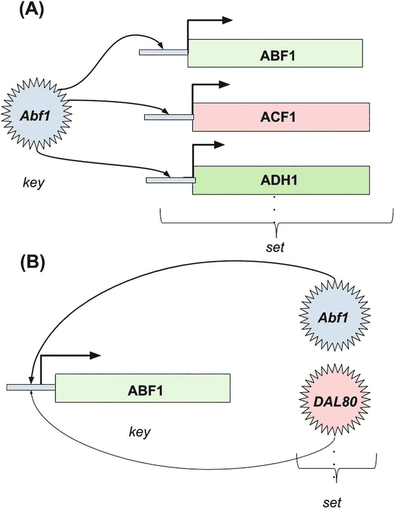

### 13. 驯服网络毛团

*使用 Python 集合挖掘系统生物学数据*

 | *柴郡猫被困住了；他试图向左移动，然后又试图向右移动。但无济于事。树上粗壮缠绕的树枝证明，即使对于猫这样虚无缥缈的幽灵般存在，也毫不让步。* <br> *“就没有人把我从这个地狱般的混乱中救出来吗？”猫喵喵叫着。* <br> *在地上看着猫的爱丽丝饶有兴趣地抬头看着。她开始理解这个一切都不像表面看起来那样的颠倒世界。* <br> *“猫，”她喊道，“你应该习惯处理这种缠结的乱麻。毕竟，是你发明了毛团！”* <br> *话音刚落，猫“噗”的一声消失了。* |

 | `set()`, `union`, `intersection`, `list comprehensions` |

 | *系统生物学，基因网络，转录网络，基因调控* |

正如我们在前几章中已经看到的，计算生物学的工作并非都围绕着分析序列展开。序列虽然非常重要，但在某种意义上只是理解复杂生物系统的起点。它们代表了进化历经数千年所雕琢出的一套解决方案“数据库”。使得生物系统如此引人入胜的原因在于，我们看到这些序列如何帮助构建构成我们在生物学中观察到的性状基础的网络。研究这类网络（特别是细胞内的网络）的新兴生物学领域，被称为“系统生物学”。系统生物学是一个庞大的领域，范围从蛋白质、信使 RNA、DNA 相互作用的实验研究，到互作网络的数学建模和模拟。

在本章中，我们将撸起袖子，应用我们在前几章中开发的技能，如解析数据文件、数据结构和正则表达式，来处理一些真实的生物数据集。我们已经在第 12 章中接触到了系统生物学的一个构建模块。

Python 拥有一套出色且久经考验的工具，可以帮助你驾驭系统生物学中庞大且不断增长的网络数据集资源。因此，首先，让我们设想你正有兴趣处理一种网络：基因以及调控这些基因在酵母细胞中如何开启或关闭的转录因子网络。酵母是值得研究的生物，原因有很多：它们世代时间短，非常适合实验进化；并且虽然它们主要以单细胞形式存在，但它们也是真核生物，因此许多基因在酵母和人类之间是保守的。但在系统生物学背景下，酵母有一个巨大优势，那就是它们拥有非常全面的、经过实验验证的细胞组分间相互作用数据库。所有这些组分之间的相互作用数量可能非常庞大，许多连接边重叠在一起，这导致许多人将这类数据称为网络毛团。


## 排版后的内容

有许多不同的数据库可供我们探索。让我们先只看一个：`YEASTRACT`^(167)，它代表 `Yeast Search for Transcriptional Regulators And Consensus Tracking`。这是一个*人工策展*的网站（意味着真正的人会查看条目并定期进行修正），你可以从该网站进行许多交互式可视化。例如，你可以查看特定转录因子调控的所有基因。然而，在某些时候，你会希望开始对网络进行自己的定量探索，超越网站程序员所能想象的范围。

首先要做的是寻找“平面文件”。这些是格式如 `CSV`（逗号分隔值）或 `TSV`（制表符分隔值）的纯文本文件。

快速浏览 `YEASTRACT` 网站，你会发现下载页面：

*   [www.yeastract.com/download.php](http://www.yeastract.com/download.php)

获取平面文件：

```
RegulationTwoColumnTable_Documented_2013927.tsv.gz
```

并使用诸如`gunzip`之类的归档程序将其解压，你会发现它包含两列，格式如下：

```
ABF1;ABF1
ABF1;ACS1
ABF1;ADE5,7
ABF1;ADH1
ABF1;ALD3
ABF1;AMS1
ABF1;ARN2
ABF1;ARO3
ABF1;ARP5
ABF1;BAP3
ABF1;BNA2
...
```

*第一列*包含一个转录因子，*第二列*包含受该转录因子调控的基因名称。从视觉上看，底层的转录因子网络可以被重构，看起来像图 13-1，它显示了一个转录因子调控多个基因。



**图 13-1** 单个转录因子 `Abf1` 调控多个基因。

## 用 `set` 来列个清单

你可能从遥远的入门数学^(168)课程中回忆起来，一个`set`只包含*唯一*的成员。在转录网络的数据结构上下文中，这意味着对于每个转录因子，我们只需要*记录一次*那个特定的基因。

让我们创建一个空的基因集合：

```
genes = set()
```

这很简单！让我们开始向集合中添加基因：

```
genes.add("ABF1")
genes.add("ACS1")
print(genes)
{'ABF1', 'ACS1'}
```

太好了，现在我们有了一个基因集合。然而，`set`的真正优势在于它们会拒绝添加重复项。这非常方便，因为我们不需要检查集合是否包含某个元素（就像使用列表时那样），只需不断添加基因，而`set`会神奇地确保只有一个条目。继续看例子：

```
genes.add("ABF1")
print(genes)
{'ABF1', 'ACS1'}
```

请注意，`ABF1`基因仍然只有一个副本！很酷吧？事实证明，当你向数据集中添加大量基因时，这一点尤其重要，因为有时（这对于生物学家来说可能是一个令人震惊的事实），你的输入数据中可能存在*错误*或*重复项*！我知道，我知道，奇迹永远不会停止。

现在你已经自动防范了常常困扰初出茅庐的计算生物学家的问题之一：缺失或重复数据的存在！

`set`还有一些其他很酷的特性。你可以轻松检查某个元素是否包含在集合中：

```
'ABF1' in genes
True
'FakeGene' in genes
False
```

或者你可以检查一个集合是否是另一个集合的子集（注意，你可以使用列表来初始化集合）。在这个例子中，请注意包含仅`ABF1`基因的集合`smaller`是原始`genes`集合的一个子集：

```
smaller=set(['ABF1'])
print(smaller)
{'ABF1'}
smaller  genes
False
```


你还可以执行各种标准集合操作，例如`intersection`（`A & B`）、`union`（`A | B`）等等（完整列表请参见 Python 语言关于集合的文档^(169)）。现在你可以开始看到，当查询由离散对象（如转录因子和基因）组成的生物数据时，`set`可能会非常有用。例如，给定两个不同的转录因子，哪些基因受到*两者*的调控，哪些基因只受到其中之一的调控？那么，让我们使用我们的 `YEASTRACT` 例子来看看 `set` 的实际应用！

## 两个字典的故事：网络的数据结构

让我们开始创建网络的数据结构。我们首先使用我们在第 8 章中介绍的`with`语句方法来读取文件：

```
with open("RegulationTwoColumnTable_Documented_2013927.tsv") as file:
    lines = file.readlines()
```

我们将开始创建*两个*字典数据结构。这样做的原因是，我们经常需要从转录因子（TF）的角度查找信息，即给定一个 TF，它控制哪些基因？但反之亦然：给定一个基因，它被哪些 TF 控制？（注意，我们暂时不考虑用于创建网络的第三方包，例如 `NetworkX` – 有关指引，请参见本章末尾的参考资料部分 – 目前我们只关注核心 Python 语言。）

这两种数据结构以及底层生物学在图 13-2 中进行了图形化描述。



**图 13-2** 两种数据结构：（A）TF 调控一组基因，（B）基因被一组 TF 调控

图 13-2 是集合的可视化表示——在图的（A）部分，键是 TF；在图的（B）部分，键是基因。

1.  `alltfs`：一个以 TF 为索引的字典，每个*键*是一个 TF，每个*值*是它调控的`set`基因（**A** 显示了一个*键*：TF *Abf1* 调控几个基因；注意只显示了前几个）。

2.  `allgenes`：一个以基因为索引的字典，每个*键*是一个基因，每个*值*是调控该基因的`set`的 TF（**B** 显示了一个*键*，即 *ABF1* *基因*，以及所有调控它的 TF——同样只显示了前几个）。

让我们先初始化字典，然后循环并解析我们已经检索到数据的行：

```
```

让我们在这里暂停一下，在创建数据结构本身之前进行回顾。在这短短几行代码中，我们做了`相当`多的事情，并且我们需要对尚未描述的新语言特性进行几次短暂的绕行。

### 首先

我们在`line`变量包含的字符串上使用`split()`，将其拆分为一个字符串`items`的列表（我们指定`split`应使用分号作为分隔每个变量的字符——这通常称为分隔符）。（对于 Python 2.7 的用户，请注意，在 Python 3 中，`split()`和`strip()`函数不再是`string`模块的一部分，我们直接在这些字符串上使用这些函数）。

### 列表推导式

其次，循环中的下一行引入了另一个新特性：列表推导式。列表推导式允许你获取一个列表并：

1. 循环遍历该列表（这是内部的“`for item in items`”）。
2. 通过应用`lower()`函数将每个项转换为小写，从而修改列表中的每个项。
3. 在新方括号`[]`内返回一个新的列表（覆盖旧的列表）。

所有操作都在一行内完成！很酷，对吧？Python的简洁性无可比拟。列表推导式非常适合这类任务。如需了解更详尽的信息，请参阅Python官方教程中关于列表推导式的内容。¹⁷⁰

现在，我们成功地将输入数据中的每个元素在一行内转换为了小写。这样做是为了避免输入文件中字体大小写的微小差异被当作不同内容处理，例如，转录因子“Pma1”实际上应该与转录因子“pma1”视为相同（这又是我们通过*预先*清理数据来构建健壮性这一通用原则的另一个例子）。这引出了……

### 第三

最后两行提取了`tf`（原始文件中的第一列，也就是`items`中的第零个元素）和调控的`gene`（第二列，即`items`中的第一个元素，记住所有列表都是从零位置开始的）。然而，在赋予`tf`和`gene`值之前，我们首先使用`strip()`方法去除字符串中的无关字符，特别是原始`line`中“随行携带”的令人讨厌的行尾字符。（这又是我们之前提到的防御性编程的另一个例子。）

最后，现在我们有了文件中的实际信息，可以运用字典的相关知识（参见第 2 章）和我们刚刚介绍的`set`功能，来用这些数据*做些*实际的事情。以下是读取数据文件后的下一段代码：

```
### genes keyed by TF
if tf in alltfs:
    (alltfs[tf]).add(gene)  # TF 已存在，我们只需添加基因
else:
    alltfs[tf] = set()      # 否则，创建一个空集合
    (alltfs[tf]).add(gene)  # 然后添加基因
```

我们来简要解析一下。首先检查`tf`这个键是否存在。如果存在，我们就使用`add()`函数将`gene`添加到该特定TF所调控的基因集合中。如果不存在，我们就*创建*一个新的*空*集合，然后像之前一样添加基因。初学者可能会对`(alltfs[tf])`外面额外的括号感到困惑。虽然这些括号并非严格必要，但它们提醒我们，当使用`add()`方法添加基因时，**我们是在向该字典条目处的集合**添加元素。如果示例变得更复杂，它们也更容易跟踪哪个元素属于哪个集合。

下一段代码的基本格式与前一段相同，但这次不是向集合添加基因，而是向集合添加TF，并且这些集合以基因作为键：

```
### TFs keyed by gene
if gene in allgenes:
    (allgenes[gene]).add(tf) # 如果基因已存在，我们只需添加 TF
else:
    allgenes[gene] = set()   # 否则创建空集合
    (allgenes[gene]).add(tf) # 然后添加 TF
```

呼！让我们把代码整合起来，看看列表 13-1 中的内容。

```
#!/usr/bin/env python3

with open("RegulationTwoColumnTable_Documented_2013927.tsv") as file:
    lines = file.readlines()

alltfs = {}
allgenes = {}

for line in lines:
    items = line.split()      # 将每一行分割成元素
    items = [item.lower() for item in items] # 将每个元素转为小写
    tf = items[0]             # 第一列 = TF（元素 0）
    gene = items[1]           # 第二列 = 由 TF 调控的基因（元素 1）
    
    ### genes keyed by TF
    if tf in alltfs:
        (alltfs[tf]).add(gene)  # TF 已存在，我们只需添加基因
    else:
        alltfs[tf] = set()      # 否则，创建一个空集合
        (alltfs[tf]).add(gene)  # 然后添加基因
    
    ### TFs keyed by genes
    if gene in allgenes:
        (allgenes[gene]).add(tf) # 基因已存在，我们只需添加 TF
    else:
        allgenes[gene] = set()      # 否则，创建一个空集合
        (allgenes[gene]).add(tf)    # 然后添加 TF

print("total TFs:", len(alltfs))
print("total genes:", len(allgenes))
```

**列表 13-1** 将网络数据从文件解析到两个数据结构中

如果你运行上述程序，它应该会读取文件并给出一些汇总统计信息，看起来大致如下：

```
total TFs: 183
total genes: 6403
```

我们在第 3 章首次遇到的`len()`函数，会打印出数据结构的*长度*，其具体含义取决于数据结构的*类型*。对于我们的*字典*而言，这就是*键*的数量。恭喜你，现在你已经成功创建了可以用来开始提出一些实际生物学问题的数据结构！

## 谁调控谁？

在分析这类互作网络数据时，一个常见的问题是：给定两种不同的转录因子，它们共同调控的*共同*基因是什么？现在，由于我们已经完成了大部分繁重的工作，使用集合的`intersection()`函数（使用快捷方式`"&"`）来回答这个问题变得异常简单：

```
print("genes regulated by both abf1 & cyc8:", alltfs['abf1'] & alltfs['cyc8'])
```

```
genes regulated by both abf1 and cyc8: {'hxt2', 'hxt4'}
```

结果是一个很小的集合：只有两个基因。我们还可以查询完整的超集，即它们两者调控的*所有*基因。利用集合的功能，我们可以确保——无需任何额外代码——通过使用`union()`（快捷方式`"|"`）函数，我们的集合将只包含唯一的元素：

```
print("genes regulated by abf1 or cyc8:", alltfs['abf1'] | alltfs['cyc8'])
```

```
genes regulated by abf1 or cyc8: {'ycr064c', 'ugx2', 'ydr095c', 'spp2', 'mtq1', ...
```

我们截断了上述集合的输出，因为它会占掉整整一章的篇幅！还要注意，`hxt2` 和 `hxt4` 尽管出现在两个原始集合中，但在结果集合中只会出现*一次*。太棒了。你现在拥有了工具，可以利用`set`函数提供的所有丰富可能性，以多种方式开始探索网络数据，唯一限制你的只有想象力。你也可以使用`allgenes`数据结构来提出类似的问题，例如哪些TF调控某个特定的基因。我们将这些功能留给你自己去发现！

## 现在整合到一起：使用 Python `__main__`
```
```

现在，我们可以把所有内容整合在一起，将文件读取和数据结构创建放入一个函数`get_tf_yeastract`，并将执行交集和并集运算的函数放入它们各自的独立函数`get_common_genes`和`get_all_genes`中（使用`def`关键字和适当的缩进，正如我们在第 2 章中介绍的）。这非常方便，因为它意味着我们可以用不同的变量`重复使用`这些函数。然后，我们可以让实际的`主`程序变得非常简短。以下是主程序的样子（注意，我们还使用了`sorted`，我们早在第 3 章就首次遇到过它，用于对输出中的基因和转录因子进行字母排序）：

```
if __name__ == "__main__":
    ### get TF regulation data
    alltfs, allgenes = get_tf_yeastract()
    ### remember we lowercased the gene names!
    common_genes = get_common_genes(alltfs, 'abf1', 'cyc8')
    print("genes regulated by both abf1 & cyc8", sorted(common_genes))
    all_genes = get_all_genes(alltfs, 'abf1', 'cyc8')
    print("genes regulated by abf1 or cyc8", sorted(all_genes))
```

这展示了命名空间的另一个巧妙特性；我们可以将所有函数放在一个文件中，然后将`主`程序放在`同一`文件的底部，而无需将其移动到单独的文件中。当你希望将所有函数、变量和测试用例放在一个地方时，这非常方便。这神奇地由以下代码实现：

```
if __name__ == "__main__"
```

通过使用`"__main__"`，Python 解释器会注意到该文件是被直接执行的，并仅在文件被直接执行时运行这些代码，而在导入该文件时则不会运行（更多令人头疼的细节，请参阅 Python 官方教程中关于模块和脚本的部分¹⁷¹）。

最终，我们在清单 13-2 中得到了完整的程序，可以看到它相当简短（如果去掉一些注释，则会更加简洁）。

```
#!/usr/bin/env python
### get the TF regulation data from yeastract
def get_tf_yeastract():
    with open("RegulationTwoColumnTable_Documented_2013927.tsv") as file:
        lines = file.readlines()
    ### create a dictionary indexed by transcription factors (TF)
    ### each key is a TF, each value is a *list* of genes it regulates
    alltfs = {}
    ### create a dictionary of indexed by genes
    ### each key is a gene, each value is a *list* of TFs regulated by that gene
    allgenes = {}
    for line in lines:
        items = line.strip(';') # split line into elements using ';' as separator
        ### lowercase each item, so that minor differences in casing don't confuse
        items = [item.lower() for item in items]
        tf = items[0].strip()  # first col  = TF  (element 0)
        gene = items[1].strip() # second col = gene that TF regulates (element 1)
        ### genes keyed by TF
        if tf in alltfs:
            (alltfs[tf]).add(gene)  # TF already added, we just add the gene
        else:
            alltfs[tf] = set()     # otherwise, we create an empty set
            (alltfs[tf]).add(gene) # then add it
        ### TFs keyed by gene
        if gene in allgenes:
            (allgenes[gene]).add(tf) # if gene already exists, we just add the TF
        else:
            allgenes[gene] = set()   # otherwise create empty set
            (allgenes[gene]).add(tf) # then add it
    print("total TFs:", len(alltfs))
    print("total genes:", len(allgenes))
    return alltfs, allgenes

def get_common_genes(alltfs, tf1, tf2):
    return alltfs[tf1] & alltfs[tf2]

def get_all_genes(alltfs, tf1, tf2):
    return alltfs[tf1] | alltfs[tf2]

if __name__ == "__main__":
    ### get TF regulation data
    alltfs, allgenes = get_tf_yeastract()
    ### remember we lowercased the gene names!
    common_genes = get_common_genes(alltfs, 'abf1', 'cyc8')
    print("genes regulated by both abf1 and cyc8", sorted(common_genes))
    all_genes = get_all_genes(alltfs, 'abf1', 'cyc8')
    print("all genes regulated by either abf1 OR cyc8", sorted(all_genes))
```
Listing 13-2
Complete program for reading and parsing transcription network data

所以，初出茅庐的 Python 爱好者们，去尽情探索交互网络数据吧！第 14 章还有更多的系统生物学知识等着你，在那里我们将创建一个动态模拟模型，模拟一个由基因和转录因子相互作用的网络。

## 参考文献与深入阅读

* `NetworkX`^((172)): 一个用于网络数据结构的 Python 库

* `Hive Plots`^((173)): 超越“毛团”的复杂生物网络可视化方法；相关 Python 包：`pyveplot`^((174))

* Teixeira *等人* (2014). The YEASTRACT database: an upgraded information system for the analysis of gene and genomic transcription regulation in Saccharomyces cerevisiae.^((175)) *Nucleic Acids Res*, **42**, D161-D166

* Monteiro *等人* (2008). YEASTRACT-DISCOVERER: new tools to improve the analysis of transcriptional regulatory associations in Saccharomyces cerevisiae.^((176)) *Nucleic Acids Res*, **36**, D132–D136

## 脚注
