14. 基因反馈回路

*使用吉莱斯皮算法建模基因网络*

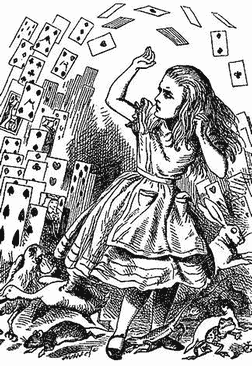 |

*“哦，天哪，”爱丽丝一边沿着小路跑，一边喊道。“所有这些卡片都以恒定的速率从我头顶飞过，好像每秒一张！我根本不可能把它们全收集起来。”*

*她看了看脚下的白兔，他正艰难地躲避着爱丽丝奔跑的路线，左右闪躲着飞来的卡片。*

*“真的有必要如此频繁地发送这些消息吗？”她恼怒地对兔子喊道。“毕竟我们只需要在有新事情要做的时候收到信号就行了！”*

*“瞎说，”兔子说，“你从来没做过什么*真正的*模拟，对吧？我这辈子都在收集卡片，每秒一张，这就是世界的运行方式，亲爱的。”*

*“哦，兔子，你真是个烦人的动物，”爱丽丝气呼呼地说，她变得非常烦躁，因为她在这个毛茸茸的小东西左右乱窜收集卡片时，总是有踩到它的危险。*

*“我就当没听见。我要去找卡片大师谈谈，让他只在有什么重要变化时才发卡片。”说完，爱丽丝气冲冲地跺着脚走了。*


`sum()`, `numpy.random` module, `exponential()`, `uniform()`


`基因调控网络`, `系统生物学`, `化学主方程`, `二聚化`, `反馈回路`, `转录因子`, `mRNA`, `翻译`, `蛋白质降解`

# 生物学中的建模与模拟：从随机性到 Gillespie 算法

生物学，如果你还没注意到的话，可能有点混乱。物理学有其无摩擦表面、点电荷和理想气体。这些系统的真实版本通常与它们的抽象概念相差不远，简洁清晰的易解方程实际上可以相当准确地描述实验结果。但在生物学中，情况往往并非如此。关于生物学中的数学，有一个经久不衰的笑话：一幅漫画中，一位科学家站在幻灯片前，标题写着“考虑一个[球形奶牛](https://en.wikipedia.org/wiki/Spherical_cow)”。这个笑话当然是在说，虽然奶牛显然不是球形的，但只有假设奶牛是球形的，方程才能真正求解！

对诸如[基因调控网络](https://en.wikipedia.org/wiki/Gene_regulatory_network)或代谢网络这类细胞网络进行建模可能很复杂：细胞可能是一个嘈杂的地方！分子四处碰撞、被合成或降解，情况会变得相当混乱。有时，这些单个事件——碰撞、生成和破坏——都会“平均掉”。例如，对于大量特定种类的蛋白质来说就是如此；如果浓度足够高，我们可以忽略单个事件，专注于宏观行为。因此，在对代谢网络建模时，常微分方程就足以模拟其动态。在其他情况下，例如转录因子网络，仅仅几个单个转录因子分子与启动子结合就可能决定一个基因是开启还是关闭。这时，*单个*事件开始显得非常重要：拷贝数的微小变化可能带来巨大差异。在这种情况下，噪声，或者更技术性地讲，随机性，就变得至关重要了！

正如前言中所述，我们在本书中的方法与其他大多数方法略有不同：我们相信通过从“自下而上”建模来建立直觉是有用的。之后，你可以回过头来学习数学。从构建一个直接的[模拟](https://en.wikipedia.org/wiki/Computer_simulation)开始，通常更有趣、也更好玩。模拟是一种通过实践来学习的好方法，符合我们的总体理念，即“摆弄”简单模型可以建立直觉。你永远不知道你会走到哪里！而且，事实上，模拟也是模拟细胞噪声的一个便捷工具。

模拟生化网络最常用的技术之一被称为`Gillespie`[算法](https://en.wikipedia.org/wiki/Gillespie_algorithm)，由`Daniel Gillespie`于上世纪 70 年代首次发表。尽管它基于一种称为化学主[方程](https://en.wikipedia.org/wiki/Master_equation)的数学形式体系，但该算法的本质无需数学即可轻松掌握。核心思想是，任何涉及多种不同分子的模拟都由一系列预设的*可能事件*组成：可能是转录因子的结合或解离，也可能是`mRNA`分子的生成或降解。每个事件都有一定的发生*概率*，该概率基于事件中涉及的分子拷贝数。

**直截了当地说**：在其他类型的算法中，时间以预设的时间步长稳定推进，我们在每一步检查需要做什么。`Gillespie`算法则不同。使用`Gillespie`算法，我们只需要问两个问题：下一个事件何时发生？以及是哪个事件？然后我们更新时间，通过更新分子数量来执行事件，并重复这个过程。无需浪费时间，哈！在那些没有有趣事件发生的中间时间步长上浪费任何时间。

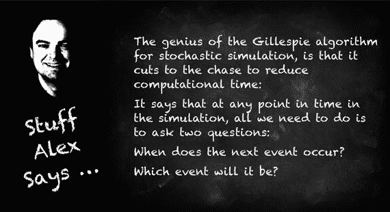

## 二聚化：一个简单的起点

最简单的建模案例之一是二聚化，其中两个分子，比如`A`和`B`，结合成一个*二聚体*（`AB`）。只有两个可能的事件：如上所述的二聚化，以及解离，即二聚体再次变成两个单独的分子。如图 14-1 所示，我们可以用两个化学方程来表示，它们分别以速率`k[D]`和`k[U]`发生。

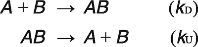

*图 14-1* 二聚化的化学方程

显然，每种分子的数量非常少会对三种物种中每一种的数量产生重大影响。让我们大胆一点，直接跳到清单 14-1 中的`Python`代码。

```python
from numpy.random import exponential, uniform
import matplotlib.pyplot as plt
### Model 1: dimerization: just two reactions
### A + B -> AB  (k_D)
### AB -> A + B  (k_U)
k_D = 2.0
k_U = 1.0
time_points = []
A_counts  = []
B_counts  = []
AB_counts = []
t = 0.0
max_time = 10.0
### maximum number of molecules
max_molecules = 100
n_A = max_molecules
n_B = max_molecules
n_AB = 0
```

*清单 14-1* 初始化设置

我们首先导入`NumPy`和`matplotlib`（分别已在第 12 章和第 10 章讨论过）。然后我们设置参数，接着是用于保存模拟输出的列表，即每种化学物种的拷贝数（`A_counts`、`B_counts`、`AB_counts`）。我们还将时间列表（`time_points`）作为浮点数存储在模拟中。这与我们之前讨论的模拟不同，我们不是简单地递增一个整数代数的数量，而是时间可以以“跳跃”方式移动，其大小取决于模拟中该特定时间点附近事件的*密度*。然后，我们将时间`t`初始化为零，并设置我们希望模拟运行的最大时间（`max_time`）。最后，我们将模拟初始化为具有最大数量的`A`和`B`单体（`n_A`、`n_B`）；在我们的示例中，我们将其设置为 100，并且没有二聚体（`n_AB=0`）。

现在我们准备好进行主模拟循环，如清单 14-2 所示，该循环在我们之前指定的`max_time`内运行。

```python
while t < max_time:
    A_counts.append(n_A)
    AB_counts.append(n_AB)
    time_points.append(t)
    dimer = k_D * n_A * n_B
    disso = k_U * n_AB
    rates = dimer + disso
    delta_t = exponential(1.0/rates)     # get time for next reaction
    type = uniform(rates)
    if type < dimer:  # do dimerization
        n_AB += 1
        n_A -= 1
        n_B -= 1
    else:            # do dissociation
        n_AB -= 1
        n_A  += 1
        n_B  += 1
    t = t + delta_t   # update the time
```

*清单 14-2* `Gillespie`算法的主模拟循环

注意，*系统状态*完全由当前*时间*（`t`）和三种分子的*数量*（`n_A`、`n_B`和`n_AB`）定义。我们首先将`t`、`n_A`和`n_B`追加到我们将用于稍后绘制系统状态的三个列表中。（注意，我们没有为`n_B`设置列表，因为在这个特定模型中，`B`分子的数量总是与`A`分子的数量相同，所以绘制它会有些多余。）

好的，这是根据您的要求和示例格式翻译的中文版本。

## 获得动力学特性

接下来，我们开始深入探讨模型实际的生物动力学特性。所有可能事件的**总速率**就是所有**单个速率**的*总和*。而单个速率又由**速率常数**乘以所涉及的**分子种类数量**构成。这些速率也可以看作是表示可能事件的*概率*。例如，二聚化事件的数量与 A 和 B 各自单体单体拷贝数的乘积成正比，再乘以速率常数（`k[D]`），如代码`dimer = k_D * n_A * n_B`所示。这应该相当直观：周围单体越多，发生二聚化事件的机会就越大。同样，对于解离，周围二聚体越多，解离的机会就越高，我们在代码`disso = k_U * n_AB`中计算了这一点。因此，**任何类型事件**的总概率就是这两者的*总和*。

假设我们遇到这样一种情况：在给定的当前分子数量下，二聚化的概率高于解离的概率，我们可以通过图 14-2 来直观地理解速率计算。

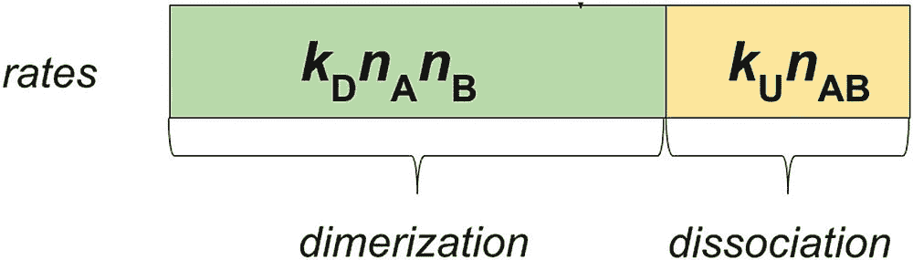

**图 14-2** 速率计算的可视化

一旦我们得到了这个总速率，就可以利用它来回答 Gillespie 算法提出的第一个问题：下一个事件 `delta_t` **何时**发生？我们通过使用 NumPy 的 `exponential` 函数，以 `1.0/rates` 作为比例因子（更多细节请参见 [NumPy 文档](http://docs.scipy.org/doc/numpy-1.10.1/reference/generated/numpy.random.exponential.html)），抽取一个随机样本来计算这个 `delta_t`。这意味着速率越大，抽取到的时间间隔就越短。直观上，你可以认为较大的速率意味着可能事件的*密度更高*，因此我们需要用更短的时间步长来放慢模拟速度，以便精确模拟所有这些事件。

好了，一切顺利，我们已经回答了第一个问题。现在，**什么**事件会发生？这实际上非常简单。我们使用已经计算出的速率，从长度为 `rates` 的区间内均匀采样（再次提醒，这个总速率是由所有单个速率的小*片段*组成的），然后观察随机数落在**哪个**单个速率区间内。在前面的代码中，我们使用 NumPy 的 `uniform` 函数，以 `rates` 作为采样区间，得到一个随机数 `type`。可视化效果如图 14-3 所示，其中虚线表示 `type` 的位置。

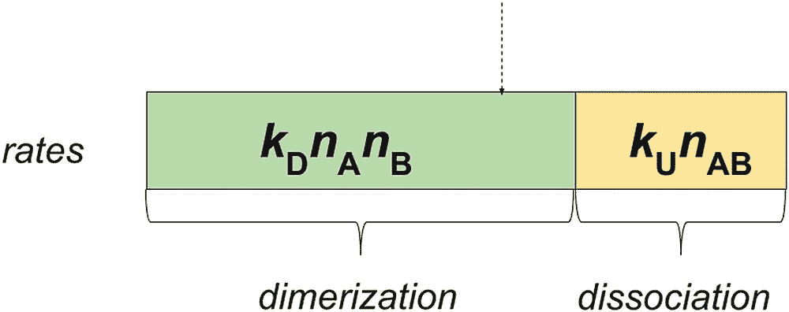

**图 14-3** 选择事件

在图 14-3 中，随机数 `type` 落在了*左段*，意味着发生了*二聚化事件*，这就是 `if type < dimer` 条件所检查的内容。然后，因为我们只有*两个*可能的事件，任何*大于* `dimer` 速率的数，按照定义，都会落在*右段*，意味着解离事件发生。这时我们可以简单地使用 `else` 语句，无需显式检查该速率。

太好了，现在我们可以在下一个 `if` 条件中实际*执行*这些事件了，这部分应该非常清晰。如果发生二聚化事件，我们只需增加二聚体数量 `n_AB`，并减少 A 和 B 单体的数量 `n_A` 和 `n_B`（因为每种单体各贡献一个来形成二聚体）。对于解离的情况，我们做相反的操作：减少二聚体的数量，增加单体的数量。最后，我们将 `delta_t` 加到当前时间 `t`（现在已成为旧时间）上，更新时间。

至少对于这个模拟来说，一切就简单了！剩下的就是使用 `matplotlib` 来打印输出结果。代码如代码清单 14-3 所示。

```
fig1 = plt.figure()
plt.xlim(0, max_time)
plt.ylim(0, max_molecules)
plt.xlabel('时间')
plt.ylabel('物种数量')
plt.plot(time_points, A_counts,  label="A")  # A 单体
plt.plot(time_points, AB_counts, label="AB") # AB 二聚体
plt.legend()
plt.show()
```

**代码清单 14-3**
绘制时间序列输出

我们在 *x* 轴上使用时间，在 *y* 轴上使用分子数量。第一部分就像在论文中设置图表一样：调用 `figure()` 命令。接下来，我们设置要显示的坐标轴范围，我们希望 *x* 轴从 *t* = 0 到 *t* = 代际数，*y* 轴从零（完全灭绝）到 2*N*（最大种群规模），这通过 `xlim` 和 `ylim` 命令设置。（这与我们在之前章节（如第 11 章和第 12 章）中使用 `matplotlib` 绘制曲线的方式略有不同。这里我们明确指定了两个轴的长度，如果不使用 `xlim` 和 `ylim`，`matplotlib` 将自行选择坐标轴范围，这可能不是您想要的区域。）第三，我们使用 `xlabel` 和 `ylabel` 标记图表。然后我们绘制两条线：第一条是时间列表（`time_points`）对单体数量（`A_counts`），第二条是时间点列表对二聚体数量（`AB_counts`）。最后，我们添加图例并显示图形。结果应该会得到类似图 14-4 的图形。

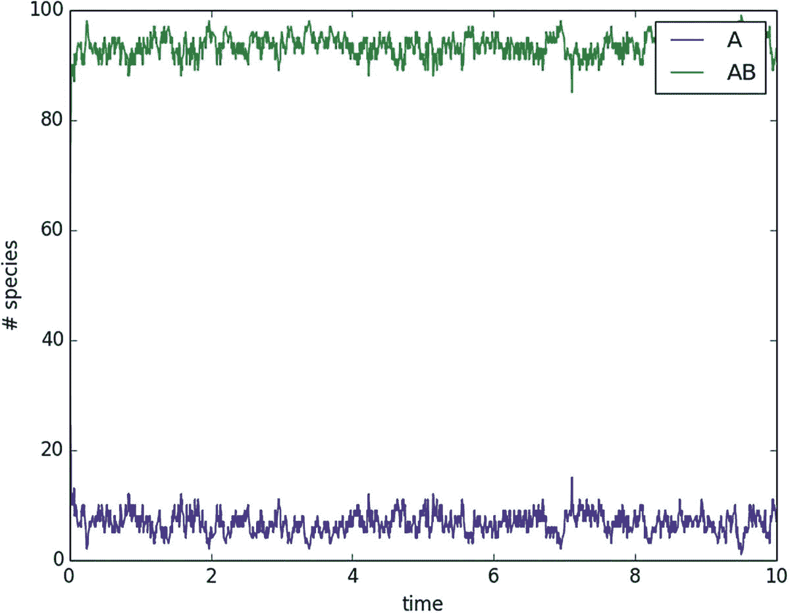

**图 14-4** 二聚化过程 Gillespie 模拟的时间序列输出图

您可以立即看到，虽然我们从零个二聚体开始，但模拟迅速将二聚体数量增加到约 90 的平衡值。然而，单个事件的随机性导致该平均值持续“波动”；同样，单体的数量降至约 10 个。

## 噪音来了！

我们可以用模拟做的另一件有趣的事情是，观察**减少分子数量**如何真正**增加噪音量**，甚至达到平衡被打破的程度。想象一下我们只有五个分子，我们可以通过设置 `max_molecules = 5` 来实现。然后，如图 14-5 所示，波动非常明显，没有真正的平衡。在细胞内的某些实际情况下，这可能会对生物学过程产生重大影响。

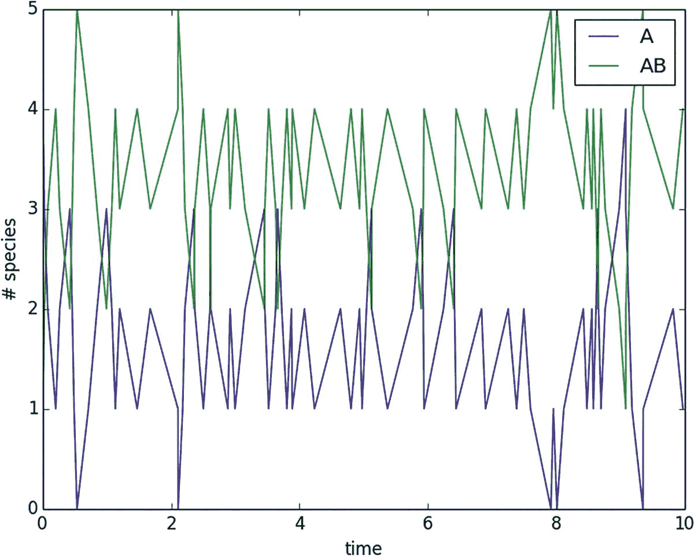

**图 14-5** 分子数量非常少时的 Gillespie 模拟

或者，我们可以走**另一条**路，通过**增加分子数量**来**减少噪音量**，使模拟更接近连续或确定性模型，方法是将分子数量设置为一个非常高的值，例如 `max_molecules = 1000`。如图 14-6 所示，分子种类的数量非常迅速地稳定下来，噪音量非常小。

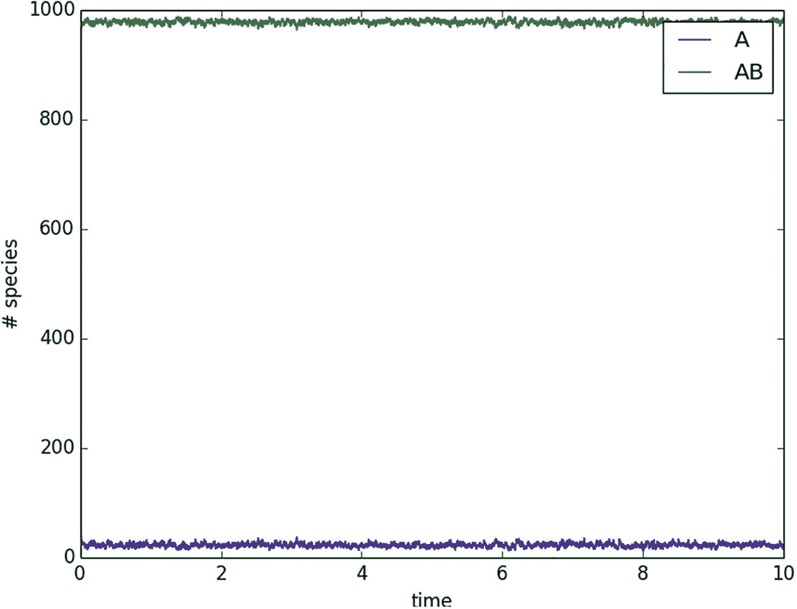

**图 14-6** 分子数量很大时的 Gillespie 模拟

好吧，这一切听起来都不错，但在这一点上，它似乎更像是*化学*而非*生物学*。那么，我们来看看更接近细胞内发生的事情，比如转录和翻译这些分子生物学过程，以及它们如何相互作用形成我们在第 12 章关于系统生物学数据挖掘中遇到的那种基因网络。`Gillespie`算法和`Python`在这里也能帮助我们！

## 让模型更真实：一个双稳态开关

我们将研究一个非常简单的基因网络示例：一个***双稳态开关***。实际上，用“网络”这个词可能有点牵强，因为我们的开关只包含两个基因。为了与之前的二聚体示例保持一致，我们称它们为基因*A*和*B*。假设你取两个基因并将它们连接起来，这样当基因*A*被*激活*时，它会倾向于关闭基因*B*，而当基因*B*被*激活*时，它会倾向于关闭基因*A*。这种基因开关实际上已经在*大肠杆菌*中创造出来（详见 Gardner (2000)）。

如图 14-7 所示，这有点像循环处决模式。

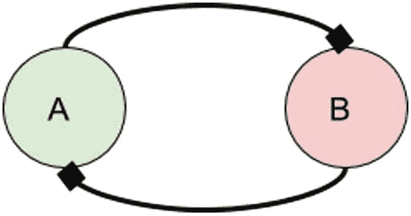

**图 14-7** 基因双稳态开关示意图

当然，这只是对分子层面所发生事情的极其粗略的描述。实际上，当足够多的转录因子***结合***到实际编码区下游 DNA 的启动子区域时，基因就会被开启。转录的起始本身因此有些随机，但一旦开始，编码区就会被***转录***成一条 `mRNA` 分子。

这条 `mRNA` 分子随后会被***翻译***成一个蛋白质分子。这两个分子，即 `mRNA` 和蛋白质，也都可以被***降解***，分别重新变回其组成的核苷酸或氨基酸。所有这些四个过程——结合、转录、翻译和降解——都可以被建模为以特定*速率*发生的单个*事件*。听起来耳熟吗？在图 14-8 中，我们展示了所涉及过程的图形快照。

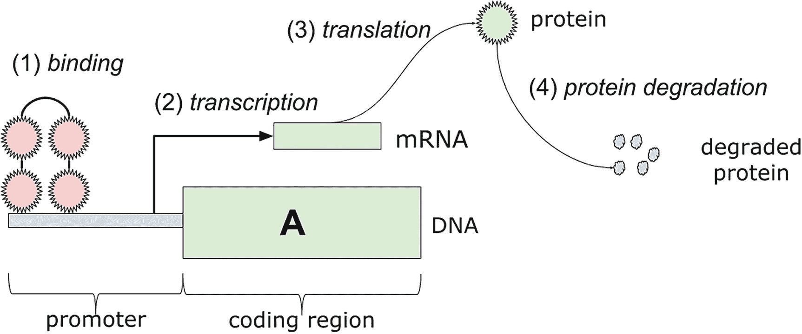

**图 14-8** 基因表达：结合、转录、翻译和蛋白质降解

通过将每个蛋白质都制成***转录因子***，我们可以将基因*A*和*B*“连接”成一个回路，创建一个***基因电路双稳态开关***，展示所涉及的主要分子生物学过程，如图 14-9 所示。

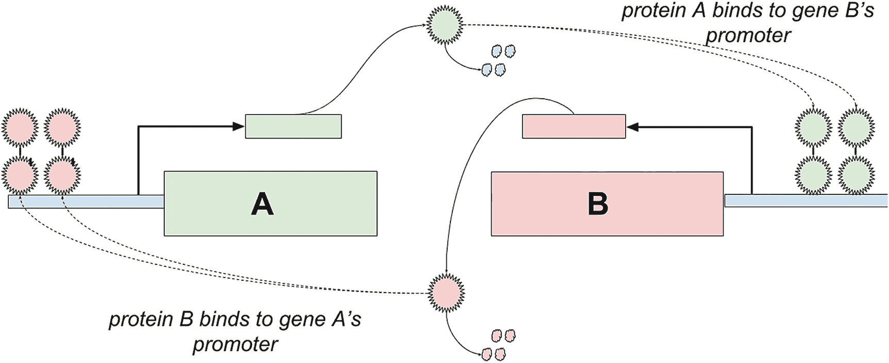

**图 14-9** 将两个基因连接起来构成一个基因双稳态开关

但这看起来已经开始变得相当复杂了！确实，使用 `Gillespie` 框架实现*完整*的双稳态开关需要我们来追踪：

1. 正在结合的转录因子的数量

2. `mRNA` 分子的数量

3. 蛋白质分子的数量

对于`每个`基因。这意味着要更新至少`六个反应物`和许多总`反应`。这看起来需要大量的记账工作。怎样才能让自己稍微轻松一点呢？

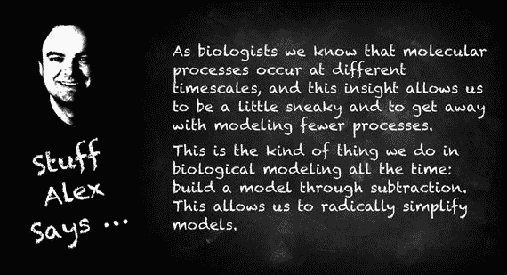

答案是：利用我们对底层生物系统的知识来`简化`模型。在我们的例子中，我们可以将模型简化为只有`两个反应物`（代表我们最初的两个基因，A 和 B）和仅`四个反应`。我们怎么做呢？让我们从观察基因如何被“开启”开始。

### 三合一：开启一个基因

关于转录，有两个重要事情需要认识到：

1.  `转录因子结合事件通常非常快`，相对于`转录起始`的时间尺度。例如，在大肠杆菌中，转录因子结合事件发生在毫秒量级，^(¹⁸⁰) 而转录起始每隔几秒钟才会发生一次。^(¹⁸¹) 因此，我们可以将基因`A`的结合和起始“合并”为一个反应，由基因`B`的蛋白质分子数量驱动（反之亦然）。

2.  `翻译是爆发式发生的`：转录和翻译可以“合并”在一起，因为尽管单个起始事件会产生一条单一的`mRNA`，但这条`mRNA`会停留足够长的时间，让核糖体翻译出多个蛋白质。在大肠杆菌中，`mRNA`的合成速率约为每分钟几纳摩尔，翻译速率约为每分钟几个`mRNA`。这种翻译事件数量的“爆发性”可以被建模为每次转录事件中蛋白质分子数量的“跳跃”，从而有效地将转录和翻译步骤合并为一个单一反应。

因此，为了`Gillespie`算法的目的，我们可以将两个蛋白质反应物各自的结合和转录过程压缩为仅两个反应（同样在代码中，我们将使用 `n_A` 和 `n_B` 表示 A 型和 B 型蛋白质的数量），并且，与之前的案例一样，我们在图 14-10 的括号中指示了这些反应发生的速率。

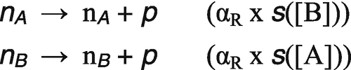

**图 14-10** 结合和转录的化学反应

第一个反应结合了三个合并的过程（结合、转录和翻译），导致此事件产生了 *p* 个新的 A 型`蛋白质`分子。该事件的速率主要负责捕捉这个整体过程，因此需要稍微多解释一下。这些 A 型蛋白质“爆发”的速率将与两件事成正比：

1.  `启动子的活性速率`：`s`([`B`])，即发生转录因子结合位点事件并`启动``mRNA`合成的速率

2.  一旦开始，`mRNA 的合成速率` (`α[R]`)

让我们从第一件事开始：对于`s`([`B`])，我们需要计算一个作为`B`型蛋白质`浓度`的*函数*的速率。让我们假设转录因子`B`以`二聚体`形式活跃（如前面的原始示例），并且二聚化是`瞬时的`（所以我们不为其建模）。我们还假设该基因由我们在第 12 章中已经看到的双相互抑制子基序开启。

提醒一下，这包括一个`带有两个结合位点的操纵子`，二聚体彼此独立地结合，并且当两个二聚体结合时，它们会以速率 `w` 关闭（或“抑制”）转录。同样来自第 12 章，我们将二聚体从各自 DNA 结合位点的`解离`速率定义为 `K[D]`。如果两个转录因子相同，那么它们的浓度都是 [`B`]，并且可以推导出活性速率作为浓度的函数 `s`([`B`])，如图 14-11 所示。

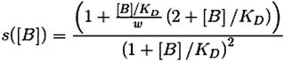

**图 14-11** B 型启动子活性速率的方程

好的，作为一名高级文档工程师和翻译员，我将严格遵循您提供的格式和注意事项，将以下英文文本翻译成中文。

正如我们在第 12 章的动力学可视化中所见，随着蛋白质（`B`）浓度的*增加*，转录起始的速率（`s`）将会*降低*。这再次基于第 12 章中的直觉：转录因子蛋白质的副本越多，它们与 DNA 上的启动子结合的机会就越多，从而`关闭`基因 A 以及随后蛋白质`A`的产生。与第 12 章处理方式的主要区别在于，现在我们使用公式将转录事件视为概率事件来计算其*概率*，而不是将速率绘制为浓度的连续函数。

呼！既然我们已经解决了第一个反应，那么第二个反应就简单多了。它与第一个反应的形式完全相同，只是启动子活性 `s(A)` 现在成为了蛋白质`A`浓度的函数，因为`B`受到`A`蛋白质的调控。

## 所有蛋白质终将消亡

这是生物学中一个令人伤感的事实：所有蛋白质最终都会消亡。对我们来说幸运的是，蛋白质分子的丢失建模起来要*简单得多*。我们这里只处理简单的生物化学降解。再次，如图 14-12 所示，我们只有两个反应，两者都与各自的浓度和蛋白质降解率 `β[p]` 成正比：

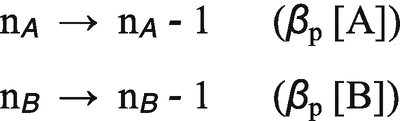

**图 14-12** 蛋白质降解的两个化学反应方程式

回到图 14-13 的图形化展示，你可以看到“整合的”结合+转录+翻译过程（在灰色方框中）是如何“映射”到原始生物学机制上的，这使我们只需跟踪蛋白质浓度即可。这让我们回到了仅有*两种反应物*（两种蛋白质）和*四个事件*的状态，如实线所示（原始事件的虚线现在隐含在整合事件中）。

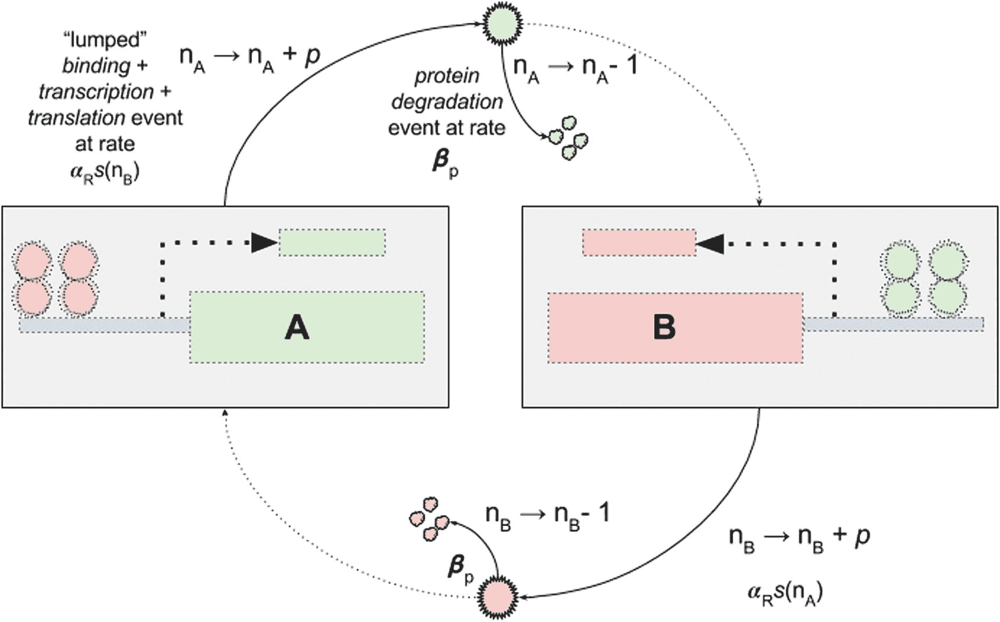

**图 14-13** 基因开关的简化模型，展示了主要建模事件

## 生物化学讲够了！上代码！

“生物化学已经讲得够多了，”我听到你这么说，“我现在已经准备好要看一些 Python 代码了。”好吧，我们已经介绍了足够的生物学知识和模型来开始编写代码，所以事不宜迟……在代码清单 14-4 中，我为你呈现`calculate_reaction_rates`函数（以及相关的全局变量）。

```python
alpha = 1    # 合成 mRNA
p  = 10      # 每个 mRNA 事件产生的蛋白质分子数
protein_degr_rate = 1/50.0   # 降解蛋白质
w_fold  = 200      # 折叠抑制倍数
K_D = 25           # 产生抑制作用的 DNA 结合强度

def calculate_reaction_rates(n_A, n_B):
    A_conc = n_A/scaling
    B_conc = n_B/scaling
    A_synthesis_rate = scaling*alpha*(1+(B_conc/K_D/2)/w_fold*(2+(B_conc/K_D/2)))/(1+(B_conc/K_D/2))**2
    B_synthesis_rate = scaling*alpha*(1+(A_conc/K_D/2)/w_fold*(2+(A_conc/K_D/2)))/(1+(A_conc/K_D/2))**2
    A_degradation_rate      = scaling*protein_degr_rate*A_conc
    B_degradation_rate      = scaling*protein_degr_rate*B_conc
    return [A_synthesis_rate, B_synthesis_rate, A_degradation_rate, B_degradation_rate]
```

**代码清单 14-4** 计算基因开关的反应速率

该函数将每种蛋白质的数量作为参数，并使用缩放因子 `scaling` 将其转换为浓度。这一点应该不言自明：接着，我们实现了前两个导致新蛋白质产生的反应。速率常数 `K[D]` 和 `w` 在代码中分别由 `K_D` 和 `w_fold` 表示。导致新蛋白质以 `β[p]` 降解率（代码中为 `protein_degr_rate`）减少的后两个反应，则在四个反应中的第二组中实现。在函数末尾，我们以列表形式返回这些速率。

## 分子记账：保持账目清晰

算完速率之后，生物学建模的大部分复杂性实际上已经完成。生物学中下一个主要部分要简单得多，它仅仅是分子数量的记账，就像二聚体例子一样，它非常自然地源自前面展示的化学反应。但它现在足够复杂，以至于我们不会将代码内联到主函数中，而是将在代码清单 14-5 中为其提供一个独立的函数。

```python
def do_reaction(n_A, n_B, next_reaction):
    if next_reaction == 0:
        n_A = n_A + p  # 创建了 p 个 A 副本
    elif next_reaction == 1:
        n_B = n_B + p  # 创建了 p 个 B 副本
    elif next_reaction == 2:
        n_A -= 1       # A 被降解
    elif next_reaction == 3:
        n_B -= 1       # B 被降解
    return n_A, n_B
```

**代码清单 14-5** 执行化学反应

我们再次传入了每种蛋白质分子的数量以及反应类型 `next_reaction`，并根据规则更新数量（请注意，爆发大小由全局变量 `p` 表示）。

## 我们准备模拟！

我们现在准备在代码清单 14-6 中引入主程序，并且我们保留了与二聚体示例相同的基本数据结构和名称，使用列表来记录时间点和蛋白质计数（`A_counts`、`B_counts`、`time_points`），以便于理解（请注意，你需要先执行代码清单 14-4 和 14-5 中的代码，此代码才能运行）。

```python
scaling = 1.0
max_time = 20000.0
time_points = []
A_counts  = []
B_counts  = []
n_A = round(11*scaling)
n_B = round(34*scaling)
seed(50)
t = 0.0
num_reactions = 4

while t < max_time:
    time_points.append(t)
    A_counts.append(n_A)
    B_counts.append(n_B)
    rates = calculate_reaction_rates(n_A, n_B)
    total_rates = sum(rates)
    delta_t = exponential(total_rates)
    r = uniform(0, total_rates)
    cumulative_sum = 0
    for reaction in range(num_reactions):
        cumulative_sum += rates[reaction]
        if cumulative_sum >= r:
            next_reaction = reaction
            break
    n_A, n_B = do_reaction(n_A, n_B, next_reaction) # 执行反应
    t = t + delta_t
```

**代码清单 14-6** 基因开关的主模拟循环

程序的 `while` 循环结构与二聚体示例几乎相同，不同之处在于我们通过 `seed(50)` 将随机数种子固定为 50。数字 50 只是随意选择的，但它能确保你的图表看起来与我们接下来展示的完全一致。我们首先计算 `total_rates`，这次是通过调用 `calculate_reaction_rates` 函数，返回速率列表并对其求和。为此，我们引入了 Python 内置的 `sum()` 函数，它会对任何提供的列表中的所有元素求和。然后，我们使用 `exponential()` 获取 `delta_t`，并通过从一个长度为 `total_rates` 的 `uniform()` 分布中采样来确定反应类型。另一个主要区别是，找到要执行的事件稍微复杂一些，因为我们现在有四种反应类型。因此，我们的区间现在如图 14-14 所示。

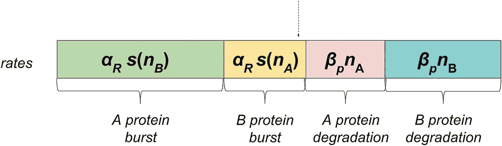

**图 14-14** 为基因开关在 Gillespie 算法中选择化学反应（事件）

为了找出要执行的反应，我们使用一个`for`循环来逐步累加反应速率。一旦累加和超过`type`，就会`break`循环并使用该反应。因此，循环会首先累加子列表`rates[0:1]`中的速率，然后是`rates[0:2]`，以此类推，直到本例中的`rates[0:4]`。如果在任何时刻这个累加和超过了`type`，我们就找到了目标反应。请务必记住，从`calculate_reaction_rates`返回的列表*顺序*必须在整个过程中*保持一致*，以便`rates`列表中的第零项始终对应于`do_reaction`函数中的第零个反应（即蛋白质*A*的爆发事件），第一项对应于第一个反应，依此类推。虽然这在当前特定示例中不成问题，但如果你在没有意识到索引必须保持原始*相同*顺序的情况下重写代码，就可能会出现问题。

获得`next_reaction`索引后，我们执行`do_reaction`，更新由`do_reaction`返回的蛋白质数量`n_A`和`n_B`，并更新时间戳`t`。现在，我们准备好进行清单 14-7 中的绘图，其代码几乎与二聚体示例完全相同。

```
fig1 = plt.figure()
plt.xlim(0, max_time)
plt.ylim(0, 1000)
plt.xlabel('time')
plt.ylabel('# species')
plt.plot(time_points, A_counts, label="A") # species A
plt.plot(time_points, B_counts, label="B") # species B
plt.legend()
plt.show()
Listing 14-7
Plotting output of Gillespie simulation
```

现在，让我们看看清单 14-8 中的完整程序，并使用默认参数运行它。

# 模拟基因开关的Gillespie算法

```python
from numpy.random import exponential, uniform, seed
import matplotlib.pyplot as plt
### Model 2: toggle switch: four reactions
alpha = 1    # synthesis mRNA
p  = 10      # number of protein molecules per mRNA event
protein_degr_rate = 1/50.0   # degrading protein
w_fold  = 200      # fold repression
K_D = 25           # strength of the DNA binding creating repression
def calculate_reaction_rates(n_A, n_B):
    A_conc = n_A/scaling
    B_conc = n_B/scaling
    A_synthesis_rate = scaling*alpha*(1+(B_conc/K_D/2)/w_fold*(2+(B_conc/K_D/2)))/(1+(B_conc/K_D/2))**2
    B_synthesis_rate = scaling*alpha*(1+(A_conc/K_D/2)/w_fold*(2+(A_conc/K_D/2)))/(1+(A_conc/K_D/2))**2
    A_degradation_rate      = scaling*protein_degr_rate*A_conc
    B_degradation_rate      = scaling*protein_degr_rate*B_conc
    return [A_synthesis_rate, B_synthesis_rate, A_degradation_rate, B_degradation_rate]
def do_reaction(n_A, n_B, next_reaction):
    if next_reaction == 0:
        n_A = n_A + p  # p copies of A are created
    elif next_reaction == 1:
        n_B = n_B + p  # p copies of B are created
    elif next_reaction == 2:
        n_A -= 1        # A is degraded
    elif next_reaction == 3:
        n_B -= 1        # B is degraded
    return n_A, n_B
scaling = 1.0
max_time = 20000.0
time_points = []
A_counts  = []
B_counts  = []
n_A = round(11*scaling)
n_B = round(34*scaling)
seed(100)
t = 0.0
num_reactions = 4
while t < max_time:
    time_points.append(t)
    A_counts.append(n_A)
    B_counts.append(n_B)
    rates = calculate_reaction_rates(n_A, n_B)
    total_rate = sum(rates)
    delta_t = exponential(1.0 / total_rate)
    r = uniform(0, 1)
    type_ = r * total_rate
    cumul = 0.0
    next_reaction = 0
    for reaction, rate in enumerate(rates):
        cumul += rate
        if cumul >= type_:
            next_reaction = reaction
            break
    n_A, n_B = do_reaction(n_A, n_B, next_reaction) # carry out reaction
    t = t + delta_t
fig1 = plt.figure()
plt.xlim(0, max_time)
plt.ylim(0, 1000)
plt.xlabel('time')
plt.ylabel('# species')
plt.plot(time_points, A_counts, label="A") # species A
plt.plot(time_points, B_counts, label="B") # species B
plt.legend()
plt.show()
```
Listing 14-8: Full program of Gillespie algorithm simulation of genetic toggle switch

你会注意到，运行这个程序会比其他的稍慢，这是因为为了得到有趣的事件，它进行了更多的计算。你应该会看到类似于图14-15的结果。

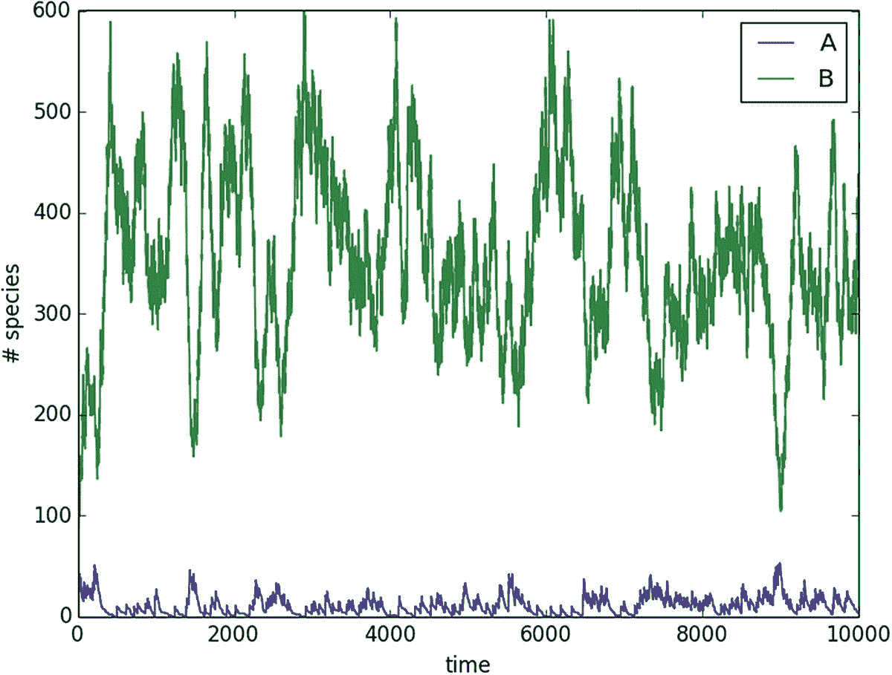

Figure 14-15: Plotting output of Gillespie algorithm simulation of genetic toggle switch

注意，`A`分子的数量在很短的时间内（大约100个时间步或更少）就达到了约400个分子的稳态，而`B`分子的数量非常低（表明`A`有效地处于开状态，而`B`处于关状态）。这个开关似乎正在履行其职责，并保持在一个单一的开状态。

如果我们把分子总数减少四分之一会发生什么？我们可以简单地通过设置`scaling = 0.25`并重新运行模拟来做到这一点，输出结果应该类似于图14-16。

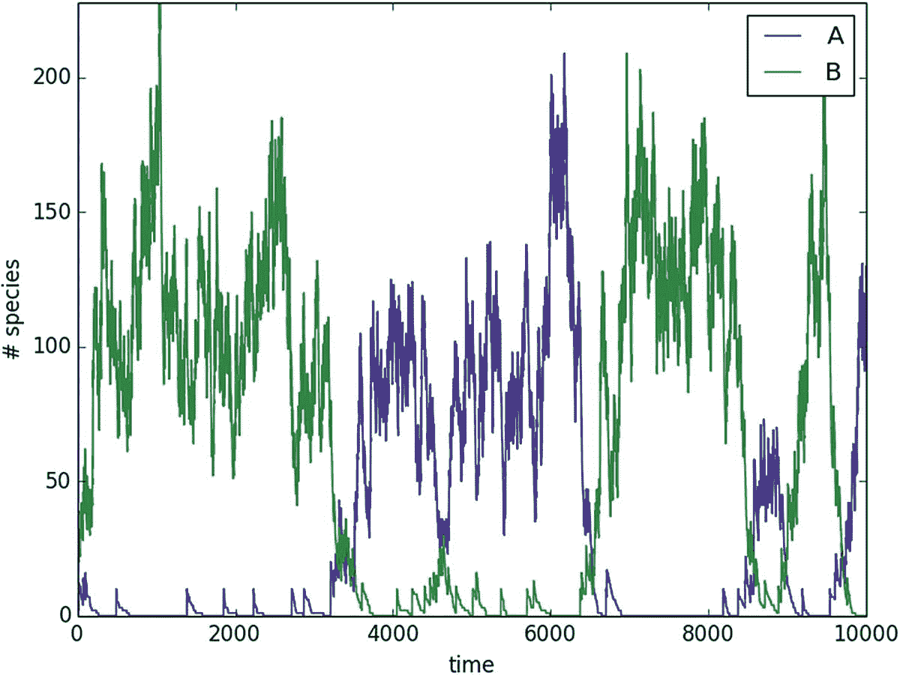

Figure 14-16: Output of simulation with a smaller number of molecules shows the genetic switch being “toggled”

尽管我们确实看到`A`分子达到了约80个分子的稳态，但这个状态现在变得*不稳定*了！在相同的10,000个时间步内，我们观察到了多次从一个状态到另一个状态的开关事件。注意，这完全是在没有任何*外部输入*的情况下发生的。它就像幽灵一样自行切换！简单的分子“噪声”就足以偶尔切换状态。我们将此留给读者作为练习，尝试调整各种参数，例如缩放因子、随机数种子（我们在前面的运行中将其设置为50）以及时间步数，来观察开关何时以及多久会变得不稳定。

## 为什么我们应该关心随机开关？

这只是一个很棒的模拟，但我们首先为什么要关心基因回路的随机开关呢？有几个原因。其一具有实际的生物医学意义：在没有外部输入的情况下可能切换状态的偶然事件，可能是某些疾病的基础。例如，我们通常认为癌症纯粹是突变等外部改变的结果，但也有证据表明，细胞内随机事件可能在癌症的发展中发挥作用（Gupta等人，2011）。在更长的时间尺度上，Arkin (1999) 及其同事表明，λ噬菌体裂解/溶原化决策电路中的随机开关，可以导致原本*基因完全相同*的*大肠杆菌*群体分化为具有*不同表型*状态的*亚群*。通过使用细菌中质粒复制的随机Petri网表示，也观察到了类似的过程（Goss & Peccoud 1999）。随着时间的推移，这些过程可能导致非常不同的进化结果。噪声很重要！

我们现在已经用Python构建了一个可识别的*生物*系统的完整模型，这不仅仅是纯粹的化学，但某种程度上又不及一个移动、生长、有生命的东西。让我们在第15章中解决这个问题，届时我们将使用Python，借助人工生命研究的一个主要工具：L-系统，来创建一个非常简单的植物生长模型。

## 参考文献与进一步探索

**书籍**

* Uri Alon，[*《系统生物学导论：生物回路设计原理》*](https://www.crcpress.com/An-Introduction-to-Systems-Biology-Design-Principles-of-Biological-Circuits/Alon/p/book/9781584886426) ^(¹⁸³)（CRC出版社，2006年版）。关于微生物（如*大肠杆菌*和酵母）系统生物学方法的优秀入门介绍。
* Hamid Bolouri，[*《基因调控网络计算建模：入门指南》*](http://www.worldscientific.com/worldscibooks/10.1142/p567) ^(¹⁸⁴)（世界科学出版公司，2008年版）。学习基因网络建模的实用入门指南。

*   Bower 和 Bolouri 主编，[《遗传与生化网络计算建模》](https://mitpress.mit.edu/books/computational-modeling-genetic-and-biochemical-networks) ^(¹⁸⁵)（麻省理工学院出版社，2001 年版）。虽然成书较早，但作为编辑合集，它仍然是技术方法的优秀综述。

# 参考书目

- West-Eberhard，[*发育可塑性与进化*](http://www.oupcanada.com/catalog/9780195122350.html) ^(¹⁸⁶)（牛津大学出版社，2003 年）。各章节探讨了噪声和随机性在生物体发育中的重要作用。

- Darren Wilkinson，[*系统生物学的随机建模*](https://www.crcpress.com/Stochastic-Modelling-for-Systems-Biology-Second-Edition/Wilkinson/p/book/9781439837726) ^(¹⁸⁷)（CRC 出版社，2011 年）。关于系统生物学中随机模型的专著。

## 文章

- Arkin 等人 (1998)。[λ噬菌体感染的大肠杆菌细胞中发育路径分叉的随机动力学分析。](https://www.ncbi.nlm.nih.gov/pmc/articles/PMC1460268/) ^(¹⁸⁸) *遗传学*，**149**，1633–1648

- Bintu 等人 (2005)。[转录调控的数字分析：应用。](https://www.ncbi.nlm.nih.gov/pmc/articles/PMC3462814/) ^(¹⁸⁹) *当代遗传学与发展观点*，**15**，125–135

- Gardner 等人 (2000)。[大肠杆菌中遗传开关的构建。](http://www.nature.com/nature/journal/v403/n6767/full/403339a0.html) ^(¹⁹⁰) *自然*，**403**，339–342

- Gillespie (1977)。[耦合化学反应的精确随机模拟。](http://web.mit.edu/endy/www/scraps/dg/JPC%252881%25292340.pdf) ^(¹⁹¹) *物理化学杂志*，**81**，2340–2361

- Goss 和 Peccoud (1998)。[利用随机 Petri 网对分子生物学中的随机系统进行定量建模。](https://www.ncbi.nlm.nih.gov/pmc/articles/PMC22622/) ^(¹⁹²) *美国国家科学院院刊*，**95**，6750–6755

- Gupta 等人 (2011)。[随机状态转变导致癌细胞群中的表型平衡。](http://www.cell.com/abstract/S0092-8674%252811%252900824-5) ^(¹⁹³) *细胞*，**146**，633–644

- Merlo 等人 (2006)。[癌症作为进化与生态过程。](http://www.cs.unm.edu/%257Akarlinjf/papers/merlo-NRC-AOL.pdf) ^(¹⁹⁴) *自然综述·癌症*，**6**，924–935

- Thattai 和 van Oudenaarden (2001)。[基因调控网络中的内在噪声。](https://www.ncbi.nlm.nih.gov/pmc/articles/PMC37484/) ^(¹⁹⁵) *美国国家科学院院刊*，**98**，8614–8619

## 其他资源

- [BioNumbers](http://bionumbers.hms.harvard.edu/) ^(¹⁹⁶)：一个包含可用于模型的有用生物学数值及其文献来源的数据库。

- [用于系统生物学的 Python](http://pysb.org/) ^(¹⁹⁷) (`PySB`)：一个用于系统生物学的 Python 框架。

- [系统生物学标记语言](http://sbml.org/) ^(¹⁹⁸) (`SBML`)：一种用于研究人员之间共享系统生物学模型的开放交换格式。该网站还提供了 [兼容 SBML 的软件清单](http://sbml.org/SBML_Software_Guide) ^(¹⁹⁹)。

## 脚注
