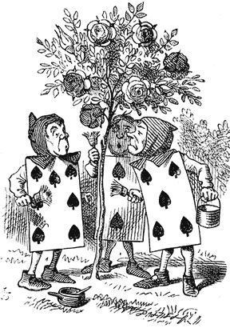
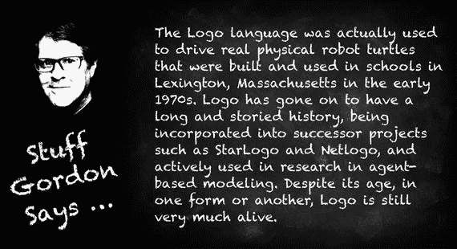
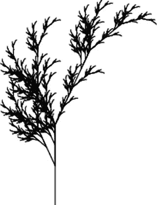

15\. 培育虚拟花园

### 用 L-系统建模植物发育



*三张纸牌提着油漆桶穿过田野，这时它们遇到一个从泥土中伸出的、模样极其古怪的结构。*

*“这个东西一定是某种强大力量作用的结果，”黑桃五说道。“它有这么多的弯弯绕绕，简直让人难以理解——没有任何自然过程能产生这样一团纠结的怪物。”*

*“是啊，快看这个结构末端那许多不同的形状，”黑桃七惊叹道，“没有两个是完全一样的。显然，这个东西——不管它叫什么——是最精湛的手工艺术品。”*

*一直沉默不语的黑桃二不自在地挪了挪脚。“嗯，好吧，你知道，我一直在数那个从地里冒出来的东西末端的分支数量。我觉得我看出了一种规律……”*

*五和七短暂地对视了一眼，随即大笑起来。“这真是太典型了，你就爱跟数字较劲。接下来你恐怕要说，你就是我们之间的差异吧。”*


`turtle` 图形，`+=` 运算符，只读，竞态条件


发育生物学，细胞繁殖，丝状生长，藻类，植物，生成行为，复杂系统

---

回顾我们迄今为止的探索，计算生物学远不止于序列分析。将视野提升到生物系统的尺度，生物体发育那惊人流畅却高度稳健的过程，自显微镜问世以来一直是人们兴趣的源泉。Python 是一个绝佳的平台，可以通过简单规则或行为的生成能力来探索发育的本质。这是一个强大的思想，因为即便是非常简单的规则，经过时间的迭代，也能产生复杂且不可预测的模式。从[*鸟类的群集行为*](https://en.wikipedia.org/wiki/Flocking_%2528behavior%2529)到[*蜜蜂的群聚*](https://en.wikipedia.org/wiki/Swarming_%2528honey_bee%2529)，生物学中充满了简单行为产生无尽迷人模式的例子——这个研究领域被称为[复杂适应系统](https://en.wikipedia.org/wiki/Complex_adaptive_system)（第 16 章和第 18 章将进一步探讨这些主题）。你甚至可以在电脑里种植植物，就像奥地利生物学家[阿里斯蒂德·林登迈尔](https://en.wikipedia.org/wiki/Aristid_Lindenmayer)早在 1968 年所做的那样，通过模拟藻类等丝状生物的生长和发育过程来实现。

林登迈尔首先设想了一个一维的单细胞线，其中任何一个细胞只从其直接左侧或右侧的邻居那里接收分裂或生长的信号。他假设每个藻类细胞存在于两种可能状态之一：繁殖或生长。处于繁殖状态的细胞会分裂成两个细胞：一个将进入生长状态，另一个将保持在繁殖状态。此外，进入生长状态的细胞最终会转变成繁殖细胞。将这两条规则结合起来，林登迈尔提出了一个[丝状生长](https://en.wikipedia.org/wiki/Filamentation)模型，该模型捕捉到了植物真实生长的某些关键特征，例如[持续的顶端生长](http://archive.bio.ed.ac.uk/jdeacon/microbes/apical.htm) ^(²⁰⁰)，即中央的“茎”（在模型中这是一组细胞）在外观上保持不变，即使细胞分裂并远离这组中央细胞。

### 提升生产力：算法化的生成规则

将这一理念转化为代码的核心，在于将生物学直觉严格定义为算法化的**生成规则**。

你可以将前述两种直觉编码为两条简单规则。将处于繁殖状态的细胞称为`A`，处于生长状态的细胞称为`B`。一条生成规则的基本含义是：获取*左侧*的一个符号，并用*右侧*的另一组符号替换它。其形式如下：

- `B → A` (规则 #1：生长细胞变为繁殖细胞)

- `A → AB` (规则 #2：繁殖细胞分裂为另一个繁殖细胞加一个生长细胞)

为了完善算法，我们只需给算法一个初始细胞作为起点，比如一个繁殖细胞`A`。我们可以“手工”（或许更应该说是“靠头脑”）运行生长过程：从`A`开始，注意到`A`不是生长细胞，因此第一条规则*不适用*；但它*是*繁殖细胞，所以我们*应用*第二条规则。于是我们得到一个*繁殖*细胞和一个*生长*细胞，即`AB`。

让我们再次运行规则：这次繁殖细胞`A`会再次变成`AB`，而第二个生长细胞`B`会保持不变，结果是`AB` + `A`，即`ABA`。持续这样做，你会得到`ABA` -> `ABAAB` -> `ABAABABA`，以此类推。

那么，如何在 Python 中构建这个算法呢？实现该功能的函数`algae_growth()`出乎意料地简短：我们只需提供希望规则运行的迭代次数以及初始符号（默认设为`A`）。清单 15-1 中的主要代码由*两个*嵌套的`for`循环组成。


def algae_growth(number, output="A", show=False):
    for i in range(number):
        new_output = ""
        for letter in output:
            if letter == "A":          # rule #2
                new_output += "AB"
            elif letter == "B":        # rule #1
                new_output += "A"
        output = new_output     # only update state after all letters are read
        if show: print("n =", i+1, output, "[", len(output), "]")
    return output

print("n = 0", "A", "[ 1 ]")
algae_growth(6, output="A", show=True)
```

外层循环运行`number`次，将结果存储在变量`output`中。在每个循环开始时，我们将`new_output`重新初始化为空字符串`""`。然后，我们获取现有的`output`，并使用内层`for`循环逐字符遍历它。对于循环中的当前`letter`，我们检查它是`A`还是`B`。如果是`A`，我们使用`+=`操作符将两个新字母追加到`new_output`字符串中。同样，如果是`B`，我们追加一个`A`。处理好该字母后，我们将`new_output`重新赋值给`output`，以便为下一次生长和繁殖迭代（外层循环）重新开始整个过程。

注意，这里我们使用了两个不同的变量，而不仅仅是`output`一个变量。这是为什么呢？这是因为在应用两条规则期间，我们需要保持`output`变量为*只读*状态；否则，我们就会像那条追逐自己尾巴的寓言蛇一样陷入循环。（为了验证这一点，你可以尝试删除`new_output`变量，并将所有`new_output`替换为`output`，代码仍然能运行，但它更像是一种“死亡螺旋”。）因此，只有在*应用*了规则之后，我们才用`new_output`的内容更新`output`变量。

清单 15-1 中的最后一步调用该函数并*培养*藻类（它运行了算法的六代）。以下输出充分展示了细胞的生长情况：

```
n = 0 A [ 1 ]
n = 1 AB [ 2 ]
n = 2 ABA [ 3 ]
n = 3 ABAAB [ 5 ]
n = 4 ABAABABA [ 8 ]
n = 5 ABAABABAABAAB [ 13 ]
n = 6 ABAABABAABAABABAABABA [ 21 ]
```

注意，仅仅经过六次迭代，我们就已经得到了非常有趣的模式。我们还打印出了每一轮迭代的长度。敏锐的读者会发现一个有趣的模式：它们呈现的是[斐波那契数列](https://en.wikipedia.org/wiki/Fibonacci_number)。仔细想想，这其实相当不可思议：一组非常简单的两条规则反复迭代，就能产生一系列细胞，而细胞的数量与自然界中最基本的数学序列之一（叶子在茎上的排列、松果的形成）紧密相连。我们还可以看到开头提到的持续顶端生长现象：即使生长持续进行，左侧边缘的`ABA`模式仍然保持不变。

### 使用 Python Turtle 图形绘制蕨类植物

到这里，你可能会想，虽然这个模式很酷，但有点无聊。毕竟，细胞并不是真的排成一条直线，它们看起来也不太像植物。我们能做得更好吗？能否利用这些想法生成某种实际上***看起来***像植物的东西？嗯，我很高兴你问这个问题，因为答案是肯定的，我们能。要实现这一点，我们需要一套具有更复杂语言的规则，但仍然使用相同的基本简单逻辑。

我们首先想象一下这棵“植物”，假设它是一株“蕨类植物”，正在一个二维（2D）表面上生长。在这里，L-system 的输出实际上是指令，告诉植物接下来在二维表面的哪个位置“生长”。有六个基本符号，可以理解为代表着发育“指令”：

- `F` = *向前移动*

- `X` = *保持不动*

- `+` = 向右转 25 度

- `-` = 向左转 25 度

- `[` = *保存*当前 (x, y) 位置

- `]` = *回到*已保存的 (x, y) 位置

生成规则将`F`和`X`视为*变量*（意味着只有这两个符号会被扩展为其他符号），而`+`、`-`、`[`、`]`是*常量*（它们是*终结符*：不会被扩展成任何其他符号的符号）。那么，事不宜迟，以下是这两条规则：

- `F` → `FF`

- `X` → `F-[[X]+X]+F[+FX]-X`

好了，这些规则*确实*比之前的规则复杂得多，但它们的工作原理基本相同。每当你看到一个`F`，就把它替换成`FF`；每当你看到一个`X`，就把它替换成右侧那串复杂的表达式！那个长表达式在其内部嵌入了指令，让植物向前移动、左右旋转，以及保存和恢复位置。可以把它想象成一个实时运行的小型遗传程序。

每个保存位置（`[`）和恢复位置（`]`）的操作，则代表一个单独“叶片”生长的完成，并从原始叶片所在位置开始生长一个新“叶片”！当我们实现代码来绘制最终植物时，这一点会更加清晰。与此同时，在清单 15-2 中，我们将看到如何在 Python 中实际实现这些生成规则。

```
def plant_growth(number, output="X", show=False):
    for i in range(number):
        new_output = ""
        for letter in output:
            # rule #1
            if letter == "X":
                new_output += "F-[[X]+X]+F[+FX]-X"
            elif letter == "F":
                new_output += "FF"
            else:
                new_output += letter
        output = new_output
        if show: print("n =", i+1, output, "[", len(output), "]")
    return output
```

你会注意到，这段代码的结构与藻类生长代码完全相同！新代码唯一的区别在于`new_output`中生成规则的右侧部分不同。以初始符号`X`开始，我们可以使用以下代码运行生长过程：

```
print("n = 0", "X", "[ 1 ]")
plant=plant_growth(2, output="X", show=True)
```

由于蕨类植物生长得非常快，我们只展示两次迭代的生长过程（在*n*=2 时，已经有 89 个符号了！）

```
n = 0 X [ 1 ]
n = 1 F-[[X]+X]+F[+FX]-X [ 18 ]
n= 2 FF-[[F-[[X]+X]+F[+FX]-X]+F-[[X]+X]+F[+FX]-X]+FF[+FFF-[[X]+X]+F[+FX]-X]-F-[[X]+X]+F[+FX]-X [ 89 ]
```

到目前为止，一切顺利，但你可能在此时自问：这看起来不像一株蕨类植物，我知道：我想看到一些*看起来*像蕨类植物的东西。为此，我们将深入探讨海龟绘图的世界。如果你在小学或中学上过计算机课，你很可能遇到过一种名为 [Logo](https://en.wikipedia.org/wiki/Fibona) 的语言，它是由位于马萨诸塞州剑桥市的 BBN 公司的科学家们在 20 世纪 60 年代末创建的。这种语言被用来教孩子们如何通过想象他们正在编程控制可以*向前*移动、*左转*和*右转*，以及从一个地方*跳跃*到另一个地方的**海龟**，来绘制**图形**。



Python 采用了海龟绘图的核心概念，并在一个模块中实现了它们，这个模块的名字是，请稍等，鼓声响起…… `turtle`。海龟绘图可用于控制一个二维“*画布*”上的海龟。海龟会留下一系列线条形成的“轨迹”，创建复杂的图案，就像一系列细胞或叶片在真实植物生长中留下它们的轨迹一样。因此，从概念上讲，海龟绘图是绘制 L-system 输出的理想匹配：海龟移动，留下轨迹，然后移动到别处。以下是清单 15-3 中的代码。

# 使用 Python 海龟绘图实现植物生长可视化

```python
import turtle
def draw_plant(actions):
stk = []
for action in actions:
if action=='X':        # 什么都不做
pass
elif action== 'F':     # 向前移动
turtle.forward(2)
elif action=='+':      # 向右旋转 25 度
turtle.right(25)
elif action=='-':      # 向左旋转 25 度
turtle.left(25)
elif action=='[':
### 通过“压入”堆栈来保存位置和朝向
pos = turtle.position()
head = turtle.heading()
stk.append((pos, head))
elif action==']':
### 通过“弹出”堆栈来恢复位置和朝向
pos, head = stk.pop()
turtle.penup()
turtle.setposition(pos)
turtle.setheading(head)
turtle.pendown()
else:
raise ValueError("不识别此动作", action)
turtle.update()
```

清单 15-3 使用 Python 海龟绘图实现植物生长的可视化

现在，这段代码对你来说应该相对简单易懂：该函数接收一系列动作（以字符串形式实现）并循环遍历这些动作（字符串中的每个字符），使用海龟语言告诉海龟要做什么。海龟遵循的命令几乎与这些符号一一对应：

1.  `turtle.forward()` 对应 **F**。

2.  `turtle.left()` 和 `turtle.right()` 对应于旋转命令 “–” 和 “+”。

3.  保存海龟状态  稍微复杂一些：因为我们需要使用 `turtle.position()` 获取当前 (x, y) 位置，并使用 `turtle.heading()` 获取海龟面对的方向。这两个位置可以通过将由位置和朝向组成的元组追加到一个列表中来进行`保存`。（这就像“压入”堆栈。）

4.  将海龟恢复到保存的位置是前一步的逆操作，我们首先从列表（或堆栈）中 `pop()` 最后一个元素。我们还会通过 `turtle.penup()` 让海龟停止留下轨迹，然后使用 `setposition()` 和 `setheading()` 将它放回保存的位置，最后放下笔，以便可以继续绘制细胞轨迹。

`draw_plant()` 函数就完成了！在清单 15-4 中，我们将蕨类植物生长的输出与图形连接起来（请注意，需要先执行清单 15-2 和清单 15-3 中的代码，此代码才能工作）。

```python
print("n = 0", "X", "[ 1 ]")
plant=plant_growth(6, output="X", show=False)
### 获取初始位置
x = 0
y = -turtle.window_height() / 2
turtle.hideturtle()
turtle.left(90)
turtle.penup()
turtle.goto(x, y)
turtle.pendown()
draw_plant(plant)
```

清单 15-4 主程序：生长植物，然后将其可视化

请注意，为了实际绘制图形，我们根据窗口大小对海龟位置进行了一些初始设置，然后将海龟移动到适当位置并放下它的 `pendown()` 以开始生长过程的可视化！如果你运行这个程序，你应该会看到类似于图 15-1 所示的结果。



图 15-1 使用 Python 中的二维 L-system 生成的“蕨类植物”

恭喜，你已经种植出了你的第一棵虚拟植物！在*下一*章（第 16 章）中，我们将扩展这些建模方法，以考察一个由数学家艾伦·图灵最初创建的著名发育模型，该模型后来被证明确实存在于真实的生物体中。

## 参考文献与深入探索

*   Lindenmayer (1968)。[发育过程中细胞相互作用的数学模型 I：具有单侧输入的细丝。](http://www0.cs.ucl.ac.uk/staff/p.bentley/teaching/L6_reading/lsystems.pdf)^(²⁰¹) *Journal of theoretical biology*，**18**，280–299

*   Philip Ball, [*The Self-Made Tapestry: Pattern Formation in Nature*](https://global.oup.com/academic/product/the-self-made-tapestry-9780198502432) ^(²⁰²) (Oxford University Press, 1997) 及其后续著作，三卷本 [*Nature's Patterns, a Tapestry in Three Parts*](https://global.oup.com/academic/product/shapes-9780199237968) ^(²⁰³) (Oxford University Press, 2009) 是生物学及其他领域图案形成科学的优秀入门读物。另有一本摄影版画册可供选择：[*Patterns in Nature*](http://press.uchicago.edu/ucp/books/book/chicago/P/bo23519431.html) ^(²⁰⁴) (University of Chicago, 2016)。Ball 真的很喜欢他的三本书！

*   Kuma and Bentley, [*On Growth, Form and Computers*](http://www.sciencedirect.com/science/book/9780124287655) ^(²⁰⁵) (Academic Press, 2003)。一本关于发育计算建模的优秀的书卷式综述。

*   Melanie Mitchell, [*Complexity: A Guided Tour*](https://global.oup.com/academic/product/complexity-9780195124415) ^(²⁰⁶) (Oxford University Press, 2009)。一次精彩的复杂性科学导览。

### 脚注
