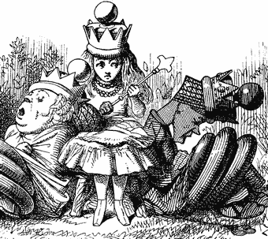
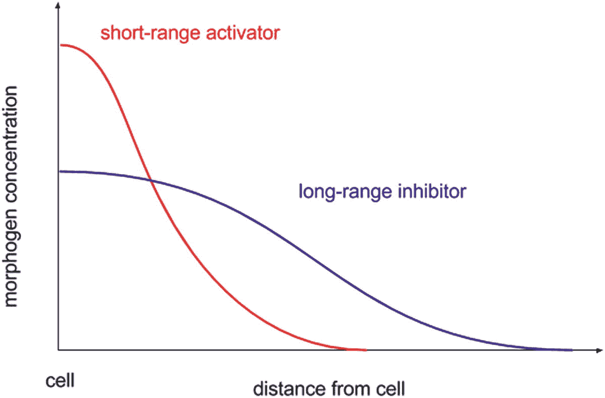
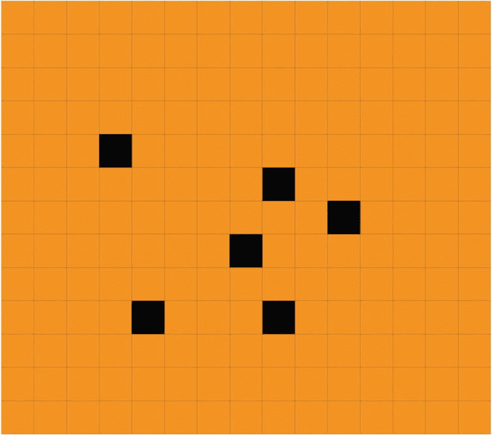
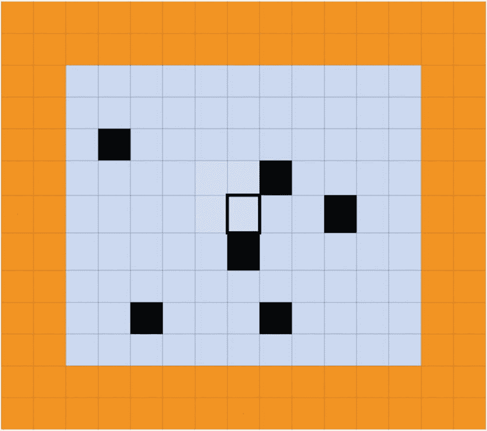
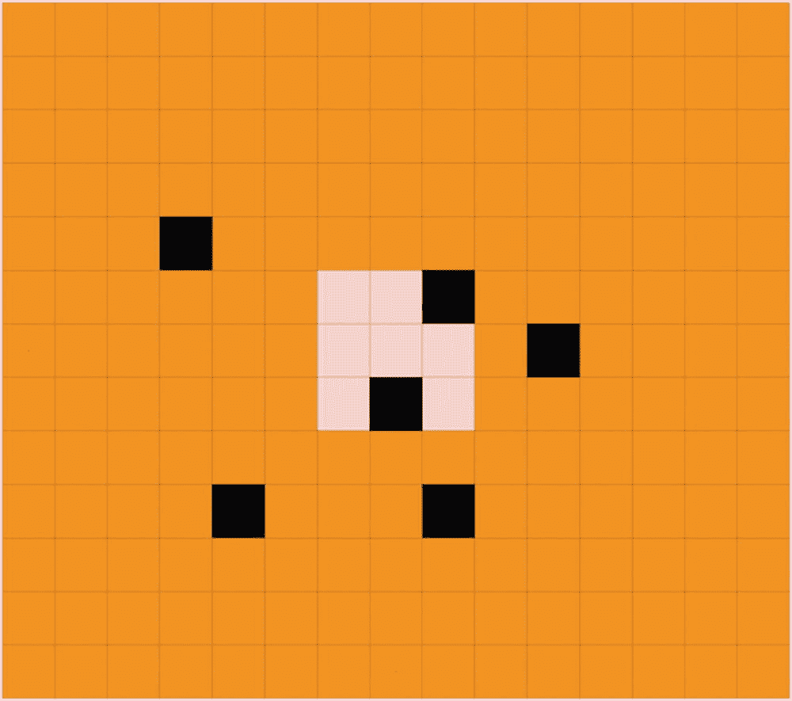
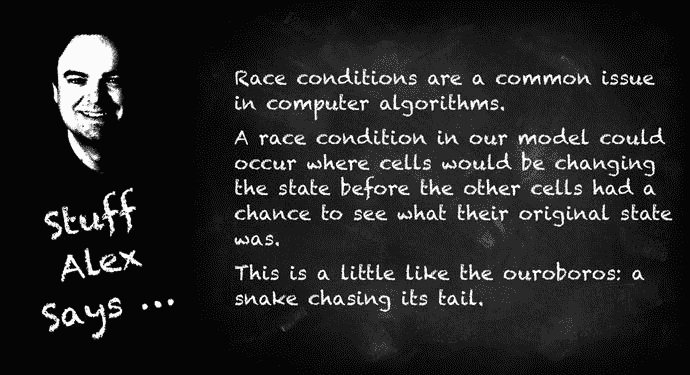
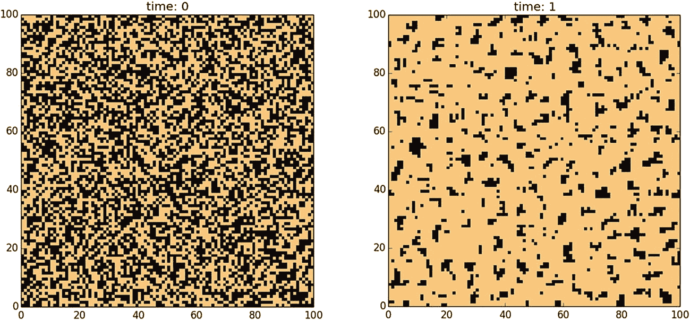
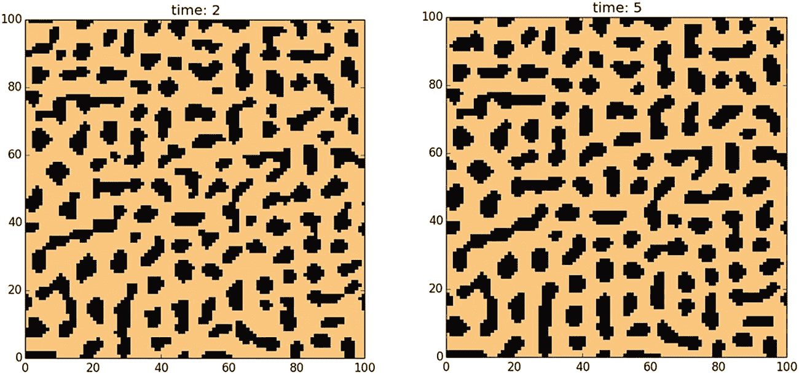

16. 豹子如何获得斑点

*图灵斑图的元胞自动机模型*

 |

 *爱丽丝意识到她讨厌国王和王后让她整天玩的愚蠢游戏。*

*“如果我们能使用同一个棋盘，但不必担心总有人要赢，那会怎样？”*

*“是的，”她喃喃自语，“我只要让每个格子根据它的邻居是谁来改变颜色。然后，我就让它们随机初始，而不是摆成这种愚蠢的战斗阵型，”她开始大声说话，扔掉了她的权杖。*

*“那将会有一系列永无止境、不断变化的游戏，而不是这种对将死的痴迷，”她喊道，一边跳起来甩掉了他们强迫她戴上的不舒服的王冠。*

*然后她听到国王和王后骚动起来，所以她迅速捡起她的王冠和权杖，坐回原位，叹了口气。* |

 |

 `numpy` `二维数组`，`zeros()`，颜色映射，`matplotlib` `pcolor()`，`pause()` |

 | *发育生物学，激活-抑制系统，图灵斑图，形态发生素，豹纹，形态发生，元胞自动机，斑马鱼* |

对生物体发育这一神奇过程的定量研究由来已久。我们在上一章看到的 L 系统可追溯至 20 世纪 60 年代末，但这段历史远比那时更为久远。达西·汤普森早在 1917 年就撰写了经典著作[*论生长与形态*](https://en.wikipedia.org/wiki/On_Growth_and_Form)，远早于 1953 年 DNA 双螺旋结构的发现。事实上，就在前一年——1952 年——英国计算机科学家艾伦·图灵发表了一篇论文，描述了一个试图回答以下问题的数学模型：豹子是如何长出斑点的？当然，图灵最为人熟知的是他在二战期间破解德国恩尼格玛密码机方面的贡献，以及他因 20 世纪 50 年代对同性恋的彻底可耻迫害而英年早逝，但他对理论生物学的贡献同样意义重大。

图灵想知道，一种在单个细胞水平上起作用的简单化学机制，是否能够产生动物身上观察到的全局多细胞图案，例如豹子复杂的皮毛图案和斑马的条纹。这与我们在上一章刚刚描述的 Lindenmayer 系统在概念上非常相似。图灵首先设想一个单一的分化细胞分泌两种化学物质，或称为形态发生素，它们会扩散到该细胞的邻域，如图 16-1 所示。



**图 16-1** 图灵斑图背后的两种形态发生素的浓度梯度

1. 一种短程激活剂，它从源细胞扩散出去，但会非常快速地（由于衰减）被清除，使得靠近细胞处活化剂浓度很高，而稍远一点则低得多。
2. 一种长程抑制剂，它也会从源细胞扩散出去，但清除速度要慢得多，因此靠近源细胞处其浓度低于活化剂，但在远离细胞的地方仍会持续存在。

他进一步设想，激活和抑制形态发生素的相对含量将决定相邻细胞是否也会分化并开始自身分泌这两种形态发生素（这正是一开始将它们称为激活剂和抑制剂的原因）。二维空间中化学扩散过程的相互作用产生了与动物皮毛惊人相似的图案。图灵运用了一些高阶的偏微分方程来模拟这一过程，但幸运的是，我们有一种更简单、更具生成性的方法可以捕捉图灵所描述的本质动态，那就是[元胞自动机](https://en.wikipedia.org/wiki/Cellular_automaton)。元胞自动机（或称 CA）是一个二维对象晶格，通常被称为“元胞”，其状态通过一系列更新规则受其相邻“元胞”影响（更多内容我们将在第 18 章关于基于智能体建模的章节中讨论）。（请注意，称它们为“元胞”通常只是一个方便的比喻，但在我们特定的案例中，我们将其视为构成组织的多细胞基质中的实际细胞。）在模拟的每个时间步长中，CA 中的每个元胞都会咨询其直接邻居，并根据这些邻居的状态作为函数来更新自身状态。这些更新规则构成了我们实现图灵扩散方案的核心。

## 实现细节

### 元胞自动机初始化！

像往常一样，让我们直接进入清单 16-1 中的 Python 代码，并在过程中解释其动态。

```
from numpy import zeros
from numpy.random import random, seed
seed()
probability_of_black = 0.5
width = 100
height = 100
## 初始化元胞自动机 (CA)
CA = zeros([height, width])      # 主 CA
next_CA = zeros([height, width]) # 下一时间步的 CA
activator_radius = 1
activator_weight = 1
inhibitor_radius = 5
inhibitor_weight = -0.1
time = 0
```

**清单 16-1** 设置元胞自动机

我们首先导入所需的 `numpy`（`zeros`）和 `numpy.random`（`random` 和 `seed`）库，然后设置随机种子。接着，我们通过 `probability_of_black` 定义了二维数组中任何给定元胞为**黑色**（即已分化）的概率。为了契合豹纹主题，我们设想所有非黑色元胞（即未分化的元胞）为**橙色**。然后我们创建两个二维元胞自动机：

1. `CA` 是当前的元胞自动机状态：运行模型时，我们将读取这个元胞数组以进行更新。
2. `next_CA` 是下一个时间步的元胞自动机状态，在更新过程中，我们将写入这个元胞自动机。

这种更新方式有时被称为同步更新，因为每个元胞 CA 都是在同一时刻更新的。每个 CA 本质上是一个二维矩阵（也称为二维数组），我们使用 NumPy 库中的另一个功能 [`zeros()`](http://docs.scipy.org/doc/numpy/reference/generated/numpy.zeros.html) 来创建这些矩阵。

`zeros()` 会创建空的矩阵，其维度由列表 `[height, width]` 指定。（这是一个非常有用的函数，因为它也可以用于创建一维数组，在后续章节存储大量绘图数据点时将派上用场。）

接下来，我们定义激活剂的半径（这对应于激活化学物质能够扩散的最大距离，默认我们将其设置为 1，因此只考虑最近的 9 个相邻元胞）以及该激活化学物质的权重。然后，我们定义最大的抑制剂半径（注意，这考虑了当前激活元胞周围 5x5 网格内的所有元胞）以及抑制剂的权重（我们将其设为负值，以明确其与激活剂的作用方向相反）。最后，我们将 `time` 设置为零。

接下来，我们通过循环遍历各个维度，并使用我们的老朋友 `random()` 函数，将每个元胞随机分配为分化或未分化状态，从而初始化 `CA`。以下是清单 16-2 中的代码片段。

```
## 初始化 CA
for x in range(width):
    for y in range(height):
        if random() < probability_of_black:
            cell_state = 1
        else:
            cell_state = 0
        CA[y, x] = cell_state
清单 16-2
初始化元胞自动机
```

按照惯例，我们将所有状态为 `1` 的元胞视为**黑色**（已分化），状态为 `0` 的元胞视为**橙色**（未分化）。图 16-2 展示了一个随机初始化的元胞自动机。



**图 16-2** 随机初始化的元胞自动机

### 创建更新规则

所有设置都已完成，现在我们准备深入生物学的核心，并开始在 `simulation_step` 函数中实际模拟发育过程。基本思路与我们之前做的一样，遍历自动机网格中的每一个元胞，并决定每个元胞是分化还是去分化。清单 16-3 展示了模拟步骤的函数。

```
def simulation_step(CA, next_CA):
    for x in range(width):
        for y in range(height):
            cell_state = CA[y, x]  # 获取当前状态
            activating_cells = 0
            inhibiting_cells = 0
            ### 统计半径内的抑制细胞数量
            for xpos in range(- inhibitor_radius, inhibitor_radius + 1):
                for ypos in range(- inhibitor_radius, inhibitor_radius + 1):
                    inhibiting_cells += CA[(y+ypos)%height, (x+xpos)%width]
            ### 统计半径内的激活细胞数量
            for xpos in range(- activator_radius, activator_radius + 1):
                for ypos in range(- activator_radius, activator_radius + 1):
                    activating_cells += CA[(y+ypos)%height, (x+xpos)%width]
            ### 如果加权后的激活细胞数量大于邻域内的抑制细胞数量
            ### 则诱导当前细胞分化
            if (activating_cells * activator_weight) + (inhibiting_cells * inhibitor_weight) > 0:
                cell_state = 1
            else:
                cell_state = 0
            ### 现在更新状态
            next_CA[y, x] = cell_state
    return next_CA
清单 16-3
用于将元胞自动机推进一个时间步的模拟函数
```

第一部分相当直接：我们遍历元胞自动机网格的 `x` 和 `y` 坐标，并检索当前在 x 和 y 位置的 `cell_state`。接下来的两个（内部）for 循环是抑制和激活作用于当前元胞的地方。我们来分解一下：



**图 16-3** 抑制范围

1. **抑制循环**：第一个循环检查当前元胞 `inhibition_radius` 半径内的所有元胞。此循环统计那些显示为**黑色**的元胞——即那些当前具有化学抑制剂且距离当前元胞足够近以影响它的元胞。该邻域内黑色元胞越多，对当前元胞的抑制影响就越大（倾向于将其关闭为**橙色**状态）。让我们以图 16-2 中的原始 CA 为例，并高亮显示可能对抑制产生贡献的元胞，用浅蓝色叠加表示，此时 `inhibition_radius` 为 5，如图 16-3 所示。

在这个特定示例中，有六个元胞会影响当前元胞的状态，因此在此时间步中，`inhibiting_cells`将被设置为 6。

## 2. 激活循环
类似地，第二个循环检查当前元胞`activator_radius`半径内的所有元胞，如图 16-4 中的浅红色所示。



图 16-4 激活剂范围

同样，该邻域内黑色元胞越多，激活化学物质对当前元胞的影响就越大，但与之前的情况相反，它倾向于激活元胞，从而使其变为**黑色**。在前面的例子中，我们有两个元胞，因此`activating_cells = 2`。

## 3. 决策
两个循环之后的最后一步是决定该元胞应该变成橙色还是黑色。我们在代码中通过计算激活元胞的加权和并将其与抑制元胞的加权和相加来实现这一点。在我们的代码示例中，这个和为

`(2 x 1) + (-0.1 x 6) = 2 - 0.6 = 1.4 > 0`

由于在此示例中该和为正，因此有足够的激活剂导致元胞变为**黑色**，从而将`cell_state`设置为 1。如果该和为负，则将其设置为 0。从生物学上讲，这实现了图灵形态发生模型的主要特征：如果邻域内激活化学物质在总体上多于抑制化学物质，那么细胞就会分化，否则就会去分化。

## 4. 更新
好了，我们快要（但还没有！）完成了。我们必须将输出写入到`next_CA`元胞自动机中相应的位置。这是一个关键点：在更新所有元胞之前，我们不能写入原始的`CA`网格，否则就会出现计算机科学家喜欢称之为“[竞态条件](https://en.wikipedia.org/wiki/Race_condition)”的问题。

## 5. 返回新的 CA
一旦所有元胞都被更新，我们就得到了刚刚写入的`next_CA`，`simulation_step`所做的最后一件事就是将此`next_CA`返回给主程序。我们将在下一节中处理实际的更新。



## 生成元胞自动机斑纹图案

现在我们准备绘制模拟的输出并运行一些形态发生过程！我们可以使用清单 16-4 中的`matplotlib`技能。

```python
### 创建绘图
fig1 = plt.figure()
### 按时间循环
for time in range(10):
    plt.pcolor(CA, vmin = 0, vmax = 1, cmap = "copper_r")  # 绘制当前 CA
    plt.axis('image')
    plt.title('时间: ' + str(time))
    plt.draw()
    plt.pause(0.5)
    CA = simulation_step(CA, next_CA)  # 推进模拟
```
清单 16-4 使用 `matplotlib` 可视化形态发生过程

和往常一样，我们使用 `figure()` 函数设置图形，然后循环执行模型的十个时间步，每次都绘制一个新图形。对于图形本身，我们使用 matplotlib 的 [`pcolor`](http://matplotlib.org/examples/pylab_examples/pcolor_demo.html) 函数；该函数接收一个 NumPy 数组和一个特定的颜色映射 (`cmap`)，用于绘制元胞自动机状态的热力图。我们使用的特定颜色映射是"`copper_r`"，其颜色范围从橙色到黑色，你猜对了，它能呈现豹纹图案。由于我们的 CA 只有两种状态：当元胞状态为 0 时显示为**橙色**，当状态为 1 时显示为**黑色**。

接着调用 `axis()`、`title()`、`draw()` 和 `pause()` 函数。请注意，我们使用了 `draw()` 命令后跟 `pause()` 命令，而不是之前示例中使用的 `show()`，因为后者会导致代码停止。这样，模拟中每个时间步的当前 CA 会显示 0.5 秒，然后才进入下一个时间步。在 for 循环结束时，进入下一个时间步之前，我们调用 `simulation_step()` 函数。这里，我们将当前的 `CA` 和 `next_CA` 作为函数参数传递。至关重要的是，我们将 `simulation_step` 的结果重新赋值给 `CA`。*这*就是我们之前提到的同步更新步骤，将接力棒传递给下一个时间步：*已写入的*现在变成了*待读取的*。

### 形态发生实战

让我们看看实际效果…. 我们从 `t=0` 时刻一个黑白元胞数量相等的随机网格开始。你可以在图 16-5 中看到，即使在第一个 `t=1` 时间步，结构就已经开始显现。



**图 16-5** 形态发生模拟的前两个时间步

如图 16-6 所示，到了 `t=2` 时刻，我们已经能看到那些豹纹裤了！而到 `t=5` 时刻，图案已经稳定下来。



**图 16-6** 形态发生模拟的后续时间步

我们鼓励你尝试调整网格大小以及激活剂和抑制剂强度的相对半径和权重，以生成你自己的皮毛图案。你可以在本书附带的代码下载或我们的 GitHub 站点中（如第 1 章所述），找到将清单 16-1 至 16-4 合并为单个文件的完整代码。大约此时，经验丰富的实验室生物学家可能会想，这一切似乎有点*抽象*。真正的胚胎并非在这些离散的时间步中发育，而且在自然界中，有没有真实的细胞分泌化学物质并以某种方式相互作用的例子呢？

历史的转折点发生在 2012 年，整整 60 年后，一个研究团队发表了一篇论文（Müller, 2012），在[斑马鱼胚胎](https://en.wikipedia.org/wiki/Zebrafish)中实验性地验证了图灵机制。他们成功识别并量化了斑马鱼胚胎模式生成过程中与图灵提出的机制相对应的两种形态发生素，并测量了可映射回原始方程的速率常数。他们还构建了一个模型（比这里介绍的稍复杂），该模型重现了实验生物体中发现的图案，从而弥合了理论预测与实验验证之间的鸿沟。

尽管此处的 CA 模型仍然是对原始图灵方程的一种近似，并且冒着再次唠叨的风险，但它表明，即使是用几行 Python 代码实现的简单模型，也能成为培养对发育生物学基本过程直觉的有力工具。计算发育生物学已成为一个活跃的研究领域；请参阅本章以及第 15 章的参考文献。

现在，我们将从探讨*个体内部*发生的发育等生物过程，转向接下来的几章（第 17–19 章），这些章节将专门介绍如何使用 Python 以计算方式探索*多个生物体种群*的动态。

## 参考文献与延伸阅读

* James D. Murray (1988). [豹子是如何获得斑点的。](http://www.math.ttu.edu/%257Elallen/murray_SciAm.pdf) *科学美国人*, **258**, 80–87

* Turing (1952). [形态发生的化学基础。](http://rstb.royalsocietypublishing.org/content/237/641/37) *伦敦皇家学会哲学汇刊 B：生物科学*, **237**, 37–72

* Forgacs and Newman, [*发育胚胎的生物物理学*](https://www.cambridge.org/catalogue/catalogue.asp%253Fisbn%253D9780521783378) (剑桥大学出版社, 2005)

* Müller *等* (2012). [Nodal 和 Lefty 的差异扩散性是反应-扩散模式形成系统的基础。](https://www.ncbi.nlm.nih.gov/pmc/articles/PMC3525670/) *科学*, **336**, 721–724

## 脚注
