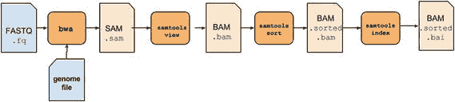

# NGS 数据处理流程

理论上我们可以编写一个直接读取 FASTQ 文件的 Python 程序，但实际上 FASTQ 文件很少被直接分析，而是作为其他工具的输入。分析 NGS 数据最常见的任务之一是**比对**。比对是指将 FASTQ 文件中所有的单独读段，在给定的基因组中寻找它们的*位置*。这个基因组被称为**参考基因组**。有许多工具可以执行此任务，多到有人在推特上调侃说，最终每个实验室都会有自己的比对算法。其中最常用的两个工具是**bowtie** 和 **bwa**（基于 [Burrows-Wheeler 变换](https://en.wikipedia.org/wiki/Burrows%25E2%2580%2593Wheeler_transform)）。就我们的目的而言，我们只想演示该过程，因此我们将随意选择 `bwa` 比对器。

比对器会生成一个**比对文件**；对于 `bwa`，它会生成一个 **SAM** 文件（代表**序列比对/映射**）。这是一个*未压缩的文本文件*，每个读段对应一行，其中包含比对器对该序列在基因组上的原始位置的“最佳猜测”。SAM 文件还包括根本未比对的读段（**未比对读段**）。图 8-1 以图形方式回顾了这些步骤。


**图 8-1** NGS 流程中 `bwa` 步骤的输入和输出

## BAM 文件：查看、排序和索引

SAM 文件在实际使用中作用有限，因为 NGS 是高度并行的；每次比对可能包含数十亿个读段；因此，SAM 文件通常非常庞大。这引出了 NGS 工具箱中的另一个主力工具：**BAM** 文件（代表**二进制比对/映射**），它基本上就是 SAM 文件的*压缩版本*。但即使转换为 BAM 后，为了后续高效处理，BAM 文件还需要*另外两个*步骤：排序和索引。所有这三个步骤都是通过一个名为 [samtools](http://samtools.sourceforge.net/)^(⁸⁷) 的工具套件实现的，这名字并不意外。我们来分解一下：

1.  **查看（View）：** 使用 `samtools view` 命令完成从 **SAM** 到 **BAM** 的转换。

2.  **排序（Sort）：** 排序会将所有更接近染色体末端的读段放到文件开头；这使得查找特定区域的所有读段更快，因为这些读段在文件中都是相邻的。这通过使用 `samtools sort` 命令实现。

3.  **索引（Index）：** 索引必须始终在排序*之后*进行，它会创建一个额外的 **BAI** 文件——这基本上是一个查找表，以便可以按染色体名称轻松检索读段，同样无需从头到尾搜索整个文件。在这里，命令 `samtools index` 是你的好帮手。

让我们扩展一下我们的图形表示（图 8-2）。



**图 8-2** 生成已排序 BAM 文件的完整 NGS 流程

好的，这在概念上很棒，但你实际如何运行这些工具呢？这里我们需要绕道了解一下命令行工具。`samtools` 和 `bwa` 的完整分步安装指南超出了本章的范围，但每个工具在其网站上都有针对每个支持平台的相当完整的安装说明（对于 `samtools`，请访问 samtools.sourceforge.net；对于 `bwa`，请访问 bio-bwa.sourceforge.net）。例如，如果你在 Linux 平台上运行，可能只需运行 `sudo dnf install samtools bwa`（在 Fedora 上）或 `sudo apt install samtools bwa`（在基于 Debian/Ubuntu 的系统上）。

我们将展示的示例使用了相关代码库中包含的两个输入文件（详情见第 1 章）：

1.  一个输入的 FASTQ 文件，包含最初取自*大肠杆菌*基因组序列的 10,000 个读段。

2.  一个*参考基因组*：我们使用文件 `NC_008253.fna` 中编码的*大肠杆菌*完整基因组（这个文件最初[从 NCBI 下载](http://www.ncbi.nlm.nih.gov/nuccore/NC_008253)^(⁸⁸)）：相关的索引已经为你预先构建好了。

所有这些文件都位于我们代码库的 `genomes` 子目录中。以下是您需要从终端运行的一系列命令：

```
bwa mem NC_008253.fna e_coli_10000snp.fq > e_coli_10000snp.sam
samtools view -b -S e_coli_10000snp.sam > e_coli_10000snp.bam
samtools sort e_coli_10000snp.bam e_coli_10000snp.sorted
samtools index e_coli_10000snp.sorted.bam
```

你应该能够继续运行这些命令，并生成两个最终输出文件：输出 BAM 文件 `e_coli_10000snp.sorted.bam` 和索引文件 `e_coli_10000snp.sorted.bam.bai`。呼！我们停下来总结一下。你可能已经注意到，要完成实际上*有趣*的生物学分析步骤——即比对，似乎需要运行许多不同的工具和步骤。你可能会认为，将这些步骤都内置到 `bwa` 中会更好，这样就省去了所有这些额外的“簿记”步骤，也许你是对的，但 NGS 工具的发展，像许多科学软件一样，是零散的。在某些方面，它仍然是一个家庭手工业。

这就是 Python 的用武之地（敏锐的读者可能已经注意到，到目前为止 Python 有点缺席！）。我们可以利用 Python 调用命令行工具的能力来“封装”，或者用另一个术语来说，*打包*那些复杂性，以构建更*可重用*的流程。

## 使用子进程调用

模块 [`subprocess`](https://docs.python.org/2/library/subprocess.html)^(⁸⁹) 是 Python 用于命令行交互的主力模块。我们不会在此重述其接口，而是直接通过清单 8-1 中的代码来实现第一步——比对本身。

```
import subprocess
with open('e_coli_10000snp.sam', "w") as output_sam:
```


### 执行比对

`subprocess.check_call(['bwa', 'mem', 'NC_008253.fna', 'e_coli_10000snp.fq'], stdout=output_sam)`

代码清单 8-1  
使用 `with` 语句将文件发送给子进程

你首先会注意到，输出文件的打开方式与我们之前在第五章中展示的文件创建方法不同。这里我们稍作停留，解释一下 `with` 语句。基本上，`with` 语句声明了一个变量，该变量仅在其下方的代码块内有效（更多详情，请参阅 Python 官方文档中关于 `with` 的内容）。这是一种非常便捷的方式，能使读取文件的代码简洁紧凑，因为我们仅在子进程调用运行期间才需要使用文件句柄。这避免了使用单独的 `open()` 和 `close()` 语句。传统的方式则需要像代码清单 8-2 那样写三行代码。

```
output_sam = open('e_coli_10000snp.sam', "w")
subprocess.check_call(['bwa', 'mem', 'NC_008253.fna', 'e_coli_10000snp.fq'], stdout=output_sam)
output_sam.close()
代码清单 8-2
不使用 with 语句向子进程发送输入文件
```

这两种方式没有绝对的优劣之分，但使用 `with` 的好处是，你不会忘记关闭文件，因为 `with` 会自动为你完成关闭操作！除了处理文件，`with` 还有许多其他用途，例如允许代码块被重用，但我们在此不深入探讨；你可以查看前面提到的 Python 官方文档中关于 `with` 的内容以获取更多细节。

现在回到 `subprocess` 调用本身……在 `with` 子句中，我们将前面章节描述的每个命令行参数作为列表传入，然后将标准输出 `stdout`（即通常会输出到控制台的内容）分配给该文件句柄。如果你在包含测试 FASTQ 和基因组文件的 `genomes` 目录中运行这段代码，你应该会看到 `bwa` 工具的输出，类似于以下内容：

```
[M::main_mem] read 10000 sequences (350000 bp)...
[M::mem_process_seqs] Processed 10000 reads in 0.244 CPU sec, 0.245 real sec
[main] Version: 0.7.9a-r786
[main] CMD: bwa mem NC_008253.fna e_coli_10000snp.fq
[main] Real time: 0.638 sec; CPU: 0.276 sec
```

好了，我们已经成功通过 Python 运行了外部工具来执行比对。祝贺我们自己！我们现在可以*扩展*这个流程，使用代码清单 8-3 中的代码，通过封装 `samtools` 命令来将 SAM 文件转换为 BAM 文件（请注意，这假设你已经运行了代码清单 8-1 中的代码）。

```
### 使用 samtools 转换回二进制（压缩）BAM 格式
with open("e_coli_10000snp.bam", "w") as output_bam:
subprocess.check_call(['samtools', 'view', '-b' '-S', "e_coli_10000snp.sam"], stdout=output_bam)
代码清单 8-3
使用 subprocess 调用 samtools
```

再次注意，这里使用了 `with` 命令创建 BAM 文件，通常这会通过标准输出（`stdout`）的方向来创建。让我们暂停片刻并稍作总结。我们已经成功使用 Python 处理了一个原始 FASTQ 文件 `e_coli_10000snp.fq`，并生成了两个比对到基因组的文件：未压缩的 `e_coli_10000snp.sam` 和压缩的 `e_coli_10000snp.bam`。然而，正如我们之前提到的，在我们对它们进行排序和建立索引之前，我们实际上还不能*使用*这些文件进行进一步的基因组学分析。原则上，我们可以使用与前面相同的方案来“封装” `samtools` 调用，但我们也可以使用一个外部库来实现此目的。这个库叫做 `pySam`。

## `pySam`：以 Python 风格读取比对文件

使用 `pySam` 暂时背离了我们通常仅使用 Python 标准库编写示例的惯例，但我们认为让你熟悉外部库的使用是很有益的，因为如果你最终专攻基因组学分析，你会用到许多更高级的工具。另外请注意，我们已经向你展示了如何在 Python 中手动使用和创建封装器，因此如果这些库过时，你应该能够轻松地编写替代代码。此外，使用 `pySam` 还有一个好处，就是能让我们的示例更简洁一些。要从命令行安装 `pySam`，你首先需要确保已安装 Python 的 `pip`（参见第一章），然后运行：

```
$ pip3 install --user pysam==0.15.2
```

（注意，我们特别要求的是 `pysam` 的 0.15.2 版本，该版本在测试时可用！）取决于你系统的设置方式，也可能是：

```
$ python3-pip install --user pysam==0.15.2
```

在结束这段铺垫之后，让我们添加一个 `sort_and_index` 函数，它的唯一目的是……听好！……对 BAM 文件进行排序和索引。像代码清单 8-4 那样将其做成一个函数是很有用的，因为这是一项我们会反复需要的任务；它还能隐藏 `samtools` 的一些复杂性和特性，让你更容易关注实际分析步骤的流程。

```
import os.path
import pysam
def sort_and_index(bam_filename):
prefix, suffix = os.path.splitext(bam_filename)

### 生成排序后的 bam 文件名
sorted_bamfilename = prefix + ".sorted.bam"

### 使用 pysam 的输出进行排序
print("生成重新排序的 BAM:", sorted_bamfilename)
pysam.sort("-o", sorted_bamfilename, bam_filename)
```


### 使用 pysam 索引的输出
```python
print("index BAM:",sorted_bamfilename)
pysam.index(sorted_bamfilename)
return sorted_bamfilename
```
代码清单 8-4  
对 BAM 文件进行排序和索引的函数

我们将上一步生成的 BAM 文件名作为输入传递给该函数。让我们逐一分析函数：

1.  首先，我们使用 `os.path` 标准库中的 `splitext` 命令来提取文件名的*前缀*（即 `e_coli_10000snp` 部分）和*后缀*（即 `bam` 部分）。
2.  然后，通过将前缀与后缀 `.sorted.bam` 拼接，生成排序后的输出文件名。
3.  现在可以开始使用 `pysam.sort()` 函数了，这个函数非常简单：只需为其提供输出文件名，前面加上 `"-o"` 参数，后面跟上输入的 `bam_filename`。
4.  接着，我们使用 `pysam.index()` 对上一步生成的文件建立索引，这会输出一个 `.bam.bai` 文件。
5.  最后，我们将新创建的 BAM 文件名称 `返回` 给调用函数：这在后续会派上用场，同时也能将生成该名称的代码集中在一处，只需编写*一次*。

请注意，我们现在已经成功封装了一些可能重复使用的常规函数。如果你在构建自己的处理流程，很可能会发现自己经常用到某些代码片段，甚至可能直接复制粘贴它们。如果这种情况频繁发生，请*停下来*。这些代码正是从原始代码中剥离出来，移植到肥沃的、可复用的函数土壤中的绝佳候选者。因此，请将上面的示例看作是让你熟悉这一过程的方式。这在编程中非常普遍，以至于它有一个专门的名称：[代码重构](https://en.wikipedia.org/wiki/Code_refactoring)。


当然，也可能会过度进行此过程，比如过早地重构不需要修改的代码，或者编写了大量实际上没什么用处的函数。

让我们看看到目前为止我们已经创建的函数，所有这些都在代码清单 8-5 中付诸实践。

```python
import os.path
import pysam
import subprocess
def sort_and_index(bam_filename):
    prefix, suffix = os.path.splitext(bam_filename)

    # generated sorted bam filename
    sorted_bamfilename = prefix + ".sorted.bam"

    # sort output using pysam's output
    print("generated resorted BAM:", sorted_bamfilename)
    pysam.sort("-o", sorted_bamfilename, bam_filename)

    # index output using pysam's index
    print "index BAM:",sorted_bamfilename
    pysam.index(sorted_bamfilename)
    return sorted_bamfilename

### alignment
with open('e_coli_10000snp.sam', "w") as output_sam:
    subprocess.check_call(['bwa', 'mem', 'NC_008253.fna', 'e_coli_10000snp.fq'], stdout=output_sam)

### convert to BAM
with open("e_coli_10000snp.bam", "w") as output_bam:
    subprocess.check_call(['samtools', 'view', '-b' '-S', "e_coli_10000snp.sam"], stdout=output_bam)

### sort and index
output_sorted_bamfilename = sort_and_index("e_coli_10000snp.bam")
```
代码清单 8-5  
NGS 流程的 Python 版本：比对、排序和建立索引

如果你运行这段代码，将会生成与使用命令行工具相同的结果。虽然我们用 shell 中仅有的四行代码就完成了同样的工作，这看起来可能有些大材小用，但我们现在拥有了进行更有趣分析的构建模块。请继续阅读……

## 可视化测序读段

如果你想实际查看 BAM 文件中包含的读段，[整合基因组学查看器](https://www.broadinstitute.org/igv/)^(⁹¹) (IGV) 是一个有用的工具。关于安装和使用该工具的分步指南超出了本章的范围，但我们提供以下指向 IGV [官方说明](http://www.broadinstitute.org/software/igv/UserGuide)^(⁹²) 相关部分的指引。你首先需要遵循 IGV 的 [加载基因组说明](http://www.broadinstitute.org/software/igv/LoadGenome)^(⁹³)，通过上传我们在 FASTA 文件 `NC_008253.fna` 中提供的基因组来创建你自己的 `.genome` 文件。然后，按照[查看比对结果的说明](http://software.broadinstitute.org/software/igv/AlignmentData)^(⁹⁴)，使用文件 `e_coli_10000snp.sorted.bam` 作为输入（你会注意到，我们的流程已经完成了这些说明所要求的排序和索引创建）。

## 统计测序读段的数量

让我们回到驱动这些基因组分析的原始生物学问题。我们现在已经成功地将读段与原始基因组进行了比对。在这个特定案例中，读段来自*大肠杆菌*的基因组 DNA，因此，如果原始测序 DNA 的所有区域都被*均匀地*扩增，我们将会在几乎每个位点看到读段分布大致均匀。我们甚至可以通过提取某些随机坐标之间的读段，*统计*每个位置存在多少读段，然后将这些读段*提取*到一个*新的* BAM 文件中以备将来可视化，来测试这个想法。

我们刚刚介绍的 `pysam` 库通过 `fetch()` 函数提供了一种非常优雅的方式来实现这一点，如代码清单 8-6 所示：

```python
import pysam
chrom = "gi|110640213|ref|NC_008253.1|"; start = 20; end = 200
output_final_bamfilename = "e_coli_subset.bam"
read_count = 0
all_reads = pysam.AlignmentFile("e_coli_10000snp.sorted.bam", 'rb')

### create final output file
output_final_bam = pysam.AlignmentFile(output_final_bamfilename, 'wb', template=all_reads)
```


### 使用 pysam 从指定坐标提取 reads

```
output_reads=all_reads.fetch(chrom, start, end)
for read in output_reads:
    read_count += 1
    output_final_bam.write(read)
all_reads.close()
output_bam.close()
print("saving new BAM:",output_final_bamfilename, " with", read_count, "reads aligning in %s:%d-%d" % (chrom, start, end))
sort_and_index("e_coli_subset.bam")
```

**代码清单 8-6** 使用 `pysam` 统计 reads 数量

如果运行此代码，我们会发现，在染色体 20 到 200 的区域内，有 216 条 reads：

```
saving new BAM: e_coli_subset.bam  with 216 reads aligning in gi|110640213|ref|NC_008253.1|:20-200
```

我们来分解一下这段代码：

1. 我们首先设置坐标并初始化 reads 计数。
2. 接下来，我们使用 `pysam` 的 `AlignmentFile()` 函数读取比对结果，并使用 `'rb'` 表示这是一个*输入*的**只读**二进制文件。该函数返回一个 Python 对象 `all_reads`，使得 reads 可以像 Python 列表一样被访问（更多详情，请参阅 [Pysam 文档](http://pysam.readthedocs.org/en/latest/usage.html)^(⁹⁵)）。
3. 我们再次使用 `pysam` 的 `AlignmentFile()` 函数生成一个*输出* BAM 文件，并使用 `'wb'` 表示这是**可写入**的二进制文件。请注意，我们还将上一步中新初始化的 `all_reads` 对象作为 `template` 关键字参数传递给 `AlignmentFile` 调用。这确保了原始 BAM 文件中关于染色体等的头部元数据信息能够传递到新的输出 BAM 文件中。
4. 都明白了吗？现在我们开始实际获取指定区域内的 reads，使用 `fetch()` 函数，并传入染色体名称以及起始和结束坐标。
5. 我们遍历每一条 reads，递增 `read_count` 并将该 read 写入新的 BAM 文件。
6. 然后，我们同时关闭原始的输入 BAM 文件和新的输出 BAM 文件。
7. 最后，我们调用 `sort_and_index()`。看，我们之前重构的代码终于派上用场了！

现在，我们得到了 reads 的计数，并且原始的 BAM 文件已经被转换成一种可以使用 IGV 再次可视化的格式（参见前文方框）。

## 构建命令行工具

现在，假设你发现自己需要定期进行这种基因组的“切片和切块”操作。比如说，出于某种原因，你只想可视化基因组某个特定片段中的 reads。如果有一个便捷的**命令行工具**，你只需指定一个 BAM 文件，然后说：“精灵，请只给我这个区域内的 reads”，那该多好啊？没错，Python（仍然）是你的朋友。（这不仅仅是一个虚构的玩具示例，我们确实遇到过需要提取基因组子集 reads 作为其他工具输入的情况。当总 BAM 文件非常大，或者其他分析或可视化工具无法处理大文件时，这一点尤其有用。）在本例的其余部分，我们将向你展示如何利用我们已经开发的功能，构建一个可以通过 shell 或终端运行的命令行工具。

我们需要介绍的第一个新 Python 组件是 `argparse` 库，它是 Python 标准库的一部分（更多细节请参考[官方 argparse 教程](https://docs.python.org/2/howto/argparse.html)^(⁹⁶)，其内容详尽无遗）。基本思路是创建一个 `ArgumentParser` 对象，该对象在初始化时附带一段对命令行程序的描述，这段描述将在运行时呈现给用户。代码示例如下：

```
parser = argparse.ArgumentParser(description="""
给定一个输入 FASTQ 文件，与基因组比对，
提取指定区域 CHROM:START-END 的 reads，
并将结果写入已排序索引的 bam 文件 OUTPUT""")
```

由于这一行较长，我们可以使用 Python 内置的三引号语法来处理长字符串（更多详情可参考此在线教程^(⁹⁷)）。创建好这个对象后，我们就可以开始添加各个命令选项了。这些选项分为两种类型：***位置参数***，即脚本的主要输入参数，通常是输入文件；以及***选项式参数***，即以 `--chromosome` 这类命令行“开关”形式提供的参数。我们的第一个参数是位置参数：

```
parser.add_argument('input_fastq', help='输入 FASTQ 文件名')
```

这是必需的输入 FASTQ 文件名，是“主要”参数。我们还提供了一个简短的帮助文本，以便向用户友好地展示信息。接下来，我们添加选项：

```
parser.add_argument('-o', '--output', dest="output_final_bam_filename",
help='输出 BAM 文件名', default="final.bam")
parser.add_argument('-c', '--chrom', help='染色体名称', required=True)
parser.add_argument('-s', '--start', type=int, help='染色体上的起始位置',
required=True)
parser.add_argument('-e', '--end', type=int, help='染色体上的结束位置',
required=True)
```

首先要注意的是，除第一个“选项”外，所有命令行选项实际上都是*必需的*，通过设置 `required=True` 来实现。这意味着，除非用户提供这些选项和输入参数，否则脚本将无法运行。让我们逐个来看：

1. 第一个选项 `--output` 是最终输出 BAM 文件的名称，它之所以不是必需的，是因为我们提供了 `default=final.bam`。此选项以及后续每个选项都有短格式和长格式，这里分别是 `-o` 和 `--output`。
2. 第二个选项 `--chrom` 是染色体的名称，是*必需的*。使用 `--chrom` 会在参数解析器对象中*自动*创建一个关联变量，我们稍后会用到它。其短格式是 `-c`。
3. 第三个选项 `--start` 是染色体上的起始位置，同样也是*必需的*。由于这是一个整数，我们指定了 `type=int`，这将自动进行类型转换。（之前的选项不需要这样做，因为它们都是字符串，而字符串是默认类型。）
4. 最后一个选项 `--end` 是染色体上的结束位置，其逻辑与 `--start` 选项相同。

现在，我们已经设置好了参数，剩下的工作就是实际解析这些参数，并将它们赋值给程序其余部分中使用的变量：

```
### 接下来获取并解析参数，并赋值给本地文件变量
args = parser.parse_args()
input_fastq = args.input_fastq
output_final_bam_filename = args.output_final_bam_filename
chrom = args.chrom
start = args.start
end = args.end
```

这部分代码基本上是不言自明的。我们首先在 `parser` 对象上调用 `parse_args` 来获取参数。获得此对象后，我们可以将每个输入参数赋值给程序其余部分中对应的变量名称。（注意，变量名称不必与参数名称相同，但为了清晰起见，此处我们保持一致。）

以下是完整的参数解析器代码，如代码清单 8-7 所示。

```
import argparse
parser = argparse.ArgumentParser(description="""给定一个输入 FASTQ 文件，与基因组比对，提取指定区域 CHROM:START-END 的 reads，并将结果写入已排序索引的 bam 文件 OUTPUT""")
parser.add_argument('input_fastq', help='输入 FASTQ 文件名')
parser.add_argument('-o', '--output', dest="output_final_bam_filename", help='输出 BAM 文件名', default="final.bam")
parser.add_argument('-c', '--chrom', help='染色体名称', required=True)
parser.add_argument('-s', '--start', type=int, help='染色体上的起始位置', required=True)
parser.add_argument('-e', '--end', type=int, help='染色体上的结束位置', required=True)
```


### `接下来获取并解析参数，并将其赋值给本地文件`
`args = parser.parse_args()`
`input_fastq = args.input_fastq`
`output_final_bam_filename = args.output_final_bam_filename`
`chrom = args.chrom`
`start = args.start`
`end = args.end`
**代码清单 8-7**
使用 `argparse` 创建命令行工具

如果将代码清单 8-7 中的程序放入一个以当前章节名称命名的可执行文件中，并使用内置的“help”功能（通过 `-h` 或 `--help` 激活）运行它，你会看到以下输出：

```
$ ./PFTLS_Chapter_08.py -h
usage: PFTLS_Chapter_08.py [-h] [-o OUTPUT_FINAL_BAM_FILENAME] -c CHROM -s
START -e END
input_fastq
Given an input FASTQ file, align to genome, extract reads for specified
region: CHROM:START-END and write to sorted indexed bam to OUTPUT
positional arguments:
input_fastq             input FASTQ file name
optional arguments:
-h, --help              show this help message and exit
-o OUTPUT_FINAL_BAM_FILENAME, --output OUTPUT_FINAL_BAM_FILENAME
output BAM file name
-c CHROM, --chrom CHROM
chromosome name
-s START, --start START
start position on chromosome
-e END, --end END       end position on chromosome
```

哇哦，我们现在有了一个功能正常的脚本！如果你没有提供任何输入，它也会捕捉到错误：

```
$ ./PFTLS_Chapter_08.py
usage: PFTLS_Chapter_08.py [-h] [-o OUTPUT_FINAL_BAM_FILENAME] -c CHROM -s
START -e END
input_fastq
PFTLS_Chapter_08.py: error: the following arguments are required: input_fastq, -c/--chrom, -s/--start, -e/--end
```

或者，如果你遗漏了一个参数：

```
$ PFTLS_Chapter_08.py -o final.bam -c 'gi|110640213|ref|NC_008253.1|' -s 20 e_coli_10000snp.fq
usage: NGS_Genome_Slicing.py [-h] [-o OUTPUT_FINAL_BAM_FILENAME] -c CHROM -s
START -e END
input_fastq
test.py: error: argument -e/--end is required
```

## 最终流程：整合所有部分

让我们再次暂停并重新整合，因为我们已经走了很远了。现在，我们拥有了完整流程的所有部分：*命令行解析器*、使用 `bwa` 的*比对调用*、用于*排序和索引*的函数，以及使用 `pySam` 进行的*读取提取*。我们现在准备开始完整程序，如代码清单 8-8 所示。

```
#!/usr/bin/env python3
import sys
import os.path
import pysam
import argparse
import subprocess
def sort_and_index(bam_filename):
prefix, suffix = os.path.splitext(bam_filename)
sorted_bamfilename = prefix + ".sorted.bam"
print("generate sorted BAM:", sorted_bamfilename)
pysam.sort("-o", sorted_bamfilename, bam_filename)
print("index BAM:", sorted_bamfilename)
pysam.index(sorted_bamfilename)
return sorted_bamfilename
parser = argparse.ArgumentParser(description="""Given an input FASTQ file, align to genome, extract reads for specified region: CHROM:START-END
and write to sorted indexed bam to OUTPUT""")
parser.add_argument('input_fastq', help='input FASTQ file name')
parser.add_argument('-o', '--output', dest="output_final_bam_filename", help='output BAM file name', default="final.bam")
parser.add_argument('-c', '--chrom', help='chromosome name', required=True)
parser.add_argument('-s', '--start', type=int, help='start position on chromosome', required=True)
parser.add_argument('-e', '--end', type=int, help='end position on chromosome', required=True)

### next get and parse args and assign to our local files
args = parser.parse_args()
input_fastq = args.input_fastq
output_final_bam_filename = args.output_final_bam_filename
chrom = args.chrom
start = args.start
end = args.end

### get prefix and extension from FASTQ file
prefix, suffix = os.path.splitext(input_fastq)
output_sam_filename = prefix + '.sam'
output_bam_filename = prefix + '.bam'

### using subprocess need to generate the standard output first
with open(output_sam_filename, "w") as output_sam:

### do the alignment, hardcode the genome to the bacterial genome
print("generated SAM output from:", input_fastq)
subprocess.check_call(['bwa', 'mem', 'NC_008253.fna', input_fastq], stdout=output_sam)

### convert back to the binary (compressed) BAM format using samtools
with open(output_bam_filename, "wb") as output_bam:
subprocess.check_call(['samtools', 'view', '-b', '-S', output_sam_filename], stdout=output_bam)
output_sorted_bamfilename = sort_and_index(output_bam_filename)

### get ready to extract reads
read_count = 0
print("now extract reads from:", output_sorted_bamfilename)
all_reads = pysam.AlignmentFile(output_sorted_bamfilename, 'rb')

### create final output file
output_final_bam = pysam.AlignmentFile(output_final_bam_filename, 'wb', template=all_reads)

### use pysam to extract the reads from the given coordinates
print("extract reads from chromosome:" + chrom + "at coordinates:", start, end)
output_reads= all_reads.fetch(chrom, start, end)
for read in output_reads:
read_count += 1
output_final_bam.write(read)
all_reads.close()
print("saving new BAM:", output_final_bam_filename, " with", read_count, "reads aligning in %s:%d-%d" % (chrom, start, end))
output_bam.close()  # finally close the output bam file
sort_and_index(output_final_bam_filename) # sort and index
代码清单 8-8
完整的 NGS Python 流程
```

现在所有部分都已就绪，最终程序采用了之前代码片段中硬编码的文件名，并从命令行获取输入文件。我们已经准备好了。以下是一个示例运行，使用与之前相同的基因组坐标：

```
$ cd genomes
$ ../PFTLS_Chapter_08.py -o final.bam -c 'gi|110640213|ref|NC_008253.1|' -s 20 -e 200 e_coli_10000snp.fq
generated SAM output from: e_coli_10000snp.fq
[M::main_mem] read 10000 sequences (350000 bp)...
[M::mem_process_seqs] Processed 10000 reads in 0.247 CPU sec, 0.247 real sec
[main] Version: 0.7.9a-r786
[main] CMD: bwa mem NC_008253.fna e_coli_10000snp.fq
[main] Real time: 0.347 sec; CPU: 0.270 sec
[samopen] SAM header is present: 1 sequences.
generate sorted BAM: e_coli_10000snp.sorted.bam
index BAM: e_coli_10000snp.sorted.bam
now extract reads from: e_coli_10000snp.sorted.bam
extract reads from chromosome:gi|110640213|ref|NC_008253.1|at coordinates: 20 200
saving new BAM: final.bam  with 216 reads aligning in gi|110640213|ref|NC_008253.1|:20-200
generate sorted BAM: final.sorted.bam
index BAM: final.sorted.bam
```

在这个过程结束时，你应该会得到一个排序后的 BAM 文件，其中包含来自 `final.sorted.bam` 文件中指定坐标范围内的目标读数。现在应该可以将这些读数重新加载到 IGV 中进行可视化。

## 下一步做什么？

在本章中，我们仅仅触及了利用这类数据所能实现目标的皮毛。比对只是大规模并行测序技术所支持的众多研究类型之一。另外两个值得关注的领域如下：

*   [变异检测](https://www.bioconductor.org/help/course-materials/2014/CSAMA2014/3_Wednesday/lectures/VariantCallingLecture.pdf) ^(⁹⁸)：这建立在我们已经完成的比对类型之上，利用读数的“堆积”来推断[单核苷酸多态性](https://en.wikipedia.org/wiki/Single-nucleotide_polymorphism)（SNP）和[插入缺失标记](https://en.wikipedia.org/wiki/Indel)的存在。基本思路是，如果在许多读数中观察到与参考基因组相对的 SNP，那么它很可能是一个真实的 SNP。[基因组分析工具包](https://www.broadinstitute.org/gatk/)^(⁹⁹)（GATK）是该领域常用的工具。


- [组装](https://en.wikipedia.org/wiki/Sequence_assembly)：组装过程，其中原始读数用于构建**参考基因组**（对于 DNA）或**转录组**（细胞在给定时间内表达的所有 mRNA 转录本的集合）。在这两种情况下，这都类似于在没有盒子原图的情况下重新拼图：你必须依赖碎片本身的形状。有时，如果存在一个亲缘关系密切的生物体的参考基因组，现有的比对可以部分指导这一过程；最困难的是[从头组装](https://en.wikipedia.org/wiki/De_novo_transcriptome_assembly)，即完全没有参考图。你可以研究的工具包括[Trinity 组装器](https://trinityrnaseq.github.io/)^(¹⁰⁰)、[Velvet/Oases](https://www.ebi.ac.uk/%257Ezerbino/oases/)^(¹⁰¹)、[ALL-Paths](http://www.broadinstitute.org/software/allpaths-lg/blog/) [LG](http://www.broadinstitute.org/software/allpaths-lg/blog/)^(¹⁰²)以及许多其他工具。它们各有优缺点。论坛[SEQanswers](http://seqanswers.com/)^(¹⁰³)和[BioStar](https://www.biostars.org/)^(¹⁰⁴)是寻找资源和讨论的好起点。

重要的是要认识到，“下一代”测序是一个技术发展非常迅速的领域，几乎每隔一个月就会有新公司成立和新工具发布。来自[PacBio](http://www.pacb.com/)^(¹⁰⁵)、[Dovetail Genomics](http://dovetailgenomics.com/)^(¹⁰⁶)和[10x Technologies](http://www.10xtechnology.com/)^(¹⁰⁷)等公司的新型测序技术使得读长越来越长，并且最终可能会变得更加准确。完全有可能在某个时候，为这种短读长测序开发的工具会变得过时，因为我们将能够一口气读取整个染色体或 mRNA 分子。

但我们确信这不会很快发生，并且基础的 NGS 概念和格式很可能会在未来很长一段时间内存在。有多少次人们预言了黑胶唱片的消亡？谁知道呢，也许你那位留着胡子的咖啡师会在 2030 年左右重新发现手工精制 NGS 管线的乐趣。因此，你们在本章中针对这些数据格式和 Python 所采用的这种务实、亲力亲为的方法，应该会在未来对你们有好处，因为即使技术和工具发生变化，它也能让你对过程中最底层的细节有清晰的了解。

说到务实和亲力亲为，在接下来的几章中，我们将向你们展示如何使用 Python 来可视化和操作来自真实生物实验室主力工具——96 孔板——的数据。

## 参考文献与进一步探索

### 教程及讨论

- [Titus Brown 的 NGS 教程](http://ged.msu.edu/angus/tutorials-2013/)^(¹⁰⁸)
- Brad Chapman 的[蓝领生物信息学博客](https://bcbio.wordpress.com/)^(¹⁰⁹)（`bcbio`）
- [BioStar](https://www.biostars.org/)：通用生物信息学论坛
- [SEQanswers](http://seqanswers.com/)：主要关注 NGS 技术的论坛

### 工具

- [Bowtie](http://bowtie-bio.sourceforge.net/index.shtml)^(¹¹⁰)：包含`tophat`、`cufflinks`及其他工具的链接

### 流程/框架

- 基于 Python 的流程`bcbio-nextgen`，与 Brad Chapman 之前提到的蓝领生物信息学博客相关：[代码仓库](https://github.com/chapmanb/bcbio-nextgen)^(¹¹¹) [文档](https://bcbio-nextgen.readthedocs.org/)^(¹¹²)
- 基于 Python 的工作流系统（[COSMOS](http://cosmos.hms.harvard.edu/)^(¹¹³)）及其相关的基因组变异检出流程（[GenomeKey](https://github.com/LPM-HMS/GenomeKey)^(¹¹⁴)）

## 脚注

9. 井！井！

*微量滴定板测定 I：数据结构*

 |
 *爱丽丝走进那家小商店，头顶的小铃铛响了，而这家店恰好也是当地的邮局。“能帮我查查有没有我的邮件吗？”爱丽丝问年迈的店主。*
 *“亲爱的，你姓什么？”店主问道。*
 *“为什么这么问？大家都只叫我爱丽丝，”爱丽丝困惑地说。*
 *“我的邮箱是按姓氏排列成网格状的，”店主带着明显的自豪感说。“从左上角的 A 到右下角的 Z。”*
 *“我想那你就查查 A 下面，找爱丽丝吧，”爱丽丝说。*
 *店主取下左上角那一捆邮件，开始翻找。“嘿，你瞧！”她说。“这有一封是给你的，信封上还写着你可能已经成为他们大奖抽奖的赢家了！”*
 *“‘可能’这个字眼很关键，”爱丽丝讽刺地说。“就像一个路人‘可能会’被陨石砸到一样。”* |

 |
 *`csv`模块，CSV 格式，OOP，类，构造函数，`import`，`matplotlib`，类变量和实例变量，Python 类型，`type()`，元组，`range()`，高级字符串格式化，异常，有序集合，条件语句，`math`模块，`None`，迭代器* |

 |
 *平板测定，96 孔板，机器人，实验室自动化，Arduinos，网格坐标系* |


