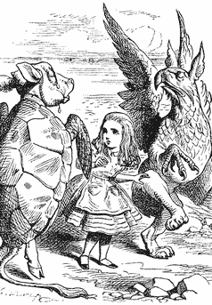
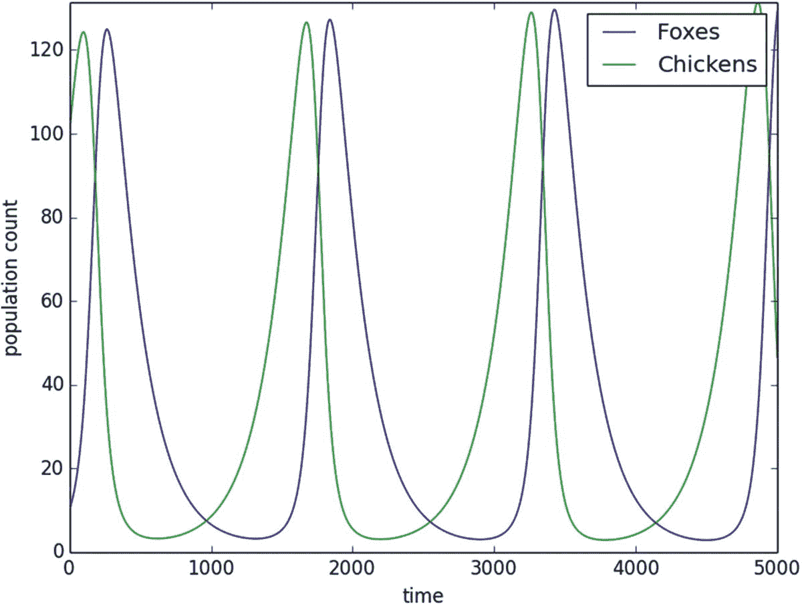
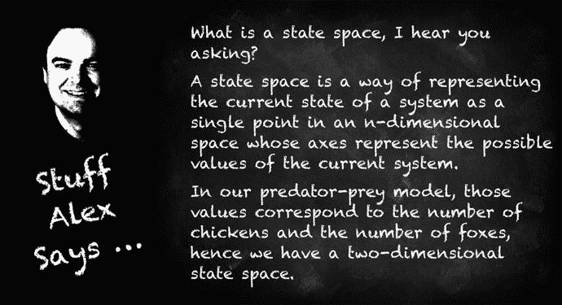
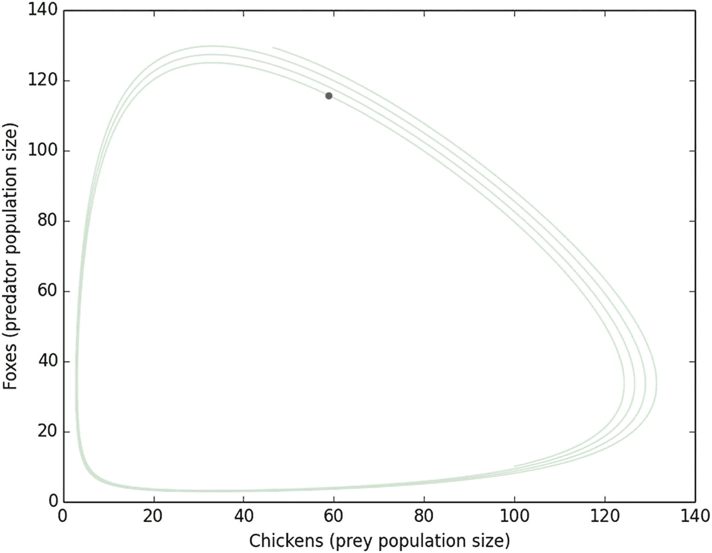

17. 狐狸看管鸡舍

*基于捕食者-猎物动态的生态建模*



*“假海龟，你为什么哭？”爱丽丝问道。*

*“你知道成为被猎食的各种动物的混合体是什么滋味吗？”假海龟凄惨地抽着鼻子说。“有人想吃我的肉，还有巨大的饥饿海鸟，如果我不留神，它们会从水边把我抓走当点心。”*

*“听起来太可怕了，”爱丽丝同情地说。*

*“哼，作为一个神话般的杂交生物，我得说，我从不觉得被拼凑起来有什么困扰，”格里芬以他最不屑和高傲的语气高谈阔论道。*

*“你说得倒轻巧，”假海龟反驳道，“你是那种不用担心自己会成为谁午餐的捕食者的组合！”*  
*“哼，那就请原谅我不是食物链底层的住户了！”格里芬气呼呼地说。*  
*“嗜血的野兽！”假海龟厉声说道。*  
*“行走的沙拉吧！”格里芬回击道。*


`max()`, `matplotlib.animation`, 元组解包, `numpy`


生态学, 生态系统, 种群动态, 繁荣-萧条, 离散模型, 捕食者-猎物, 承载力, 状态空间, Lotka-Volterra 模型

# 生态系统与种群动态的 Python 建模

## 从个体到生态系统

从个体生物体向上一个层级是[生态系统](https://en.wikipedia.org/wiki/Ecosystem)：生物体之间以及与其环境的相互作用。在任何真实的生态系统中，任何物种的个体数量都在不断变化，因为个体会出生和死亡。显然，任何生物种群的增长也受到可用资源数量的限制，并最终受到一个理论上限的限制——这个界限被称为“[承载能力](https://en.wikipedia.org/wiki/Carrying_capacity)”。如果这些“资源”恰好是另一个物种，那么对该物种来说就更糟糕了。虽然“大自然，血淋淋的爪牙”这句古老格言过于简化，但在许多情况下，“猎物”物种数量的增加可能意味着“捕食者”的更多晚餐。然而，这种情况是双向作用的：如果捕食者开始吃光所有猎物，那么捕食者可能就得节食了，以免它们自己开始挨饿。

## 种群动态学

[种群动态学](https://en.wikipedia.org/wiki/Population_dynamics)是研究物种相互作用以及种群增长和变化的领域。种群动态建模的相关性已超出其起源于生物体生态学的范畴（尽管在那里仍然非常重要！），扩展到了细胞或分子水平的种群动态研究，例如癌症和病毒等传染病。因此，所有领域的生物学家都最好多了解种群动态学。种群动态学在生物学之外也有许多应用，从经济泡沫的增长和破裂到社交网络的兴起（和衰落）。当你开始环顾四周，观察事物如何兴衰（从你最喜欢的乐队开始），以及可能如何再次流行时，可以确信某种形式的种群动态学在驱动着这一切。

`Python` 再次非常适合用优雅简洁的代码帮助您建模和可视化种群动态。生态模型的核心是“[捕食者-猎物](https://en.wikipedia.org/wiki/Lotka%25E2%2580%2593Volterra_equations)”的概念：一个单一的`捕食者`物种和一个单一的`猎物`物种。虽然这对于包含许多物种的完整生态系统来说可能是一个过于粗略的简化，但捕食者-猎物模型的基本结构可以被视为更复杂模型的良好概念性“构建块”。完整生态系统中的许多动态都可以在捕食者-猎物模型中以缩影的形式重现。

## 建模实例：鸡与狐狸

那么，让我们直接想象一个种群：后院里的一群`鸡`正受到附近树林里露营的`狐狸`种群的捕食。我们在清单 17-1 中建立模型，通过使用 `Python` 的 `NumPy` 数组追踪在指定代数内两个物种的数量。为了代码简洁，我们使用 `"Ch"` 代表鸡，`"Fx"` 代表狐狸。

这里我们使用 `NumPy` 的 `zeros()` 函数（我们在第 [16] 章(#476668_1_En_16_Chapter.xhtml)首次遇到）创建存储每个时间点物种数量的数组。与之前使用 `zeros` 的主要区别在于，我们现在创建的是**一维数组**而不是**二维数组**，这只需要一个**单个整数**参数，而不是**维度列表**。

```
import numpy as np
generations = 5000
### setup empty arrays
Ch = np.zeros(generations+1)
Fx = np.zeros(generations+1)
### initialize the population
Ch[0] = 100.0
Fx[0] = 10.0
b_Ch = 0.5   # prey birth rate
d_Ch = 0.015 # predation rate (death rate of prey)
b_Fx = 0.015     # predator birth rate
d_Fx = 0.5       # predator death rate
### set parameters
dt = 0.01   # scale parameters so that timestep doesn't "jump"
for t in range(0, generations):
    Ch[t+1] = Ch[t]        + dt * (b_Ch * Ch[t]  - d_Ch * Fx[t] * Ch[t])
    Fx[t+1] = Fx[t]        + dt * (-d_Fx * Fx[t]   +  b_Fx * Fx[t] * Ch[t])
```

*清单 17-1* 初始化和运行鸡与狐狸生态模型

我们首先创建数组并初始化种群规模。接下来，我们设置模型的其他参数。首先，我们定义一些参数来控制捕食者和猎物的**出生**率（以 `"b_"` 为前缀）或**死亡**率（以 `"d_"` 为前缀）。该模型使用了我们在第 [13] 章(#476668_1_En_13_Chapter.xhtml)首次介绍的离散时间步长。这符合我们使用直接模拟方法介绍问题的理念。因此，我们需要引入一个时间步长大小——`dt`——其缘由稍后将解释。

在清单 17-1 的末尾，我们运行模型，您会注意到它的代码只有***三行***！这就是整个模型。然后我们只需循环经过代数，每一代（`t+1`）根据前一代（`t`）的值进行更新。对于鸡和狐狸，我们从每个物种的当前数量开始，然后对每个物种的该数量进行**增加**（通过出生）和**减少**（通过死亡）。

鸡的***出生数量***（方程中的第一项 `b_Ch * Ch[t]`）仅取决于当前鸡的数量（这假设有无限的食物）。然而，鸡的***死亡数量***取决于狐狸的数量：捕食者越多，鸡的死亡就越多……哦，太可怕了，太可怕了！这意味着对于鸡的死亡，两个物种的数量之间将存在一个*交互项*；因此，我们将死亡率（`d_Ch`）乘以当前的狐狸数量（`Fx[t]`）和当前的鸡的数量（`Ch[t]`）。

狐狸的情况则完全相反。狐狸会以其自然率***死亡***（除了那些讨厌的鸡，没有其他东西能让这些狐狸活着！）；因此，我们将 `d_Fx` 乘以 `Fx[t]`。但是新狐狸的***出生***率将取决于周围猎物的数量，所以在这种情况下，我们将狐狸的出生率（`b_Fx`）乘以狐狸的数量（`Fx[t]`）和鸡的数量（`Ch[t]`）。

为了百分之百明确总和的每个部分意味着什么，我们在代码中添加了注释：

```
for t in range(0, generations):
    ### old prey   +   newly born prey   -  killed prey
    Ch[t+1] = Ch[t]        + dt * (b_Ch * Ch[t]  - d_Ch * Fx[t] * Ch[t])
    ### old predators   -  predator death   +  births of predators
    Fx[t+1] = Fx[t]        + dt * (-d_Fx * Fx[t]    +  b_Fx * Fx[t] * Ch[t])
```


如前所述，最后一个复杂之处在于，因为我们使用的是***离散***时间间隔，所以引入了时间步长：`dt`。这通过相关的时间尺度（每一代可能代表一个更小的时间步长）来缩放新生和死亡的数量，这就是为什么它位于前面代码中括号外面的原因，并确保模拟数字平滑变化。

## 观察繁荣与萧条

现在模拟的艰巨工作已经完成。与前面章节一样，在清单 17-2 中，我们转向使用 **matplotlib** 来绘制输出结果。

```python
### do the plotting
### get the maximum of the population so we can scale window properly
popMax = max(max(Fx), max(Ch))
fig1 = plt.figure()
plt.xlim(0, generations)
plt.ylim(0, popMax)
plt.xlabel('time')
plt.ylabel('population count')
time_points = list(range(generations + 1))
plt.plot(time_points, Fx, label="Foxes")
plt.plot(time_points, Ch, label="Chickens")
plt.legend()
plt.draw()
plt.show()
```

*清单 17-2* 使用 matplotlib 绘制模拟输出

完整的代码如清单 17-3 所示。

## 捕食者-猎物模型模拟

```python
import numpy as np
from matplotlib import pylab as plt
import matplotlib.animation as animation

generations = 5000

### setup empty arrays
Fx = np.zeros(generations+1)
Ch = np.zeros(generations+1)

### initialize the population
Ch[0] = 100.0
Fx[0] = 10.0

### set the parameters
dt = 0.01     # scale parameters so that each timestep doesn't "jump"
b_Ch = 0.5    # prey birth rate
d_Ch = 0.015  # predation rate (death rate of prey)
b_Fx = 0.015  # predator birth rate
d_Fx = 0.5    # predator death rate

### run predator-prey!
for t in range(0, generations):
    ### old prey + newly born prey - killed prey
    Ch[t+1] = Ch[t] + dt * (b_Ch * Ch[t] - d_Ch * Fx[t] * Ch[t])
    ### old predators - predator death + births of predators
    Fx[t+1] = Fx[t] + dt * (-d_Fx * Fx[t] + b_Fx * Fx[t] * Ch[t])

### do the plotting
### get the maximum of the population so we can scale window properly
popMax = max(max(Fx), max(Ch))
fig1 = plt.figure()
plt.xlim(0, generations)
plt.ylim(0, popMax)
plt.xlabel('time')
plt.ylabel('population count')
time_points = list(range(generations + 1))
plt.plot(time_points, Fx, label="Foxes")
plt.plot(time_points, Ch, label="Chickens")
plt.legend()
plt.draw()
plt.show()
```

*清单 17-3* 模型与可视化的完整代码

运行清单 17-3 中的代码，应生成类似于图 17-1 的输出，展示出鸡和狐狸种群开始相互影响时产生的多个周期。请注意，当鸡的数量从初始的 100 只开始增加时，狐狸的数量也随之迅速增长，因为周围有更多美味的猎物！这导致鸡的数量在大约 120 只时停止增长，并开始下降。然而，由于美味的鸡数量减少，狐狸的生存变得困难，这为鸡种群的恢复提供了时间，于是周期再次开始。



*图 17-1* 捕食者-猎物模型的可视化

图 17-1 展示了大多数捕食者-猎物模型中出现的经典繁荣与衰退的循环模式，两个物种在此过程中持续“共舞”。该模型已广泛应用于病毒种群等其他生物实体，并在生物学之外的领域也有应用。这种循环模式让人不禁思考：相比两条上下波动的时序曲线，是否还有更好的方式来展示其中的动态？

## 动画化捕食者-猎物模型

答案是肯定的！因为这是一个[动力系统](https://en.wikipedia.org/wiki/Dynamical_system)的实例，可以看作是在二维[状态空间](https://en.wikipedia.org/wiki/State_space)中移动的一个点。系统随时间在该空间中经过的路径被称为**轨迹**。系统起始位置不同，所遵循的轨迹也会不同。



`matplotlib`库再次提供了解决方案，通过使用其动画子包（这一点我们在清单 17-3 的导入语句中已有所暗示）。有关动画包的更多详细信息，请参阅 matplotlib 文档^(²¹³)。

```python
fig2 = plt.figure()
plt.plot(Ch, Fx, 'g-', alpha=0.2)  # state space
plt.xlabel('Chickens (prey population size)')
plt.ylabel('Foxes (predator population size)')
line, = plt.plot(Ch[0], Fx[0], 'r.', markersize=10) # draw point as red

def init():
    line.set_data([], [])  # set empty data
    return line,

def animate(i):
    line.set_xdata(Ch[i])
    line.set_ydata(Fx[i])
    return line,

ani = animation.FuncAnimation(fig2, animate, range(0, len(time_points)), init_func=init, interval=25, blit=False)
plt.show()
```

*清单 17-4* 状态空间的动画化

让我们逐步分析这段代码。我们首先像之前一样设置总图，然后绘制状态空间。这相当简单：我们只是将鸡的数量（`Ch`）与狐狸的数量（`Fx`）进行绘图，而不是作为时间的函数。`'g-'`表示一条实心（`-`）绿色（`g`）线，`alpha`设置线条的透明度，使其看起来略微淡化。随后添加坐标轴标签。为了在状态空间图上添加轨迹的初始点，我们绘制第一个时间点，即 x-y 坐标：`Ch[0]`、`Fx[0]`，具体如下：

```python
line, = plt.plot(Ch[0], Fx[0], 'r.', markersize=10)
```

但将结果赋值给变量`line`需要进一步说明。`plot`命令总是返回一个元组（关于元组的更多信息，请参见第 3 章），其中包含图中所有线条的列表。由于这个特定绘图只有*一条*线，我们对`line`进行所谓的**元组解包**，以获取列表中的*第一个*元素（更多详情，请参阅 matplotlib 文档中的教程^(²¹⁴)）。

然后，我们设置两个辅助函数来实现动画：

1. `init()` 创建动画将“静止”的基础帧，返回一个可由下一个函数更新的线条对象。

2. `animate()` 接受一个整数 `i` 作为输入，代表模拟的当前时间步。此函数更新`init()`函数中创建的`line`帧，从而通过使用`set_xdata`和`set_ydata`函数移动红点，更新系统在整个状态空间中的位置。

最后一步通过调用`animation.FuncAnimation`并传入参数：`fig2`、动画将运行的`time_points`范围（实质上是让红点穿过状态空间），以及前文所述用于初始化和更新动画的两个函数，来*运行*动画。最后调用`plt.show()`显示图形。

如果你获取清单 17-3 中的完整代码，并将清单 17-4 中的代码附加到其后，然后运行它。它应该会生成一个类似于图 17-2 中所示的图形，只是红点将从底部中间开始，并向外螺旋移动。现在，我们可以一目了然地看清系统的循环性质，完整地观察整个轨迹。



*图 17-2* 鸡和狐狸状态空间的可视化

敏锐的读者可能会注意到，轨迹是不稳定的，也就是说，它不会收敛到一个稳定的圆，而是在每次迭代中开始略微向外螺旋。如果增加迭代次数，你会发现螺旋会向外扩展得更远（相应地，时间序列图中的幅度也会增加）。这种不稳定性是由于我们处理的是*离散*时间步长，这隐式地在模拟中引入了*时间滞后*。可以通过使`dt`参数更小来减少这种滞后，从而减少时间延迟并使模拟更平滑。但要做到这一点，需要转向使用[Lotka-Volterra 微分方程](https://en.wikipedia.org/wiki/Lotka%25E2%2580%2593Volterra_equations)的*连续*版本模型，我们在参考章节中链接了一个使用`SciPy`库求解这些方程的示例。

下一章建立在使用整数个体数量进行种群动态建模的概念之上，但更进一步：将个体本身建模为离散、唯一的智能体。

## 参考文献与进一步探索

- Roughgarden, *Primer of Ecological Theory*^(²¹⁵) (Prentice Hall, 1997)。关于生态学和种群遗传学的基础入门读物，包含编码示例。考虑到当时 Python（或 R）尚未诞生，我们暂且原谅 Roughgarden 使用 SPlus。
- Edelstein-Keshet, *Mathematical Models in Biology*^(²¹⁶) (Siam, 2004)。生物学和生态学传统数学建模的经典教材，但在随机模型方面有所欠缺。
- 使用 `SciPy`^(²¹⁷) 求解 Lotka-Volterra 方程的 Python 代码示例。

---

## 脚注
