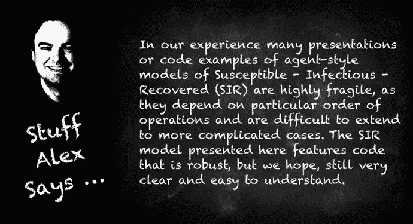
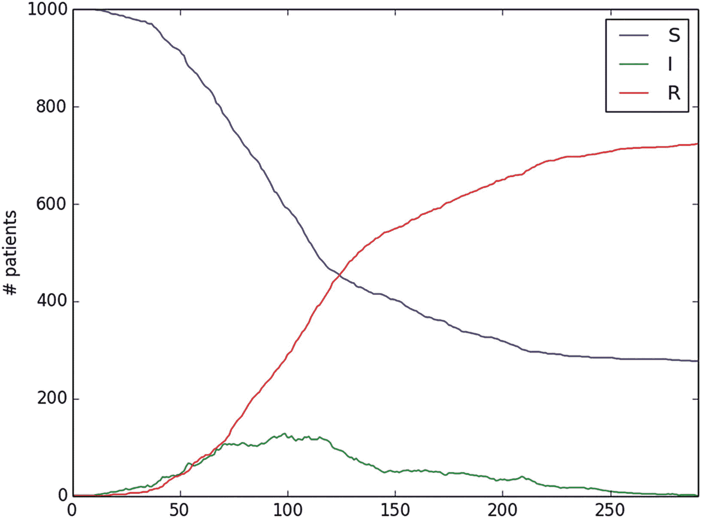
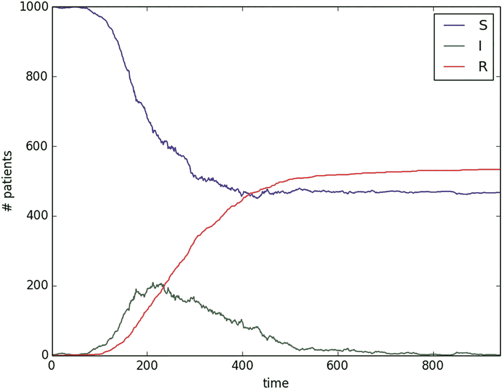

18. 虚拟流感流行病

*基于智能体的流行病学探索*


*终有一天，假海龟和狮鹫化解了分歧。假海龟为称狮鹫为嗜血野兽而道歉，狮鹫则为称假海龟为行走的沙拉吧而道歉。*

*“我想我们都同意，当个杂交生物可不容易，”狮鹫说。“呃——我不是故意的，”他急忙补充道，生怕自己措辞不当再次惹恼假海龟。*

*“古人诚不欺我，猫鸟朋友，”假海龟睿智地说。*

*“但你们确实有个大优势！”爱丽丝突然说道。“杂种优势。”*

*“那是什么？”假海龟问。*

*“拥有更丰富、更多样化基因组的生物，比如杂种，”爱丽丝说，“通常不太容易受到能在基因同质化群体中肆虐的疾病影响。”*

*“真是个书呆子！”狮鹫叫道，笨拙地假装打了个喷嚏来掩饰自己的话。*

*“你是不是感冒了？”爱丽丝问。*


`pop()`、Python 类、`numpy.random` 模块


流行病学、流感、SIR 模型、基于智能体的模型、流行病、大流行病

---

流感每年都会出现，如果能有一种方法大致模拟其动态发展，那将非常有用。别担心，亲爱的读者，我们正好有合适的模型：`SIR`！在本章中，我们将介绍 `SIR` 模型，该模型代表 [susceptible–infectious–recovered](https://en.wikipedia.org/wiki/Compartmental_models_in_epidemiology)（易感-感染-康复），它是流行病学、公共卫生和病毒学等领域的基础概念模型。该模型还将使我们能够引入 [基于智能体的模型](https://en.wikipedia.org/wiki/Agent-based_model)（`ABM`）的概念，*其中每个个体在模型中拥有独特的身份*。这与我们前一章捕食者-猎物动力学（第 17 章）中仅对*个体总数*进行建模截然不同。基于智能体的模型是一种强大的方法，已被用于模拟从股票市场到社会学等跨科学领域的复杂现象，但其根源深植于生物学，特别是生态学（有时被称为**基于个体的模型**）。许多关于基于智能体模型的介绍强调其复杂性或对现有 `ABM` 包的使用，但本章的方法是从一个非常简单的纯 Python 基于智能体模型入手，以此作为跳板，来添加 `ABM` 所允许的更丰富动态特性。

## SIR 模型：易感–感染–康复

传染病 `SIR` 模型的基本思想是：我们有一个个体群体，每个个体可以处于几种可能状态之一：**易感–感染–康复**。在任何给定时间，一个个体将处于这三种状态中的**一种**，并从初始的*易感*状态发展到*感染*状态，然后最终死亡或*康复*。通常，我们假设疾病仅通过*一个*个体（臭名昭著的***零号病人***）引入群体，并且该群体是“充分混合的”，即任何特定易感个体被零号病人感染的几率是随机的。一旦所有条件设定完毕，我们想知道疾病的总体进展如何。换句话说，在“流感季节”期间，各类病人的数量将如何上升和下降？如前所述，该模型可以用确定性数学来构建，但正如我们之前所见，自然界往往并非如此……

## 并非秘密的智能体

好吧，这很酷，但*基于智能体的建模*与此有何关系？正如我们之前所见，许多生物系统本质上是*含噪声的*，因为结果有时取决于仅仅几个基因副本或少数个体生物。基于智能体的模型建立在跟踪离散个体数量的洞察之上，但更进一步，允许每个智能体拥有自己*内部*的独特属性。我们通常将此属性称为**智能体状态**，并且我们还允许这些状态受到它们所生活世界的其他方面的影响，即它们拥有**智能体行为**。

那么，最好的做法可能就是直接挽起我们虚拟的 Python 袖子，看看这在实际代码中是什么样子。让我们从模型的最底层开始：个体患者。无需赘言，在清单 18-1 中，我们展示了 `Patient` 类。

```python
class Patient():
    # 默认状态为易感
    def __init__(self, state = 'susceptible'):
        self.state = state
    def infect(self):
        self.state = 'infected'
    def recover(self):
        self.state = 'recovered'
```

*清单 18-1*

`Patient`：Python 中一个简单的智能体类

你会立刻注意到，通过使用 `class` 关键字，我们应用了在第 7 章学到的面向对象编程技能。这里我们只有一个实例变量 `state`，顾名思义，它用于跟踪病人的感受状态。让我们来分解一下这些*代理行为*：

1. 在 `__init__` 方法中，我们通过传入一个表示状态的字符串来初始化病人对象的每个实例。我们还为 `state` 提供了默认关键字 `susceptible`，因为在大多数情况下，这就是我们希望在模拟开始时创建的状态（但请注意，它可以被覆盖）。
2. 接下来，我们有一个 `infect` 方法，它将状态更改为 `infected`。没错，这一点完全在意料之中。
3. 最后，我们有 `recover` 方法，你猜到了，它让代理康复！

没错，它就像看起来一样简单。虽然它可能看起来比一个包装器强不了多少，但它为后续创建更复杂的代理奠定了基础，并且在建模者的思维中实现了一个重要的认知飞跃：我们坚定地专注于对*个体*代理进行建模。

## 代理列表：让代理保持正轨

在管理病人群体时，我们需要做的下一件事是能够将它们作为一个集合来管理。这就是清单 18-2 中 `PatientList` 类的用途。它负责管理所有个体代理，并保持代理集合的*全局属性*为最新状态，例如在任何给定时刻每种代理类型的数量。

```
class PatientList():
    # 为每种代理类型创建列表
    def __init__(self):
        self.susceptible_agents = []
        self.infected_agents = []
        self.recovered_agents = []
    def append(self, agent):
        if agent.state == 'susceptible': self.susceptible_agents.append(agent)
        elif agent.state == 'infected': self.infected_agents.append(agent)
        elif agent.state == 'recovered': self.recovered_agents.append(agent)
        else: print("error: must be one of the three valid states")
    def infect(self):
        shuffle(self.susceptible_agents) # 打乱列表以随机排序
        patient = self.susceptible_agents.pop() # 从列表中移除病人
        patient.infect()
        self.append(patient) # 移动到相应的列表
    def recover(self):
        shuffle(self.infected_agents)
        patient = self.infected_agents.pop()
        patient.recover()
        self.append(patient)
    def get_num_susceptible(self):
        return len(self.susceptible_agents)
    def get_num_infected(self):
        return len(self.infected_agents)
    def get_num_recovered(self):
        return len(self.recovered_agents)
    def get_num_total(self):
        return len(self.susceptible_agents)+len(self.infected_agents)+ \
                len(self.recovered_agents)
```

这里的基本思想是，这个类的功能类似于Python的原生列表（例如，它也有一个`append`方法），但具有特定于我们模型的额外功能，例如`infect`和`recover`。（请注意，这个类的代码实际上比原则上需要的要长，因为我们包含了额外的错误检查：这一点非常重要，并且符合我们之前提出的构建鲁棒性的原则。）让我们分解这个类：

- `__init__`创建了这个类的一个实例，在类内部包含带有三类个体子列表的*实例变量*（`susceptible_agents`、`infected_agents`、`recovered_agents`）。

- `append`将已创建的代理添加到相应的列表类型中（创建代理的工作在主代码中完成）。这包括一些错误检查，以确保状态有效。请注意，我们可以简单地使用一个包含所有代理类型的列表，但这样如果需要找到特定类型的代理，我们可能需要扫描整个列表；通过使用独立的列表，我们加快了搜索速度。

- `infect`：此方法首先打乱现有的`susceptible_agents`列表。然后我们使用`pop()`方法来获取要感染的个体代理。请注意，`pop()`既*返回*列表开头的代理，又*从*列表中*移除*该代理。然后我们`infect()`该个体代理，并将其转移到感染者列表。

- `recover`具有与`infect`完全相同的结构，不同之处在于它打乱的是感染者列表并随机选择一个感染者，然后指示其康复，之后我们将其转移到康复者列表。

- `get_num_susceptible`、`get_num_infected`、`get_num_recovered`、`get_num_total`：这些是相当不言自明的方法，用于返回不同的计数（以及总数）。这看起来可能有点矫枉过正，但在进行面向对象编程时，为任何可能随时间变化的内部状态提供get函数，通常是一个好习惯。此外，这使我们不必在代码各处使用一堆`len()`函数。

呼！就这样，我们用大约40行Python代码（如果排除注释和空格，则更少）为我们的实际模型建立了关键的数据结构。当我们编写模型本身时，这种设置将带来回报，因为我们可以用一种非常直接和直观的方式来表达它。但在那之前，让我们从模型的初始化开始，包括所有基本参数和清单18-3中代理的创建（运行此代码前需先执行清单18-1和18-2中的类定义）。

```python
beta = 0.09  # 易感率
gamma = 0.05 # 康复率
susceptible_count = 1000
infected_count = 1
recovered_count = 0
### 用于记录输出的列表
S = []
I = []
R = []
t = []
time = 0.0
patients = PatientList()
### 创建个体病人
for indiv in range(susceptible_count):
    agent = Patient()      # 默认情况下，所有新病人都是易感的
    patients.append(agent) # 添加到列表
for indiv in range(infected_count):
    agent = Patient(state='infected')
    patients.append(agent)
for indiv in range(recovered_count):
    agent = Patient(state='recovered')
    patients.append(agent)
```

### SIR 模型动力学

我们首先定义SIR模型的关键参数：`易感率`（𝛽，代码中用`beta`表示）—— 即易感患者被疾病感染的速率；以及`恢复率`（𝛾，代码中用`gamma`表示）—— 即感染患者康复的速率。这些都是关键参数，也出现在模型的数学表达式中。两者的比值被称为`R₀`（=𝛽/𝛾），可以理解为病毒或疾病在人群中传播的概率。2011年电影《传染病》的粉丝们会记得`R₀`在剧情中起到了关键作用。当`R₀ > 1`时，疾病会在人群中传播并演变为流行病，而非消亡，这在直觉上很容易理解：当患者被感染的速度超过其康复速度时，那么*整个*人群极有可能都会被感染。（在《传染病》中，令人担忧的是流行病是否会演变为全球大流行，即跨越国界的流行病。）

接下来，我们将易感个体数量初始化为2000，并设定一个单独的感染个体（此时尚无康复个体）。随后，我们添加四个空列表`S`、`I`、`R`和`t`，用于记录各类个体的数量以及时间点，并创建`PatientList`的初始实例`patients`。最后，我们遍历每个数字，使用`state = '<type-of-agent>'`关键词创建代表三种智能体类型的个体智能体，并将它们添加到`patients`中。请注意，由于我们将`Patient`和`PatientList`类设计为对智能体添加顺序不敏感，因此这些操作可以按任意顺序进行，甚至在理论上可以动态完成。



## 运行疫情模拟

好了，现在我们到了可以相当简洁地用代码清单18-4写下模型动力学的时刻了。
```

# SIR 模型动力学

```python
from random import shuffle
from numpy.random import random
while len(patients.infected_agents) > 0:
    for susc in range(patients.get_num_susceptible()):
        if random() < beta * (patients.get_num_infected() / float(patients.get_num_total())):
            patients.infect()  # 感染患者
    for infected in range(patients.get_num_infected()):
        if random() < gamma:
            patients.recover() # 康复患者
    ### 记录用于绘图的值
    t.append(time)
    S.append(patients.get_num_susceptible())
    I.append(patients.get_num_infected())
    R.append(patients.get_num_recovered())
    ### 更新时间
    time += 1
```

代码清单 18-4

由于我们之前付出的所有努力，写下模型变得相当简单：只要还有感染智能体（`while` 条件），我们就执行一步模拟。模拟中的第一项是*遍历所有仍处于易感状态的患者智能体*，并判断它们是否应该被感染。此决定基于感染个体数量 *I* 与总人口规模 *N* 的比值，再乘以前面提到的易感参数 𝛽。如果随机选择的数字小于 𝛽 × *I*/*N*，我们就感染该智能体；否则保持原样。这实际上是假设任何易感个体智能体接触感染智能体的概率是均等的。（如果我们想探索关于特定智能体感染概率的其他假设，这正是我们可以介入并测试其他可能性的地方。）然后，我们要求智能体列表对一名随机患者执行 `infect()`。

模拟中的第二项是*遍历所有被感染的患者*，并判断是否有患者会康复。与感染步骤类似，我们以概率 𝛾 让一个智能体康复，并同样调用列表对一名随机患者执行 `recover()`。

细心的观察者会注意到，所有这些循环可能效率不高，并且存在“更好”的方法来选择智能体，而无需依赖遍历这些列表；特别是，我们可以像第 14 章介绍的 Gillespie 算法那样“跳跃”时间。我们意识到了这一点；然而，我们认为，为了呈现一个简单的模型，我们暂时对这些问题略过不提。

我们在循环中做的最后一件事是更新记录的数值和时间，并递增时间步长。所有这些数据记录操作你现在应该非常熟悉了，以下用于绘制最终时间过程的 `matplotlib` 命令也应该不陌生，代码清单 18-5 如下。

```python
### 绘制输出
import matplotlib.pyplot as plt
fig1 = plt.figure()
plt.xlim(0, max(t))
plt.ylim(0, susceptible_count + infected_count + recovered_count)
plt.xlabel('时间')
plt.ylabel('患者数量')
plt.plot(t, S, label="易感者（S）")
plt.plot(t, I, label="感染者（I）")
plt.plot(t, R, label="康复者（R）")
plt.legend()
plt.show()
```

代码清单 18-5

如果你运行最终的模型，应该会看到类似于图 18-1 所示的结果。



**图 18-1** SIR 智能体模型的一次代表性输出运行

在这里，你看到易感智能体（**蓝色**线）变成感染状态（**绿色**线），并且在此次特定运行中，它们开始相当快地康复，感染峰值大约出现在 100 个时间步左右。大约在那之后，所有被感染的智能体都相当迅速地康复（**红色**线）。随后感染开始消退，新增病例数量下降，直到大约 300 个时间步时，感染已完全消失。在其他运行中，你会看到感染达到平稳期或消失的确切时间变化很大。这反映了真实流行病的现实，尤其是在规模较小的人群中，接触的随机性会改变流行病的持续时间。我们在之前介绍的系统生物学和生态学模型中已经看到了这种随机性。

另请注意，在某些运行中，你可能根本看不到曲线，人群可能会立即崩溃。这是意料之中的，因为这是一个随机模拟，总会有一些情况，初始感染个体在将感染传播给其他人*之前*就设法康复了。

## 强化你的智能体

到目前为止，模型中“患者”的智能体特性尚未发挥显著作用，它们很大程度上只是智能体类型的占位符，从这个意义上说，它们是极为“单薄”的智能体。然而，利用我们的设置，我们可以非常轻松地添加更多生物学上的复杂性，乐趣也由此开始。我们可以提出非常直接的问题，并以非常直观的方式将它们直接编码实现。比方说，我们不禁好奇，如果康复患者有时会立即再次变得易感，会发生什么情况。

我们可以回过头去研究其他流行病学模型的数学公式，并从中重新推导出基于智能体的模型，但我们完全可以直接对原始的 SIR 模型进行一些修改。可以把它想象成对汽车进行的改装——嘘——如果你不说，我们也不会告诉制造商。用 Python 进行修改是微不足道的；在代码清单 [18-6] 中，我们只是修改了智能体类 `Patient`，*其他的一切保持不变*。

```python
class Patient():
    # 默认状态为易感
    def __init__(self, state = 'susceptible'):
        self.state = state
    def infect(self):
        self.state = 'infected'
    def recover(self):
        self.state = 'recovered'
        if random() < 0.8:
            print("切换回易感状态")
            self.state = 'susceptible'
```

**代码清单 18-6** 修改后的 `Patient` 智能体类

一旦状态转换为康复，我们只是在 80% 的情况下（0.8）将状态重新切换为易感。正如你可能猜到的，这会导致感染持续更长时间，那些“显然”已经康复的患者会不断变回复易感状态。一次典型的运行结果如图 [18-2] 所示。



**图 18-2** 修改后的 SIR 模型运行结果，其中康复患者会自发地再次变得易感

你会注意到感染的持续时间*长得多*，并且易感个体曲线包含了更多的噪声，波动幅度也大得多，这是因为康复个体再次变得易感，而不是像我们之前看到的平滑下降的曲线。在代码中非常容易做出这种改变，因为我们使用了面向对象编程的*信息隐藏*原则；`Patient` 类完全自包含状态和行为，任何行为上的改变都会传递到模型的其余部分，而无需修改其他代码。面向对象编程天生就适合基于智能体的建模风格。

在代码清单 [18-7] 中，我们展示了包含额外智能体行为的模型完整代码。

# 18. 基于智能体的模拟

```python
from random import shuffle
from numpy.random import random
import matplotlib.pyplot as plt

class Patient():
    # 默认状态为易感
    def __init__(self, state = 'susceptible'):
        self.state = state
    def infect(self):
        self.state = 'infected'
    def recover(self):
        self.state = 'recovered'
        if False:  # 设置为 True 以探索替代模型
            if random() < 0.8:      # 80%概率
                self.state = 'susceptible'

class Patients():
    def __init__(self, num_patients):
        self.num_patients = num_patients
        self.patients = [Patient() for i in range(num_patients)]
        self.num_total = num_patients
        self.num_susceptible = num_patients
        self.num_infected = 0
        self.num_recovered = 0

    def get_num_total(self):
        return self.num_total

    def get_num_susceptible(self):
        count = 0
        for p in self.patients:
            if p.state == 'susceptible':
                count += 1
        return count

    def get_num_infected(self):
        count = 0
        for p in self.patients:
            if p.state == 'infected':
                count += 1
        return count

    def get_num_recovered(self):
        count = 0
        for p in self.patients:
            if p.state == 'recovered':
                count += 1
        return count

    def infect(self):
        # 感染一个随机的易感患者
        for p in self.patients:
            if p.state == 'susceptible':
                p.infect()
                self.num_infected += 1
                self.num_susceptible -= 1
                break

    def recover(self):
        # 康复一个随机的感染患者
        for p in self.patients:
            if p.state == 'infected':
                p.recover()
                self.num_infected -= 1
                self.num_recovered += 1
                break
```

`代码清单 18-7` 修改后 SIR 模型的完整代码

### 模型参数

```python
num_patients = 500
susceptible_count = num_patients
infected_count = 1
recovered_count = 0

patients = Patients(num_patients)
### 感染一个患者
patients.infect()

beta = 0.8   # 感染率
gamma = 0.1  # 康复率
time = 0
t, S, I, R = [], [], [], []
```

### 主模拟循环

```python
while patients.get_num_infected() > 0:
    for susc in range(patients.get_num_susceptible()):
        if random() < beta * (patients.get_num_infected() / \
                float(patients.get_num_total())):
            patients.infect()  # 感染患者
    for infected in range(patients.get_num_infected()):
        if random() < gamma:
            patients.recover()  # 康复患者
    t.append(time)  # 记录用于绘图的值
    S.append(patients.get_num_susceptible())
    I.append(patients.get_num_infected())
    R.append(patients.get_num_recovered())
    time += 1  # 更新时间步

fig1 = plt.figure()  # 绘制输出
plt.xlim(0, max(t))
plt.ylim(0, susceptible_count + infected_count + recovered_count)
plt.xlabel('时间')
plt.ylabel('患者数量')
plt.plot(t, S, label="S")
plt.plot(t, I, label="I")
plt.plot(t, R, label="R")
plt.legend()
plt.show()
```

在我们的示例中，我们展示了对单个方法的简单调整，但它揭示了一个强有力的观点：基于智能体的模型提供了一种非常简单的直接方式，来探索你对系统中个体生物实体变异如何影响全局属性的直觉。而且这一切只需要相当少量的 `Python` 代码。过去 20 年涌现了大量工具和框架，用以创建极其复杂的基于智能体的模型，以及使用这些工具进行研究，我们鼓励你去探索。但请记住，基于智能体方法的基本原理可以通过简洁的 `Python` 程序轻松掌握。

在下一章，也是最后一章，我们将再次提升时间尺度：从*生态*时间尺度转向*进化*时间尺度。我们将从使用 `Python` 模拟不包含繁殖的个体群体，转向模拟其遗传组成发生变化的群体。

## 参考文献与进一步探索

- Grimm and Railsback, [*个体基础建模与生态学*](http://press.princeton.edu/titles/8108.html) (普林斯顿大学出版社, 2005)
- Railsback and Grimm, [*基于智能体和个体的建模：实用导论*](http://www.railsback-grimm-abm-book.com/) (普林斯顿大学出版社, 2011)
- [`Project Mesa`](https://github.com/projectmesa): 基于 `Python` 的智能体建模环境
- [`pyAbm`](https://pypi.python.org/pypi/pyabm): 另一个基于 `Python` 的智能体建模框架（撰写本书时处于休眠状态）
- `Swarm` 开发组：最初的智能体建模工具包 `Swarm` 的所在地。本书作者之一（AKL）是原始开发团队的成员。SDG 目前是年度 `SwarmFest` 会议的保管人，该会议汇集了来自所有学科的建模者以及包括 `Swarm`、[`NetLogo`](https://ccl.northwestern.edu/netlogo/)、`RePast` 等在内的工具开发者。
- [`NetLogo`](https://ccl.northwestern.edu/netlogo/): 源自 Seymour Papert 开发的原始 `Logo` 系统，`NetLogo` 是一个基于智能体的建模工具包，拥有大型模型库和活跃的社区。
- [`OpenABM`](https://www.openabm.org/)（开放智能体建模）联盟：包含理论、软件和模型细节的网站。
