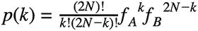
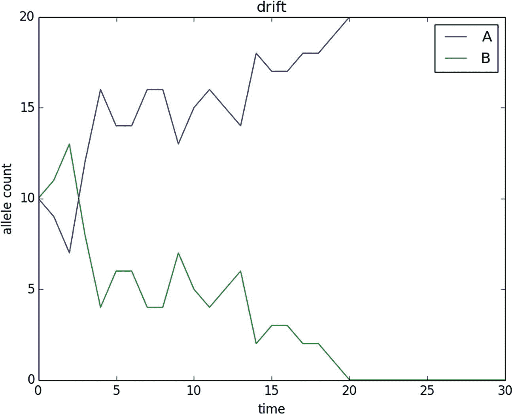
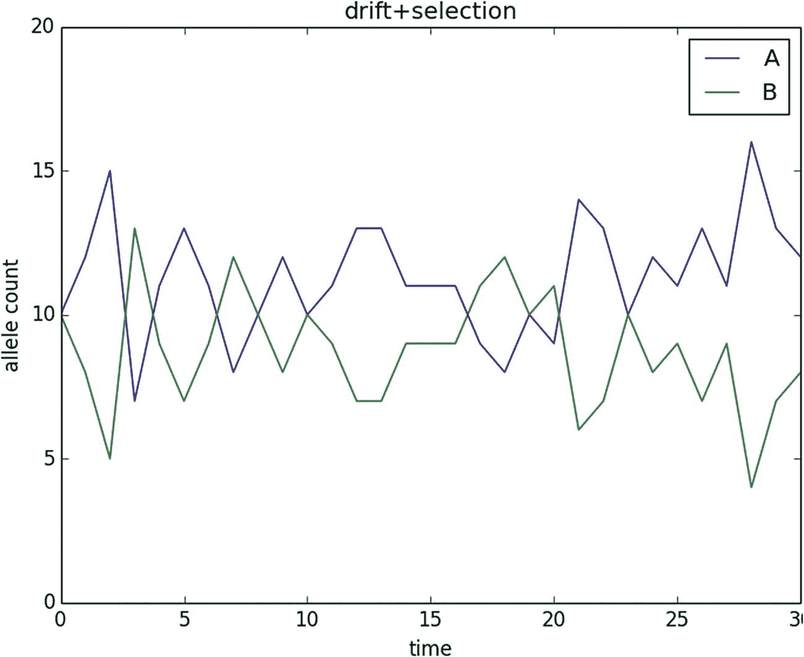

## 19. 追溯生命足迹

### 使用 `Wright-Fisher` 模型进行进化动力学分析

在这一最终章中，我们将把 Python 视角从建模*生态动力学*转向建模*进化论*。不同科学家会对如何精确定义进化论争论不休，但大多数人同意进化论的核心是**等位基因频率随时间的变化**。支撑这些变化的主要理论是[群体遗传学](https://en.wikipedia.org/wiki/Population_genetics)。群体遗传学有着悠久而辉煌的历史（参见 Provine (2001)），并早于许多机制性生物生命科学，例如分子生物学。该学科的支柱是在 20 世纪 30 年代由当时的一些杰出人物奠定的。其中两位尤为突出：英国统计学家[罗纳德·费雪爵士](https://en.wikipedia.org/wiki/Ronald_Fisher)和美国数学家[休厄尔·赖特](https://en.wikipedia.org/wiki/Sewall_Wright)。多年来，他们构建的理论就像美丽的引擎：闪亮的镀铬气缸和深奥数学的化油器，但缺乏让它们真正歌唱的燃料（即数据）。来自人类基因组计划等测序项目产生的海量数据彻底改变了这一状况，并使群体遗传学比以往任何时候都更具意义。

不过，幸运的是，只要掌握少量数学知识，就能轻松理解群体遗传学的基础。只需少量 Python 代码，你就可以通过研究两个基本机制——**遗传漂变**和**自然选择**——来开始构建自己的进化探索。我们将通过构建一个以它们命名的简单模型——[Wright-Fisher 模型](https://en.wikipedia.org/wiki/Genetic_drift)来开始探索，并且像之前章节一样，我们采用基于模拟的方法。

那么，让我们设想一个包含个体的有限群体，这些个体要么拥有基因的一种变异（称为等位基因），称其为等位基因*A*，要么拥有另一种变异，称其为等位基因*B*。因此，在任何时间点*t*，整个群体仅由*两个*数字定义：等位基因*A*的数量（称其为`n[A]`）和等位基因*B*的数量（称其为`n[B]`）。为了存储运行`generations`次模拟的*结果*，我们在代码清单 19-1 中创建了一个二维矩阵，该矩阵存储 **`generations` 行**，并使用*两*列（每种等位基因各一列）。

```python
from numpy import zeros
num_alleles = [10, 10]
twoN = sum(num_alleles)
allele_counts = zeros((generations + 1, 2))
allele_counts[0, :] = num_alleles
```

*代码清单 19-1：创建用于存储等位基因计数的二维矩阵*

让我们来解析一下：

1. 我们首先计算总群体大小 `2N`，它始终是每种等位基因类型的数量，定义为仅包含两个数字的 Python 数组：`[n[A] n[B]]`（在代码清单 19-1 中，我们将它们设置为 10 和 10）。然后我们对数组中的所有元素（这里只有两个）执行 `sum()`，并返回一个单一的数字：`2N = n[A] + n[B]`。

2. 然后我们初始化 NumPy 的 `zeros` 数组，其中*第一列*（索引 0）存储 `n[A]`，*第二列*（索引 1）存储 `n[B]`。这类似于我们在第 16 章的二维元胞自动机中存储值的方式。

3. 最后，我们使用切片运算符 "`:`" 初始化第零代（`t=0`），将 `[n[A], n[B]]` 作为一列来初始化第一行。

（从技术上讲，我们只需要存储*一个*数字，因为群体大小保持不变（`2N`）。我们总是可以从等位基因 A 的数量计算出等位基因 B 的数量，反之亦然，使用公式 `2N = n[A] + n[B]`，但为了后续绘图方便，同时存储*两个*数字是很有用的。）

## 明白我（遗传）漂变的意思了吗？

现在，让我们尝试找出下一代 `t+1` 时每种等位基因的数量。我们该怎么做？从概念上讲，我们模拟的是等位基因在群体中**随机交配**并产生*下一代*后代的过程。我们可以将其视为将所有 `2N` 个体放入一个袋子中，让它们交配和繁殖，然后抽出相同数量的原始个体（因为群体大小保持不变），从而得到*下一代*群体中每种类型的等位基因数量。

要是现在有一种数学方法能为我们做到这一点就好了。嗯，幸运的是，确实有，那就是[二项分布](https://en.wikipedia.org/wiki/Binomial_distribution)。*给定*A 等位基因的当前频率（`f[A] = n[A] / 2N`），从袋子中抽取 `2N` 次后恰好得到 `k` 个 A 等位基因的*概率* `p(k)` 由图 19-1 中的公式给出。



*图 19-1：二项分布公式*

这看起来有点复杂，幸运的是，**NumPy** 包再次派上用场了。它有一个很好的内置函数：`binomial()`，该函数会根据给定的 `2N` 次抽取，从上文所述的概率分布中*返回*一个新的 A 等位基因数量 `k`。因此，我们只需向该函数提供两个参数：A 等位基因的原始频率（`f[A]`）和从袋子中的"抽取"次数（此处为 `2N`），该函数就会*返回*A 的新计数。那么，让我们看看代码清单 19-2 中的代码（该代码接续自代码清单 19-1）。

```python
from numpy.random binomial
f_A = allele_counts[t,0] / twoN  # A 的当前频率
f_B = (twoN - allele_counts[t,0]) / twoN # B 的当前频率
allele_counts[t+1,0] = binomial(twoN, f_A) # 新的 A 等位基因计数
allele_counts[t+1,1] = twoN - allele_counts[t+1,0] # 新的 B 等位基因计数
```

*代码清单 19-2：假设遗传漂变，计算新的等位基因计数*

代码首先计算 A 等位基因的频率，然后计算 B 等位基因的频率（注意，我们总是可以从 `f[A]` 计算出 `f[B]`，因为这两个频率之和必须始终为 1，即 `f[A] + f[B] = 1`）。接下来，它使用 NumPy 的二项式公式获取 A 的新等位基因计数，然后计算 B 的新等位基因计数（同样，`n[B]` 始终等于 `2N – n[A]`）。

这就是核心所在！我们已经成功地在 Python 中实现了一代的遗传漂变！要在**多代**之间进行计算，我们只需使用上一代的计数（在时间 `t`）来计算新的一代（在时间 `t+1`）。为此，我们创建一个循环，并将整个过程包装在一个函数中，以便更好地组织代码，如代码清单 19-3 所示。

## 绘制遗传漂变图

首先，我们为等位基因计数数据绘制一个简单的时间图。现在使用`matplotlib`应该已是家常便饭，所以我们直接进入代码，设置绘图范围和标签：

```
fig1 = plt.figure()
plt.xlim(0, generations)
plt.ylim(0, twoN)
plt.xlabel('time')
plt.ylabel('allele count')
```

绘图应该很简单，对于 *y* 轴，我们已经将数据存储在简洁的 NumPy 数组中；我们可以像前几章那样，直接将其传递给主`plot()`命令。注意，我们使用`[:,0]`和`[:,1]`（[参见 NumPy 文档中关于高级索引的更多信息](http://docs.scipy.org/doc/numpy/reference/arrays.indexing.html)）来分别传递原始数组第 0 列或第 1 列的所有行。同样，与前几章一样，我们使用`range`和`list`命令创建一个`time_points`列表，用于创建图例并绘制图形：

```
time_points = list(range(generations + 1))
plt.plot(time_points, allele_counts[:,0], label="A") # 绘制 A 计数
plt.plot(time_points, allele_counts[:,1], label="B") # 绘制 B 计数
plt.legend()
plt.draw()
```

我们使用`draw()`而不是紧随其后的`show()`，因为`show()`会导致代码在此处停止，用户必须关闭图形才能继续。正如我们在关于图灵模式的第 16 章中看到的，`draw()`通过在后台准备图形并允许继续执行来规避此问题。然后我们可以等到准备显示所有图形时再发出`show()`命令。让我们再次将其封装到一个函数中，以便在清单 19-5 中轻松重用于不同类型的图形。

```
def plot_population(allele_counts, generations):
twoN = sum(num_alleles)   # 等位基因总数（2N）
fig1 = plt.figure()
plt.xlim(0, generations)
plt.ylim(0, twoN)
plt.xlabel('time')
plt.ylabel('allele count')
time_points = list(range(generations + 1))
plt.plot(time_points, allele_counts[:,0], label="A") # 等位基因 A
plt.plot(time_points, allele_counts[:,1], label="B") # 等位基因 B
plt.legend()
plt.draw()
return
```

**清单 19-5** 在指定代数内绘制等位基因计数的函数

将这两个函数结合起来，我们现在可以在清单 19-6 的主程序中进行模拟并生成图形，但这次让我们运行更长时间，比如 30 代。注意最后的`plt.show()`，它实际上会显示图形。

```
if __name__ == "__main__":
generations = 30         # 代数
num_alleles = [10, 10]   # 初始等位基因数量 [A, B]
print(num_alleles[0], num_alleles[1])
allele_counts = simulate_population(generations, num_alleles)
plot_population(allele_counts, generations)
plt.show()
```

**清单 19-6** 模拟进化 30 代

运行上述程序，你现在应该能够生成一个类似图 19-2 的图形。



**图 19-2** 模拟 30 代的遗传漂变

你现在可以尽情探索进化模拟了。尝试增加代数，看看种群在其中一个等位基因最终主宰种群之前能持续多久。这就是我们所说等位基因“走向固定”的时刻，意味着在没有其他变化（如新的突变）的情况下，该种群现在固定于该特定等位基因（无论是*A*还是*B*）。尝试多次运行模拟，并统计*A*等位基因走向固定的次数。注意到某种模式了吗？

你应该会看到，任何给定等位基因在大约 50% 的情况下会走向固定。这可以从原始的数学解中理解，该解指出给定等位基因的固定概率等于其在种群中的初始频率，在我们的例子中是 *f*[*A*] = *n*[*A*] / 2*N* = 10 / 20 = 0.5。但通过运行模拟，你现在应该对这在现实世界中如何运作有了更直观的感受：在现实世界中，任何特定的个体种群可能固定于两个等位基因中的任何一个。但在这里，你可以借用已故伟大进化生物学家斯蒂芬·杰·古尔德的比喻，多次“重播生命之带”，并开始看到这种整体统计模式从每个个别特例中浮现出来，而 Python 为你提供了这样的工具！

## 将自然选择加入其中

但种群并不总是这样“漂变”。有时特定的等位基因组合会比其他的更受青睐。我们可以通过简单地“嵌入”一个选择函数来轻松扩展现有的 Wright-Fisher 代码，以捕捉有时某些基因型相对于其他基因型具有相对优势的事实。
我们将在此暂停，快速绕道了解一些非常基础的遗传学知识，如果关于等位基因和基因型的讨论让你昏昏欲睡，可以随意跳过。你们大多数人都记得，二倍体生物（例如人类）任何特定基因都有两个副本（每个染色体上一个）。任何特定基因（或基因座）由两个等位基因组成，每个染色体上一个；等位基因的特定组合称为该基因座的基因型。在我们这里描述的情况下，两个可能的等位基因*A*和*B*可以排列成四种可能的基因型：
*   *AA*   *AB*   *BA*   *BB*
*   *f*[*AA*] *+ f*[*AB*] *+ f*[*BA*] *+ f*[*BB*] *= 1*

```python
def simulate_population(generations, num_alleles):
    twoN = sum(num_alleles)
    allele_counts = zeros((generations + 1, 2)) # 创建数组
    allele_counts[0, :] = num_alleles           # 初始化 t=0
    for t in range(generations):
        f_A = allele_counts[t,0] / twoN # A 的当前频率
        f_B = (twoN - allele_counts[t,0]) / twoN # B 的当前频率
        allele_counts[t+1,0] = binomial(twoN, f_A) # 新的 A 计数
        allele_counts[t+1,1] = twoN - allele_counts[t+1,0] # 新的 B 计数
        print(allele_counts[t+1, 0], allele_counts[t+1,1])
    return allele_counts
```

**代码清单 19-3** 在指定代数内模拟群体的函数

我们有一个完全自包含的函数，仅需两个数字（*A* 和 *B* 的等位基因计数），即可计算最多 *t* 代的等位基因数量。太棒了！与前几章类似，函数`range`生成我们将向前模拟的时间整数点列表。我们在清单 19-4 中展示了主程序的代码，该程序仅运行三代的进化，初始设定为 10 个*A*等位基因和 10 个*B*等位基因（需要先执行清单 19-1 到 19-3）。

```
if __name__ == "__main__":
generations = 3 # 代数
num_alleles = [10, 10] # 初始等位基因数量 [A, B]
print(num_alleles[0], num_alleles[1]) # 打印第一代
allele_counts = simulate_population(generations, num_alleles)
```

**清单 19-4** 模拟进化三代的程序主体

输出应类似如下：

```
10 10
8.0 12.0
8.0 12.0
5.0 15.0
```

但并非完全相同，因为二项式函数是随机抽取的，所以你的数字可能会略有不同，但如果你多次运行该函数，就会开始看到它们如何变化。我们现在准备好见证进化在行动：通过遗传漂变的等位基因频率变化！让我们用老朋友`matplotlib`来绘制输出。

AA`和`BB`是两种**纯合**基因型，而`AB`和`BA`是**杂合**基因型（由于`AB`和`BA`在功能上通常无法区分，我们通常将其缩写为`AB`，但请注意，存在两种方式获得`AB`杂合子这一事实稍后会变得重要！）如上面前述方程所示，这些基因型中的每一个在种群中也有一个对应的**基因型频率**（注意，与等位基因频率一样，它们的总和始终**为一**！）。

好，一切都很好，那么，我们如何从等位基因频率`f[A]`和`f[B]`推导出群体中的基因型频率呢？这里我们可以借助群体遗传学的另一个重要原理，即**哈迪-温伯格原理**。你可以查阅[维基百科文章](https://en.wikipedia.org/wiki/Hardy%25E2%2580%2593Weinberg_principle)获取详细解释，但其直观思想是：在随机交配的群体中，基因型的频率仅与构成这些基因型的等位基因频率的*乘积*成正比。由此得出以下基因型频率：
*   `f[AA] = f[A] x f[A] = f[A]²`
*   `f[AB] = f[A] x f[B] + f[B] x f[A] = 2 * f[A] * f[B]`
*   `f[BB] = f[B] x f[B] = f[B]²`

（注意，有*两种*方式得到`AB`基因型，因此我们将`AB`和`BA`的频率乘积相加。）这是一段Python代码片段（注意，我们使用了内置的`x**y`幂运算符，它是Python中上标`x^y`的版本）：
```python
### 根据等位基因频率计算当前基因型频率
f_AA = f_A**2
f_AB = 2 * f_A * f_B
f_BB = f_B**2
```

由于选择作用发生在基因型层面，计算群体*当前*第`t`代中基因型的比例，是计算*下一*代`t+1`中基因型比例的第一步。我们可以通过使用三个不同的权重：`w[AA]`、`w[AB]`和`w[BB]`，来表示选择对三种可能基因型的*作用强度*。这些只是*相对权重*，因此可以是任何值，但按惯例，它们通常是介于0和1之间的数字。例如，当`w[AA] = w[AB] = w[BB]`时，意味着所有基因型具有同等的优势（或劣势），这等同于说群体中没有选择作用。

要得到下一代，我们只需将这些权重应用于现有的基因型频率，从而得到新的*绝对适应度（注意，这些值加起来不等于1！）*：
```python
g_AA = f_AA * w_AA
g_AB = f_AB * w_AB
g_BB = f_BB * w_BB
```

我们还没有完成，因为这些新数字还不是群体中真正的基因型频率。我们需要通过*群体的平均适应度*（按惯例称为`w_bar`）来*归一化*这些频率，平均适应度就是绝对适应度的总和：
```python
w_bar = g_AA +  g_AB  + g_BB
```

然后将适应度除以这个值，得到*新的*基因型频率（它们*确实*加起来等于1！）
```python
f_AA = g_AA / w_bar
f_AB = g_AB / w_bar
f_BB = g_BB / w_bar
```

快完成了！最后，为了回到等位基因频率（这在遗传漂变步骤中需要用到），我们注意到每个`AB`基因型包含一个`A`等位基因，因此我们将`AB`基因型频率（`f[AB]`）的*一半*加到`AA`基因型频率（`f[AA]`）中。这样我们就得到了等位基因`A`的频率（`f[A]`）。由此，计算`B`等位基因的频率就很简单了，即`1 - f[B]`。在Python中：
```python
f_A = f_AA + f_AB/2
f_B = 1 - f_A
```

那么，让我们将所有这些整合到清单19-7的一个函数中，该函数接收第`t`代的等位基因频率作为输入，并返回下一代`t+1`的新等位基因频率。
```python
def do_selection(f_A, f_B):
    # 根据等位基因频率计算当前基因型频率
    f_AA = f_A**2
    f_AB = 2 * f_A * f_B
    f_BB = f_B**2
    # 现在应用选择，得到基因型的绝对适应度
    # 注意这些值加起来不等于 1！
    g_AA = f_AA * w_AA
    g_AB = f_AB * w_AB
    g_BB = f_BB * w_BB
    # 计算平均适应度，即上述值的加权和
    w_bar = g_AA +  g_AB  + g_BB
    # 现在使用平均适应度得到*新的*基因型频率
    # 注意这些值加起来等于 1！
    f_AA = g_AA / w_bar
    f_AB = g_AB / w_bar
    f_BB = g_BB / w_bar
    # 得到 A 的新频率：
    # AA 基因型 + 所有 AB 基因型的一半包含 A
    # 所以将它们相加：
    f_A = f_AA + f_AB/2
    # B 的频率就是 1 - A 的频率
    # 频率之和必须为 1！
    f_B = 1 - f_A
    return f_A, f_B
```

清单19-7：对输入等位基因频率执行选择作用的函数

我们现在可以将这个`do_selection`函数插入到我们最初的`simulate_population`函数中（清单19-8），将其放置在*刚刚*根据当前等位基因计数计算出等位基因频率*之后*，但在使用二项式抽取模拟随机交配和遗传漂变*之前*。你可以看到这在概念上有多美妙：选择只是一个步骤，在该步骤中，等位基因频率被*转换*为一组*新的*等位基因频率。我们还利用此机会添加了一个新的关键字参数`selection`（默认设置为`False`），这样我们可以选择性地“切换”选择作用的开和关。
```python
def simulate_population(generations, num_alleles, selection=False):
    twoN = sum(num_alleles)
    allele_counts = zeros((generations + 1, 2)) # 创建数组
    allele_counts[0, :] = num_alleles # 初始化 t=0
    for t in range(generations):
        f_A = allele_counts[t,0] / twoN # A 的当前频率
        f_B = (twoN - allele_counts[t,0]) / twoN # A 的当前频率
        if selection:
            f_A, f_B = do_selection(f_A, f_B)
        allele_counts[t+1,0] = binomial(twoN, f_A) # 新的 A 计数
        allele_counts[t+1,1] = twoN - allele_counts[t+1,0] # 新的 B 计数
        print(allele_counts[t+1, 0], allele_counts[t+1,1])
    return allele_counts
```

清单19-8：带有可选选择作用（关键字参数）的新模拟函数


## 杂合子优势与实际应用

那么，让我们设想一个现实世界的例子，其中选择作用已知存在，并开始看看我们是否能用Python代码模拟其效果。一个更有趣的案例是杂合子（`AB`）比两种纯合子（`AA`和`BB`）都更适应。这被称为**杂合子优势**，或**超显性**。关于杂合子优势，记录最完善的案例之一是，在疟疾持续爆发的地区，那些只携带一个[镰状细胞性贫血](https://en.wikipedia.org/wiki/Sickle-cell_disease)隐性等位基因的人，比那些携带*两个*该等位基因（隐性纯合子：在我们的命名法中为`BB`）或*没有*该等位基因（显性等位基因纯合子：`AA`）的人具有[适应优势](https://en.wikipedia.org/wiki/Heterozygote_advantage%253DSickle-cell_anemia)。这是因为隐性纯合子几乎总是有害的（导致镰状细胞病），而显性纯合子（`AA`）缺乏携带一个镰状细胞等位基因（`B`）的个体所具有的对疟疾的抵抗力。

在受杂合子优势影响的有限种群中，随着时间的推移，种群会通过比仅受遗传漂变影响的种群（其中等位基因更容易丢失）更久地保留等位基因的两个拷贝，从而保持更高程度的多样性（通常称为**多态性**）。我们可以通过设置适应度权重、加入选择，然后使用代码清单19-9中的代码运行10代来定性地观察这一现象（这取决于首先运行代码清单19-7和19-8中函数的代码）。

```
w_AA = 0.33
w_AB = 0.95
w_BB = 0.33
if __name__ == "__main__":
    generations = 10        # 世代数
    num_alleles = [10, 10]  # 等位基因的初始数量 [A, B]
    print(num_alleles[0], num_alleles[1])
```

### 漂变 + 选择
```python
allele_counts = simulate_population(generations, num_alleles, selection=True)
plot_population(allele_counts, generations, selection=True)
plt.show()
```

**代码清单 19-9** 模拟持续 10 代的杂合子优势

现在来看图 19-3 中的输出结果。



**图 19-3** 模拟持续 30 代的漂变和选择（杂合子优势）

如果你多次运行此模型，你也会开始看到一个模式：即每种类型`A`或`B`的等位基因数量在种群中保留的时间会更长。这确实是杂合子优势。恭喜你，在这最后一章中，你已经开始了探索生物学中最长的时间尺度：进化。我们离最初在早期章节中探讨纳秒尺度变化的三维蛋白质结构已经很遥远了。然而，所有这些生物时间尺度都可以通过 Python 供你探索。

## 参考文献与进一步探索

*   [simuPop](http://simupop.sourceforge.net/) ^(²³⁰)：基于 Python 的脚本环境，用于进行时间正向的群体遗传学模拟
*   [popRange](http://www.ncbi.nlm.nih.gov/pmc/articles/PMC4399400/) ^(²³¹)：虽然它基于`R`语言，但这是一个用于群体遗传学模拟的有趣软件包（它在[CRAN 上有一个包](https://cran.r-project.org/web/packages/popRange/index.html)^(²³²)）
*   [PyPop](http://pypop.org/) ^(²³³)：一个基于 Python 的群体遗传学框架，用于分析基因型数据，包括检测偏离哈迪-温伯格平衡等，由其中一位作者（AKL）开发
*   斯蒂芬·杰·古尔德，[*奇妙的生命：布尔吉斯页岩与历史的本性*](https://en.wikipedia.org/wiki/Wonderful_Life_%2528book%2529)（WW Norton & Company, 1990）
*   威廉·普罗文，[*理论群体遗传学的起源*](http://press.uchicago.edu/ucp/books/book/chicago/O/bo3618372.html) ^(²³⁴)（芝加哥大学出版社，2001）

## 脚注
