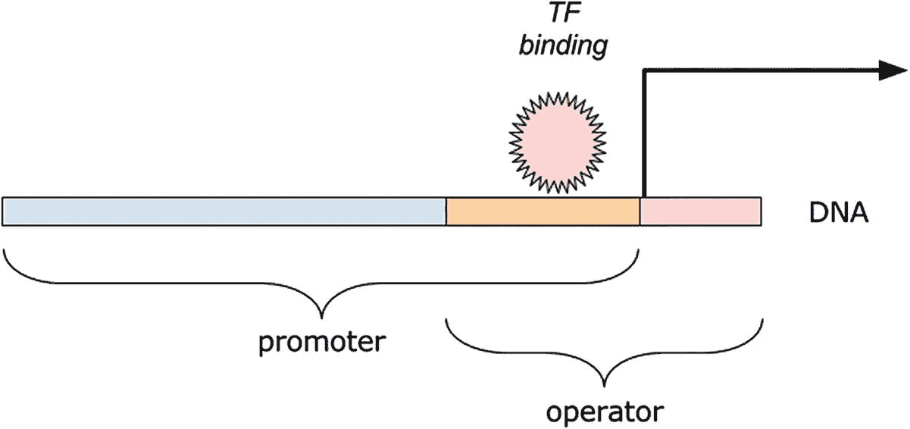
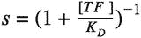
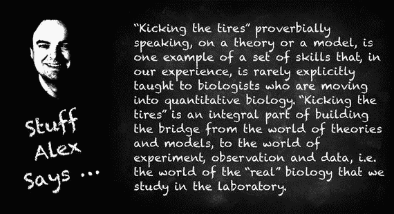
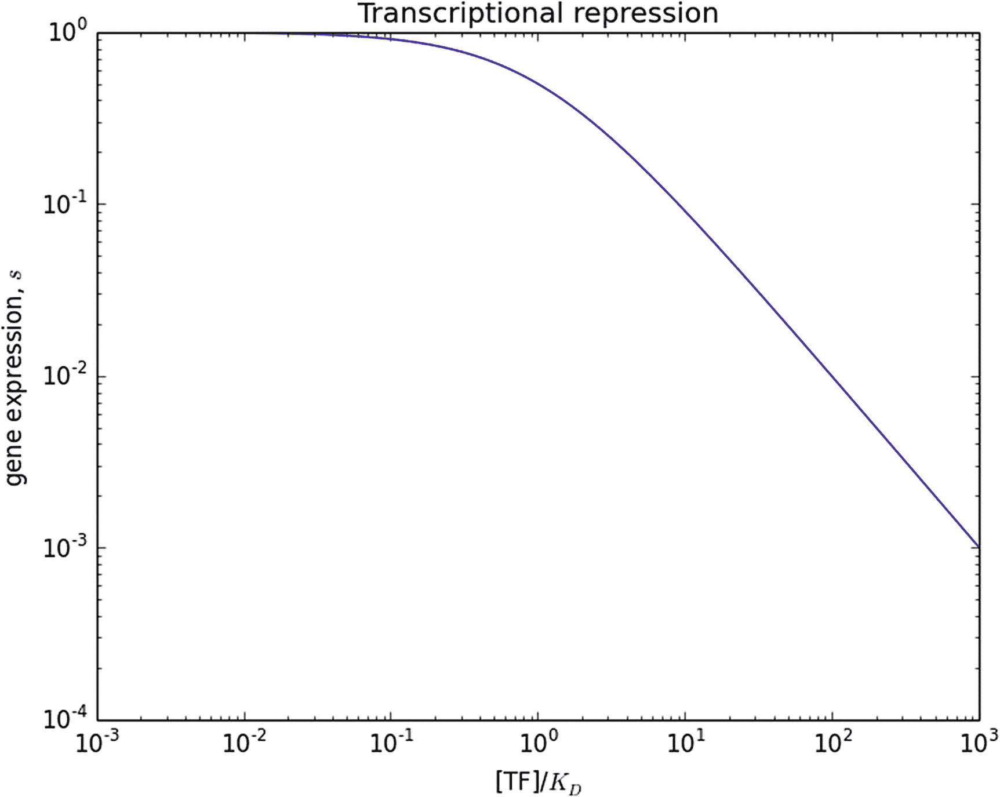
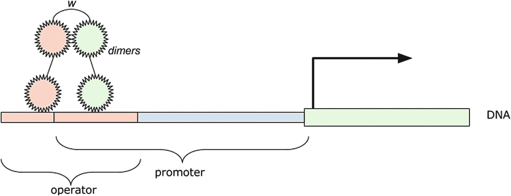
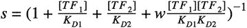
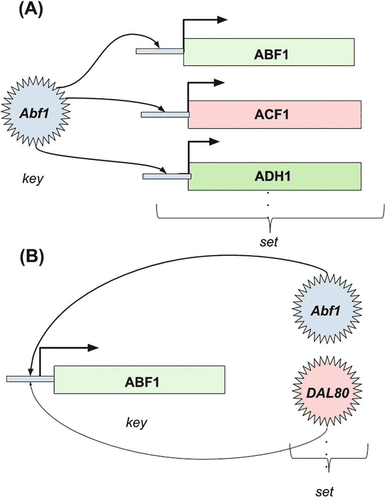

# 第 12 章 使用 Python 进行简单的基因调控建模

在第 11 章中，我们使用 Python 探索了三维结构生物学的世界。我们向你展示了如何使用 Python 研究旋转键对分子结构的影响。现在，我们将沿着复杂性的阶梯向上攀升，从近乎纯粹的物理和化学领域，转向那些更明显具有*生物学*特征的领域。当所有这些分子以大规模或小规模聚集在一起时会发生什么，这正是[生化动力学](https://en.wikipedia.org/wiki/Enzyme_kinetics)的研究主题。但更有趣的是，分子在细胞内聚集并执行某种生物学功能的过程。在本章中，我们将向你展示如何使用一些更高级的`matplotlib`函数来可视化[转录因子](https://en.wikipedia.org/wiki/Transcription_factor)蛋白的*浓度*与其在细胞中主要生物学功能（即启动从 DNA 到信使 RNA 的转录过程，也就是*开启*或*关闭*基因）之间的关系。

我们从最基本的转录调控形式之一开始：**阻遏蛋白调控基序**。阻遏型基序由基因下游启动子区域中的 DNA**结合位点**组成，当转录因子（通常称为 TF）结合到该位点时，它会阻断 RNA 聚合酶接近基因以启动转录。这些 RNA 聚合酶的被阻断会*抑制*基因表达，即*关闭基因*。与生物学中的许多情况一样，实际情况比这个高度简化的图景要复杂得多，但它大致描述了像*大肠杆菌*这样的细菌中发生的情况。

### 简单的转录抑制：Lac 操纵子

让我们来看一种最简单的抑制形式，其中***单个结合位点***（有时称为操纵基因）与核心启动子重叠，如图 12-1 所示（这是*大肠杆菌*中[Lac 操纵子](https://en.wikipedia.org/wiki/Lac_operon)的一种风格化版本）。



**图 12-1** Lac 操纵子

启动子中与操纵基因位点（**粉色**）重叠的部分（**蓝色**）显示为**橙色**。如前所述，当转录因子结合到此位点时，它会阻断 RNA 聚合酶接近启动子。直观地说，随着*游离*TF 浓度的增加，TF 结合到该位点的可能性*也越大*。这反过来又会*降低*基因的表达速率。我们将得到的基因表达速率称为**s**。TF 浓度与基因抑制程度之间的确切关系可以从占据状态的热力学和统计力学模型中推导出来，但幸运的是，亲爱的读者，我们不会在此深究这个难题！（关于这方面的良好论述，我们在此示例中有所借鉴，请查阅本章末尾列出的 Bintu 等人（2005）的参考文献）。

从这个推导中，我们得到了一个简单且相当直观的方程，它描述了图 12-2 所示简单阻遏情况下的关系。



**图 12-2** 简单阻遏子的基因表达速率

在前述方程中，`[TF]`是***转录因子浓度***，`K[D]`是结合的 TF-操纵基因分子复合物的***解离常数***。在我们将其编码到 Python 中之前，让我们先“试试这个方程的水温”，以确保它通过生物学合理性的基本“嗅探测试”。



一个特别有用的技能是考虑[极限情况](https://en.wikipedia.org/wiki/Limiting_case_%2528mathematics%2529)。首先，你可以看到，如果转录因子浓度为零（即`[TF] = 0`），抑制程度`s = 1`。这应该是直观的：如果没有 TF 漂浮在周围结合到操纵基因位点并妨碍其工作，RNA 聚合酶就可以接近基因。事实上，`s`永远不会大于 1：`s = 1`是*完全没有抑制*的基础情况。从这里开始全是下坡路；然而，一旦你开始*增加*TF 浓度，`s`就会*降低*：抑制已经开始了！其次，`K[D]`如何影响事情？嗯，如果你还记得基础酶动力学，解离常数衡量的是化学复合物解离的速率。从图 12-2 的方程中你可以看到，当你*增加`K[D]`*时，这会有*增加`s`*的趋势。这同样是有道理的：如果 TF 更容易从 DNA 上解离，RNA 聚合酶就越容易接近，基因表达就越多。耶！

### 介绍`NumPy`以及`from ... import`

背景知识足够多了，让我们来看看如何使用两个外部 Python 库的组合来可视化这种关系。这里我们将使用`NumPy`库以及`matplotlib`。`NumPy`，我们在**序言**和第 11 章中简要提到过，是一个为科学和数学目的而优化的数据结构和库（如果你还没有安装`numpy`，请回顾第 1 章的安装步骤）。尽管我们为了保持可控性而很大程度上避免了外部库，但`NumPy`是一个特例，因为它广泛可用、维护良好，并包含许多高效的数据结构以及常与`matplotlib`结合使用的特性。代码清单 12-1 展示了相关代码。

```
from numpy import arange
import matplotlib.pyplot as plt
### transcription activation function for a single repressor
def single_repressor(TF_concentration_1, K_D1):
F = 1/(1 + TF_concentration_1/K_D1)
return F
fig1 = plt.figure()
K_D1 = 7.9E-10 # dissociation constants
TF_concentration_1  = arange(0.001, 1000, 0.001) * K_D1
plt.loglog(TF_concentration_1 / K_D1,
single_repressor(TF_concentration_1, K_D1),
basex=10, color="blue")
plt.xlabel("[TF]/$K_D$")
plt.ylabel("repression, $F$")
plt.title('Transcriptional repression')
plt.show()
```

**代码清单 12-1** 使用`NumPy`和`matplotlib`可视化简单基因抑制

你首先会注意到`import`语句的格式有点不同：`from numpy import arange`。这是怎么回事？嗯，`arange`是外部模块`numpy`中包含的一个函数，所以我们可以简单地`import`该模块，但那样当你使用`arange`函数时，你还必须包含该模块名：

```
import numpy
numpy.arange(0.001, 1000, 0.001)
```

这样也能正常工作，但每次都输入`numpy.arange`很快就会变得繁琐，特别是如果你想在 Python 程序中反复使用它的话，而且你可能会发现自己会想，为什么不能只导入这个函数*一次*呢？这正是使用`from`语句与`import`结合所实现的目的：

```
from numpy import arange
```


## 排版后的内容

我们已经将 `string` 函数导入到了*本地*命名空间中，因此不再需要每次使用时都额外加上 `numpy` 前缀。这是我们在第 7 章首次遇到的命名空间简写用法的一个示例。现在，我们可以毫无顾虑地直接使用 `arange` 了！太好了！

接下来，我们定义一个名为 `simple_repression()` 的函数，该函数实现了我们之前介绍过的抑制方程：给定一个 `TF_concentration` 和 `K_D1`（解离常数），它会计算输出的抑制水平 `F`。（注意：我们在 `K_D1` 的变量名中使用了“`1`”，因为稍后我们会引入一个双重抑制子。）将其定义为一个函数而不是简单地将代码内联是很有用的，因为我们在后续计算中会再次用到它。接着，我们使用 matplotlib 的 `figure()` 函数来初始化图形，然后定义解离常数 `K_D1`。接下来，我们使用 `arange(0.001, 1000, 0.001)` 来创建绘图点：从 0.001 开始，以 0.001 为步长，递增到 1000。`arange` 函数是基于基础 Python 中的 `range` 函数建模的，但允许更精细的控制，并返回一种新的数据类型：**数组**。当使用大量数值时，NumPy 的数组比等效的标准 Python 列表更高效。此外，matplotlib（我们在第 10 章介绍和讨论过）已经“理解”NumPy 数组。我们还将结果数组乘以 `K_D1` 以得到 `TF_concentration`——这是因为我们将绘制 [*TF*]/K[D] 的*比值*而非 [*TF*] 的绝对值，并且我们希望图表显示整齐的整数数量级（10⁻³ 到 10³）。整齐的整数数量级是很棒的！

现在我们已准备好绘制图表本身：matplotlib 的 `loglog()` 函数用于创建[双对数图](https://en.wikipedia.org/wiki/Log%25E2%2580%2593log_plot)，这样我们可以轻松地在很广的 TF 浓度范围内可视化抑制程度。`loglog` 函数的第一个参数是 *x* 轴，即我们之前创建的 NumPy 数组，第二个参数是 *y* 轴。对于这第二个参数，我们使用 `simple_repression` 函数将数组转换为输出。注意在 `loglog` 调用中内联使用了 `simple_repression` 函数，这避免了仅为 *y* 轴创建一个单独的变量。我们还指定了双对数图使用以 10 为底的对数（`basex=10`）和颜色（`color="blue"`）。

最后几行基本不言自明：我们使用 `xlabel`、`ylabel` 和 `title` 设置轴标签和标题，最后调用 `show()`。matplotlib 的一个很棒的特性是，在标签中位于美元符号内的任何文本都会被当作 LaTeX 数学公式处理。matplotlib 会将这些表达式转换为格式精美的版本，例如，轴标签 `$K_D$` 和 `$s$` 分别被渲染为 K[D] 和 s（更多细节请参阅文档）。（如果你不知道 LaTeX 是什么，别担心，你完全不需要为此烦恼，但了解一下 LaTeX 所产生的精美排版还是值得的）。

在图 12-3 中，我们展示了绘制的图表！



**图 12-3** 基因表达抑制随转录因子浓度变化的图表

现在我们可以看到，随着 TF 分子浓度的增加，转录抑制在实际中是如何进行的。你会注意到图表跨越了六个数量级，在比值达到 0.1 到 1 之间之前，抑制并没有真正以任何有意义的方式开始。

## 双相互抑制子：两个优于一个

但生物系统如果不狡猾的话就不是生物系统了。在原核生物和某些真核生物（如酵母）中，对 DNA 进行相对简单的调整，例如通过突变（我们将在第 19 章对进化进行建模，但先不要操之过急），可以在原始结合位点附近引入另一个结合位点。一个新的抑制子基序的引入带来了一个新的调控可能性：一个操纵子，其中结合到该位点的转录因子相互交互，从而在相同相对数量的 TF 情况下增加抑制程度。让 TF 的投入产出比更高。这在数量上与简单抑制子情况相比如何？



**图 12-4** 具有双相互抑制子的启动子

让我们回到分子生物学层面。图 12-4 显示的是控制某个基因的启动子。同样，我们有一个操纵子（粉红色），在橙色区域部分重叠了启动子（蓝色）。不过这次有*两个*相邻的结合基序。一种常见的情况是，TF 在与 DNA 操纵子位点***结合***之前先形成***二聚体***（*两个*相同类型的分子副本形成一个*单一*复合体），如上图所示。此外，这两对二聚体，由于它们从 DNA 上突伸得更多，现在更有可能与*彼此*相互作用。这种两组分子之间的相互作用被称为[协同结合](https://en.wikipedia.org/wiki/Cooperative_binding)，并且*增加*了当两个结合位点都被 TF 占据时，它们*保持*结合在启动子上的概率，相比于只有两个位点中的一个被占据的情况。所以现在我们有两种情况：*两个* TF 可以*单独*结合，也可以*一起*结合。另外，我们设 TF 之间的相互作用强度为 *w*（如上图所示）。这被称为**双相互抑制子**。那么，在相同的 TF 浓度下，我们现在能获得多少转录抑制？

同样，该公式可以从基本原理出发，沿着与简单抑制子相同的思路推导出来（详见 Bintu 等人，2005 年），但直奔主题，我们在图 12-5 中展示了该公式。



**图 12-5** 两个相互抑制子的基因表达速率

这里我们有两个转录因子，它们各有单独的浓度（[TF[1]], [TF[2]]）和解离常数（K[D1], K[D2]）。同样，即使不对公式进行任何详细的推导或解释，公式的结构也应该在直观上有些道理。它几乎与之前的公式相同，只是除了***第一***项之外，我们现在为第二个 TF 浓度增加了一个***第二***项（代表仅由第二个 TF 单独导致的抑制），以及一个***第三***项，考虑到两种 TF 浓度和抑制强度 *w* 的存在，该项显然代表了由 TF 之间*协同*相互作用所带来的额外抑制。

那么，这与简单抑制子情况相比如何呢？让我们先假设两个 TF 是相同的，因此它们的浓度 [TF[1]] = [TF[2]] (= [TF])。然后我们可以很容易地将该公式编码到 Python 中，并在与简单抑制子情况相同的坐标轴上绘制抑制因子 `F`。在代码清单 12-2 中，我们展示了代码。


```python
from numpy import arange
import matplotlib.pyplot as plt

### 单一阻遏物的转录激活函数
def single_repressor(TF_concentration_1, K_D1):
    F = 1/(1 + TF_concentration_1/K_D1)
    return F

### 双重阻遏物的转录激活函数
### 其中阻遏物以强度 w 相互作用
def dual_repressor(TF_concentration_1, TF_concentration_2, K_D1, K_D2, w):
    F = 1/(1 + TF_concentration_1/K_D1 + TF_concentration_2/K_D2 + ((TF_concentration_1/K_D1) * (TF_concentration_2/K_D2))* w)
    return F

fig1 = plt.figure()
K_D1 = 7.9E-10    # 解离常数
K_D2 = 25 * K_D1  # 解离常数

### 单一阻遏物
TF_concentration_1 = arange(0.001, 1000, 0.001) * K_D1
plt.loglog(TF_concentration_1 / K_D1,
           single_repressor(TF_concentration_1, K_D1),
           basex=10, color="blue", label="single")
plt.xlabel("[TF]/$K_D$")
plt.ylabel("repression, $F$")

### 双重阻遏物
w = 200
TF_concentration_2 = arange(0.001, 1000, 0.001) * K_D2
plt.loglog(TF_concentration_2 / K_D2,
           dual_repressor(TF_concentration_2, TF_concentration_2, K_D1, K_D2, w),
           basex=10, color="green", label="dual")
plt.title('转录抑制')
plt.legend(loc='lower left')
plt.show()
```

清单 12-2 将两个基因表达关系叠加在单个图上

此代码结构与之前的代码几乎相同，在这一点上应当相当不言自明。我们创建了另一个函数 `dual_repressor()`，用于编码前述公式。我们进一步将 `K_D2` 设置为 `K_D1` 解离常数的 25 倍（详情参见 Bintu et al. (2005b)）。在 `loglog` 调用中，我们还额外提供了一个 `label` 参数。随后，matplotlib 的 `legend` 调用会利用该参数为彩色线条创建图例。我们还将图例放置在左下角（`loc='lower left'`），以避免遮挡图形。另请注意，我们*只需一次*创建 *x* 和 *y* 轴标签。

好了，现在我们可以准备在图 12-6 中比较阻遏物了！


图 12-6 比较单一阻遏与双重阻遏对基因表达的影响

显然，双重阻遏物在关闭基因方面效率更高。在相同转录因子浓度下，能实现更多的转录抑制。这张图确实能帮助生物学家直观感受在大范围转录因子浓度下的调控变化。

## 相同浓度，更强抑制：注释图表

好了，假设你正面向一群持怀疑态度的听众进行展示。对某些人来说，双对数图可能不像对其他人那样直观。假设你非常想向那些需要看到*具体数值*的人强调一个观点：双重阻遏确实能产生显著差异。这时，叠加文本注释以及图表上的垂直与水平线就会派上用场。

假设我们想要比较当转录因子浓度加倍时，*绝对*抑制量如何变化。我们首先在两个不同的转录因子浓度水平上覆盖水平线和垂直线，然后添加文本框，并用箭头指向每种情况下的抑制水平。在清单 12-3 中，我们展示了 Python 代码（你需要从之前的清单中定义 `single_repressor` 和 `dual_repressor` 函数）。

```python
def draw_points(TF_ratio, repression, color):
    plt.axhline(repression,
                linestyle='dashed',
                color=color,
                linewidth=2)
    plt.annotate("%.1g" % repression,
                 xy = (TF_ratio, repression),
                 xytext = (TF_ratio*0.1, repression*0.1),
                 color=color,
                 arrowprops=dict(facecolor=color, width=2, frac=0.2, shrink=0.05))

for TF_ratio in [0.5, 1.0]:
    plt.axvline(x=TF_ratio, linestyle="dashed", color="pink", linewidth=3)
    TF_value = TF_ratio * K_D1  # 将比率转换为转录因子浓度
    repression = single_repressor(TF_value, K_D1)
    draw_points(TF_ratio, repression, "blue")
    TF_value = TF_ratio * K_D2
    repression = dual_repressor(TF_value, TF_value, K_D1, K_D2, w)
    draw_points(TF_ratio, repression, "green")
```

清单 12-3 向 matplotlib 图表添加注释


我们从一个函数 `draw_points()` 开始。该函数首先使用 matplotlib 的 `axhline()` 函数，在给定的 `repression` 水平上绘制一条颜色为 `color` 的虚线水平线。然后使用 `annotate` 函数绘制抑制水平，并用箭头指向图上的精确点。`xy` 关键字是*图上实际点*的位置，而 `xytext` 是*文本框*的位置。`arrowprops` 关键字会创建一条从标签到该点的箭头，颜色同样为 `color`。请注意，在 `xytext` 中，我们将提供给 `xy` 的坐标乘以了 0.1，这样能使标签与箭头末端略微错开。

接下来，我们为 `TF_ratio`（0.5 和 1.0，即浓度加倍）添加一个 `for` 循环。在每次循环迭代中，我们首先使用 `axvline` 在指定的 `TF_ratio` 处绘制一条垂直线。然后将 `TF_ratio` 转换为实际的 `TF_value`，并调用 `single_repressor` 获取 `repression` 水平，接着将其提供给 `draw_points()` 函数。然后，我们对 `dual_repressor()` 重复相同的过程。请注意，我们还会匹配原始曲线的颜色：**蓝色**代表单一阻遏物，**绿色**代表双重阻遏物。

现在，让我们将整个程序整合起来，生成图形。完整的代码见清单 12-4。


```python
from numpy import arange
import matplotlib.pyplot as plt

### transcription activation function for a single repressor
def single_repressor(TF_concentration_1, K_D1):
    F = 1/(1 + TF_concentration_1/K_D1)
    return F

### transcription activation function for a dual repressor
### where repressors interact with strength w
def dual_repressor(TF_concentration_1, TF_concentration_2, K_D1, K_D2, w):
    F = 1/(1 + TF_concentration_1/K_D1 + TF_concentration_2/K_D2 + ((TF_concentration_1/K_D1) * (TF_concentration_2/K_D2)) * w)
    return F

def draw_points(TF_ratio, repression, color):
    plt.axhline(repression,
                linestyle='dashed',
                color=color,
                linewidth=2)
    plt.annotate("%.1g" % repression,
                 xy = (TF_ratio, repression),
                 xytext = (TF_ratio*0.1, repression*0.1),
                 color=color,
                 arrowprops=dict(facecolor=color, width=2, frac=0.2, shrink=0.05))

fig1 = plt.figure()

### dissociation constants
K_D1 = 7.9E-10
K_D2 = 25 * K_D1

### single repressor
TF_concentration_1 = arange(0.001, 1000, 0.001) * K_D1
plt.loglog(TF_concentration_1 / K_D1,
           single_repressor(TF_concentration_1, K_D1),
           basex=10, color="blue", label="single")
plt.xlabel("[TF]/$K_D$")
plt.ylabel("repression, $F$")

### dual repressor
w = 200
TF_concentration_2 = arange(0.001, 1000, 0.001) * K_D2
plt.loglog(TF_concentration_2 / K_D2,
           dual_repressor(TF_concentration_2, TF_concentration_2, K_D1, K_D2, w),
           basex=10, color="green", label="dual")

for TF_ratio in [0.5, 1.0]:
    plt.axvline(x=TF_ratio, linestyle="dashed", color="pink", linewidth=3)
    TF_value = TF_ratio * K_D1  # convert ratio into TF concentration
    repression = single_repressor(TF_value, K_D1)
    draw_points(TF_ratio, repression, "blue")
    TF_value = TF_ratio * K_D2
    repression = dual_repressor(TF_value, TF_value, K_D1, K_D2, w)
    draw_points(TF_ratio, repression, "green")

plt.title('Transcriptional repression')
plt.legend(loc='lower left')
plt.show()
```

**列表 12-4** 生成带有注释的基因表达抑制图表的完整代码

在图 12-7 中，我们展示了该图！


**图 12-7** 带有图例的注释图，展示了单抑制子和双抑制子的基因抑制情况

你可以清晰地看到，单抑制子基序仅将基因表达抑制了 1.4 倍（=0.7/0.5），而双抑制子基序则实现了四倍的抑制（=0.0008/0.0002）。将这些`matplotlib`注释功能牢记于心是非常有用的，因为它们能为图表增添非常高效的元素。

因此，可视化转录因子结合的动力学开始更像是真实的生物学了。接下来，在第 13 章中，我们将沿着生物复杂性的阶梯继续向上，使用 Python 挖掘一个数据集，该数据集包含了连接到简单单细胞生物——酿酒酵母细胞内它们所控制基因上的所有转录因子。然后，在第 14 章中，我们将所有内容整合在一起，创建一个基于 Python 的简单`仿真模型`，用于探索相互作用的基因通过本章介绍的双相互作用抑制子基序相互调节的动力学。

## 参考文献与深入阅读

- James A. Goodrich 和 Jennifer F. Kugel, *《分子生物学家的结合与动力学》*^(¹⁶⁴) (冷泉港出版社, 2007)
- Bintu, Buchler, Garcia, Gerland, Hwa, Kondev, 和 Phillips (2005a). 转录调控的数字化：模型.^(¹⁶⁵) *《遗传学与发展当前观点》*, **15**, 116–124
- Bintu, Buchler, Garcia, Gerland, Hwa, Kondev, Kuhlman, *等* (2005b). [转录调控的数字化：应用.](https://www.ncbi.nlm.nih.gov/pmc/articles/PMC3462814/)^(¹⁶⁶) *《遗传学与发展当前观点》*, **15**, 125–135

## 脚注

### 13. 驯服网络毛团

*使用 Python 集合挖掘系统生物学数据*

 | *柴郡猫被困住了；他试图向左移动，然后又试图向右移动。但无济于事。树上粗壮缠绕的树枝证明，即使对于猫这样虚无缥缈的幽灵般存在，也毫不让步。* <br> *“就没有人把我从这个地狱般的混乱中救出来吗？”猫喵喵叫着。* <br> *在地上看着猫的爱丽丝饶有兴趣地抬头看着。她开始理解这个一切都不像表面看起来那样的颠倒世界。* <br> *“猫，”她喊道，“你应该习惯处理这种缠结的乱麻。毕竟，是你发明了毛团！”* <br> *话音刚落，猫“噗”的一声消失了。* |

 | `set()`, `union`, `intersection`, `list comprehensions` |

 | *系统生物学，基因网络，转录网络，基因调控* |

正如我们在前几章中已经看到的，计算生物学的工作并非都围绕着分析序列展开。序列虽然非常重要，但在某种意义上只是理解复杂生物系统的起点。它们代表了进化历经数千年所雕琢出的一套解决方案“数据库”。使得生物系统如此引人入胜的原因在于，我们看到这些序列如何帮助构建构成我们在生物学中观察到的性状基础的网络。研究这类网络（特别是细胞内的网络）的新兴生物学领域，被称为“[系统生物学](https://en.wikipedia.org/wiki/Systems_biology)”。系统生物学是一个庞大的领域，范围从蛋白质、信使 RNA、DNA 相互作用的实验研究，到互作网络的数学建模和模拟。在本章中，我们将撸起袖子，应用我们在前几章中开发的技能，如解析数据文件、数据结构和正则表达式，来处理一些真实的生物数据集。我们已经在第 12 章中接触到了系统生物学的一个构建模块。Python 拥有一套出色且久经考验的工具，可以帮助你驾驭系统生物学中庞大且不断增长的网络数据集资源。因此，首先，让我们设想你正有兴趣处理一种网络：基因以及调控这些基因在酵母细胞中如何开启或关闭的转录因子网络。酵母是值得研究的生物，原因有很多：它们世代时间短，非常适合实验进化；并且虽然它们主要以单细胞形式存在，但它们也是[真核生物](https://en.wikipedia.org/wiki/Eukaryote)，因此许多基因在酵母和人类之间是保守的。但在系统生物学背景下，酵母有一个巨大优势，那就是它们拥有非常全面的、经过实验验证的细胞组分间相互作用数据库。所有这些组分之间的相互作用数量可能非常庞大，许多连接边重叠在一起，这导致许多人将这类数据称为网络毛团。


## 排版后的内容

有许多不同的数据库可供我们探索。让我们先只看一个：`YEASTRACT`^(¹⁶⁷)，它代表 **Yea**st **S**earch for **T**ranscriptional **R**egulators **A**nd **C**onsensus **T**racking。这是一个*人工策展*的网站（意味着真正的人会查看条目并定期进行修正），你可以从该网站进行许多交互式可视化。例如，你可以查看特定转录因子调控的所有基因。然而，在某些时候，你会希望开始对网络进行自己的定量探索，超越网站程序员所能想象的范围。

首先要做的是寻找“平面文件”。这些是格式如 **CSV**（逗号分隔值）或 **TSV**（制表符分隔值）的纯文本文件。

快速浏览 `YEASTRACT` 网站，你会发现下载页面：

*   [www.yeastract.com/download.php](http://www.yeastract.com/download.php)

获取平面文件：

```
RegulationTwoColumnTable_Documented_2013927.tsv.gz
```

并使用诸如`gunzip`之类的归档程序将其解压，你会发现它包含两列，格式如下：

```
ABF1;ABF1
ABF1;ACS1
ABF1;ADE5,7
ABF1;ADH1
ABF1;ALD3
ABF1;AMS1
ABF1;ARN2
ABF1;ARO3
ABF1;ARP5
ABF1;BAP3
ABF1;BNA2
...
```

*第一列*包含一个转录因子，*第二列*包含受该转录因子调控的基因名称。从视觉上看，底层的转录因子网络可以被重构，看起来像图 13-1，它显示了一个转录因子调控多个基因。


**图 13-1** 单个转录因子 `Abf1` 调控多个基因。

## 用 `set` 来列个清单

你可能从遥远的入门数学^(¹⁶⁸)课程中回忆起来，一个`set`只包含*唯一*的成员。在转录网络的数据结构上下文中，这意味着对于每个转录因子，我们只需要*记录一次*那个特定的基因。

让我们创建一个空的基因集合：

```
genes = set()
```

这很简单！让我们开始向集合中添加基因：

```
genes.add("ABF1")
genes.add("ACS1")
print(genes)
{'ABF1', 'ACS1'}
```

太好了，现在我们有了一个基因集合。然而，`set`的真正优势在于它们会拒绝添加重复项。这非常方便，因为我们不需要检查集合是否包含某个元素（就像使用列表时那样），只需不断添加基因，而`set`会神奇地确保只有一个条目。继续看例子：

```
genes.add("ABF1")
print(genes)
{'ABF1', 'ACS1'}
```

请注意，`ABF1`基因仍然只有一个副本！很酷吧？事实证明，当你向数据集中添加大量基因时，这一点尤其重要，因为有时（这对于生物学家来说可能是一个令人震惊的事实），你的输入数据中可能存在*错误*或*重复项*！我知道，我知道，奇迹永远不会停止。

现在你已经自动防范了常常困扰初出茅庐的计算生物学家的问题之一：缺失或重复数据的存在！

`set`还有一些其他很酷的特性。你可以轻松检查某个元素是否包含在集合中：

```
'ABF1' in genes
True
'FakeGene' in genes
False
```

或者你可以检查一个集合是否是另一个集合的子集（注意，你可以使用列表来初始化集合）。在这个例子中，请注意包含仅`ABF1`基因的集合`smaller`是原始`genes`集合的一个子集：

```
smaller=set(['ABF1'])
print(smaller)
{'ABF1'}
smaller  genes
False
```


你还可以执行各种标准集合操作，例如`intersection`（`A & B`）、`union`（`A | B`）等等（完整列表请参见 Python 语言关于集合的文档^(¹⁶⁹)）。现在你可以开始看到，当查询由离散对象（如转录因子和基因）组成的生物数据时，`set`可能会非常有用。例如，给定两个不同的转录因子，哪些基因受到*两者*的调控，哪些基因只受到其中之一的调控？那么，让我们使用我们的 `YEASTRACT` 例子来看看 `set` 的实际应用！

## 两个字典的故事：网络的数据结构

让我们开始创建网络的数据结构。我们首先使用我们在第 8 章中介绍的`with`语句方法来读取文件：

```
with open("RegulationTwoColumnTable_Documented_2013927.tsv") as file:
lines = file.readlines()
```

我们将开始创建*两个*字典数据结构。这样做的原因是，我们经常需要从转录因子（TF）的角度查找信息，即给定一个 TF，它控制哪些基因？但反之亦然：给定一个基因，它被哪些 TF 控制？（注意，我们暂时不考虑用于创建网络的第三方包，例如 **NetworkX** – 有关指引，请参见本章末尾的参考资料部分 – 目前我们只关注核心 Python 语言。）

这两种数据结构以及底层生物学在图 13-2 中进行了图形化描述。



**图 13-2** 两种数据结构：（A）TF 调控一组基因，（B）基因被一组 TF 调控

图 13-2 是集合的可视化表示——在图的（A）部分，键是 TF；在图的（B）部分，键是基因。

1.  `alltfs`：一个以 TF 为索引的字典，每个*键*是一个 TF，每个*值*是它调控的`set`基因（**A** 显示了一个*键*：TF *Abf1* 调控几个基因；注意只显示了前几个）。
2.  `allgenes`：一个以基因为索引的字典，每个*键*是一个基因，每个*值*是调控该基因的`set`的 TF（**B** 显示了一个*键*，即 *ABF1* *基因*，以及所有调控它的 TF——同样只显示了前几个）。

让我们先初始化字典，然后循环并解析我们已经检索到数据的行：

```
alltfs = {}
allgenes = {}
for line in lines:
items = line.split(';') # split line into elements using ';' as separator
items = [item.lower() for item in items]   # lowercase each item
tf = items[0].strip()   # first column  = TF  (element 0)
gene = items[1].strip() # second column = gene that TF regulates (element 1)
```

让我们在这里暂停一下，在创建数据结构本身之前进行回顾。在这短短几行代码中，我们做了*相当*多的事情，并且我们需要对尚未描述的新语言特性进行几次短暂的绕行。

***首先***，我们在`line`变量包含的字符串上使用`split`，将其拆分为一个字符串`items`的**列表**（我们指定`split`应使用分号作为分隔每个变量的字符——这通常称为**分隔符**）。（对于 Python 2.7 的用户，请注意，在 Python 3 中，`split`和`strip`函数不再是`string`模块的一部分，我们直接在这些字符串上使用这些函数）。

##### 列表推导式

***其次***，循环中的下一行引入了另一个新特性：**列表推导式**。列表推导式允许你获取一个列表并：
1.  循环遍历该列表（这是内部的“`for item in items`”）
2.  通过应用`lower()`函数将每个项转换为小写，从而修改列表中的每个项。


3. 在新方括号`[ ]`内返回一个*新的*列表（覆盖旧的列表）

所有操作都在一行内完成！很酷，对吧？Python 的简洁性无可比拟。列表推导式非常适合这类任务。如需了解更详尽的信息，请参阅 Python 官方教程中关于列表推导式的内容。¹⁷⁰

现在，我们成功地将输入数据中的每个元素在一行内转换为了小写。这样做是为了避免输入文件中字体大小写的微小差异被当作不同内容处理，例如，转录因子“**Pma1**”实际上应该与转录因子“**pma1**”视为相同（这又是我们通过*预先*清理数据来构建健壮性这一通用原则的另一个例子）。这引出了……

***第三***，最后两行提取了`tf`（原始文件中的第一列，也就是`items`中的第零个元素）和调控的`gene`（第二列，即`items`中的第一个元素，记住所有列表都是从零位置开始的）。然而，在赋予`tf`和`gene`值之前，我们首先使用`strip`方法去除字符串中的无关字符，特别是原始`line`中“随行携带”的令人讨厌的行尾字符。（这又是我们之前提到的防御性编程的另一个例子。）

最后，现在我们有了文件中的实际信息，可以运用字典的相关知识（参见第 2 章）和我们刚刚介绍的`set`功能，来用这些数据*做些*实际的事情。以下是读取数据文件后的下一段代码：

```
### genes keyed by TF
if tf in alltfs:
(alltfs[tf]).add(gene)  # TF 已存在，我们只需添加基因
else:
alltfs[tf] = set()      # 否则，创建一个空集合
(alltfs[tf]).add(gene)  # 然后添加基因
```

我们来简要解析一下。首先检查`tf`这个键是否存在。如果存在，我们就使用`add()`函数将`gene`添加到该特定 TF 所调控的基因集合中。如果不存在，我们就*创建*一个新的*空*集合，然后像之前一样添加基因。初学者可能会对`(alltfs[tf])`外面额外的括号感到困惑。虽然这些括号并非严格必要，但它们提醒我们，当使用`add()`方法添加基因时，**我们是在向该字典条目处的集合**添加元素。如果示例变得更复杂，它们也更容易跟踪哪个元素属于哪个集合。

下一段代码的基本格式与前一段相同，但这次不是向集合添加基因，而是向集合添加 TF，并且这些集合以基因作为键：

```
### TFs keyed by gene
if gene in allgenes:
(allgenes[gene]).add(tf) # 如果基因已存在，我们只需添加 TF
else:
allgenes[gene] = set()   # 否则创建空集合
(allgenes[gene]).add(tf) # 然后添加 TF
```

呼！让我们把代码整合起来，看看列表 13-1 中的内容。

```
#!/usr/bin/env python3
with open("RegulationTwoColumnTable_Documented_2013927.tsv") as file:
lines = file.readlines()
alltfs = {}
allgenes = {}
for line in lines:
items = line.split()      # 将每一行分割成元素
items = [item.lower() for item in items] # 将每个元素转为小写
tf = items[0]             # 第一列 = TF（元素 0）
gene = items[1]           # 第二列 = 由 TF 调控的基因（元素 1）
### genes keyed by TF
if tf in alltfs:
(alltfs[tf]).add(gene)  # TF 已存在，我们只需添加基因
else:
alltfs[tf] = set()      # 否则，创建一个空集合
(alltfs[tf]).add(gene)  # 然后添加基因
### TFs keyed by genes
if gene in allgenes:
(allgenes[gene]).add(tf) # 基因已存在，我们只需添加 TF
else:
allgenes[gene] = set()      # 否则，创建一个空集合
(allgenes[gene]).add(tf)    # 然后添加 TF
print("total TFs:", len(alltfs))
print("total genes:", len(allgenes))
```

**列表 13-1** 将网络数据从文件解析到两个数据结构中

如果你运行上述程序，它应该会读取文件并给出一些汇总统计信息，看起来大致如下：

```
total TFs: 183
total genes: 6403
```

我们在第 3 章首次遇到的`len()`函数，会打印出数据结构的*长度*，其具体含义取决于数据结构的*类型*。对于我们的*字典*而言，这就是*键*的数量。恭喜你，现在你已经成功创建了可以用来开始提出一些实际生物学问题的数据结构！

## 谁调控谁？

在分析这类互作网络数据时，一个常见的问题是：给定两种不同的转录因子，它们共同调控的*共同*基因是什么？现在，由于我们已经完成了大部分繁重的工作，使用集合的`intersection`函数（使用快捷方式`"&"`）来回答这个问题变得异常简单：

```
print("genes regulated by both abf1 & cyc8:", alltfs['abf1'] & alltfs['cyc8'])
genes regulated by both abf1 and cyc8: {'hxt2', 'hxt4'}
```

结果是一个很小的集合：只有两个基因。我们还可以查询完整的超集，即它们两者调控的*所有*基因。利用**集合**的功能，我们可以确保——无需任何额外代码——通过使用`union`（快捷方式`"|"`）函数，我们的集合将只包含唯一的元素：

```
print("genes regulated by abf1 or cyc8:", alltfs['abf1'] | alltfs['cyc8'])
genes regulated by abf1 or cyc8: {'ycr064c', 'ugx2', 'ydr095c', 'spp2', 'mtq1', ...
```

我们截断了上述集合的输出，因为它会占掉整整一章的篇幅！还要注意，**hxt2** 和 **hxt4** 尽管出现在两个原始集合中，但在结果集合中只会出现*一次*。太棒了。你现在拥有了工具，可以利用`set`函数提供的所有丰富可能性，以多种方式开始探索网络数据，唯一限制你的只有想象力。你也可以使用`allgenes`数据结构来提出类似的问题，例如哪些 TF 调控某个特定的基因。我们将这些功能留给你自己去发现！

## 现在整合到一起：使用 Python `__main__`

现在，我们可以把所有内容整合在一起，将文件读取和数据结构创建放入一个函数`get_tf_yeastract`，并将执行交集和并集运算的函数放入它们各自的独立函数`get_common_genes`和`get_all_genes`中（使用`def`关键字和适当的缩进，正如我们在第 2 章中介绍的）。这非常方便，因为它意味着我们可以用不同的变量*重复使用*这些函数。然后，我们可以让实际的*主*程序变得非常简短。以下是主程序的样子（注意，我们还使用了`sorted`，我们早在第 3 章就首次遇到过它，用于对输出中的基因和转录因子进行字母排序）：

```
if __name__ == "__main__":
### get TF regulation data
alltfs, allgenes = get_tf_yeastract()
### remember we lowercased the gene names!
common_genes = get_common_genes(alltfs, 'abf1', 'cyc8')
print("genes regulated by both abf1 & cyc8", sorted(common_genes))
all_genes = get_all_genes(alltfs, 'abf1', 'cyc8')
print("genes regulated by abf1 or cyc8", sorted(all_genes))
```

这展示了命名空间的另一个巧妙特性；我们可以将所有函数放在一个文件中，然后将*主*程序放在*同一*文件的底部，而无需将其移动到单独的文件中。当你希望将所有函数、变量和测试用例放在一个地方时，这非常方便。这神奇地由以下代码实现：

```
if __name__ == "__main__"
```

通过使用`"__main__"`，Python 解释器会注意到该文件是被直接执行的，并仅在文件被直接执行时运行这些代码，而在导入该文件时则不会运行（更多令人头疼的细节，请参阅 Python 官方教程中关于模块和脚本的部分¹⁷¹）。


好的，作为一名高级文档工程师和翻译员，我将严格遵循您的格式要求，将以下英文文本翻译成中文。


最终，我们在清单 13-2 中得到了完整的程序，可以看到它相当简短（如果去掉一些注释，则会更加简洁）。

```
#!/usr/bin/env python
### get the TF regulation data from yeastract
def get_tf_yeastract():
with open("RegulationTwoColumnTable_Documented_2013927.tsv") as file:
lines = file.readlines()
### create a dictionary indexed by transcription factors (TF)
### each key is a TF, each value is a *list* of genes it regulates
alltfs = {}
### create a dictionary of indexed by genes
### each key is a gene, each value is a *list* of TFs regulated by that gene
allgenes = {}
for line in lines:
items = line.strip(';') # split line into elements using ';' as separator
### lowercase each item, so that minor differences in casing don't confuse
items = [item.lower() for item in items]
tf = items[0].strip()  # first col  = TF  (element 0)
gene = items[1].strip() # second col = gene that TF regulates (element 1)
### genes keyed by TF
if tf in alltfs:
(alltfs[tf]).add(gene)  # TF already added, we just add the gene
else:
alltfs[tf] = set()     # otherwise, we create an empty set
(alltfs[tf]).add(gene) # then add it
### TFs keyed by gene
if gene in allgenes:
(allgenes[gene]).add(tf) # if gene already exists, we just add the TF
else:
allgenes[gene] = set()   # otherwise create empty set
(allgenes[gene]).add(tf) # then add it
print("total TFs:", len(alltfs))
print("total genes:", len(allgenes))
return alltfs, allgenes
def get_common_genes(alltfs, tf1, tf2):
return alltfs[tf1] & alltfs[tf2]
def get_all_genes(alltfs, tf1, tf2):
return alltfs[tf1] | alltfs[tf2]
if __name__ == "__main__":
### get TF regulation data
alltfs, allgenes = get_tf_yeastract()
### remember we lowercased the gene names!
common_genes = get_common_genes(alltfs, 'abf1', 'cyc8')
print("genes regulated by both abf1 and cyc8", sorted(common_genes))
all_genes = get_all_genes(alltfs, 'abf1', 'cyc8')
print("all genes regulated by either abf1 OR cyc8", sorted(all_genes))
Listing 13-2
Complete program for reading and parsing transcription network data
```

所以，初出茅庐的 Python 爱好者们，去尽情探索交互网络数据吧！第 14 章还有更多的系统生物学知识等着你，在那里我们将创建一个动态模拟模型，模拟一个由基因和转录因子相互作用的网络。

## 参考文献与深入阅读

*   NetworkX^((172)): 一个用于网络数据结构的 Python 库
*   Hive Plots^((173)): 超越“毛团”的复杂生物网络可视化方法；相关 Python 包：`pyveplot`^((174))
*   Teixeira *等人* (2014). The YEASTRACT database: an upgraded information system for the analysis of gene and genomic transcription regulation in Saccharomyces cerevisiae.^((175)) *Nucleic Acids Res*, **42**, D161-D166
*   Monteiro *等人* (2008). YEASTRACT-DISCOVERER: new tools to improve the analysis of transcriptional regulatory associations in Saccharomyces cerevisiae.^((176)) *Nucleic Acids Res*, **36**, D132–D136

## 脚注

14. 基因反馈回路

*使用吉莱斯皮算法建模基因网络*

 |
 *“哦，天哪，”爱丽丝一边沿着小路跑，一边喊道。“所有这些卡片都以恒定的速率从我头顶飞过，好像每秒一张！我根本不可能把它们全收集起来。”*
*她看了看脚下的白兔，他正艰难地躲避着爱丽丝奔跑的路线，左右闪躲着飞来的卡片。*
*“真的有必要如此频繁地发送这些消息吗？”她恼怒地对兔子喊道。“毕竟我们只需要在有新事情要做的时候收到信号就行了！”*
*“瞎说，”兔子说，“你从来没做过什么* **真正的** *模拟，对吧？我这辈子都在收集卡片，每秒一张，这就是世界的运行方式，亲爱的。”*
*“哦，兔子，你真是个烦人的动物，”爱丽丝气呼呼地说，她变得非常烦躁，因为她在这个毛茸茸的小东西左右乱窜收集卡片时，总是有踩到它的危险。*
*“我就当没听见。我要去找卡片大师谈谈，让他只在有什么重要变化时才发卡片。”说完，爱丽丝气冲冲地跺着脚走了。* |

 |
 `sum()`, `numpy.random` module, `exponential()`, `uniform()` |

 |
 *基因调控网络，系统生物学，化学主方程，二聚化，反馈回路，转录因子，mRNA，翻译，蛋白质降解* |


