# 参考书目

- West-Eberhard，[*发育可塑性与进化*](http://www.oupcanada.com/catalog/9780195122350.html) ^(¹⁸⁶)（牛津大学出版社，2003 年）。各章节探讨了噪声和随机性在生物体发育中的重要作用。

- Darren Wilkinson，[*系统生物学的随机建模*](https://www.crcpress.com/Stochastic-Modelling-for-Systems-Biology-Second-Edition/Wilkinson/p/book/9781439837726) ^(¹⁸⁷)（CRC 出版社，2011 年）。关于系统生物学中随机模型的专著。

## 文章

- Arkin 等人 (1998)。[λ噬菌体感染的大肠杆菌细胞中发育路径分叉的随机动力学分析。](https://www.ncbi.nlm.nih.gov/pmc/articles/PMC1460268/) ^(¹⁸⁸) *遗传学*，**149**，1633–1648

- Bintu 等人 (2005)。[转录调控的数字分析：应用。](https://www.ncbi.nlm.nih.gov/pmc/articles/PMC3462814/) ^(¹⁸⁹) *当代遗传学与发展观点*，**15**，125–135

- Gardner 等人 (2000)。[大肠杆菌中遗传开关的构建。](http://www.nature.com/nature/journal/v403/n6767/full/403339a0.html) ^(¹⁹⁰) *自然*，**403**，339–342

- Gillespie (1977)。[耦合化学反应的精确随机模拟。](http://web.mit.edu/endy/www/scraps/dg/JPC%252881%25292340.pdf) ^(¹⁹¹) *物理化学杂志*，**81**，2340–2361

- Goss 和 Peccoud (1998)。[利用随机 Petri 网对分子生物学中的随机系统进行定量建模。](https://www.ncbi.nlm.nih.gov/pmc/articles/PMC22622/) ^(¹⁹²) *美国国家科学院院刊*，**95**，6750–6755

- Gupta 等人 (2011)。[随机状态转变导致癌细胞群中的表型平衡。](http://www.cell.com/abstract/S0092-8674%252811%252900824-5) ^(¹⁹³) *细胞*，**146**，633–644

- Merlo 等人 (2006)。[癌症作为进化与生态过程。](http://www.cs.unm.edu/%257Akarlinjf/papers/merlo-NRC-AOL.pdf) ^(¹⁹⁴) *自然综述·癌症*，**6**，924–935

- Thattai 和 van Oudenaarden (2001)。[基因调控网络中的内在噪声。](https://www.ncbi.nlm.nih.gov/pmc/articles/PMC37484/) ^(¹⁹⁵) *美国国家科学院院刊*，**98**，8614–8619

## 其他资源

- [BioNumbers](http://bionumbers.hms.harvard.edu/) ^(¹⁹⁶)：一个包含可用于模型的有用生物学数值及其文献来源的数据库。

- [用于系统生物学的 Python](http://pysb.org/) ^(¹⁹⁷) (`PySB`)：一个用于系统生物学的 Python 框架。

- [系统生物学标记语言](http://sbml.org/) ^(¹⁹⁸) (`SBML`)：一种用于研究人员之间共享系统生物学模型的开放交换格式。该网站还提供了 [兼容 SBML 的软件清单](http://sbml.org/SBML_Software_Guide) ^(¹⁹⁹)。

## 脚注

15\. 培育虚拟花园

### 用 L-系统建模植物发育

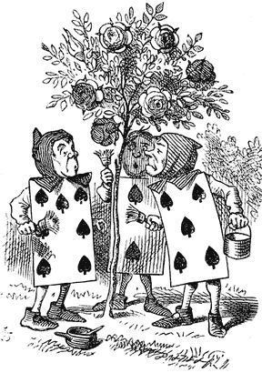

*三张纸牌提着油漆桶穿过田野，这时它们遇到一个从泥土中伸出的、模样极其古怪的结构。*

*“这个东西一定是某种强大力量作用的结果，”黑桃五说道。“它有这么多的弯弯绕绕，简直让人难以理解——没有任何自然过程能产生这样一团纠结的怪物。”*

*“是啊，快看这个结构末端那许多不同的形状，”黑桃七惊叹道，“没有两个是完全一样的。显然，这个东西——不管它叫什么——是最精湛的手工艺术品。”*

*一直沉默不语的黑桃二不自在地挪了挪脚。“嗯，好吧，你知道，我一直在数那个从地里冒出来的东西末端的分支数量。我觉得我看出了一种规律……”*

*五和七短暂地对视了一眼，随即大笑起来。“这真是太典型了，你就爱跟数字较劲。接下来你恐怕要说，你就是我们之间的差异吧。”*


`turtle` 图形，`+=` 运算符，只读，竞态条件


发育生物学，细胞繁殖，丝状生长，藻类，植物，生成行为，复杂系统

---

回顾我们迄今为止的探索，计算生物学远不止于序列分析。将视野提升到生物系统的尺度，生物体发育那惊人流畅却高度稳健的过程，自显微镜问世以来一直是人们兴趣的源泉。Python 是一个绝佳的平台，可以通过简单规则或行为的生成能力来探索发育的本质。这是一个强大的思想，因为即便是非常简单的规则，经过时间的迭代，也能产生复杂且不可预测的模式。从[*鸟类的群集行为*](https://en.wikipedia.org/wiki/Flocking_%2528behavior%2529)到[*蜜蜂的群聚*](https://en.wikipedia.org/wiki/Swarming_%2528honey_bee%2529)，生物学中充满了简单行为产生无尽迷人模式的例子——这个研究领域被称为[复杂适应系统](https://en.wikipedia.org/wiki/Complex_adaptive_system)（第 16 章和第 18 章将进一步探讨这些主题）。你甚至可以在电脑里种植植物，就像奥地利生物学家[阿里斯蒂德·林登迈尔](https://en.wikipedia.org/wiki/Aristid_Lindenmayer)早在 1968 年所做的那样，通过模拟藻类等丝状生物的生长和发育过程来实现。

林登迈尔首先设想了一个一维的单细胞线，其中任何一个细胞只从其直接左侧或右侧的邻居那里接收分裂或生长的信号。他假设每个藻类细胞存在于两种可能状态之一：繁殖或生长。处于繁殖状态的细胞会分裂成两个细胞：一个将进入生长状态，另一个将保持在繁殖状态。此外，进入生长状态的细胞最终会转变成繁殖细胞。将这两条规则结合起来，林登迈尔提出了一个[丝状生长](https://en.wikipedia.org/wiki/Filamentation)模型，该模型捕捉到了植物真实生长的某些关键特征，例如[持续的顶端生长](http://archive.bio.ed.ac.uk/jdeacon/microbes/apical.htm) ^(²⁰⁰)，即中央的“茎”（在模型中这是一组细胞）在外观上保持不变，即使细胞分裂并远离这组中央细胞。

### 提升生产力：算法化的生成规则

将这一理念转化为代码的核心，在于将生物学直觉严格定义为算法化的**生成规则**。

你可以将前述两种直觉编码为两条简单规则。将处于繁殖状态的细胞称为`A`，处于生长状态的细胞称为`B`。一条生成规则的基本含义是：获取*左侧*的一个符号，并用*右侧*的另一组符号替换它。其形式如下：

- `B → A` (规则 #1：生长细胞变为繁殖细胞)

- `A → AB` (规则 #2：繁殖细胞分裂为另一个繁殖细胞加一个生长细胞)

为了完善算法，我们只需给算法一个初始细胞作为起点，比如一个繁殖细胞`A`。我们可以“手工”（或许更应该说是“靠头脑”）运行生长过程：从`A`开始，注意到`A`不是生长细胞，因此第一条规则*不适用*；但它*是*繁殖细胞，所以我们*应用*第二条规则。于是我们得到一个*繁殖*细胞和一个*生长*细胞，即`AB`。

让我们再次运行规则：这次繁殖细胞`A`会再次变成`AB`，而第二个生长细胞`B`会保持不变，结果是`AB` + `A`，即`ABA`。持续这样做，你会得到`ABA` -> `ABAAB` -> `ABAABABA`，以此类推。

那么，如何在 Python 中构建这个算法呢？实现该功能的函数`algae_growth()`出乎意料地简短：我们只需提供希望规则运行的迭代次数以及初始符号（默认设为`A`）。清单 15-1 中的主要代码由*两个*嵌套的`for`循环组成。


def algae_growth(number, output="A", show=False):
    for i in range(number):
        new_output = ""
        for letter in output:
            if letter == "A":          # rule #2
                new_output += "AB"
            elif letter == "B":        # rule #1
                new_output += "A"
        output = new_output     # only update state after all letters are read
        if show: print("n =", i+1, output, "[", len(output), "]")
    return output

print("n = 0", "A", "[ 1 ]")
algae_growth(6, output="A", show=True)
```

外层循环运行`number`次，将结果存储在变量`output`中。在每个循环开始时，我们将`new_output`重新初始化为空字符串`""`。然后，我们获取现有的`output`，并使用内层`for`循环逐字符遍历它。对于循环中的当前`letter`，我们检查它是`A`还是`B`。如果是`A`，我们使用`+=`操作符将两个新字母追加到`new_output`字符串中。同样，如果是`B`，我们追加一个`A`。处理好该字母后，我们将`new_output`重新赋值给`output`，以便为下一次生长和繁殖迭代（外层循环）重新开始整个过程。

注意，这里我们使用了两个不同的变量，而不仅仅是`output`一个变量。这是为什么呢？这是因为在应用两条规则期间，我们需要保持`output`变量为*只读*状态；否则，我们就会像那条追逐自己尾巴的寓言蛇一样陷入循环。（为了验证这一点，你可以尝试删除`new_output`变量，并将所有`new_output`替换为`output`，代码仍然能运行，但它更像是一种“死亡螺旋”。）因此，只有在*应用*了规则之后，我们才用`new_output`的内容更新`output`变量。

清单 15-1 中的最后一步调用该函数并*培养*藻类（它运行了算法的六代）。以下输出充分展示了细胞的生长情况：

```
n = 0 A [ 1 ]
n = 1 AB [ 2 ]
n = 2 ABA [ 3 ]
n = 3 ABAAB [ 5 ]
n = 4 ABAABABA [ 8 ]
n = 5 ABAABABAABAAB [ 13 ]
n = 6 ABAABABAABAABABAABABA [ 21 ]
```

注意，仅仅经过六次迭代，我们就已经得到了非常有趣的模式。我们还打印出了每一轮迭代的长度。敏锐的读者会发现一个有趣的模式：它们呈现的是[斐波那契数列](https://en.wikipedia.org/wiki/Fibonacci_number)。仔细想想，这其实相当不可思议：一组非常简单的两条规则反复迭代，就能产生一系列细胞，而细胞的数量与自然界中最基本的数学序列之一（叶子在茎上的排列、松果的形成）紧密相连。我们还可以看到开头提到的持续顶端生长现象：即使生长持续进行，左侧边缘的`ABA`模式仍然保持不变。

### 使用 Python Turtle 图形绘制蕨类植物

到这里，你可能会想，虽然这个模式很酷，但有点无聊。毕竟，细胞并不是真的排成一条直线，它们看起来也不太像植物。我们能做得更好吗？能否利用这些想法生成某种实际上***看起来***像植物的东西？嗯，我很高兴你问这个问题，因为答案是肯定的，我们能。要实现这一点，我们需要一套具有更复杂语言的规则，但仍然使用相同的基本简单逻辑。

我们首先想象一下这棵“植物”，假设它是一株“蕨类植物”，正在一个二维（2D）表面上生长。在这里，L-system 的输出实际上是指令，告诉植物接下来在二维表面的哪个位置“生长”。有六个基本符号，可以理解为代表着发育“指令”：

- `F` = *向前移动*

- `X` = *保持不动*

- `+` = 向右转 25 度

- `-` = 向左转 25 度

- `[` = *保存*当前 (x, y) 位置

- `]` = *回到*已保存的 (x, y) 位置

生成规则将`F`和`X`视为*变量*（意味着只有这两个符号会被扩展为其他符号），而`+`、`-`、`[`、`]`是*常量*（它们是*终结符*：不会被扩展成任何其他符号的符号）。那么，事不宜迟，以下是这两条规则：

- `F` → `FF`

- `X` → `F-[[X]+X]+F[+FX]-X`

好了，这些规则*确实*比之前的规则复杂得多，但它们的工作原理基本相同。每当你看到一个`F`，就把它替换成`FF`；每当你看到一个`X`，就把它替换成右侧那串复杂的表达式！那个长表达式在其内部嵌入了指令，让植物向前移动、左右旋转，以及保存和恢复位置。可以把它想象成一个实时运行的小型遗传程序。

每个保存位置（`[`）和恢复位置（`]`）的操作，则代表一个单独“叶片”生长的完成，并从原始叶片所在位置开始生长一个新“叶片”！当我们实现代码来绘制最终植物时，这一点会更加清晰。与此同时，在清单 15-2 中，我们将看到如何在 Python 中实际实现这些生成规则。

```
def plant_growth(number, output="X", show=False):
    for i in range(number):
        new_output = ""
        for letter in output:
            # rule #1
            if letter == "X":
                new_output += "F-[[X]+X]+F[+FX]-X"
            elif letter == "F":
                new_output += "FF"
            else:
                new_output += letter
        output = new_output
        if show: print("n =", i+1, output, "[", len(output), "]")
    return output
```

你会注意到，这段代码的结构与藻类生长代码完全相同！新代码唯一的区别在于`new_output`中生成规则的右侧部分不同。以初始符号`X`开始，我们可以使用以下代码运行生长过程：

```
print("n = 0", "X", "[ 1 ]")
plant=plant_growth(2, output="X", show=True)
```

由于蕨类植物生长得非常快，我们只展示两次迭代的生长过程（在*n*=2 时，已经有 89 个符号了！）

```
n = 0 X [ 1 ]
n = 1 F-[[X]+X]+F[+FX]-X [ 18 ]
n= 2 FF-[[F-[[X]+X]+F[+FX]-X]+F-[[X]+X]+F[+FX]-X]+FF[+FFF-[[X]+X]+F[+FX]-X]-F-[[X]+X]+F[+FX]-X [ 89 ]
```

到目前为止，一切顺利，但你可能在此时自问：这看起来不像一株蕨类植物，我知道：我想看到一些*看起来*像蕨类植物的东西。为此，我们将深入探讨海龟绘图的世界。如果你在小学或中学上过计算机课，你很可能遇到过一种名为 [Logo](https://en.wikipedia.org/wiki/Fibona) 的语言，它是由位于马萨诸塞州剑桥市的 BBN 公司的科学家们在 20 世纪 60 年代末创建的。这种语言被用来教孩子们如何通过想象他们正在编程控制可以*向前*移动、*左转*和*右转*，以及从一个地方*跳跃*到另一个地方的**海龟**，来绘制**图形**。


Python 采用了海龟绘图的核心概念，并在一个模块中实现了它们，这个模块的名字是，请稍等，鼓声响起…… `turtle`。海龟绘图可用于控制一个二维“*画布*”上的海龟。海龟会留下一系列线条形成的“轨迹”，创建复杂的图案，就像一系列细胞或叶片在真实植物生长中留下它们的轨迹一样。因此，从概念上讲，海龟绘图是绘制 L-system 输出的理想匹配：海龟移动，留下轨迹，然后移动到别处。以下是清单 15-3 中的代码。

# 使用 Python 海龟绘图实现植物生长可视化

```python
import turtle
def draw_plant(actions):
stk = []
for action in actions:
if action=='X':        # 什么都不做
pass
elif action== 'F':     # 向前移动
turtle.forward(2)
elif action=='+':      # 向右旋转 25 度
turtle.right(25)
elif action=='-':      # 向左旋转 25 度
turtle.left(25)
elif action=='[':
### 通过“压入”堆栈来保存位置和朝向
pos = turtle.position()
head = turtle.heading()
stk.append((pos, head))
elif action==']':
### 通过“弹出”堆栈来恢复位置和朝向
pos, head = stk.pop()
turtle.penup()
turtle.setposition(pos)
turtle.setheading(head)
turtle.pendown()
else:
raise ValueError("不识别此动作", action)
turtle.update()
```

清单 15-3 使用 Python 海龟绘图实现植物生长的可视化

现在，这段代码对你来说应该相对简单易懂：该函数接收一系列动作（以字符串形式实现）并循环遍历这些动作（字符串中的每个字符），使用海龟语言告诉海龟要做什么。海龟遵循的命令几乎与这些符号一一对应：

1.  `turtle.forward()` 对应 **F**。

2.  `turtle.left()` 和 `turtle.right()` 对应于旋转命令 “–” 和 “+”。

3.  保存海龟状态  稍微复杂一些：因为我们需要使用 `turtle.position()` 获取当前 (x, y) 位置，并使用 `turtle.heading()` 获取海龟面对的方向。这两个位置可以通过将由位置和朝向组成的元组追加到一个列表中来进行`保存`。（这就像“压入”堆栈。）

4.  将海龟恢复到保存的位置是前一步的逆操作，我们首先从列表（或堆栈）中 `pop()` 最后一个元素。我们还会通过 `turtle.penup()` 让海龟停止留下轨迹，然后使用 `setposition()` 和 `setheading()` 将它放回保存的位置，最后放下笔，以便可以继续绘制细胞轨迹。

`draw_plant()` 函数就完成了！在清单 15-4 中，我们将蕨类植物生长的输出与图形连接起来（请注意，需要先执行清单 15-2 和清单 15-3 中的代码，此代码才能工作）。

```python
print("n = 0", "X", "[ 1 ]")
plant=plant_growth(6, output="X", show=False)
### 获取初始位置
x = 0
y = -turtle.window_height() / 2
turtle.hideturtle()
turtle.left(90)
turtle.penup()
turtle.goto(x, y)
turtle.pendown()
draw_plant(plant)
```

清单 15-4 主程序：生长植物，然后将其可视化

请注意，为了实际绘制图形，我们根据窗口大小对海龟位置进行了一些初始设置，然后将海龟移动到适当位置并放下它的 `pendown()` 以开始生长过程的可视化！如果你运行这个程序，你应该会看到类似于图 15-1 所示的结果。

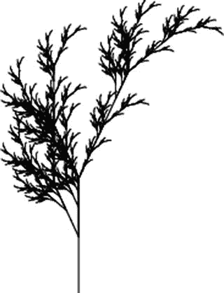

图 15-1 使用 Python 中的二维 L-system 生成的“蕨类植物”

恭喜，你已经种植出了你的第一棵虚拟植物！在*下一*章（第 16 章）中，我们将扩展这些建模方法，以考察一个由数学家艾伦·图灵最初创建的著名发育模型，该模型后来被证明确实存在于真实的生物体中。

## 参考文献与深入探索

*   Lindenmayer (1968)。[发育过程中细胞相互作用的数学模型 I：具有单侧输入的细丝。](http://www0.cs.ucl.ac.uk/staff/p.bentley/teaching/L6_reading/lsystems.pdf)^(²⁰¹) *Journal of theoretical biology*，**18**，280–299

*   Philip Ball, [*The Self-Made Tapestry: Pattern Formation in Nature*](https://global.oup.com/academic/product/the-self-made-tapestry-9780198502432) ^(²⁰²) (Oxford University Press, 1997) 及其后续著作，三卷本 [*Nature's Patterns, a Tapestry in Three Parts*](https://global.oup.com/academic/product/shapes-9780199237968) ^(²⁰³) (Oxford University Press, 2009) 是生物学及其他领域图案形成科学的优秀入门读物。另有一本摄影版画册可供选择：[*Patterns in Nature*](http://press.uchicago.edu/ucp/books/book/chicago/P/bo23519431.html) ^(²⁰⁴) (University of Chicago, 2016)。Ball 真的很喜欢他的三本书！

*   Kuma and Bentley, [*On Growth, Form and Computers*](http://www.sciencedirect.com/science/book/9780124287655) ^(²⁰⁵) (Academic Press, 2003)。一本关于发育计算建模的优秀的书卷式综述。

*   Melanie Mitchell, [*Complexity: A Guided Tour*](https://global.oup.com/academic/product/complexity-9780195124415) ^(²⁰⁶) (Oxford University Press, 2009)。一次精彩的复杂性科学导览。

### 脚注

16. 豹子如何获得斑点

*图灵斑图的元胞自动机模型*

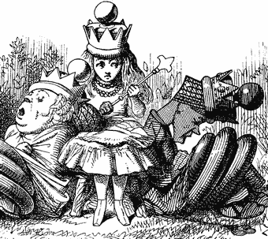 |

 *爱丽丝意识到她讨厌国王和王后让她整天玩的愚蠢游戏。*

*“如果我们能使用同一个棋盘，但不必担心总有人要赢，那会怎样？”*

*“是的，”她喃喃自语，“我只要让每个格子根据它的邻居是谁来改变颜色。然后，我就让它们随机初始，而不是摆成这种愚蠢的战斗阵型，”她开始大声说话，扔掉了她的权杖。*

*“那将会有一系列永无止境、不断变化的游戏，而不是这种对将死的痴迷，”她喊道，一边跳起来甩掉了他们强迫她戴上的不舒服的王冠。*

*然后她听到国王和王后骚动起来，所以她迅速捡起她的王冠和权杖，坐回原位，叹了口气。* |

 |

 `numpy` `二维数组`，`zeros()`，颜色映射，`matplotlib` `pcolor()`，`pause()` |

 | *发育生物学，激活-抑制系统，图灵斑图，形态发生素，豹纹，形态发生，元胞自动机，斑马鱼* |

对生物体发育这一神奇过程的定量研究由来已久。我们在上一章看到的 L 系统可追溯至 20 世纪 60 年代末，但这段历史远比那时更为久远。达西·汤普森早在 1917 年就撰写了经典著作[*论生长与形态*](https://en.wikipedia.org/wiki/On_Growth_and_Form)，远早于 1953 年 DNA 双螺旋结构的发现。事实上，就在前一年——1952 年——英国计算机科学家艾伦·图灵发表了一篇论文，描述了一个试图回答以下问题的数学模型：豹子是如何长出斑点的？当然，图灵最为人熟知的是他在二战期间破解德国恩尼格玛密码机方面的贡献，以及他因 20 世纪 50 年代对同性恋的彻底可耻迫害而英年早逝，但他对理论生物学的贡献同样意义重大。

图灵想知道，一种在单个细胞水平上起作用的简单化学机制，是否能够产生动物身上观察到的全局多细胞图案，例如豹子复杂的皮毛图案和斑马的条纹。这与我们在上一章刚刚描述的 Lindenmayer 系统在概念上非常相似。图灵首先设想一个单一的分化细胞分泌两种化学物质，或称为形态发生素，它们会扩散到该细胞的邻域，如图 16-1 所示。

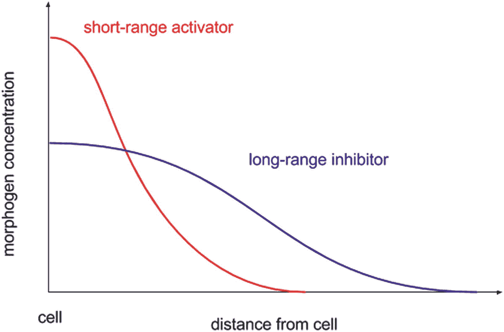

**图 16-1** 图灵斑图背后的两种形态发生素的浓度梯度

1. 一种短程激活剂，它从源细胞扩散出去，但会非常快速地（由于衰减）被清除，使得靠近细胞处活化剂浓度很高，而稍远一点则低得多。
2. 一种长程抑制剂，它也会从源细胞扩散出去，但清除速度要慢得多，因此靠近源细胞处其浓度低于活化剂，但在远离细胞的地方仍会持续存在。

他进一步设想，激活和抑制形态发生素的相对含量将决定相邻细胞是否也会分化并开始自身分泌这两种形态发生素（这正是一开始将它们称为激活剂和抑制剂的原因）。二维空间中化学扩散过程的相互作用产生了与动物皮毛惊人相似的图案。图灵运用了一些高阶的偏微分方程来模拟这一过程，但幸运的是，我们有一种更简单、更具生成性的方法可以捕捉图灵所描述的本质动态，那就是[元胞自动机](https://en.wikipedia.org/wiki/Cellular_automaton)。元胞自动机（或称 CA）是一个二维对象晶格，通常被称为“元胞”，其状态通过一系列更新规则受其相邻“元胞”影响（更多内容我们将在第 18 章关于基于智能体建模的章节中讨论）。（请注意，称它们为“元胞”通常只是一个方便的比喻，但在我们特定的案例中，我们将其视为构成组织的多细胞基质中的实际细胞。）在模拟的每个时间步长中，CA 中的每个元胞都会咨询其直接邻居，并根据这些邻居的状态作为函数来更新自身状态。这些更新规则构成了我们实现图灵扩散方案的核心。

## 实现细节

### 元胞自动机初始化！

像往常一样，让我们直接进入清单 16-1 中的 Python 代码，并在过程中解释其动态。

```
from numpy import zeros
from numpy.random import random, seed
seed()
probability_of_black = 0.5
width = 100
height = 100
## 初始化元胞自动机 (CA)
CA = zeros([height, width])      # 主 CA
next_CA = zeros([height, width]) # 下一时间步的 CA
activator_radius = 1
activator_weight = 1
inhibitor_radius = 5
inhibitor_weight = -0.1
time = 0
```

**清单 16-1** 设置元胞自动机

我们首先导入所需的 `numpy`（`zeros`）和 `numpy.random`（`random` 和 `seed`）库，然后设置随机种子。接着，我们通过 `probability_of_black` 定义了二维数组中任何给定元胞为**黑色**（即已分化）的概率。为了契合豹纹主题，我们设想所有非黑色元胞（即未分化的元胞）为**橙色**。然后我们创建两个二维元胞自动机：

1. `CA` 是当前的元胞自动机状态：运行模型时，我们将读取这个元胞数组以进行更新。
2. `next_CA` 是下一个时间步的元胞自动机状态，在更新过程中，我们将写入这个元胞自动机。

这种更新方式有时被称为同步更新，因为每个元胞 CA 都是在同一时刻更新的。每个 CA 本质上是一个二维矩阵（也称为二维数组），我们使用 NumPy 库中的另一个功能 [`zeros()`](http://docs.scipy.org/doc/numpy/reference/generated/numpy.zeros.html) 来创建这些矩阵。

`zeros()` 会创建空的矩阵，其维度由列表 `[height, width]` 指定。（这是一个非常有用的函数，因为它也可以用于创建一维数组，在后续章节存储大量绘图数据点时将派上用场。）

接下来，我们定义激活剂的半径（这对应于激活化学物质能够扩散的最大距离，默认我们将其设置为 1，因此只考虑最近的 9 个相邻元胞）以及该激活化学物质的权重。然后，我们定义最大的抑制剂半径（注意，这考虑了当前激活元胞周围 5x5 网格内的所有元胞）以及抑制剂的权重（我们将其设为负值，以明确其与激活剂的作用方向相反）。最后，我们将 `time` 设置为零。

接下来，我们通过循环遍历各个维度，并使用我们的老朋友 `random()` 函数，将每个元胞随机分配为分化或未分化状态，从而初始化 `CA`。以下是清单 16-2 中的代码片段。

```
## 初始化 CA
for x in range(width):
    for y in range(height):
        if random() < probability_of_black:
            cell_state = 1
        else:
            cell_state = 0
        CA[y, x] = cell_state
清单 16-2
初始化元胞自动机
```

按照惯例，我们将所有状态为 `1` 的元胞视为**黑色**（已分化），状态为 `0` 的元胞视为**橙色**（未分化）。图 16-2 展示了一个随机初始化的元胞自动机。

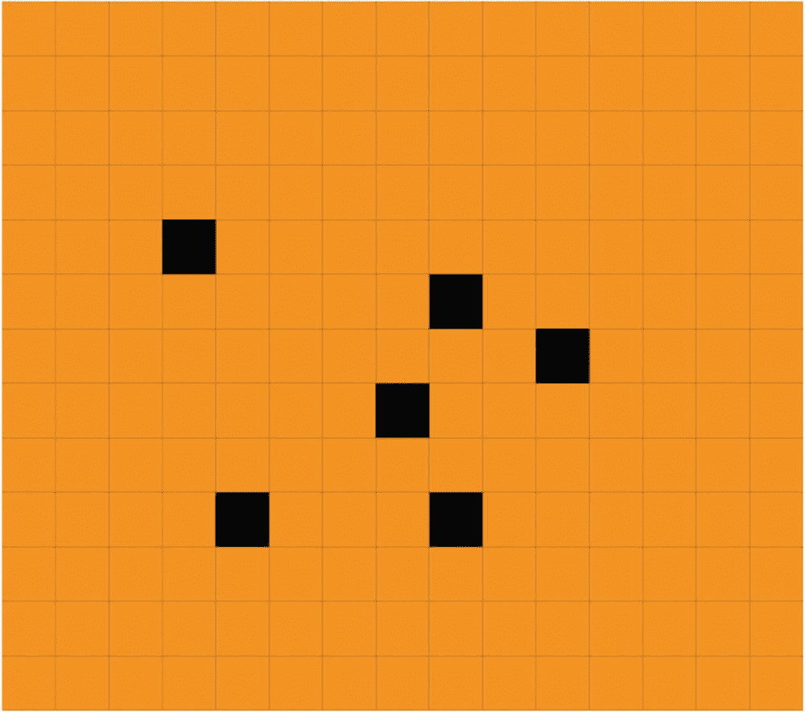

**图 16-2** 随机初始化的元胞自动机

### 创建更新规则

所有设置都已完成，现在我们准备深入生物学的核心，并开始在 `simulation_step` 函数中实际模拟发育过程。基本思路与我们之前做的一样，遍历自动机网格中的每一个元胞，并决定每个元胞是分化还是去分化。清单 16-3 展示了模拟步骤的函数。

```
def simulation_step(CA, next_CA):
    for x in range(width):
        for y in range(height):
            cell_state = CA[y, x]  # 获取当前状态
            activating_cells = 0
            inhibiting_cells = 0
            ### 统计半径内的抑制细胞数量
            for xpos in range(- inhibitor_radius, inhibitor_radius + 1):
                for ypos in range(- inhibitor_radius, inhibitor_radius + 1):
                    inhibiting_cells += CA[(y+ypos)%height, (x+xpos)%width]
            ### 统计半径内的激活细胞数量
            for xpos in range(- activator_radius, activator_radius + 1):
                for ypos in range(- activator_radius, activator_radius + 1):
                    activating_cells += CA[(y+ypos)%height, (x+xpos)%width]
            ### 如果加权后的激活细胞数量大于邻域内的抑制细胞数量
            ### 则诱导当前细胞分化
            if (activating_cells * activator_weight) + (inhibiting_cells * inhibitor_weight) > 0:
                cell_state = 1
            else:
                cell_state = 0
            ### 现在更新状态
            next_CA[y, x] = cell_state
    return next_CA
清单 16-3
用于将元胞自动机推进一个时间步的模拟函数
```

第一部分相当直接：我们遍历元胞自动机网格的 `x` 和 `y` 坐标，并检索当前在 x 和 y 位置的 `cell_state`。接下来的两个（内部）for 循环是抑制和激活作用于当前元胞的地方。我们来分解一下：

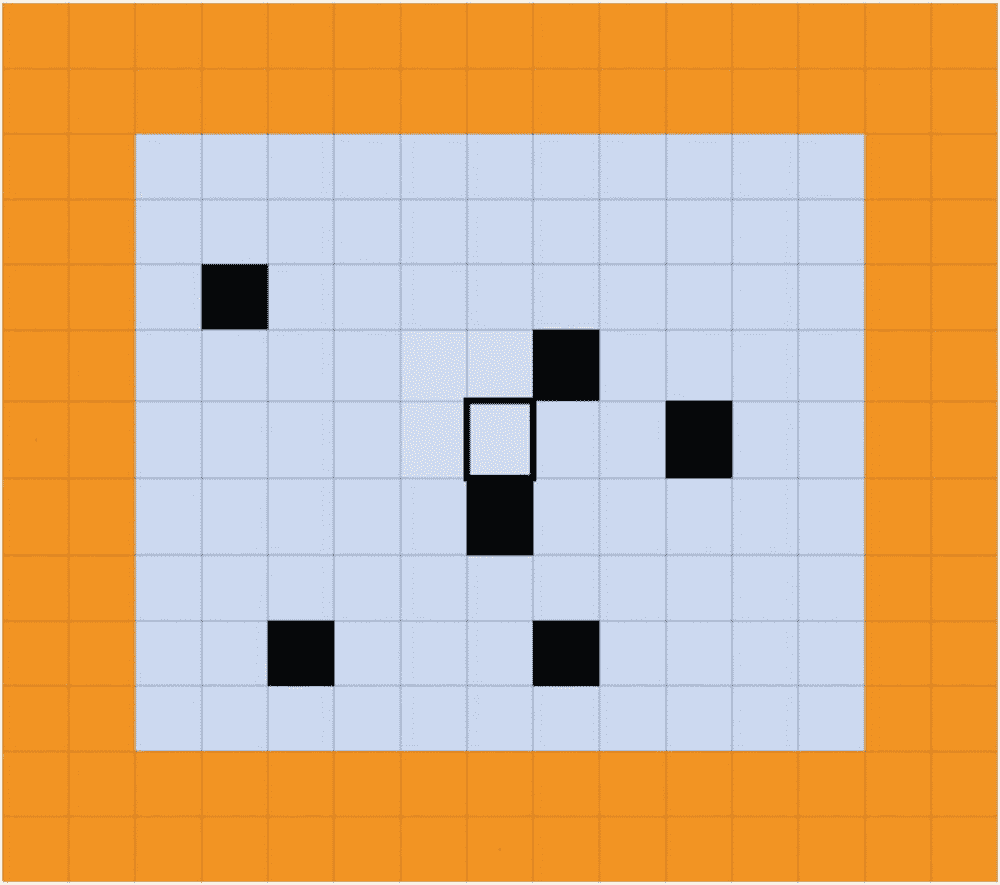

**图 16-3** 抑制范围

1. **抑制循环**：第一个循环检查当前元胞 `inhibition_radius` 半径内的所有元胞。此循环统计那些显示为**黑色**的元胞——即那些当前具有化学抑制剂且距离当前元胞足够近以影响它的元胞。该邻域内黑色元胞越多，对当前元胞的抑制影响就越大（倾向于将其关闭为**橙色**状态）。让我们以图 16-2 中的原始 CA 为例，并高亮显示可能对抑制产生贡献的元胞，用浅蓝色叠加表示，此时 `inhibition_radius` 为 5，如图 16-3 所示。

在这个特定示例中，有六个元胞会影响当前元胞的状态，因此在此时间步中，`inhibiting_cells`将被设置为 6。

## 2. 激活循环
类似地，第二个循环检查当前元胞`activator_radius`半径内的所有元胞，如图 16-4 中的浅红色所示。

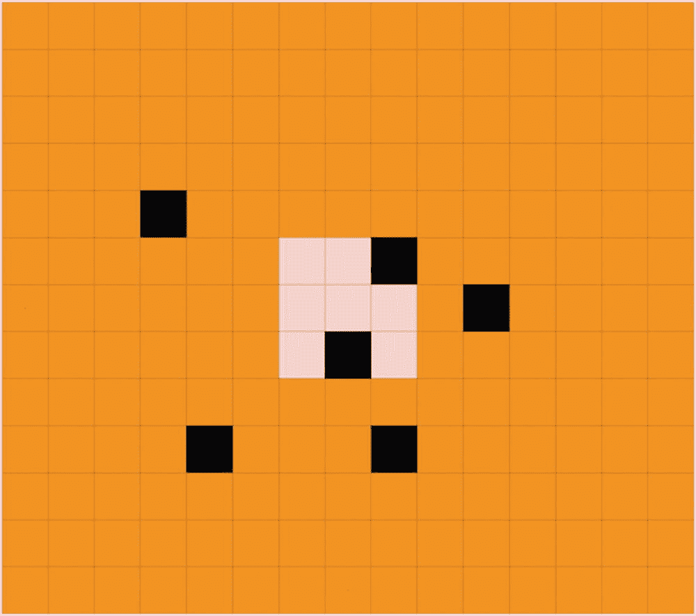

图 16-4 激活剂范围

同样，该邻域内黑色元胞越多，激活化学物质对当前元胞的影响就越大，但与之前的情况相反，它倾向于激活元胞，从而使其变为**黑色**。在前面的例子中，我们有两个元胞，因此`activating_cells = 2`。

## 3. 决策
两个循环之后的最后一步是决定该元胞应该变成橙色还是黑色。我们在代码中通过计算激活元胞的加权和并将其与抑制元胞的加权和相加来实现这一点。在我们的代码示例中，这个和为

`(2 x 1) + (-0.1 x 6) = 2 - 0.6 = 1.4 > 0`

由于在此示例中该和为正，因此有足够的激活剂导致元胞变为**黑色**，从而将`cell_state`设置为 1。如果该和为负，则将其设置为 0。从生物学上讲，这实现了图灵形态发生模型的主要特征：如果邻域内激活化学物质在总体上多于抑制化学物质，那么细胞就会分化，否则就会去分化。

## 4. 更新
好了，我们快要（但还没有！）完成了。我们必须将输出写入到`next_CA`元胞自动机中相应的位置。这是一个关键点：在更新所有元胞之前，我们不能写入原始的`CA`网格，否则就会出现计算机科学家喜欢称之为“[竞态条件](https://en.wikipedia.org/wiki/Race_condition)”的问题。

## 5. 返回新的 CA
一旦所有元胞都被更新，我们就得到了刚刚写入的`next_CA`，`simulation_step`所做的最后一件事就是将此`next_CA`返回给主程序。我们将在下一节中处理实际的更新。

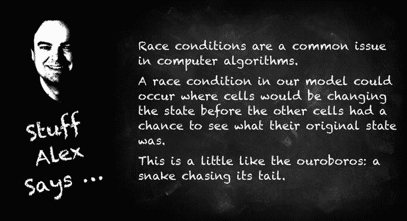

## 生成元胞自动机斑纹图案

现在我们准备绘制模拟的输出并运行一些形态发生过程！我们可以使用清单 16-4 中的`matplotlib`技能。

```python
### 创建绘图
fig1 = plt.figure()
### 按时间循环
for time in range(10):
    plt.pcolor(CA, vmin = 0, vmax = 1, cmap = "copper_r")  # 绘制当前 CA
    plt.axis('image')
    plt.title('时间: ' + str(time))
    plt.draw()
    plt.pause(0.5)
    CA = simulation_step(CA, next_CA)  # 推进模拟
```
清单 16-4 使用 `matplotlib` 可视化形态发生过程

和往常一样，我们使用 `figure()` 函数设置图形，然后循环执行模型的十个时间步，每次都绘制一个新图形。对于图形本身，我们使用 matplotlib 的 [`pcolor`](http://matplotlib.org/examples/pylab_examples/pcolor_demo.html) 函数；该函数接收一个 NumPy 数组和一个特定的颜色映射 (`cmap`)，用于绘制元胞自动机状态的热力图。我们使用的特定颜色映射是"`copper_r`"，其颜色范围从橙色到黑色，你猜对了，它能呈现豹纹图案。由于我们的 CA 只有两种状态：当元胞状态为 0 时显示为**橙色**，当状态为 1 时显示为**黑色**。

接着调用 `axis()`、`title()`、`draw()` 和 `pause()` 函数。请注意，我们使用了 `draw()` 命令后跟 `pause()` 命令，而不是之前示例中使用的 `show()`，因为后者会导致代码停止。这样，模拟中每个时间步的当前 CA 会显示 0.5 秒，然后才进入下一个时间步。在 for 循环结束时，进入下一个时间步之前，我们调用 `simulation_step()` 函数。这里，我们将当前的 `CA` 和 `next_CA` 作为函数参数传递。至关重要的是，我们将 `simulation_step` 的结果重新赋值给 `CA`。*这*就是我们之前提到的同步更新步骤，将接力棒传递给下一个时间步：*已写入的*现在变成了*待读取的*。

### 形态发生实战

让我们看看实际效果…. 我们从 `t=0` 时刻一个黑白元胞数量相等的随机网格开始。你可以在图 16-5 中看到，即使在第一个 `t=1` 时间步，结构就已经开始显现。

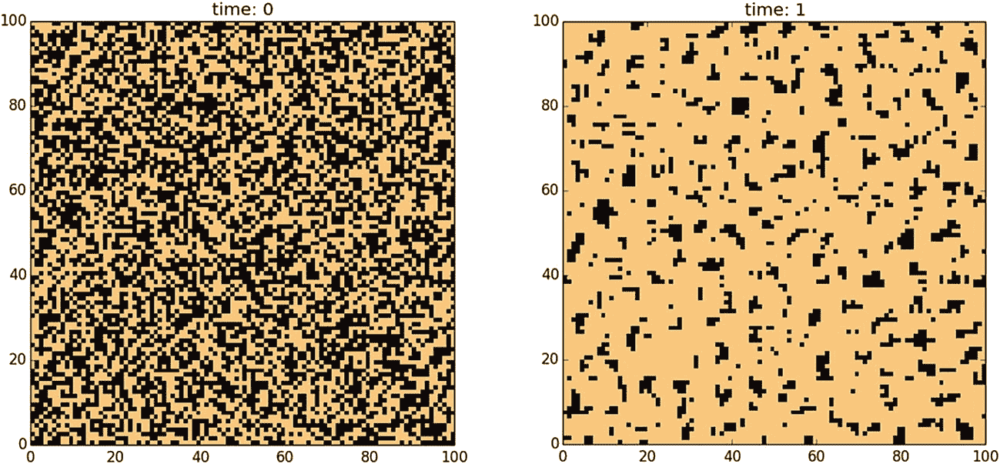

**图 16-5** 形态发生模拟的前两个时间步

如图 16-6 所示，到了 `t=2` 时刻，我们已经能看到那些豹纹裤了！而到 `t=5` 时刻，图案已经稳定下来。

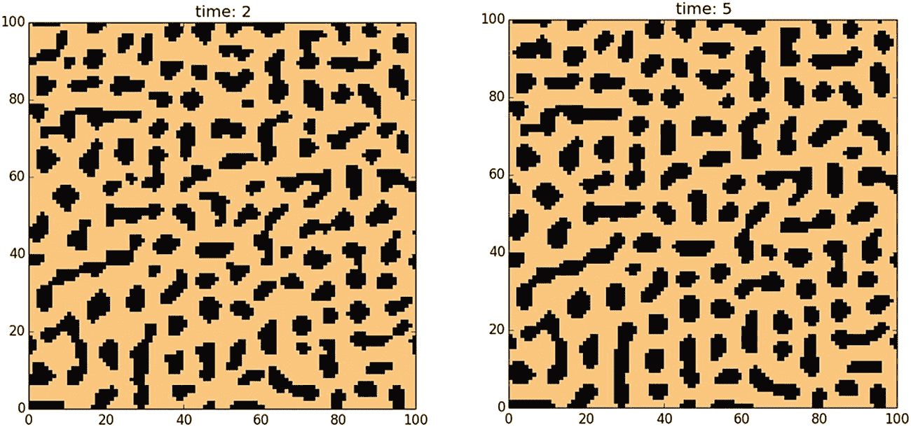

**图 16-6** 形态发生模拟的后续时间步

我们鼓励你尝试调整网格大小以及激活剂和抑制剂强度的相对半径和权重，以生成你自己的皮毛图案。你可以在本书附带的代码下载或我们的 GitHub 站点中（如第 1 章所述），找到将清单 16-1 至 16-4 合并为单个文件的完整代码。大约此时，经验丰富的实验室生物学家可能会想，这一切似乎有点*抽象*。真正的胚胎并非在这些离散的时间步中发育，而且在自然界中，有没有真实的细胞分泌化学物质并以某种方式相互作用的例子呢？

历史的转折点发生在 2012 年，整整 60 年后，一个研究团队发表了一篇论文（Müller, 2012），在[斑马鱼胚胎](https://en.wikipedia.org/wiki/Zebrafish)中实验性地验证了图灵机制。他们成功识别并量化了斑马鱼胚胎模式生成过程中与图灵提出的机制相对应的两种形态发生素，并测量了可映射回原始方程的速率常数。他们还构建了一个模型（比这里介绍的稍复杂），该模型重现了实验生物体中发现的图案，从而弥合了理论预测与实验验证之间的鸿沟。

尽管此处的 CA 模型仍然是对原始图灵方程的一种近似，并且冒着再次唠叨的风险，但它表明，即使是用几行 Python 代码实现的简单模型，也能成为培养对发育生物学基本过程直觉的有力工具。计算发育生物学已成为一个活跃的研究领域；请参阅本章以及第 15 章的参考文献。

现在，我们将从探讨*个体内部*发生的发育等生物过程，转向接下来的几章（第 17–19 章），这些章节将专门介绍如何使用 Python 以计算方式探索*多个生物体种群*的动态。

## 参考文献与延伸阅读

* James D. Murray (1988). [豹子是如何获得斑点的。](http://www.math.ttu.edu/%257Elallen/murray_SciAm.pdf) *科学美国人*, **258**, 80–87

* Turing (1952). [形态发生的化学基础。](http://rstb.royalsocietypublishing.org/content/237/641/37) *伦敦皇家学会哲学汇刊 B：生物科学*, **237**, 37–72

* Forgacs and Newman, [*发育胚胎的生物物理学*](https://www.cambridge.org/catalogue/catalogue.asp%253Fisbn%253D9780521783378) (剑桥大学出版社, 2005)

* Müller *等* (2012). [Nodal 和 Lefty 的差异扩散性是反应-扩散模式形成系统的基础。](https://www.ncbi.nlm.nih.gov/pmc/articles/PMC3525670/) *科学*, **336**, 721–724

## 脚注

17. 狐狸看管鸡舍

*基于捕食者-猎物动态的生态建模*

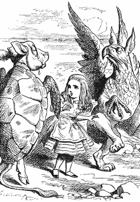

*“假海龟，你为什么哭？”爱丽丝问道。*

*“你知道成为被猎食的各种动物的混合体是什么滋味吗？”假海龟凄惨地抽着鼻子说。“有人想吃我的肉，还有巨大的饥饿海鸟，如果我不留神，它们会从水边把我抓走当点心。”*

*“听起来太可怕了，”爱丽丝同情地说。*

*“哼，作为一个神话般的杂交生物，我得说，我从不觉得被拼凑起来有什么困扰，”格里芬以他最不屑和高傲的语气高谈阔论道。*

*“你说得倒轻巧，”假海龟反驳道，“你是那种不用担心自己会成为谁午餐的捕食者的组合！”*  
*“哼，那就请原谅我不是食物链底层的住户了！”格里芬气呼呼地说。*  
*“嗜血的野兽！”假海龟厉声说道。*  
*“行走的沙拉吧！”格里芬回击道。*


`max()`, `matplotlib.animation`, 元组解包, `numpy`


生态学, 生态系统, 种群动态, 繁荣-萧条, 离散模型, 捕食者-猎物, 承载力, 状态空间, Lotka-Volterra 模型