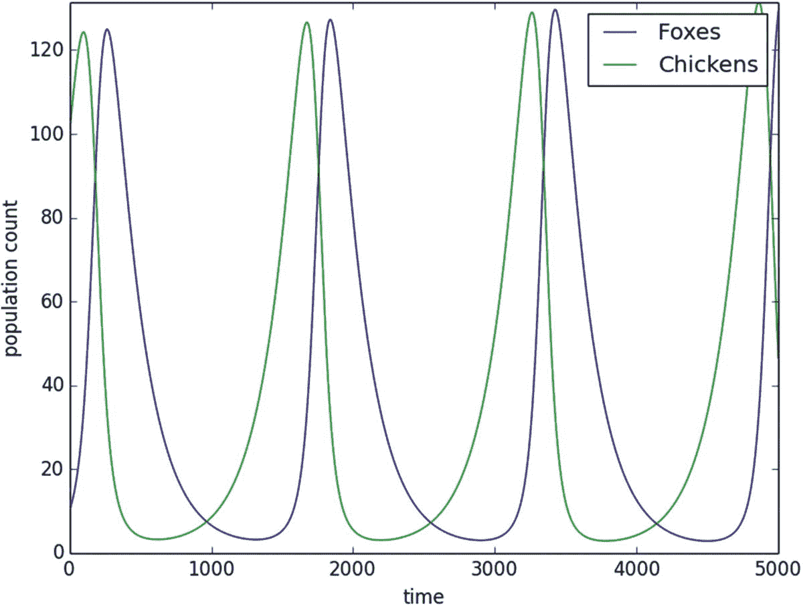
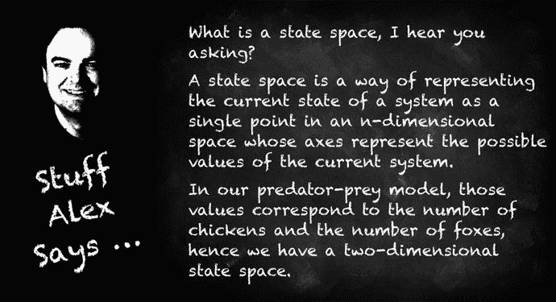
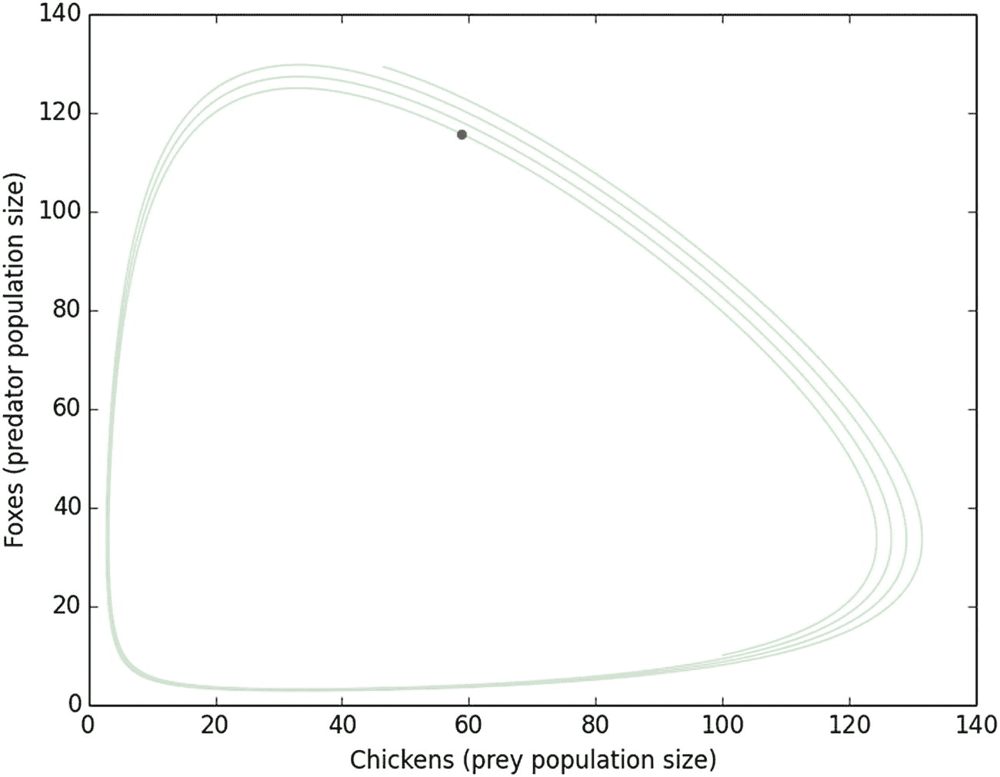
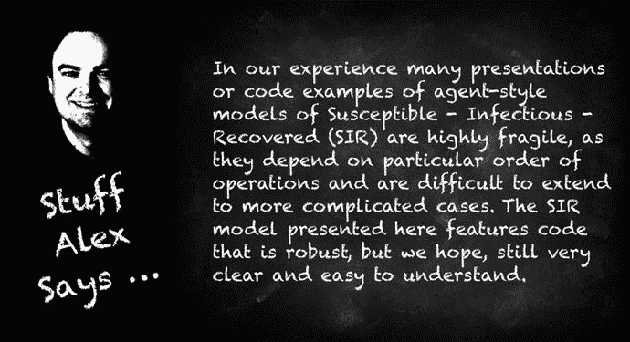
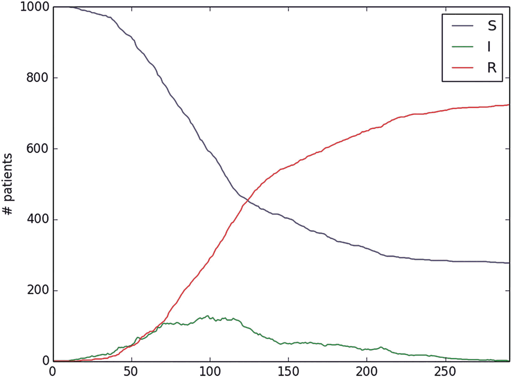
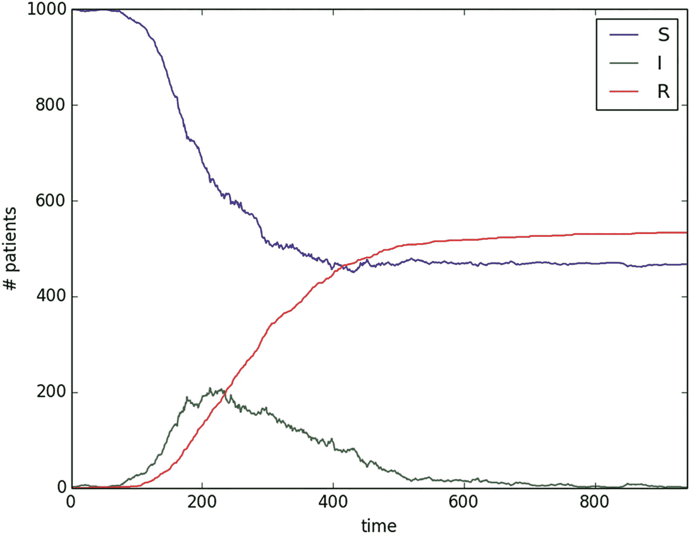
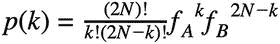
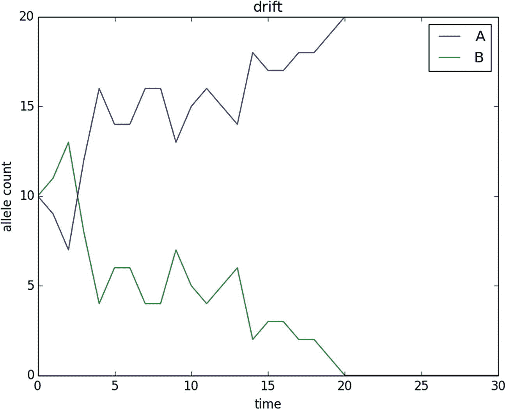
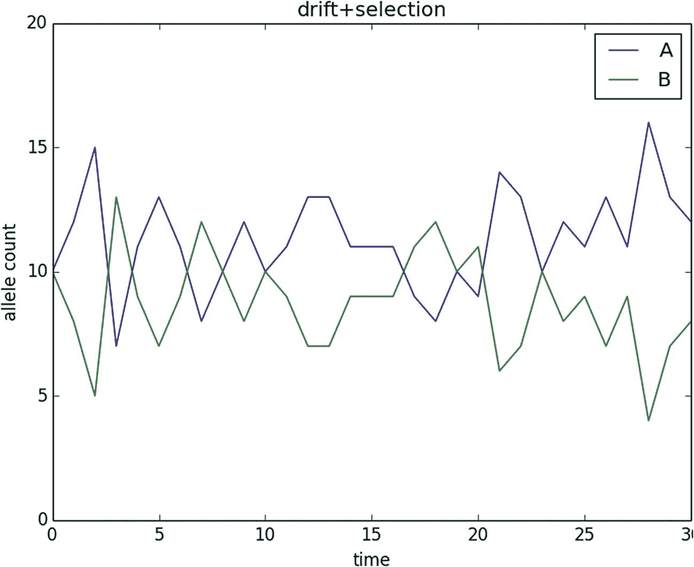

# 生态系统与种群动态的 Python 建模

## 从个体到生态系统

从个体生物体向上一个层级是[生态系统](https://en.wikipedia.org/wiki/Ecosystem)：生物体之间以及与其环境的相互作用。在任何真实的生态系统中，任何物种的个体数量都在不断变化，因为个体会出生和死亡。显然，任何生物种群的增长也受到可用资源数量的限制，并最终受到一个理论上限的限制——这个界限被称为“[承载能力](https://en.wikipedia.org/wiki/Carrying_capacity)”。如果这些“资源”恰好是另一个物种，那么对该物种来说就更糟糕了。虽然“大自然，血淋淋的爪牙”这句古老格言过于简化，但在许多情况下，“猎物”物种数量的增加可能意味着“捕食者”的更多晚餐。然而，这种情况是双向作用的：如果捕食者开始吃光所有猎物，那么捕食者可能就得节食了，以免它们自己开始挨饿。

## 种群动态学

[种群动态学](https://en.wikipedia.org/wiki/Population_dynamics)是研究物种相互作用以及种群增长和变化的领域。种群动态建模的相关性已超出其起源于生物体生态学的范畴（尽管在那里仍然非常重要！），扩展到了细胞或分子水平的种群动态研究，例如癌症和病毒等传染病。因此，所有领域的生物学家都最好多了解种群动态学。种群动态学在生物学之外也有许多应用，从经济泡沫的增长和破裂到社交网络的兴起（和衰落）。当你开始环顾四周，观察事物如何兴衰（从你最喜欢的乐队开始），以及可能如何再次流行时，可以确信某种形式的种群动态学在驱动着这一切。

`Python` 再次非常适合用优雅简洁的代码帮助您建模和可视化种群动态。生态模型的核心是“[捕食者-猎物](https://en.wikipedia.org/wiki/Lotka%25E2%2580%2593Volterra_equations)”的概念：一个单一的`捕食者`物种和一个单一的`猎物`物种。虽然这对于包含许多物种的完整生态系统来说可能是一个过于粗略的简化，但捕食者-猎物模型的基本结构可以被视为更复杂模型的良好概念性“构建块”。完整生态系统中的许多动态都可以在捕食者-猎物模型中以缩影的形式重现。

## 建模实例：鸡与狐狸

那么，让我们直接想象一个种群：后院里的一群`鸡`正受到附近树林里露营的`狐狸`种群的捕食。我们在清单 17-1 中建立模型，通过使用 `Python` 的 `NumPy` 数组追踪在指定代数内两个物种的数量。为了代码简洁，我们使用 `"Ch"` 代表鸡，`"Fx"` 代表狐狸。

这里我们使用 `NumPy` 的 `zeros()` 函数（我们在第 [16] 章(#476668_1_En_16_Chapter.xhtml)首次遇到）创建存储每个时间点物种数量的数组。与之前使用 `zeros` 的主要区别在于，我们现在创建的是**一维数组**而不是**二维数组**，这只需要一个**单个整数**参数，而不是**维度列表**。

```
import numpy as np
generations = 5000
### setup empty arrays
Ch = np.zeros(generations+1)
Fx = np.zeros(generations+1)
### initialize the population
Ch[0] = 100.0
Fx[0] = 10.0
b_Ch = 0.5   # prey birth rate
d_Ch = 0.015 # predation rate (death rate of prey)
b_Fx = 0.015     # predator birth rate
d_Fx = 0.5       # predator death rate
### set parameters
dt = 0.01   # scale parameters so that timestep doesn't "jump"
for t in range(0, generations):
    Ch[t+1] = Ch[t]        + dt * (b_Ch * Ch[t]  - d_Ch * Fx[t] * Ch[t])
    Fx[t+1] = Fx[t]        + dt * (-d_Fx * Fx[t]   +  b_Fx * Fx[t] * Ch[t])
```

*清单 17-1* 初始化和运行鸡与狐狸生态模型

我们首先创建数组并初始化种群规模。接下来，我们设置模型的其他参数。首先，我们定义一些参数来控制捕食者和猎物的**出生**率（以 `"b_"` 为前缀）或**死亡**率（以 `"d_"` 为前缀）。该模型使用了我们在第 [13] 章(#476668_1_En_13_Chapter.xhtml)首次介绍的离散时间步长。这符合我们使用直接模拟方法介绍问题的理念。因此，我们需要引入一个时间步长大小——`dt`——其缘由稍后将解释。

在清单 17-1 的末尾，我们运行模型，您会注意到它的代码只有***三行***！这就是整个模型。然后我们只需循环经过代数，每一代（`t+1`）根据前一代（`t`）的值进行更新。对于鸡和狐狸，我们从每个物种的当前数量开始，然后对每个物种的该数量进行**增加**（通过出生）和**减少**（通过死亡）。

鸡的***出生数量***（方程中的第一项 `b_Ch * Ch[t]`）仅取决于当前鸡的数量（这假设有无限的食物）。然而，鸡的***死亡数量***取决于狐狸的数量：捕食者越多，鸡的死亡就越多……哦，太可怕了，太可怕了！这意味着对于鸡的死亡，两个物种的数量之间将存在一个*交互项*；因此，我们将死亡率（`d_Ch`）乘以当前的狐狸数量（`Fx[t]`）和当前的鸡的数量（`Ch[t]`）。

狐狸的情况则完全相反。狐狸会以其自然率***死亡***（除了那些讨厌的鸡，没有其他东西能让这些狐狸活着！）；因此，我们将 `d_Fx` 乘以 `Fx[t]`。但是新狐狸的***出生***率将取决于周围猎物的数量，所以在这种情况下，我们将狐狸的出生率（`b_Fx`）乘以狐狸的数量（`Fx[t]`）和鸡的数量（`Ch[t]`）。

为了百分之百明确总和的每个部分意味着什么，我们在代码中添加了注释：

```
for t in range(0, generations):
    ### old prey   +   newly born prey   -  killed prey
    Ch[t+1] = Ch[t]        + dt * (b_Ch * Ch[t]  - d_Ch * Fx[t] * Ch[t])
    ### old predators   -  predator death   +  births of predators
    Fx[t+1] = Fx[t]        + dt * (-d_Fx * Fx[t]    +  b_Fx * Fx[t] * Ch[t])
```


如前所述，最后一个复杂之处在于，因为我们使用的是***离散***时间间隔，所以引入了时间步长：`dt`。这通过相关的时间尺度（每一代可能代表一个更小的时间步长）来缩放新生和死亡的数量，这就是为什么它位于前面代码中括号外面的原因，并确保模拟数字平滑变化。

## 观察繁荣与萧条

现在模拟的艰巨工作已经完成。与前面章节一样，在清单 17-2 中，我们转向使用 **matplotlib** 来绘制输出结果。

```python
### do the plotting
### get the maximum of the population so we can scale window properly
popMax = max(max(Fx), max(Ch))
fig1 = plt.figure()
plt.xlim(0, generations)
plt.ylim(0, popMax)
plt.xlabel('time')
plt.ylabel('population count')
time_points = list(range(generations + 1))
plt.plot(time_points, Fx, label="Foxes")
plt.plot(time_points, Ch, label="Chickens")
plt.legend()
plt.draw()
plt.show()
```

*清单 17-2* 使用 matplotlib 绘制模拟输出

完整的代码如清单 17-3 所示。

## 捕食者-猎物模型模拟

```python
import numpy as np
from matplotlib import pylab as plt
import matplotlib.animation as animation

generations = 5000

### setup empty arrays
Fx = np.zeros(generations+1)
Ch = np.zeros(generations+1)

### initialize the population
Ch[0] = 100.0
Fx[0] = 10.0

### set the parameters
dt = 0.01     # scale parameters so that each timestep doesn't "jump"
b_Ch = 0.5    # prey birth rate
d_Ch = 0.015  # predation rate (death rate of prey)
b_Fx = 0.015  # predator birth rate
d_Fx = 0.5    # predator death rate

### run predator-prey!
for t in range(0, generations):
    ### old prey + newly born prey - killed prey
    Ch[t+1] = Ch[t] + dt * (b_Ch * Ch[t] - d_Ch * Fx[t] * Ch[t])
    ### old predators - predator death + births of predators
    Fx[t+1] = Fx[t] + dt * (-d_Fx * Fx[t] + b_Fx * Fx[t] * Ch[t])

### do the plotting
### get the maximum of the population so we can scale window properly
popMax = max(max(Fx), max(Ch))
fig1 = plt.figure()
plt.xlim(0, generations)
plt.ylim(0, popMax)
plt.xlabel('time')
plt.ylabel('population count')
time_points = list(range(generations + 1))
plt.plot(time_points, Fx, label="Foxes")
plt.plot(time_points, Ch, label="Chickens")
plt.legend()
plt.draw()
plt.show()
```

*清单 17-3* 模型与可视化的完整代码

运行清单 17-3 中的代码，应生成类似于图 17-1 的输出，展示出鸡和狐狸种群开始相互影响时产生的多个周期。请注意，当鸡的数量从初始的 100 只开始增加时，狐狸的数量也随之迅速增长，因为周围有更多美味的猎物！这导致鸡的数量在大约 120 只时停止增长，并开始下降。然而，由于美味的鸡数量减少，狐狸的生存变得困难，这为鸡种群的恢复提供了时间，于是周期再次开始。



*图 17-1* 捕食者-猎物模型的可视化

图 17-1 展示了大多数捕食者-猎物模型中出现的经典繁荣与衰退的循环模式，两个物种在此过程中持续“共舞”。该模型已广泛应用于病毒种群等其他生物实体，并在生物学之外的领域也有应用。这种循环模式让人不禁思考：相比两条上下波动的时序曲线，是否还有更好的方式来展示其中的动态？

## 动画化捕食者-猎物模型

答案是肯定的！因为这是一个[动力系统](https://en.wikipedia.org/wiki/Dynamical_system)的实例，可以看作是在二维[状态空间](https://en.wikipedia.org/wiki/State_space)中移动的一个点。系统随时间在该空间中经过的路径被称为**轨迹**。系统起始位置不同，所遵循的轨迹也会不同。



`matplotlib`库再次提供了解决方案，通过使用其动画子包（这一点我们在清单 17-3 的导入语句中已有所暗示）。有关动画包的更多详细信息，请参阅 matplotlib 文档^(²¹³)。

```python
fig2 = plt.figure()
plt.plot(Ch, Fx, 'g-', alpha=0.2)  # state space
plt.xlabel('Chickens (prey population size)')
plt.ylabel('Foxes (predator population size)')
line, = plt.plot(Ch[0], Fx[0], 'r.', markersize=10) # draw point as red

def init():
    line.set_data([], [])  # set empty data
    return line,

def animate(i):
    line.set_xdata(Ch[i])
    line.set_ydata(Fx[i])
    return line,

ani = animation.FuncAnimation(fig2, animate, range(0, len(time_points)), init_func=init, interval=25, blit=False)
plt.show()
```

*清单 17-4* 状态空间的动画化

让我们逐步分析这段代码。我们首先像之前一样设置总图，然后绘制状态空间。这相当简单：我们只是将鸡的数量（`Ch`）与狐狸的数量（`Fx`）进行绘图，而不是作为时间的函数。`'g-'`表示一条实心（`-`）绿色（`g`）线，`alpha`设置线条的透明度，使其看起来略微淡化。随后添加坐标轴标签。为了在状态空间图上添加轨迹的初始点，我们绘制第一个时间点，即 x-y 坐标：`Ch[0]`、`Fx[0]`，具体如下：

```python
line, = plt.plot(Ch[0], Fx[0], 'r.', markersize=10)
```

但将结果赋值给变量`line`需要进一步说明。`plot`命令总是返回一个元组（关于元组的更多信息，请参见第 3 章），其中包含图中所有线条的列表。由于这个特定绘图只有*一条*线，我们对`line`进行所谓的**元组解包**，以获取列表中的*第一个*元素（更多详情，请参阅 matplotlib 文档中的教程^(²¹⁴)）。

然后，我们设置两个辅助函数来实现动画：

1. `init()` 创建动画将“静止”的基础帧，返回一个可由下一个函数更新的线条对象。

2. `animate()` 接受一个整数 `i` 作为输入，代表模拟的当前时间步。此函数更新`init()`函数中创建的`line`帧，从而通过使用`set_xdata`和`set_ydata`函数移动红点，更新系统在整个状态空间中的位置。

最后一步通过调用`animation.FuncAnimation`并传入参数：`fig2`、动画将运行的`time_points`范围（实质上是让红点穿过状态空间），以及前文所述用于初始化和更新动画的两个函数，来*运行*动画。最后调用`plt.show()`显示图形。

如果你获取清单 17-3 中的完整代码，并将清单 17-4 中的代码附加到其后，然后运行它。它应该会生成一个类似于图 17-2 中所示的图形，只是红点将从底部中间开始，并向外螺旋移动。现在，我们可以一目了然地看清系统的循环性质，完整地观察整个轨迹。



*图 17-2* 鸡和狐狸状态空间的可视化

敏锐的读者可能会注意到，轨迹是不稳定的，也就是说，它不会收敛到一个稳定的圆，而是在每次迭代中开始略微向外螺旋。如果增加迭代次数，你会发现螺旋会向外扩展得更远（相应地，时间序列图中的幅度也会增加）。这种不稳定性是由于我们处理的是*离散*时间步长，这隐式地在模拟中引入了*时间滞后*。可以通过使`dt`参数更小来减少这种滞后，从而减少时间延迟并使模拟更平滑。但要做到这一点，需要转向使用[Lotka-Volterra 微分方程](https://en.wikipedia.org/wiki/Lotka%25E2%2580%2593Volterra_equations)的*连续*版本模型，我们在参考章节中链接了一个使用`SciPy`库求解这些方程的示例。

下一章建立在使用整数个体数量进行种群动态建模的概念之上，但更进一步：将个体本身建模为离散、唯一的智能体。

## 参考文献与进一步探索

- Roughgarden, *Primer of Ecological Theory*^(²¹⁵) (Prentice Hall, 1997)。关于生态学和种群遗传学的基础入门读物，包含编码示例。考虑到当时 Python（或 R）尚未诞生，我们暂且原谅 Roughgarden 使用 SPlus。
- Edelstein-Keshet, *Mathematical Models in Biology*^(²¹⁶) (Siam, 2004)。生物学和生态学传统数学建模的经典教材，但在随机模型方面有所欠缺。
- 使用 `SciPy`^(²¹⁷) 求解 Lotka-Volterra 方程的 Python 代码示例。

---

## 脚注

18. 虚拟流感流行病

*基于智能体的流行病学探索*


*终有一天，假海龟和狮鹫化解了分歧。假海龟为称狮鹫为嗜血野兽而道歉，狮鹫则为称假海龟为行走的沙拉吧而道歉。*

*“我想我们都同意，当个杂交生物可不容易，”狮鹫说。“呃——我不是故意的，”他急忙补充道，生怕自己措辞不当再次惹恼假海龟。*

*“古人诚不欺我，猫鸟朋友，”假海龟睿智地说。*

*“但你们确实有个大优势！”爱丽丝突然说道。“杂种优势。”*

*“那是什么？”假海龟问。*

*“拥有更丰富、更多样化基因组的生物，比如杂种，”爱丽丝说，“通常不太容易受到能在基因同质化群体中肆虐的疾病影响。”*

*“真是个书呆子！”狮鹫叫道，笨拙地假装打了个喷嚏来掩饰自己的话。*

*“你是不是感冒了？”爱丽丝问。*


`pop()`、Python 类、`numpy.random` 模块


流行病学、流感、SIR 模型、基于智能体的模型、流行病、大流行病

---

流感每年都会出现，如果能有一种方法大致模拟其动态发展，那将非常有用。别担心，亲爱的读者，我们正好有合适的模型：`SIR`！在本章中，我们将介绍 `SIR` 模型，该模型代表 [susceptible–infectious–recovered](https://en.wikipedia.org/wiki/Compartmental_models_in_epidemiology)（易感-感染-康复），它是流行病学、公共卫生和病毒学等领域的基础概念模型。该模型还将使我们能够引入 [基于智能体的模型](https://en.wikipedia.org/wiki/Agent-based_model)（`ABM`）的概念，*其中每个个体在模型中拥有独特的身份*。这与我们前一章捕食者-猎物动力学（第 17 章）中仅对*个体总数*进行建模截然不同。基于智能体的模型是一种强大的方法，已被用于模拟从股票市场到社会学等跨科学领域的复杂现象，但其根源深植于生物学，特别是生态学（有时被称为**基于个体的模型**）。许多关于基于智能体模型的介绍强调其复杂性或对现有 `ABM` 包的使用，但本章的方法是从一个非常简单的纯 Python 基于智能体模型入手，以此作为跳板，来添加 `ABM` 所允许的更丰富动态特性。

## SIR 模型：易感–感染–康复

传染病 `SIR` 模型的基本思想是：我们有一个个体群体，每个个体可以处于几种可能状态之一：**易感–感染–康复**。在任何给定时间，一个个体将处于这三种状态中的**一种**，并从初始的*易感*状态发展到*感染*状态，然后最终死亡或*康复*。通常，我们假设疾病仅通过*一个*个体（臭名昭著的***零号病人***）引入群体，并且该群体是“充分混合的”，即任何特定易感个体被零号病人感染的几率是随机的。一旦所有条件设定完毕，我们想知道疾病的总体进展如何。换句话说，在“流感季节”期间，各类病人的数量将如何上升和下降？如前所述，该模型可以用确定性数学来构建，但正如我们之前所见，自然界往往并非如此……

## 并非秘密的智能体

好吧，这很酷，但*基于智能体的建模*与此有何关系？正如我们之前所见，许多生物系统本质上是*含噪声的*，因为结果有时取决于仅仅几个基因副本或少数个体生物。基于智能体的模型建立在跟踪离散个体数量的洞察之上，但更进一步，允许每个智能体拥有自己*内部*的独特属性。我们通常将此属性称为**智能体状态**，并且我们还允许这些状态受到它们所生活世界的其他方面的影响，即它们拥有**智能体行为**。

那么，最好的做法可能就是直接挽起我们虚拟的 Python 袖子，看看这在实际代码中是什么样子。让我们从模型的最底层开始：个体患者。无需赘言，在清单 18-1 中，我们展示了 `Patient` 类。

```python
class Patient():
    # 默认状态为易感
    def __init__(self, state = 'susceptible'):
        self.state = state
    def infect(self):
        self.state = 'infected'
    def recover(self):
        self.state = 'recovered'
```

*清单 18-1*

`Patient`：Python 中一个简单的智能体类

你会立刻注意到，通过使用 `class` 关键字，我们应用了在第 7 章学到的面向对象编程技能。这里我们只有一个实例变量 `state`，顾名思义，它用于跟踪病人的感受状态。让我们来分解一下这些*代理行为*：

1. 在 `__init__` 方法中，我们通过传入一个表示状态的字符串来初始化病人对象的每个实例。我们还为 `state` 提供了默认关键字 `susceptible`，因为在大多数情况下，这就是我们希望在模拟开始时创建的状态（但请注意，它可以被覆盖）。
2. 接下来，我们有一个 `infect` 方法，它将状态更改为 `infected`。没错，这一点完全在意料之中。
3. 最后，我们有 `recover` 方法，你猜到了，它让代理康复！

没错，它就像看起来一样简单。虽然它可能看起来比一个包装器强不了多少，但它为后续创建更复杂的代理奠定了基础，并且在建模者的思维中实现了一个重要的认知飞跃：我们坚定地专注于对*个体*代理进行建模。

## 代理列表：让代理保持正轨

在管理病人群体时，我们需要做的下一件事是能够将它们作为一个集合来管理。这就是清单 18-2 中 `PatientList` 类的用途。它负责管理所有个体代理，并保持代理集合的*全局属性*为最新状态，例如在任何给定时刻每种代理类型的数量。

```
class PatientList():
    # 为每种代理类型创建列表
    def __init__(self):
        self.susceptible_agents = []
        self.infected_agents = []
        self.recovered_agents = []
    def append(self, agent):
        if agent.state == 'susceptible': self.susceptible_agents.append(agent)
        elif agent.state == 'infected': self.infected_agents.append(agent)
        elif agent.state == 'recovered': self.recovered_agents.append(agent)
        else: print("error: must be one of the three valid states")
    def infect(self):
        shuffle(self.susceptible_agents) # 打乱列表以随机排序
        patient = self.susceptible_agents.pop() # 从列表中移除病人
        patient.infect()
        self.append(patient) # 移动到相应的列表
    def recover(self):
        shuffle(self.infected_agents)
        patient = self.infected_agents.pop()
        patient.recover()
        self.append(patient)
    def get_num_susceptible(self):
        return len(self.susceptible_agents)
    def get_num_infected(self):
        return len(self.infected_agents)
    def get_num_recovered(self):
        return len(self.recovered_agents)
    def get_num_total(self):
        return len(self.susceptible_agents)+len(self.infected_agents)+ \
                len(self.recovered_agents)
```

这里的基本思想是，这个类的功能类似于Python的原生列表（例如，它也有一个`append`方法），但具有特定于我们模型的额外功能，例如`infect`和`recover`。（请注意，这个类的代码实际上比原则上需要的要长，因为我们包含了额外的错误检查：这一点非常重要，并且符合我们之前提出的构建鲁棒性的原则。）让我们分解这个类：

- `__init__`创建了这个类的一个实例，在类内部包含带有三类个体子列表的*实例变量*（`susceptible_agents`、`infected_agents`、`recovered_agents`）。

- `append`将已创建的代理添加到相应的列表类型中（创建代理的工作在主代码中完成）。这包括一些错误检查，以确保状态有效。请注意，我们可以简单地使用一个包含所有代理类型的列表，但这样如果需要找到特定类型的代理，我们可能需要扫描整个列表；通过使用独立的列表，我们加快了搜索速度。

- `infect`：此方法首先打乱现有的`susceptible_agents`列表。然后我们使用`pop()`方法来获取要感染的个体代理。请注意，`pop()`既*返回*列表开头的代理，又*从*列表中*移除*该代理。然后我们`infect()`该个体代理，并将其转移到感染者列表。

- `recover`具有与`infect`完全相同的结构，不同之处在于它打乱的是感染者列表并随机选择一个感染者，然后指示其康复，之后我们将其转移到康复者列表。

- `get_num_susceptible`、`get_num_infected`、`get_num_recovered`、`get_num_total`：这些是相当不言自明的方法，用于返回不同的计数（以及总数）。这看起来可能有点矫枉过正，但在进行面向对象编程时，为任何可能随时间变化的内部状态提供get函数，通常是一个好习惯。此外，这使我们不必在代码各处使用一堆`len()`函数。

呼！就这样，我们用大约40行Python代码（如果排除注释和空格，则更少）为我们的实际模型建立了关键的数据结构。当我们编写模型本身时，这种设置将带来回报，因为我们可以用一种非常直接和直观的方式来表达它。但在那之前，让我们从模型的初始化开始，包括所有基本参数和清单18-3中代理的创建（运行此代码前需先执行清单18-1和18-2中的类定义）。

```python
beta = 0.09  # 易感率
gamma = 0.05 # 康复率
susceptible_count = 1000
infected_count = 1
recovered_count = 0
### 用于记录输出的列表
S = []
I = []
R = []
t = []
time = 0.0
patients = PatientList()
### 创建个体病人
for indiv in range(susceptible_count):
    agent = Patient()      # 默认情况下，所有新病人都是易感的
    patients.append(agent) # 添加到列表
for indiv in range(infected_count):
    agent = Patient(state='infected')
    patients.append(agent)
for indiv in range(recovered_count):
    agent = Patient(state='recovered')
    patients.append(agent)
```

### SIR 模型动力学

我们首先定义SIR模型的关键参数：`易感率`（𝛽，代码中用`beta`表示）—— 即易感患者被疾病感染的速率；以及`恢复率`（𝛾，代码中用`gamma`表示）—— 即感染患者康复的速率。这些都是关键参数，也出现在模型的数学表达式中。两者的比值被称为`R₀`（=𝛽/𝛾），可以理解为病毒或疾病在人群中传播的概率。2011年电影《传染病》的粉丝们会记得`R₀`在剧情中起到了关键作用。当`R₀ > 1`时，疾病会在人群中传播并演变为流行病，而非消亡，这在直觉上很容易理解：当患者被感染的速度超过其康复速度时，那么*整个*人群极有可能都会被感染。（在《传染病》中，令人担忧的是流行病是否会演变为全球大流行，即跨越国界的流行病。）

接下来，我们将易感个体数量初始化为2000，并设定一个单独的感染个体（此时尚无康复个体）。随后，我们添加四个空列表`S`、`I`、`R`和`t`，用于记录各类个体的数量以及时间点，并创建`PatientList`的初始实例`patients`。最后，我们遍历每个数字，使用`state = '<type-of-agent>'`关键词创建代表三种智能体类型的个体智能体，并将它们添加到`patients`中。请注意，由于我们将`Patient`和`PatientList`类设计为对智能体添加顺序不敏感，因此这些操作可以按任意顺序进行，甚至在理论上可以动态完成。



## 运行疫情模拟

好了，现在我们到了可以相当简洁地用代码清单18-4写下模型动力学的时刻了。
```

# SIR 模型动力学

```python
from random import shuffle
from numpy.random import random
while len(patients.infected_agents) > 0:
    for susc in range(patients.get_num_susceptible()):
        if random() < beta * (patients.get_num_infected() / float(patients.get_num_total())):
            patients.infect()  # 感染患者
    for infected in range(patients.get_num_infected()):
        if random() < gamma:
            patients.recover() # 康复患者
    ### 记录用于绘图的值
    t.append(time)
    S.append(patients.get_num_susceptible())
    I.append(patients.get_num_infected())
    R.append(patients.get_num_recovered())
    ### 更新时间
    time += 1
```

代码清单 18-4

由于我们之前付出的所有努力，写下模型变得相当简单：只要还有感染智能体（`while` 条件），我们就执行一步模拟。模拟中的第一项是*遍历所有仍处于易感状态的患者智能体*，并判断它们是否应该被感染。此决定基于感染个体数量 *I* 与总人口规模 *N* 的比值，再乘以前面提到的易感参数 𝛽。如果随机选择的数字小于 𝛽 × *I*/*N*，我们就感染该智能体；否则保持原样。这实际上是假设任何易感个体智能体接触感染智能体的概率是均等的。（如果我们想探索关于特定智能体感染概率的其他假设，这正是我们可以介入并测试其他可能性的地方。）然后，我们要求智能体列表对一名随机患者执行 `infect()`。

模拟中的第二项是*遍历所有被感染的患者*，并判断是否有患者会康复。与感染步骤类似，我们以概率 𝛾 让一个智能体康复，并同样调用列表对一名随机患者执行 `recover()`。

细心的观察者会注意到，所有这些循环可能效率不高，并且存在“更好”的方法来选择智能体，而无需依赖遍历这些列表；特别是，我们可以像第 14 章介绍的 Gillespie 算法那样“跳跃”时间。我们意识到了这一点；然而，我们认为，为了呈现一个简单的模型，我们暂时对这些问题略过不提。

我们在循环中做的最后一件事是更新记录的数值和时间，并递增时间步长。所有这些数据记录操作你现在应该非常熟悉了，以下用于绘制最终时间过程的 `matplotlib` 命令也应该不陌生，代码清单 18-5 如下。

```python
### 绘制输出
import matplotlib.pyplot as plt
fig1 = plt.figure()
plt.xlim(0, max(t))
plt.ylim(0, susceptible_count + infected_count + recovered_count)
plt.xlabel('时间')
plt.ylabel('患者数量')
plt.plot(t, S, label="易感者（S）")
plt.plot(t, I, label="感染者（I）")
plt.plot(t, R, label="康复者（R）")
plt.legend()
plt.show()
```

代码清单 18-5

如果你运行最终的模型，应该会看到类似于图 18-1 所示的结果。



**图 18-1** SIR 智能体模型的一次代表性输出运行

在这里，你看到易感智能体（**蓝色**线）变成感染状态（**绿色**线），并且在此次特定运行中，它们开始相当快地康复，感染峰值大约出现在 100 个时间步左右。大约在那之后，所有被感染的智能体都相当迅速地康复（**红色**线）。随后感染开始消退，新增病例数量下降，直到大约 300 个时间步时，感染已完全消失。在其他运行中，你会看到感染达到平稳期或消失的确切时间变化很大。这反映了真实流行病的现实，尤其是在规模较小的人群中，接触的随机性会改变流行病的持续时间。我们在之前介绍的系统生物学和生态学模型中已经看到了这种随机性。

另请注意，在某些运行中，你可能根本看不到曲线，人群可能会立即崩溃。这是意料之中的，因为这是一个随机模拟，总会有一些情况，初始感染个体在将感染传播给其他人*之前*就设法康复了。

## 强化你的智能体

到目前为止，模型中“患者”的智能体特性尚未发挥显著作用，它们很大程度上只是智能体类型的占位符，从这个意义上说，它们是极为“单薄”的智能体。然而，利用我们的设置，我们可以非常轻松地添加更多生物学上的复杂性，乐趣也由此开始。我们可以提出非常直接的问题，并以非常直观的方式将它们直接编码实现。比方说，我们不禁好奇，如果康复患者有时会立即再次变得易感，会发生什么情况。

我们可以回过头去研究其他流行病学模型的数学公式，并从中重新推导出基于智能体的模型，但我们完全可以直接对原始的 SIR 模型进行一些修改。可以把它想象成对汽车进行的改装——嘘——如果你不说，我们也不会告诉制造商。用 Python 进行修改是微不足道的；在代码清单 [18-6] 中，我们只是修改了智能体类 `Patient`，*其他的一切保持不变*。

```python
class Patient():
    # 默认状态为易感
    def __init__(self, state = 'susceptible'):
        self.state = state
    def infect(self):
        self.state = 'infected'
    def recover(self):
        self.state = 'recovered'
        if random() < 0.8:
            print("切换回易感状态")
            self.state = 'susceptible'
```

**代码清单 18-6** 修改后的 `Patient` 智能体类

一旦状态转换为康复，我们只是在 80% 的情况下（0.8）将状态重新切换为易感。正如你可能猜到的，这会导致感染持续更长时间，那些“显然”已经康复的患者会不断变回复易感状态。一次典型的运行结果如图 [18-2] 所示。



**图 18-2** 修改后的 SIR 模型运行结果，其中康复患者会自发地再次变得易感

你会注意到感染的持续时间*长得多*，并且易感个体曲线包含了更多的噪声，波动幅度也大得多，这是因为康复个体再次变得易感，而不是像我们之前看到的平滑下降的曲线。在代码中非常容易做出这种改变，因为我们使用了面向对象编程的*信息隐藏*原则；`Patient` 类完全自包含状态和行为，任何行为上的改变都会传递到模型的其余部分，而无需修改其他代码。面向对象编程天生就适合基于智能体的建模风格。

在代码清单 [18-7] 中，我们展示了包含额外智能体行为的模型完整代码。

# 18. 基于智能体的模拟

```python
from random import shuffle
from numpy.random import random
import matplotlib.pyplot as plt

class Patient():
    # 默认状态为易感
    def __init__(self, state = 'susceptible'):
        self.state = state
    def infect(self):
        self.state = 'infected'
    def recover(self):
        self.state = 'recovered'
        if False:  # 设置为 True 以探索替代模型
            if random() < 0.8:      # 80%概率
                self.state = 'susceptible'

class Patients():
    def __init__(self, num_patients):
        self.num_patients = num_patients
        self.patients = [Patient() for i in range(num_patients)]
        self.num_total = num_patients
        self.num_susceptible = num_patients
        self.num_infected = 0
        self.num_recovered = 0

    def get_num_total(self):
        return self.num_total

    def get_num_susceptible(self):
        count = 0
        for p in self.patients:
            if p.state == 'susceptible':
                count += 1
        return count

    def get_num_infected(self):
        count = 0
        for p in self.patients:
            if p.state == 'infected':
                count += 1
        return count

    def get_num_recovered(self):
        count = 0
        for p in self.patients:
            if p.state == 'recovered':
                count += 1
        return count

    def infect(self):
        # 感染一个随机的易感患者
        for p in self.patients:
            if p.state == 'susceptible':
                p.infect()
                self.num_infected += 1
                self.num_susceptible -= 1
                break

    def recover(self):
        # 康复一个随机的感染患者
        for p in self.patients:
            if p.state == 'infected':
                p.recover()
                self.num_infected -= 1
                self.num_recovered += 1
                break
```

`代码清单 18-7` 修改后 SIR 模型的完整代码

### 模型参数

```python
num_patients = 500
susceptible_count = num_patients
infected_count = 1
recovered_count = 0

patients = Patients(num_patients)
### 感染一个患者
patients.infect()

beta = 0.8   # 感染率
gamma = 0.1  # 康复率
time = 0
t, S, I, R = [], [], [], []
```

### 主模拟循环

```python
while patients.get_num_infected() > 0:
    for susc in range(patients.get_num_susceptible()):
        if random() < beta * (patients.get_num_infected() / \
                float(patients.get_num_total())):
            patients.infect()  # 感染患者
    for infected in range(patients.get_num_infected()):
        if random() < gamma:
            patients.recover()  # 康复患者
    t.append(time)  # 记录用于绘图的值
    S.append(patients.get_num_susceptible())
    I.append(patients.get_num_infected())
    R.append(patients.get_num_recovered())
    time += 1  # 更新时间步

fig1 = plt.figure()  # 绘制输出
plt.xlim(0, max(t))
plt.ylim(0, susceptible_count + infected_count + recovered_count)
plt.xlabel('时间')
plt.ylabel('患者数量')
plt.plot(t, S, label="S")
plt.plot(t, I, label="I")
plt.plot(t, R, label="R")
plt.legend()
plt.show()
```

在我们的示例中，我们展示了对单个方法的简单调整，但它揭示了一个强有力的观点：基于智能体的模型提供了一种非常简单的直接方式，来探索你对系统中个体生物实体变异如何影响全局属性的直觉。而且这一切只需要相当少量的 `Python` 代码。过去 20 年涌现了大量工具和框架，用以创建极其复杂的基于智能体的模型，以及使用这些工具进行研究，我们鼓励你去探索。但请记住，基于智能体方法的基本原理可以通过简洁的 `Python` 程序轻松掌握。

在下一章，也是最后一章，我们将再次提升时间尺度：从*生态*时间尺度转向*进化*时间尺度。我们将从使用 `Python` 模拟不包含繁殖的个体群体，转向模拟其遗传组成发生变化的群体。

## 参考文献与进一步探索

- Grimm and Railsback, [*个体基础建模与生态学*](http://press.princeton.edu/titles/8108.html) (普林斯顿大学出版社, 2005)
- Railsback and Grimm, [*基于智能体和个体的建模：实用导论*](http://www.railsback-grimm-abm-book.com/) (普林斯顿大学出版社, 2011)
- [`Project Mesa`](https://github.com/projectmesa): 基于 `Python` 的智能体建模环境
- [`pyAbm`](https://pypi.python.org/pypi/pyabm): 另一个基于 `Python` 的智能体建模框架（撰写本书时处于休眠状态）
- `Swarm` 开发组：最初的智能体建模工具包 `Swarm` 的所在地。本书作者之一（AKL）是原始开发团队的成员。SDG 目前是年度 `SwarmFest` 会议的保管人，该会议汇集了来自所有学科的建模者以及包括 `Swarm`、[`NetLogo`](https://ccl.northwestern.edu/netlogo/)、`RePast` 等在内的工具开发者。
- [`NetLogo`](https://ccl.northwestern.edu/netlogo/): 源自 Seymour Papert 开发的原始 `Logo` 系统，`NetLogo` 是一个基于智能体的建模工具包，拥有大型模型库和活跃的社区。
- [`OpenABM`](https://www.openabm.org/)（开放智能体建模）联盟：包含理论、软件和模型细节的网站。

## 19. 追溯生命足迹

### 使用 `Wright-Fisher` 模型进行进化动力学分析

在这一最终章中，我们将把 Python 视角从建模*生态动力学*转向建模*进化论*。不同科学家会对如何精确定义进化论争论不休，但大多数人同意进化论的核心是**等位基因频率随时间的变化**。支撑这些变化的主要理论是[群体遗传学](https://en.wikipedia.org/wiki/Population_genetics)。群体遗传学有着悠久而辉煌的历史（参见 Provine (2001)），并早于许多机制性生物生命科学，例如分子生物学。该学科的支柱是在 20 世纪 30 年代由当时的一些杰出人物奠定的。其中两位尤为突出：英国统计学家[罗纳德·费雪爵士](https://en.wikipedia.org/wiki/Ronald_Fisher)和美国数学家[休厄尔·赖特](https://en.wikipedia.org/wiki/Sewall_Wright)。多年来，他们构建的理论就像美丽的引擎：闪亮的镀铬气缸和深奥数学的化油器，但缺乏让它们真正歌唱的燃料（即数据）。来自人类基因组计划等测序项目产生的海量数据彻底改变了这一状况，并使群体遗传学比以往任何时候都更具意义。

不过，幸运的是，只要掌握少量数学知识，就能轻松理解群体遗传学的基础。只需少量 Python 代码，你就可以通过研究两个基本机制——**遗传漂变**和**自然选择**——来开始构建自己的进化探索。我们将通过构建一个以它们命名的简单模型——[Wright-Fisher 模型](https://en.wikipedia.org/wiki/Genetic_drift)来开始探索，并且像之前章节一样，我们采用基于模拟的方法。

那么，让我们设想一个包含个体的有限群体，这些个体要么拥有基因的一种变异（称为等位基因），称其为等位基因*A*，要么拥有另一种变异，称其为等位基因*B*。因此，在任何时间点*t*，整个群体仅由*两个*数字定义：等位基因*A*的数量（称其为`n[A]`）和等位基因*B*的数量（称其为`n[B]`）。为了存储运行`generations`次模拟的*结果*，我们在代码清单 19-1 中创建了一个二维矩阵，该矩阵存储 **`generations` 行**，并使用*两*列（每种等位基因各一列）。

```python
from numpy import zeros
num_alleles = [10, 10]
twoN = sum(num_alleles)
allele_counts = zeros((generations + 1, 2))
allele_counts[0, :] = num_alleles
```

*代码清单 19-1：创建用于存储等位基因计数的二维矩阵*

让我们来解析一下：

1. 我们首先计算总群体大小 `2N`，它始终是每种等位基因类型的数量，定义为仅包含两个数字的 Python 数组：`[n[A] n[B]]`（在代码清单 19-1 中，我们将它们设置为 10 和 10）。然后我们对数组中的所有元素（这里只有两个）执行 `sum()`，并返回一个单一的数字：`2N = n[A] + n[B]`。

2. 然后我们初始化 NumPy 的 `zeros` 数组，其中*第一列*（索引 0）存储 `n[A]`，*第二列*（索引 1）存储 `n[B]`。这类似于我们在第 16 章的二维元胞自动机中存储值的方式。

3. 最后，我们使用切片运算符 "`:`" 初始化第零代（`t=0`），将 `[n[A], n[B]]` 作为一列来初始化第一行。

（从技术上讲，我们只需要存储*一个*数字，因为群体大小保持不变（`2N`）。我们总是可以从等位基因 A 的数量计算出等位基因 B 的数量，反之亦然，使用公式 `2N = n[A] + n[B]`，但为了后续绘图方便，同时存储*两个*数字是很有用的。）

## 明白我（遗传）漂变的意思了吗？

现在，让我们尝试找出下一代 `t+1` 时每种等位基因的数量。我们该怎么做？从概念上讲，我们模拟的是等位基因在群体中**随机交配**并产生*下一代*后代的过程。我们可以将其视为将所有 `2N` 个体放入一个袋子中，让它们交配和繁殖，然后抽出相同数量的原始个体（因为群体大小保持不变），从而得到*下一代*群体中每种类型的等位基因数量。

要是现在有一种数学方法能为我们做到这一点就好了。嗯，幸运的是，确实有，那就是[二项分布](https://en.wikipedia.org/wiki/Binomial_distribution)。*给定*A 等位基因的当前频率（`f[A] = n[A] / 2N`），从袋子中抽取 `2N` 次后恰好得到 `k` 个 A 等位基因的*概率* `p(k)` 由图 19-1 中的公式给出。



*图 19-1：二项分布公式*

这看起来有点复杂，幸运的是，**NumPy** 包再次派上用场了。它有一个很好的内置函数：`binomial()`，该函数会根据给定的 `2N` 次抽取，从上文所述的概率分布中*返回*一个新的 A 等位基因数量 `k`。因此，我们只需向该函数提供两个参数：A 等位基因的原始频率（`f[A]`）和从袋子中的"抽取"次数（此处为 `2N`），该函数就会*返回*A 的新计数。那么，让我们看看代码清单 19-2 中的代码（该代码接续自代码清单 19-1）。

```python
from numpy.random binomial
f_A = allele_counts[t,0] / twoN  # A 的当前频率
f_B = (twoN - allele_counts[t,0]) / twoN # B 的当前频率
allele_counts[t+1,0] = binomial(twoN, f_A) # 新的 A 等位基因计数
allele_counts[t+1,1] = twoN - allele_counts[t+1,0] # 新的 B 等位基因计数
```

*代码清单 19-2：假设遗传漂变，计算新的等位基因计数*

代码首先计算 A 等位基因的频率，然后计算 B 等位基因的频率（注意，我们总是可以从 `f[A]` 计算出 `f[B]`，因为这两个频率之和必须始终为 1，即 `f[A] + f[B] = 1`）。接下来，它使用 NumPy 的二项式公式获取 A 的新等位基因计数，然后计算 B 的新等位基因计数（同样，`n[B]` 始终等于 `2N – n[A]`）。

这就是核心所在！我们已经成功地在 Python 中实现了一代的遗传漂变！要在**多代**之间进行计算，我们只需使用上一代的计数（在时间 `t`）来计算新的一代（在时间 `t+1`）。为此，我们创建一个循环，并将整个过程包装在一个函数中，以便更好地组织代码，如代码清单 19-3 所示。

## 绘制遗传漂变图

首先，我们为等位基因计数数据绘制一个简单的时间图。现在使用`matplotlib`应该已是家常便饭，所以我们直接进入代码，设置绘图范围和标签：

```
fig1 = plt.figure()
plt.xlim(0, generations)
plt.ylim(0, twoN)
plt.xlabel('time')
plt.ylabel('allele count')
```

绘图应该很简单，对于 *y* 轴，我们已经将数据存储在简洁的 NumPy 数组中；我们可以像前几章那样，直接将其传递给主`plot()`命令。注意，我们使用`[:,0]`和`[:,1]`（[参见 NumPy 文档中关于高级索引的更多信息](http://docs.scipy.org/doc/numpy/reference/arrays.indexing.html)）来分别传递原始数组第 0 列或第 1 列的所有行。同样，与前几章一样，我们使用`range`和`list`命令创建一个`time_points`列表，用于创建图例并绘制图形：

```
time_points = list(range(generations + 1))
plt.plot(time_points, allele_counts[:,0], label="A") # 绘制 A 计数
plt.plot(time_points, allele_counts[:,1], label="B") # 绘制 B 计数
plt.legend()
plt.draw()
```

我们使用`draw()`而不是紧随其后的`show()`，因为`show()`会导致代码在此处停止，用户必须关闭图形才能继续。正如我们在关于图灵模式的第 16 章中看到的，`draw()`通过在后台准备图形并允许继续执行来规避此问题。然后我们可以等到准备显示所有图形时再发出`show()`命令。让我们再次将其封装到一个函数中，以便在清单 19-5 中轻松重用于不同类型的图形。

```
def plot_population(allele_counts, generations):
twoN = sum(num_alleles)   # 等位基因总数（2N）
fig1 = plt.figure()
plt.xlim(0, generations)
plt.ylim(0, twoN)
plt.xlabel('time')
plt.ylabel('allele count')
time_points = list(range(generations + 1))
plt.plot(time_points, allele_counts[:,0], label="A") # 等位基因 A
plt.plot(time_points, allele_counts[:,1], label="B") # 等位基因 B
plt.legend()
plt.draw()
return
```

**清单 19-5** 在指定代数内绘制等位基因计数的函数

将这两个函数结合起来，我们现在可以在清单 19-6 的主程序中进行模拟并生成图形，但这次让我们运行更长时间，比如 30 代。注意最后的`plt.show()`，它实际上会显示图形。

```
if __name__ == "__main__":
generations = 30         # 代数
num_alleles = [10, 10]   # 初始等位基因数量 [A, B]
print(num_alleles[0], num_alleles[1])
allele_counts = simulate_population(generations, num_alleles)
plot_population(allele_counts, generations)
plt.show()
```

**清单 19-6** 模拟进化 30 代

运行上述程序，你现在应该能够生成一个类似图 19-2 的图形。



**图 19-2** 模拟 30 代的遗传漂变

你现在可以尽情探索进化模拟了。尝试增加代数，看看种群在其中一个等位基因最终主宰种群之前能持续多久。这就是我们所说等位基因“走向固定”的时刻，意味着在没有其他变化（如新的突变）的情况下，该种群现在固定于该特定等位基因（无论是*A*还是*B*）。尝试多次运行模拟，并统计*A*等位基因走向固定的次数。注意到某种模式了吗？

你应该会看到，任何给定等位基因在大约 50% 的情况下会走向固定。这可以从原始的数学解中理解，该解指出给定等位基因的固定概率等于其在种群中的初始频率，在我们的例子中是 *f*[*A*] = *n*[*A*] / 2*N* = 10 / 20 = 0.5。但通过运行模拟，你现在应该对这在现实世界中如何运作有了更直观的感受：在现实世界中，任何特定的个体种群可能固定于两个等位基因中的任何一个。但在这里，你可以借用已故伟大进化生物学家斯蒂芬·杰·古尔德的比喻，多次“重播生命之带”，并开始看到这种整体统计模式从每个个别特例中浮现出来，而 Python 为你提供了这样的工具！

## 将自然选择加入其中

但种群并不总是这样“漂变”。有时特定的等位基因组合会比其他的更受青睐。我们可以通过简单地“嵌入”一个选择函数来轻松扩展现有的 Wright-Fisher 代码，以捕捉有时某些基因型相对于其他基因型具有相对优势的事实。
我们将在此暂停，快速绕道了解一些非常基础的遗传学知识，如果关于等位基因和基因型的讨论让你昏昏欲睡，可以随意跳过。你们大多数人都记得，二倍体生物（例如人类）任何特定基因都有两个副本（每个染色体上一个）。任何特定基因（或基因座）由两个等位基因组成，每个染色体上一个；等位基因的特定组合称为该基因座的基因型。在我们这里描述的情况下，两个可能的等位基因*A*和*B*可以排列成四种可能的基因型：
*   *AA*   *AB*   *BA*   *BB*
*   *f*[*AA*] *+ f*[*AB*] *+ f*[*BA*] *+ f*[*BB*] *= 1*

```python
def simulate_population(generations, num_alleles):
    twoN = sum(num_alleles)
    allele_counts = zeros((generations + 1, 2)) # 创建数组
    allele_counts[0, :] = num_alleles           # 初始化 t=0
    for t in range(generations):
        f_A = allele_counts[t,0] / twoN # A 的当前频率
        f_B = (twoN - allele_counts[t,0]) / twoN # B 的当前频率
        allele_counts[t+1,0] = binomial(twoN, f_A) # 新的 A 计数
        allele_counts[t+1,1] = twoN - allele_counts[t+1,0] # 新的 B 计数
        print(allele_counts[t+1, 0], allele_counts[t+1,1])
    return allele_counts
```

**代码清单 19-3** 在指定代数内模拟群体的函数

我们有一个完全自包含的函数，仅需两个数字（*A* 和 *B* 的等位基因计数），即可计算最多 *t* 代的等位基因数量。太棒了！与前几章类似，函数`range`生成我们将向前模拟的时间整数点列表。我们在清单 19-4 中展示了主程序的代码，该程序仅运行三代的进化，初始设定为 10 个*A*等位基因和 10 个*B*等位基因（需要先执行清单 19-1 到 19-3）。

```
if __name__ == "__main__":
generations = 3 # 代数
num_alleles = [10, 10] # 初始等位基因数量 [A, B]
print(num_alleles[0], num_alleles[1]) # 打印第一代
allele_counts = simulate_population(generations, num_alleles)
```

**清单 19-4** 模拟进化三代的程序主体

输出应类似如下：

```
10 10
8.0 12.0
8.0 12.0
5.0 15.0
```

但并非完全相同，因为二项式函数是随机抽取的，所以你的数字可能会略有不同，但如果你多次运行该函数，就会开始看到它们如何变化。我们现在准备好见证进化在行动：通过遗传漂变的等位基因频率变化！让我们用老朋友`matplotlib`来绘制输出。

AA`和`BB`是两种**纯合**基因型，而`AB`和`BA`是**杂合**基因型（由于`AB`和`BA`在功能上通常无法区分，我们通常将其缩写为`AB`，但请注意，存在两种方式获得`AB`杂合子这一事实稍后会变得重要！）如上面前述方程所示，这些基因型中的每一个在种群中也有一个对应的**基因型频率**（注意，与等位基因频率一样，它们的总和始终**为一**！）。

好，一切都很好，那么，我们如何从等位基因频率`f[A]`和`f[B]`推导出群体中的基因型频率呢？这里我们可以借助群体遗传学的另一个重要原理，即**哈迪-温伯格原理**。你可以查阅[维基百科文章](https://en.wikipedia.org/wiki/Hardy%25E2%2580%2593Weinberg_principle)获取详细解释，但其直观思想是：在随机交配的群体中，基因型的频率仅与构成这些基因型的等位基因频率的*乘积*成正比。由此得出以下基因型频率：
*   `f[AA] = f[A] x f[A] = f[A]²`
*   `f[AB] = f[A] x f[B] + f[B] x f[A] = 2 * f[A] * f[B]`
*   `f[BB] = f[B] x f[B] = f[B]²`

（注意，有*两种*方式得到`AB`基因型，因此我们将`AB`和`BA`的频率乘积相加。）这是一段Python代码片段（注意，我们使用了内置的`x**y`幂运算符，它是Python中上标`x^y`的版本）：
```python
### 根据等位基因频率计算当前基因型频率
f_AA = f_A**2
f_AB = 2 * f_A * f_B
f_BB = f_B**2
```

由于选择作用发生在基因型层面，计算群体*当前*第`t`代中基因型的比例，是计算*下一*代`t+1`中基因型比例的第一步。我们可以通过使用三个不同的权重：`w[AA]`、`w[AB]`和`w[BB]`，来表示选择对三种可能基因型的*作用强度*。这些只是*相对权重*，因此可以是任何值，但按惯例，它们通常是介于0和1之间的数字。例如，当`w[AA] = w[AB] = w[BB]`时，意味着所有基因型具有同等的优势（或劣势），这等同于说群体中没有选择作用。

要得到下一代，我们只需将这些权重应用于现有的基因型频率，从而得到新的*绝对适应度（注意，这些值加起来不等于1！）*：
```python
g_AA = f_AA * w_AA
g_AB = f_AB * w_AB
g_BB = f_BB * w_BB
```

我们还没有完成，因为这些新数字还不是群体中真正的基因型频率。我们需要通过*群体的平均适应度*（按惯例称为`w_bar`）来*归一化*这些频率，平均适应度就是绝对适应度的总和：
```python
w_bar = g_AA +  g_AB  + g_BB
```

然后将适应度除以这个值，得到*新的*基因型频率（它们*确实*加起来等于1！）
```python
f_AA = g_AA / w_bar
f_AB = g_AB / w_bar
f_BB = g_BB / w_bar
```

快完成了！最后，为了回到等位基因频率（这在遗传漂变步骤中需要用到），我们注意到每个`AB`基因型包含一个`A`等位基因，因此我们将`AB`基因型频率（`f[AB]`）的*一半*加到`AA`基因型频率（`f[AA]`）中。这样我们就得到了等位基因`A`的频率（`f[A]`）。由此，计算`B`等位基因的频率就很简单了，即`1 - f[B]`。在Python中：
```python
f_A = f_AA + f_AB/2
f_B = 1 - f_A
```

那么，让我们将所有这些整合到清单19-7的一个函数中，该函数接收第`t`代的等位基因频率作为输入，并返回下一代`t+1`的新等位基因频率。
```python
def do_selection(f_A, f_B):
    # 根据等位基因频率计算当前基因型频率
    f_AA = f_A**2
    f_AB = 2 * f_A * f_B
    f_BB = f_B**2
    # 现在应用选择，得到基因型的绝对适应度
    # 注意这些值加起来不等于 1！
    g_AA = f_AA * w_AA
    g_AB = f_AB * w_AB
    g_BB = f_BB * w_BB
    # 计算平均适应度，即上述值的加权和
    w_bar = g_AA +  g_AB  + g_BB
    # 现在使用平均适应度得到*新的*基因型频率
    # 注意这些值加起来等于 1！
    f_AA = g_AA / w_bar
    f_AB = g_AB / w_bar
    f_BB = g_BB / w_bar
    # 得到 A 的新频率：
    # AA 基因型 + 所有 AB 基因型的一半包含 A
    # 所以将它们相加：
    f_A = f_AA + f_AB/2
    # B 的频率就是 1 - A 的频率
    # 频率之和必须为 1！
    f_B = 1 - f_A
    return f_A, f_B
```

清单19-7：对输入等位基因频率执行选择作用的函数

我们现在可以将这个`do_selection`函数插入到我们最初的`simulate_population`函数中（清单19-8），将其放置在*刚刚*根据当前等位基因计数计算出等位基因频率*之后*，但在使用二项式抽取模拟随机交配和遗传漂变*之前*。你可以看到这在概念上有多美妙：选择只是一个步骤，在该步骤中，等位基因频率被*转换*为一组*新的*等位基因频率。我们还利用此机会添加了一个新的关键字参数`selection`（默认设置为`False`），这样我们可以选择性地“切换”选择作用的开和关。
```python
def simulate_population(generations, num_alleles, selection=False):
    twoN = sum(num_alleles)
    allele_counts = zeros((generations + 1, 2)) # 创建数组
    allele_counts[0, :] = num_alleles # 初始化 t=0
    for t in range(generations):
        f_A = allele_counts[t,0] / twoN # A 的当前频率
        f_B = (twoN - allele_counts[t,0]) / twoN # A 的当前频率
        if selection:
            f_A, f_B = do_selection(f_A, f_B)
        allele_counts[t+1,0] = binomial(twoN, f_A) # 新的 A 计数
        allele_counts[t+1,1] = twoN - allele_counts[t+1,0] # 新的 B 计数
        print(allele_counts[t+1, 0], allele_counts[t+1,1])
    return allele_counts
```

清单19-8：带有可选选择作用（关键字参数）的新模拟函数


## 杂合子优势与实际应用

那么，让我们设想一个现实世界的例子，其中选择作用已知存在，并开始看看我们是否能用Python代码模拟其效果。一个更有趣的案例是杂合子（`AB`）比两种纯合子（`AA`和`BB`）都更适应。这被称为**杂合子优势**，或**超显性**。关于杂合子优势，记录最完善的案例之一是，在疟疾持续爆发的地区，那些只携带一个[镰状细胞性贫血](https://en.wikipedia.org/wiki/Sickle-cell_disease)隐性等位基因的人，比那些携带*两个*该等位基因（隐性纯合子：在我们的命名法中为`BB`）或*没有*该等位基因（显性等位基因纯合子：`AA`）的人具有[适应优势](https://en.wikipedia.org/wiki/Heterozygote_advantage%253DSickle-cell_anemia)。这是因为隐性纯合子几乎总是有害的（导致镰状细胞病），而显性纯合子（`AA`）缺乏携带一个镰状细胞等位基因（`B`）的个体所具有的对疟疾的抵抗力。

在受杂合子优势影响的有限种群中，随着时间的推移，种群会通过比仅受遗传漂变影响的种群（其中等位基因更容易丢失）更久地保留等位基因的两个拷贝，从而保持更高程度的多样性（通常称为**多态性**）。我们可以通过设置适应度权重、加入选择，然后使用代码清单19-9中的代码运行10代来定性地观察这一现象（这取决于首先运行代码清单19-7和19-8中函数的代码）。

```
w_AA = 0.33
w_AB = 0.95
w_BB = 0.33
if __name__ == "__main__":
    generations = 10        # 世代数
    num_alleles = [10, 10]  # 等位基因的初始数量 [A, B]
    print(num_alleles[0], num_alleles[1])
```

### 漂变 + 选择
```python
allele_counts = simulate_population(generations, num_alleles, selection=True)
plot_population(allele_counts, generations, selection=True)
plt.show()
```

**代码清单 19-9** 模拟持续 10 代的杂合子优势

现在来看图 19-3 中的输出结果。



**图 19-3** 模拟持续 30 代的漂变和选择（杂合子优势）

如果你多次运行此模型，你也会开始看到一个模式：即每种类型`A`或`B`的等位基因数量在种群中保留的时间会更长。这确实是杂合子优势。恭喜你，在这最后一章中，你已经开始了探索生物学中最长的时间尺度：进化。我们离最初在早期章节中探讨纳秒尺度变化的三维蛋白质结构已经很遥远了。然而，所有这些生物时间尺度都可以通过 Python 供你探索。

## 参考文献与进一步探索

*   [simuPop](http://simupop.sourceforge.net/) ^(²³⁰)：基于 Python 的脚本环境，用于进行时间正向的群体遗传学模拟
*   [popRange](http://www.ncbi.nlm.nih.gov/pmc/articles/PMC4399400/) ^(²³¹)：虽然它基于`R`语言，但这是一个用于群体遗传学模拟的有趣软件包（它在[CRAN 上有一个包](https://cran.r-project.org/web/packages/popRange/index.html)^(²³²)）
*   [PyPop](http://pypop.org/) ^(²³³)：一个基于 Python 的群体遗传学框架，用于分析基因型数据，包括检测偏离哈迪-温伯格平衡等，由其中一位作者（AKL）开发
*   斯蒂芬·杰·古尔德，[*奇妙的生命：布尔吉斯页岩与历史的本性*](https://en.wikipedia.org/wiki/Wonderful_Life_%2528book%2529)（WW Norton & Company, 1990）
*   威廉·普罗文，[*理论群体遗传学的起源*](http://press.uchicago.edu/ucp/books/book/chicago/O/bo3618372.html) ^(²³⁴)（芝加哥大学出版社，2001）

## 脚注

## 索引

### A

基于智能体的模型 (ABM)
- 行为
- 状态

比对

等位基因频率

`append` 方法

`apt`

另请参阅，Debian

Arduino

`argparse` 库

`ArgumentParser()`

参数
- 选项风格参数
- `parse_args`
- 位置参数

算术运算符

数组，见 `NumPy`

“as”关键字，另请参阅，`import` 语句

阿伏伽德罗常数

### B

BAI（BAM 索引）文件

BAM（二进制比对/映射）文件
- 索引
- SAM 到 BAM 的转换
- 排序

贝叶斯生物标志物函数

贝叶斯函数
- `return` 语句
- 函数内的字符串格式化

贝叶斯定理
- 生物标志物
- CA-125 生物标志物
- 方程
- 假设性疾病

托马斯·贝叶斯

二项分布，方程

生物化学

生物动力学
- 化学反应物
- 协同结合
- 解离常数
- 速率计算

Biopython 包

键旋转，另请参阅，3D 分子结构

布尔类型
- `false`
- `true`

`bowtie` 算法

内置值

`bwa` 算法

字节码

### C

`CamelCase`（驼峰命名法）

承载力

类型转换

### 元胞自动机（CA）模型

### 决策
#### 初始化
#### 设置
#### 模拟函数
#### 同步更新

### 二维

### 化学主方程

### 类，另请参阅，面向对象编程（OOP）
- `class variable`
- 构造函数，`__init__` 方法
- 定义与结构
- `DNASequence` 类
  - 向其添加残基
- `DNANucleotide` 类
- 继承
  - 抽象类
  - 子类
  - 泛型类
  - 方法覆盖
  - 顶层/父类
- 实例变量
- 分子量
- 对象比较
- 对象，顶层类
- `self.field` 语法
- `self` 关键字
- 变量

### `close()` 函数

### 逗号分隔值（CSV）文件

### 分子相互作用网络

### 比较运算符

### 编译型与解释型语言

### 复杂适应系统
- 基于个体模型
- 元胞自动机
- 生成规则
- L-系统
  - 另请参阅（利用 L-系统进行植物发育）

### 计算机编程
- 防御性编程
- 过程式
- 竞态条件
- 重构

### 条件语句
- `and` 语句
- 比较运算符
- 复杂条件
- `elif` 语句
- `else` 语句
- 求值
- `if` 语句
- 缩进语法
- `or` 语句
- `while` 循环

### 协同结合

### `csv` 模块

### Cython

### D

### Debian，另请参阅，Ubuntu

### `-=`（减量运算符）

### 深度测序

### 二聚化，另请参阅，生物动力学

### 解离，另请参阅，生物动力学

### 解离常数

### DNA 限制性酶切函数
- `bamHI` 限制性位点
- 完整函数

### `DNASequence` 类

### 双相互抑制因子，见基因启动子

### 鸭子类型

### 动力系统
- 状态空间
- 轨迹

### E

### `easy_install`，另请参阅，`pip`

### 生态种群动态

### 编辑器
- 颜色编码
- emacs
- vim

### 静电力

### `elif` 语句，见条件语句

### `else` 语句

### 行尾字符 (`\n`)

### `==`（等于运算符），另请参阅，比较运算符

### 错误信息

### 进化
- 定义
- 群体遗传学
  - 另请参阅（群体遗传学）
- 其中的随机性

### 异常处理
- 错误
- `Exception()`
- 修改参数
- 打开文件
- 解析 CSV 文件
- `try` 语句
- `ValueError`
- `except` 语句

### F

### FASTA 文件
- 基本格式
- Biopython 包
- `seq_name` 变量
- `Sequences.fasta`

### FASTQ 文件
- 流动槽
- 使用 Python 处理
- 质量得分

### Fedora

### `%f`（浮点数格式化）

### 斐波那契数列

### 文件归档器
- `gunzip`
- `.tar.gz` 格式
- WinZip
- `.zip` 格式

### 文件处理
- `close()` 函数
- 行尾字符
- 句柄
- `open()` 函数
- `readlines()` 方法

### 文件解析
- FASTA 文件
  - Biopython
  - 标准库
- 分子相互作用数据文件
- 多孔板 CSV 文件

### 费希尔，罗纳德

### `float()` 函数

### `for` 语句，见循环

### `from` 语句，见 `import` 语句

### 函数

### G

### 基因表达
- 处理数据文件
- 分子生物学基础
- 抑制

### 基因启动子
- 细菌的
- 共有识别位点
- 双相互抑制因子
- 活性速率
- 上游序列

### 基因调控网络
- 生物动力学
  - 另请参阅（生物动力学）
- 模拟
  - 另请参阅（吉莱斯皮算法）
- 随机切换
- 系统状态
- 双稳态开关
  - 另请参阅（遗传双稳态开关）

### 遗传漂变

### 遗传双稳态开关
- 建模
- 模拟转录
  - 化学反应
  - 分子计数
  - 程序
  - 选择事件
- 模拟
- 可视化输出

### 基因组分析工具包（GATK）

### 基因组学
- *大肠杆菌* 参考基因组
- 遗传密码
```


## 人类基因组

- 随机合成染色体，创建
- 参考基因组
- 转录组
  - 另请参阅：下一代测序（NGS）
- 变异检测
  - 另请参阅：下一代测序（NGS）

### 基因型

- 适应度
- 频率
- 杂合的
- 纯合的

### 吉莱斯皮算法

- 主模拟循环
- 反应物
- 选择事件
- 时间序列输出

### 吉莱斯皮，丹尼尔·T.

另见：`吉莱斯皮算法`

### `git` 命令行工具

### GitHub 仓库

### 古尔德，斯蒂芬·杰伊

### `>`（大于运算符）

另请参阅：比较运算符

### `>=`（大于或等于运算符）

另请参阅：比较运算符

### `<>`（大于或小于）

另请参阅：比较运算符

## H

### 硬编码

### 哈迪-温伯格原理

### 井号（或“磅符”）

另请参阅：Python 注释

### 杂合子优势/超显性

## I

`IDE` 集成开发环境

另请参阅：集成开发环境

`IDLE` Python 交互式 Shell

`if` 语句

`import` 语句和 `from` 语句

`import` 重命名方式，命名空间

`+=` （增量运算符）

基于个体的模型

`!=` （不等运算符）

另请参阅：比较运算符

`__init__` 方法

请参阅：类

实例

请参阅：类

`in` 语句

请参阅：Python 列表

整数运算、浮点数

集成开发环境：

- Eclipse
- GitHub Atom
- `IDLE` Python 交互式 Shell
  - 另请参阅：（编辑器）
- PyCharm

综合基因组学查看器 (IGV)

`int()` 函数

迭代器

## J

Java 编程语言

## K

`keys()` 方法

另请参阅：Python 字典

键-值对

另请参阅：Python 字典

## L

实验室自动化：编程控制板移动、二维移动

乳糖操纵子

λ 噬菌体

LaTeX

`<` （小于运算符）

另请参阅：比较运算符

`<=` （小于等于运算符）

另请参阅：比较运算符

林登迈耶，阿里斯蒂德

另请参阅：基于 L-系统的植物发育

Linux

列表推导式

请参阅：Python 列表

Logo 语言

循环：

- `break` 语句
- 缩进
- `for` 循环
- `for` 循环，代码块
- `while` 循环

洛特卡-沃尔泰拉微分方程

L-系统

请参阅：基于 L-系统的植物发育

## M

macOS 在其上安装 Python

`__main__` 关键字

`MatchObject` 匹配对象

另请参阅：正则表达式库

数学建模

`math` 模块

`math.ceil()` 方法

Matplotlib 库：

- 添加注释
- 制作动画, `animation.FuncAnimation()`
- 状态空间动画化
- `axhline()` 函数
- `axvline()` 函数
- 颜色映射、颜色映射算法、`colorMap` 变量
- 浓度属性、`createColorMap` 方法
- 热图
- RGB 色彩模型、缩放数值
- `draw()` 函数
- `figure()` 函数
- 基因表达抑制
- LaTeX 数学公式
- `legend()` 函数
- `loglog()` 函数
- 多孔板，可视化
- `pcolor()` 函数
- `plot()` 函数
- 绘图命令、坐标系
- `plotPlate` 方法
- `plt` 符号
- 行和列标签
- `pyplot`
- `show()` 函数
- 可视化多孔板
- `python-matplotlib`
- 可视化捕食者-猎物
- 可视化 3D 数学
- `xlabel()` 函数、`xlim()` 函数、`ylabel()` 函数、`ylim()` 函数
- `zeros()` 函数

`max()` 函数

信使 RNA (mRNA)

代谢网络

方法，对象

另请参阅：面向对象编程 (OOP)

缺失数据处理

米切尔，梅兰妮

移动计算平台

分子动力学

另请参阅：3D 分子结构

分子能量计算

分子相互作用网络：

- 数据结构：NetworkX
- 可视化表示
- 文件解析
- 转录因子

分子力学

另请参阅：3D 分子结构

其代码效率

分子建模

形态发生素

另请参阅：图灵斑图

多孔板：

- 坐标
- CSV 文件
- `__init__` 构造方法
- 映射：`definePhysicalMap` 方法
- 函数
- 初始化方法：`mapWell` 方法
- 位置：`mapPositions` 类变量
- 处理视角
- 行和列标记
- 使用 Matplotlib 可视化

突变

## N

命名空间/模块

自然选择

`NciI` 限制性内切酶

NetLogo

另请参阅：Logo

下一代测序 (NGS)：

- 序列比对
- 序列组装
- 基本流程
- 命令行处理
- 命令行工具
- 统计序列读段
- 序列读段
- 测序错误

NGS Python 流程：

- 序列比对
- BAM 文件
- 使用 pySam 进行排序和索引

`None` 值

数值 Python

请参阅：NumPy

NumPy：

- `arrange()` 函数
- 数组、二维数组
- `exponential()` 函数
- `numpy.random` 库：`binomial()` 函数、`random()` 函数、`seed()` 函数、`uniform()` 函数、`zeros()` 函数

## O

面向对象编程 (OOP) 和基于智能体的模型

另请参阅：（基于智能体的模型 (ABM)）

类

另请参阅：（类）

概念模型

列表对象

方法

另请参阅：（方法，对象）

组织代码

可移植实现

与 3D 向量

对象

另请参阅：面向对象编程 (OOP)

`print` 命令

`__str__()` 方法

`open()` 命令

打开文件

请参阅：文件处理

操纵子（遗传学）

运算符优先级

`os.path` 库：`splitext()` 函数

## P, Q

患者类

另请参阅：易感-感染-康复 (SIR) 模型

患者列表类

`pip`

`pip3` 命令

基于 L-系统的植物发育：

- 藻类生长
- 算法生产规则
- 蕨类植物，Python 海龟图形
- 命令
- Logo
- 符号
- 二维系统
- 可视化

斐波那契数列

多态性

`popRange`（软件）

种群动态

群体遗传学：

- 等位基因

另请参阅：（等位基因）

- 固定
- 哈代-温伯格原理

### 杂合子优势

### 赖特-费舍尔模型

另见 `赖特-费舍尔模型`

`**` (幂运算符)

### 捕食者-猎物模型

#### 动画制作

##### 辅助函数

##### 鸡与狐狸生态模型

##### 洛特卡-沃尔泰拉微分方程版本

##### 状态空间

##### 可视化

`print()` 函数

## Project Mesa

## 蛋白质

### 降解

### 蛋白质数据库 (PDB)

#### PDB 文件

## PyCharm

见 `集成开发环境`

## PyCogent 包

## PyCon

## PyMOL 包

## PyPI 包

## PyPop

## pySam

`fetch()` 函数

### 安装

`sort_and_index` 函数

## Python

### 代码性能

### 分布

### 语言

#### Python 注释

#### Python 字典

##### 不可变对象类型

##### `keys()` 方法

##### 带标签的条目

##### 方法

#### 元组

##### 值

#### Python 函数

##### `calculateMolarVolume`

##### 声明

##### 默认参数

##### `explainIndentedCode`

##### 缩进代码

##### 关键字参数

##### return 语句

##### 重用

#### Python 爱好者 (Pythonistas)

#### Python 语言参考

#### Python 列表

##### `append()` 方法

##### 错误信息

##### 索引

###### `in` 语句

###### 列表推导式

##### 方法

##### 修改

##### 对象类型

##### `pop()` 方法

##### `vs.` Python 字符串

#### 切片符号

##### 方括号

## python-matplotlib 包

见 `Matplotlib 库`

### Python 集合

#### `add()` 函数

#### `intersection()` 函数

#### `union()` 函数

### Python 标准库

### Python 字符串

#### 分隔符

#### 编辑

#### `find()` 方法

#### 格式化

#### `join()` 方法

#### `lower()` 函数

#### `+` 运算符，追加字符串

#### 单引号和双引号

## 切片符号


# 分割与序列处理

## `split()` 函数

### 三引号

## Python 风格指南

## python3 包

## python3-pip

另见 `pip`

## Python 元组

### 括号

### 解包

## Python 变量

### 大小写敏感性

### 类型转换

### 实数

## 字符串

### 类型

## Python 网站

## R

## `raise` 语句

见 `异常处理`

## random 模块

### `random.choice()` 方法

### `seed()` 函数

### `range()` 函数

## 读取，序列

## 正则表达式库

### 定义

### `findall()` 方法

### `finditer()` 方法

### 导入

### 匹配

### MatchObject

### NciI 识别位点

### 重复搜索

### ScrF1 识别位点

### 可搜索模式

### 字符串查找方法

## 调控基序

见 `基因启动子`

## `re` 模块

## RePast

## `replace()` 方法

## 限制性内切酶

## `return` 语句

另见 `Python 函数`

## 贝叶斯神父

见 `贝叶斯，托马斯`

## RNA 聚合酶

## `round()` 函数

## S

## SAM (序列比对/图谱) 文件

## samtools

### 索引

### 排序

### 查看

## SciPy

## ScrFI 酶

## `self` 关键字

见 `类`

## 序列，生物学

### DNA 序列

#### 启动子

见 `基因启动子`

### RNA 序列

### 转录因子结合位点

## 序列类

### DNASequence 类

#### 添加残基

### ProteinSequence 类

### RNASequence 类

## `set()` 函数

见 `Python 集合`

## 短读长测序

## `show()` 命令

## 简化封装与接口生成器 (SWIG)

## 模拟，计算机

### 进化

### 流感大流行

### 分子动力学

### 植物发育

### 时间步长

### 触发器开关

## simuPop

## 切片符号

## `sorted()` 函数

## 统计与概率

### 贝叶斯

另见 `贝叶斯定理`

### 条件概率

### 假阳性

### 零假设

### 全概率

### t 检验

## 随机模型

## `str()` 函数

另见 `Python 字符串`

## `%s` (字符串格式化)

## 字符串

另见 `Python 字符串`

### 迭代器

## 结构生物学

另见 `3D 分子结构`

### 键能或共价能项

### 非键能或非共价能项

## 子模块

另见 `命名空间/模块`

## subprocess 模块

### `bwa` 工具

### 基因组目录

## `with` 语句

## `sum()` 函数

## 易感-感染-恢复 (SIR) 模型

### 描述

### 完整代码

```python
# SIR 模型完整代码示例（内容由用户提供或系统生成）
```

### `infect()` 方法

### 引入自发易感性

### 关键参数

#### 恢复率

#### 感染率

### 模型动态

### 输出绘图

### Patient 类

### PatientList 类

### 零号病人

### `recover()` 方法

## Swarm 开发组 (SDG)

## Swarm (仿真软件)

## Swiss PDB Viewer

## 系统生物学

### 建模与仿真

另见 `基因调控网络`

### 网络

## T

## 制表符分隔值 (TSV) 文件

见 `逗号分隔值 (CSV) 文件`

## 理论生物学

## 汤普森，达西

## 3D 分子结构

### 角度

### 键

## 3D 数学矩阵

### 类定义

### `__init__` 方法

### 旋转

### `rotationMatrix` 方法

### `transform3DVector` 方法

### 向量变换

## 通过 matplotlib 进行 3D 数学可视化

### 静电相互作用

### 人促红细胞生成素蛋白

### 分子键，旋转

### 分子动力学

### 分子力学

### Python 表示

#### Atom 类

## 扭转角

## 时间序列，绘图

## 转录因子网络

另见 `基因调控网络`

## 转录因子 (TF)

## 转录，遗传学

### 起始

### `transcribe()` 实现

## 翻译，遗传学

### 爆发性

### `translate()` 实现

## `try` 语句

## 元组

见 `Python 元组`

## 图灵，艾伦

## 图灵斑图

### 元胞自动机实现

#### 激活子循环

#### 激活子半径

#### 抑制子循环

#### 抑制子半径

#### 浓度

#### 长程抑制子

#### 短程激活子

## 可视化皮毛图案

## `turtle` 模块

### `forward()` 函数

### `heading()` 函数

### `left()` 函数

### `pendown()` 函数

### `penup()` 函数

### `right()` 函数

### 用于 L 系统的海龟命令

## `type()` 函数

## U

### Ubuntu

### `unittest` 模块

### Unix 时间戳

## V

### ValueError

另见 `异常处理`

### 变量

见 `Python 变量`

## W

### 96 孔板

另见 `多孔板`

#### 面向对象编程 (OOP)

#### 物理布局

#### 行与列

#### 标准

## `while` 语句

见 `循环`

## Windows

### 命令提示符应用程序

### 在 Windows 上安装 Python

### WinPython

## `with` 语句

## 赖特-费舍尔模型

### 三代进化

### 遗传漂变

#### 30 代

#### 绘图

### 自然选择

### 二维矩阵

## 赖特，休厄尔

## X

## 3.x 版本

## Y, Z

## 酵母转录调控因子与共有序列追踪数据库 (YEASTRACT)

## 2038 年问题

## 脚注