# 量子场：建构现实的基石

20 世纪初，更具体地说是 20 世纪 30 年代的欧洲，见证了人类历史上最伟大的理论之一——量子力学的诞生。经过近一个世纪的变迁，这一想象力的奇迹不断演变，衍生出众多分支。其中之一便是本章的主题：*量子场论*（`QFT`）。如果你热爱物理学，并希望理解万物存在的根本原因，那么你必须深入了解量子场论。它被誉为历史上最成功的理论，自 20 世纪 50 年代以来蓬勃发展，并催生了粒子物理学标准模型。这是现代关于自然在最小尺度上如何运作的观点，已被无数次实验以及像大型强子对撞机（`LHC`）这样的仪器反复证实。总而言之，量子场论的形成故事，以及其背后的物理学大师们，是一段充满惊奇、激烈竞争，但最终走向合作的传奇。

我们的故事始于 1900 年，当时开尔文勋爵站在英国皇家科学学会面前宣称：“*物理学中已没有什么是可以发现的*”——这在当时是个有力的宣言，但事后看来显然是个错误。或许，我们应当感谢这位勋爵如此大胆的断言，因为正是这样的断言激励着其他人去证明其错误。这一论断在 30 年后的德国受到了检验。

大约在 20 世纪 30 年代，伟大的德国物理学家马克斯·普朗克（1858–1947）正在研究黑体辐射问题，更具体地说是“紫外灾难”。要理解这个问题，我们得先回顾一下材料在不同温度下发出多种颜色光线的物理原理。1900 年，英国物理学家瑞利勋爵推导出了一个近似公式来预测这一过程。为了完成这项任务，瑞利使用了所谓的黑体，这是一种能够吸收和发射光线但不反射光线的简单物体。请注意，术语*黑*并不仅仅指颜色是黑色，而是指它只吸收和发射光线，但*不反射光线*，因此当你观察它时，你看到的是它的辉光或*辐射*。瑞利的工作成果被称为瑞利-金斯定律，它描述了黑体光谱辐射作为其波长`λ`和开尔文温度（`K`）的函数（参见公式 1.1）：

```
Bλ(T) = (2cK_BT) / λ⁴
```

(1.1)

其中：

- `c` = 光速（299792458 米/秒）
- `K_B`，玻尔兹曼常数 = 1.38064852 × 10⁻²³ 米²千克秒⁻²开尔文⁻¹
- `λ` = 波长
- `T` = 开尔文温度

## 马克斯·普朗克登场：量子力学之父

瑞利-金斯定律在较长的波长（可见光范围外的红外光谱）范围内效果很好，但在可见光范围内却给出了无穷大的值。图 1-1 展示了一幅图表，显示了在 5000 开尔文温度下，黑体在可见光和红外波段的瑞利-金斯光谱辐射度。这即是所谓的“紫外灾难”：经典物理学预测的可见光范围内的辐射值达到无穷大。这根本不可能；如果这是真的，那么我们只要靠近烛光就会被烤熟！马克斯·普朗克意识到了这一点，并在 20 世纪 30 年代找到了解决方案，这也为他赢得了诺贝尔奖和历史地位。

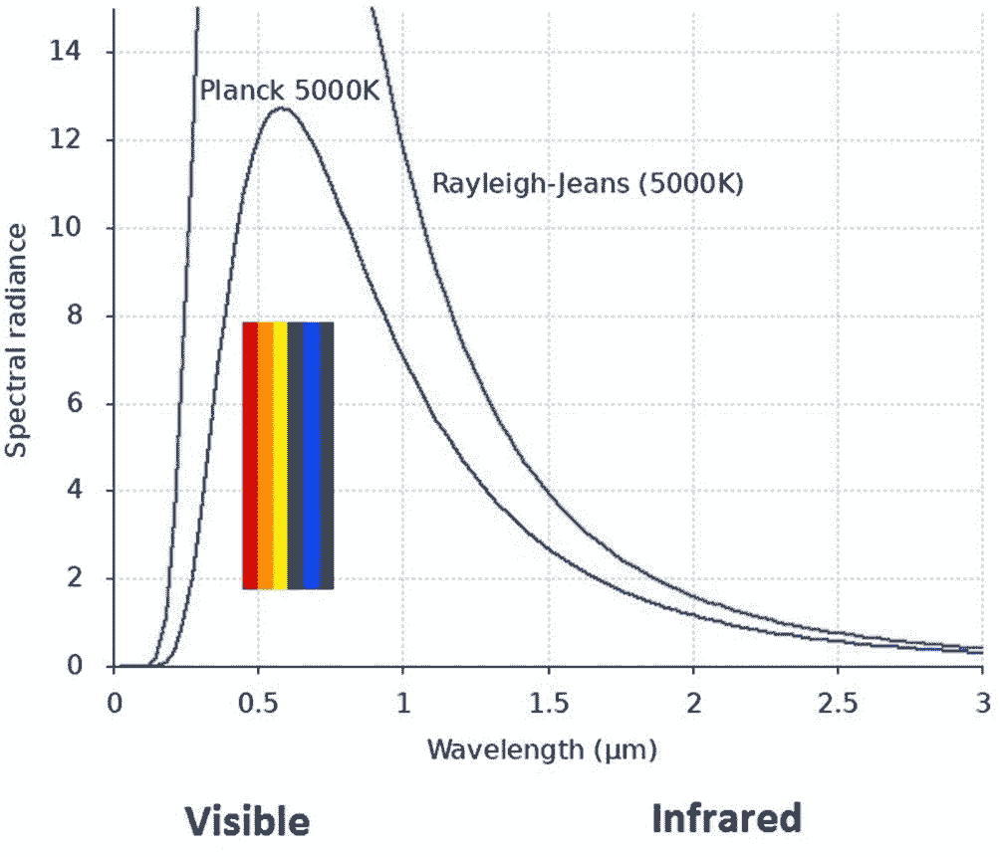

**图 1-1** 针对紫外灾难的瑞利-金斯定律与普朗克解决方案的对比图

普朗克修改了瑞利的原始推导，通过改变公式使其符合实验结果，如公式 1.2 所示。

```
Bλ(T) = (2cK_BT) / λ⁴
```

(1.1)

```
Bλ(λ, T) = (2hc² / λ⁵) * 1 / (e^(hc / (λK_BT)) - 1)
```

(1.2)

其中 `h` 是普朗克常数 = 6.62 × 10⁻³⁴ 米²千克/秒。

他提出了一个在当时看来不可思议的假设：能量可以被吸收或发射成离散的单元，他将其称为*量子*：`E = hv = h * (c / λ)`，其中 `v` 是频率。注意，频率等于光速除以波长 `v = c / λ`。这在今天看来或许微不足道，但在 20 世纪 30 年代却是开创性的；甚至连普朗克自己都不完全理解他究竟开启了什么。他由此催生了一个全新的理论：量子力学。

## 普朗克大获全胜，爱因斯坦赢得诺贝尔奖

因此，在当时，普朗克并没有意识到他的*能量量子*假说有多么巨大，因为他承认，他对“紫外灾难”的解决方案仅仅是让瑞利-金斯定律的数学公式能够吻合众所周知的实验结果的一种权宜之计。要理解这一假说的威力，我们必须审视普朗克时代前后人们对光本质的看法。

### 普朗克之前的光的本质

自 19 世纪以来，人们普遍认为光的行为像波。苏格兰物理学家詹姆斯·克拉克·麦克斯韦（1831–1879）为这类波的基本特性提供了描述（见图 1-2）。

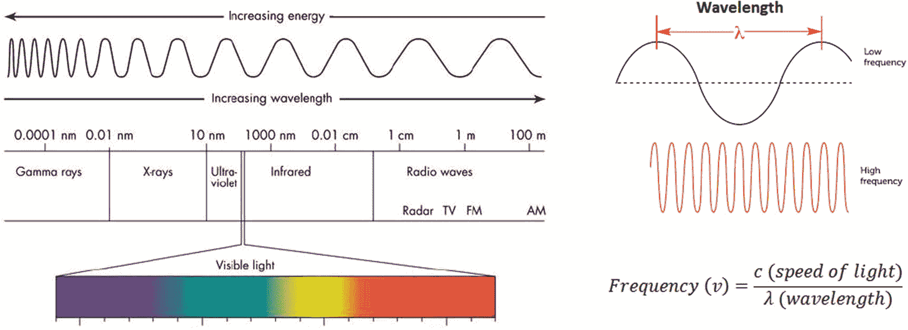

**图 1-2** 19 世纪光的本质

- 光波的一个基本属性是其波长或 lambda（`λ`）。
- 观察图 1-2 的右侧：在非常短的波长处，我们有很多波；反之亦然，在较长的波长处情况也是如此。这就是频率（`v`），光波的第二个基本属性。

似乎可以合乎逻辑地认为：在高频率（短波长）下，波的能量更高（因为有更多物质在流动），而在低频率（长波长）下，能量会降低。因此，能量（`E`）与其频率（`v`）成正比，与其波长（`λ`）成反比。这一认知催生了 19 世纪光的标准光谱：

- 光谱左侧（波长最短处，介于 1 皮米到 0.01 纳米之间）是伽马射线：非常危险，通常是超新星爆炸的结果，它们能量最高。来自超新星的伽马射线暴可以摧毁沿途的一切：例如，地球上的所有生命，甚至整个太阳系。你可不想成为伽马射线暴的目标！
- 接下来，在波长 0.01–10 纳米处，是广为人知的 X 射线：非常适合用于透视物体内部，无论是有机物还是无机物，但持续暴露仍然危险，足以致癌。
- 在波长 10–400 纳米处，是紫外线（UV）：这种来自太阳的辐射赋予地球生命，但高剂量下可能有害。幸运的是，地球上的臭氧层维持了这种辐射的平衡，使其得以孕育生命。
- 紧随紫外线范围之后的是一个狭窄区域，即可见光谱，它让我们得以欣赏这个美丽宇宙中我们所能看到的一切。
- 接下来是红外线，波长最高可达 1050 纳米。它应用于工业、科学、军事、执法和医疗领域。例如夜视镜、热传感器等设备。
- 最后，是红外线范围之上的无线电波。人类大多数技术都利用这些电波来传输各种信息，如音频、视频、电视、广播、手机等，不一而足。

### 普朗克之后，物理学将改天换地

在 20 世纪 30 年代，普朗克颠覆了古典物理学对光本质的理解。尽管他提出的能量量子假说被大多数物理学家斥为荒谬，并且多年来一直无人问津，但世纪另一位巨匠阿尔伯特·爱因斯坦将抓住这一发现，提出全新的光的诠释。于是，光子诞生了。

这一点并非广为人知：爱因斯坦获得诺贝尔奖并非因其相对论的杰作，而是因其对光的量子性质和光电效应的研究。爱因斯坦利用普朗克的设想，将光想象为离散的波（粒子），他称之为光子。他用这个理论解决了当时未知的光电效应中的一个悖论（见图 1-3）。

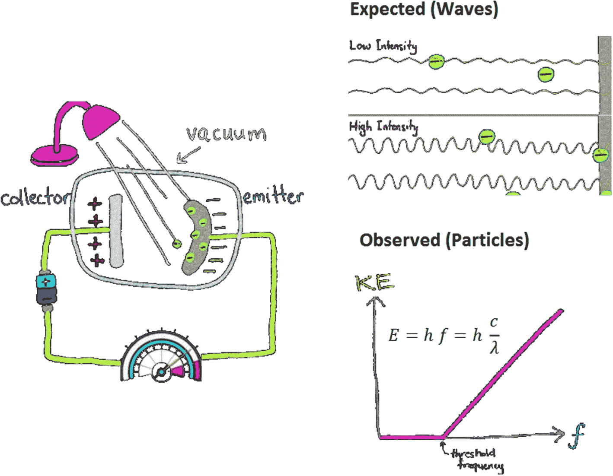

**图 1-3** 关于光电效应的新见解为爱因斯坦赢得了 1921 年诺贝尔物理学奖

顾名思义，光电效应试图描述当光线照射到金属表面时，电子的行为。为此，设计了图 1-3 中的实验：

- 从两块金属板开始。我们称它们为发射极和收集极。两者通过导线连接到电池。电池的负极连接到发射极，正极连接到收集极。
- 众所周知，电子带负电荷；因此，它们流向发射极，而正电荷则聚集在收集极。也请记住，异种电荷相互吸引。
- 实验思路是：当光源照射到发射极时，测量电子从发射极流向收集极时的动能。为了精确测量，在两者之间设置了真空环境。
- 如果光像古典物理学所要求的那样以波的形式流动，那么当光照射到电子时，电子将被激活并从发射极表面逃逸，飞向收集极。此外，随着光强（光量）的增加，更多的电子将被激活并以更大的数量逃逸。这种电荷的增加可以用图中所示的测量仪来测量。

然而，实际情况并非如此。在现实中观察到了两件事：

1.  电荷的增加（电子的动能）并不取决于光的强度，而是取决于其频率。
2.  更奇怪的是，并非所有频率的光都能激活电子使其逃逸出发射极。如果我们绘制动能（`KE`）随频率（`f`）变化的函数图（见图 1-3 右下方），那么曲线上存在一个点（阈值频率），超过该点后电子逃逸。低于该阈值，则电子保持不变。这确实是个难题！

爱因斯坦提出了解决这一难题的方案：通过假设能量以粒子形式表现，他解决了上述第二点中的悖论。想象一下，你在乡村集市上，想用球击倒木瓶来赢得奖品。如果你向木瓶扔弹珠，它们纹丝不动；但如果扔一个棒球，木瓶就会被击倒，你就能赢得心仪的奖品。爱因斯坦认为这种情况正是如此发生的。低频率的光子没有足够的能量让电子获得能量从而逃出发射极。增加光的频率；它增加了电子的能量，使它们逃逸并产生可测量的电流。由此可以推导出一个数学模型（见图 1-4）。

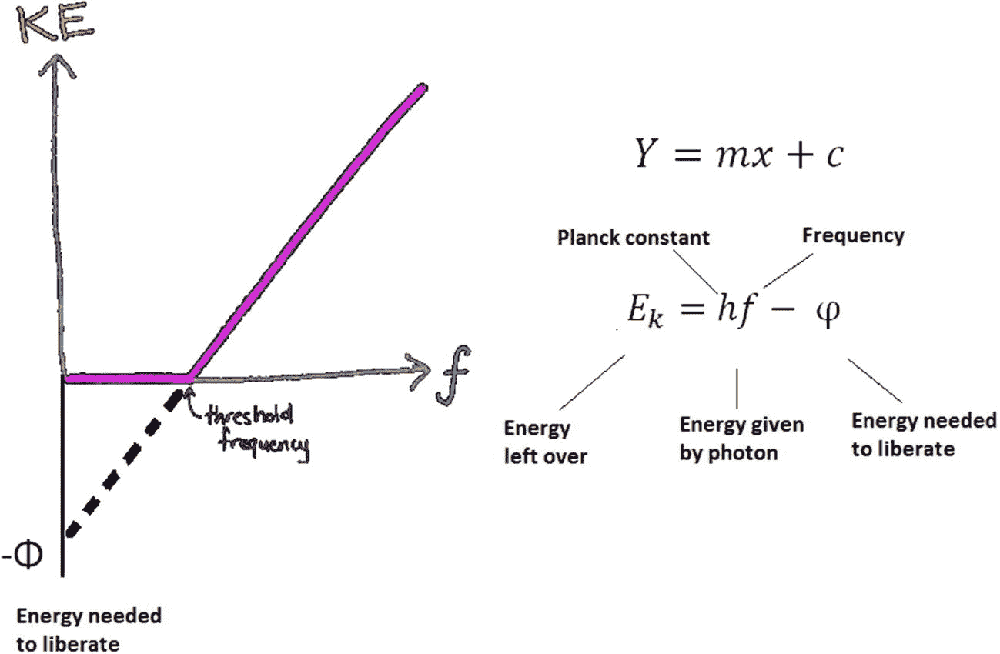

### 图 1-4 光电效应方程

`Ek` 对 `f` 的图表绘制出一条对角线上升的直线。直线开始上升的点被标记为“阈值频率”。方程表示为：剩余能量 = 普朗克常数 × 频率 − 解放电子所需的能量。

**图 1-4 光电效应方程**

图 1-4 展示了电子动能（`Ek`）作为光频率（`f`）函数的图表。在低频时，直到达到阈值频率之前，没有电子逸出。现在，如图所示，将直线沿虚线轨迹延伸，我们得到一条直线图（注意虚线轨迹与 Y 轴的交点被希腊字母 φ 命名）。这是解放电子所需的能量。因此，这条直线图可以用代数方程 `Y = mx + c` 来描述，其中 `m` 是斜率，`c` 是 Y 轴截距。

现在，将 `Y` 替换为动能，斜率 `m` 为普朗克常数（`h`），频率（`f`）替换 `x`，`c` 为解放电子所需的能量或 `–φ`。因此，我们的直线图等式变为 `E[k] = hf – φ`。

这就是光电效应的方程：电子被解放后剩余的能量等于光子提供的能量减去解放它所需的能量。

> **提示**
>
> 顺便提一下，第一个认为光是粒子的科学家是艾萨克·牛顿。他认为光以他称之为“微粒”的小包形式传播。他还认为这些微粒具有质量；这个观点是错误的。不幸的是，这个想法从未被广泛接受，并一直沉寂，直到 20 世纪 30 年代被普朗克-爱因斯坦革命复兴。

## 量子力学有多种形式

几乎毫无疑问，20 世纪 30 年代是 20 世纪物理学的黄金时代。诺贝尔奖如同糖果般颁发，似乎在揭示自然奥秘的探索中，没有什么能阻止人类。自那时起，量子力学在近一个世纪的无尽理论和实验挑战中屹立不倒。总的来说，这些年来它经历了相当大的变化。这些就是所谓的量子力学诠释，它们的形式确实非常奇特。

### 哥本哈根诠释

这是关于量子力学意义的最早共识，诞生于物理学的黄金时代，由马克斯·普朗克、尼尔斯·玻尔、维尔纳·海森堡等人在 20 世纪 20 年代的哥本哈根共同提出。

#### 革命始于普朗克、玻尔和薛定谔

马克斯·普朗克关于能量量子的假设引发了这场革命，爱因斯坦对光的二象性和/或量子本质的贡献也起到了推动作用。也就是说，光既表现为波也表现为粒子这一观点。

丹麦物理学家尼尔斯·玻尔（1885–1962）于 20 世纪 20 年代在哥本哈根资助成立了理论物理研究所，致力于原子研究这一全新领域。当时，原子被认为看起来像一个微型的太阳系，中心是一个由质子、中子和绕其旋转的电子组成的原子核。这被称为卢瑟福模型，但它有一个严重的问题：电荷！如果带负电的电子绕带正电的原子核旋转，那么由于异种电荷相吸，电子最终会坍缩进原子核，摧毁所有存在的物质。玻尔预见到了这种情况，并利用普朗克的能量量子概念提出理论，认为电子通过获得或失去能量从一个轨道跳跃到另一个轨道；他称之为“量子跃迁”。这个想法后来被称为玻尔原子，但它有一个奇怪的特征：电子并非简单地从一条轨道移动到另一条轨道。它们会瞬间从一条轨道消失，并重新出现在另一条轨道上。这一点并不为另一位物理学巨匠所接受：埃尔温·薛定谔。

奥地利物理学家埃尔温·薛定谔（1887–1961）是著名的波函数 `ψ` 之父。薛定谔试图描述一个物理系统的能量；他提出了现在被认为是上个世纪物理学中最强大工具的理论（见图 1-5）。

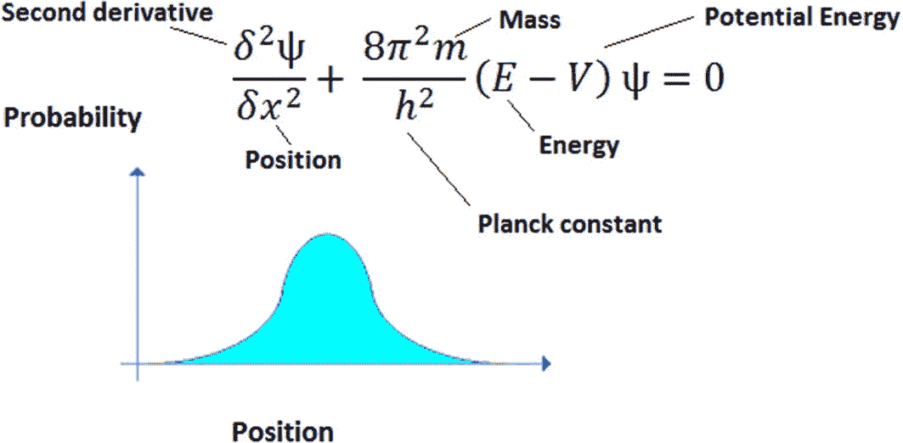

**图 1-5 薛定谔波函数 `ψ` 是量子力学的基石**

薛定谔厌恶玻尔对原子的诠释，他曾有名言：“如果我要接受量子跃迁，那我真后悔涉足原子研究领域。”事实上，他的波函数正是试图推翻普朗克-玻尔-爱因斯坦的理论。他想要抛弃刚诞生的能量量子理论，回归到连续的经典波动力学模型，甚至极力主张所有现实都可以完全由波来描述。那么，为什么 `ψ` 如今在量子力学中无处不在呢？这要感谢我们下一位物理学家：马克斯·玻恩。

德国-犹太裔物理学家马克斯·玻恩（Max Born，1882–1970）将薛定谔的波函数引向了一个全新的方向。玻恩提出了对 `ψ` 的概率论解释，即一个粒子的状态处于不断的变化之中，我们唯一能知道的是该粒子处于给定状态的概率。玻恩假设这个概率为 `P = ψ²`。不用说，薛定谔对此完全不以为然，他认为自己的波函数被误用了。他用一个如今著名的思想实验——量子猫——来回击玻恩。但在我们查看盒子里的猫是死是活以及原因之前，先来考虑一个诙谐的故事：在典型的美国卡通片《飞出个未来》（由《辛普森一家》的创作者马特·格勒宁制作）中，我们的英雄弗莱在公元 3000 年地球上的新纽约市警校入学。一天巡逻时，弗莱追赶一个在汽车后备箱里藏着一个神秘盒子的歹徒。歹徒被拘留后，发现竟是沃纳·海森堡。弗莱满脸惶恐地看着盒子问道：“盒子里是什么？”海森堡回答：“一只猫。”“猫是死是活？”弗莱问道。海森堡回答：“猫既不是活的也不是死的，而是处于一个叠加态中，每种状态都被分配了一个概率。”长话短说，歹徒海森堡因严重违反物理定律而被捕。对于物理爱好者来说，这算是一个有趣的故事。尽管如此，这表明量子猫已成为民间传说，也是用来解释量子力学概率性质的主要例子。

强大的 **海森堡不确定性原理（HUP）** 是德国物理学家沃纳·海森堡（1901–1976）的成果，它是量子理论的基石之一。它描述了粒子位置（`x`）和动量（`ρ`）之间关系中的不确定度。更清楚地说，我们可以精确测量一个粒子的*位置*或*动量*，但不能同时测量两者。不确定性原理源于量子客体基本的波粒二象性（见图 1-6）。


**图 1-6 不确定性是量子客体互补变量（如位置和动量）波粒二象性的一个基本属性。**

> **提示**
>
> 值得注意的一点是，起初这种不确定度与*观察者效应*相混淆，后者认为测量行为会改变量子系统的状态。事实上，海森堡本人曾将观察者效应作为该假设的物理解释。自那以后，物理学家厄尔·赫斯·肯纳德在 1928 年通过对 HUP 的严格数学推导，证明这一解释是不正确的。

不确定性原理在热力学世界中具有深远影响：例如，它催生了*零点能*的概念。在开尔文温标中，零开尔文被称为*绝对零度*，即所有分子运动停止的温度。这一点被量子力学和不确定性原理所禁止，因为如果所有分子运动都停止了，那么粒子的位置和动量就都会被知道。这是不可能的；你要么知道粒子的位置，要么知道其动量，但不能两者皆知。因此，即使在绝对零度，粒子也会以微小的能量振动，因此得名零点能。

奥地利物理学家沃尔夫冈·泡利（1900–1958）是爱因斯坦的亲密同事，也是因著名的*不相容原理*而获得诺贝尔奖的得主。该原理指出，没有两个电子可以具有完全相同的一组量子数。这些数字描述了电子的状态；因此，没有两个电子可以同时处于相同的量子态。在泡利的时代，电子的化学效应由一组三个量子数描述：
- `n`：主量子数
- `l`：轨道角动量量子数
- `m[l]`：磁量子数

泡利研究了关于原子（具有偶数与奇数个电子）化学稳定性的化学实验结果。当时人们认为，具有偶数个电子的原子在化学上比具有奇数个电子的原子更稳定。此外，人们认为这些电子以对称的簇或闭合壳层围绕原子核排列。泡利意识到，可以通过在上述三个量子数的基础上增加一个新的量子数，将这些复杂的壳层还原为单个电子。泡利引入了一个新的二值量子数，后来被称为*量子自旋*。泡利的发现后来被推广到标准模型中的所有粒子：
- **费米子**：以核时代建筑师之一（恩里科·费米）的名字命名，它们遵守费米-狄拉克统计和泡利不相容原理。费米子具有半整数自旋，包括电子、夸克和轻子（电子、中微子）。
- **玻色子**：它们遵守玻色-爱因斯坦统计，不遵循泡利不相容原理。此外，它们具有整数自旋，包括光子、胶子、W-Z 玻色子和全能希格斯玻色子（所谓的“上帝粒子”）。

泡利不相容原理的重要性在于它有助于解释原子复杂的壳层结构及其对原子化学稳定性的影响。它还解释了原子共享电子的方式，从而说明了自然界中元素的化学多样性及其组合。为此，泡利于 1945 年获得诺贝尔奖，获奖理由是“通过发现一个新的自然定律——不相容原理或泡利原理——而做出的贡献”，并且享有被阿尔伯特·爱因斯坦提名的无上荣誉。

#### 保罗·狄拉克的天才之处

英国物理学家保罗·狄拉克（1902–1984）被认为是量子力学和量子电动力学发展过程中最重要的贡献者之一。你可能听说过"反物质"这个术语，即质量与普通物质相同但电荷相反的物质。狄拉克是首位推导出预言其存在的方程式的人。狄拉克的众多贡献包括：


**图 1-7 狄拉克方程是在量子力学框架中引入相对论性时空的首次尝试。**

*   狄拉克方程：该方程被认为是量子力学领域一项不可思议的成就，原因有两点：其一，它试图在薛定谔的波函数中纳入狭义相对论（时空坐标）（见图 1-7）。这一壮举被视为物理学的圣杯：将相对论和量子力学融合成一个统一万物的理论。遗憾的是，狄拉克方程距离实现这千年伟业还差一步之遥，我们稍后会对此进行解释。其二，它预言了反物质的存在，这在当时既未被怀疑也未被观测到，却在多年后通过粒子对撞机实验得到了实验证实。
*   狄拉克试图以一种与相对论一致的方式来处理原子的意图，对物质结构产生了深远影响。他的方程引入了两个新的数学对象，它们如今已成为物理学和量子场论的基础：
    *   `a[k]` 和 `β`：这些是与泡利矩阵密切相关的 4x4 矩阵。回顾泡利不相容原理，它引入了一个新的量子数，利用一个 2x2 矩阵来解释电子壳层团簇，该矩阵后来被称为电子自旋（或旋量）。与此类似，狄拉克矩阵被称为双旋量。
    *   一个四分量波函数 `ѱ`：它有四个分量，因为它在任何给定点的求值结果都是一个双旋量。从物理上解释，它被认为是自旋向上电子、自旋向下电子、自旋向上正电子和自旋向下正电子的叠加态。请注意，狄拉克的四分量波函数不同于泡利的两分量波函数，也不同于薛定谔针对单一复数值的波函数。
*   空穴理论：狄拉克方程的解包含负能量。为了应对这一事实，狄拉克提出了空穴理论假说。该理论假定，真空是一种多体量子态，其中所有负能量的电子本征态都被占据了。这种描述后来被称为狄拉克海。此外，由于泡利不相容原理禁止两个电子占据同一量子态，额外的电子将被迫占据正能量本征态，而正能量的电子被禁止衰变成负能量的本征态。狄拉克推断，在这片狄拉克海中可能存在未被占据的负能量本征态，他称之为空穴，并认为它们的行为类似于带正电的粒子，因为需要正能量才能从真空中产生一个粒子-空穴对。他最初认为空穴可能就是质子；但后来有人指出，空穴应该与电子质量相同；因此，它不可能是质子，因为质子的质量大约是电子的 1800 倍。这种空穴后来被确认为正电子，并于 1932 年由美国物理学家卡尔·安德森通过实验发现！

#### 爱因斯坦 vs. 玻尔：非定域性与幽灵般的超距作用（EPR 佯谬）

在 19 世纪早期，物理学界的两位泰斗——尼尔斯·玻尔与阿尔伯特·爱因斯坦——之间展开了一场无声的较量。爱因斯坦不喜欢马克斯·玻恩对波函数的概率诠释。他想要将自己的相对论推广到原子尺度，以实现一个统一的物理学理论。于是，在 1935 年，他与同事鲍里斯·波多尔斯基和内森·罗森共同发表了臭名昭著的 EPR 佯谬。这篇论文的目的是通过展示量子力学基本原理之一——纠缠——的荒谬性，来对其核心给予致命一击。纠缠是量子系统的一个基本属性，源于两个粒子之间的相互作用。例如，若一个粒子自旋向上，则另一个粒子在被测量时会瞬时表现出自旋向下，因此它们被称为纠缠态。诡异之处在于，这种事件是跨越空间、甚至时间瞬时发生的（非定域性）。因此，举例来说，取两个纠缠粒子，将一个留在地球上，将另一个移到太阳系边缘，然后对第一个粒子的自旋进行测量。此时，位于太阳系边缘的第二个粒子会瞬时呈现出相反的自旋值。这令爱因斯坦感到荒谬，他坚信光速是宇宙中的极限速度。如果没有什么能比光速更快，第一个粒子如何能瞬时将其自旋状态通知给另一个粒子呢？爱因斯坦称之为`幽灵般的超距作用`。

> **提示** 爱因斯坦憎恶量子力学的概率诠释，因为他无法接受"观测（测量）行为定义了粒子的状态"这一观点。他相信粒子的状态（属性）在其产生的那一刻就已确定，并曾著名地写信给玻尔说：“上帝不掷骰子。”玻尔则回复道：“您不应该告诉上帝该做什么。”爱因斯坦试图反驳这一观点，并将他生命的最后几十年用于寻找物理学的圣杯：将相对论与量子力学统一的理论。他未能成功，因此这个圣杯至今仍未被我们寻得：即那个能统一天空、大地与原子的万物之母方程。

#### 贝尔定理终结了爱因斯坦与玻尔的争论及 EPR 悖论

爱因斯坦与玻尔的争论持续多年，始终未分胜负。两位物理学家去世时也未能化解分歧。然而，1964 年，爱尔兰物理学家约翰·斯图尔特·贝尔（1928–1990）发表了一项定理，旨在彻底终结这一争论。贝尔定理并非试图证明谁对谁错：量子力学还是相对论。它只是提供了检验纠缠粒子中非定域性原理的方法。简而言之，贝尔定理指出，一个相关的三变量量子系统的概率之和小于或等于 1。即
```
P(A = B) − P(A = C) − P(B = C) ≤ 1
```

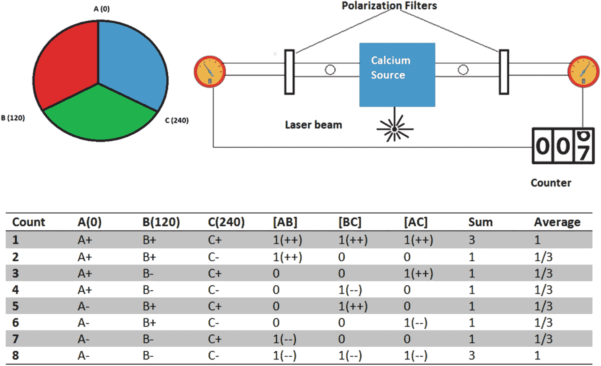

一个分为 A 0、B 120、C 240 三个扇区的饼图示意图。一个连接着计数器、钙源和偏振滤光片的激光束示意图。下方表格包含 9 列 8 行，列标题为：计数、A 0、B 120、C 240、A B、B C、A C、总和、平均值。

**图 1-8** 利用三个角度的光子偏振解释贝尔定理

为了说明贝尔定理，请考虑图 1-8 中三个不同角度（A、B 和 C）的光子偏振。我们旨在计算两个相邻光子偏振（以+/−表示）相同的**最小概率**。为此，我们使用一个表格，列出了 A、B、C 的八种可能排列，以及相邻偏振（第 5、6、7 列的+/−）。我们还计算了总和与平均值。请注意，相邻偏振相同由`++`或`−−`表示，此时我们记为 1。平均值是总和除以 3。上述结果表明，最小概率必须大于或等于 1/3；贝尔定理在此表明，如果现实是由观测行为（如量子力学所预言）所定义，那么最小概率必须小于 1/3。

另一方面，如果相对论是正确的（粒子的状态在创生时即已确定），那么概率必须大于或等于 1/3。现在的关键在于找出量子力学是否违反了贝尔不等式。如果违反，那么我们的宇宙是奇异的（玻尔和普朗克是正确的，量子力学得以保全）。反之，如果不等式未被违反，那么爱因斯坦的相对论胜出，量子力学就是错误的。

令人惊叹的是，1982 年，法国物理学家阿兰·阿斯佩（1947 年至今）设计了一项实验来检验量子力学是否违反了贝尔定理（见图 1-8 右上侧）。该实验使用激光和钙源来产生成对的纠缠光子。这些光子沿相反方向运动，穿过偏振滤光片，最终记录结果。其目标是计算两个光子在不同角度下要么都通过、要么都不通过的概率，统计总数，并查看概率之和是否大于或等于 1/3。请记住，每对光子都是纠缠的，因此当它们通过滤光片时，可能会发生`鬼魅般的超距作用`。结果令人震惊。概率之和约为 1/4；贝尔不等式正如量子力学所预言的那样被违反了。看来`上帝确实掷骰子`！

> **提示** 已故物理学家史蒂芬·霍金（1942–2018）曾说过：“上帝不仅掷骰子，他还是个强迫性赌徒。”量子力学的某些预言如此奇异，以至于超出了人们的理解。我们的大脑天生是为了理解周围的世界；然而，在量子尺度上，有些事情是无法理解的，只能接受。

阿斯佩的实验还向`鬼魅般的超距作用`发起了挑战。测试一个光子是否能即时地将其偏振状态告知其纠缠伙伴并非易事。为了实现这一点，实验稍作修改，使用了一个光开关，能以约 2 纳秒（ns）的速率选择性地开启或关闭光信号。现在，光以每秒 18.6 万英里的速度传播，需要大约 20 纳秒才能从实验装置的一端到达另一端（接近 14 米）。目标是重新进行实验，看看新结果是否与旧结果一致。如果一致，则意味着光子能够在光从实验一端传播到另一端所需的时间之前，将偏振状态告知其伙伴，而相对论禁止宇宙中任何事物超过光速，这恰恰是被相对论所禁止的。两次实验的结果完全吻合：既令人震惊又令人担忧；想象一下，如果两个光子分别位于银河系的边缘。

在接受英国 BBC 采访时，约翰·贝尔谈到了这些结果：在物理学中，有些事物超出了我们的理解，我们别无选择，只能接受它们，仿佛现实在捉弄我们所有人。量子尺度上发生着令人惊叹的事情，但最大的讽刺是，我们无法利用它们。尽管纠缠粒子可以跨越巨大距离以超光速传递信号，但信息却无法通过信号本身传递。这也是量子力学所预言的事实；真扫兴，别想着给你在阿尔法半人马座的外星伙伴发短信了。

> **提示** 很难相信贝尔精妙的定理多年来一直默默无闻。当然，后来情况发生了转变，以至于著名物理学家称其为“科学史上最深刻的发现。”

#### 意识、神秘主义与波函数坍缩

量子力学告诉我们，粒子的状态以叠加形式存在于概率曲线或波函数之中。此外，当通过探测器或测量设备对粒子进行测量时，波函数就会坍缩为单一状态。坍缩为何发生至今仍是一个谜，我们只知道坍缩标志着从量子领域向经典领域的转变。然而，每当量子系统与外部世界相互作用时，似乎都会发生这种情况。当这种奇异的物理现象被发现时，物理学家们开始求助于哲学和神秘主义来理解正在发生的一切。事实上，诸如《吠陀经》、《薄伽梵歌》、《罗摩衍那》和《摩诃婆罗多》等神圣的印度教典籍中，存在实体忽隐忽现的描述。在《梨俱吠陀》的神圣经文里，光速被计算为半个尼梅萨内 2202 由旬，按古代单位换算约为每秒 18.5 万英里。

几个世纪以来，`量子原理`一直被用来验证诸如`神性`、`意识`、`积极思维`等`形而上学`概念。但撇开这些不谈，为何`量子力学`能让顶尖物理学家相信，`心灵意识`在现实中可能扮演着内在角色？科学中有一个基本原则叫做`因果律`。它深深植根于我们的日常生活，以至于我们视其为理所当然：`因果关系`，每个作用力都有大小相等方向相反的`反作用力`，行动必有后果，等等。但如果有科学证据表明`因果律`可以被违反呢？这样的证据将难以理解，因为它会挑战现实的根基；毕竟，科学家的头脑是通过观察来理解物理现象的。这样的实验确实存在，它叫做`双缝实验`，由托马斯·杨于 1801 年首次完成（见图 1-9）。

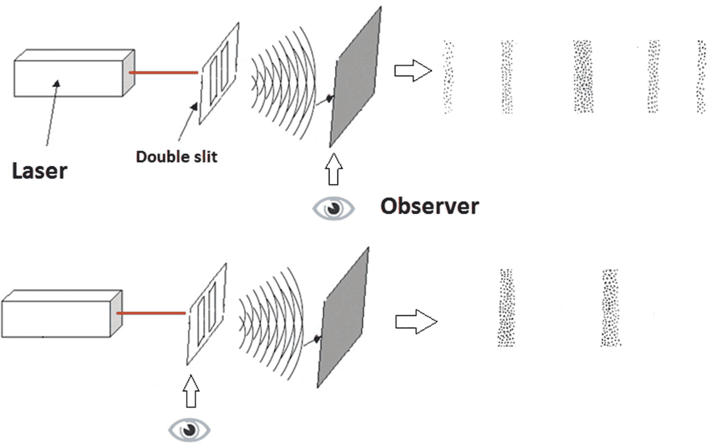

两张示意图显示一束`激光`投射到`双缝`上，观察者正在观察双缝后的物体。衍射后的激光束在双缝后的物体上形成明暗相间的条纹图案。

`图 1-9` 展示`波粒二象性`的`双缝实验`似乎违反了`因果律`

在图 1-9 所示的`双缝实验`中，从激光束发出的`光子`穿过一块带有两个狭缝的金属板，最终的投影记录在`探测器`屏幕上。第一步，在屏幕处放置一个`观察者`或`测量设备`，结果如图上方所示产生了`干涉图案`。在这种情况下，图案表明`光`的行为像`波`。现在，如果将`观察者`移到两个狭缝附近，以观察`光子`穿过哪个狭缝，那么结果图案就会变为两条亮线的簇（图下方）；这里`光子`的行为像`粒子`。为何会发生这种情况是物理学中最大的谜团之一。专家们就此得出了一些具体结论：

*   该实验说明了`光子`固有的`波粒二象性`，这是所有`量子现象`的本质。请注意，自托马斯·杨首次进行该实验以来，对于`电子`、`原子`和`分子`也得到了相同的结果；因此，该效应仅适用于原子量子尺度的物体。

*   `量子系统`本质上是概率性的：`量子力学`中没有精确答案，只有物体处于给定状态及其全能`波函数`的概率。

然后是真正怪异的影响。伟大的美国物理学家理查德·费曼曾这样评价`双缝实验`：“`量子力学`的奥秘可以通过仔细研究这一个实验来领悟。”根据你如何看待，这里似乎有一两个怪异之处在起作用：

*   现实似乎是由`观察行为`创造或描述的。是我们定义了`光`处于哪种状态：`粒子`还是`波`。这太奇怪了；如果移除`观察者`，事物还会存在吗？为什么首先需要一个`观察者`？是谁或什么创造了`观察者`？

*   将`观察者`在屏幕和狭缝之间移动的任意选择，似乎能回溯时间，去决定`光`应该处于哪种状态（`波`还是`粒子`）。这超越了奇异；对此一个更容易接受的解释是从`状态叠加`的角度来思考：当`光`未被观察时，它存在于`波-粒子`状态的概率叠加中。

因此，`意识`在这一系列事件中扮演的角色依然存在。`意识-观察`对我们的现实来说是基础性的吗？如果是这样，难道不会挑战那种认为`意识`是大脑的孤立幻觉的科学教条吗？科学允许我们收集独立且可验证的证据，不受预期的污染，并通过从物理现象中去除所有心灵的痕迹而蓬勃发展。

科学寻求建立客观可靠的世界模型，依赖于标准和可验证的实验方法。而`量子力学`现在似乎揭示，在自然界最深层次，客观科学已不再可能。`心灵`在世界的展开过程中是否扮演着内在角色？马克斯·普朗克曾说过：“自然的奥秘似乎无法由我们自己解开，因为我们本身就是自然的一部分，因而也是我们首先试图解开的那个奥秘的一部分。”

> **提示：** 一些`量子力学`原理似乎难以理解，而面对这些不可思议的现象时，像普朗克、薛定谔等大师级的物理学家，都曾求助于哲学来理解他们的科学发现。

### 多世界诠释

在`量子力学`的`多世界诠释`（`MWI`）中，`波函数`是普适的。它存在于所有现实之中，并且当我们在现实世界中观测现象时，它并不会坍缩。`多元宇宙`远比我们想象的更加离奇。

在`哥本哈根诠释`中，`波函数坍缩`标志着`量子世界`与`经典世界`之间的转换。然而，还有另一种解释方式，即在一个由无限多个现实组成的集合中，所有结果都是可能的。

当埃尔温·薛定谔提出他那被他称为“荒谬”的`量子猫`思想实验来挑战`叠加原理`时，他认为，如果我们打开盒子发现猫还活着，是因为我们身处整个`量子时间线`的一部分，在那个时间线里，毒害猫的事件从未发生。然而，同样存在一个同等真实的时间线，猫已死亡，而另一个版本的我们正在经历着这一切。不仅如此，时间线的数量是无限的，并且同时发生。这听起来令人难以置信，但这是对相关数学公式的一种非常严肃的诠释。

> **提示**

> `多世界诠释`由美国物理学家休·埃弗雷特（1930–1982）在其 1957 年的博士论文《普适波函数理论》中提出。

在`双缝实验`中，`哥本哈根诠释`认为，在观测的瞬间，所有叠加的`光子`轨迹（历史）合并（坍缩）成`观察者`所在现实的单一时间线。而`多世界诠释`则认为，这种合并从未发生，所有可能的历史都在继续，我们只是发现自己身处其中一条时间线（见图 1-10）。请注意，所有历史都具有相同的可能性。然而，有些历史彼此相似，而我们往往会落入最普遍的历史中。

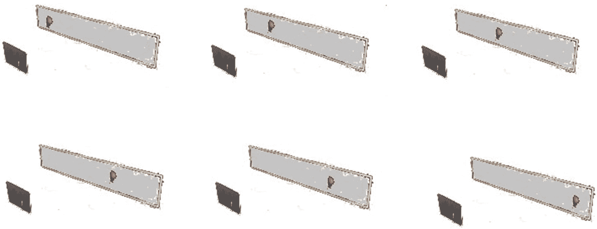

一排图像，每一张上都有一个心形。这可以被解释为 MC 中不同宇宙的表示。每张图像代表一个不同的可能光子轨迹。

`图 1-10` – 在`多世界诠释`中，所有可能的`光子`轨迹都在各自的时间线中延续

> **提示**

> 埃弗雷特的想法在最初提出时并未得到重视，很可能是因为他当时还是一名研究生。

总而言之，`多世界诠释`可能是`量子力学`最纯粹的诠释，因为它的数学公式不需要`波函数坍缩`。然而，现实在每个瞬间都相互分叉的想法会引发一种存在危机，这或许可以解释其为何不受欢迎。想象一下，无限个版本的你正在经历每一种可能的人生道路。这听起来太离奇了。总而言之，关于`多世界诠释`最重要的具体细节是：

-   `多世界`是一种决定论诠释：它通过假设任何给定的时间线都是一条可预测的`因果链条`来消除`波函数`固有的概率性。没有`状态的叠加`。

-   尽管近年来它越来越受欢迎，但并没有证据证明其存在。它受到`量子力学`数学的支持，但仍只是一种诠释。

-   它没有提供任何预测来将自己与其他诠释区分开来，其解释也并不完整。它未能解释相邻历史相互作用时会发生什么，也未能解释`波函数`为何会转化为概率。

-   除了它引发的存在危机之外，它还带来了另一个深刻的哲学不安：自由意志会怎样？如果我们生活在一个决定论的宇宙中，那么我们在任何给定时刻都在做出所有可能的决定；因此，我们没有自由意志。这是一个合理的论点，但却是一种可怕的生存观。

### 补充诠释

在`量子力学`的诠释中，`哥本哈根诠释`和`多世界诠释`是最流行的。然而，还有更多其他诠释，它们主要分为两大类别：`波函数坍缩` vs. `波函数不坍缩`，并进一步根据决定论、非定域性（鬼魅般的超距作用）和观察者存在进行分类。以下列表根据`波函数坍缩`对其中一些进行了描述。

#### 有意识观察者

也称为`冯·诺依曼-维格纳诠释`，由匈牙利数学家约翰·冯·诺依曼（1903–1957）提出，匈牙利物理学家尤金·维格纳（1902–1995）亦有贡献。它通过假设`波函数`是普适的，并且是实验者的`意识`使其坍缩，从而深入了哲学的领域。这个理论本身的实质内容并不多；尽管如此，多年来它已经衍生出诸如以下的想法：

-   **主观还原**：由于`意识`导致`波函数坍缩`，`量子力学`与身心问题之间存在一个交叉点。该领域的研究人员正致力于寻找意识事件与物理事件之间的关联。

-   **参与式人择原理**：由传奇美国物理学家约翰·阿奇博尔德·惠勒（1911–2008）倡导。它认为`意识`在将宇宙带入存在中发挥了作用。一个离奇的想法（如果事情还能更离奇的话）；总而言之，请考虑这一点：如果`意识`能将现实带入存在，那么在人类进化并试图揭示它之前发生了什么？恐龙的`意识`能做到吗？此外，如果`意识`是生命的固有属性，那么在生命在地球上演化之前发生了什么？现实是在太阳系诞生之初就存在，还是在宇宙大爆炸之后才存在？

#### 量子信息

这是一个真正引人入胜的理论，它试图通过借鉴标准量子物理学（即信息是不可逆记录的）来消除`波函数坍缩`中的非决定论（机率）。在这种情况下，信息意味着可以在数学和物理上理解的量，而不可逆意味着由于`热力学第二定律`（熵），量子态无法回滚到先前的状态。`熵`指出，宇宙的无序度（熵）只能增加。或许，这可以从所谓的“时间之箭”的角度得到更好的理解。也就是说，因为时间只能增加，并且由于`海森堡不确定性原理`（量子态本质上是随机的），记录的信息由于`量子力学`的基本不确定性而不可逆。总而言之，`量子信息诠释`基于三个原则：

-   `波函数`决定性地演化，经历所有可能性。一个粒子会随机选择这些可能性中的一个来实现。

-   允许有意识的`观察者`存在；然而，在信息在宇宙中被不可逆地记录之前，`观察者`无法获得知识。一旦被记录，信息就成为`观察者`头脑中的知识。

-   `测量装置`是量子的而非经典的，但它可以被统计确定，并且能够记录不可逆的信息。获得知识的人类思维也是如此。

    > **提示** 在这种诠释中，只有一个世界：`量子世界`，以及从量子到经典的转变。此外，经典运动定律和`因果律`的决定论本质上是统计性的。一切都是概率性的，但接近确定性。

以下理论则完全摒弃了`波函数坍缩`的概念。

#### 导波理论

又称*`德布罗意-玻姆`*理论，以先驱物理学家路易·`德布罗意`（1892–1987）和大卫·`玻姆`（1917–1992）的名字命名。该理论将`波函数`与*`位形`*（量子系统中所有粒子的位置）概念相结合。这一理论是*决定论*的（不允许存在随机性）；这意味着即使系统未被观测，`位形`依然存在（不存在`态的叠加`）。它也是*非定域*的，并接受超距（瞬时）作用。最显著的特征是存在一个*引导方程*，用于控制`位形`随时间的演化。具体而言，该理论包含两个组成部分：

* 整个宇宙的位形。即宇宙中所有粒子的位置 `q(t) ∈ Q`，其中 `Q` 是位形空间。

* 一个导波 `ѱ(q, t) ∈ C`。这是一个双分量波函数，用于控制位形随时间 (`t`) 的演化。

因此，在每一时刻，不仅存在一个波函数（导波），还存在整个宇宙的一个明确确定的位形。这有效地消除了哥本哈根诠释的非决定论以及态的叠加（不允许存在量子猫）。因此，我们所感知的现实，是通过将我们大脑的位形与整个宇宙位形的某一部分进行等同而产生的。

*   **双缝实验**：在双缝实验中，导波理论认为每个光子都具有一条明确确定的轨迹，且恰好穿过其中一条狭缝。这与哥本哈根诠释形成对比，后者认为光子在探测（观测）之前并非定域在空间中。此外，粒子在探测器屏幕上的最终位置以及它所通过的狭缝，由粒子的初始位置决定；关键假设是，实验者无法获知或控制这个初始位置，因此探测的图案看起来具有随机性。根据玻姆的理论，波函数与自身发生干涉，并通过量子势引导粒子，使得粒子避开相消干涉的区域，而被吸引到相长干涉的区域，从而产生实验所获得的图案。

*   **相对论**：导波理论与*狭义相对论*存在冲突，因为它具有*非定域性*（接受超距瞬时作用）。多年来，人们不断添加各种扩展，试图克服这一冲突。玻姆本人在 1953 年就利用绝对时间（时间在处处相同——这在狭义相对论中是绝对不允许的；在狭义相对论中，时间具有很强的可塑性，并可能因观察者的位置不同而不同）对理论进行了扩展。

*   **海森堡不确定性原理**：哥本哈根诠释告诉我们，由于量子力学内在的不确定性，我们无法同时测量量子系统中的两个共轭变量（位置和动量）。然而，在导波理论中，我们可以同时测量一个粒子的位置和动量。每个粒子都具有一条明确的轨迹和一个波函数。观察者对于这条轨迹（从而对于位置和动量）的了解是有限的。正是由于对粒子轨迹缺乏了解，才导致了不确定性。

*   **纠缠与贝尔定理**：导波理论对贝尔测试实验做出的经验预测与普通量子力学完全相同。这是因为该理论具有根本性的*非定域性*。如前文所述（见贝尔定理），1982 年阿兰·阿斯佩通过实验证明贝尔不等式被违反；此外，他还证实了所预测的两个纠缠光子之间的瞬时（超光速）作用。导波理论通过为两个粒子建立一个波方程（其中实验装置的取向会影响波函数）来描述阿斯佩实验的物理过程。正是这个波函数在改变偏振滤光片取向时承载了超光速效应。值得重申的是，量子力学、贝尔定理以及导波理论都不允许*信息*以超光速传播。这是一个非常重要的区别。

### 时间对称理论

这是一系列由量子场论先驱理查德·费曼和约翰·惠勒倡导的理论。它们引入了*逆因果性*的概念。即未来的事件可以影响过去的事件（正如过去的事件影响未来一样）。在时间对称性中，单次测量无法描述粒子的状态，但如果给出在不同时间进行的两次测量，则有可能计算出系统在所有中间时刻的精确状态。这一概念以两种方式影响量子系统的基础：

*   波函数坍缩并非系统发生的物理变化，而是由于第二次测量导致我们对系统了解的变化。

*   对于纠缠而言，它并非真实的物理状态，而只是因忽略逆因果性而产生的幻觉。两个粒子发生纠缠的点，仅仅是每个粒子都受到另一个粒子未来事件影响的点。

### 退相干

这是 1970 年由德国物理学家海因茨·迪特尔·泽赫（1932–2018）提出的一种诠释。根据泽赫的观点，退相干是信息从系统流失到环境中的过程。要发生这种情况，必须满足以下条件：

*   孤立地看，系统的动力学是非幺正的（这意味着根据薛定谔方程描述的量子态时间演化由一个非幺正算符表示）。然而，孤立系统与环境的组合体是以幺正方式演化的。

*   系统本身的动力学必须是不可逆的。

*   系统与环境之间可以产生纠缠，从而将量子信息转移到周围环境中。

尽管退相干否定了波函数坍缩，但它仍是对坍缩的一种理解尝试。它并不会产生实际的波函数坍缩。它只为其表观的坍缩提供了一种解释，即量子系统将信息泄漏到环境中。请注意，退相干未能解释*测量问题*，即波函数如何以及为何坍缩。尽管如此，它试图通过从量子系统到环境的状态跃迁来解释这一问题。

## 从量子力学到量子场：进化还是革命

在 20 世纪 30 年代的物理学黄金时代之后，迎来了由伟大的英国物理学家保罗·狄拉克领导的所谓“二次量子化革命”。他通过其伟大的方程找到了一种用相对论术语描述电子行为的方法，做出了深远的贡献。狄拉克不仅为我们提供了电子的相对论描述，还提供了量子化我们宇宙其他属性（如质量、电荷、位置和能量）的基本方法。在随后的岁月里，这些思想成为了量子化自然界所有亚原子力（如弱力、强核力和电磁力）的基础。这些就是现在所谓的*量子场论*的例子：它是现代物理学的基础。

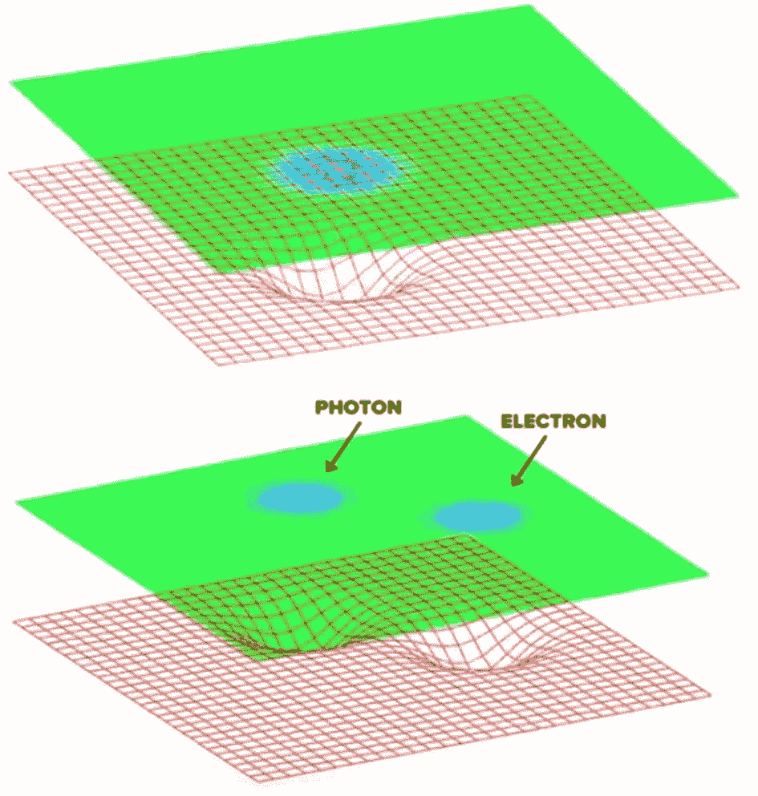

一幅关于电子量子场和电子发射光子的示意图，展示了电子从较高能级跃迁到较低能级的过程。当电子下落时，它会发射一个光子。光子的能量等于两个能级之间的能量差。

**图 1-11** 电子量子场的基本描述（上图）与电子发射光子（下图）

量子场论的基本原理很简单，但与其衍生出的理论一样奇怪：

*   在亚原子世界中，场遍布整个宇宙。标准模型中的每个粒子都有一个对应的场：电子、质子、夸克、光子等。

*   我们熟知并喜爱的粒子只是其各自场中的局部振动。

*   场可以相互作用，这解释了粒子是如何产生和湮灭的。

要理解粒子间的相互作用，请参阅显示电子场的图 1-11。电子是该场中的一个局部振动（上图）；如果电子发射一个光子，那么量子场论表明，电子的部分能量会在光子场中建立起另一个振动（下图），随后该振动会移开。

> **提示**  
>
> 场的概念大约始于 250 年前，由英国科学家迈克尔·法拉第（1791–1867）在其电磁学实验中提出。经过十多年的实验，法拉第对电和磁现象的行为方式形成了一种直觉。其结果便是：现代对电磁场的看法。

对于像法拉第这样的科学家来说，在 18 世纪提出场遍及整个空间的抽象概念，是科学史上最具革命性的思想之一。法拉第的顿悟时刻发生在他意识到试图将两块磁铁放在一起时所产生的排斥作用时。他想象那里存在着某种东西，尽管我们看不见它。他将这种物质称为*力线*；而我们则称之为磁场（见图 1-12）。

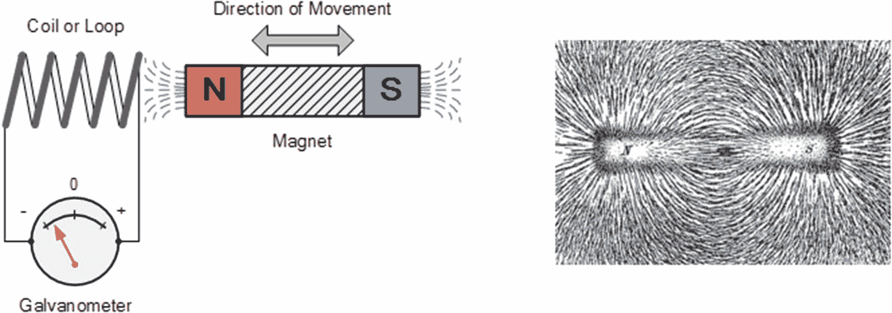

三幅插图展示了：一个连接着检流计的线圈或回路，一块带有南北极的磁铁，两极的运动方向，以及磁铁周围散布的磁场。

**图 1-12** 法拉第的电磁感应实验及其力线理论，为我们提供了当今关于电磁场的概念

又过了 50 年，法拉第的思想才由他的学生詹姆斯·克拉克·麦克斯韦以及后来的海因里希·鲁道夫·赫兹得以科学证实。此外，又过了 150 年，它才被用作现代物理学中量子场论的基础。

> **提示**  
>
> 量子场论吸收了量子力学的思想（例如能量作为离散的量子块流动），并将其与法拉第的场概念相结合，而法拉第的场是连续、平滑、在空间中振荡的物体。这是法拉第的遗产：我们的宇宙中没有粒子，只有场及其产生的振动。因此，量子场论看似是将两个旧原理简单组合，形成对现实的现代描述；然而，其数学形式却十分复杂。以至于解出量子场论中的大部分方程都需要超级计算能力。

### 我们皆由量子场构成，却对其不甚了解

在现代物理学中，元素周期表描述了我们构成的基础粒子。它从三种粒子开始：电子（由 J.J. 汤姆逊于 1897 年发现）和两种夸克（上夸克和下夸克，位于图 1-13 顶部）。在 20 世纪 70 年代，我们了解到原子核中我们熟悉的部分——质子和中子——本身也是由更小的夸克组成的：质子由两个上夸克和一个下夸克组成，中子由两个下夸克和一个上夸克组成。

> **提示**  
>
> 夸克的名字看起来很奇怪（上、下、奇、粲）。20 世纪 70 年代的物理学家使用这些名字并没有什么充分的理由。并不是说上夸克指向上方，或者下夸克指向下方；它们仅仅是发现者赋予的名称。

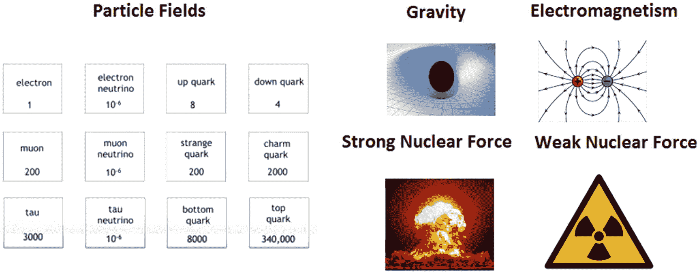

一幅示意图展示了粒子场，如电子、电子中微子、上夸克、下夸克、缪子、缪子中微子、奇夸克、粲夸克、陶子、陶子中微子、底夸克和顶夸克。右侧的四张图片分别代表引力、电磁力、强核力和弱核力。

**图 1-13** 物理学的对应物——元素周期表，展示了宇宙的基本构建块：电子、中微子、夸克以及自然界的基本力

很难想象，一切存在之物都可以由一个电子和两种夸克的不同排列组合而成。这是一个非常简单且令人安慰的图景，但可惜它并不完整。

### 构建宇宙的配方

物理学的元素周期表始于电子：它是第一个被发现、质量被定为 1 的最小粒子。标准模型中所有其他粒子的质量都是以电子质量为单位测量的。

- 除了构成质子和中子的电子及上夸克、下夸克之外，第四种粒子——中微子（由泡利于 1930 年提出以解释放射性衰变）于 1956 年在实验中被探测到。中微子极其微小，质量仅为电子的百万分之一；它并非构成我们人体的原子的一部分，而是源自太阳辐射，且因其体积微小而极难探测。事实上，每分钟大约有 10¹⁴个来自太阳的中微子穿过你的身体。它们与物质的相互作用极少，如果我们想建造一个中微子天文台，就必须将其建在地球深处。

# 量子场论与标准模型

- 因此，我们有四种粒子构成了宇宙的基石；然而，出于未知的原因，大自然将这四种粒子复制了两遍（参见图 1-13 左侧）。以电子为例，事实上有两种额外的粒子，它们的行为与电子完全相同，但质量不同：`μ子`的质量是电子的 200 倍，而`τ子`的质量则是电子的 3000 倍。它们为何存在？这仍然是个谜。
- 同样的原理也适用于中微子。它还有另外两种类型：`μ子中微子`和`τ子中微子`，只不过这三种类型的质量都相同，均为电子质量的百万分之一。
- 最后，最初的两种夸克（上夸克、下夸克）又加入了另外四种：奇异夸克、粲夸克、底夸克和顶夸克，它们的质量远大于其原型。

> **提示**  
> 物理学家对四种基石粒子（电子、中微子、上夸克、下夸克）及其性质和自然中的角色有着清晰的认识；然而，大自然为何决定将它们以不同质量复制两次尚不清楚，这也是粒子物理学中活跃的研究课题。可能还有更多复制品隐藏在我们目前的对撞机技术之外。

量子场论认为，万物皆由上述 12 种粒子场构成，这些场不仅相互之间可以相互作用，还与四种基本自然力相互作用（参见图 1-13），这四种力同样由量子场描述：

- 其中两种力非常熟悉：`引力`和`电磁力`。它们在星系尺度上起作用，我们每天都能感受到它们维系着天地万物。
- 在原子尺度上，还有两种力在起作用：`强核力`，它将构成质子和中子的夸克束缚在一起；以及`弱核力`，它负责放射性衰变并驱动着天空中的恒星。

> **提示**  
> 在量子场论中，自然界四种力都拥有自己的场：法拉第发现了`电磁场`。与强核力相关的场被称为`胶子场`；与弱核力相关的场被称为`W-Z 玻色子场`。

引力也有一个与之相关的场，被爱因斯坦描述为时空结构。这是他的相对论的基础，也是众多讨论的主题。你可能听说过，相对论和量子力学就像油和水，根本无法混合。但那将是另一个故事的主题了。

## 神奇四力：希格斯场登场

在我们所生活的宇宙中，一切存在的事物都是所有这些场组合与相互作用的结果；而包含这一切的理论，就是`标准模型`。这个名字看似平凡，但它却是科学史上最成功的理论。不过，近年来还有一个额外的场变得非常著名。希格斯场是由苏格兰科学家彼得·希格斯（1929 年至今）在 20 世纪 60 年代提出的；你可能知道它的“化名”——`上帝粒子`。之所以这样称呼，是因为人们认为希格斯场负责赋予标准模型中所有粒子的质量。到 20 世纪 70 年代，它成为了量子场论不可或缺的一部分，尽管其实验证据一直难以捉摸，直到 2015 年，瑞士大型强子对撞机（LHC）才探测到了希格斯场的涟漪（见图 1-14）。

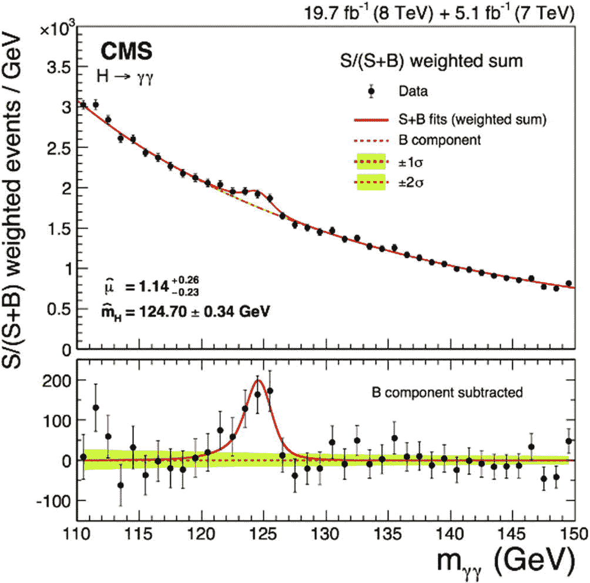

**图 1-14**  
大型强子对撞机的实验结果^(¹)显示在 125 吉电子伏特（GeV）附近有一个波峰。该波峰被认为是所谓的`上帝粒子`或`希格斯玻色子`。

`希格斯玻色子`的质量大约是电子的 2.4 x 10⁶倍，并且存在时间极短，约为 `10^(-22)` 秒。希格斯粒子是拼图的最后一块，它之所以重要有两个原因：

- 它负责宇宙中所有的质量。它解释了我们将粒子质量这一属性，理解为该粒子场与`希格斯场`相互作用的表现。希格斯场让我们清晰地理解了质量的含义。
- 它是拼图的最后一块：自 20 世纪 70 年代以来，`标准模型`在理论和实验层面描述原子尺度的自然界方面取得了难以置信的成功。物理学家们从 20 世纪 70 年代起就一直追寻`上帝粒子`，最终于 2015 年找到了它；但这是借助了有史以来最昂贵的科学仪器才得以实现的：一条 27 公里长的超导环和 46 米长的探测器，估计耗资 44 亿美元。

## 标准模型与物理学的超级方程

目前由`标准模型`描述的物理学理解，为我们提供了一个被称为`几乎万物的理论`的`主方程`。这是一个描述宇宙及其万物行为的方程（见图 1-15）。

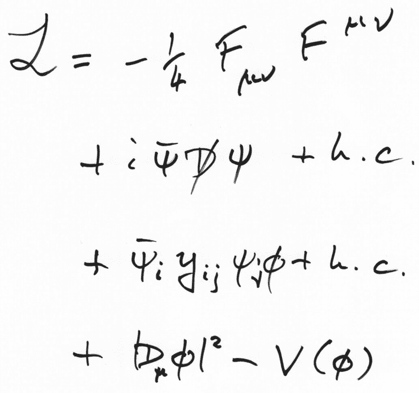

**图 1-15**  
展示在欧洲核子研究中心咖啡杯上的物理标准模型拉格朗日量（图像致谢^(²)）

这个所谓的几乎万物的方程被称为`拉格朗日量`，或一个用于确定变化系统状态及其能维持的最大可能能量的方程。这个超级方程囊括了我们目前所见的一切：从法拉第的`电磁场`、12 种粒子场、4 种自然力场，到`希格斯场`：

- 第一行描述自然力：`电磁力`以及`强核力`和`弱核力`。
- 第二行描述这些力如何作用于物质的基本粒子，即夸克和轻子。
- 第三行描述这些粒子如何从`希格斯玻色子`获得质量。
- 最后一行使`希格斯玻色子`能够发挥其作用。

对于普通人来说，这看起来像是天书，但这个方程正确地预测了科学上每一项实验的结果。它是物理学还原论方法的巅峰。一项令人惊叹的成就，也是我们当前知识的极限——迄今为止我们能做到的最好水平。

## 追寻未解之谜

在科学的宇宙游戏中，每当你解开一个谜团，另一个更神秘的谜团就会浮现。`标准模型`超方程或许能解释原子尺度上的一切现象；然而，当我们仰望星空时，有些事情仍然无法解释：

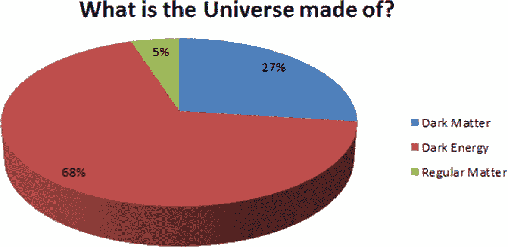

**图 1-16**  
两大神秘之物：`暗物质`和`暗能量`构成了整个可见宇宙的 95%

- 在研究星系的运动以及将它们聚合在一起的引力时，天文学家发现了一个矛盾之处。根据星系所包含的物质总量，它们远离的速度本应比观测到的快得多，但有什么东西在牵制着它们，一种看不见的东西（它在仪器上不显示，也不与光相互作用）：`暗物质`。注意，“暗”这个名字并不意味着这种物质实际上是黑暗的，而是我们根本不知道它是什么。
- `暗物质`可能无法直接观测到，但其引力效应可以被精确测量，它包围着所有星系（约占所有质能的 27%——见图 1-16）。此外，还有一种更神秘的东西叫做`暗能量`。它被认为是导致宇宙加速膨胀的“罪魁祸首”。1998 年，天文学家利用超新星的光来计算宇宙的膨胀率；他们的发现令人震惊：宇宙实际上正在加速，而它的最终命运是一个热议的话题。有人说它会以超过光速的速度撕裂自身（大撕裂），有人说它会瓦解成孤立的稳定粒子，如电子和中微子，所有复杂结构都会消散（热寂），还有人说它最终会停止，引力将占据上风，导致一场大坍缩。总而言之，`暗能量`占据了宇宙总质能中令人难以置信的 68%（见图 1-16）。
- 暴胀：关于宇宙早期生命的又一个谜团。暴胀是利用宇宙背景辐射（CBR）发现的早期宇宙的快速膨胀阶段，它被认为是星系、恒星、行星以及最终我们人类以现有方式存在的原因。我们知道它发生过，但`标准模型`方程无法解释它。

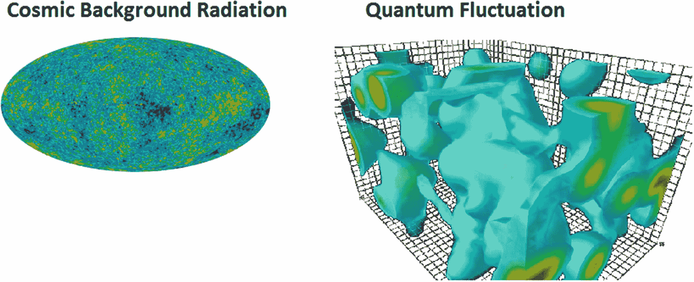

**图 1-17**  
威尔金森微波各向异性探测器（WMAP）拍摄的 CBR 图像（左图）；空间真空量子涨落的 3D 模拟图（右图）

在图 1-17 中，我们看到一张由 NASA 的 WMAP 仪器拍摄的图像，它描绘了大爆炸后一瞬间早期宇宙的快照。红色、黄色、绿色和蓝色区域表示温度变化，平均温度为 2.72 开尔文（-273.15 摄氏度）。CBR 本质上是宇宙大爆炸产生的火球的图像，而温度变化（图像中颜色的闪烁）被认为是由真空的量子涨落引起的（图 1-17 右侧）。其原因在于量子场的存在；尽管在早期宇宙中粒子并不存在，但量子场和量子涨落无处不在，而这些涨落被认为是 CBR 中颜色闪烁的原因。由于暴胀发生得非常快，它恰好捕捉到了这些涨落，并将其拉伸到整个天空。因此，图 1-17 右侧的量子涨落就是左侧 CBR 中颜色的波纹。事实上，天文学家已经进行了计算，并确定量子涨落发生在大爆炸后大约`10^(-20)`秒，而现在它们已经被拉伸了 140 亿年，遍布整个宇宙。星系、恒星以及我们所见的一切，都归功于大爆炸时量子场及其涨落的存在。这是量子场论的又一项伟大胜利。

然而，仍然存在未解之谜：例如，CBR 快照中描绘的是什么场？一些人认为是`希格斯场`，但另一些人说它不是希格斯场，而是某种新场；事实是我们不知道。

## 暗能量将决定宇宙的最终命运

根据 CBR 提供的信息以及`暗能量`导致宇宙加速膨胀的发现，宇宙的命运已被推至宇宙学未解之谜清单的首位。为此，天文学家创建了`状态方程（w）`。`w = p / ρ`，其中`p`是暗能量施加在宇宙上的压力，`ρ`（希腊字母 Rho）是（此处的）暗能量的能量密度。`w`的值将成为世界末日的最高仲裁者：

- `w < -1` 的值表示宇宙在加速，以越来越快的速度膨胀。这种膨胀将不受阻碍地持续下去，直到超过光速，甚至克服将原子结合在一起的`强核力`和`弱核力`。一切都会以超过光速的速度撕裂自身，甚至夸克也不例外，直至什么都不剩。此假说由达特茅斯学院的罗伯特·R·考德威尔提出，他估计如果`w = -1.5`，大撕裂将在 220 亿年后发生。如果宇宙注定灭亡，那就让它轰轰烈烈地结束吧（与其他结局相比）。

# 物理学进展与量子力学基础

- `w = -1` 的值表明暗能量是一个正的宇宙学常数，宇宙将继续永远膨胀下去，预计会发生热寂。热寂假说源自开尔文勋爵的热理论以及热力学第一和第二定律在宇宙尺度上的推演。

- `w > -1` 的值则表示大坍缩，即宇宙的膨胀最终会逆转，并最终重新坍缩成一个奇点（一个密度无限大的点），随后可能跟随着另一次宇宙大爆炸。如果你愿意，可以称之为永恒的宇宙大爆炸循环；然而，绝大多数证据表明这个理论是不正确的。相反，天文观测显示宇宙的膨胀正在加速，而不是被引力减速。

以上是我们为了超越标准模型推进物理学发展、揭示下一条自然法则而需要理解的一些东西；不过，按照事物发展的规律，当我们最终弄清楚暗物质-暗能量由什么构成时，又会有更奇怪的东西冒出来。尽管如此，仔细研究 `CBR` 是未来最大的希望。

## 超越标准模型

1900 年，开尔文勋爵站在英国科学界面前宣称：“`物理学中已再无新物可发现。`”他大错特错了。20 世纪 30 年代，马克斯·普朗克横空出世，用量子力学颠覆了整个物理学界。爱因斯坦、泡利、狄拉克、玻恩、海森堡、薛定谔以及许多其他人紧随其后，开创了物理学的黄金时代。这一趋势在 20 世纪 50 年代和 60 年代随着量子场论先驱们的出现而延续，此后还有更多：暴胀、暗物质、暗能量、弦理论、圈量子引力等等。我们的宇宙充满了谜团，物理学家们已经在期待下一次革命了。有许多仪器正在为此努力，但最强大的无疑是大型强子对撞机（`LHC`）。

## LHC 强势回归

`LHC` 是实验物理学家的圣地，也是发现自然新定律的场所。2012 年，`LHC` 发现了希格斯玻色子，随后停机两年进行升级，并于 2015 年以发现希格斯玻色子时两倍的能量吞吐量重新启动。这台经过改良的新型 `LHC` 有两大目标：（1）更深入地了解希格斯粒子；（2）发现标准模型之外的新物理现象。物理学家对此寄予厚望与期待。以下是其中一些展望：

- 标准模型方程的内在结构中隐藏着一个巨大谜团，当人们注意到电磁力与弱核力、强核力的方程之间存在相似性时，这个谜团便浮现出来。换句话说，这三种力看起来相似，因此我们不禁要问：现实中它们是否只是同一种超级力的不同表现形式？或许自然界只有一种力，我们所体验到的三种力，实则是从不同角度观察同一事物所得的结果。

- 对 12 种物质场（电子、中微子和夸克）的计算都基于同一个方程：著名的狄拉克方程。因此，同样地，自然界中或许并没有 12 种物质场，而只有一个统一的场，我们看到 12 种不同表现，是因为我们从不同角度观察同一事物。

### 大统一与超对称：物理学的圣杯

上一节中的观点被称为“大统一理论”。该理论认为电磁力、弱核力和强核力是同一种超级力。然而，还有另一种可能性：由于物质和力都由量子场描述，物理学家们一直思考是否存在某种方式让物质与力相互关联；针对这一点的理论被称为“超对称理论”。此外，还有一种离奇的理论提出：我们只需消除标准模型方程中的所有独立项，将它们合并成一个单一的项，引力、核力、粒子和希格斯玻色子等一切都会从中涌现。——这正是“弦理论”追寻的目标。

> **提示**
>
> 这些理念驱动了理论物理学界过去 30 年的发展，也是 `LHC` 力图实现的目标。目前还没有实验方法能检验弦理论；然而，大统一理论和超对称理论未来可能近在 `LHC` 的掌握之中。总而言之，建造 `LHC` 的初衷是寻找希格斯玻色子，但既然任务已达成，物理学家们认为现在是时候将 `LHC` 的炮口指向大统一理论和超对称理论了。

### 前方的阴霾与沮丧

自 2015 年升级后的 `LHC` 开始运行以来，为了寻找大统一理论和超对称理论，结果却令人失望：什么也没有观察到。物理学界对此感到震惊，且对于目前的情况尚无共识。尽管如此，以下是他们的一些回应：

- 保持耐心：我们还需要一点时间；如果今年什么都没观察到，也许未来会有发现。但最终，专家们一致认为，如果 `LHC` 在未来几年内依然一无所获，那么它发现任何东西的可能性就微乎其微了。

- 我们走在正确的道路上，但真正需要的是更大的机器来发现新物理。总的来说，`LHC` 造价 44 亿美元，而更大型的、用于揭示大统一理论的机器预计耗资约 100 亿美元。世界上没有多少政府愿意为此买单来探索这些理念。

- 第三种回应更为推测性，并未得到许多专家的支持。尽管物理学家知道标准模型方程是正确的，但有些人认为其中仍隐藏着未解之谜。因此，方程中关于大统一理论的线索可能只是“红色鲱鱼”（误导性线索），我们需要回到原点，更好地理解它。这个想法挑战了过去 30 年的假设和范式。

### 当我们错了，进步才开始

也许 `LHC` 缺乏实验结果恰恰是我们需要回归基础的契机；有时我们需要后退一步，才能前进两步。一些物理学家因这种“无结果”而充满活力，因为正是在十字路口，新想法才会涌现。例如，标准模型方程与凝聚态物理学（研究材料运行原理的科学）、量子信息科学（追求量子计算机的科学）等其他科学领域之间，已经建立起了联系。

总而言之，物理学家们持乐观态度，认为我们能够取得进展——尽管不是以我们原本期望的方式，但进步依然在发生。标准模型方程目前或许仍是王者，但希望在于，我们能够提出更好的理论。

## 练习题

通过以下轻松练习，检验你对基础量子力学的掌握情况。如果卡住，附录中提供了参考答案。

1.  填空。著名物理学家 _____ 在 _____ 时说过：物理学中已无任何东西可待发现。

2.  哪位德国物理学家被认为是量子力学之父？他在取得开创性发现时正在研究什么问题？

3.  编写一个小程序，根据瑞利-金斯定律（公式 1.1）绘制黑体光谱辐射作为波长 `λ`（lambda）和温度 `T`（开尔文度，`K`）函数的紫外灾难实验数据，并将其与修正后的普朗克曲线（公式 1.2）进行对比。

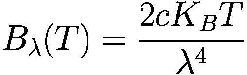

(1.1)

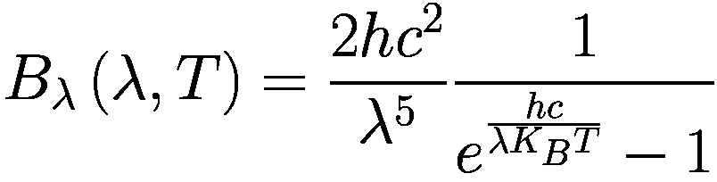

(1.2)

使用 `c` = 光速（`299792458` m/s），`K[B]` = 玻尔兹曼常数 = `1.38064852 × 10⁻²³ m² kg s⁻² K⁻¹`，温度 `T` 分别取 `3000`、`4000` 和 `5000` K。

4.  简要描述光电效应实验。光电效应对光的本质有何启示？

5.  谁因对光电效应的新见解而获得诺贝尔奖？在此新见解之前的旧观念是什么？实验中实际观察到了什么？

6.  判断正误。

    1.  哥本哈根诠释是第一个量子力学诠释，起源于 20 世纪 30 年代。

    2.  能量并非以连续形式传播，而是以称为量子的离散能量包形式传播的概念是由伯纳德·海森堡提出的。

    3.  尼尔斯·玻尔并非量子跃迁之父。

    4.  卢瑟福原子模型是 19 世纪初对原子结构完美无瑕的描述。

    5.  阿尔伯特·爱因斯坦在谈到玻尔原子模型（量子跃迁）时说：“如果我要接受量子跃迁，那我后悔涉足原子研究领域了”。

    6.  波函数 `ѱ` 之父是埃尔温·薛定谔。

    7.  波函数现在被认为是上世纪物理学中最强大的工具。

    8.  德裔犹太物理学家马克斯·玻恩对波函数的描述试图回归到连续的经典波动模型。

    9.  薛定谔推崇一个理念，即所有现实都可以完全由波及其波函数 `ѱ` 来描述。

    10. 马克斯·玻恩提出了量子猫思想实验来挑战薛定谔。

7.  多选题：以下哪些是有效的量子力学诠释？

    1.  星门诠释

    2.  多世界诠释

    3.  提华纳平原诠释

    4.  嘎吱船长诠释

    5.  量子信息诠释

    6.  哥本哈根诠释

    7.  量子猫挠量子狗诠释

8.  不确定性原理关于粒子的位置和动量说了什么？

9.  判断正误。不确定性原理催生了零点能的概念。

10. 零点能关于绝对零度说了什么？

11. 用一句话定义泡利不相容原理。

12. 多选题：关于泡利不相容原理，以下哪项是正确的？

    1.  量子猫利用不相容原理逃出了盒子。

    2.  泡利引入了一个新的双值量子数，后来被称为量子自旋。

    3.  不相容原理后来被推广到标准模型中的所有粒子。

    4.  玻色子（光子、胶子、力载体）不遵从不相容原理。

    5.  量子狗不遵从不相容原理。

    6.  费米子（电子、夸克、中微子）遵从不相容原理。

13. 狄拉克方程试图解决什么问题？

14. 用一句话回答：什么是狄拉克方程？

15. 关于狄拉克方程，以下哪项是正确的？

    1.  它预言了反物质的存在。

    2.  它将相对论时空引入到量子力学语境中。

    3.  它遵循泡利不相容原理。

    4.  它违反了不确定性原理。

    5.  它使用带有时空坐标 `(x, t)` 的双分量波函数。

    6.  狄拉克方程只有正能量解。

16. 填空。在狄拉克“空穴”理论中，______ 中的空穴需要 ______ 能量才能产生一个粒子-空穴对。后来证实这些空穴就是 ______，由美国物理学家卡尔·安德森于 1932 年通过实验发现。

17. 用简单的术语定义粒子纠缠。


15.  哪位著名物理学家称纠缠为`鬼魅般的超距作用`？它为何如此诡异？我们可以用纠缠粒子发送短信吗？如果可以，为什么？

16.  简要描述贝尔定理。它为什么重要？

17.  多选题：选出关于贝尔定理的正确表述：

    1.  它击败了量子力学。

2.  法国物理学家阿兰·阿斯佩通过实验证明量子力学违反了贝尔不等式。

3.  它证明了粒子的属性是在观测时刻才被确定的。

4.  爱因斯坦认为纠缠是神来之笔，并提出了 EPR 悖论以示庆祝。

18.  填空：双缝实验展示了粒子的 _____ 二象性，当激光束穿过带有两条紧挨着的狭缝的金属板时，结果投射在探测器屏幕上。如果将测量装置放置在屏幕上，产生的干涉图案显示为 _____。如果将测量装置放置在狭缝处，干涉图案则显示为 _____。这表明量子系统从根本上说是 _____（没有确切答案），其惊人含义是：属性是在 _____ 时刻而非创生时刻被确定的。

19.  哥本哈根诠释和多世界诠释之间有哪些区别？

20.  用简单的术语描述除哥本哈根和多世界诠释之外的另外两种量子力学诠释。

21.  填空。在量子场论（QFT）中，场遍布整个 _____，标准模型中的粒子仅仅是其各自场中的 _____。场之间可以相互 _____。

22.  法拉第是哪种场之父？他最初为此场起的名字是什么？

23.  量子场论中定义标准模型所有粒子的四个基本粒子场是什么？自然界中的四种力场是什么？

24.  在量子场论中，电子的两个伙伴是什么？为什么说电子场被复制了两次？

25.  中微子、上夸克和下夸克在量子场论中的伙伴分别是什么？

26.  为什么希格斯场被称为“上帝粒子”？它是在什么仪器中被发现的？能量水平是多少？

27.  什么是标准模型的拉格朗日量？它为什么重要？

* 提示 1：图的 x 轴是波长 `λ`。y 轴是光谱辐射 `B[λ]`。

* 提示 2：最快的方法是使用开源软件 `GNUPlot`；同时将图保存为 `JPEG` 图像。

脚注 1 2

