# 3. 看，量子比特革命
量子计算机的核心是`量子比特`，它被设计为经典`比特`的模拟物，而经典比特是所有电子产品中决定性的核心组件。比特是利用晶体管物理构建的。晶体管非常微小，大约只有 15 纳米（nm），其中`1 nm = 10^(-12)米`；相比之下，量子比特则很大——有数米高。在本章中，我们将探讨该领域的先驱 IT 公司所设计的`量子比特`的基本架构。
你还将了解到，尽管量子比特大多处于实验阶段且难以构建，但这并不意味着无法利用一些光学工具和独创性来构建它。即使简陋且原始，也可以使用折射晶体、光子发射器和较低的预算来构建一个量子门。本章还将探讨超导环作为构建量子比特的主要方法，以及其他流行的设计及其相互关系。在尺寸、成本和性能方面，每种特定设计都有其自身的优点和注意事项。那么，我们开始吧。
## 你身边的量子计算机
在过去的几十年里，量子计算机从理论领域跃入了实验领域。而且，尽管普通人买不起价值 1500 万美元的、拥有 2000 个量子比特的闪亮`D-Wave`系统，但信不信由你，利用一些光学知识和扎实的物理学基础，可以构建一个非常原始的量子门。在本节中，我们将进行实验性的尝试，构建一个虽然简陋但有效的量子门，它能够纠缠光子以产生一个受控-Z（CZ）门。这个门是最难构建的，并且展示了叠加的量子特性。但在我们查看构建此门所需的硬件之前，先来看看它背后的理论。
在 20 世纪初量子力学的黄金时代，伟大的奥地利物理学家沃尔夫冈·泡利（1900–1958）因其在`不相容原理`上的卓越研究而获得了诺贝尔奖。简单来说，这个原理指出：`没有两个粒子能同时占据同一个量子态`。对于不熟悉原子物理的人来说，这听起来可能没什么大不了的，但这却是泡利的天才之举。事实上，爱因斯坦在代表泡利写给诺贝尔委员会的建议信中写道：`因其在发现自然新定律方面的科学研究`。
泡利不相容原理解释了重元素中电子态的稳定性，一些物理学家认为，正是泡利原理导致了普通物质稳定并占据体积。这项卓越研究的成果是泡利自旋矩阵（X, Y, Z），通常用希腊字母西格玛（σ）表示如下：
![$$ {\sigma}_x=\left[\begin{array}{cc}0&amp; 1\\ {}1&amp; 0\end{array}\right]\ {\sigma}_y=\left[\begin{array}{cc}0&amp; -i\\ {}i&amp; 0\end{array}\right]\ {\sigma}_z=\left[\begin{array}{cc}1&amp; 0\\ {}0&amp; -1\end{array}\right] $$](images/469026_2_En_3_Chapter/469026_2_En_3_Chapter_TeX_Equa.png)
泡利矩阵是 2x2 的复数矩阵，其中(i)表示虚数 `$$ \sqrt{-1} $$`。
> **提示** 在量子力学中，泡利矩阵用于描述粒子在与外部电磁场相互作用时的自旋。
反过来，泡利门可以用于构建更复杂的门。例如，这里有一个使用`Z 门`的 2 量子比特受控门。这个门更强大，并且能够实现叠加和纠缠（见图 3-1）。
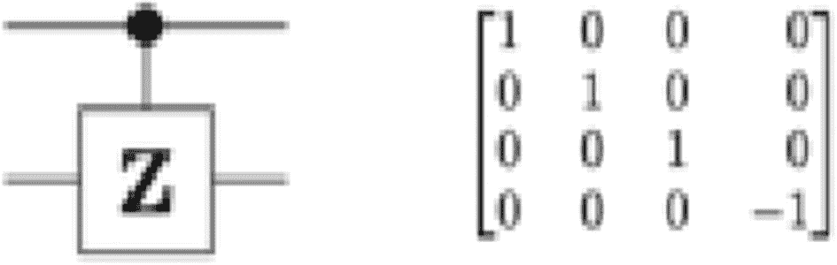
左侧是交叉点处为 z 的示意图。右侧是一个 4×4 的矩阵。第一行为 1, 0, 0, 0，第二行为 0, 1, 0, 0，第三行为 0, 0, 1, 0，第四行为 0, 0, 0, -1。
**图 3-1** 以示意图和矩阵模式展示的受控 Z 门 (CZ)。请注意，所有量子门都有对应的矩阵表示形式
在图 3-1 中，水平线代表量子比特。黑点称为控制端，它作用于第二个量子比特，仅在第一个量子比特为`|1>`时执行`Z`操作，否则保持其不变。
> **提示** 在量子力学中，所有门都使用矩阵和列向量或态矢`|0>`、`|1>`来描述（更多内容见下一章）。正是矩阵的丰富表示形式，使量子计算相比经典计算获得了性能提升。
表 3-1 详细列出了可用于构建简易(CZ)量子门的硬件组件及其预估成本。这些组件在当地的无线电设备商店可能找不到，但可以在 eBay 上以便宜的价格购得，也可以从任何光学制造商那里购买。
**表 3-1** 构建光子 CZ 量子门所需的硬件
| 项目 | 数量 | 描述 | 预估成本（美元） |
| --- | --- | --- | --- |
| `USHIO EXCIMER PHOTON SOURCE UER20H`、`UER 20 H - 126 VA`、`USHIO EH0019` | 2 | 单光子源 | 800 |
| `USHIO EXCIMER Photon Source Power Supply B0083` | 1 | 光子源电源 | 1350 |
| 部分偏振分束器（`PPBS`） | 3 | 一种将光束一分为二的光学器件 | 20 |
我们来更详细地看看这些项目：
- **单光子源**：这是一种发射单个光子粒子的光源。每个光源代表`CZ`门的一个输入量子比特。
- **电源**：如果能将光子源直接插入交流电源插座，那就太好了；然而，这并不可行；我们需要一个昂贵的定制电源。在这里，我使用的是来自 eBay 上日本光学制造商`USHIO`的一款设备。
- **部分偏振分束器（`PPBS`）**：这本质上是一种具有两种特定特性的晶体，非常适合研究量子力学效应：
    - 它能把一束光分成两束。
    - 它起到滤光片的作用，只让特定偏振方向的光波通过，同时阻挡其他偏振方向的光波。
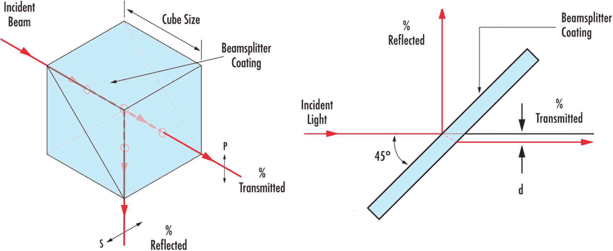
左侧是一个带有标注部件的立方体示意图，标注包括：立方体尺寸、分束镀膜、透射光、反射光和入射光。右侧是一个倾斜 45 度的条状物，标注包括：分束器镀膜、透射光、入射光以及反射百分比。
**图 3-2** — 偏振分束器类型
分束晶体有两种形式：
1. **由两个直角棱镜构成的立方体**：其中一个棱镜的斜面镀有膜层，两个棱镜粘合在一起形成一个立方体（见图 3-2 左侧）。这种型号的优点是消除了光束偏移，反射和透射光路长度相等。然而，其厚重的实心玻璃结构使得制造大尺寸产品更加困难且昂贵。
2. **线性平板**：由一块薄而平的玻璃板构成，在其基板的第一表面镀膜。它们重量轻、相对便宜，且易于制造大尺寸产品。但其反射和透射光路长度不同，并会导致透射光产生光束偏移（见图 3-2 右侧）。
> **提示** 使用光学元件构建量子门的方法由 T Nagata 等人在《新物理学杂志》中描述。^(³) 事实上，我们的实验装置旨在以更低的成本复现 Nagata 的实验。
借助表 3-1 中的硬件，我们可以复现 Nagata 在利用光学元件构建量子`CZ`门方面的开创性工作。其实验装置如图 3-3 所示。
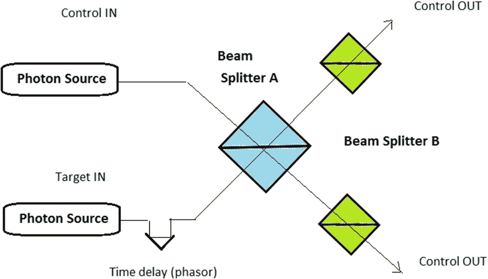
示意图从控制输入和目标输入光子源开始，进入分束器 a，然后在分束器 b 处分流到两个控制输出端。
**图 3-3** — 由 Nagata 及其同事描述的使用光学元件构建的`CZ`门
图 3-3 中的实验装置使用了：
- 两个光子源，分别代表门的控制量子比特和目标量子比特。
- 两个光子必须同时进入部分偏振分束器（`PPBS-A`）。分束器 A 对水平偏振光（H）的反射率为 1/3，对垂直偏振光（V）的反射率为 1。当光子撞击分束器时，**仅对于水平偏振**（H）光子会产生一种量子力学效应（*双光子量子干涉*）。
- 在门的输出端，我们统计单个光子同时发射到两种输出模式（控制端和目标端）的情况。
双光子干涉与后选择的结合只会翻转输入态中两个输入光子均为水平偏振时的相位或符号，即`<H,H>`变为`<-H, -H>`。
> **提示** 控制-Z 门的特性是，除了`<H,H>`映射为`<-H,-H>`之外，它对所有输入对不起作用。这需要状态的叠加和纠缠。
此外，该操作还会削弱水平偏振光子的概率幅，同时保持垂直偏振光子的概率幅。为了补偿 H 和 V 偏振光子概率幅的这种削弱，在`PPBS-A`的输出端引入了两个额外的分束器（`PPBS-B`）。这样，该门便作为一个适用于水平和垂直基态的`CZ`门工作，成功概率为 1/9。
> **提示** 根据 Nagata 及其同事的研究，我们这种光子`CZ`门的成功概率为 1/9。这确实很低。这意味着 89% 的情况下我们会得到错误结果（8/9 *100）。你能看出他们是怎样得出 1/9 这个值的吗？请记住，分束器对水平偏振光（H）的反射率是 1/3，而我们有两个量子比特：控制位和目标位。因此，`P = 1/3² = 1/9`。
光子`CZ`门的高错误概率很可能是光学量子门未能普及的原因之一，量子计算领域的大多数主要参与方都选择了超导环。正如我们将在本章后面看到的，由粒子与外部环境相互作用引入的错误是量子计算的主要头疼问题，也是当前大多数研究的方向。我们正处于嘈杂中等规模量子（`NISQ`）计算机时代。事实上，Nagata 在这项实验中的大部分工作都集中在降低分束器产生的错误率上，但现在让我们更仔细地看看这个门的核心量子效应：双光子量子干涉。
### 双光子量子干涉

也称为洪-欧-曼德尔效应，由物理学家钟基·洪、欧哲宇和伦纳德·曼德尔于 1987 年在罗切斯特大学首次演示。该效应发生在两个相同的单光子入射到 1:1 分束器上时。这里的`1:1`意味着光子被反射或被透射的概率各为 50%。在理想条件下，满足以下规律：
- 当光子的时间重叠完美（即它们同时击中分束器）时，两个光子将始终从同一输出模式共同离开分束器。
- 如果光子的可区分性增加，它们前往不同探测器的概率也会增加。
- 干涉仪是一种将两束或多束光源合并以产生可测量和分析的干涉图样的仪器，可用于精确测量带宽、光路长度和时间。

> **提示**
>
> 双光子干涉依赖于光子的存在，无法用经典光学完全解释。该效应为线性光学量子计算中的逻辑门提供了底层物理机制。

因此，当光子同时击中分束器时，它们可能被反射或透射，共有四种可能性，如图 3-4 和表 3-2 所示。

**表 3-2** 双光子干涉的可能结果

|   | 上端 | 下端 |
|---|---|---|
| 1 | 反射 | 透射 |
| 2 | 透射 | 透射 |
| 3 | 反射 | 反射 |
| 4 | 透射 | 反射 |

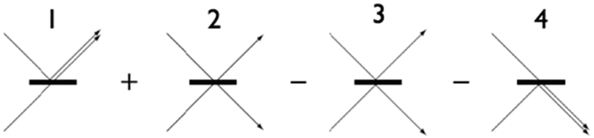
> *一个方程：传输向上加上反射，减去反射再减去传输向下。*
>
> **图 3-4** 双光子干涉中的反射/透射可能性

> **注意**
>
> 在物理学中，所谓的费曼规则指出：由于分束器不记录光子的状态（即不是测量设备），我们必须将所有可能的状态（路径）相加来计算其概率幅。在量子力学中，该值的模方代表了特定结果出现的概率。

此外，
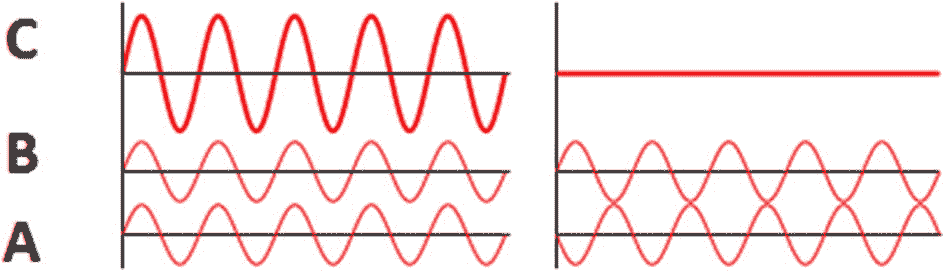
> *两个包含波 a、b、c 的示意图。在第一个示意图中，波 a 和 b 相等，波 c 则大于 a 和 b。在第二个示意图中，波 a 和 b 的波峰与波谷相互接触，波 c 为一水平直线。*
>
> **图 3-5** 波动力学中的干涉。将波 A 和波 B 相加，得到相长干涉（左图）或相互抵消（右图，相消干涉）

- 从分束器底面反射会引入π的相对相位偏移，相当于在叠加态的对应项中引入因子 −1（这意味着选项 3 和 4 必须从概率幅中减去）。注意，这是由分束器量子态的*可逆性*所要求的。
- 由于两个光子完全相同，我们无法区分可能性 2 和 3 的输出状态；因此，选项 3 的负号确保了这两项相互抵消。在波动力学中，这被称为*相消干涉*（见图 3-5 右侧）。

> **提示**
>
> 量子力学断言，一个量子系统的状态由*一个概率幅向量*描述，其中所有可能性的总和必须为 1。这一思想由德国物理学家马克斯·玻恩（1882–1970）提出，他在量子力学早期发展中发挥了关键作用。根据玻恩的解释，任何量子态的变换都必须保持状态向量的长度。这意味着量子态之间的线性变换必须是幺正且可逆的（所有状态都由具有复数系数的概率描述，并且必须加起来等于 1）。

### 光子干涉背后的数学原理

为了理解双光子干涉背后的机制，量子力学依赖于湮灭算符和产生算符。这些算符利用代数方法为量子谐振子问题提供了解决方案，并广泛应用于多粒子系统和光子的研究：
- *产生*算符 `â†` (`a-hat-dagger`)：*使给定状态中的粒子数增加一个*，它是*湮灭*算符 `â` 的逆操作，后者使粒子数减少一个。
- 考虑两个光学模式（每个光子对应一个）`a` 和 `b`，及其相应的产生/湮灭算符：`â†`, `â` and `b̂†`, `b̂`。

给定一个用狄拉克括号记法描述的单光子态 `|1⟩`，那么这两个光子的状态可以用上述算符描述为
`↠b̂† |0,0⟩ₐᵦ = |1,1⟩ₐᵦ`
也就是说，将产生算符作用于光学模式 `(a, b)` 的基础光子态，即可得到其当前状态。现在，当两个光子从分束器两侧同时入射时，光学模式 `(a, b)` 经历幺正变换变为 `(c, d)`，相应的产生和湮灭算符也随之变换：
`↠→ (ĉ† + d̂†)/√2` and `b̂† → (ĉ† - d̂†)/√2`
第二个算符中的负号源自以矩阵形式执行的幺正变换：`(â, b̂)ᵀ = (1/√2) [[1, 1], [1, -1]] (ĉ, d̂)ᵀ`

最后，这两个光子的状态如图 3-6 所示。
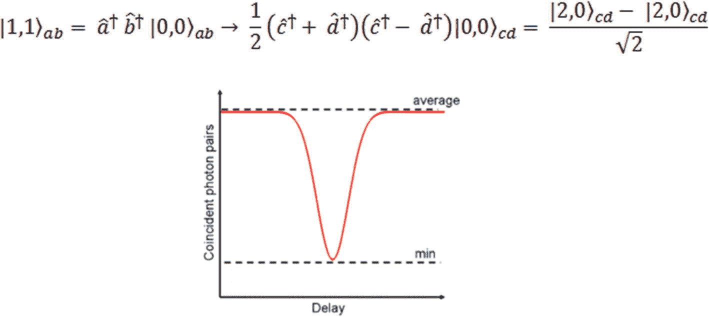
> *一张重合光子对数量与延迟时间的折线图。线条平均趋势呈水平，下降至最小值，回升，然后再次水平。图表上方展示了两个光子的状态方程。*
>
> **图 3-6** 两个光子进入分束器时的状态及其实验特征

在实验上，可以通过监测分束器输出模式 `(a, b)` 的两个光电探测器来观察双光子干涉：当光子同时击中分束器时，探测器的符合计数率将降至零。这便产生了所谓的洪-欧-曼德尔凹陷。注意，当两个光子在所有属性上完全相同时，符合计数达到零（图 3-6 底部）。

> **提示**
>
> *括号记法* `∣1, 1⟩` 是量子力学数学描述的基础，由伟大的英国物理学家保罗·狄拉克提出。一个*右矢*本质上是系统状态 `(s1, s2, …, sn)` 的*向量*，表示为 `∣s1, s1, .., sn⟩`。注意，右矢内部放置的是标签：符号、字母、数字甚至单词。例如，量子比特的基础态用右矢 `∣0⟩`、`∣1⟩` 表示，其中 0、1 是标签（而非数字 0、1）——这是一个不幸且令人困惑的巧合。此外，由于右矢是向量，它们遵循线性代数的常规法则。例如，`∣A⟩ = ∣B⟩ + ∣C⟩`。

### 控制-Z 门的输出状态

在 Nagata 的门控中，当两个光子进入分束器-A 时，量子干涉开始发挥作用。然后，通过使用输入模式（`a`，`b`）的产生/湮灭算符，酉变换 `U[A]` 变为
`(â†, b̂†)ᵀ = U_A (â, b̂)ᵀ = [[√R, i√(1-R)], [i√(1-R), √R]] (â, b̂)ᵀ`
其中 `R` 是分束器的反射率，`i` 是虚数单位。相比之下，当考虑到垂直（`V`）和水平（`H`）偏振时（图 3-7 右侧），分束器-B 有四个输入模式。


其中 φ (Phi) 是水平偏振光与垂直偏振光之间的相位差。在理想情况下，PPBS-A 的参数为 `RH = 1/3`，`RV = 1`，`φ = 0`，因此矩阵 `U[B]` 变为

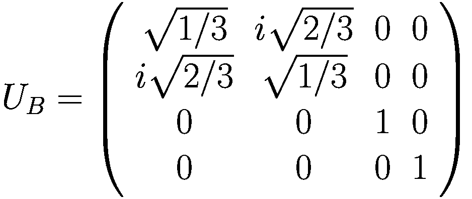

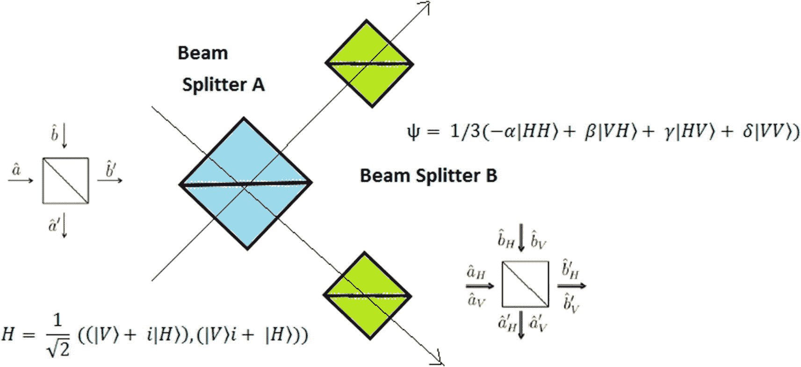

图示显示两束光通过分束器 a。一束向上，另一束向下。两个插图示出了 `a` 和 `b` 在分束器上的方向。给出了 psi 和 H 的方程。

**图 3-7** CZ 门的输出状态

- 分束器-A 使两个光子都处于叠加态。这也被称为 **Hadamard** 变换（量子计算中一种非常有用的变换/门）。此时，对于光子偏振（`H`，`V`）的系统状态为
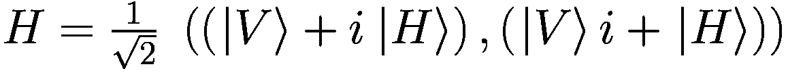。
- 当光子穿过分束器-B 时，对于垂直（`V`）和水平（`H`）偏振，引入了四个输入模式，系统的末态 (Psi) 为
```
ψ = 1/3(−α| HH⟩ + β| VH⟩ + γ| HV⟩ + δ| VV⟩)
```

末态 ѱ 是通过将酉变换 `U[B]` 应用于光子偏振（`H`，`V`）的四个基态，并使用具有反射率理想值（`R[H] = 0`，`R[V] = 2/3`）的产生算符获得的。见表 3-3。

**表 3-3** CZ 门的末态

| 基态 | 结果状态 |
| :--- | :--- |
| `U[B] ∣ H, H ⟩ a, b` | 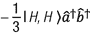 负三分之一向量 H, H, 单位向量 a, 单位向量 b。 |
| `U[B] ∣ H, V ⟩ a, b` | 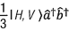 三分之一向量 H, V, 单位向量 a, 单位向量 b。 |
| `U[B] ∣ V, H ⟩ a, b` | 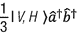 三分之一向量 V, H, 单位向量 a, 单位向量 b。 |
| `U[B] ∣ V, V ⟩ a, b` | 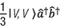 三分之一向量 V, V, 单位向量 a, 单位向量 b。 |

与其它量子比特设计（例如超导环路——其构建复杂且危险，需冷却至接近绝对零度）相比，使用线性光学构建量子门似乎更容易；其代价是错误率显著增加。尽管如此，构建高保真度量子门的竞赛仍在进行中。在门设计方面，一切皆有可能，谁将获胜尚无定论。

### 降低错误率

Nagata 及其同事在其研究中，通过对光子 CZ 门的错误源进行深入分析，以寻找降低错误率、实现高保真度的线索。他们确定了以下错误源：

- 光学双折射误差 *δφ*：双折射的正式定义是光在透明的、分子有序材料中的双重折射现象，表现为折射率存在方向依赖性差异。所有透明固体，如玻璃、晶体聚合物，甚至食盐，都会产生光学双折射。
- 模式失配误差 *δε*：该误差由每个光子的两个光学模式（`a`，`b`）及其产生/湮灭算符引入。
- 水平偏振光子的反射率误差 *δR*[*H*]：该值会影响测量的精度。
- 垂直偏振光子的反射率误差 *δR*[*V*]。

通过操作这四个错误源并结合一些潜在创新，研究人员已经探索了实现高保真度门的要求：

- 高反射率镜：这些是超高技术晶体，其透射率与损耗之和 (~1 − *R*) < 10^(−5)。它们能有效减少反射率误差和光学双折射。
- 使用光纤或波导的门，以最小化空间模式失配 *δε*。
- 具有较小时间抖动的单光子源也可以最小化时间模式失配。

## 超导环路 vs. 线性光学

使用线性光学构建的门相对简单且制造成本低廉，但错误率较高。另一方面，超导环路门更复杂，需要接近绝对零度的温度。然而，它们的错误率比光子学门低得多。

在本节中，我们将探讨这些超导器件的内部工作原理。几年前，它们还只存在于理论物理学中，但现在，它们正缓慢而稳步地成为现实，并且很快将遍布数据中心。

### 超导回路

当电流通过导体时，部分能量会以热和光的形式损失。这被称为电阻，其大小取决于材料类型；像铜或金这类金属是优良的电导体，电阻很低。科学家发现，材料温度越低，其导电性能越好（温度越低，电阻越小）。问题在于，无论材料冷却到何种程度，它始终会表现出一定程度的电阻。

**注意**
1911 年，科学家发现，将汞冷却到 4.2 开尔文（接近绝对零度）时，其电阻变为零。这一顿悟时刻导致了超导体的发现，超导体是一种在极低温度下电阻为零的材料。

自那以后，人们发现了许多其他超导材料：铝、镓、铌等，它们在临界温度下表现出零电阻（见表 3-4）。超导体的伟大之处在于，电流在其中流动没有损耗，因此理论上，闭合回路中的电流可以永远流动下去。事实上，科学家们已经通过实验证明了这一原理，他们成功使电流在超导环中持续流动了数年。

**小贴士**
在一个由超导体回路构成的量子比特中，电流会围绕回路来回振荡。注入的微波会激发电流，使其进入叠加态。

**表 3-4** 常见超导体及其临界温度

| 材料 | 温度 (K) | 说明 |
| --- | --- | --- |
| 汞 | 4.2 | 1911 年由海克·卡末林·昂内斯发现的第一种超导体 |
| 铅 | 7 | 于 1941 年发现具有超导性 |
| 氮化铌 | 16 | 铌和氮的化合物（合金），常用于红外光探测器 |
| 铌钛合金 | 16 | 也称为 II 型超导体，常用于超导磁体的工业导线 |
| 由汞、钡、钙、铜和氧组成的陶瓷 | 133 | 这些被称为高温超导体，非常受欢迎，因为它们可以用更便宜的材料（如液氮）冷却，而无需使用更昂贵的液氦 |

### 走出实验室：IBM-Q 的量子比特设计

图 3-8 展示了 IBM-Q 平台^(⁴)使用超导回路的量子比特基本组件的缩略图，以及开尔文温度。该设计的一个重要组件是 `Qubit Signal Amplifier`（量子比特信号放大器）。

#### 量子比特信号放大器

这是一种用于读取量子比特信号的量子力学信号增强器。光放大器在通信和激光物理学中非常重要。例如，它们被广泛用作长距离光纤电缆中的中继器，用于传输数字电信信号。

**小贴士**

# 量子放大器有两个主要特性：其放大系数和其不确定性（噪声）。这两者密切相关：放大系数越高，噪声也越高。量子系统对环境噪声极其敏感。

为了让量子比特正常工作，我们需要能够实时高保真地读取其量子态。为此，可以使用一种特殊类型的信号放大器：量子极限放大器（`QLA`）。`QLA` 器件使用低噪声微波来探测量子比特的量子态，同时最大限度地减少环境噪声。然而，这种低噪声是有代价的：温度必须很低，非常低，比地球上甚至外太空的任何地方都要冷（仅比绝对零度高出几度）。在图 3-8 中，`QLA` 被用于两个位置：量子比特块顶部腔室（约 4K）和内腔室（超导回路所在处），温度仅为 10 毫开尔文（10mK）。

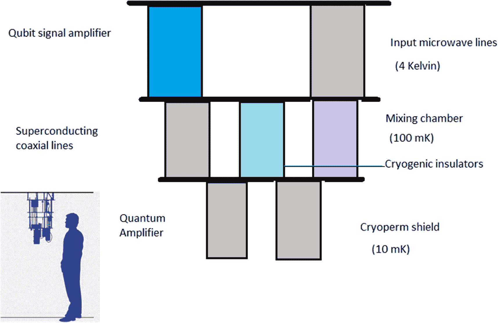

示意图分为三层，底部是量子放大器，中间是超导同轴线路，顶部是量子比特信号放大器。插图中是一个人站在量子比特设计旁。

**图 3-8** IBM-Q 使用的基本量子比特设计的草图

**注意**

为了达到这些超低温，量子比特块被封装在一个称为稀释制冷机的特殊圆柱形低温腔体中。该腔体具有 4K、100mK 和 10mK 三个温度层，微波信号通过输入和输出链路传输，旨在最大限度地减少量子比特暴露于噪声中。这些链路包括一些微波组件，例如微波和同轴线缆、低温绝缘体和屏蔽层。

## 微波与超导同轴线缆

这些是用于提高整体载流能力的超导电缆，广泛用于医疗、科学和航空航天行业的低温应用。它们之所以有用，是因为能够在相对较小的横截面上承载非常大的电流，且电损耗极小。当涉及到线路上的能量传输时，有四个重要参数需要考虑：电阻、电感、电容和电导。

*   电阻和电感合称为传输线阻抗。在处理超导回路时，这两者至关重要。

*   电容和电导合称为线路导纳。在这种特定情况下，这两者通过封装量子比特的真空腔室被消除。

**小贴士**

传输线中材料提供的电阻会随着线路电流的增加而增加；这被称为欧姆损耗（`I²Rloss`）。此外，长度为“l”、横截面积为“a”的导体的电阻“R”由公式 `R = ρ l / a` 给出，其中 (ρ) 是导体材料的恒定电阻率。

温度和电流频率是影响线路电阻的主要因素：重要的是要记住，导体的电阻随温度变化呈线性变化，而如果电流频率增加，导体表面的电流密度也会增加。另一方面，如果频率降低，电流趋向于流向导体的中心（电流流向表面的越多，流向中心的就越少，这一特性称为趋肤效应）。

这种频率变化引出了电感的概念（见图 3-9）。在交流传输线中，电流呈正弦波形流动。该电流会感应出一个垂直于电场的磁场，该磁场也呈正弦变化（这一效应称为法拉第定律）。

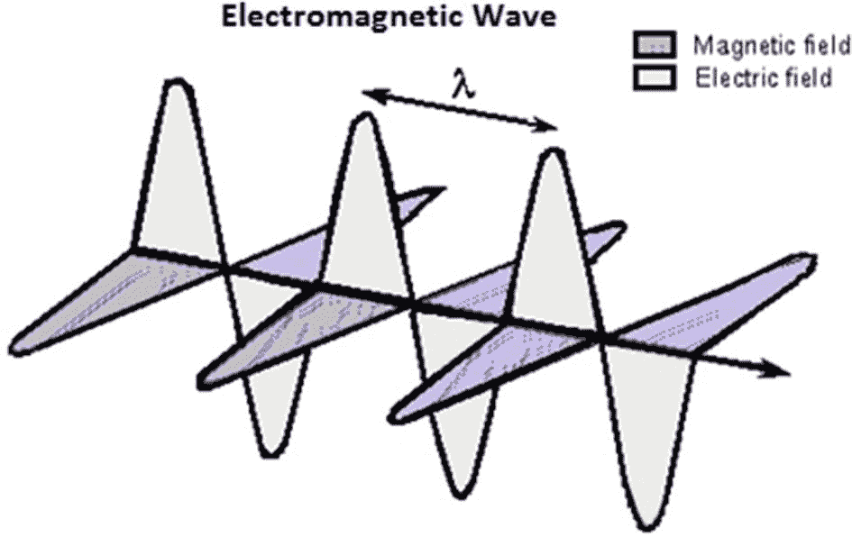

示意图展示了相互垂直的磁场和电场，以及电磁波波长 lambda。

**图 3-9** 传输线中的电感或电流流动

这个变化的磁场会在导体中感应出与初始电流方向相反的电动势（EMF）。这种反向的 EMF 流动由称为电感的参数来描述，它是阻碍电流变化的特性。

**注意**

超导体通过将温度降低到临界值，并使用特殊金属（汞和铅）或陶瓷合金（铌和钛），将电阻和电感几乎降至零。这种神奇的组合使得通过微小的导线以极小的损耗/热量传输高电压成为可能。

## 低温绝热材料与屏蔽层

它们的作用是在为低温容器和真空管道提供最佳的辐射能屏障的同时，实现热绝缘。换言之，它们防止有毒的液氮逸出。所有这些组件共同协作，以应对一个全局性的挑战：在最小噪声下读取量子比特状态，这项艰巨任务通常被称为*超导量子比特的读取问题*。

## 非破坏性读取量子比特量子态的方法

当前读取超导量子比特量子态的最佳方法是使用弱微波信号（约 7 GHz）探测其读取脉冲，即用少量微波光子探测信号。然而，在室温下，如果不显著提高其能量，这是不可行的，因为读取脉冲极其微弱（功率在 `10^(-16)` 瓦(W) 或更低量级；这会给放大后的输出增加可观的噪声。

**提示**

用于探测读取脉冲的设备称为*低噪声放大器 (LNA)*。这是一种最先进的、基于半导体的高增益、低噪声放大器，用于增强信号。LNA 本身不足以读取量子比特状态，因为它们增加的噪声大约是量子信号本身的 1000 倍（参见图 3-10 上方）。

IBM-Q 的工程师通过在放大链路中增加一个称为*量子极限放大器 (QLA)* 的器件作为第一级放大，解决了读取问题（参见图 3-10 下方）。

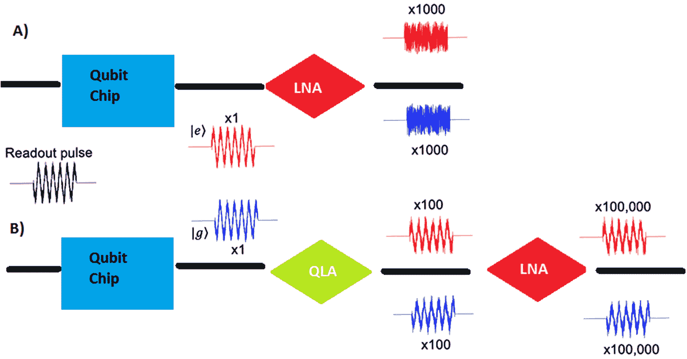

两个示意图。a，量子比特芯片连接到 L N A。b，量子比特芯片连接到 Q L A，再连接到 L N A。

**图 3-10** 使用 LNA 和 QLA 的量子比特信号放大链路，分别具有高信噪比（上方）和低信噪比（下方）

QLA 仅向输入信号添加量子力学所要求的最小噪声量（等于环境量子噪声或信号频率下的半个光子）。

**提示**

在理想情况下，QLA 输出端的信噪比仅降低两倍（因为增加的噪声与输入噪声相等）。QLA 之所以有效，是因为微波放大器链路的噪声性能主要由第一级放大级的噪声特性决定。

在图 3-10 中，一个读取脉冲进入量子芯片（超导环路）并以基态 `∣g⟩` 或激发态 `∣e⟩` 形式输出；为了探测信号，可以使用 LNA 或 QLA 构建一个放大链路。

- 仅使用 LNA 时，信号会被模糊 1000 倍，非常难以分辨（由于信噪比高）。

- 使用 QLA 作为第一级放大级时，链路输出端放大后的读取信号的相位易于分辨，因为其信噪比与离开量子比特芯片的信号相似。

为了确定量子比特的最终状态，IBM-Q 的研究人员使用了一个称为*读取保真度*的指标^(⁵)。

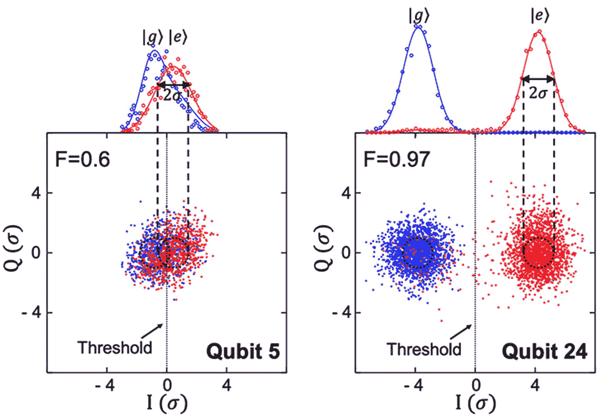

两张 Q sigma 与 I sigma 的关系图，阈值位于 I 等于 0 处。左图，F 等于 0.6，g 和 e 集中在阈值中间。右图，F 等于 0.97，g 集中在负 I 区域，e 集中在正 I 区域。

**图 3-11** IBM 研究部门的 Abdo 及其同事报告的两个量子比特的读取保真度直方图，显示了低（噪声大）保真度（左）和高（准确）保真度（右）

**提示**

*读取保真度*代表成功确定量子比特状态的概率。该指标编码为 0.5 到 1 之间的实数，其中 1 表示我们确切知道量子比特状态（无读取错误），0.5 表示无法读取量子比特状态（读取错误）。

图 3-11 显示了两个量子比特读取信号在基态 `∣g⟩`（蓝色）和激发态 `∣e⟩`（红色）下的测量直方图。该图解释了读取保真度的计算方式：即基态或激发态信号的重叠或分离程度。点代表 I 和 Q 微波信号的读取数据点；上方我们看到均值（代表信号强度）和标准差（代表噪声水平）的高斯分布。左侧，两个信号重叠，保真度为 0.6（存在读取错误）；右侧，信号清晰可辨（保真度 = 0.97 – 无错误）。

这种读取保真度测量是实时确定量子比特状态的关键。通常，信号之间的分离程度取决于探测信号的强度（读取信号中使用的光子数以及输出链路的总增益），而标准差（测量噪声）则取决于输出链路中的噪声和平均时间。

**注意**

在不到 1 微秒内实现高于 0.9 的读取保真度是非常理想的，而这得益于 QLA 才得以实现。

因此，IBM-Q 的研究人员正致力于提升其量子处理器的读取保真度性能，目标有两个：使读取保真度的分布更集中，并更好地实现时间上的控制。这项开创性工作已制造出包含 5 到 53 个量子比特的量子处理器。此外，他们的扩展计划雄心勃勃：计划到 2023 年实现 1000 量子比特的处理器^(⁶)，最终目标是达到数百万个量子比特。

## 超导环路的优缺点

光子系统与超导系统之间构建终极量子门的竞赛仍在继续。尽管如此，大型组织选择超导环路的原因显而易见。以下是构建高保真度量子比特时需要考虑的最关键因素列表：

- **错误率**：成功或获得有效结果的概率。对于 Nagata 描述的光子量子门，成功率为 1/9（11%）。另一方面，超导环路的成功率超过 99%。

- **存活时间**：可以保持量子叠加态的最短时间。这是一个非常重要的指标，因为正是这种奇特的量子力学效应赋予了量子计算相对于经典计算的性能优势：量子比特以给定概率存在于 0/1 叠加态，为解决当前问题提供了更多路径。

- **成本**：普通人可能负担不起超导所需的低温绝热设备，因此大学物理实验室可能会选择线性光学方案。

基于此，以下是超导量子比特的优缺点：

**优势**

- 低错误率（约 99.4% 的逻辑门成功率）。

- 速度快，基于现有材料构建。虽然非常昂贵且复杂。

- 有一定数量的纠缠量子比特（约 9 个），能够执行双量子比特操作。

**劣势**

- 存活时间短：0.00005 秒。这确实很短：量子叠加态最多只能维持 50 微秒。

- 必须保持在极低的温度下，即超冷的 -271°C。这比太空还要冷，仅略高于绝对零度。

幸运的是，在构建高性能量子比特时，光子系统或超导系统并非唯一选择。目前有许多方案可供选择，并且新的方案层出不穷。

# 量子比特的多种形态

伟大的物理学家理查德·费曼曾理论化地提出，量子力学奇异特性可用于构建信息处理设备。事实证明，任何两态（或两能级）量子力学系统都能用来表示一个量子比特。这类状态最简单的例子包括：

**电子的两能级自旋**：自旋向上和自旋向下（常用于超导环路）
*   **单光子偏振**：垂直偏振和水平偏振（用于线性光学）

更晦涩的两态量子系统包括：
*   **电子电荷**：无电子、一个电子。
*   **通过磁共振实现的核自旋**：在强恒定磁场中的原子核，受到弱振荡磁场扰动时会产生电磁信号（向上或向下）。
*   **光学晶格**：利用激光束创建周期性偏振模式，状态为：向上或向下。
*   **量子点**：理论上的微小半导体粒子，尺寸仅纳米级，因量子力学特性而不同于较大粒子：当紫外线照射时，量子点中的电子可被激发到更高能级状态（向上）。激发电子可落回基态（向下），同时通过发光释放能量。

总而言之，存在大量可用于构建高保真量子比特的两态量子力学系统。表 3-5 列出了其中一部分，不包括我们目前已经见过的超导环路和线性光学。

### 表 3-5
现有的一些常见量子比特设计方案

| 设计方案 | 描述与分析 |
| :--- | :--- |
| **离子阱** | 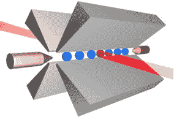<br>图示有四个互相垂直的平面。离子位于四个平面的中心。离子阱是一种利用电场或磁场组合，将带电粒子（离子）捕获在隔绝外部环境的系统中的技术。应用激光来耦合量子比特状态以执行单次操作，或耦合内部状态与外部运动状态以实现纠缠。<br>**可扩展性**<br>离子阱试图通过离子阱阵列的扩展，实现大规模通用量子计算的梦想。该技术还能通过光子连接远程纠缠离子链网络，或结合这两种方式，来构建大型纠缠态。<br>**优点**<br>• 寿命长：专家宣称捕获离子可保持纠缠长达 1000 秒，相比超导环（0.00005 秒）相当出色<br>• 成功率更高（99.9%），高于超导体（99.4%）。提升虽不大，但仍胜出<br>• 迄今（14 个）可实现双量子比特操作的纠缠量子比特数量最多<br>**缺点**<br>• 运行速度慢。需要大量激光器 |
| **硅量子点** | 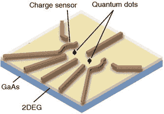<br>图示有两块方形板，底部是 2DEG，上方是 GaAs。板上方是一个带有电荷传感器和量子点标签的结构。在硅量子点中，电子被垂直限制在量子砷化镓（`GaAs`）的基态，形成二维电子气（`2DEG`）。这种二维电子气可在二维空间自由移动，但在第三维受到严格限制。这种严格限制导致第三维方向上运动能量量子化，用于描述量子比特的状态。注：`2DEG` 气体常用于半导体制造的晶体管中，在低温和强磁场下，电导量子化时也会展现量子效应（参见霍尔效应^(⁷)）。<br>**优点**<br>• 稳定，基于现有半导体材料构建<br>• 寿命优于超导环，达 0.03 秒<br>**缺点**<br>• 可实现双量子比特操作的纠缠量子比特数量少（2 个）<br>• 成功率低于超导环或离子阱，但仍有约 99%的高水平 |
| **拓扑量子比特** | 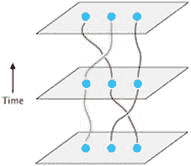<br>图示有三块上下堆叠的板。每块板上有三个点，与下一块板上的另一个点相连。时间指向向上。拓扑量子比特利用被称为*任意子*的二维准粒子，这些粒子在三维时空中的路径相互缠绕形成辫子。这些辫子构成了计算机的逻辑门。拓扑量子比特旨在消除量子计算机特有的错误水平，这些错误源于量子力学的概率性质，并通过量子比特纠缠的寿命或持续时间来描述。<br>**优点**<br>• 稳定，无错误（不适用寿命概念）。这非常惊人，如果能实现拓扑量子比特，当前量子处理器的所有难题都将迎刃而解<br>**缺点**<br>• 目前纯属理论，尽管近期实验表明，这些元素可能在现实世界中利用接近绝对零度并暴露于强磁场下的砷化镓半导体创造出来 |
| **金刚石空位** | 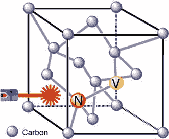<br>一个立方体图示，内部有多个碳原子、一个 N 和一个 V。一束光束射向立方体表面。金刚石空位旨在以一种简单方式解决从量子比特中读取信息的长期难题*（测量问题）*。请记住，测量量子比特状态会使其波函数坍缩，这应该是执行链中的最后一步。现在，由于金刚石是天然发光体，其发射的光粒子能保持状态的叠加；因此，它们可以在量子计算设备之间传递信息，这一壮举被视为量子计算的圣杯。最棒的是，它们能在室温下工作，无需冷却到零下 272 摄氏度！金刚石空位的一个缺点是天然金刚石表面只有大约 2%的区域存在这些空位。尽管如此，研究人员正在研发通过电子束轰击金刚石以产生更多空位的工艺。<br>**优点**<br>• 寿命长：10 秒<br>• 成功率高：99.2%<br>• 可实现双量子比特操作的纠缠量子比特数量可观（6 个）<br>• 量子比特在室温下工作<br>**缺点**<br>• 表面材料中空位数量少：约 2%<br>• 难以纠缠 |

自理查德·费曼时代以来，量子计算机取得了长足发展，全球一些最大的公司都希望参与其中。目前，超导环路处于领先地位。然而，一些惊人的新设计，例如离子阱或金刚石空位，正在寻求实现大规模量子计算的梦想。

## 习题
以下是一组简单的习题，用于复习本章的主要概念。答案见附录。

1.  写出泡利自旋矩阵 `X`、`Y`、`Z` 的矩阵表示。
2.  `控制-Z` 门的矩阵表示是什么？
3.  简要描述两种光束分离器。
4.  给出一个光学量子门未能普及的原因。
5.  简要阐述物理学中的`费曼规则`。
6.  什么是`双光子量子干涉`？
7.  波干涉的两种类型是什么？
8.  什么是相消波干涉？
9.  列出光子门中两种误差来源。
10. 用一句话定义超导体。
11. 举出两个超导材料的例子。
12. 超导量子比特内（下层）腔室的温度是多少？
13. 列出 `IBM-Q` 超导腔室的三个组件。
14. 在 `IBM-Q` 设计中，超导同轴电缆的作用是什么？
15. 低温绝缘体的作用是什么？
16. 读取量子比特量子态的非破坏性方法是什么？
17. 在 `IBM-Q` 中，用于探测读取脉冲的两种设备是什么？
18. 什么是读取保真度？
19. 构建高保真度量子比特时需要考虑的三个因素是什么？
20. 什么是`玻恩定则`？
21. 列出三种类型的（设计）量子比特系统。

脚注 1   2   3   4   5
