# 4. 走进 IBM Quantum：云上量子计算的独一无二平台

在本章中，我们将通过 IBM Q 了解云上的量子计算：这是首个此类平台。本章首先概述了 Composer，这是一个用于可视化创建电路、提交实验、探索硬件设备等的 Web 控制台。接下来，你将学习如何创建你的第一个实验，并将其提交给模拟器或真实量子设备。IBM Quantum 拥有强大的 REST API 来控制实验的生命周期，本章将通过对端点和请求参数的详细描述来展示如何使用它。最后，本章以一系列练习来测试你的 REST API 技能作为结尾。让我们开始吧。

IBM 无疑在云量子计算的竞赛中占据了早期领先地位。他们推出了一个名为 IBM Quantum 的强大远程运行实验平台。让我们看看这个平台如何能够改变现状。

## 初探 IBM Quantum

这是 IBM 的量子计算平台；让我们来看看——请遵循以下概述的步骤（所有重印件均由国际商业机器公司提供，© 国际商业机器公司）：
*   在 `quantum-computing.ibm.com/` 创建一个帐户。你需要一个电子邮箱；等待批准并确认。
*   登录 Web 控制台，通过点击主菜单右上角应用程序切换器中的 `学习` 菜单，导航到 Composer 选项卡。

### 量子 Composer

Composer 是用于创建量子电路的可视化工具。在其顶部，显示带有可用量子比特的实验直方图（见图 4-1）。
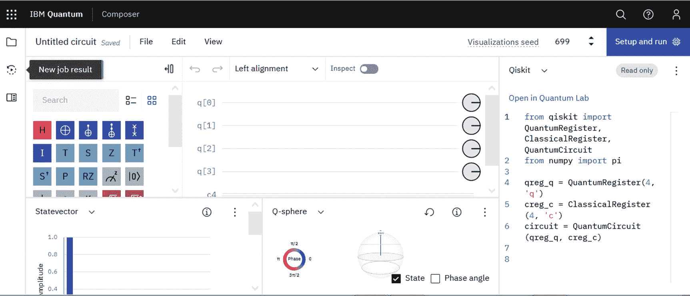
**图 4-1** Composer 中的实验直方图
*   在右侧，我们看到一个显示了 4 个可用量子比特的直方图。它们都初始化到基态 |0>。这是你放置量子门的地方。
*   在左侧，我们有量子门。将门拖拽到特定量子比特的直方图位置，开始构建电路。

让我们看看这些门及其含义。

### 量子门

IBM Quantum 支持的量子门如表 4-1 所述。
**表 4-1** IBM Quantum 的量子门
| 门 | 描述 |
| --- | --- |
| 泡利 X 泡利 X 门示意图，以圆内加号表示。 | 使量子比特绕 X 轴旋转 180 度。将|0>态映射为|1>态，将|1>态映射为|0>态。也称为比特翻转门或非门。其矩阵表示为：![$$ X=\left[\begin{array}{cc}0&amp; 1\\ {}1&amp; 0\end{array}\right] $$](images/469026_2_En_4_Chapter/469026_2_En_4_Chapter_TeX_IEq1.png) |
| 泡利 Y 泡利 Y 门图像，以字母 Y 表示。 | 使布洛赫球绕 Y 轴旋转π弧度。其泡利矩阵表示为：![$$ Y=\left[\begin{array}{cc}0&amp; -i\\ {}-i&amp; 0\end{array}\right] $$](images/469026_2_En_4_Chapter/469026_2_En_4_Chapter_TeX_IEq2.png)，其中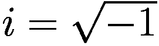被称为虚数单位。 |
| 泡利 Z 泡利 Z 门图像，以字母 Z 表示。 | 使布洛赫球绕 Z 轴旋转π弧度。其泡利矩阵表示为：![$$ Z=\left[\begin{array}{cc}1&amp; 0\\ {}0&amp; -1\end{array}\right] $$](images/469026_2_En_4_Chapter/469026_2_En_4_Chapter_TeX_IEq4.png) |
| 阿达玛 阿达玛门符号，以字母 H 表示。 | 表示绕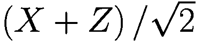轴旋转π。换句话说，它将状态映射为：• |0> 映射为 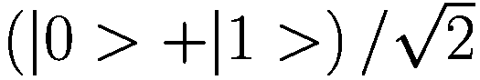• |1> 映射为 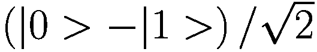此门是构建叠加态所必需的。 |
| 相位 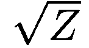 Z 门相位平方的符号，以字母 S 表示。 | 其特性是将 X 映射为 Y，将 Z 映射为 Z。此门扩展了 H 门，用于生成复叠加态。 |
| S 门的转置共轭 S 门的转置共轭符号，以上标加号的字母 S 表示。 | 它将 X 映射为-Y，将 Z 映射为 Z。 |
| 受控非门 (CNOT) 受控非门符号，以加号符号表示。 | 这是一个双量子比特门，如果控制位处于状态 1，则翻转目标量子比特（应用泡利 X 门）。此门是生成纠缠态所必需的。 |
| 相位 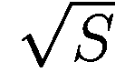 S 门相位平方根的符号，以字母 T 表示。 | 门执行双量子比特交换的半程旋转。它具有通用性，任何门都可以仅由 sqrt(swap)和单量子比特门构建。其矩阵表示为：![$$ \sqrt{S}=\left[\begin{array}{cccc}1&amp; 0&amp; 0&amp; 0\\ {}0&amp; 1/2\left(1+i\right)&amp; 1/2\left(1-i\right)&amp; 0\\ {}0&amp; 1/2\left(1-i\right)&amp; 1/2\left(1+i\right)&amp; 0\\ {}0&amp; 0&amp; 0&amp; 1\end{array}\right] $$](images/469026_2_En_4_Chapter/469026_2_En_4_Chapter_TeX_IEq11.png) |
| T 门的转置共轭或 Dagger-T T 门或 Dagger-T 门的转置共轭符号，以上标加号的字母 T 表示。 | 其矩阵表示为：![$$ \sqrt{S}=\left[\begin{array}{cccc}1&amp; 0&amp; 0&amp; 0\\ {}0&amp; 1/2\left(1-i\right)&amp; 1/2\left(1+i\right)&amp; 0\\ {}0&amp; 1/2\left(1+i\right)&amp; 1/2\left(1-i\right)&amp; 0\\ {}0&amp; 0&amp; 0&amp; 1\end{array}\right] $$](images/469026_2_En_4_Chapter/469026_2_En_4_Chapter_TeX_IEq12.png) |
| 屏障 屏障门符号，以竖直虚线表示。 | 阻止跨越其源线的变换。 |
| 测量 测量门符号。 | 测量门接收一个处于叠加态的量子比特作为输入，并输出 0 或 1。输出的 0 或 1 取决于量子比特的初始状态，各有一定概率。请始终牢记，测量应是电路中的最后一步操作。 |
| 条件 条件门符号，以文字 if 表示。 | 有条件地执行量子操作。 |
| 恒等 恒等门符号，以文字 i d 表示。 | 恒等门使量子比特进行一个单位时间的空闲操作。 |

您可以从编辑器左侧拖拽门来创建电路，或者，如果您更倾向于编写代码，可以切换到编辑器模式，如图 4-2 所示。

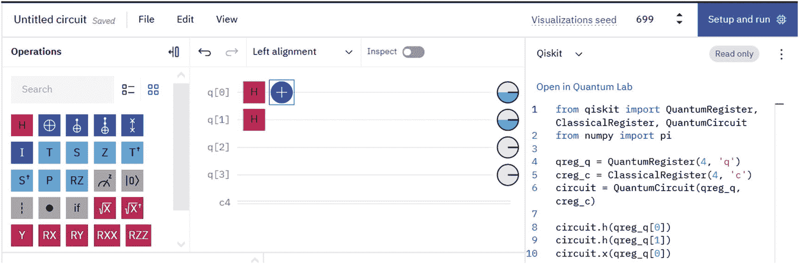

**图 4-2** QASM 编辑器模式下的实验编辑器

**提示**

编辑器提供两种语言选择：`Qiskit` 或 `QASM`（量子汇编语言）。最终，您的电路或 Python 代码将被翻译成 `QASM`，以便提交到真实设备上运行。

现在，让我们来看看可供使用的各种量子处理器。

### 可用的量子后端

在开放（免费）计划下，有许多量子处理器可供实验使用（从主菜单点击“计算资源”）。表 4-2 根据 IBM 量子后端信息网站^(⁸)，按量子比特数量列出了部分排名。

**表 4-2** IBM Quantum 用户在开放计划下可用的部分量子后端列表

| 名称 | 详细信息 |
| --- | --- |
| `ibm_perth` | 处理器：Falcon r5.11H 量子比特：7 量子体积：32 |
| `ibm_lagos` | 处理器：Falcon r5.11H 量子比特：7 量子体积：32 |
| `ibm_nairobi` | 处理器：Falcon r5.11H 量子比特：7 量子体积：32 |

这里有一个小秘密：有一个非常有趣的方法可以通过出色的 REST API 实时获取可用机器的更新列表。本章的“远程访问”部分将更详细地介绍此 API，但现在我们先演示如何通过*可用后端列表* REST 端点获取始终最新的后端列表：`api-qcon.quantum-computing.ibm.com/api/Backends?access_token=ACCESS-TOKEN`。

**提示**

要获取访问令牌，请参阅本章“远程访问”下的“通过 API 令牌进行身份验证”部分。请注意，API 令牌与访问令牌不同。API 令牌用于身份验证，而访问令牌用于通过 REST API 调用操作。

上段中的 URL 会返回一个 JSON 格式的量子处理器列表。以下是撰写本文时的示例。请注意，您得到的结果可能有所不同：

```json
[{
"name": "ibm_lagos",
"version": "1",
"status": "on",
"serialNumber": "Real5Qv2",
"description": "5 transmon bowtie",
"basisGates": "u1,u2,u3,cx,id",
"onlineDate": "2017-01-10T12:00:00.000Z",
"chipName": "Sparrow",
"id": "28147a578bdc88ec8087af46ede526e1",
"topologyId": "250e969c6b9e68aa2a045ffbceb3ac33",
"url": "https://ibm.biz/qiskit-ibmqx2",
"simulator": false,
"nQubits": 7,
"couplingMap": [
[0, 1],
[0, 2],
[1, 2],
[3, 2],
[3, 4],
[4, 2]
]
}, {
"name": "ibm_nairobi",
"version": "1",
"status": "on",
"serialNumber": "ibmqx5",
"description": "16 transmon 2x8 ladder",
"basisGates": "u1,u2,u3,cx,id",
"onlineDate": "2017-09-21T11:00:00.000Z",
"chipName": "Albatross",
"id": "f451527ae7b9c9998e7addf1067c0df4",
"topologyId": "ad8b182a0653f51dfbd5d66c33fd08c7",
"url": "https://ibm.biz/qiskit-ibmqx5",
"simulator": false,
"nQubits": 7,
"couplingMap": [
[1, 0],
...
[15, 14]
]
},
{
"name": "ibmqx_hpc_qasm_simulator",
"status": "on",
"serialNumber": "hpc-simulator",
"basisGates": "u1,u2,u3,cx,id",
"onlineDate": "2017-12-09T12:00:00.000Z",
"id": "084e8de73c4d16330550c34cf97de3f2",
"topologyId": "7ca1eda6c4bff274c38d1fe66c449dff",
"simulator": true,
"nQubits": 32,
"couplingMap": "all-to-all"
},
{
"name": "ibmqx_qasm_simulator",
"status": "on",
"description": "online qasm simulator",
"basisGates": "u1,u2,u3,cx,id",
"id": "18da019106bf6b5a55e0ef932763a670",
"topologyId": "250e969c6b9e68aa2a045ffbceb3ac33",
"simulator": true,
"nQubits": 24,
"couplingMap": "all-to-all"
}]
```

**清单 4-1** 来自后端信息 REST API 调用的 HTTP 响应

清单 4-1 显示，关于这些机器的结构布局，还有许多额外有趣的信息：

- **额外的处理器和模拟器：**
    - 有几个可用的远程模拟器（`ibmq_qasm_simualtor`, `simulator_mps`, `ibmq_qasm_simualtor`）。这些信息在测试复杂电路时会很有用：更多模拟器总是好事。

- 关于 475 量子比特处理器的传闻已经流传了一段时间。甚至有传言说到 2023 年底将推出 1000 量子比特的处理器，但先别兴奋；这台机器仅对企业客户可用。IBM 已制定了一份雄心勃勃的路线图，未来要达到一百万量子比特。详情请查阅 [www.ibm.com/quantum/roadmap](http://www.ibm.com/quantum/roadmap)。

- 除了机器名称、版本、状态、量子比特数量等常规信息外，还有一些术语我们需要熟悉：
    - `basisGates`：这些是处理器的物理量子比特门。它们是构建更复杂逻辑门的基础。列表中的大多数处理器都使用`u1,u2,u3,cx,id`。
        - `u1`、`u2`、`u3`门被称为*部分非门*，它们通过 theta、phi 或 lambda 弧度对量子比特的 X、Y、Z 轴进行旋转。
    - `Cx`被称为*受控非门*（`CNOT`或`CX`）。它作用于 2 个量子比特，仅当第一个量子比特为`|1>`时，才对第二个量子比特执行非操作，否则保持不变。
    - `Id`是单位门，它在一个单位时间内对量子比特执行空闲操作。
    - `couplingMap`：耦合映射定义了单个量子比特之间在保持量子相干性时的相互作用。量子比特耦合对于简化量子电路以及允许系统分解为更小的单元非常重要。

现在回到我们的第一个量子电路的作曲器。

### 纠缠：贝尔态和 GHZ 态

纠缠实验用于展示量子力学的奇异特性，主要分为两种类型：

- **贝尔态**：它们证明物理学不是由局域实在性描述的。这就是爱因斯坦所说的*幽灵般的超距作用*（2 量子比特纠缠）。
- **GHZ 态**：比贝尔态更奇特（以其发明者命名：Greenberger-Horne-Zeilinger），它们描述了 3 量子比特纠缠。

接下来让我们更详细地了解它们。

#### 贝尔态实现的双量子比特纠缠

贝尔态是对著名的贝尔不等式的实验检验。1964 年，爱尔兰物理学家约翰·贝尔提出了一种检验量子纠缠（远距离的幽灵作用）的方法。他提出的一组不等式在物理学界变得极其重要，这组不等式被称为贝尔定理，其内容大致如下。

考虑光子偏振（光在特定平面内振荡）在三个不同角度`A = 0`、`B = 120`、`C = 240`的情况。实在论认为，光子对于这三个偏振设定具有确定的、同时存在的数值，而且它们必须对应于表 4-3 中所示的八种情况。

**表 4-3** 三个角度下光子偏振的排列组合

| 计数 | A(0) | B(120) | C(240) | [AB] | [BC] | [AC] | 总和 | 平均值 |
| --- | --- | --- | --- | --- | --- | --- | --- | --- |
| 1 | A+ | B+ | C+ | 1(++) | 1(++) | 1(++) | 3 | 1 |

## 贝尔不等式与实验验证

| 2 | A+ | B+ | C- | 1(++) | 0 | 0 | 1 | 1/3 |

| 3 | A+ | B- | C+ | 0 | 0 | 1(++) | 1 | 1/3 |

| 4 | A+ | B- | C- | 0 | 1(--) | 0 | 1 | 1/3 |

| 5 | A- | B+ | C+ | 0 | 1(++) | 0 | 1 | 1/3 |

| 6 | A- | B+ | C- | 0 | 0 | 1(--) | 1 | 1/3 |

| 7 | A- | B- | C+ | 1(--) | 0 | 0 | 1 | 1/3 |

| 8 | A- | B- | C- | 1(--) | 1(--) | 1(--) | 3 | 1 |

现在贝尔定理提问：*任何相邻角度的偏振与第一个角度相同的概率是多少？* 我们还计算了偏振的总和与平均值。假设实在论为真，那么通过查看表 4-1，这个问题的答案必然是概率`>= 1/3`。这就是贝尔不等式给出的内容：一种检验这个论断的方法。不可思议之处在于：信不信由你，量子力学违反了贝尔不等式，给出的概率小于`1/3`。这一点于 1982 年由法国物理学家阿兰·阿斯佩首次通过实验证明。

现在，让我们将上述光子偏振转化为可以在量子计算机上运行的实验。1969 年，约翰·克劳泽、迈克尔·霍恩、阿布纳·希莫尼和理查德·霍尔特提出了贝尔定理的一个证明：`CHSH`不等式，其正式表述为：

```
S = ⟨A, B⟩ - ⟨A, B′⟩ + ⟨A′, B⟩ + ⟨A′, B′⟩
```

```
S ≤ 2
```

为了说明这一点，我们有两个探测器：爱丽丝和鲍勃。给定`A`和`A′`是爱丽丝一侧的探测器设置，`B`和`B′`是鲍勃一侧的设置，四种组合分别在单独的实验中测试。实在论认为，对于一对纠缠粒子，显示所有可能排列的奇偶表如下所示：

| A | B | 1 |
| --- | --- | --- |
| A | B’ | 0 |
| A’ | B | 0 |
| A’ | B’ | 1 |

在经典实在论中，`CHSH`不等式变为`|S| = 2`。然而，量子力学的数学形式体系预测`S`的最大值为`|S| = 2√2`，从而违反了这个不等式。这可以通过使用四个独立的量子电路（每次测量一个）来检验，每个电路都有 2 个量子比特。为简化起见，让爱丽丝探测器上的测量为`A = Z`、`A′ = X`，鲍勃探测器上的测量为`B = W`、`B′ = V`（见表 4-2）。实验开始时，必须构建一个与恒等变换相符的基础贝尔态（见图 4-5）：

```
1/√2 (|00⟩ + |11⟩)
```

上述表达式本质上意味着：爱丽丝持有的量子比特可以是`0`或`1`。如果爱丽丝在标准基下测量她的量子比特，结果将是完全随机的，每种可能性概率均为`1/2`。但如果鲍勃随后测量他的量子比特，结果将与爱丽丝得到的结果相同。所以，如果鲍勃测量，他乍看之下也会得到一个随机结果，但如果爱丽丝和鲍勃相互通信，他们会发现，尽管结果看似随机，但它们实际上是相关的。

### 图 4-3 基础贝尔态

一个示例基础贝尔态图。它展示了两个量子比特`Q0`和`Q1`的纠缠。它包含四个量子门。`H`门创建了第一个量子比特的叠加态。两个测量门处于`0`和`1`状态。

在图 4-3 中，两个量子比特被制备在基态`|0⟩`。`H`门将第一个量子比特创建为`1/√2 (|00⟩ + |10⟩)`的叠加态。接下来，如果第一个量子比特被激发，`CNOT`门将翻转第二个量子比特，得到状态`1/√2 (|00⟩ + |11⟩)`。这是表 4-2 中四次测量所需的初始纠缠态（所有重印内容由国际商业机器公司提供，© 国际商业机器公司）。

-   要将测量基旋转到`ZW`轴，请使用门序列`S-H-T-H`。

-   要将测量基旋转到`ZV`轴，请使用门序列`S-H-T′-H`。

-   `XW`和`XV`的测量与上述方式相同，`X`则是通过在标准测量之前放置一个`Hadamard`门来实现。

### 实验注意事项

在合成器中进行实验之前，请确保其乐谱中的拓扑结构（量子比特数量和目标设备）设置为在模拟器上使用两个量子比特。某些拓扑结构（如真实量子设备中的 5 量子比特）不支持量子比特`0`和`1`的纠缠，这会在设计时产生错误。请注意，目标设备可以是真实的量子处理器或模拟器。

### 表 4-4 贝尔态的量子电路

| 贝尔态测量 | 100 次实验的结果 |
| --- | --- |
| AB (ZW) 一个用于 ZW 的 AB 量子电路。它有两个并联的量子比特。q0 有一个 Hadamard 门和一个测量门。q1 串联了一个受控非门、Z 门的相位平方根门、Hadamard 门、S 门的相位平方根门和 Hadamard 门。底部有一条标记为 c 的水平线。 | `\| c[2] \| 概率 \|` `\| 11 \| 0.39 \|` `\| 10 \| 0.06 \|` `\| 00 \| 0.46 \|` `\| 01 \| 0.09 \|` |
| AB′ (ZV) 一个用于 ZV 的 AB prime 量子电路。它有两个并联的量子比特。q0 有一个 Hadamard 门和一个测量门。q1 串联了一个受控非门、Z 门的相位平方根门、Hadamard 门、S 门的相位平方根门和 Hadamard 门。底部有一条标记为 c 的水平线。 | `\| c[2] \| 概率 \|` `\| 11 \| 0.49 \|` `\| 10 \| 0.07 \|` `\| 00 \| 0.36 \|` `\| 01 \| 0.08 \|` |
| A′B (XW) 一个用于 XW 的 A prime B 量子电路。它有两个并联的量子比特。q0 有两个 Hadamard 门。q1 串联了一个受控非门、Z 门的相位平方根门、Hadamard 门、S 门的相位平方根门和 Hadamard 门。底部有一条标记为 c 的水平线。 | `\| c[2] \| 概率 \|` `\| 11 \| 0.42 \|` `\| 10 \| 0.05 \|` `\| 00 \| 0.49 \|` `\| 01 \| 0.04 \|` |
| A’B’ (XV) A’B’ (XV)的量子电路。它有两个并行连接的量子比特。`q0`有两个 Hadamard 门。`q1`依次包含一个受控非门、相位平方根 Z 门、Hadamard 门、相位平方根 S 门和 Hadamard 门。底部有一个标记为`c`的水平线。 | `\| c[2] \| 概率 \|` `\| 11 \| 0.05 \|` `\| 10 \| 0.52 \|` `\| 00 \| 0.03 \|` `\| 01 \| 0.40 \|` |

现在，我们需要根据表 4-4 中的每次测量结果，再加上 A 与 B 之间的关联概率`<AB>`，来构建一个表格。纠缠粒子奇偶性概率之和由下式给出：

```
<AB> = P(1,1) + P(0,0) - P(1,0) - P(0,1)
```

请记住，最终目标是确定是否满足`S ≤ 2`或`|S| = 2`；因此，通过汇总所有测量的结果，我们得到表 4-5。

### 表 4-5 贝尔实验的汇总结果

|       | `P(00)` | `P(11)` | `P(01)` | `P(10)` | `<AB>` |
|-------|---------|---------|---------|---------|--------|
| AB (ZW)  | 0.46    | 0.39    | 0.09    | 0.06    | 0.68   |
| AB’ (ZV) | 0.36    | 0.49    | 0.08    | 0.07    | 0.73   |
| A’B (XW) | 0.49    | 0.42    | 0.04    | 0.05    | 0.47   |
| A’B’(XV) | 0.03    | 0.05    | 0.40    | 0.52    | -0.32  |

将`<AB>`列的绝对值相加，我们得到`|S| = 2.2`。这些结果违反了贝尔不等式（正如量子力学所预测的那样）。

## 利用 GHZ 态测试的三量子比特纠缠

这些测试以物理学家格林伯格-霍恩-泽林格（`Greenberger-Horne-Zeilinger`）的名字命名，他们提出了一种针对 N 个纠缠量子比特的推广测试，其中最简单的就是三量子比特 `GHZ`态：

```
|GHZ> = 1/sqrt(2) * (|000> - |111>)
```

### 注意

`GHZ`态的重要性在于，它们表明多于两个粒子的纠缠不仅在统计（概率）预测上，而且在非统计（确定性）预测上都与局域实在论相矛盾。

简而言之，`GHZ`态表现出对贝尔不等式的更强违背。让我们通过一个简单的谜题来看看这是如何实现的：假设有三个独立的盒子，每个盒子包含两个变量 `X`、`Y`。每个变量有两个可能的结果：`1`、`-1`。问题是要找出一组 `X`、`Y` 的值，使之满足以下一组恒等式：

```
(1) XYY = 1
(2) YXY = 1
(3) YYX = 1
(4) XXX = -1
```

对于心急的读者来说，这个问题无解。例如，在 (1)、(2) 和 (3) 中将 `Y = 1` 代入，然后将它们相乘，即 (5) = (1) * (2) * (3)。这组等式就变成了：

```
(1) X11 = 1
(2) 1X1 = 1
(3) 11X = 1
(4) XXX = -1
(5) 将(1)(2)(3)相乘，我们得到 XXX = 1
```

没有解，因为等式 (4)`XXX = -1` 与等式 (5)`XXX = 1` 相矛盾。可怕的是，一个 GHZ 态确实能够为这个问题提供一个解。这在经典实在论的确定性观点看来似乎是不可能的，但在量子力学的世界里，没有不可能，只有概率低。

难以置信的是，GHZ 测试可以在单次实验运行后便确定性地排除局域实在论描述。但首先，我们必须构建一个 GHZ 基态。尝试在作曲家中构建表 4-6 中的电路，以查看概率是否与左侧图表匹配。

### 表 4-6 GHZ 基态

| `|GHZ> = 1/sqrt(2) * (|000> - |111>)` | 构建 GHZ 基态的电路图。它包含三个量子比特 `Q1`、`Q2` 和 `Q3`。三个测量门分别对应 0、1 和 2。量子比特之间使用受控非门连接。 |
| :--- | :--- |

为了启动实验，表 4-6 展示了 GHZ 基态（以及相应的概率结果，概率应约为一半）：
1.  在基态电路中，量子比特 1 和 2 上的 Hadamard 门使它们处于叠加态 `|00,01,01,11>`。同时，X 门取反量子比特 3；因此，我们最终得到状态 `1/sqrt(2) * (|001> + |101> + |011> + |111>)`。
2.  两个 CNOT 门将所有量子比特纠缠到状态 `1/sqrt(2) * (|001> + |010> + |100> + |111>)`。
3.  最后，三个 Hadamard 门将第二步映射到状态 `1/2 * (|000> - |111>)`。

现在，为上一节中的恒等式 `XYY`、`YXY`、`XYY` 和 `XXX` 创建量子电路，如表 4-7 所示（所有转载均已获得国际商业机器公司许可，©国际商业机器公司）。

### 表 4-7 GHZ 态的量子电路

#### YYX 恒等式

| 测量 | 100 次射击的结果 |
| :--- | :--- |
| YYX | `Y Y X` 恒等式的 GHZ 基态。量子比特 `q0`、`q1` 和 `q2` 之间使用受控非门连接。在 Hadamard 门之后，所有三个量子比特使用一个公共的屏障。 |
| `c[3]` | 概率 |
| 011 | 0.34 |
| 101 | 0.23 |
| 110 | 0.23 |
| 000 | 0.20 |

#### YXY 恒等式

| 测量 | 100 次射击的结果 |
| :--- | :--- |
| YXY | `Y X Y` 恒等式的 GHZ 基态。量子比特 `q0`、`q1` 和 `q2` 之间使用受控非门连接。在 Hadamard 门之后，所有三个量子比特使用一个公共的屏障。 |
| `c[3]` | 概率 |
| 011 | 0.23 |
| 101 | 0.28 |
| 110 | 0.25 |
| 000 | 0.24 |

#### XYY 恒等式

| 测量 | 100 次射击的结果 |
| :--- | :--- |
| XYY | `X Y Y` 恒等式的 GHZ 基态。量子比特 `q0`、`q1` 和 `q2` 之间使用受控非门连接。在 Hadamard 门之后，所有三个量子比特使用一个公共的屏障。 |
| `c[3]` | 概率 |
| 011 | 0.23 |
| 101 | 0.26 |
| 110 | 0.35 |
| 000 | 0.16 |

#### XXX 恒等式

| 测量 | 100 次射击的结果 |
| :--- | :--- |
| XXX | `X X X` 恒等式的 GHZ 基态。量子比特 `q0`、`q1` 和 `q2` 之间使用受控非门连接。在 Hadamard 门之后，所有三个量子比特使用一个公共的屏障。 |
| `c[3]` | 概率 |
| 010 | 0.25 |
| 100 | 0.32 |
| 111 | 0.22 |
| 001 | 0.21 |

-   对于 X 的测量，将 H 门应用于相应的量子比特。
-   对于每个 Y 实例，将 `S†`（S-dagger）门和 H 门应用于相应的量子比特。

总而言之，本节展示的纠缠原理在 20 世纪早期并不流行。事实上，它们受到了一种名为“超决定论”的理论的挑战，该理论试图为这些原理寻找一条出路。

## 超级决定论：摆脱“幽灵”之途

爱因斯坦自始至终都是对的吗？

在 1969 年接受英国广播公司（BBC）采访时，物理学家约翰·贝尔谈到了他在量子力学方面的工作。他说，我们必须接受这样的预言：在对纠缠粒子进行测量时，作用力的传递会超过光速，但同时我们对此无能为力。信息不能以超过光速的速度传播，这一事实同样也被量子力学所预言。仿佛大自然在和我们玩一个把戏。他还提到，有一种方法可以通过一个名为**超级决定论**的原理来解开这个谜题。

粒子纠缠意味着，对一个粒子进行的测量会瞬间影响另一个粒子，即使它们相隔遥远（想想银河系或宇宙的两端），甚至跨越时间。爱因斯坦是这一理论的强烈反对者，他给尼尔斯·玻尔写信时有一句著名的话：`上帝不会掷骰子`。他无法接受量子力学的概率性质，因此，在 1935 年，他与同事波多尔斯基和罗森一起，提出了那个著名的 `EPR` 悖论，旨在挑战量子力学的基础。在 `EPR` 悖论中，如果两个纠缠粒子被极其遥远的距离隔开，对其中一个粒子的测量不可能瞬间影响到另一个粒子，因为这种影响必须以超光速传播（而光速是宇宙中的终极速度极限）。这将违反广义相对论，从而产生一个悖论：没有什么能比光速更快，这是相对论的绝对法则。

然而，在 1982 年，量子力学的预言被法国物理学家阿兰·阿斯佩证实。他设计了一个实验，表明纠缠光子违反了贝尔不等式。他还证明，对其中一个纠缠光子的测量，会以超光速将自身状态信号传递给另一个光子。自那以后，阿斯佩的实验结果被一次又一次地证明是正确的（关于他实验的详细信息见第 1 章）。讽刺的是，有可能爱因斯坦一直都是对的，而粒子纠缠不过是一种幻觉。关键在于超级决定论原理。

**提示**

简单来说，超级决定论认为，自宇宙诞生之初，自由选择就已经被取消了。所有粒子的关联和纠缠都在大爆炸的那一刻就已建立。因此，并不需要超光速信号来告诉粒子 B 粒子 A 的结果是什么。

如果这一理论成立，它将证明爱因斯坦在提出“`EPR`”悖论时是正确的，而我们迄今为止的所有辛勤工作都只是幻觉。但这个原理听起来更像是宗教教条（一切结果都由命运决定），而不是科学，正如贝尔所认为的那样，超级决定论是不可信的。他的理由是，由于大量微小效应所带来的改变，在需要的情况下，自由选择实际上是自由的。超级决定论被称为无法检验的理论，因为实验者永远无法消除那些在宇宙诞生之初就建立起来的关联。尽管如此，这并没有阻止科学家们试图证明爱因斯坦是正确的，而粒子纠缠是幻觉。事实上，有一项实验正在艰苦进行中，试图解决这个问题，并且构思非常巧妙。让我们来看看。

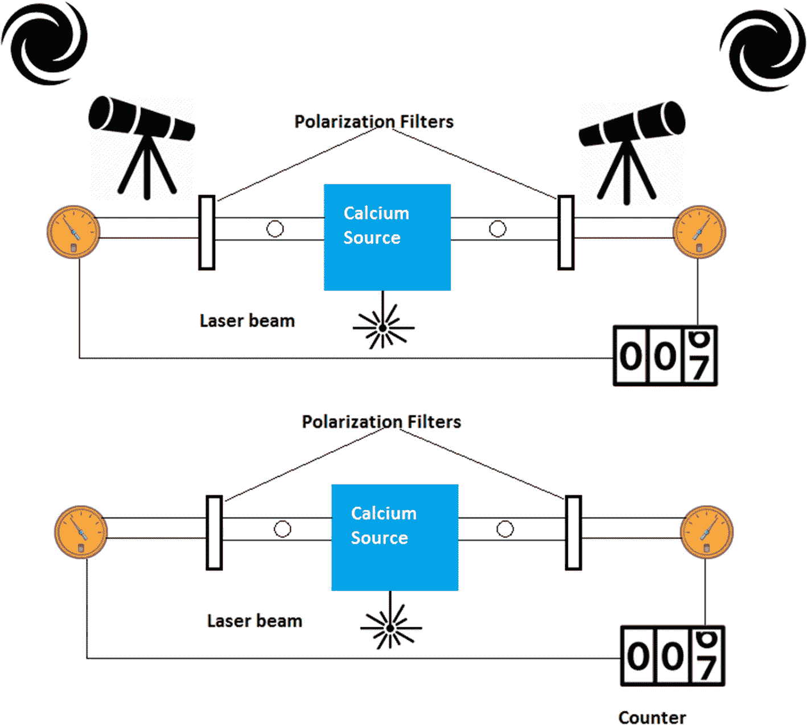

**图 4-4** 使用宇宙光子的贝尔不等式实验与标准测试对比

图 4-4 展示了标准的贝尔不等式测试实验（底部）以及由安德鲁·弗里德曼及其在麻省理工学院的同事提出的使用宇宙光子的实验变体（顶部）。^(⁹)

**提示**

关于标准贝尔不等式测试的完整描述，请参见第 1 章。

弗里德曼及其同事提出了一个使用宇宙射线对标准贝尔实验进行的新颖变体。其想法是利用实时天文观测——观测我们银河系中的遥远恒星、遥远的类星体或宇宙微波背景的某片区域——本质上是让宇宙来决定如何设置实验，而不是使用标准的量子随机数生成器。也就是说，在纠缠光子到达之前，利用来自遥远星系的光子来控制偏振滤光片的朝向。

如果成功，其意义将是开创性的。如果此类实验的结果没有违反贝尔不等式，那就意味着超级决定论最终可能是正确的。粒子纠缠将是一种幻觉，纠缠粒子间的信号传递也无法像相对论所预言的那样超光速。爱因斯坦将是对的，不存在超距的“幽灵”作用。

对量子力学来说幸运的是，到目前为止还没有发生过这种情况。请记住，弗里德曼和他的同事们并不是唯一参与其中的团队。目前有多个团队正试图解开这个谜题。事实上，他们大多数结果都与量子力学相符。也就是说，他们的结果违反了贝尔不等式。因此，爱因斯坦和玻尔在相对论与量子力学之争中所造成的裂痕似乎至今仍未弥合。下一节将展示如何通过 IBM Quantum 简洁的 REST API 进行远程访问。

## 通过 REST API 进行远程访问

Quantum 拥有一个相对来说不为人知的 REST API，它在幕后处理所有的远程通信。当前的 Python SDK 都使用了它：
-   `Qiskit`：量子信息软件工具包（Quantum Information Software Kit）是在 Python 中进行量子编程的事实上的访问工具。
-   `QiskitIBMQProvider`：一个与 `Qiskit` 捆绑的、不太知名的库，它将 REST API 封装在一个 Python 客户端中。

在本节中，我们将深入探究 `IBMQprovider`，并查看用于远程访问的不同 REST 端点。但首先，需要进行身份验证。

## 身份验证

要调用任何 REST API，我们首先必须获得一个访问令牌。这将是调用本节中任何调用的访问密钥。有两种方法可以获得此令牌：

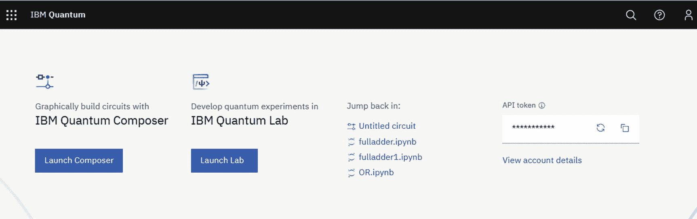

一个标题为“I B M quantum”的窗口截图。该页面包括使用 I B M quantum 作曲家以图形方式构建电路，以及在 I B M quantum 实验室中开发量子实验。它还包含“跳回”选项和 API 令牌。

**图 4-5** 从控制台获取您的 API 令牌。

*   使用您的 API 令牌：要获取 API 令牌，请登录 IBM Q 控制台并从仪表板复制它（参见图 4-5）。
*   使用您的账户用户名和密码：让我们看看如何使用 REST 完成此操作。

### 通过 API 令牌进行身份验证

*   **HTTP 方法：** `POST`
*   **URL：** `https://auth.quantum-computing.ibm.com/api/users/loginWithToken`
*   **请求体：** `{"apiToken": "YOUR_API_TOKEN"}`

### 通过用户名-密码进行身份验证

*   **HTTP 方法：** `POST`
*   **URL：** `https://auth.quantum-computing.ibm.com/api/users/login`
*   **请求体：** `{"email": "USER-NAME", "password": "YOUR-PASSWORD"}`

两种方法的响应都是：

```json
{
"id": "ACCESS_TOKEN",
"ttl": 1209600,
"created": "2018-04-15T20:21:03.204Z",
"userId": "USER-ID"
}
```

其中 `id` 是您的访问令牌，`ttl` 是生存时间（或过期时间，以毫秒为单位），`userId` 是您的用户 ID。请保存访问令牌和用户 ID，以便在本节中使用。请注意，当您的会话过期时，需要生成一个新的访问令牌。

## 列出可用的后端

此调用返回 IBM Q 中所有可用后端和模拟器的 JSON 列表：

*   **HTTP 方法：** `GET`
*   **URL：** `https://api-qcon.quantum-computing.ibm.com/api/Backends?access_token=ACESS-TOKEN`

### 请求参数

| 名称 | 值 |
| --- | --- |
| `access_token` | 您的账户访问令牌 |

### HTTP 头部

| 名称 | 值 |
| --- | --- |
| `x-qx-client-application` | 默认为 `qiskit-api-py` |

### 响应示例

所有 API 调用的响应内容类型均为 `application/json`。下一段展示了对此端点调用后的部分结果。请注意，此端点将同时返回真实处理器和模拟器。

```
[{
"name": "ibmqx2",
"version": "1",
"status": "on",
"serialNumber": "Real5Qv2",
"description": "5 transmon bowtie",
"basisGates": "u1,u2,u3,cx,id",
"onlineDate": "2017-01-10T12:00:00.000Z",
"chipName": "Sparrow",
"id": "28147a578bdc88ec8087af46ede526e1",
"topologyId": "250e969c6b9e68aa2a045ffbceb3ac33",
"url": "https://ibm.biz/qiskit-ibmqx2",
"simulator": false,
"nQubits": 5,
"couplingMap": [
[0, 1],
[0, 2],
[1, 2],
[3, 2],
[3, 4],
[4, 2]
]
},..]
```

上表中最关键的键在表 4-8 中进行了描述。

**表 4-8** 可用后端响应键

| 键 | 描述 |
| --- | --- |
| `Name` | 在对其执行代码时要使用的处理器名称 ID |
| `Version` | 用于跟踪处理器变更的字符串或正整数 |
| `Description` | 这可能是对用于构建芯片的硬件的描述。你可能会看到类似：5 transmon bowtie, 16 transmon 2x8 ladder 的内容。注：transmon 被定义为一种抗噪声超导电荷量子比特。它由 Robert J. Schoelkopf、Michel Devoret、Steven M. Girvin 及其同事于 2007 年在耶鲁大学开发^(¹⁰) |
| `basisGates` | 这些是处理器的物理量子比特门。它们是构建更复杂逻辑门的基础 |
| `nQubits` | 处理器使用的量子比特数量 |
| `couplingMap` | 耦合映射定义了单个量子比特之间的相互作用，同时保持量子相干性。它用于简化量子电路，并允许系统被分解为更小的单元 |

## 获取后端参数

此调用返回 Q Experience 中给定处理器的后端参数的 JSON 列表。其中一些参数包括：

*   以开尔文度量为单位的量子比特冷却温度：例如，我测得 `ibmqx4` 的温度为 0.021 K——那是一个极度寒冷的 -459.6 华氏度或 -273.1 摄氏度。
*   以纳秒为单位的缓冲时间。
*   以纳秒为单位的门时间。
*   其他量子规格在后端信息站点^(¹¹)中有更详细的记载。

请求类型和端点 URL 为：

*   **HTTP 方法：** `GET`
*   **URL：** `https://api-qcon.quantum-computing.ibm.com/api/Backends/NAME/properties?access_token=ACCESS-TOKEN`

### 请求参数

| 名称 | 值 |
| --- | --- |
| `access_token` | 您的账户访问令牌 |

### HTTP 头部

| 名称 | 值 |
| --- | --- |
| `x-qx-client-application` | 默认为 `qiskit-api-py` |

### 响应示例

代码清单 4-2 展示了 `ibmqx4` 参数的简化 JSON 响应。

```
{
"lastUpdateDate": "2018-04-15T10:47:03.000Z",
"fridgeParameters": {
"cooldownDate": "2017-09-07",
"Temperature": {
"date": "2018-04-15T10:47:03Z",
"value": 0.021,
"unit": "K"
}
},
"qubits": [{
"name": "Q0",
"buffer": {
"date": "2018-04-15T10:47:03Z",
"value": 10,
"unit": "ns"
},
"gateTime": {
"date": "2018-04-15T10:47:03Z",
"value": 50,
"unit": "ns"
},
"T2": {
"date": "2018-04-15T10:47:03Z",
"value": 16.5,
"unit": "μs"
},
"T1": {
"date": "2018-04-15T10:47:03Z",
"value": 45.2,
"unit": "μs"
},
"frequency": {
"date": "2018-04-15T10:47:03Z",
"value": 5.24208,
"unit": "GHz"
}
},..]
```

代码清单 4-2 `ibmqx4` 参数的简化响应

## 获取处理器的队列状态

此调用返回特定量子处理器事件队列的状态。

*   **HTTP 方法：** `GET`

# IBM Quantum Computing API 参考

### 检查处理器状态

#### URL

[`https://api-qcon.quantum-computing.ibm.com/api/Backends/NAME/queue/status?access_token=ACCESS-TOKEN`](https://api-qcon.quantum-computing.ibm.com/api/Backends/NAME/queue/status?access_token=ACCESS-TOKEN)

这看起来很奇怪，但此 API 调用似乎不要求访问令牌。

#### HTTP 头部

| 名称 | 值 |
| --- | --- |
| `x-qx-client-application` | 默认为 `qiskit-api-py` |

#### 响应示例

例如，要获取 `ibmqx4` 的事件队列，请在浏览器中粘贴以下 URL：

[`https://quantumexperience.ng.bluemix.net/api/Backends/ibmqx4/queue/status`](https://quantumexperience.ng.bluemix.net/api/Backends/ibmqx4/queue/status)

响应看起来像：`{"state":true,"status":"active","lengthQueue":0}`，其中：

- `state`：处理器的状态。如果在线则为 `true`，否则为 `false`。
- `status`：执行队列的状态：`active`（活跃）或 `busy`（忙碌）。
- `lengthQueue`：执行队列的大小，或等待执行的模拟任务数量。

**提示**：当你向 IBM Q Experience 提交实验时，它会进入执行队列。此 API 调用有助于监控处理器在特定时间段的繁忙程度。

### 列出执行队列中的任务

此调用返回处理器执行队列中的任务列表。

- **HTTP 方法：** `GET`
- **URL：** [`https://api-qcon.quantum-computing.ibm.com/api/jobs?access_token=ACCESS-TOKEN&filter=FILTER`](https://api-qcon.quantum-computing.ibm.com/api/jobs?access_token=ACCESS-TOKEN&filter=FILTER)

#### 请求参数

| 名称 | 值 |
| --- | --- |
| `access_token` | 您的账户访问令牌 |
| `filter` | 一个 JSON 格式的结果大小提示。例如：`{"limit":2}` 最多返回 2 条记录 |

#### HTTP 头部

| 名称 | 值 |
| --- | --- |
| `x-qx-client-application` | 默认为 `qiskit-api-py` |

#### 响应示例

代码清单 4-3 展示了此调用的响应格式。该信息似乎是实验执行的历史记录，包含状态、日期、结果、代码、校准等信息。

```json
[{
"qasms": [{
"qasm": "...",
"status": "DONE",
"executionId": "331f15a5eed1a4f72aa2fb4d96c75380",
"result": {
"date": "2018-04-05T14:25:37.948Z",
"data": {
"creg_labels": "c[5]",
"additionalData": {
"seed": 348582688
},
"time": 0.0166247,
"counts": {
"11100": 754,
"01100": 270
}
}
}
}],
"shots": 1024,
"backend": {
"name": "ibmqx_qasm_simulator"
},
"status": "COMPLETED",
"maxCredits": 3,
"usedCredits": 0,
"creationDate": "2018-04-05T14:25:37.597Z",
"deleted": false,
"id": "d405c5829274d0ee49b190205796df87",
"userId": "ef072577bd26831c59ddb212467821db",
"calibration": {}
}, ...]
```

**注意**：根据执行队列的大小，如果队列中没有任务，你可能会得到一个空结果（`[]`），或者得到一个如代码清单 4-3 所示的正式结果。无论哪种情况，请确保 HTTP 响应代码为 `200`（OK）。

### 获取账户信息

创建账户时，每位用户都会被分配若干执行积分，用于运行实验。该调用用于查询您的积分信息。

- **HTTP 方法：** `GET`
- **URL：** `https://auth.quantum-computing.ibm.com/api/users/USER-ID?access_token=ACCESS-TOKEN`

> **提示**：用户 ID 可通过 API 令牌或用户密码从身份验证响应中获取。详情请参阅“身份验证”部分。

#### 请求参数

| 名称 | 值 |
| --- | --- |
| `access_token` | 您的账户访问令牌 |

#### HTTP 标头

| 名称 | 值 |
| --- | --- |
| `x-qx-client-application` | 默认为 `qiskit-api-py` |

#### 响应示例

清单 4-4 展示了该调用的示例响应。

```json
{
"institution": "Private Research",
"status": "Registered",
"blocked": "None",
"dpl": {
"blocked": false,
"checked": false,
"wordsFound": {},
"results": {}
},
"credit": {
"promotional": 0,
"remaining": 150,
"promotionalCodesUsed": [],
"lastRefill": "2018-04-12T14:05:09.136Z",
"maxUserType": 150
},
"additionalData": {
},
"creationDate": "2018-04-01T15:36:16.344Z",
"username": "",
"email": "",
"emailVerified": true,
"id": "",
"userTypeId": "…",
"firstName": "…",
"lastName": "…"
}
```

### 列出用户的实验

该调用用于查询给定用户 ID 的所有实验。

- **HTTP 方法：** `GET`
- **URL：** `https://api-qcon.quantum-computing.ibm.com/api/users/USER-ID/codes/lastest?access_token=ACCESS-TOKEN&includeExecutions=true`

#### 请求参数

| 名称 | 值 |
| --- | --- |
| `USER-ID` | 从身份验证步骤获取的用户 ID |
| `access_token` | 您的账户访问令牌 |
| `includeExecutions` | 若设为 `true`，则结果中包含执行信息 |

#### HTTP 标头

| 名称 | 值 |
| --- | --- |
| `x-qx-client-application` | 默认为 `qiskit-api-py` |

#### 响应示例

清单 4-5 展示了该调用的示例响应。

```json
{
"total": 17,
"count": 17,
"codes": [{
"type": "Algorithm",
"active": true,
"versionId": 1,
"idCode": "…",
"name": "3Q GHZ State YXY-Measurement 1",
"jsonQASM": {
...
},
"qasm": "",
"codeType": "QASM2",
"creationDate": "2018-04-14T19:09:51.382Z",
"deleted": false,
"orderDate": 1523733740504,
"userDeleted": false,
"displayUrls": {
"png": "URL"
},
"isPublic": false,
"id": "…",
"userId": "…"
}]}
```

### 在硬件上运行作业

使用此调用向您的客户计划中可用的硬件处理器提交量子作业。

## IBM Quantum REST API 请求示例

* **HTTP 方法：** `POST`
* **URL：** `https://runtime-us-east.quantum-computing.ibm.com/jobs`

#### HTTP 标头

| 名称 | 值 |
| --- | --- |
| `X-Access-Token` | 访问令牌 |
| `Content-Type` | `application/json` |

#### 负载格式

负载的格式将执行参数（后端名称、执行次数和代码）全部嵌入到单个 JSON 文档中，如下所示。

```json
{
  "program_id": "circuit-runner",
  "hub": "ibm-q",
  "group": "open",
  "project": "main",
  "backend": "ibmq_quito",
  "params": {
    "shots": 1024,
    "circuits": [
      " OPENQASM 2.0;\ninclude \"qelib1.inc\";\n\nqreg q[4];\ncreg c[4];\nh q[0];\nh q[1];\nx q[0];\nmeasure q[0] -> c[0];"
    ]
  },
  "tags": [
    "composer-info:composer:true",
    "composer-info:code-id:d2262dd4e07a9f894caabd977b10c7e98d90537228723dd14dceaab023c36098",
    "composer-info:code-version-id:646d2a856260a179aa094d3e"
  ]
}
```

上述负载向真实设备 `ibmq_quito` 提交了一个随机实验。提交前请确保该设备在线（或改用模拟器）。同时确保 QASM 代码是包含换行符（`\n`）的单行文本。注意双引号必须转义。如果提交失败，通常意味着设备离线或 QASM 负载无效。

#### 响应格式

如果一切正常，响应将如下所示：

```json
{
  "id": "chn19jpike34bjj7d400",
  "backend": "ibmq_quito"
}
```

`id` 值代表作业 ID。您可以在仪表盘的“作业”菜单中监控其状态（见图 4-6）。

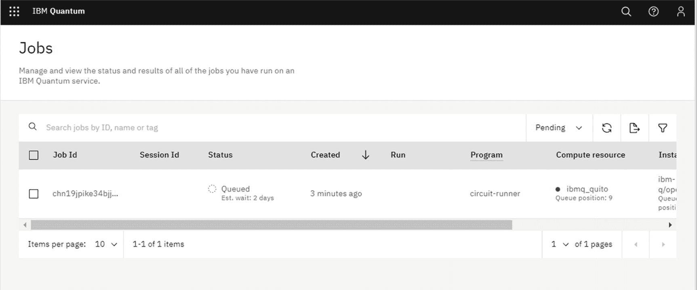

**图 4-6** Web 控制台中的作业状态

> **注意：** 根据执行队列的大小，您的作业可能需要等待一段时间。请通过取消测试作业来保持队列整洁。

### 获取 API 版本

该调用返回 Q Experience REST API 的版本。

* **HTTP 方法：** `GET`
* **URL：** `https://api-qcon.quantum-computing.ibm.com/api/version?access_token=ACCESS-TOKEN`

#### 请求参数

| 名称 | 值 |
| --- | --- |
| `access_token` | 您的账户访问令牌 |

#### HTTP 标头

| 名称 | 值 |
| --- | --- |
| `x-qx-client-application` | 默认为 `qiskit-api-py` |

#### 响应格式

该调用返回一个包含 API 版本的字符串，在撰写本文时为 `0.153.0`。

我们已经深入探究了 IBM Quantum REST API，了解了其幕后机制。现在，让我们通过一组简单的练习来检验这些知识。

## 练习

IBM Quantum REST API 可以成为增强客户端应用程序功能的强大工具。在本练习集中，我们将使用桌面客户端平台设置一个 REST 工作区，用于本章中介绍的 API 调用。

1.  从 `www.postman.com/` 安装 Postman 桌面客户端。提示：启动 Postman 时，请勿登录云账户。这将允许你在本地工作。

2.  为 IBM Quantum REST API 创建一个新集合。将工作区命名为 *IBM Quantum*。提示：了解非常有用的 Postman 全局变量，以便快速存储 API 或访问令牌等信息。参见 `https://learning.postman.com/docs/sending-requests/variables/`。

3.  创建一个新请求：通过令牌进行身份验证。使用以下参数：
    1.  类型：`POST`
    2.  URL：来自本章的身份验证部分：`https://auth.quantum-computing.ibm.com/api/users/loginWithToken`
    3.  有效负载：`{"apiToken": "YOUR_API_TOKEN"}`。提示：从 IBM Q 控制台仪表板复制 API 令牌。验证响应是否返回一个 `id`（访问令牌）。请注意，API 令牌（用于身份验证）与访问令牌（用于调用操作）不同。提示：将访问令牌存储在 Postman 全局变量中，以便在后续操作中使用。

4.  创建一个新请求：通过密码进行身份验证。使用以下参数：
    1.  类型：`POST`
    2.  URL：来自本章的身份验证部分：`https://auth.quantum-computing.ibm.com/api/users/login`
    3.  有效负载：`{"email": "USER-NAME", "password": "YOUR-PASSWORD"}`。验证响应是否返回一个 `id`（访问令牌）。

5.  创建一个 `GET` 请求以获取可用后端的列表：
    1.  类型：`GET`
    2.  URL：`https://api-qcon.quantum-computing.ibm.com/api/Backends?access_token=ACCESS_TOKEN`
    3.  验证响应信息。提示：使用练习 3 中的访问令牌。请勿使用仪表板中的 API 令牌。

6.  创建一个 `GET` 请求以获取处理器参数（使用处理器 `ibm_perth` 或控制台中你喜欢的名称）：
    1.  类型：`GET`
    2.  URL：`https://api-qcon.quantum-computing.ibm.com/api/Backends/ibm_perth/properties?access_token=ACCESS_TOKEN`
    3.  验证响应 JSON。将你的请求命名为 `Get Backend properties`。提示：使用全局变量存储处理器名称。

7.  创建一个 `GET` 请求以获取上述处理器的队列状态：
    1.  URL：`https://api-qcon.quantum-computing.ibm.com/api/Backends/ibm_perth/queue/status?access_token=ACCESS_TOKEN`
    2.  类型：`GET`
    3.  验证 JSON 响应。

8.  创建一个 `GET` 请求以列出执行队列中的作业：
    1.  名称：`List Jobs`
    2.  类型：`GET`
    3.  URL：`https://api-qcon.quantum-computing.ibm.com/api/jobs?access_token=ACCESS_TOKEN`
    4.  验证 JSON 响应。

## 9. 创建一个 `GET` 请求以列出用户实验：

1.  名称：`List Experiments`
2.  类型：`GET`
3.  URL：`https://api-qcon.quantum-computing.ibm.com//api/users/USER_ID/codes/lastest?access_token=ACCESS_TOKEN`（提示：用户 ID 在身份验证请求中返回）。
4.  验证 JSON 响应。

## 10. 创建一个 `GET` 请求以获取 API 版本：

1.  类型：`GET`
2.  名称：`Get API Version`
3.  URL：`https://api-qcon.quantum-computing.ibm.com/api/version?access_token=ACCESS_TOKEN`
4.  验证 JSON 响应。

### 最后，导出你的集合。

如果你计划将 IBM Quantum REST API 集成到现有的桌面或 Web 应用程序中，这将是一个非常有用的工具。你的 Postman 工作区应类似于图 4-7。

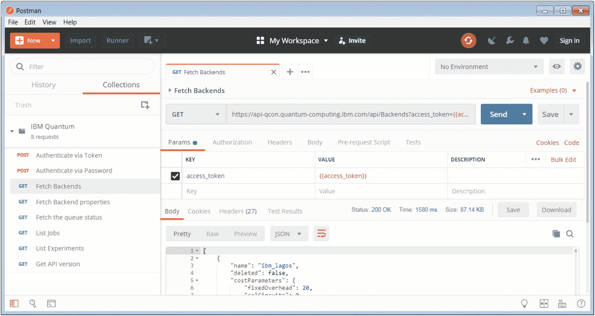

一个标题为 Postman 的窗口截图。应用程序右侧包含历史记录和集合。集合选项已高亮显示。在 IBM quantum 下选中了获取后端选项。左侧选中了 params 选项。此处 access token 已被勾选。

图 4-7

包含 Quantum REST API 集合的 Postman 桌面应用程序

脚注 1   2   3   4
