# 6. Qiskit：用于 Python 量子编程的卓越 SDK

在本章中，你将开始接触 Qiskit，这是目前最顶尖的量子编程 SDK。你将了解到在你的本地系统上安装它有多么简单。本节还展示了量子计算如何模拟其经典对应物，并找到捷径以更快地获得结果。接下来，本章将带你了解量子程序的构成，包括系统调用、电路编译和设计、量子汇编等等。

Qiskit 包含一组有用的模拟器，可以在本地或远程执行你的程序，但它也允许你在真实的处理器上运行。你将一步步学习如何在 IBM Quantum 云平台内的真实设备上运行你的量子程序。那么，让我们开始吧。

## 安装 Qiskit

Qiskit 是量子信息软件工具包（Quantum Information Software Kit），是进行云端量子编程的事实上的 SDK。它是用 Python 编写的，Python 是一种用于科学计算的强大脚本语言。让我们看看如何将这款 SDK 安装到 Linux 或 Windows 系统中。我们从最简单的（Windows）开始，然后跳到 Linux（CentOS, Ubuntu）。

### 在 Windows 上设置

Qiskit 需要 Python 3.6 或更高版本。如果你的系统是 Windows，很可能没有安装 Python。如果是这样，你可以从 Python.org 网站获取安装程序。下载安装程序，运行它，然后在命令窗口中运行以下命令来验证安装：

```
C:\>Python -V
Python 3.8.10
```

处理不同版本的 Python 可能会让人困惑。尽管如此，建议你使用 3.8 以上的版本，以访问 SDK 的最新特性。Python 拥有一个非常棒的包管理器，叫做 PIP（首选安装程序），它使安装模块变得非常容易。因此，要安装 Qiskit，只需在控制台中输入：

```
C:\>pip install qiskit qiskit-aer qiskit-ibmq-provider
```

你需要安装的入门包包括 `qiskit`（核心库）、`qiskit-aer`（模拟器和设备库）和 `qiskit-ibmq-provider`（用于访问硬件处理器）。你可以通过输入 `pip list` 来查看主机上安装的软件包列表。以下是我的配置示例（清单 6-1）。

```
qiskit                        0.39.0
qiskit-aer                    0.11.0
qiskit-experiments            0.3.1
qiskit-ibmq-provider          0.19.2
qiskit-metal                  0.1.2
qiskit-nature                 0.6.0
```

**清单 6-1** `Qiskit` SDK 的 `Python` 包信息

就是这样；你已经作为量子程序员迈出了旅程的第一步。对于 Linux 用户，让我们在 CentOS 7 上进行设置。

### 在 Linux CentOS 上设置

在 CentOS 7 上进行设置会复杂一些。这是因为 CentOS 主要侧重于稳定性，而非前沿软件。因此，CentOS 自带的是 Python 2.7；此外，官方发行版并不提供 Python 3.6 的软件包。但这并不意味着不能安装 Python 3.6。让我们来看看具体方法。

**提示**

本节中的说明应适用于任何基于 Red Hat 基础版本的 Linux 发行版，例如 RHEL 7, CentOS7, 和 Fedora Core。

#### 步骤 1：准备你的系统

首先，通过运行以下命令确保 `Yum`（Linux 更新管理器）是最新的：

```
$ sudo yum -y update
```

接下来，安装 `yum-utils`，这是一个用于扩展和补充 `yum` 的实用程序和插件的集合：

```
$ sudo yum -y install yum-utils
```

安装 CentOS 开发工具。这包括编译器和库，允许构建和编译多种类型的软件：

```
$ sudo yum -y groupinstall development
```

现在，让我们安装 Python 3。请注意，我们将运行多个版本的 Python：官方的 2.7 版本和用于开发的 3.6 版本。

#### 步骤 2：安装 Python 3

为了打破默认 CentOS 发行版的束缚，我们可以使用一个名为*上游稳定版内联（IUS）*的社区项目。这是一套为 CentOS 等不提供最新开发库的操作系统准备的开发库。让我们通过 `yum` 安装 IUS：

```
$ sudo yum -y install https://centos7.iuscommunity.org/ius-release.rpm (CentOS7)
```

IUS 安装完成后，我们可以安装最新版本的 Python（3.6）：

```
$ sudo yum -y install python36u
```

检查以确保安装正确：

```
$ python3.6 -V
Python 3.6.4
```

现在，让我们安装 `pip` 并进行验证：

```
$ sudo yum -y install python36u-pip
$ pip3.6 -V
```

最后，我们需要安装 IUS 包 `python36u-devel`，它提供了有用的 Python 开发库：

```
$ sudo yum -y install python36u-devel
```

#### 步骤 3：避免干扰他人——设置虚拟环境

仅当你运行 Linux 系统，并且有一个运行着多个 Python 版本的多用户系统，同时不想干扰其他用户时，此步骤才有效。例如，在你的主目录中创建一个虚拟环境：

```
$ mkdir $HOME/qiskit
$ cd $HOME/qiskit
$ python3 -m venv qiskit
```

上述命令序列将在用户主目录下创建一个名为 `qiskit` 的文件夹，用于存放你所有的量子程序。在此文件夹内，还会创建一个名为 `qiskit` 的 Python 3 虚拟环境。要激活该环境，请运行以下命令：

```
$ source qiskit/bin/activate
(qiskit) [centos@localhost qiskit]$
```

在虚拟环境中，你可以使用命令 `python` 代替 `python3`，如果你愿意，也可以使用 `pip` 代替 `pip3`：

```
$ python3 -V
Python 3.9.4
```

**提示**：如果你不激活虚拟环境，则必须使用 `python3` 和 `pip3` 而不是 `python` 和 `pip`。同时请记住，根据你的 Linux 发行版不同，情况可能会有所差异。

#### 步骤 4：安装 Qiskit

激活你的虚拟环境并使用以下命令安装 Qiskit：

```
$ pip install qiskit qiskit-aer qiskit-ibmq-provider matplotlib
```

列表 6-2 显示了上述命令的标准输出。

## 安装 Qiskit

```
Collecting qiskit
Downloading qiskit-0.5.7.tar.gz (4.5MB)
100% |████████████████████| 4.5MB 183kB/s
Collecting matplotlib=2.1 (from qiskit)
Downloading matplotlib-2.1.2.tar.gz (36.2MB)
100% |████████████████████| 36.2MB 18kB/s
Complete output from command python setup.py egg_info:
======================================================================
Edit setup.cfg to change the build options
...
Installing collected packages:  IBMQuantum, numpy, python-dateutil, pytz, cycler, pyparsing, matplotlib, decorator, networkx, ply, scipy, mpmath, sympy, pillow, qiskit
Running setup.py install for pycparser ... done
Running setup.py install for matplotlib ... done
Running setup.py install for networkx ... done
Running setup.py install for ply ... done
Running setup.py install for mpmath ... done
Running setup.py install for sympy ... done
Running setup.py install for qiskit ... done
Successfully installed IBMQuantum-1.9.0  qiskit-0.4.11 requests-2.18.4 requests-ntlm-1.1.0 scipy-1.0.1 six-1.11.0 sympy-1.1.1 urllib3-1.22
(qiskit) [centos@localhost qiskit]$
```

列表 6-2 在 CentOS 7 中安装 Qiskit

**提示**：在虚拟环境下，Python 包将安装在环境的主目录`lib/python3.6/site-packages`中，而不是系统的路径下，如图 6-1 所示。

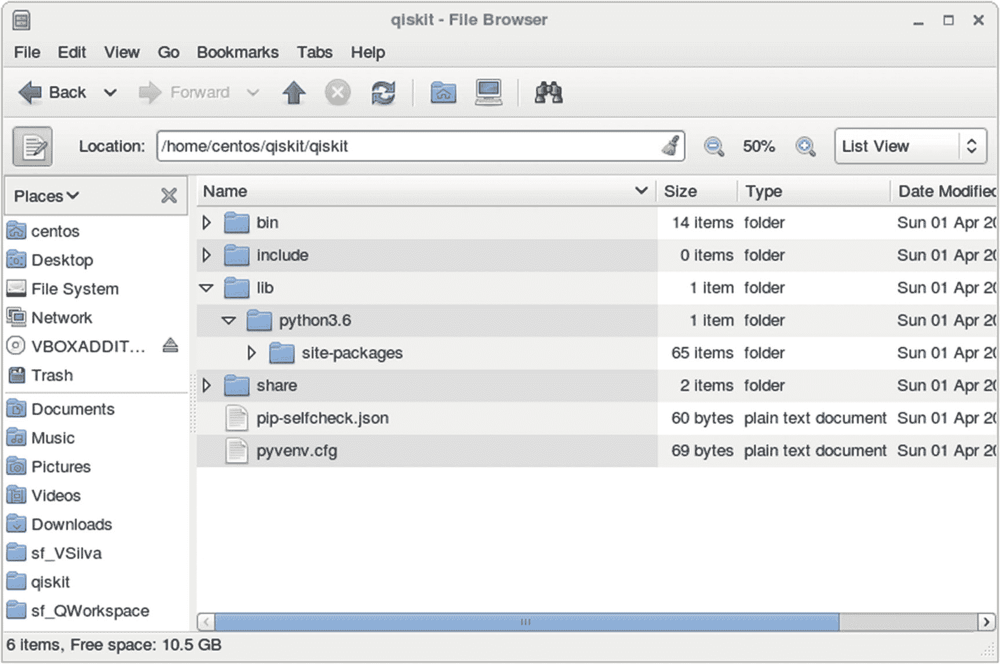

图 6-1 – Python 虚拟环境文件夹布局

### 凭证配置

此步骤是在硬件或远程模拟器上运行程序所必需的。它涉及到将你的 API 令牌存储在本地磁盘的主目录下，以便 SDK 能够与云端通信。事实上，Qiskit 使用了第 4 章中描述的 REST API。配置可以通过编程方式完成，在命令行中的`python`解释器中输入以下行：

```
from qiskit import IBMQ
IBMQ.save_account('MY_API_TOKEN')
```

也可以手动完成：

1.  从 IBM Quantum 仪表板`https://quantum-computing.ibm.com/`复制 API 令牌。

2.  在你的主目录中，将令牌添加到文件`$HOME/.qiskit/qiskitrc`：

    ```
    [ibmq]
    token = API-TOKEN
    url = https://auth.quantum-computing.ibm.com/api
    verify = True
    ```

3.  将令牌添加到文件`$HOME/.qiskit/qiskit-ibm.json`：

    ```
    {
    "default-ibm-quantum": {
    "channel": "ibm_quantum",
    "token": “API-TOKEN”,
    "url": "https://auth.quantum-computing.ibm.com/api"
    }
    }
    ```

    **Linux 用户注意事项**：文件夹的权限应为`755`，所有文件的权限应为`644`。

现在我们已经准备好开始编写量子代码了。让我们看看如何做。

## 你的第一个量子程序

让我们通过一个极简示例来剖析量子程序的构成。在本例中，我们创建一个量子比特和一个用于测量该量子比特的经典寄存器，然后对量子比特应用泡利 X 门（比特翻转），最后测量其值。该程序的基本伪代码可以概括如下：

1.  创建一个量子程序。

2.  创建一个或多个量子比特和用于测量量子比特的经典寄存器。

3.  创建一个电路，将量子比特分组到逻辑执行单元中。

4.  在量子比特上应用量子门以实现期望结果。

5.  将量子比特测量到经典寄存器中以收集最终结果。

6.  在模拟器或真实的量子设备上执行。

7.  获取结果。

现在，让我们详细查看 Python 代码以及 Composer 电路。

```
#############################
from qiskit import *
from qiskit.tools.visualization import *
def main():
### 创建一个带 1 个经典寄存器的 1 量子比特电路
qc = QuantumCircuit(1,1)
### 泡利 X 门
qc.x(0)
### 从量子比特 0 到经典比特 0 的测量门
qc.measure(0, 0)
### 打印到标准输出
print(qc)
### 后端模拟器
backend = 'qasm_simulator'
### 在模拟器中运行
job = execute(qc, Aer.get_backend(backend))
### 显示结果计数
print (job.result().get_counts())
if __name__ ==  '__main__':
main()
```

列表 6-3 量子程序的剖析

让我们看看列表 6-3 中发生了什么：

*   第 2-3 行导入所需的库：`qiskit`（量子类），`qiskit.tools.visualization`（用于电路可视化）。

*   接下来，第 7 行创建了一个`QuantumCircuit`。这是所有操作的入口点。该电路有 1 个量子比特和 1 个用于测量它的经典寄存器。

*   第 10 行向第一个量子比特添加一个泡利 X 门（比特翻转）。这会将初始状态 |0> 翻转到 |1>。

*   第 13 行将量子比特测量到经典寄存器。第 16 行将电路的文本图转储到标准输出。

*   最后，在模拟器`qasm_simulator`中运行（第 19-25 行）。

### Windows 注意事项

Windows 开发者请注意。你必须将程序包装在`main`函数中，然后使用以下方式调用它：

```
if __name__ ==  '__main__':
main()
```

这在 Windows 中是必需的，因为 Qiskit 使用异步任务（执行器）来执行程序，当任务触发时，子进程将在启动时执行主模块。因此，你需要保护主代码以避免递归创建子进程。当我的程序在 CentOS 中正常运行时，但在 Windows 中失败了并显示以下错误，我通过艰难的方式发现了这一点：

```
RuntimeError:
An attempt has been made to start a new process before the
current process has finished its bootstrapping phase.
This probably means that you are not using fork to start your
child processes and you have forgotten to use the proper idiom
in the main module:
if __name__ == '__main__':
freeze_support()
...
如果程序不会被冻结以生成可执行文件，则可以省略 "freeze_support()" 这行。
```

对于 Python 新手来说，这可能是一个头疼的根源。现在，运行程序查看其输出：

```
python p1.py
┌───┐┌─┐
q: ┤  X   ├┤M├
└───┘└╥┘
c: 1/══════╩═

{'1': 1024}
```

结果是 JSON 文档 `{'1': 1024}`，其中 `1` 是量子比特的测量值（记住我们使用 X 门翻转了比特），`1024` 是该结果的迭代次数（shots）。该结果的概率通过将结果迭代次数（`1024`）除以程序的总迭代次数（`1024`）来计算。在这种情况下，`P = 1024/1024 = 1`。

**提示**

量子计算机是概率机器。因此，所有测量结果都附带了该特定结果的概率。

列表 6-3 也可以使用等效的量子电路来描述，该电路可以在量子 Composer 中快速构建和执行，如图 6-2 所示。

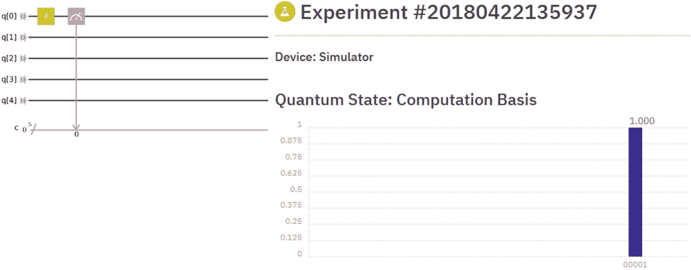

一个示例量子电路。它包括实验的结果及其附带的概率。提供了实验编号、模拟器设备和计算基量子态。

**图 6-2** 程序 6-3 的 Composer 实验

图 6-2 显示了列表 6-3 的量子电路，包括实验结果以及附带的概率。如您所见，该电路非常简单：在 Composer 中，将一个 X 门拖到量子比特 0 上，然后对同一个量子比特执行测量。您会发现 Composer 是一个构建相对简单电路、执行电路并可视化其结果的神奇工具。

## Quantum Lab：云控制台中的隐藏瑰宝

你已经使用命令行和 Composer 运行了你的第一个程序，但在 IBM 控制台工具集中有一个非常强大的工具，在你需要快速测试程序时非常有用。它被称为 Quantum Lab。

### 练习 6.1

从控制台主菜单中，选择 Quantum Lab；你将看到一个启动器。选择一个 Python 3 笔记本，然后从列表 6-3 中粘贴第 2、3 和 6-25 行（移除所有缩进）。按下运行按钮即可看到你的程序运行（见图 6-3）。

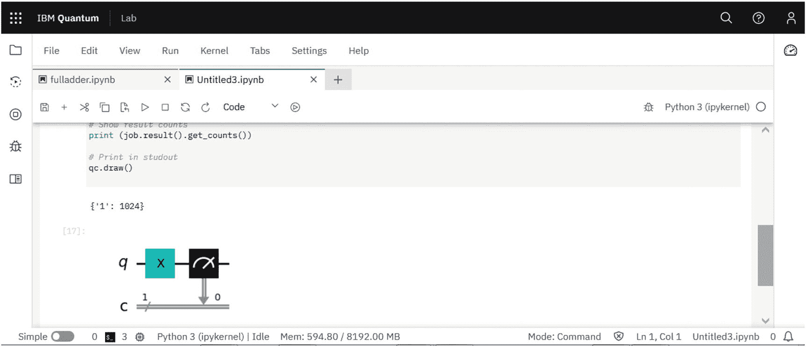

标题为“IBM 量子实验室”的窗口截图。中间页面显示了一个从程序复制的 Python 笔记本列表。通过按下顶部的运行按钮来启动程序。

**图 6-3** 列表 6-3 的 Quantum Lab 执行

**提示**

Quantum Lab 是一个无需安装 Qiskit 或在 Composer 中设计电路即可测试代码的绝佳工具。

### 练习 6.2

修改程序，通过调用 `Quantum Circuit` 的 `draw()` 方法来在浏览器中显示电路。（提示：在代码末尾添加 `qc.draw()`）。验证你的电路看起来与图 6-3 底部一致。

### 练习 6.3

绘制结果计数的直方图。验证它与程序输出和 Composer 的输出是否匹配。（提示：使用 `plot_histogram()` 系统调用，将作业结果计数作为参数传递）。

现在，让我们深入了解 SDK 内部，看看这段代码是如何在幕后被处理的。

## SDK 内部：电路编译

图 6-4 展示了程序运行时后台发生的情况：

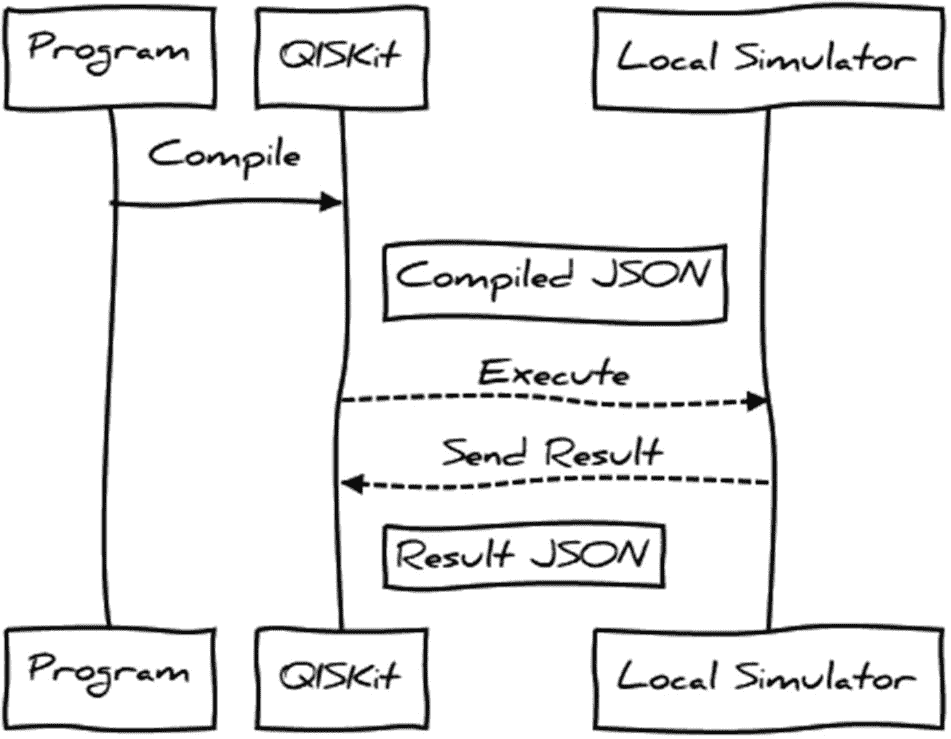

一个框图描述了程序运行背后的过程。它从程序开始，然后是编译、Qiskit、执行和本地模拟器。

**图 6-4** 程序、Qiskit 和本地模拟器之间的序列图

*   Qiskit 将你程序的电路编译成一个 JSON 文档，以便提交给本地模拟器。
*   模拟器解析该文档，运行电路，并返回一个不透明的 JSON 文档（对开发者隐藏）。
*   Qiskit 将结果 JSON 文档包装在一个主程序可用的对象中：例如，调用 `result.get_counts('Circuit')` 从该文档中提取计数信息。

### 电路编译

`清单 6-4` 展示了编译后的程序在提交至模拟器之前的格式。该文档由以下几部分组成：

*   一个执行 ID。
*   一个包含模拟器信息的头部，包括名称、执行中使用的信用点数以及运行交互次数（shots）。
*   `circuits` 部分包含一个电路对象数组。每个电路由以下部分组成：
    *   一个电路名称。
    *   一个包含配置信息的头部，例如量子比特耦合映射、基础（物理）门、运行时间种子等。
    *   一个已编译的电路部分，其头部包含关于量子比特和经典寄存器的信息，以及一系列应用于该电路的操作（或门）及其参数。

```json
{
    "id": "aA46vJHgnKQko3u5L1QqbUDk31sY2m",
    "config": {
        "max_credits": 10,
        "backend": "local_qasm_simulator",
        "shots": 1024
    },
    "circuits": [{
        "name": "Circuit",
        "config": {
            "coupling_map": "None",
            "layout": "None",
            "basis_gates": "u1,u2,u3,cx,id",
            "seed": "None"
        },
        "compiled_circuit": {
            "operations": [{
                "name": "u3",
                "params": [3.141592653589793, 0.0, 3.141592653589793],
                "texparams": ["\\pi", "0", "\\pi"],
                "qubits": [0]
            }, {
                "name": "measure",
                "qubits": [0],
                "clbits": [0]
            }],
            "header": {
                "number_of_qubits": 1,
                "qubit_labels": [["qr", 0]],
                "number_of_clbits": 1,
                "clbit_labels": [["cr", 1]]
            }
        },
        "compiled_circuit_qasm": "OPENQASM 2.0;\ninclude \"qelib1.inc \";\nqreg qr[1];\ncreg cr[1];\nu3(3.14159265358979,0,3.14159265358979) qr[0];\nmeasure qr[0] -> cr[0];\n"
    }]
}
```

**清单 6-4** 程序 6-3 的编译格式

> **注意**
> 编译格式对程序员是不透明的，旨在通过 SDK API 而非直接访问。原因是其格式可能随版本而变化。不过，了解后台发生的事情总是不错的。

### 执行结果

这是从后端模拟器返回给客户端的响应文档。该文档的格式如 `清单 6-5` 所示。值得注意的信息包括：

*   运行状态、执行时间、模拟器名称等。
*   结果数据。这是你程序中可用的信息，包括电路名称、执行时间、状态、测量次数（shots）等。

```json
{
    "backend": "qasm_simulator",
    "id": "aA46vJHgnKQko3u5L1QqbUDk31sY2m",
    "result": [{
        "data": {
            "counts": {
                "1": 1024
            },
            "time_taken": 0.0780002
        },
        "name": "Circuit",
        "seed": 123,
        "shots": 1024,
        "status": "DONE",
        "success": true,
        "threads_shot": 4
    }],
    "simulator": "qubit",
    "status": "COMPLETED",
    "success": true,
    "time_taken": 0.0780002
}
```

**清单 6-5** 来自本地模拟器的结果文档

获取结果文档有点棘手，因为它是一个不透明的对象，不会暴露给用户程序。需要记住的重要一点是，结果文档（以及编译格式）对程序员是隐藏的。原因是它们的格式可能会随着时间的推移而改变。尽管如此，了解事物如何在幕后运行总是有帮助的。

> **提示**
> 编译格式和结果格式对模拟器和集成开发人员很有用。例如，你可以为组织的 Web 应用程序添加量子功能。

### 汇编代码

`清单 6-4` 中的已编译电路包含一个部分，该部分将程序翻译为量子汇编语言（QASM），如下一段所示。

```qasm
OPENQASM 2.0;
include "qelib1.inc";
qreg qr[1];
creg cr[1];
x qr[0];
measure qr[0] -> cr[0];
```

> **提示**
> QASM 仅在由 IBM Quantum 提供的远程模拟器上运行时有用。

### Qiskit 模拟器

访问真实的量子设备代价高昂；因此，我们不应该在真实设备上运行如 `清单 6-3` 这样的简单程序。为了测试目的，Qiskit 提供了一整套模拟器来满足您的所有需求。`表 6-1` 列出了在撰写本文时可用的部分模拟器。

**表 6-1** 用于 IBM Quantum 的本地和远程模拟器列表

| 名称 | 描述 |
| :--- | :--- |
| `qasm_simulator` | 这是 Qiskit 自带的默认 Python 模拟器。它速度较慢但能完成任务。 |
| `simulator_mps` | 矩阵乘积态，一种高效的纠缠态经典模拟。 |
| `simulator_statevector` | 一个状态向量模拟器，支持 CPU 和 GPU 模拟方法。 |


| 完整列表 | 查看完整列表请访问 [`https://qiskit.org/ecosystem/aer/tutorials/1_aer_provider.html`](https://qiskit.org/ecosystem/aer/tutorials/1_aer_provider.html) |

作为一个简单的练习，将以下REST API URL粘贴到浏览器中，获取IBM Quantum模拟器和真实设备的列表：
```
https://api-qcon.quantum-computing.ibm.com/api/Backends?access_token=ACCESS_TOKEN.
```

请注意，您需要一个访问令牌，可以通过使用`第4章`中描述的REST API轻松获得。现在您已经学习了如何在模拟器中运行程序，接下来让我们在真实设备上运行它。

## 在真实量子设备上运行

从易到难，在真实设备上运行有三种方式：
1. 使用Composer创建电路并快速在硬件上运行。此方法主要用于教学目的，以便快速测试。
2. 在本地桌面使用Python执行程序。此方法适用于严肃的量子编程和算法开发。
3. 使用REST API：如果您为服务提供商工作，并希望将量子集成到您的Web或桌面平台，可以使用此方法。

让我们修改上一节中的程序，来创建一个更复杂的电路。清单6-6展示了一个电路，它在第一个量子比特上执行一系列旋转。这些旋转演示了如何使用物理U门，通过`theta`、`phi`或`lambda`角度，将单个量子比特绕布洛赫球的X、Y和Z轴进行旋转。

> `提示`

> 物理门（也称为基础门）很重要，因为它们是构建更复杂逻辑门的基础。

清单6-6执行了以下步骤：
- 分配了5个量子比特和5个经典测量寄存器，对应`Quantum`量子处理器`ibm_perth`可用的5个量子比特（第8行）。
- 下一步，使用基础门`u1`、`u2`和`u3`在第一个量子比特上执行一系列旋转（第29-34行）。
- 最后，对量子比特执行测量，并将结果存储在经典寄存器中。
- 执行前，后端被设置为`ibmqx4`（一个5量子比特处理器 – 第42行），认证令牌和API URL通过`set_api(Qconfig.APItoken, Qconfig.config['url'])`设置。
- 要在真实量子设备上执行，请使用执行系统调用`execute(NAMES, BACKEND, shots=SHOTS, timeout=TIMEOUT)`，其中：
    - `NAMES`是一个电路名称列表。
    - `SHOTS`是电路中执行的迭代次数。次数越高，精度越大。
    - `TIMEOUT`是远程端点的读取超时时间。

```python
import sys,time,math
from qiskit import *
from qiskit.tools.visualization import *
# Main sub
def main():
    # Circuit with 5 qubits, 5 classic bits
    circuit = QuantumCircuit (5,5)
    # first physical gate: u1(lambda) to qubit 0
    circuit.u(math.pi/2, -4 *math.pi/3, 2 * math.pi, 0)
    circuit.u(math.pi/2, -3 *math.pi/2, 2 * math.pi, 0)
    circuit.u(-math.pi, 0, -math.pi, 0)
    circuit.u(-math.pi, 0, -math.pi/2, 0)
    circuit.u(math.pi/2, math.pi, -math.pi/2, 0)
    circuit.u(-math.pi, 0, -math.pi/2, 0)
    # measure gate from qubit 0 to classical bit 0
    circuit.measure_all()
    # dump to stdout
    print (circuit)
    # HW
    name      = 'ibm_perth'
    IBMQ.load_account()
    provider    = IBMQ.get_provider(hub='ibm-q', group='open', project='main')
    backend     = provider.get_backend(name)
    # Group of circuits to execute
    circuits = [circuit]
    job = execute(circuits, backend, shots=512)
    # Show result counts
    print ("Job id=" + str(job.job_id()) + " Status:" + str(job.status()))
###########################################
if __name__ ==  '__main__':
    start_time = time.time()
    main()
    print("--- %s seconds ---" % (time.time() - start_time))
```
`清单 6-6` 示例电路 #2

### 通过Composer运行

清单6-6中的程序也可以使用其流畅的拖放用户界面在Quantum Composer中创建。只需将门拖入量子比特直方图，如图6-5所示，设置门的参数，最后在模拟器或真实设备中保存并运行。

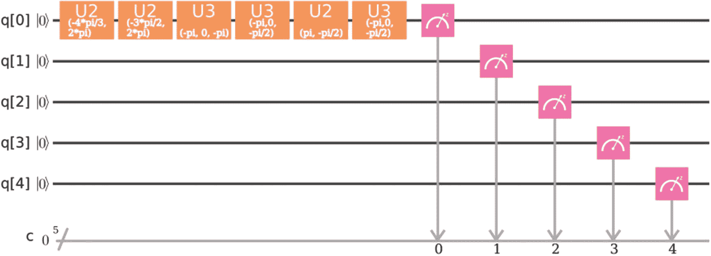

一个使用流畅拖放界面的量子Composer。步骤是将门拖放到量子比特直方图中，设置门的参数，然后保存并执行模拟。

`图 6-5` 程序6-6的量子Composer电路

对于那些喜欢汇编原始功能的人来说，Composer允许以汇编模式将代码直接复制粘贴到控制台中，如图6-6所示。它甚至会解析代码中的任何语法错误，并向您显示有问题的行。

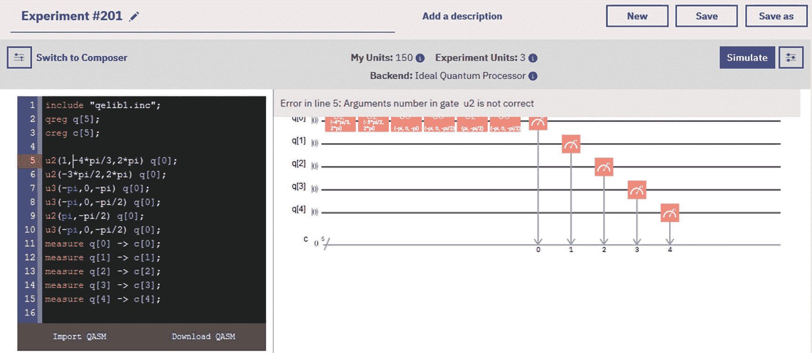

标题为“Experiment 201”页面的屏幕截图。Composer允许以汇编模式将代码直接复制粘贴到代码中。语法错误用阴影标记。左侧窗格显示模拟器汇编模式。

`图 6-6` 图6-5中电路的汇编模式Composer

在IBM Quantum中执行实验有多种方式；其中最有趣的一种是使用他们强大的REST API。

### 通过本地桌面运行

此方法适用于您体内的Python程序员。运行清单6-6中的程序，然后使用Web控制台的IBM Jobs菜单监控其状态（见图6-7）。

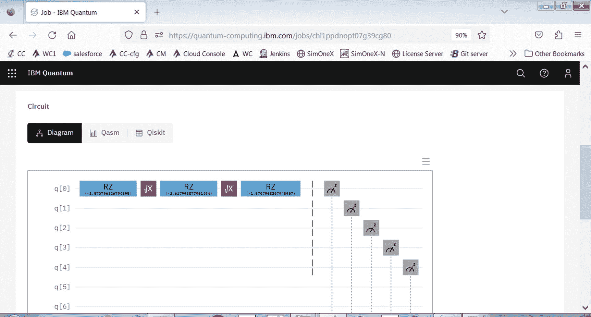

标题为“Job-I B M quantum”页面的屏幕截图。I B M量子电路在下方包含一个图表、Q A S M和Q I S K I T选项。图表选项被选中并高亮显示。

`图 6-7` 清单6-6在Web控制台内的硬件（`ibm_perth`）上运行的作业视图

> `注意`

> 根据执行队列的大小，您的作业肯定会进入`PENDING`状态。您可能需要等待一段时间。使用“计算资源”菜单监控队列大小，或者在最终完成工作之前在模拟器中运行。硬件资源始终是宝贵的。

### 通过您喜爱的REST客户端运行

这是与Quantum交互最激动人心的方式之一，但也是最困难的。通过使用简单的REST请求，您几乎可以做任何事情：
- 列出后端设备。
- 列出真实设备的硬件或校准参数。
- 获取有关作业执行队列的信息。
- 获取作业或实验的状态。
- 运行或取消作业。

> `提示`

> REST API允许您使用任何语言创建自己的IBM Quantum接口（甚至是一个Web浏览器）。此API在第4章中有详细描述。实际上，Python和Composer在后台调用了REST API。

要使用REST提交实验，我们使用`jobs` API。让我们看看如何操作。

#### 通过作业API运行

你可以使用任意常用的浏览器REST客户端来提交清单6-6中的实验。例如，使用Chrome的YARC（Yet Another REST Client），向以下端点发送一个HTTP POST请求：
```
https://runtime-us-east.quantum-computing.ibm.com/jobs
```

其中的棘手之处在于获取你的访问令牌或访问密钥。为此，你必须使用API令牌或用户名和密码进行身份验证。请注意，不要将API令牌与访问令牌混淆。要获取访问令牌，你必须发送一个身份验证请求。（请参阅第4章中*远程REST API*下的内容。）

> `提示`


> Chrome 的 YARC 允许你构建 REST 请求并将其保存为收藏。按照第 4 章中的描述，向 IBM Quantum 创建一个身份验证请求，将其保存为收藏，并每次使用它来获取访问令牌，以测试其他 REST API 调用。

请求负载是清单 6-7 中所示的 JSON 文档。其格式在表 6-2 中进行了描述。

| 键 | 描述 |
| --- | --- |
| `Circuits` | 这是一个汇编代码程序的数组，所有程序均在一行内，由换行符（`\n`）分隔 |
| `shots` | 你的代码将运行的迭代次数 |
| `backend` | 这是一个描述后端的对象。本例中为 `ibm_quito` |
| `Hub`、`Group`、`Project` | 对于开放式（免费）计划：`ibm-q`、`open`、`main` |

```
{
"program_id": "circuit-runner",
"hub": "ibm-q",
"group": "open",
"project": "main",
"backend": "ibmq_quito",
"params": {
"shots": 1024,
"circuits": [
"\n\ninclude \"qelib1.inc\";\nqreg q[5];\ncreg c[5];\nu2(-4*pi/3,2*pi) q[0];\nu2(-3*pi/2,2*pi) q[0];\nu3(-pi,0,-pi) q[0];\nu3(-pi,0,-pi/2) q[0];\nu2(pi,-pi/2) q[0];\nu3(-pi,0,-pi/2) q[0];\nmeasure q -> c;\n"
]
},
"tags": [
"composer-info:composer:true",
"composer-info:code-id:d2262dd4e07a9f894caabd977b10c7e98d90537228723dd14dceaab023c36098",
"composer-info:code-version-id:646d2a856260a179aa094d3e"
]
}
```

一旦你获得了访问令牌，将 HTTP 头部 `X-Access-Token: ACCESS_TOKEN` 添加到请求中，然后将清单 6-7 中的负载复制粘贴到 REST 客户端的负载中，提交并等待响应。如果一切顺利，你应该会收到以下响应：

```
{
"id": "chobhqanajhpa6495on0",
"backend": "ibmq_quito"
}
```

可以使用作业 ID 来查看状态或从控制台检索结果。

> **提示**
>
> 作业 API 目前是未归档的，不打算让用户直接访问。因此，响应格式可能会随时间变化。也许未来会有所改变，REST API 将成为官方 SDK 的一部分。但与此同时，你的结果可能会有所不同。

### 结果可视化类型

Qiskit 包含一个复杂的可视化库，用于展示你的结果。以下是其中一些类型：

- **直方图**：目前最常用的一种。它绘制了计数数据的直方图。
- **态城市图**：绘制量子态的城市场景图；即密度矩阵 `rho` 的实部和虚部的两个 3D 条形图。
- **态 Hinton 图**：使用方块来表示矩阵中的值，方块的大小表示对应值的幅度，而其颜色则表示值的符号。白色方块表示值为正，黑色方块表示值为负。
- **量子球体**：绘制量子态的球体表示。这里，点的大小与状态中对应项的概率成正比，颜色表示相位。
- **PauliVec**：以所有可能的泡利算符和恒等算符的张量积为基，绘制量子态密度矩阵的条形图。
- **布洛赫多向量**：为每个量子比特绘制一个布洛赫球。

> **注意**
>
> 除直方图外，所有可视化类型都需要状态向量模拟器。

让我们通过绘制第一组贝尔（纠缠）态的图来看看这些图示的实际效果

| 代码 | 可视化 |
| --- | --- |
| ```python<br>from qiskit import *<br>from qiskit.visualization import *<br>qc = QuantumCircuit(2)<br>qc.h(0)<br>qc.cx(0,1)<br>qc.measure_all()<br>job = execute(qc, Aer.get_backend("qasm_simulator"))<br>plot_histogram(job.result().get_counts())<br>``` | 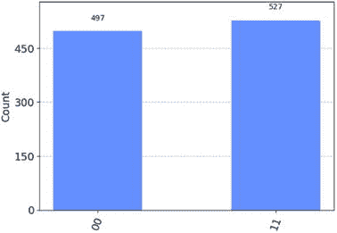<br>计数与状态 00 和 11 的柱状图。数值如下：00, 497。11, 527。 |
| ```python<br>from qiskit import *<br>from qiskit.visualization import *<br>qc = QuantumCircuit(2)<br>qc.h(0)<br>qc.cx(0,1)<br>job = execute(qc, Aer.get_backend("statevector_simulator"))<br>plot_state_city(job.result().get_statevector())<br>``` | 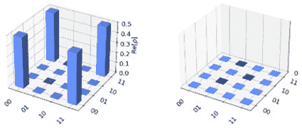<br>两个三维柱状图。这里，状态 00 和 11 具有约 0.5 的最高值。 |
| ```python<br>from qiskit import *<br>from qiskit.visualization import *<br>qc = QuantumCircuit(2)<br>qc.h(0)<br>qc.cx(0,1)<br>job = execute(qc, Aer.get_backend("statevector_simulator"))<br>plot_state_hinton(job.result().get_statevector())<br>``` | 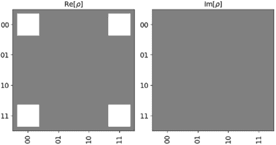<br>一组用于量子态密度矩阵的两个 Hinton 图。矩阵值由方块表示。此处，该图有四个浅色方块，表示正值。 |
| ```python<br>from qiskit import *<br>from qiskit.visualization import *<br>qc = QuantumCircuit(2)<br>qc.h(0)<br>qc.cx(0,1)<br>job = execute(qc, Aer.get_backend("statevector_simulator"))<br>plot_state_qsphere(job.result().get_statevector())<br>``` | 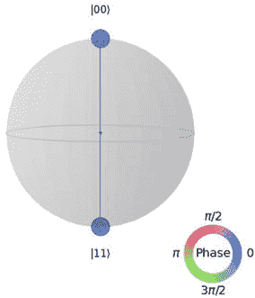<br>一个 Q 球面图，其中有两个分别对应 00 和 11 状态的阴影圆，位置相对。这里的阴影圆表示正相位。相位符号单独提供在下方。共有四个符号：π/2、0、3π/2 和π。 |
| ```python<br>from qiskit import *<br>from qiskit.visualization import *<br>qc = QuantumCircuit(2)<br>qc.h(0)<br>qc.cx(0,1)<br>job = execute(qc, Aer.get_backend("statevector_simulator"))<br>plot_state_paulivec(job.result().get_statevector())<br>``` | 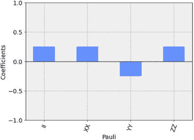<br>系数与泡利算符的柱状图。图表数据如下：II, 0.25。XX, 0.25。YY, -0.25。ZZ, 0.25。数值均为近似值。 |
| ```python<br>from qiskit import *<br>from qiskit.visualization import *<br>qc = QuantumCircuit(2)<br>qc.h(0)<br>qc.cx(0,1)<br>job = execute(qc, Aer.get_backend("statevector_simulator"))<br>plot_bloch_multivector(job.result().get_statevector())<br>``` | 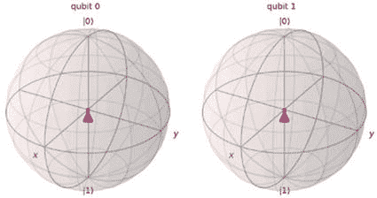<br>两个多向量图描绘了状态 00 的测量结果。a. 量子比特 0。b. 量子比特 1。此处，00 和 11 出现的概率相等。 |

- 对于直方图（`plot_histogram`），X 轴显示测量结果：对应于贝尔态的 00 和 11。Y 轴显示结果计数，其概率为 1/2（497/1024 和 527/1024，因为 497+527=1024，即总射击次数）。

## 各类量子态可视化图表

*   **态城市图**（`plot_state_city`）较难理解，但仔细观察会发现只有状态 `00` 和 `11` 具有 3D 柱状条。Y 轴上的概率为 `1/2`。注意虚部（右侧）为空（请记住，测量后虚部将始终消失）。
*   **态 Hinton 图**（`plot_state_hinton`）显示状态 `00` 和 `11` 的白色方块。白色表示数值为正。
*   **Q 球面图**（`plot_state_qsphere`）同样显示状态 `00` 和 `11` 的蓝色圆圈；这里的蓝色阴影表示正相位（符号），如图例所示。
*   **泡利矢量图**（`plot_state_paulivec`）最难理解：我们可以将量子态重写为两个量子比特所有排列的组合，使得 `|ψ⟩ = 0.70|00⟩ + 0|01⟩ + 0|10⟩ + 0.70|11⟩`。因为测量到 `00` 或 `11` 的概率为 `1/2`，我们可以将该态表示为所有泡利矩阵的张量积，其中 `0.25I + 0.25XX - 0.25YY + 0.25ZZ` 映射到 `0.70|00⟩ + 0.70|11⟩`。在此上下文中，`I` 映射到 `00`，`ZZ` 映射到 `11`（中间项相互抵消）。
*   最后，**多向量图**（`plot_bloch_multivector`）显示测量结果 `00`。注意 `00` 和 `11` 是等概率的。

尝试以下练习以更清楚地理解这一点。本章末尾还提供了更多结果可视化练习。

### 练习 6.4

绘制第二个贝尔态`$$ {\varphi}_{-}=\frac{1}{\sqrt{2}}\left(\left.|00\right\rangle -\left.|11\right\rangle \right) $$`的直方图和态城市图。提示：在第一个量子比特上添加一个 X 门。注意相位（符号）不会在直方图中显示，但会在态城市图中显示。为什么？提示：概率可以为负吗？

### 练习 6.5

绘制第三个贝尔态`$$ {\theta}_{+}=\frac{1}{\sqrt{2}}\left(\left.|01\right\rangle +\left.|10\right\rangle \right) $$`的直方图和态城市图。将结果与上面的图表进行比较，并验证结果显示正确的输出：`01`、`10`。提示：在第二个量子比特上添加一个 X 门。

### 噪声模型与假提供者

到目前为止，你已经了解了如何从完美（无噪声）模拟器中显示结果。然而，在现实中，量子电路是脆弱且充满噪声的。它们很容易因与环境的相互作用而变得模糊不清。出于以下几个原因，最好先在噪声模拟器中测试电路，然后再迁移到真实设备上：

*   执行队列中等待时间过长。
*   你的工作可能需要大量量子比特，但你的付费套餐中并不提供。
*   你的时间限制可能要求你快速测试工作，或者你根本没有时间或耐心在硬件执行队列中等待数小时或数天。

无论出于何种原因，Qiskit 都提供了一个强大的噪声模拟系统，它有两种形式：

*   使用 Aer 包中的模块实现**细粒度噪声控制**：一个用于量子电路的高性能模拟器。
*   **假提供者**：这些后端是使用系统快照模拟 IBM Quantum 硬件行为的。假提供者在本地桌面运行，并以处理器名称命名。例如，对于处理器 `ibm_perth`，其对应的假提供者名为 `FakePerth`。

> **注意**
> 我们生活在 NISQ（含噪中等规模量子计算）时代，纠错是当下最热门的研究领域之一。你很快就会意识到，噪声是实验结果中的一个大问题，尤其是在量子比特数量众多、噪声累积的情况下。

让我们为我们研究过的其中一个贝尔态添加一些噪声。请看列表 [6-8]（图 [6-10]）。它为上一节的贝尔态 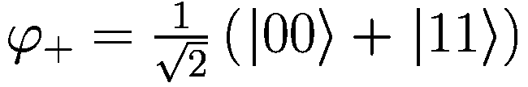 创建了一个噪声模型。

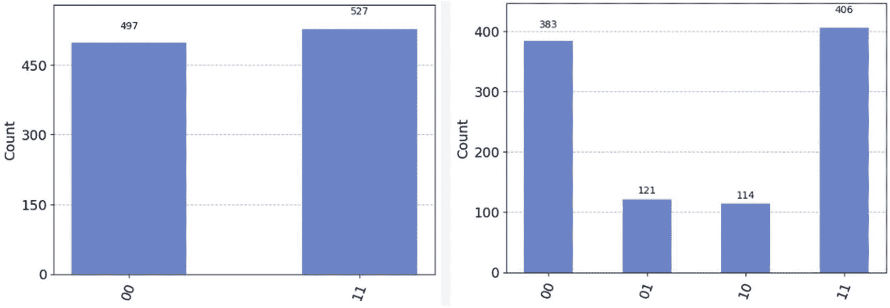
**图 6-10** – 无噪声模拟（左）与使用列表 [6-8] 中 `qasm_simulator` 的 10% 噪声模型（右）的结果计数对比

```python
from qiskit import *
from qiskit.tools.visualization import *
from qiskit.providers.aer.noise.errors import pauli_error, depolarizing_error
from qiskit.providers.aer.noise import NoiseModel

def get_noise(p_meas, p_gate):
    error_meas = pauli_error([('X', p_meas), ('I', 1 - p_meas)])
    error_gate1 = depolarizing_error(p_gate, 1)
    error_gate2 = error_gate1.tensor(error_gate1)

    noise_model = NoiseModel()
    # 测量误差应用于测量
    noise_model.add_all_qubit_quantum_error(error_meas, "measure")
    # 单量子比特门误差应用于 x 门
    noise_model.add_all_qubit_quantum_error(error_gate1, ["x"])
    # 双量子比特门误差应用于 cx 门
    noise_model.add_all_qubit_quantum_error(error_gate2, ["cx"])

    return noise_model

noise_model = get_noise(0.1, 0.1)  # 10%

qc = QuantumCircuit(2)
qc.h(0)
qc.cx(0, 1)
qc.measure_all()

backend = Aer.get_backend("qasm_simulator")
job = execute(qc, backend, noise_model=noise_model)
plot_histogram(job.result().get_counts())
```

**列表 6-8** – 第一个贝尔态 `φ+` 的 10% 噪声模型

我们首先从 `qiskit.providers.aer.noise` 包中导入所需的模块。一些关键的系统调用包括：

*   `NoiseModel`：一个存储用于模拟的噪声模型的类。
*   `pauli_error`：一个 n 量子比特泡利误差通道（混合酉），以泡利门和概率列表的形式给出。
*   `depolarizing_error`：一个 n 量子比特退极化误差通道，由退极化概率 `p` 参数化。

在假提供者中运行甚至更简单；让我们更新列表 [6-8] 中的代码，使用 `qiskit.providers.fake_provider` 包来调用带有约 1% 误差模型的 `FakePerth`。将你的结果与图 [6-10]（左）中的无噪声结果进行比较。

| `from qiskit import *`<br>`from qiskit.tools.visualization import *`<br>`from qiskit.providers.fake_provider import *`<br><br>`qc = QuantumCircuit(2)`<br>`qc.h(0)`<br>`qc.cx(0, 1)`<br>`qc.measure_all()`<br><br>`backend = FakePerth()`<br>`job = execute(qc, backend)`<br>`plot_histogram(job.result().get_counts())` | 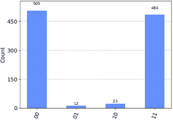 |
| --- | --- |

### 练习 6.6

使用量子实验室为第一个 GHZ 态 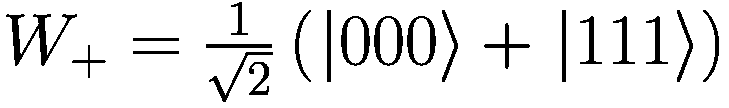 创建一个电路。绘制带噪声的 `FakePerth` 的直方图。提示：GHZ 是描述 3 个纠缠量子比特的量子态的名称。验证 `000` 和 `111` 的结果计数最高。

## 练习

让我们为描述两个纠缠量子比特的贝尔态创建量子电路。共有 4 个贝尔态：

# 贝尔态公式

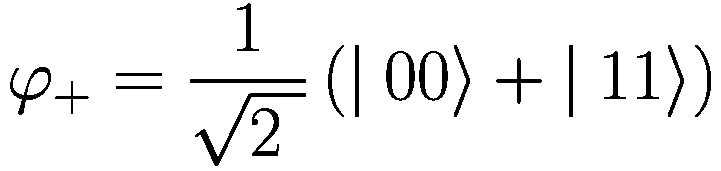

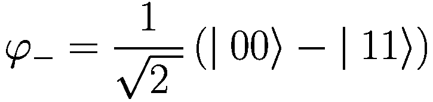

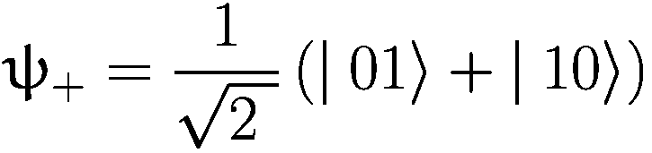

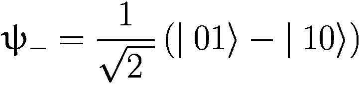

它们分别使用希腊字母 `φ+` 和 `ψ+`。

## 贝尔态练习

### 练习 6.7

使用量子实验室编写一个程序来绘制 `φ[+]`。验证电路是否如以下所示。

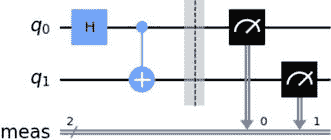

### 练习 6.8

在 `qasm_simulator` 中运行上一个电路，并将结果计数显示在标准输出上。验证它们是否与预期值匹配。例如，`{'00': 517, '11': 507}`。绘制一个计数的直方图。（提示：使用 `plot_histogram` 系统调用）。

### 练习 6.9

修改上一个电路以绘制 `φ[-]`。注意，在 `qasm_simulator` 中运行时，相位（负号）不会显示。我们如何可视化这个负号？提示：将 `qasm_simulator` 切换到状态向量模拟器 (`statevector_simulator`)，然后使用 `job.result().get_statevector()` 系统调用来打印结果。验证负号是否出现。提示：系统调用 `array_to_latex(job.result().get_statevector())` 将以非常漂亮的 LaTeX 格式显示输出：`[1/√2, 0, 0, −1/√2]`。

### 练习 6.10

编写一个程序来显示贝尔态 `ψ+`。使用 `qasm_simulator`。验证输出是否类似于：`{'01': 517, '10': 507}`。绘制直方图。

### 练习 6.11

最后，编写一个程序来显示贝尔态 `ψ-`。使用 `statevector_simulator`。验证状态和相位是否与代数结果匹配：`[0, 1/√2, −1/√2, 0]`。

## 扩展 Qiskit 习题

以下是一组经过强化的习题，旨在加深你对 Qiskit SDK 的理解。请使用量子实验室快速测试你的解决方案。如果遇到困难，附录中提供了参考答案。

### 6.12

哪种量子门与经典非门类似？`X`，`H`，`Y`，`CNOT`。

### 6.13

以下哪个命令会将下面的量子电路转换为 qasm 字符串？

```python
qc = QuantumCircuit(2,2)
qc.h(0)
qc.h(1)
```

`qc.qasm_simulator()`，`qc.qasm_str()`，`qc.qasm()`

### 6.14

以下量子电路的深度是多少？提示：电路深度是电路中的最长路径。路径长度始终为整数，表示该路径上需要执行的门的数量。


### 6.15

以下哪个语句会打印 qiskit 版本？

```python
import qiskit
print(qiskit.__version__)
print(qiskit.__qiskit_version__)
print(qiskit.version())
print(qiskit_version())
```

### 6.16

以下代码片段的输出是什么？

```python
q = QuantumRegister(2,"qreg")
c = ClassicalRegister(2,"creg")
qc = QuantumCircuit(q,c)
qc.x(q[0])
qc2.measure(q,c)
job = execute(qc2,Aer.get_backend('qasm_simulator'),shots=1024)
counts = job.result().get_counts(qc2)
print(counts)
```

`{'00': 1024}` `{'11': 1024}` `{'10': 1024}` `{'01': 1024}`

### 6.17

以下哪个语句返回下列电路的深度？

```python
q = QuantumRegister(3)
c = ClassicalRegister(3)
qc = QuantumCircuit(q,c)
qc.h(q[0:3])
qc.x(q[0:3])
qc.z(q[0:3])
qc.draw(output='mpl')
```


`qc.size()`，`qc.path()`，`qc.depth()`

### 6.18

为了实现量子态 `i|10>`，以下哪个选项最适合填入下方代码片段中的缺失语句？提示：`Y|0> = i|1>`，同时请记住 Qiskit 使用小端序比特排序（量子比特 0 从右侧开始）。

```python
from qiskit import QuantumRegister, ClassicalRegister, QuantumCircuit, execute, Aer
qc = QuantumCircuit(2,2)
### 缺失语句
```

a) `qc.z(1) qc.x(1)`

b) `qc.y(1)`

c) `qc.y(0)`

d) `qc.s(0) qc.z(1)`

### 6.19

在我们的量子电路中，有一个量子比特初始化为 `|0>` 状态。以下哪些量子门会得到相同的输出状态 `|0>`？（选择 3 个）：`S`，`T`，`HSH`，`HYH`，`I`，`HZH`。提示：哪种（或哪些）门会使状态保持不变？

### 6.20

在下面的量子电路中，你应该使用哪个指令来测量量子比特输出？提示：该电路没有经典寄存器。

```python
qc = QuantumCircuit(1)
qc.x(0)
```

`qc.measure(0)`，`qc.measure(0,0)`，`qc.measure()`，`qc.measure_all()`

### 6.21

在下面的代码中，哪个语句是非酉的？提示：忽略 `QuantumCircuit`。

```python
qc = QuantumCircuit(2,2)
qc.x(0)
qc.y(1)
qc.z(1)
qc.measure([0,1],[0,1])
```

### 6.22

选择显示下图的最佳选项。

```python
a) legend = ['所有 H 门']
title = '三个量子比特的叠加态'
plot_histogram(counts, legend=legend, title=title)

b) title = ['所有 H 门']
legend = '三个量子比特的叠加态'
plot_histogram(counts, legend=legend, title=title)

c) plot_histogram(counts)
```

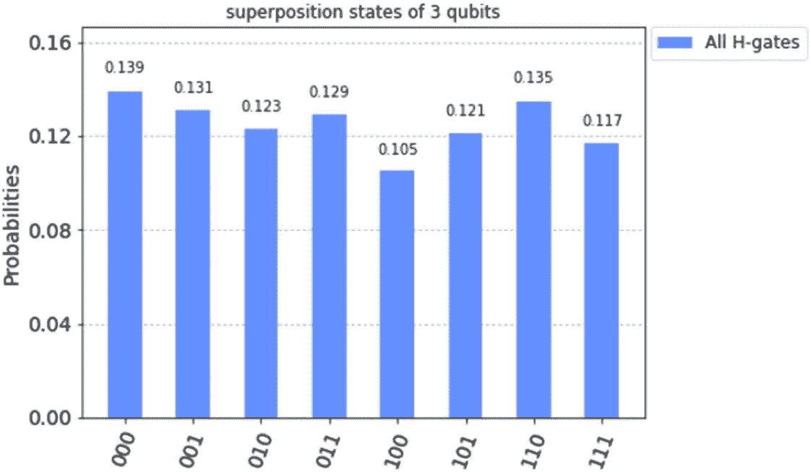

### 6.23

对于给定的贝尔量子电路，以下哪个 qsphere 图是正确的？

```python
bell = QuantumCircuit(2)
bell.h(0)
bell.x(1)
bell.cx(0,1)
```

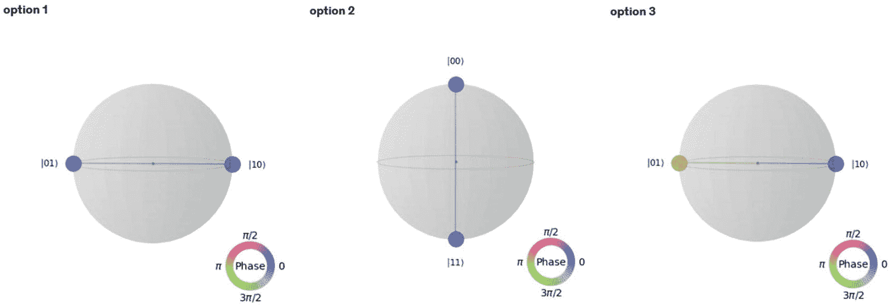

### 6.24

哪个选项在其 state_city 图中正确描述了以下给定的量子电路？

```python
bell = QuantumCircuit(2)
bell.x(0)
bell.h(0)
bell.cx(0,1)
```

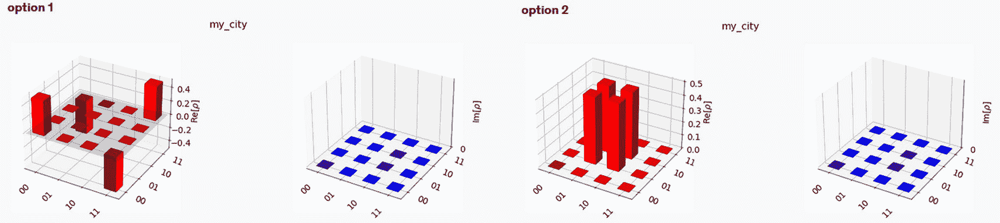

四个三维图从左到右的标题分别为：选项 1、我的城市、选项 2 和我的城市。

6.25 给定由单个量子比特量子电路（`qc`）的布洛赫球表示的状态向量，假设电路初始化为 `|0>`，选择能到达该状态的操作（选择 3 个）。

```
a) qc.h(0)
b) qc.h(0)
   qc.x(0)
c) qc.ry(pi/2,0)
   qc.x(0)
d) qc.rx(pi,0)
e) qc.rx(pi,0)
   qc.ry(pi,0)
```

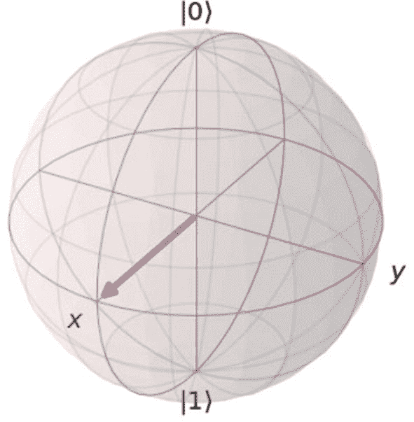

一个单量子比特量子电路的布洛赫球。一个箭头从球心指向外表面上标有“x”的一点。

作为云端量子程序员，你已经迈出了这段旅程的第一步。通过使用 Python SDK 和强大的量子汇编引擎，可以在令人惊叹的 IBM Quantum 平台上运行实验。当几年后量子计算机开始加入数据中心时，这些技能将非常有价值。在下一章中，我们将通过一系列算法来提升一个层次，这些算法展示了量子力学应用于计算时的真正威力。那么，让我们继续吧。
