# 理查德·费曼：物理学的半神，量子计算机之父

在上世纪最伟大物理学家的排名中，美国物理学家理查德·费曼（1918–1988）的等次仅略低于阿尔伯特·爱因斯坦。他的名字、传奇和遗产，如同半神的功绩，长存于学术殿堂。费曼在物理学领域五十余年的生涯中成就斐然：他参与了制造第一颗原子弹的曼哈顿计划；他在计算和量子电动力学方面的讲座与著作堪称传奇；他的著作《费曼物理学讲义：六则简单篇章》彻底革新了世界各地的物理教学方式。费曼是量子场论（现代量子力学观点）的先驱者之一；他的贡献意义深远，并于 1965 年因其在量子电动力学方面的研究获得诺贝尔奖。

关于费曼，一个鲜为人知的小细节是，他是最早提出量子计算机构想的人。他意识到，研究原子尺度现象所需的巨大复杂性，应该由一台基于原子原理设计的机器来承担；这便是量子机器的黎明。本章是我对这位杰出人物的生平与贡献的理解。

## 量子场论的奥秘：无穷大的瘟疫

量子场论在描述现实世界的最小尺度方面取得了巨大成功，它建立在哥本哈根诠释的量子力学之上，成为了当代物理学的观点。然而，这一成功也付出了代价，因为即便是量子场论中最强大的方程，如狄拉克方程（详见第 1 章）或费曼路径积分，在处理最简单的粒子相互作用时也变得极其难以求解。尽管如此，这并未阻止物理学家寻找巧妙的方法使其变得可行。这些努力包括：

1.  首先，通过近似将复杂性简化为可解的形式。
2.  其次，处理这些近似方程中出现的恼人的无穷大。
3.  最后，将整个过程整合成一个大多数人都能理解的图解系统；其伟大成果便是：费曼图。

为了解量子场论可以变得多么混乱，考虑最简单的粒子相互作用：电子散射（当两个电子相互碰撞时——见图 2-1）。

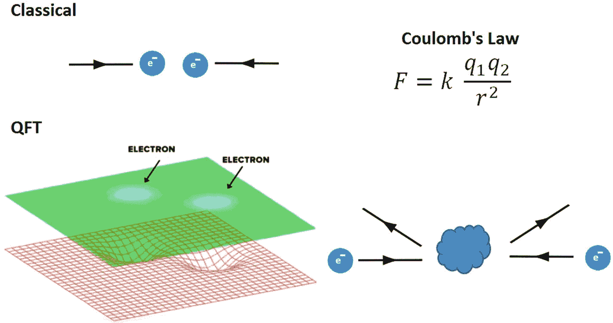

一幅插图根据经典电动力学和量子场论表示了电子散射。库仑定律在顶部被标出，公式为 F = K 乘以 q1q2 除以 r 的平方。

**图 2-1** （上）根据经典电动力学的电子散射，（下）根据量子场论的相同过程

在传统的经典电动力学中，库仑定律量化了两个静止带电粒子之间的力的大小。这是因为每个电子都会产生一个电磁场，而这个电磁场会对另一个电子施加一个排斥力。该力与距离的平方成反比：

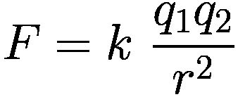

其中

*   `k` 是库仑常数，有时称为电力常数或静电常数，在真空中 `k = 8.99x10⁹ Nm²C^(-2)`。注意，其值取决于粒子所处的介质。
*   `q[1]`、`q[2]` 是电子的电荷量。
*   `r` 是它们之间的距离。

对于大多数最简单的情况，库仑定律在这种亚原子台球碰撞中效果良好，且易于求解。然而，在现代量子场论，特别是量子电动力学中，情况就不同了。在量子场论中，电子不是一个粒子，而是电子场中的一次振动（见图 2-1）。注意，这个场（以及所有量子场）遍布整个宇宙，无论是否存在电子，它都无所不在。此外，电子场可能与其他场相互作用，例如电磁场，其振动负责产生光子，即我们感知到的光。量子电动力学就是这样描述电子散射的。

### 根据量子电动力学的电子散射

电子场中的一次振动产生我们称之为粒子的东西；这个场反过来又与电磁场相连（一个场中的振动可能引发另一个场中的振动）。当电子激发电磁场时，它会产生一个光子，这个光子又会将第一个电子的一部分动量传递给第二个电子。在量子场论中，这个被交换的光子被称为虚粒子，由于量子事件，它的存在笼罩在神秘之中，可以简单理解为这个虚粒子仅存在足够长的时间来传递力。还有其他类型的虚粒子，其存在同样模糊，但更多的内容将在下一节关于费曼图的部分讨论。

现在正是我们初次接触费曼图的好时机，这里展示的是根据量子电动力学描绘的电子散射图。我们稍后会深入探讨其内在原理。

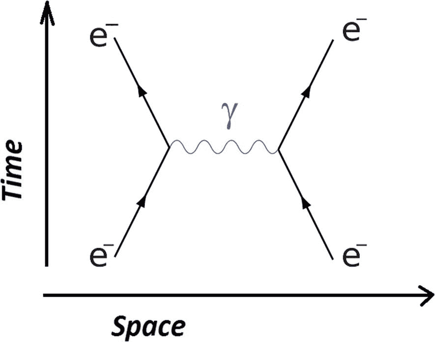

一幅时间与空间的关系图，在被散射的电子电荷（表示为伽马）之间呈现了正弦波模式。

**图 2-2** 电子散射最可能情况的费曼图

在图 2-2 中，我们看到两个电子在一个坐标系中相向而行，其中 Y 轴代表时间，X 轴代表空间。注意，空间轴上的实际距离并不重要：

*   电子交换一个虚光子（用希腊字母伽马 γ 表示），即带有波浪线的三点顶点。
*   电子最终相互远离。

但是，费曼图不仅仅是相互作用的图画，正如我们将在下一节中看到的，它们是伪装起来的方程，图中的每一部分都代表着一大块数学表达式。事情变得真正奇异的地方在于带有波浪线（虚光子交换）的顶点，以至于量子场论中有如下观点：

> **提示** 电子散射发生的方式是无限的；此外，所有导致相同结果的中间事件都确实会发生。因此，要完美计算两个电子的散射，我们需要把所有可能发生的方式加起来。

鉴于这个简单过程背后存在着无限的可能性，完整的量子场论解是不可能的。这时，微扰理论登场了，它是解决量子场论问题绝对不可或缺的工具。

### 微扰理论：若无法尽善尽美，或许近似足矣

微扰理论是求解无解方程的艺术：当你遇到一个无法求解的方程时，只需找到一个可解的相似方程，然后对其进行小幅调整（即微扰），使得结果与之近似。结果永远不会精确，但足以让你接近真相。

以电子散射为例，最可能发生的相互作用是交换一个虚光子。其他所有相互作用对该事件发生概率的贡献都更小。

> **提示**  
> 理查德·费曼曾指出，相互作用越复杂，它对最终概率幅的贡献就越小。而他的图表在此大显身手；事实上，特定相互作用的概率取决于连接点的数量（即顶点数）；以至于在相互作用中每增加一个顶点，最终概率就会降低约 100 倍。

因此，电子散射最可能的相互作用是图 2-2 中的简单情况：包含两个顶点和一次虚光子交换；三个顶点的交换贡献的概率约为两个顶点相互作用的 1%，四个顶点的相互作用贡献的概率又约为三个顶点的 1%，以此类推。微扰理论和费曼图有助于识别哪些是对最终方程的重要补充，以及哪些相互作用可以忽略。它们让复杂的计算成为可能，但我们仍未大功告成。

中间态的低概率引出了一个新谜题，对于*圈相互作用*尤其如此。让我们仔细审视一下。

### 用重整化应对那些恼人的无穷大

圈相互作用是奇特的中间态，会在费曼图中制造混乱。两个典型的圈相互作用例子是（见图 2-3）：

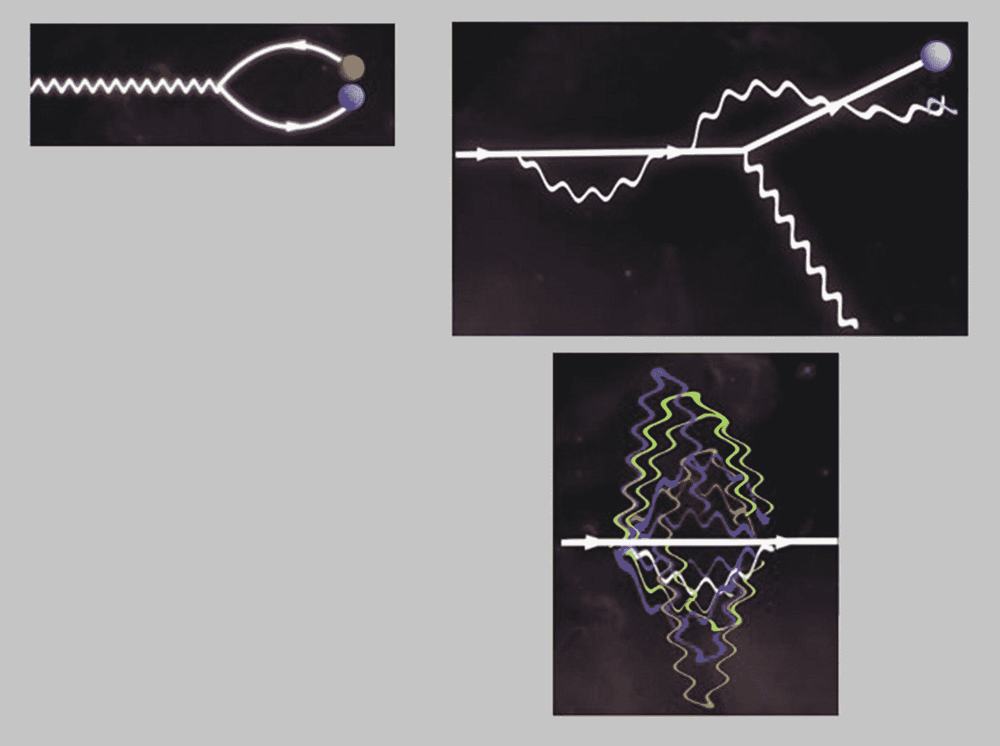

该插图展示了圈相互作用的两个例子，并标明了电子和光子的流动方向。

**图 2-3** 两个圈相互作用的例子：左侧，一个光子变为一个电子-正电子对，然后又变回光子；右上方，一个电子发射后又重新吸收同一个光子；右下方，展示了因虚光子相互作用而产生的自能圈效应

1.  一个光子瞬间变为电子-正电子对，然后又变回光子。
2.  一个电子发射后又重新吸收同一个光子。

> **提示**  
> 对于第二种情况，量子电动力学指出，由于电子不断地与虚光子相互作用，电子会在电磁场中引起持续的扰动；这会减慢电子的速度并增加其有效质量。这种效应被称为*自能*。

当试图用量子电动力学计算电子质量的自能修正时，结果得到的却是无穷大的额外质量。量子电动力学至此看起来前景不妙，但为什么会是无穷大呢？量子电动力学认为，要计算这些自能圈引起的质量修正，我们需要将所有可能的光子能量加起来，但这些能量可以任意大，从而将修正后的质量推向无穷大乃至更远。

> **提示**  
> 物理学家推测，在现实中，自能圈必定存在一个极限，但我们尚不知道那个极限是什么；这不过是我们疯狂宇宙中的又一个谜团，尽管有人认为答案在于我们尚未掌握的量子引力理论。

总而言之，就像微扰理论一样，物理学家们找到了一个巧妙的方法来约束自能圈中的无穷大：重整化。

### 重整化：电子质量并非无穷大

重整化是量子场论对抗无穷大洪流的第二个武器。我们知道电子的质量并非无穷大，因为其数值已经通过实验测定，而重整化的技巧就在这里发挥作用（见图 2-4）。

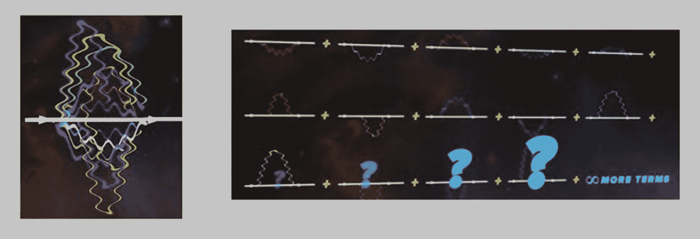

该插图展示了用于计算电子质量的重整化方法，标明了自能圈以及由无穷多项正弦波模式构成的序列。

**图 2-4** 自能圈减缓了电子的动量，并使其有效质量趋于无穷大

重整化的方法如下：不要从电子的修正质量（或称裸质量）开始——因为它无法测量——而应采用*实验测量所得的质量*。换句话说，不要使用理论计算值，而是使用其实验（有限）数值，然后从那里开始求解方程。这个巧妙的技巧可以用来消除量子场论中出现的许多无穷大！以下是两个重整化作为关键工具的具体场景：

1.  计算因自能圈导致的电子修正质量
2.  因虚粒子-反粒子对不断创生与湮灭而产生的电荷无限屏蔽效应

> **注**  
> 重整化之所以有效，是因为电子质量的实验测量值已经包含了其部分自能圈效应。因此，该测量值与其基本质量或裸质量相差不大。基于此，重整化只能预测粒子质量相对于其实验室测量值的关系。

所以，重整化是应对那些恼人无穷大的天赐之物；然而，这条规则是有代价的：每消除一个无穷大，你必须在实验室中测量某个性质，这意味着该理论无法从零开始预测那个特定性质；它只能预测相对于你实验室测量值的其他性质。总的来说，重整化将量子场论从无穷大的瘟疫中拯救了出来。最后，我们将用极其精巧的费曼图来完善这个三位一体！

### 量子场论的三位一体：微扰理论、重整化与费曼图

在量子场论中，所有亚原子粒子都被描述为量子场中的振动。但即使是最优雅的公式，一旦用于处理除最简单粒子相互作用之外的任何情况，都会变得异常复杂。理查德·费曼为我们提供了一套简单的图示规则来管理这种复杂性。他的图表已成为当代物理学的常用工具之一。它们成功地描述了诸如：

*   粒子散射
*   自能相互作用
*   物质与反物质的产生与湮灭
*   各种衰变过程

费曼图是预测亚原子世界行为的极其强大的工具，也是粒子物理学标准模型的核心组成部分。

## 费曼图：披着图形式的外衣的公式

费曼图通过提供粒子相互作用无限可能性的图形化表示，彻底改变了理论物理学。费曼图之所以了不起，是因为：

*   其优美与简洁为理解现实的本质提供了深刻的洞见。
*   在其直观的图形外观背后，隐藏着关于粒子相互作用的数学公式。这极大地简化了问题，甚至让粒子物理中繁琐复杂的数学变得有趣而引人入胜。
*   它们是破解不可解方程的工具：即隐藏在粒子两个测量态之间的无限可能性。

### 费曼的量子力学方法：路径积分

费曼在路径积分上的卓越工作使他在 1965 年获得了诺贝尔物理学奖。他独创的路径积分指出，要正确计算一个粒子在 A 点和 B 点之间运动的概率，我们需要将所有可能路径的贡献加起来（图 2-5 左侧），其中包括那些不可能的路径（图 2-5 右侧）。

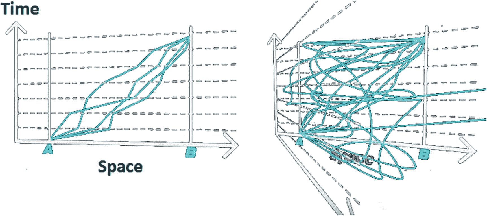

两张时间与空间的关系图展示了粒子从 A 点运动到 B 点的路径。左侧表示一条带有多次波动的线性路径。右侧则显示了一条没有特定模式的随机曲线。

图 2-5

在路径积分中，从测量的初始状态到测量的最终状态之间所有可能发生的事件，在数学上都确实发生了。

### 揭开不可能的面纱：费曼图来相助

路径积分告诉我们，在两个状态之间演化的量子系统中，存在无限多种可能的中间状态。此外，要计算这种演化的概率，我们需要将所有可能的中间状态相加。这显然是无法实现的；然而，这正是费曼图大放异彩之处：它让物理学家能够找出哪些可能性需要考虑，才能得到一个可接受的答案。

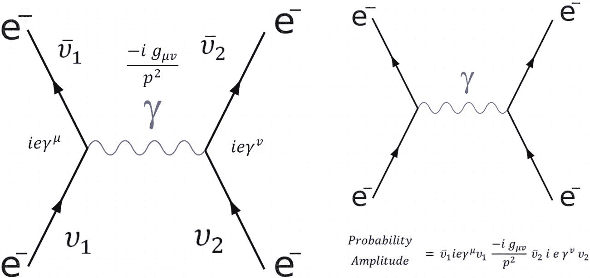

一张示意图展示了两个电子相互作用时发射光子伽马的过程。入射和出射的电荷分别用 υ1、υ2 和 ῡ1、ῡ2 表示。概率幅的公式标注在右侧。

图 2-6

显示电子散射或两个电子（`e^-`）相互作用导致发射一个光子（`γ`）的费曼图

每个图代表一类粒子相互作用（图 2-6 左侧），并给出了计算该相互作用对总概率贡献的方程（图 2-6 右侧）。在这个特定情况下，我们使用一个电子散射图，其中：

*   `υ1 υ2 ῡ1 ῡ2` 分别代表电子 1 和电子 2 的入射和出射电荷。
*   `ieγ^μ ieγ^ν` 代表光子的吸收和发射（这些是连接点或顶点）。
*   波浪线 `-i gμν / p²` 是光子的量子化场激发。

从这个图推导出的方程代表了两个电子相互碰撞的所有方式，其中包括单个光子的参与。通过这个方程，可以计算出这种交换的影响。遗憾的是，量子层面的电子散射远比这复杂得多。

当我们观察电子散射时，我们看到的只是两个电子相互反弹；然而，散射中心处的量子事件仍然是个谜。量子力学认为，散射发生的方式有无数种，而最诡异的部分是，所有这些方式都同时发生！

> **提示**  
> 费曼图的天才之处在于，一组极其简单的规则就能让我们找到路径积分中所有重要的相互作用，以及其他量子电动力学（QED）相互作用，比如电子散射。让我们来看看这些简单的规则，以及如何运用它们来做一些基本的量子场论计算。

### 只需几条简单的图规则

在量子场论中，量子电动力学（QED）是第一个诞生的，并且目前仍是所有场论中最强大的。QED 研究电子场与电磁场之间的相互作用，也就是电子、电子的反物质伙伴正电子以及光子之间的相互作用。

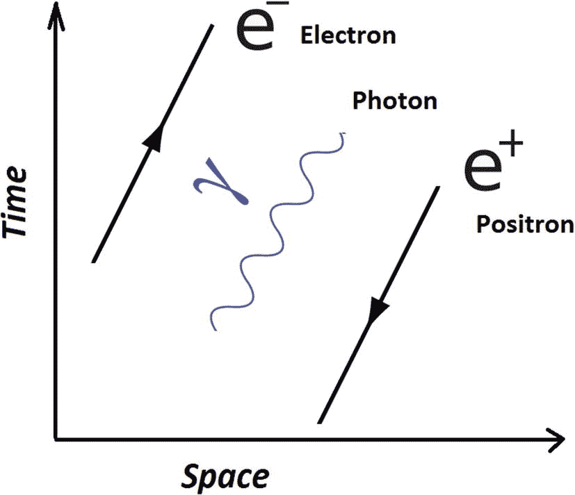

一张时间与空间的关系图上，有一个向上的箭头标记为电子，一个向下的箭头标记为正电子。光子用箭头之间的正弦波表示，并标记为伽马。

图 2-7

费曼图的构成要素

在费曼图中，电子（`e^-`）用指向时间正方向的箭头表示，而正电子（`e^+`）则用指向时间负方向的箭头表示。请注意，将反物质描绘成时间倒退看起来很奇怪，但这正是有意为之，并且提供了一种非常强大的机制，我们很快就会看到。最后，光子（`Υ`）用一条没有时间方向的波浪线表示。将这三个元素放在时空坐标系中，我们就得到了一个基本的费曼图，不过它目前还毫无用处。

要开始认识到这种方法的强大和简洁，电场和电磁场需要相互作用。当粒子相互作用时，事情开始变得有趣起来；这种相互作用在图示中用一个顶点来表示。顶点是代表不同粒子的线条交汇的点。

> **提示**  
> 事实证明，在 QED 中，只可能存在一种顶点：即有一个箭头指向内、一个箭头指向外，并连接一个单光子（参见图 2-7）。仅这一个顶点就代表了六种不同的相互作用，并可用于构建无限的费曼图。

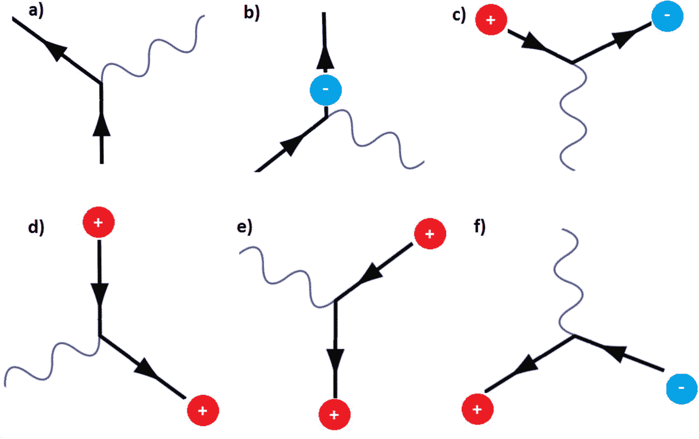

一幅由六个部分组成的示意图展示了来自单个入射和出射电子-光子顶点的可能相互作用。这些图展示了每次旋转后电子和光子的方向。

图 2-8

费曼图中单个入射、出射电子-光子顶点产生的各种可能性

在图 2-8 中，我们看到从基本顶点图（a）出发的可能相互作用（时间向上增加）：

1.  此图表示一个初始电子发射一个光子；之后两个粒子向相反方向运动；现在，如果我们旋转顶点，使电子和光子都来自下方（b），那么
2.  此图表示一个电子吸收一个入射光子，光子消失，其动量完全转移给电子。再次旋转，则
3.  这幅图描述了一个入射光子释放其能量，从而产生一对电子-正电子对的过程（这个过程被称为对产生）。再次旋转，则
4.  这里我们看到一个正电子吸收了一个光子，
5.  一个正电子发射了一个光子，以及最后，
6.  一个电子和一个正电子相互湮灭，产生一个光子。这些都是电子与电磁场可能发生相互作用的所有方式。

每一个 QED 相互作用都是基于图 2-8 构建的。请注意，费曼图必须遵循守恒定律，包括：

*   粒子不能凭空出现或消失（如果有粒子进入，就必须有其他粒子出来）。
*   电荷也必须守恒（如果一个电子进入，就必须有一个电子出来；如果一个正电子进入，就必须有一个正电子出来）。
*   如果一个电子和一个正电子同时进入，那么它们会湮灭，并产生一个净电荷为零的光子。
*   类似地，如果一个光子产生了一个带正电荷的正电子，那么它也必须同时产生一个带负电荷的电子。

## 高级文档工程师排版输出

入射-出射粒子平衡电荷的方式更为复杂（见图 2-9）；然而，它们都是由单一顶点（图 2-5 右侧）构建而成。

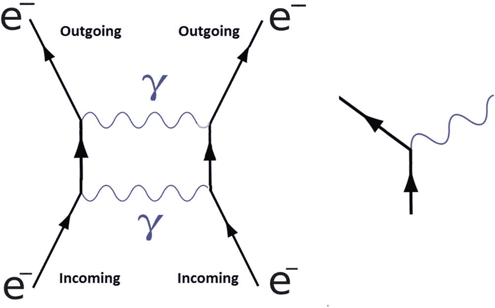

该示意图展示了两侧电子的入射与出射电荷，以及中间发射的光子（用 gamma 表示）。

**图 2-9** 在量子电动力学中，仅一个三路顶点即可构建出无穷无尽的费曼图

最后，或许也是最重要的规则之一是：由一组费曼图描述的总体相互作用，是由入射粒子（进入的粒子）和出射粒子（离开的粒子）共同定义的。这些是需要被测量的粒子（例如测量其能量或动量），并且它们必须遵守能量-动量关系：

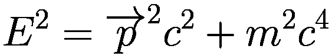

其中 `E` 是物体的总能量，`m` 是静止质量，`p` 是动量。

> **提示**  
> *能量-动量*关系是一个相对论方程，与爱因斯坦著名的*质能*方程 `E = mc²` 密切相关，它由保罗·狄拉克于 1928 年首次确立，形式为 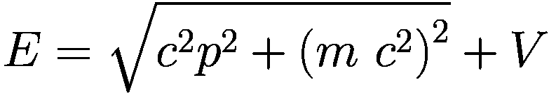，其中 `V` 是势能的大小。狄拉克利用能量-动量关系以相对论术语描述了电子的行为，并由此首次尝试将狭义相对论与量子力学统一起来；这一成就为他赢得了世界声誉、诺贝尔奖以及在历史上的地位。

### 虚粒子的奇特之处

费曼图中的入射粒子和出射粒子被称为*在壳*，因为它们位于我们绘制爱因斯坦能量、动量和质量方程时得到的质壳结构之上（见图 2-10）。

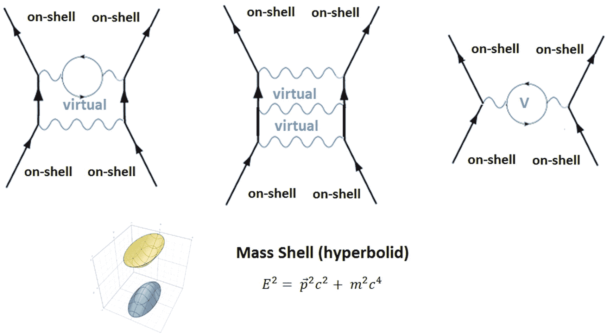

一幅由三部分组成的示意图展示了标记为“在壳”的入射和出射粒子。它们之间的光子被标记为“虚粒子”。在双曲面形式的质壳下方，标记了 `E` 平方的公式。

**图 2-10** 一组费曼图，展示了在壳粒子与虚粒子（上方），以及能量、动量和质量方程的双曲面结构（壳）

另一方面，在费曼图入射与出射轨迹之间发生的一切都被认为是虚的，其可能性是无限的。也就是说，每一个最终得到同一组入射-出射粒子的可能费曼图，都是该相互作用可能性空间中的一条有效路径（见图 2-10 上方）。

> **提示**  
> 虚粒子存在于费曼图内的顶点之间，既不进入也不离开。根据定义，它们也是不可测量的。

虚粒子的其他奇特特性包括：

- 它们不遵守质能动量等价关系；因此，它们被称为*离壳*。
- 它们不受光速或时间方向的限制！这就导致了前面提到的无限可能性。

### 费曼图简化量子场论-量子电动力学计算的力量

从前一节我们看到，即使是最简单的电子散射相互作用，其费曼图集合也可能是无限的。只要最终结果相同，所有可能性都必须考虑。费曼图的精妙之处在于，它们是简化量子电动力学相互作用的极其强大的工具。这是因为相互作用的解释无关紧要；我们关心的只是费曼图的拓扑结构，即顶点之间是如何连接的。

> **提示**  
> 费曼图通过减少需要求解的相互作用数量来简化量子场论计算。例如，对于两个电子交换一个光子（见图 2-7 上方），无论我们将光子画成从第一个顶点到第二个顶点，还是从第二个顶点到第一个顶点，这都无关紧要，尽管两者看似是两种不同的相互作用。费曼将这种差异简单理解为：第一种情况下光子随时间向前传播，而第二种情况下则随时间向后传播。两种情况下描述传递的数学公式是相同的。这是费曼图一个奇特但强大的特性。

量子电动力学是一块难啃的硬骨头，原因如下：

- 每个费曼图都代表无穷多个具体的相互作用。例如，每条粒子路径实际上都是无限的，粒子动量的可能性也是无限的。
- 必须考虑所有可能的路径，即使是不可能的路径，例如超光速路径——这在爱因斯坦的相对论中是绝对禁止的。
- 对于任何虚粒子（离壳的、既非入射也非出射的粒子），必须考虑其任何可能的能量、速度，甚至时间方向，而“考虑”意味着要在数学上进行求解。

最后一点，即在量子电动力学相互作用中必须考虑任何可能的*时间方向*，正是费曼图大放异彩之处。为了说明这一点，让我们来看另一个典型的电子相互作用，称为康普顿散射（见图 2-7）。

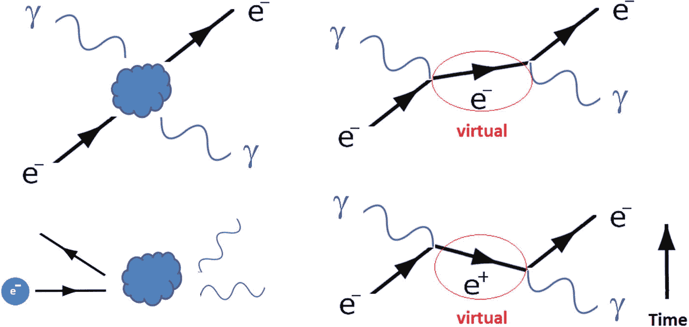

一幅电子与光子相互碰撞的示意图。左侧标记为在壳电子和光子。右侧的费曼图代表了康普顿散射的两种不同路径。图中突出显示了入射和出射电荷之间的虚空间。

**图 2-11** 电子与光子相互碰撞的康普顿散射

在图 2-11 中，一个电子和一个光子相互弹开。在左侧，我们看到的是在壳的电子和光子；我们可以测量这两个粒子的动量或能量等属性，但无论离壳部分（云团内部）发生了什么，都是不可测量的，这属于奇异的范畴。量子电动力学认为，内部发生的任何事情都有无限种可能性，而且所有这些可能性都必须被求解，即使是不可能的路径，比如时间回溯的路径。这看起来是一项不可能完成的任务，但使用费曼图时却并非如此。费曼图可以利用反物质轻松表示时间回溯的路径。考虑图 2-11 的右侧，我们展示了康普顿散射的两种不同路径的费曼图：

- 一种可能的发生方式是：电子发射一个新光子，然后随后吸收入射光子（图 2-11 右上方）。在顶点之间的中间阶段，电子是一个虚粒子，这意味着我们需要包含它可能采取的所有路径，只要最终结果相同（包括时间回溯的路径）。

根据费曼的说法，一个在时间中逆向运动的电子看起来就像一个正电子；因此，一条不可能的路径可以很容易地表示如下（图 2-11 的右下角）：相同的粒子进入和离开（与之前的选项一样）；然而，相互作用看起来略有不同。不是电子发射一个新的光子，而是一个入射光子发射了一个正电子-电子对。这个新的电子成为我们的出射电子，而正电子与入射的电子湮灭，产生了出射光子。

这些看起来可能是两种不同的相互作用；然而，在费曼图的世界里，数学是相同的；只要结果相同，在壳外发生什么并不重要。我们不在意图中相互作用的解释，只关心其拓扑结构（顶点是如何连接的）。总而言之，通过使用费曼图，我们最终大幅减少了量子电动力学（QED）中需要求解的相互作用数量，简化了量子场论（QFT）计算所需的复杂数学。

在下一节中，我们将探讨将反物质描述为时间反转物质的想法是多么巧妙绝伦，以及它如何将物理学从其最大的威胁——对称性破缺中拯救出来。

### 反物质作为时间反转物质与镜像宇宙

漫画传说中充满了平行维度、多重宇宙之类的概念；在这种背景下，DC 漫画中有一个开创性的故事线叫做《无限地球危机》。在那个故事里，有一个全能的存在，监视者，他能随意扭曲时间和空间的法则，按自己的意愿塑造现实。监视者与一个邪恶的、同样强大但呈对称相反的存在——反监视者——展开战争。这个邪恶实体释放出一股反物质波来摧毁所有宇宙以及其中的所有地球。最终，反物质波摧毁了整个多元宇宙；然而，监视者召集了多元宇宙中最伟大的英雄们，与反监视者进行最后的战斗。在高潮时刻，反监视者被击败，我们的英雄们得以重启多元宇宙，释放出一个看起来很像量子涨落（或大爆炸）的事件。最后，多元宇宙得救了，尽管与之前不尽相同，生命得以延续。

这绝不是一个牵强的故事，因为量子力学的某些解释确实包含了无限现实（地球）、多重宇宙、量子涨落以及其他奇异的事物。总而言之，在我们的现实中，并不存在像反监视者这样的东西，也没有能够湮灭沿途一切的反物质波；然而，这并没有阻止我们宇宙的物理学家们想象一个镜像宇宙，在那里物理定律以相同的方式运作，但方向相反；费曼称这个宇宙为宇称对称。

### 量子理论的基础依赖于对称性

看看镜中的自己；那会是你的一个对称版本吗？现在想象一下，你的倒影是由相反电荷的物质构成的；不仅如此，想象时间在镜子中向相反方向流动，如果那个倒影能被拉入现实，那么你的另一个自我将是一个完美的对称的你。但让我们从头开始，当你听到“对称性”这个词时，你首先想到的是什么？

在对称性的经典定义中，我们可能会想到反射或镜像对称：试试这个，在纸上画一个正方形或圆形脸，然后在中心画一条垂直轴，对折纸张，如果它们完全重合，那么你就得到了一个对称的形状。这被称为几何或反射对称（见图 2-12）。

> **提示**
> 在物理学中，当物理定律在坐标变换下保持不变时，就会产生对称性；我们的宇宙在空间、时间的坐标平移下，以及在量子力学波函数的抽象相位变化下（在原子尺度上）都是对称的。

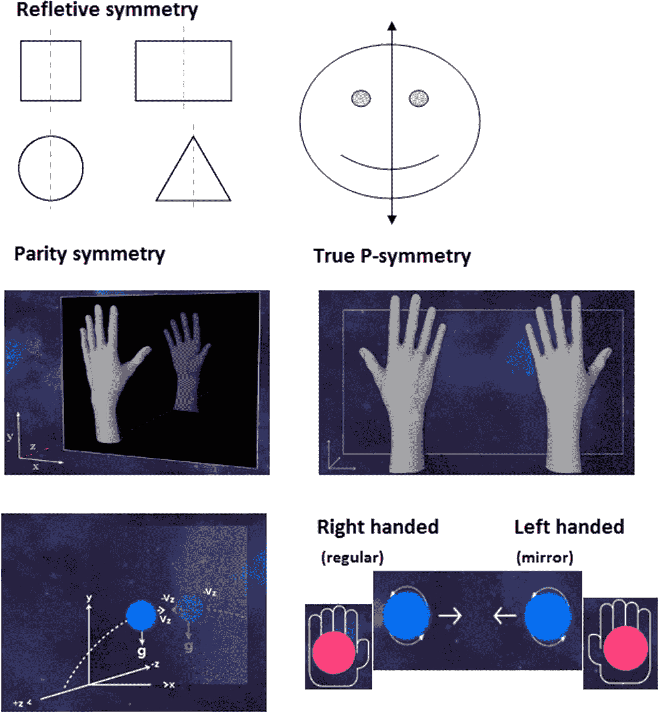

一幅插图展示了反射对称、宇称对称和真实 P 对称的例子。真实 P 对称的例子展示了右手在镜子中的反射看起来像左手。

图 2-12

（顶部）连续或反射对称的例子；（中部）由空间轴（XYZ）平移给出的离散宇称对称；（底部）常规反射与镜像反射中的手性

然而，在某些方面，我们的宇宙并不是对称的；事实上，物理定律对于镜像宇宙来说并非相同，但要理解这一点，我们需要理解“宇称变换”的含义。

在物理领域，图 2-12 顶部的几何对称性被称为“连续的”，因为不存在部分反射这回事；你要么反射整个物体，要么不反射（将对称性视为一种随时间变化的运动或位置变化）。另一方面，宇称是一种“离散对称性”。离散对称性描述系统中非连续（不连贯）的变化。例如，正方形具有离散的旋转对称性，因为只有旋转直角的倍数（90 度）才能保持正方形的原始外观（例如，将正方形旋转 45 度会变成一个菱形）。物理学中其他类型的离散对称性包括：

*   电荷共轭：翻转电荷的符号
*   时间反转：让时钟倒着走

宇称变换涉及空间轴的翻转。当你把手放在镜子前面时，你就在 z 轴上经历了一次宇称变换；你反射的手由前向后翻转，看起来你的左手变成了右手，反之亦然。奇怪的是，看起来你的手是在 x 轴上翻转的，而不是 z 轴。事实上，真正的 x 轴变换会导致左右互换，而面向保持不变，也就是说，真正的 x 轴变换等于 z 轴反射加上一次旋转（见图 2-12）。

> **提示**
> 形式上，一个完整的宇称反演涉及翻转所有三个轴。此外，当一个事物在宇称变换下保持相同时，它被称为宇称对称或 P 对称。

同时，任何单个轴上的反射都可以通过在不同轴上的反射加上一次旋转来重现：

*   在两个轴上的反射会使事物恢复到原来的状态。
*   在三个轴上的反射给出与在一个轴上的反射相同的结果。

## 镜像宇宙中的宇称对称性与手性

现在，在我们所讨论的镜像宇宙中，如果我们向镜子扔一个球，那么它看起来像是在朝我们飞来。在这里，我们意识到，尽管某些属性在镜子中会符号翻转，但其他属性保持不变（见图 2-12）。因此：

翻转的属性被称为**奇函数**：

- 空间轴：`X`，`Y`，`Z`

在镜子中不发生变化的属性（**偶函数**）是：

- 角动量
- 球的能量、质量、重力
- 时钟中的时间

> **提示**  
> 物理定律在镜像世界中应该同样适用，即使空间轴发生了翻转。例如，牛顿运动定律可用于计算球的速度和轨迹，但这仅在球在反射中保持不变时才成立。

现在想象一下，我们给球的运动加上自旋（见图 2-12 的右下角）；请注意，这种自旋或角动量在反射中保持不变，但动量矢量或运动方向却发生了翻转。这类似于在镜子反射中左右手的互换，并引入了关键的**手性**概念。

> **注意**  
> 想象用手抓住球，手指指向自旋方向，拇指指向运动方向。如果我们用右手来做，那么相对于运动矢量，我们得到的是右手自旋；如果用左手，则得到左手自旋。*在物理学中，旋转运动物体的手性被称为手征性。*

然而，手性在量子力学中有特定的含义：*量子手性与量子自旋有关，其中运动不参与其中*。相反，它被认为是一种根本性的内部左或右不对称性。大多数粒子既有左手版本也有右手版本，起初人们认为两者的行为相同。这是早期涉及重力、电磁力和强核力的实验所达成的共识。当时，人们认为尚未测试的弱核力也是如此。正如我们很快就会发现的，事实并非如此。

理查德·费曼在他著名的物理学讲座中讨论了这样一个镜像宇宙，并描述了它需要满足什么条件才能实现宇称对称。他想象了一个在镜子反射中的时钟，其数字是反写的，组件左右翻转，并且指针逆时针走动。最后，他邀请我们在现实世界中建造这样一个时钟：

- 像反射那样构造时钟的每一个部件：数字反写。
- 每一个右手螺丝或线圈都被替换为左手版本，反之亦然。

最后他问道：这个镜像时钟会以完全相同的逆时针方式走动吗？我们的直觉告诉我们应该如此，因为我们已经将所有机械组件替换成了它们的镜像对应物；不幸的是，这是错的；镜像时钟仍然会顺时针走动。

> **提示**  
> 宇称变换是通过将一个物体的属性替换为其镜像对立面来实现的：正电荷变为负电荷，左变为右，上变为下，等等。物理定律对这种宇称变换并不可对称。

这一事实于 1956 年由杰出的美籍华裔实验物理学家吴健雄（1912–1997）使用放射性钴（钴-60）原子同位素实验证实。

吴健雄从一个简单的论点出发：如果宇称守恒，那么就不应该存在一个实验来确定我们是生活在常规宇宙还是镜像宇宙中；换句话说，只要宇称守恒，我们身处哪个宇宙并不重要。因此，她设计了一个实验来测试宇称在我们宇宙中是否守恒。这个实验非常巧妙，其原理如下：

钴-60 放射性同位素在弱核力的作用下衰变为镍，在此过程中发射出一个电子、一些伽马射线光子和中微子。它的原子核碰巧也具有异常强的自旋，因此吴健雄和同事们利用这一事实，用磁场将一组原子的自旋轴对齐，并观察它们的衰变（图 2-13 的上方）。他们发现，衰变中产生的电子沿着与自旋相反的方向飞出。这正是证明宇称对称性在我们宇宙中被破坏的确凿证据。让我们来看看原因。

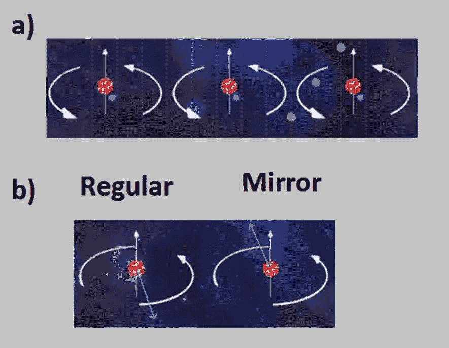

一幅分为两部分的插图展示了钴-60 原子的自旋运动，并标明了发射电子的动量。底部部分展示了常规反射与镜像反射之间的区别。

**图 2-13**  
（上方）自旋向上对齐的钴-60 原子在磁场中向相反方向发射电子。（下方）钴-60 在常规反射与镜像反射中发射电子的动量，作为宇称破坏的证据

> **提示**  
> 原子核的自旋与发射电子的动量相关联这一事实，是让吴健雄确信宇称变换被破坏的线索。这是因为在反射宇宙中，原子核的自旋（由沿轴线的角动量矢量表示——即指向原子核上方的箭头）不会改变（在两种情况下都指向相同的方向，即向上）；然而，发射电子的动量在镜像反射中指向相反方向（图 2-13 的底部）。事实证明，为了宇称守恒，*原子核自旋方向与发射电子方向之间必须没有任何关联*。这样，反射中就不会有任何变化，但实验显示的结果并非如此。

费曼利用吴健雄及其同事的实验，提出了一个由钴-60 衰变驱动的时钟：利用对齐原子的自旋，并在底部添加一个探测器，每当电子向下发射时就滴答一声。随后他证明，在一个反射时钟中，如果将钴原子替换为其宇称反转的对应物，衰变电子会向上运动，远离探测器。他得出结论：一个完美构造的钴-60 镜像时钟永远不会走动。

> **提示**  
> 费曼理解到，宇称对称性的破坏对一种更高的对称性构成了威胁：即所谓的 CPT 对称性或**电荷-宇称-时间**对称性（即电荷、宇称和时间的联合翻转）；而这一对称性正是量子场论的基础。

### 破缺的对称性有可能连带破坏整个物理学

量子场论中的绝对规则是：如果我们翻转这三个属性（电荷-宇称-时间），物理学必须保持不变，否则一切都会乱套，量子场论也将随之崩塌。由于宇称已被破坏，费曼试图通过证明电荷-宇称或称 CP 对称性可以保存下来，从而拯救量子场论。他提出了一种由反物质制成的改进型钴-60 时钟，其中：

- 电子变为正电子。
- 夸克变为反夸克，将质子和中子转换为它们的反粒子对应物。
- 钴-60 变为反钴-60。

> **提示**  
> 电荷共轭（翻转）是 CP 变换中的 C 部分。这就是转换为反物质的意思。

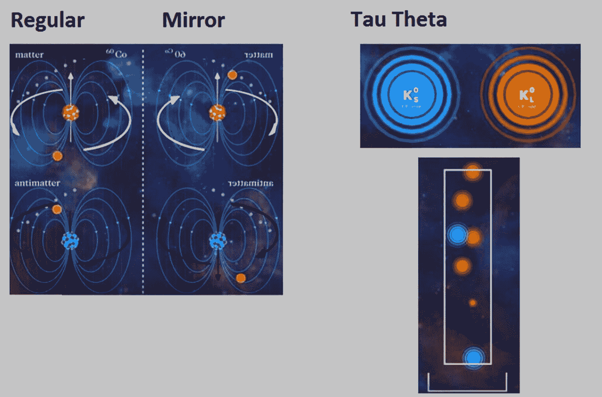

一幅插图展示了钴-60 物质在常规宇宙和镜像宇宙中的运动。右侧表示用于验证 CP 破坏的 Tau-Theta 实验，其中突出显示了`K_S`和`K_L`态。

**图 2-14**  
（左侧）费曼的钴-60 物质与反物质时钟，展示了在镜像宇宙中 CP 对称性如何保持。（右侧）克罗宁和菲奇用于测试 CP 破坏的 Tau-Theta 实验

#### 时间之钟能否拯救 CP 对称性？

在图 2-14 中，我们看到了费曼的钴-60 反物质时钟在运行；左侧是常规宇宙，右侧是其镜像反射：

- 左上角是常规物质钴-60 原子，其自旋轴由磁场向上对齐，下方是其反物质对应物。由于反物质原子具有带负电的原子核，其核磁场相对于常规物质将指向相反方向。因此，当施加磁场时，反物质钴-60 将如图所示向下对齐。
- 在镜像反射的反物质时钟中，衰变电子的方向和自旋的方向都被翻转了；一次是由于镜像反射，一次是由于切换到反物质。

这导致镜像中的电子沿原始方向（向下）运动，时钟照常滴答作响。总而言之，即使我们的宇宙不具有宇称对称性，*但它可能在电荷-宇称（`CP`）变换下是对称的*。

在费曼的思想实验中，`CP`对称性似乎成立，通过左右翻转并使用反物质代替常规物质。多年来，实验物理学家已经证明这对于标准模型中的大多数粒子是成立的。

> **提示**
> 
> 宇称对称性破缺是弱核力作用的结果，该力只影响左手费米子（夸克、电子、中微子）。右手费米子完全感受不到弱力。注意，反物质的情况正好相反：左手反费米子感受不到弱力，而右手反费米子能感受到。因此，对于弱力而言，我们在进行`CP`变换时可能会面临同样的情况。

总而言之，解开这个谜题的关键在于找出是否存在一个违反`CP`变换的实验。如果`CP`对称性成立（至少在理论上成立），那么我们就无法通过实验来区分我们是生活在常规宇宙中还是`CP`变换后的宇宙中。所有物理学定律在两者中都必须以相同的方式运作。

#### 第二击：`CP`对称性被破坏，三振出局，物理学陷入困境

在宇宙对称性破败的游戏中，第一击是实验物理学家吴健雄证明钴-60 放射性同位素中的宇称变换被破坏。现在我们处于第九局下半，满垒，`CP`对称性面临考验。随着人群的欢呼，我们试图找出是否存在违反`CP`变换的实验。当在所谓的*τ-θ之谜*中发现这种情况时，物理学家们开始担忧。

`Tau`和`Theta`是两个被认为是相同的粒子；它们具有相同的质量、电荷和自旋，但衰变成不同的产物：`Tau`衰变成三个π介子，而`Theta`衰变成两个π介子，这是唯一的区别。此外，`Tau`的衰变产物具有奇宇称，而`Theta`的具有偶宇称（这暗示了宇称守恒被违反，从而引发了所谓的`τ-θ`问题）。1956 年，物理学家李政道和杨振宁提出了一个解决方案：他们声称`Tau`和`Theta`实际上是同一种粒子，即今天所知的`Kaon`（`K^+`），并且导致其衰变的弱核力不保持宇称。这一解决方案为他们赢得了 1957 年的诺贝尔奖。

后来，在 1964 年，美国核物理学家詹姆斯·克罗宁（1931-2016）和瓦尔·菲奇（1923-2015）研究了一种被称为*中性 Kaon*的奇特`Kaon`的衰变结果，寻找宇称破坏的迹象。

> **提示**
> 
> `中性 Kaon`是其自身粒子和反粒子的奇特量子混合。这种混合存在两种状态：`$$ {K}_S^o $$`（`K-S`）是短命的，并且在组合的电荷-宇称变换下不改变（`CP`：偶）。第二种类型`$$ {K}_L^o $$`（`K-L`）是长命的，并且具有奇`CP`状态（它在`CP`变换下会改变）。*如果要保持`CP`对称性，`K`[*`S`*] 和`K`[*`L`*] 绝不应该相互转换，因为它们具有不同的`CP`状态*。

克罗宁和菲奇发现中性`Kaon`在这个宇宙中表现出一种奇异的行为：他们将两种类型的`中性 Kaon`送入一根长管中，管子末端连接着一台探测器（图 2-14 的右侧）。短命的`K[S]`粒子由于其寿命极短，本不应完成这段旅程，然而，探测器处却发现了大量来自`K[S]`粒子的衰变产物。

> **注意**
> 
> 对克罗宁和菲奇结果的唯一解释是：长命的`K[L]`粒子转变成了`K[S]`粒子，从而违反了`CP`对称性。看来费曼的镜像反物质钴-60 时钟终究是行不通了！

##### 时间对称性守恒：神圣的 CPT 看似岌岌可危

CP 对称性的破缺对物理定律有着可怕的后果；在 C-P-T 三位一体中，仅存的希望是*时间反演对称性*。迄今为止的所有结果表明，时间对称性也已被破坏，但要做到这一点，我们需要回到过去，回到量子场论的起源。

我们发现自己身处 20 世纪 50 年代，正处于量子场论的诞生之初；当时人们认为，这个充满希望的新理论需要某种对称性。随着时间的推移，理论的发展，人们逐渐认识到在 `c` 荷共轭、`p` 宇称反转和 `t` 时间反演联合作用下对对称性的要求：

- 量子场论的公理基础指出，我们宇宙的反物质、镜像反射和时间反演版本应遵循相同的物理定律（这被称为 CPT 定理，该定理假定量子场论必须是 CPT 不变的）。

- CPT 不变性是整个 20 世纪 50 年代物理学家的确定观点：物理定律必须在电荷、宇称和时间方向翻转下同样适用，但随后出现的实验表明，先是 `p` 宇称对称性被破坏，然后是 `CP` 对称性，因此我们只能抱持最后的希望：`T` -对称性。

> **提示**  
> 如果 CPT 对称性成立（以拯救物理世界），但 CP 对称性被破坏，那么 `T` -对称性也必然被破坏。这是因为时间反演变换需要将我们从破碎的 CP 镜像宇宙带到一个稳定的 CPT 宇宙。

上述说法的问题在于，如果我们反其道而行之，从稳定的 CPT 宇宙通过 `T` -变换到破碎的 CP 镜像宇宙，那么时间反演变换会改变宇宙的行为方式。这非常糟糕，因为无论时间向前还是向后，物理定律都应该同样适用。所以 `T` -对称性就被否定了；当然，这一切都停留在理论层面，还没有任何定论。

> **注**  
> 为了守恒量子信息，量子力学需要时间反演对称性。量子力学指出信息不能被破坏。

那么真相到底是什么？`T` -对称性到底有没有被破坏？答案取决于我们如何定义时间反演：

1. 对时间反演最直观的解释是，当我们翻转所谓的*时间之箭*，让宇宙在时间中逆行。据推测，在这种 `T` -变换下，量子信息得以保存。

2. 对时间反演的第二种解释如图 2-15 右侧所示。这种解释被认为是翻转了物理系统的演化方向：例如，爆炸变成内爆，或者粒子衰变变成粒子产生。换句话说，*不是倒流时间，也不是将物质转化为反物质，而是反转所有动量和自旋*。

> **提示**  
> 选项一并不是物理学家在 CPT 中所谓的 `T` 的含义。实际上，正确的 `T` 来自选项二，即所有动量和自旋都被反转，也就是让所有粒子折返回它们原本的来源。如果这个 `T` -对称性成立，那么在反转所有粒子运动后，这些粒子应当回溯它们的路径、反应和历史。此外，随着这个运动-自旋反转后的宇宙在时间中向前演化，它应当最终回到其初始状态。另一方面，如果这个 `T` -对称性被破坏，那么未来就不会完美地镜像过去。

物理学家们认为，这种 `T` -对称性的一个预言是，所有过程向前和向后进行所需的时间应当相同。如果这是真的，那么可以设计一个实验来检验这一点：通过对一种粒子类型与另一种粒子类型之间的量子跃迁进行计时；无论在哪个方向上，该时间都应当相同。事实上，在 2012 年，斯坦福直线加速器中心 BaBaR 合作组的物理学家测量了 `B` 介子在两种类型之间转换的速度。如果这种 `T` -对称性成立，那么转换速度在两个方向上应当相同；他们的结果是：转换速度并不相同。*反转转换方向改变了物理学的某些方面，这表明存在 `T` -对称性破缺*。

#### 在倒流宇宙中的粒子

从数学上讲，在倒流宇宙的 `T` -变换下，粒子看起来像是经历了电荷-宇称反转（图 2-15 左侧）。

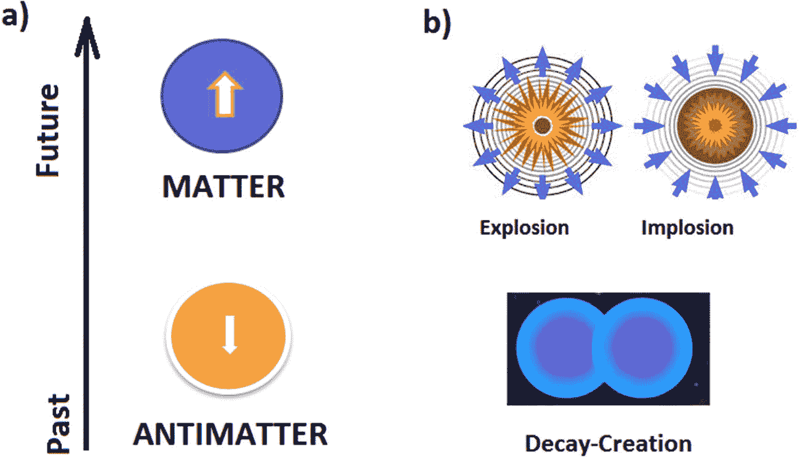

一幅由两部分组成的插图展示了 CPT 中的 `T` 变换。a. 它用一个向上的箭头表示过去的反物质和未来的物质。b. 它表示了爆炸、内爆和衰变-产生的结构。

**图 2-15**  
CPT 中的 `T` 变换：(a) 将反物质视为时间反演后的物质的时间反演。(b) 通过反转所有动量和自旋进行的 `T` 变换

在时间中向前行进的物质看起来就像是向后行进的物质的反物质。这种将反物质视为时间反演物质的解释最早由瑞士数学家恩斯特·斯图克尔伯格于 1945 年提出；然而，如今这一解释主要与理查德·费曼相关联。

> **提示**  
> 这种解释对于费曼的路径积分量子力学方法及其无处不在的费曼图至关重要。此外，它是 CP 变换的逆运算，也就是说，两者相互抵消。*这意味着如果 CP 被破坏，那么简单的时间反演也会被破坏*。这种 `T` -破坏已在物质与反物质之间的不对称性中被实验观测到。

好的，作为一名高级文档工程师和翻译员，我将严格按照您提供的注意事项和示例格式，将给定的英文文本翻译成中文。

---

#### CPT 是安全的：自然界对称性的 70 年过山车之旅

如今所有物理学家都认同，量子场论在其适用范围内是正确的。它堪称科学界迄今为止提出的最成功的理论。该理论得到大量实验结果的支撑，这些结果与理论本身的吻合程度达到了预期中的极致。

总而言之，我们发现斯坦福大学的实验表明，在这个宇宙中，`T` 对称性被破坏了，但这是一件好事；请记住，当 `CP` 对称性也被破坏时，`T` 对称性的破坏最终拯救了 `CPT`。至此，在这长达数十年的过山车之旅中，我们看到了对称性是如何被逐一打破的：

-   首先，吴健雄通过钴-60 放射性同位素实验打破了宇称对称性。
-   接着，克罗宁和菲奇通过中性 K 介子实验打破了电荷-宇称对称性。
-   最终，我们面临选择：要么放弃时间本身的对称性来拯救 `CPT`，要么就任由 `CPT` 被破坏。而现在，随着 `T` 对称性也似乎被打破，`CPT` 定理反而安全了。

最终，费曼提出的反物质时间反转思想依然成立，而我们那个完美的镜像宇宙，则是在电荷、宇称和时间三者同时反转的场景下正常工作。

量子场论的伟大先驱理查德·费曼于 1988 年因脂肪肉瘤（一种罕见的软组织癌症）去世，享年 69 岁。他的离世对物理学界来说，是过去、现在以及未来永远的巨损。我将他的逝世比作肖邦或莫扎特的离去，如同那些作曲大师，他毕生致力于创作卓越的著作，在此过程中成为了他那一代人中最具原创性的思想者之一。费曼成为科学界的传奇，不仅因为他在量子力学的路径积分法和量子场论方面做出了开创性工作，还因为他那惊世骇俗、引人入胜的教学方法。他的物理学讲座以及他的著作 *《六堂极简物理课》* 都堪称神话，为他赢得了诸如 *“伟大的讲解员”* 和 *“物理学最杰出的教师”* 等美誉。在他临终前，他告诉一位同事，他传授了那么多知识，结识了那么多人，也许他并没有真正离去。如果他的量子场论最终被证明是正确的，那么他的天才智慧将不会消失，只会被循环再利用，也许会注入到一个正在学骑自行车、仰望星空、好奇地思索着那片等待被发现的真理之海的孩童脑海中。理查德·费曼万岁：伟大的讲解员。

## 练习

通过以下习题集，检验你对 `QFT` 和 `QED` 知识的掌握程度。

1.  `QFT` 和 `QED` 分别代表什么？`QED` 与 `QFT` 有何关系？
2.  用一句话说明，`QED` 研究的是什么？
3.  在 `QFT` 中，例如处理狄拉克方程或费曼路径积分时，管理其复杂性的三种方法是什么？
4.  用一句话定义电子散射。在经典电动力学中，用什么定律或方程来描述它？
5.  在经典电动力学中，用什么公式来计算两个静止带电电子之间的作用力？
6.  以下哪项是正确的？
    1.  在 `QFT` 中，电子是电子场中的振动。
    2.  量子场充满整个宇宙。
    3.  电子场与电磁场不发生相互作用。
    4.  电磁场中的振动产生质子和夸克。
7.  填空。费曼图本质上也是隐藏的 _______，图中的每个部分都代表着一块数学表达式。在一个费曼图中，当两个电子相向而行时，它们可能会交换一个 _____ _____。
8.  关于微扰论，以下哪项是正确的？
    1.  它是绘制方程的艺术。
    2.  如果你遇到一个无法求解的方程，找一个可解且相似的方程，然后对其进行微小改动，使结果相近。
    3.  相互作用越复杂，它对最终概率幅的贡献就越小。
    4.  某个特定相互作用的概率取决于费曼图中顶点的数量。
9.  什么是费曼图中的圈相互作用？请给出两个例子。
10. 为什么圈相互作用可能会变得无穷大？
11. 重正化是如何消除 `QFT` 中的无穷大圈效应的？
12. 描述重正化的一个缺陷。
13. 关于费曼路径积分，以下哪项是正确的？
    1.  在一个量子系统在两个状态之间演化时，存在无限多种可能的中间态。
    2.  不可能路径不应被考虑。
    3.  即使使用费曼图，路径的概率也无法计算。
14. 画出费曼图的基本元素以及坐标轴。
15. 用费曼图画出电子散射中最可能的相互作用。解释图中发生了什么。不要使用任何公式。
16. 什么是虚粒子？
17. 给出虚粒子的两个奇特特性。
18. 费曼图如何简化 `QFT` 的计算？
19. 在 `QED` 中有一个有趣的案例，称为 *巴巴散射*，以印度核计划之父、物理学家霍米·J·巴巴 (1909–1966) 的名字命名。*巴巴散射* 是指电子-正电子的散射过程。在本练习中，你必须画出 *巴巴散射* 的两个最重要的费曼图，每个图使用一个虚光子和两个顶点。同时，用几句话描述每个相互作用中发生了什么。
    - 提示 1：两种情况都使用一个虚光子和两个顶点。注意，这两个图可能看似描述两个截然不同的事件，但必须给出相同的结果。
    - 提示 2：使用本章描述的简单规则，并记住图旋转的威力。

    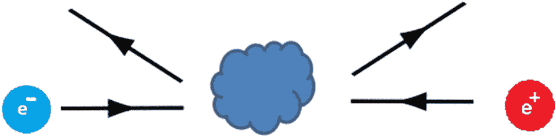

20. 画出上一道练习中 *巴巴散射* 所有可能的四个顶点图。忽略所有自能图（即电子或正电子发射并重新吸收光子的情况）。解释每个图中发生了什么。

    提示：忽略如下图所示的所有显示自能圈的图。

    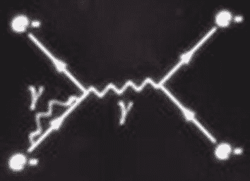

21. 填空。将正方形、三角形或圆形从中间划分的一条线，产生的两半是 _____ 对称性的例子。
22. 简要描述自然界中的两种对称性。每种对称性各举一个例子。
23. 填空。宇称变换涉及翻转 ___ ____。一个真正的 x 轴变换等于一个 z 轴反射加上一个 ____。
24. 具有 `P`-对称性意味着什么？
25. 在一个镜像宇宙中，哪些属性会被翻转，哪些不会？
26. 对或错：即使空间轴被翻转，物理定律在镜像世界中应该同样适用。
27. 宇称对称性（`P`-对称性）在我们的宇宙中被打破了吗？为什么？
28. 用几句话描述 `CP` 对称性。
29. 简要描述证明 `CP` 对称性被破坏的实验。
30. 什么是 `CPT` 对称性？为什么它如此重要？
31. 举出两个 `T`-对称性变换的例子。

