# 11. 现实世界中的量子技术：高级化学与蛋白质折叠

我的物理老师曾经说过，量子计算机是出了名的差劲计算器，然后他会引用理查德·费曼的话来强调，这些机器是依据原子原理构思出来的；因此，它们应该解决原子尺度的问题。这一点在化学和医学领域体现得最为明显，量子技术已经在这些领域努力工作，力求有所作为。在本章中，我们展示了两个令人惊叹的真实实验，它们说明了量子计算的能力如何在现实世界中发挥作用。

## 特征值的重要性

特征值在此语境中占据核心地位。特征值是与线性方程组（矩阵方程）关联的特殊标量，在物理学和工程学中极其重要。特征值`λ`（拉姆达）通过变换矩阵（`A`）和向量（`v`）利用以下方程计算得出：

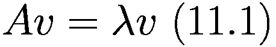

向量`v`被称为特征向量；现在求解关于`λ`的方程，我们得到：

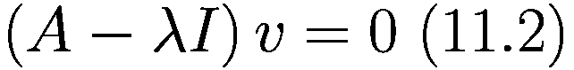

其中`I`是单位矩阵；注意，将标量`λ`乘以单位矩阵在数学上是合法的，这样它才能从矩阵`A`中减去。最后，我们可以通过计算以下矩阵的行列式来得到`λ`：

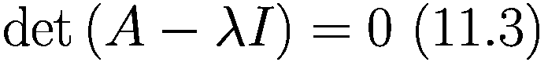

此处特征向量`v`不能为零；因此，行列式必须为零，方程 11.2 才能成立。

> **提示**: 特征值也被称为特征根或潜根，广泛应用于稳定性分析、旋转体物理学、振动系统振荡、分子化学、图形变换等众多领域。

请查看图 11-1 以更好地理解这一点；`λ`起到变换`Av`的标量作用。注意方向可能相反；然而，向量的角度保持不变。

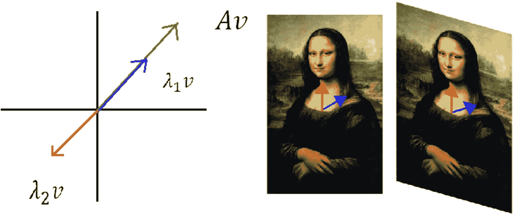

**图 11-1** — 特征值的图示说明，以及蒙娜丽莎的剪切映射，其中红色向量是变换的特征向量

特征值在以下领域非常重要：
- **物理学**: 它们用于测量粒子的能量，或与波函数相关联的可测量物理量的值。
- **化学工程**: 它们用于求解微分方程和分析系统的稳定性。
- **数据科学**: 它们用于通过识别数据中最大变异的方向来提取数据集的最重要特征。这些方向可以表示为特征向量，变异量可以表示为特征值。

仅举几例，在我们的案例中，特征值将用于寻找化学元素的基态以及进行蛋白质折叠实验。让我们通过一些简单的练习来实践这个重要概念。

**练习 11.1**: 求泡利矩阵`X = [[0, 1], [1, 0]]`的特征值和特征向量。提示：使用方程 11.3 找到 2 个特征值，然后使用方程 11.1 找到特征向量。

```
det([[0, 1], [1, 0]] - [[λ, 0], [0, λ]]) = 0, det([[-λ, 1], [1, -λ]]) = 0, λ² = 1, λ = ±1
```

```
当 λ = 1 时， [[0, 1], [1, 0]] [x, y]ᵀ = [x, y]ᵀ, [y, x]ᵀ = [x, y]ᵀ, v1 = [1, 1]ᵀ
```

```
当 λ = -1 时， [[0, 1], [1, 0]] [x, y]ᵀ = -1 [x, y]ᵀ, [y, x]ᵀ = [-x, -y]ᵀ, v2 = [1, -1]ᵀ
```

请自行尝试这些练习。像往常一样，答案在附录中提供。

**练习 11.2**: 求泡利矩阵`Y = [[0, -i], [i, 0]]`的特征值和特征向量。

**练习 11.3**: 求泡利矩阵`Z = [[1, 0], [0, -1]]`的特征值和特征向量。你能从 XYZ 泡利矩阵得到的特征值中得出什么结论？

## 量子计算机中的特征值

要在量子计算机中寻找特征值，我们必须使用变分量子特征求解器（VQE）。该算法由以下组件组成（见图 11-2）：

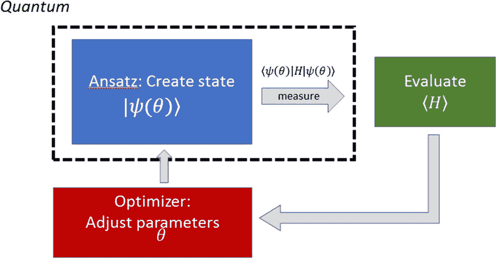

**图 11-2** — 变分量子特征求解器组件布局

- **假设波函数（Ansatz）**: 源自德语 “猜想”，这是一个用于波函数的参数化量子电路。顾名思义，它是一种推测，其中的参数是一组 theta 角度。
- **优化器**: 这是一个经典求解器，它获取波函数的期望值`⟨Ψ(θ)|H|Ψ(θ)⟩`，评估其哈密顿量（`H`），并调整参数集`θ`以最小化哈密顿量的能量。

此过程重复一定数量的周期（由优化器定义），直到达到所需的最小值。这将是我们正在寻找的特征值。

> **提示**: 在物理学中，哈密顿量是一个系统的总能量，即其动能（运动能量）和势能（位置能量）。

但是，既然有许多经典求解器可以完成这项工作，为什么还要使用量子计算机呢？使用量子计算有优势吗？

## 为什么要用量子计算机

特征值在经典计算机上很容易计算；然而，随着变换矩阵（`A`）规模的增大，任何经典机器都会耗尽内存。请参考为寻找加权晶格特征值而使用的经典 Python 求解器与 VQE 求解器的预估执行指标（见表 11-1）。

表 11-1 使用 Python 特征求解器与 VQE 模拟及硬件计算 Kagome 晶格基态的执行指标^(²²)

| 晶格维度 | 执行时间（秒）经典 | 内存（字节） | 执行时间（秒）量子模拟器 | 执行时间 IBM-Quantum 硬件 |
| --- | --- | --- | --- | --- |
| 12 | 2 | 64K | 2 | 1.5 小时 |
| 13 | 12 | 192K | 21 | 3.1 小时 |
| 14 | 116 | 520M | 1104 | ? |
| 15 | 1233 | 1G | 7012 | ? |
| 16 | 崩溃 | ? | ? | ? |

注：问号表示因资源不足或硬件限制而缺失的数据。

目前，经典求解器的速度远快于 VQE（无论是模拟还是硬件）；然而，随着变换矩阵规模的增大，执行时间呈指数级增长，更糟的是，软件会耗尽内存并崩溃。这就是经典硬件的致命缺陷。而量子计算机则没有内存，它并行地消耗量子比特状态。目前，我们正处于嘈杂量子时代，因此硬件速度慢且仅限于小规模样本；但这种情况未来将会改变。试想：一个 50 量子比特的变换矩阵在模拟中需要`2⁵⁰ = 1125` TB 的 RAM。没有任何超级计算机能够处理超过 50 个量子比特，而量子计算机却可以并行处理数千甚至数百万个维度！
因此，VQE 将成为展示这一系列非凡实验的算法，并在实践中产生重要影响。

### 分子基态

我们的目标是使用分子哈密顿量计算晶格的基态（能量最低的定态）。回顾上一节，系统的哈密顿量规定了其总动能和势能。在分子化学中，大多数元素都使用晶格建模，其中顶点代表相互作用的原子；因此，最小哈密顿量将给出我们寻找的值。因此，为了达到基态，我们需要将其最小化。

> **提示**  
> 基态之所以重要，是因为它们揭示了激发态电子在发射光子时去向何方、从何处返回。它们还能揭示元素的原子序数。基态也被称为系统的零点能。

#### 晶格

当我们在固体中考虑电子的行为时，可以在晶格上对其建模，其中顶点指向原子的位置。这是量子物理、凝聚态物理和量子化学等领域的常见做法。运行代码清单 11-1 以显示一个六顶点方晶格（见图 11-3）。

> **注意**  
> 代码清单 11-1 使用了`Qiskit`或量子实验室中不可用的自定义模块。请从本书源代码目录`Workspace\Ch11\vqelattice.py`运行。量子实验室有助于快速运行简单的电路；然而，具有专门依赖关系的更复杂程序只能通过命令行运行。

## 晶格构建

```
from qiskit_nature.second_q.hamiltonians.lattices import *
from qiskit_nature.second_q.hamiltonians import *
import matplotlib.pyplot as plt
from qiskit_nature.second_q.problems import LatticeModelProblem
from heisenberg_model import HeisenbergModel
from qiskit_nature.mappers.second_quantization import LogarithmicMapper
from qiskit.algorithms.minimum_eigensolvers import VQE
from qiskit.algorithms.optimizers import *
from qiskit.primitives import Estimator
from qiskit_nature.second_q.circuit.library import HartreeFock, UCCSD
from qiskit import *
from qiskit.primitives import BackendEstimator
from qiskit.circuit.library import *
from custom_vqe import CustomVQE

t = 1.0  # 相互作用参数
v = 0.0  # 在位势能
行数 = 2
列数 = 3
量子比特数 = 行数 * 列数

##### 方晶格
square_lattice = SquareLattice(rows=行数, cols=列数, boundary_condition=BoundaryCondition.PERIODIC)
square_lattice.draw()
###### plt.savefig('sq.png')
plt.show()
```

代码清单 11-1

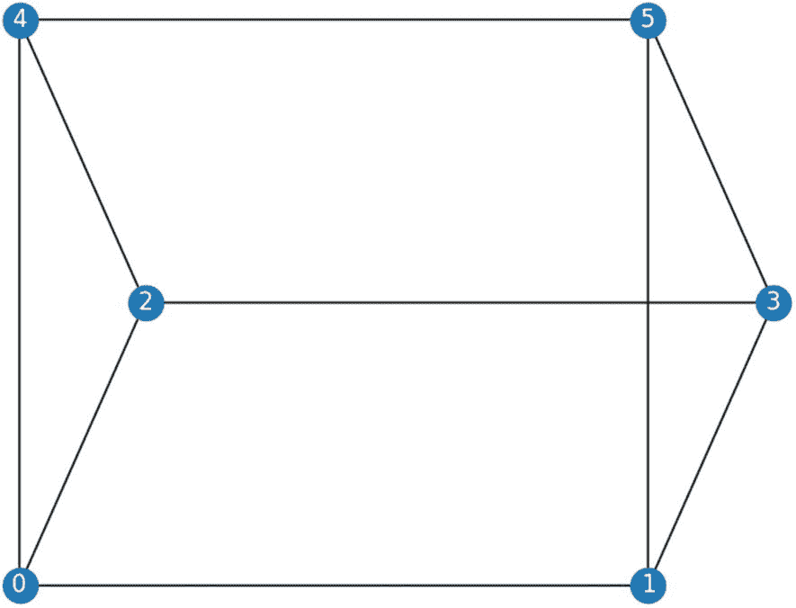

图 11-3

具有六个顶点和周期性边界的方晶格

> **提示**
>
> Qiskit 为量子化学实现了丰富的晶格模型库。详情请参见^(²³)。

## 海森堡自旋 ½ 哈密顿量

我们将使用海森堡自旋 ½ 模型来研究磁性系统的临界点和相变。它由哈密顿量给出：

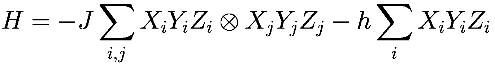

其中 ![$$ X=\left[\begin{array}{cc}0&amp; 1\\ {}1&amp; 0\end{array}\right],Y=\left[\begin{array}{cc}0&amp; -i\\ {}i&amp; 0\end{array}\right],Z=\left[\begin{array}{cc}1&amp; 1\\ {}0&amp; -1\end{array}\right] $$](images/469026_2_En_11_Chapter/469026_2_En_11_Chapter_TeX_IEq4.png) 是泡利自旋-1/2 矩阵，`J` 是耦合常数（相互作用中施加的强度），`h` 是外部磁场。这个哈密顿量的能谱描述了系统在热力学平衡下的统计特性（参见代码清单 11-2）。

```python
"""The Heisenberg model"""
import logging
import numpy as np
from fractions import Fraction
from typing import Optional
from qiskit_nature.operators.second_quantization import SpinOp
from qiskit_nature.problems.second_quantization.lattice.lattices import Lattice
from qiskit_nature.problems.second_quantization.lattice.models.lattice_model import LatticeModel
class HeisenbergModel(LatticeModel):
    """The Heisenberg model."""
    def coupling_matrix(self) -> np.ndarray:
        """Return the coupling matrix."""
        return self.interaction_matrix()
    @classmethod
    def uniform_parameters(
        cls,
        lattice: Lattice,
        uniform_interaction: complex,
        uniform_onsite_potential: complex,
    ) -> "HeisenbergModel":
        return cls(
            cls._generate_lattice_from_uniform_parameters(
                lattice, uniform_interaction, uniform_onsite_potential
            )
        )
    @classmethod
    def from_parameters(
        cls,
        interaction_matrix: np.ndarray,
    ) -> "HeisenbergModel":
        return cls(cls._generate_lattice_from_parameters(interaction_matrix))
    def second_q_ops(self, display_format: Optional[str] = None) -> SpinOp:
        if display_format is not None:
            logger.warning(
                "Spin operators do not support display-format. Provided display-format "
                "parameter will be ignored."
            )
        ham = []
        weighted_edge_list = self._lattice.weighted_edge_list
        register_length = self._lattice.num_nodes
        # kinetic terms
        for node_a, node_b, weight in weighted_edge_list:
            if node_a == node_b:
                index = node_a
                ham.append((f"X_{index}", weight))
            else:
                index_left = node_a
                index_right = node_b
                coupling_parameter = weight
                ham.append((f"X_{index_left} X_{index_right}", coupling_parameter))
                ham.append((f"Y_{index_left} Y_{index_right}", coupling_parameter))
                ham.append((f"Z_{index_left} Z_{index_right}", coupling_parameter))
        return SpinOp(ham, spin=Fraction(1, 2), register_length=register_length)
```

代码清单 11-2

用于研究磁性系统临界点和相变的海森堡模型

现在，让我们在主程序中运行海森堡模型，看看哈密顿量是如何构建的（参见代码清单 11-3、11-4）。请注意，代码清单 11-3 是代码清单 11-1 的延续。

# 使用6个量子比特的方格点阵的海森堡哈密顿量

```
1.0 * ZZIIII
+ 1.0 * ZIZIII
+ 1.0 * IZIZII
+ 1.0 * IIZZII
+ 1.0 * ZIIIZI
+ 1.0 * IIZIZI
+ 1.0 * IZIIIZ
+ 1.0 * IIIZIZ
+ 1.0 * IIIIZZ
+ 1.0 * YYIIII
+ 1.0 * YIYIII
+ 1.0 * IYIYII
+ 1.0 * IIYYII
+ 1.0 * YIIIYI
+ 1.0 * IIYIYI
+ 1.0 * IYIIIY
+ 1.0 * IIIYIY
+ 1.0 * IIIIYY
+ 1.0 * XXIIII
+ 1.0 * XIXIII
+ 1.0 * IXIXII
+ 1.0 * IIXXII
+ 1.0 * XIIIXI
+ 1.0 * IIXIXI
+ 1.0 * IXIIIX
+ 1.0 * IIIXIX
+ 1.0 * IIIIXX
```

# 来自代码清单 11-1 的方格点阵哈密顿量

```python
# Build Hamiltonian from graph edges
heis = HeisenbergModel.uniform_parameters(
lattice=square_lattice,
uniform_interaction=t,
uniform_onsite_potential=v,
)
# Map from SpinOp to qubits just as before.
log_mapper = LogarithmicMapper()
ham = 4 * log_mapper.map(heis.second_q_ops().simplify())
print(ham)
```

观察代码清单 11-4 和图 11-3；该点阵有 9 条边，我们的哈密顿量由`X`、`Y`、`Z`泡利矩阵的相互作用构成；因此，我们得到了 27（9*3）项。请注意，哈密顿量中的索引与图 11-3 中边的索引相匹配（通过将代码清单 11-4 中的项索引与图 11-3 中连接边的索引进行比较来验证这一点）。记住这一点，我们就可以将这些对象提供给 VQE，以提取点阵的基态。让我们看看如何操作。

### VQE

拼图的最后一块是一个`CustomVQE`对象类（参见代码清单 11-5）。它使用最小特征值求解器接口来计算给定算符或哈密顿量的最小特征值。其任务是：
- 实现图 11-2 中的目标函数。
- 在目标函数内部，它调用`Qiskit Runtime Estimator`基元服务来获取量子电路（`Ansatz`）和可观测量（哈密顿量中的项）的期望值。请注意，该值是优化器每次交互收集的能量，并可选择性地发送回客户端。
- 运行优化器以最小化能量。优化器运行的周期数取决于具体实现。对于每个周期，都会产生一个能量值，并通过结果回调函数发送回来。
- 为发送给优化器的`Ansatz`定义随机参数（角度）的初始点。
- 收集最终的 VQE 能量结果（在优化器完成后）并将其返回给客户端。

```python
from qiskit.algorithms import MinimumEigensolver, VQEResult
import numpy as np
# Define a custom VQE class
class CustomVQE(MinimumEigensolver):
def __init__(self, estimator, circuit, optimizer, callback=None):
self._estimator = estimator
self._circuit = circuit
self._optimizer = optimizer
self._callback = callback
def compute_minimum_eigenvalue(self, operators, aux_operators=None):
# Define objective function to classically minimize over
def objective(x):
# Execute job with estimator primitive
job = self._estimator.run([self._circuit], [operators], [x])
# Get results from jobs
est_result = job.result()
# Get the measured energy value
value = est_result.values[0]
# Save result information using callback function
if self._callback is not None:
self._callback(value)
return value
# Select an initial point for the ansatzs' parameters
x0 = np.pi/4 * np.random.rand(self._circuit.num_parameters)
# Run optimization
res = self._optimizer.minimize(objective, x0=x0)
# Populate VQE result
result = VQEResult()
result.cost_function_evals = res.nfev
result.eigenvalue = res.fun
result.optimal_parameters = res.x
return result
```

现在，我们准备运行实验。将代码清单 11-1、11-3 和 11-6 收集到一个文件中。请注意，代码清单 11-2 和 11-5 位于相同位置的单独文件中。所有文件都随本手稿的源代码一起提供。

### 结果

清单 11-6 是主程序的第三部分也是最后一部分。它完成了以下几项重要工作：
- 使用经典求解器`NumPyEigensolver`计算基态。这仅是为了对比，以便有一个基准与量子计算结果进行比对。
- 调用`CustomVQE`来最小化晶格哈密顿量，并收集优化器每一步的能量。这些能量将与经典的基态基准线一同绘制，用于比较。
- 计算 VQE 最后能量与经典基态能量之间的相对误差，以得出最终的相对误差百分比。这能告诉我们实验的准确度。该值越低越好。

#### 经典方法

##### 计算基态能量

`from qiskit.algorithms import NumPyEigensolver`

##### 寻找前三个（k=3）特征值

`exact_solver = NumPyEigensolver(k=3)`
`exact_result = exact_solver.compute_eigenvalues(hamiltonian)`
`print(exact_result.eigenvalues)`

##### 保存基态能量供后续使用

`gs_energy = np.round(exact_result.eigenvalues[0], 4)`
`print("基态能量 " + str(gs_energy))`

#### VQE

`ansatz = EfficientSU2(nqubits)`
`optimizer = NFT(maxiter=100)`
`#ansatz = TwoLocal(nqubits)`
`#optimizer = SLSQP(maxiter=75)`
`intermediate_info = []`
`def callback(value):`
`    intermediate_info.append(value)`

##### 定义 `qiskit-terra` 的 `Estimator` 原始实例

`estimator   = Estimator() #[ansatz], [ham])`

##### 设置 VQE 算法

`custom_vqe  = CustomVQE(estimator, ansatz, optimizer, callback=callback)`

##### 运行自定义 VQE 函数并监控执行时间

`start       = time()`
`result      = custom_vqe.compute_minimum_eigenvalue(ham)`
`end         = time()`
`print(result)`
`print(f'执行时间（秒）: {end - start:.2f}')`
`def rel_err(target, measured):`
`    return abs((target - measured) / target)`

##### 计算期望基态能量与 VQE 结果之间的相对误差

`rel_error   = rel_err(gs_energy, result.eigenvalue)`
`print(f'期望基态能量: {gs_energy:.10f}')`
`print(f'计算所得基态能量: {result.eigenvalue:.10f}')`
`print(f'相对误差: {rel_error:.8f}')`

##### 绘制回调函数获取的能量收敛数据。

`plt.plot(intermediate_info, color='purple', lw=2, label='模拟 VQE')`
`plt.ylabel('能量')`
`plt.xlabel('迭代次数')`
`plt.axhline(y=gs_energy, color="tab:red", ls="--", lw=2, label="目标: " + str(gs_energy))`
`plt.legend()`
`plt.grid()`
`plt.savefig("plot.png")`

## 清单 11-6

### VQE 执行与结果

运行实验，并将你的结果与图 11-4 进行比较，该图显示 VQE 与经典求解器之间存在 17% 的误差。你得到了更好的结果吗？

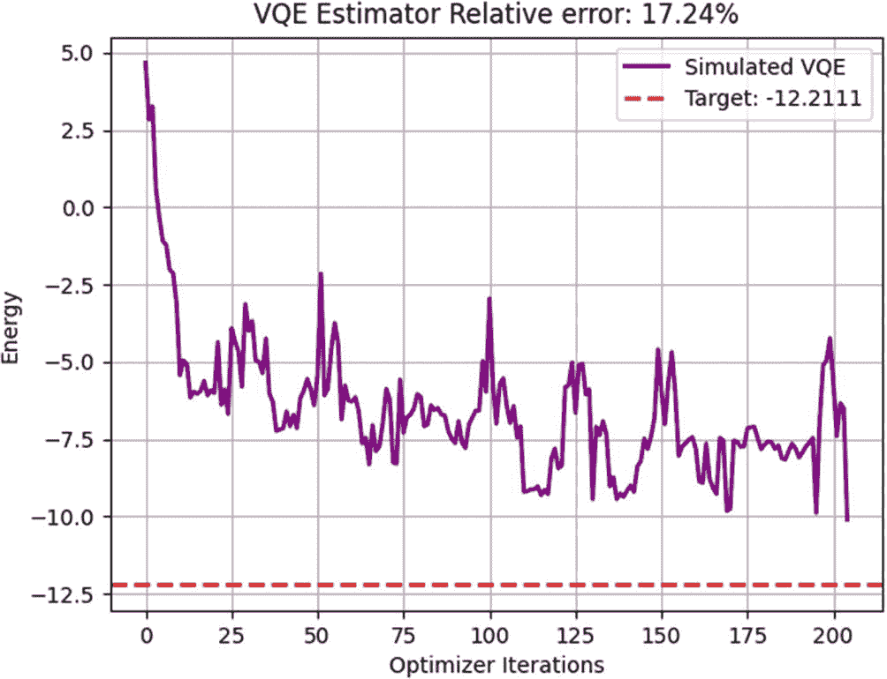

一张 V Q E 相对误差折线图，纵轴能量范围从 -12.5 到 5，横轴为优化器迭代次数从 0 到 200。图中绘制了两条曲线，分别是模拟 V Q E 和目标值。目标能量等于 -12.2111。

图 11-4

基态实验的 VQE 结果

## 练习 11.4

修改清单 11-6，使用 Qiskit 电路库^(²⁴) 和优化器库^(²⁵) 中不同的 `Ansatz` 与 `Optimizer` 组合。提示：所有电路都是通过接口构建的；因此，只需将旧名称替换为新名称即可。注意我使用了 (`EfficientSU2`, `NFT`)：将你的结果与我的进行比较，看看是否能得到更低的误差率。

## 练习 11.5

Qiskit 在 [2] 中打包了丰富的晶格库。修改清单 11-1 以使用其他晶格类型：例如，使用以下代码片段中的直线晶格并设置周期性边界条件。

```python
##### 直线
line_lattice = LineLattice (num_nodes=nqubits,    boundary_condition=BoundaryCondition.PERIODIC)
line_lattice.draw(style=LatticeDrawStyle(with_labels=True, font_color='w'))
```

总而言之，VQE 是量子武器库中一个强大的算法。它非常灵活，几乎可以用于任何优化任务。让我们继续另一个引人瞩目的实验来展示它的威力。这次轮到生物信息学领域：蛋白质折叠。

## 蛋白质折叠

蛋白质是驱动地球上所有生命的基本构件。蛋白质是一条氨基酸链，它会折叠成一个紧凑的形状（构象）；它们起初是一条线性氨基酸链或具有不稳定三维结构的随机卷曲。最终，氨基酸相互作用形成结构明确、折叠好的蛋白质；这些化学机器创造了生命。可靠地预测蛋白质结构极其复杂，却能改变我们对自然界的理解。量子计算机可以通过预测对蛋白质功能至关重要的结构，来帮助解开这一复杂性。

注意

蛋白质折叠是生物学界的圣杯，因为氨基酸序列决定了蛋白质的三维结构；折叠失败会产生有毒化合物，可能导致多种疾病。

在这个问题中，有以下几个重要概念需要理解：

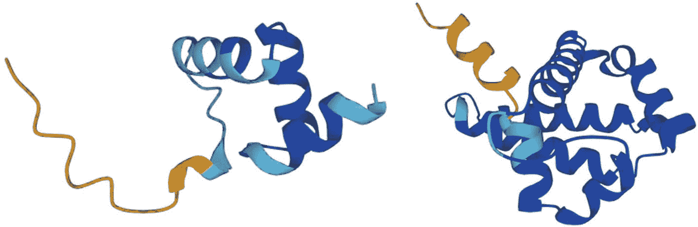

一张大肠杆菌蛋白链和血红蛋白链的示意图。它们用不同粗细和深浅的线条描绘了初级、二级及其他结构。

图 11-5

左侧：大肠杆菌蛋白，展示了初级、二级和三级结构。右侧：血红蛋白，展示了四级结构（来自 AlphaFold^(²⁶) 蛋白质结构数据库）

-   **肽**：一种由氨基酸（由氨基和羧酸组成的有机化合物——自然界中有超过 500 种氨基酸）组成的小型链。

-   **多肽**：一条更长、连续且不分枝的肽链，由化学键或肽键连接。

-   **折叠阶段**：决定蛋白质结构并控制其功能的四个阶段：

    -   **一级结构**：这是多肽链中氨基酸残基的线性序列。

    -   **二级结构**：由一级结构折叠成α螺旋或β折叠片层而成。

    -   **三级结构**：由多个二级结构相互折叠而成。这是蛋白质的几何形状（见图 11-5 左侧）。

    -   **四级结构**：由多个三级结构相互作用形成功能性蛋白质，如血红蛋白（见图 11-5 右侧）。

### 蛋白质折叠问题

根据美国国家医学图书馆的定义，蛋白质折叠问题由三个难题组成：(a) 折叠代码是什么，(b) 折叠机制是什么，(c) 蛋白质的三维结构是什么？目前，只有强大的超级计算机，结合蛋白质结构数据库、计算物理方法以及像蒙特卡洛采样^(²⁷) 这样复杂的算法等先进工具，才能根据氨基酸序列预测三维结构。

提示

1994 年，CASP（蛋白质结构预测技术关键评估）成立，旨在预测未知的蛋白质结构。CASP 已从一个小团体发展成为一项全球性倡议，涵盖了来自 19 个以上国家的 200 多个小组。

### 使用量子计算机进行蛋白质折叠

我们可以使用 Qiskit 的研究包（在撰写本文时，这个库还不太为人所知）进入蛋白质折叠领域。该库目前处于 alpha 阶段，并非官方发行版的一部分；但是，可以通过以下命令轻松安装：

```
pip install qiskit-research
```

现在我们已经准备好开始折叠了。让我们看看具体如何操作。

#### 问题初始化

本节中的代码分为三个部分。我们从初始化步骤开始（见代码清单 11-7）。在此步骤中，我们定义：

- 一条蛋白质氨基酸链或肽：在化学中，氨基酸用单字母符号表示。本例中，链为 `APRLR`：`A` = 丙氨酸，`P` = 脯氨酸，`R` = 精氨酸，`L` = 亮氨酸。有关氨基酸符号的完整说明，请参见^((28))。请注意，蛋白质可能包含侧链；这些侧链可以相互结合，使蛋白质保持特定的形状或构象。

- 其次，它定义了氨基酸之间的能量相互作用过程。在此案例中，我们使用宫泽-杰尼根接触能量相互作用。这是一种广泛用于球状蛋白质的、基于知识的接触势。它采用概率模型，将单体项与氨基酸的多种疏水性标度进行比较。当将蛋白质视为椭球体时，该方法与蛋白质各层之间表现出很强的相关性^((29))。

- 接触能量相互作用以及肽被发送到 `ProteinFoldingProblem`，这是一个封装了该信息以便传递给算法的对象。请注意，还定义了一组惩罚参数。这些参数描述了强制执行问题的约束强度。

> **注意**：蛋白质折叠应通过本书的源代码从命令行运行，路径为 `Workspace\Ch11\proteinfolding.py`。此脚本无法在 Quantum Lab 中运行。

```markdown
## 运行 VQE

要运行 VQE，我们需要定义几个对象（见代码清单 11-8）：

- `拟设` – `RealAmplitudes`：这是一种启发式试探波函数，用于化学应用或机器学习中的分类电路。该电路由围绕布洛赫球 y 轴的旋转（`RY`）以及相邻量子比特上的纠缠（`CX` 门）组成；其制备的量子态仅具有实振幅；虚部始终为 0。

- `优化器` – `COBYLA`（线性近似约束优化）：这是一种用于约束问题的数值优化方法，通过目标函数的导数来寻找局部最小值。

- `哈密顿量`：它描述了系统的动能和势能。该特定案例使用四面体晶格（菱形或立方体晶格）通过构型量子比特来编码氨基酸的运动。有关该编码方式如何工作的更多详情，请参见^((30))。

```python
##### 运行 VQE
###### 经典优化器
optimizer = COBYLA(maxiter=50)

###### 变分拟设
ansatz = RealAmplitudes(reps=1)

counts = []
values = []

def store_intermediate_result(eval_count, parameters, mean, std):
    counts.append(eval_count)
    values.append(mean)

###### 使用 CVaR 初始化 VQE，alpha = 0.1
vqe = SamplingVQE(
    Sampler(),
    ansatz=ansatz,
    optimizer=optimizer,
    aggregation=0.1,
    callback=store_intermediate_result,
)

raw_result = vqe.compute_minimum_eigenvalue(qubit_op)
```

**代码清单 11-8**
蛋白质折叠问题的 VQE 执行部分

---

### 结果解释与显示

最后，利用 VQE 本征态返回的二进制概率来计算最佳转向序列位串，该位串与肽及晶格中未使用的量子比特一起被发送到 `Protein Result` 类。该类解释位串，并生成一个包含蛋白质中每个原子笛卡尔坐标的 XYZ 文件。该文件用于在三维坐标系中绘制蛋白质（见代码清单 11-9）。

```python
##### 显示结果解释
result = protein_folding_problem.interpret(raw_result=raw_result)
print(
    "位图形状表示：",
    result.turn_sequence,
)
print("扩展表达式：", result.get_result_binary_vector())
print(
    f"主转向序列：{result.protein_shape_decoder.main_turns}"
)
print(f"侧转向序列：{result.protein_shape_decoder.side_turns}")
print(result.protein_shape_file_gen.get_xyz_data())

##### 绘制构象（形状）能量图
fig = plt.figure()
plt.plot(counts, values)
plt.ylabel("构象能量")
plt.xlabel("VQE 迭代次数")
fig.add_axes([0.44, 0.51, 0.44, 0.32])
plt.plot(counts[40:], values[40:])
plt.ylabel("构象能量")
plt.xlabel("VQE 迭代次数")
plt.show()
#plt.savefig('protein-energy.png')

##### 绘制主链图
fig = result.get_figure(title="蛋白质结构", ticks=False, grid=True)
fig.get_axes()[0].view_init(10, 70)
#plt.savefig('protein-main-chain.png')
plt.show()
```

**代码清单 11-9**
蛋白质折叠的结果解释与显示

---

让我们看看整个过程是如何运行的：

练习 11.6：将代码清单 11-7、11-8 和 11-9 连接起来，对肽（`APRLRFY`）进行实验。用图 11-6 验证你的结果。

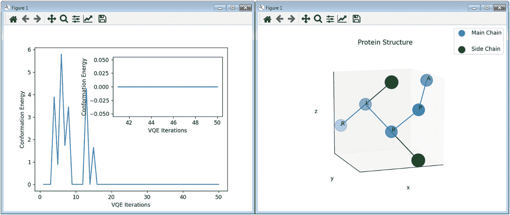

图 11-6
使用侧链的蛋白质折叠实验的实验结果

练习 11.7：修改你的代码，使用 `EfficientSU2` 拟设电路，该电路由 SU(2)（2 阶特殊酉群，或行列式为 1 的酉矩阵）张成的单量子比特操作层以及 `CX` 纠缠组成。这是一种为机器学习准备试探波函数的启发式模式。将优化器切换为 Nakanishi-Fujii-Todo (`NFT`) 算法（一种使用梯度下降的方法）。比较两种实验的结果。提示：重命名创建拟设和优化器的两个指令并运行；有关电路和优化器的完整列表，请参见^((31))。

### 关于该肽

本实验采用的氨基酸序列是神经肽 `APRLRFY`（`NPID: NP02949`），来自生物体*加州海兔*（`UniProt ID: ELH1_APLCA`）。您可以从神经肽数据库（如^(³²)）获取该蛋白质的信息。欧洲生物信息学研究所还提供了一个强大的 3D 查看器，用于可视化折叠结构（见图 11-7）。

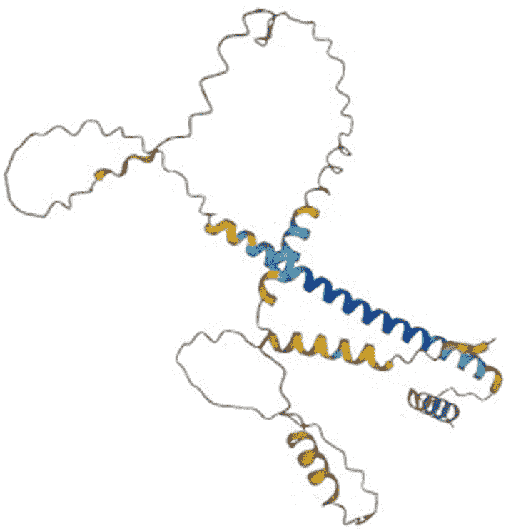

神经肽链示意图。图中用不同粗细和深浅的链表示一级、二级及其他结构。

图 11-7
欧洲生物信息学研究所 AlphaFold 项目提供的神经肽 `APRLRFY`（`NPID: NP02949`）3D 可视化图像

#### 激动人心的时代即将到来

---

```python
from qiskit_research.protein_folding.interactions.miyazawa_jernigan_interaction import *
from qiskit_research.protein_folding.peptide.peptide import Peptide
from qiskit_research.protein_folding.protein_folding_problem import *
from qiskit_research.protein_folding.penalty_parameters import PenaltyParameters
from qiskit.utils import algorithm_globals, QuantumInstance
from qiskit.circuit.library import *
from qiskit.algorithms.optimizers import *
from qiskit.algorithms import NumPyMinimumEigensolver
from qiskit.algorithms.minimum_eigensolvers import SamplingVQE
from qiskit import execute, Aer
from qiskit.primitives import Sampler
import matplotlib.pyplot as plt

##### 不含侧链的蛋白质
#main_chain = "APRLRFY"
#side_chains = [""] * 7

##### 含侧链
main_chain = "APRLR"
side_chains =["", "", "F", "Y", ""]

##### 相互作用
#random_interaction = RandomInteraction()
mj_interaction = MiyazawaJerniganInteraction()

##### 物理约束
penalty_back = 10
penalty_chiral = 10
penalty_1 = 10
penalty_terms = PenaltyParameters(penalty_chiral, penalty_back, penalty_1)

##### 肽
peptide = Peptide(main_chain, side_chains)

##### 问题
protein_folding_problem = ProteinFoldingProblem(peptide, mj_interaction, penalty_terms)
qubit_op = protein_folding_problem.qubit_op()

##### 导出哈密顿量
#print(qubit_op)
```

**代码清单 11-7**
蛋白质折叠问题的初始化步骤

---
```

您所看到的只是量子计算机在现实世界中产生影响的冰山一角。但对于单个章节而言，还有更多、多得多的内容有待涵盖。事实上，量子计算已在科学、工业和商业的主要领域开辟道路。以下是一些示例：

## 在物理与化学领域^(³³)

* `电子结构`：旨在描述分子系统的量子力学运动，包括电子在由静止原子核产生的静电场中的运动状态。

* `振动结构`：一种通过实时监测振动光谱来研究光激发分子结构与动力学的技术。

* `基态求解器`：目标是利用`电子结构`或`振动结构`计算分子`哈密顿量`的基态。

* `激发态求解器`：目标是计算分子`哈密顿量`的激发态。该`哈密顿量`可以是电子的或振动的。

## 在商业领域^(³⁴)

* `投资组合优化`：从所有待考虑的投资组合中，选择最佳资产分配（`投资组合`）的过程。

* `投资组合多元化`：分散投资以限制损失的实践。

* `信用风险分析`：旨在通过评估客户在授信前发生违约的概率，判断其信用状况。

* `期权定价理论`：为期权的公允价值提供评估，交易者会将其纳入策略。

量子计算机即将彻底改变信息技术。`IBM`计划在 `2023` 年底前发布一款 `1000` 量子比特的处理器。这款设备将比以往所有超级计算机加在一起还要强大。现在正是了解这些不可思议机器的好时机！

脚注 1 2 3 4 5 6 7 8 9 10 11 12 13
