# 5. 数学基础：是时候重温线性代数了

矩阵、复数以及张量积是量子计算的神圣三位一体。在学习量子计算数学背景的过程中，我像你一样也曾纳闷：这其中的量子魔力到底在哪里？一个复数或一个矩阵如何能告诉我叠加态或纠缠态是什么？那种幽灵般的效应又在何处？我曾对叠加态有一种不成熟的理解，认为一个系统同时存在于多种状态中：就像盒子里的猫，既死又活。然而这是不正确的，猫不可能同时既死又活，正如一个量子系统不可能同时存在于两种状态中一样。

我的线性代数可以说相当生疏了。所以过了一段时间，我才明白叠加态不过是一个代数和。意识到这一点后，我有点失望，不，猫并非同时既死又活：猫处于一个概率和之中：50% 死亡加 50% 存活。总而言之，量子力学那些奇特的性质：纠缠和叠加态完全由矩阵来描述。正是矩阵和复数的丰富内涵开辟了更广阔的天地，也正是这一点赋予了量子超越传统标量数学的优势。可以把它想象成从一个城市到另一个城市的旅行：标量只提供一条路可走。而矩阵则提供数不清的路径，其中有些是坏路，有些是好路，而这正是整个问题的关键。这就是量子算法优于经典算法的原因。尽管如此，事情会变得更复杂一些，但归根结底，它都是线性代数。所以，让我们重温一下这门古老的代数学吧。

## 量子比特 101：向量、矩阵与复数

在深入探讨量子程序与算法之前，我们需要回顾一些基础的数学知识，以理解其背后的运作原理。理解量子比特基本模型以及量子门效应的一个基本方法，是利用其代数表示。为此，你需要掌握一些基本的线性代数概念，包括：

- **线性向量**：简单的向量，例如 ![$$ \left[\begin{array}{c}1\\ {}0\end{array}\right] $$](images/469026_2_En_5_Chapter/469026_2_En_5_Chapter_TeX_IEq1.png)，用于表示量子比特的基础状态。
- **复数**：由实部和虚部组成的数，表示为 `a + bi`，其中 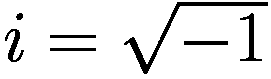。注意，量子比特叠加态 `ѱ = α∣0⟩ + β∣1⟩` 的系数 `α`、`β` 就是复数。
- **共轭复数**：在讨论量子门时会频繁听到的一个术语。求一个复数的共轭复数，只需将虚部的符号取反；因此，`a + bi` 变成 `a - bi`，反之亦然。
- **矩阵乘法**：如果 `A` 是一个 `n × m` 矩阵，`B` 是一个 `m × p` 矩阵，那么它们的乘积 `AB` 是一个 `n × p` 矩阵。在该乘积矩阵中，`A` 的某一行上的 `m` 个元素与 `B` 的某一列上的 `m` 个元素相乘，然后求和，得到 `AB` 中的一个元素。取第一个矩阵的第一行，将每个元素与第二个矩阵第一列的对应元素相乘，结果作为结果矩阵的第一个元素。
- **矩阵的行列式** `det(M)`：一个单一的数值，在求逆矩阵或解线性方程组时非常有用。对于一个 `2x2` 矩阵，将主对角线上的元素相乘，然后减去副对角线上元素的乘积：![$$ A=\left[\begin{array}{cc}a&amp; b\\ {}c&amp; d\end{array}\right],\kern0.5em \det (A)= ad- bc $$](images/469026_2_En_5_Chapter/469026_2_En_5_Chapter_TeX_IEq3.png)。类似地，对于 `3x3` 矩阵，可以将其拆分为 3 个 `2x2` 子式的行列式。因此，给定 ![$$ A=\left[\begin{array}{ccc}a&amp; b&amp; c\\ {}d&amp; e&amp; f\\ {}g&amp; h&amp; i\end{array}\right],\kern0.5em \det (A)=a\ \mathit{\det}\left[\begin{array}{cc}e&amp; f\\ {}h&amp; i\end{array}\right]-b\ \mathit{\det}\left[\begin{array}{cc}d&amp; f\\ {}g&amp; i\end{array}\right]+c\ \mathit{\det}\left[\begin{array}{cc}d&amp; e\\ {}g&amp; h\end{array}\right] $$](images/469026_2_En_5_Chapter/469026_2_En_5_Chapter_TeX_IEq4.png)。请注意，计算 `NxN` 矩阵的行列式是有方法可循的，但比较复杂，超出了本章的讨论范围。

让我们通过一组简单的练习来实践这些概念。

**练习 5.1**：求矩阵 ![$$ A=\left[\begin{array}{ccc}1&amp; 2&amp; 3\\ {}4&amp; 5&amp; 6\end{array}\right],B=\left[\begin{array}{cc}a&amp; b\\ {}c&amp; d\\ {}e&amp; f\end{array}\right] $$](images/469026_2_En_5_Chapter/469026_2_En_5_Chapter_TeX_IEq5.png) 的乘积 `C`

![$$ AB=\left[\begin{array}{cc}a+2c+3e&amp; b+2d+3f\\ {}4a+5c+6e&amp; 4b+5d+6f\end{array}\right] $$](images/469026_2_En_5_Chapter/469026_2_En_5_Chapter_TeX_Equa.png)

**练习 5.2**：记住矩阵乘法不满足交换律：`AB ≠ BA`。请用前一个练习中的矩阵 `A`、`B` 证明这一点。

![$$ BA=\left[\begin{array}{cc}a&amp; b\\ {}c&amp; d\\ {}e&amp; f\end{array}\right]\ \left[\begin{array}{c}1\ 2\kern0.5em 3\\ {}4\kern0.5em 5\kern0.5em 6\end{array}\right]=\left[\begin{array}{ccc}a+4b&amp; 2a+5b&amp; 3a+6b\\ {}c+4d&amp; 2c+5d&amp; 3c+6d\\ {}e+4f&amp; 2e+5f&amp; 3e+ ef\end{array}\right] $$](images/469026_2_En_5_Chapter/469026_2_En_5_Chapter_TeX_Equb.png)

**练习 5.3**：计算矩阵 ![$$ A=\left[\begin{array}{cc}1&amp; 2\\ {}3&amp; 4\end{array}\right] $$](images/469026_2_En_5_Chapter/469026_2_En_5_Chapter_TeX_IEq6.png) 的行列式

`|A| = 1*4 – 3*2 = -2`

**练习 5.3a**：这是一个更棘手的题目 – 计算 `3x3` 矩阵的行列式：![$$ M=\left[\begin{array}{ccc}a&amp; b&amp; c\\ {}d&amp; e&amp; f\\ {}g&amp; h&amp; i\end{array}\right] $$](images/469026_2_En_5_Chapter/469026_2_En_5_Chapter_TeX_IEq7.png)

![$$ \left|M\right|=a\left[\begin{array}{cc}e&amp; f\\ {}h&amp; i\end{array}\right]-b\left[\begin{array}{cc}d&amp; f\\ {}g&amp; i\end{array}\right]+c\left[\begin{array}{cc}d&amp; e\\ {}g&amp; h\end{array}\right]=a\left( ei- hf\right)=b\left( di- gf\right)+c\left( dh- ge\right) $$](images/469026_2_En_5_Chapter/469026_2_En_5_Chapter_TeX_Equc.png)

请自行尝试这些练习。如果遇到困难，附录中提供了答案。

**练习 5.4**：将数值 `1.2`、`3.0`、`−0.1` 表示为一个列向量。

### 内积

两个向量 `a` 和 `b` 的内积（点积的推广形式），表示为 `(a.b)` 或 `<a, b>`，是将它们相乘的一种方式，结果是一个标量。因此，`< (x1, x2, ...), (y1, y2, ...) > = x1y1 + x2y2 + ...`

**练习 5.5**：求向量`a`和`b`的内积。其中：
$$ a=\left[\begin{array}{c}1\\ {}2\\ {}3\end{array}\right],b=\left[\begin{array}{c}4\\ {}5\\ {}6\end{array}\right} $$

### 矩阵的转置 `M^T`

矩阵的转置是通过将原矩阵的行与列互换而得到的翻转版本。

**练习 5.6**：求矩阵`A`的转置：
$$ A=\left[\begin{array}{ccc}1& 2& 3\\ {}4& 5& 6\end{array}\right] $$

其转置为：
$$ {A}^T=\left[\begin{array}{cc}1& 4\\ {}2& 5\\ {}3& 6\end{array}\right] $$

**练习 5.7**：请自行尝试此练习。求矩阵`A`的转置：
$$ A=\left[\begin{array}{c}1\\ {}2\\ {}3\end{array}\right] $$

### 共轭转置或伴随矩阵 `M^†`

一个`m × n`复矩阵`A`的共轭转置，或厄米转置，是一个`n × m`矩阵，通过对`A`进行转置并对每个元素取共轭复数得到。其中`z = a + ib`的共轭复数是`z* = a – ib`（下一节会有更多关于复数的内容）。

**练习 5.8**：矩阵`A`的共轭转置是什么？
$$ A=\left[\begin{array}{c}a+i\\ {}2b-i\\ {}3c\end{array}\right] $$

其共轭转置为：
$$ {A}^{\dagger }=\left[a-i\kern0.5em 2b+i\kern0.5em 3c\right] $$

请自行尝试这些练习。

**练习 5.9**：向量`v`的共轭转置向量是什么？其中`a`、`b`和`c`为复数。
$$ v=\left[\begin{array}{c}a\\ {}b\\ {}c\end{array}\right] $$

**练习 5.10**：给定上一个问题中的复向量，`v^† v`的结果是什么？

**练习 5.11**：计算以下乘积：
$$ \left[\begin{array}{c}a\\ {}b\\ {}c\end{array}\right]\left[x\kern0.5em y\kern0.5em z\right] $$

### 复数：数学中的魔法帽

你可能听说过著名的虚数`i = sqrt(-1)`或`i² = -1`。它是由17世纪法国哲学家勒内·笛卡尔提出的，目的是为了解决诸如以下悖论：
`x² = -1`

我们知道任何数的平方都必须是正数，那么如何解这个方程呢？只需设`i = sqrt(-1)`，然后你就得到`x = i`。这相当于从魔术师的帽子里变出一只兔子。事实上，虚数是数学工具库中的基本组成部分，也是量子力学中不可或缺的一部分。复数可以使用笛卡尔坐标系在复平面上进行几何表示（见图5-1）。

一张虚部Im对实部Re的图。两条长度为`r`的线段沿X轴以角度`phi`向相反方向延伸，并终止于点`z = x + iy`和`z = x - iy`。

图5-1：复数`Z`的复平面，其中X轴为实部，Y轴为虚部。

> **提示**  
> 我们知道`x = r * cos(phi)`和`y = r * sin(phi)`；因此，我们可以将复数表示为`z = r cos(phi) + i * r * sin(phi)`。经过因式分解并使用万能的欧拉恒等式（见下一节），我们得到`z = r * e^phi`。这被称为复数的**极坐标形式**，其中`r`是模长，`phi`是复平面中的旋转角度。请记住这个极坐标形式和出色的欧拉恒等式。它们非常重要。

**练习 5.12：**这是一个脑筋急转弯问题：以下哪个是`-16`的平方根？
a) `-4`，b) `4i`。

**练习 5.13：**求`i`的幂：`i^(-3)`，`i^(-2)`，`i^(-1)`，`i⁰`，`i¹`，`i²`，`i³`。

## 欧拉恒等式：绝妙的杰作

量子计算的基石是欧拉恒等式，由同名的瑞士数学家提出。它以其全部辉煌呈现如下：
`e^(ix) = Cos x + i Sin x`

你必须将这个公式深深烙印在脑海中，因为它无处不在，不仅在量子力学中，几乎在所有数学领域都能见到。是什么让欧拉恒等式如此不可思议？因为它联系了：
- 三种基本算术运算：加法、乘法和乘方
- 三个强大的常数：`pi`（用于几何）、`e`（欧拉数，用于数学分析）和`i`（虚数）
- 加法恒等元（`0`），乘法恒等元（`1`）

因此，这个强大的公式将数学的三大领域：几何、数值分析和复数联系在了一起。这就是为什么它被称为“数学中最美丽的定理”和“有史以来最伟大的方程式”等等。欧拉对数学的贡献数不胜数，让我们深入这颗小宝石，理解其精妙之处。

**练习 5.14：**欧拉恒等式与正弦、余弦和指数函数的无穷级数密切相关，其中：
```
Sin x = x - x³/3! + x⁵/5! - x⁷/7! + ...   (1)
Cos x = 1 - x²/2! + x⁴/4! - x⁶/6! + ...   (2)
e^x = 1 + x/1! + x²/2! + x³/3! + x⁴/4! + x⁵/5! + ...   (3)
```
使用上述无穷级数证明欧拉恒等式。提示：从`e^x`开始，应用`i`的幂：`i^(-3) = i`，`i^(-2) = -1`，`i^(-1) = -i`，`i⁰ = 1`等。最后将包含`i`的项分组并与余弦和正弦的级数进行比较。
```
e^(ix) = 1 + ix + (ix)²/2! + (ix)³/3! + (ix)⁴/4! + (ix)⁵/5! + ...
```
```
= [1 - x²/2! + x⁴/4! - x⁶/6! + ...] + i[x - x³/3! + x⁵/5! - x⁷/7! + ...]
= Cos x + i Sin x
```
自己尝试这些练习。使用恒等式`Sin x = Sin(-x)`，`Cos x = Cos(-x)`和欧拉恒等式。提示：对所有的指数函数应用欧拉恒等式，然后简化。

**练习 5.15：**证明`Cos x = 1/2 (e^(ix) + e^(-ix))`

**练习 5.16：**证明`Sin x = 1/(2i) (e^(ix) - e^(-ix))`

总而言之，欧拉恒等式对于我们理解量子计算至关重要。事实上，任何一个单量子比特门都可以概括为跨越三个欧拉角的旋转，这真是一件杰作。
```
U(theta, phi, lambda) = [ [Cos(theta/2), -e^(i*lambda)*Sin(theta/2)],
                          [e^(i*phi)*Sin(theta/2), e^(i*(phi+lambda))*Cos(theta/2)] ]
```

## 矩阵的张量积 ⊗

张量积在抽象代数、代数拓扑、几何、微分几何以及物理学中至关重要。在量子计算中，几乎所有内容都是向量或矩阵（算子）的张量积。你必须熟悉这个概念。张量积之所以重要，是因为：
1.  它可以让你改变定义模的环。
2.  它可以将双线性映射转化为线性映射，从而可以应用线性代数。

# 量子力学的基本假设

对于不擅长数学的人来说，这一节可能有点难；然而，我们需要稍微深入（但不是太深）量子力学，以便扎实理解并补充线性代数知识。

## 假设 1：状态与向量空间

一个量子系统完全由希尔伯特空间中的一个状态向量描述：

$$ \mid \left.\uppsi \right\rangle ={\sum}_i{\alpha}_i\mid \left.{e}_i\right\rangle, {\sum}_i{\left|\alpha \right|}²=1 $$

这个假设告诉我们，任何量子态 `ѱ` 都可以由一组线性无关的状态 `e[i]` 与复系数 `α[i]` 相乘后的叠加（求和）来描述。一个非常重要的条件是，复系数平方和必须等于 1。在量子计算中，所有变换都必须是幺正的（可逆的），而这一性质保证了这一点。另一个需要记住的重要概念是*基向量*。对于单个量子比特，基向量是 `|0⟩` 和 `|1⟩`。对于 2 量子比特系统，我们有 2² = 4 个基向量：

简单来说，两个矩阵 `A` 和 `B` 的张量积记为 `A⊗B`。

> **提示**
>
> 在量子力学中，张量积通常被缩写；因此，我们可以写成 `|0⟩⊗|1⟩ = |0⟩|1⟩ = |01⟩`。

让我们通过一个使用量子门的简单示例来说明前面的第 1 点和第 2 点。

**练习 5.17：** 控制-X 门（`CX`）由恒等算子的张量积构成 `CX = |0⟩⟨0| ⊗ I + |1⟩⟨1| ⊗ X`，其中：`I`、`X`、`|0⟩`、`⟨0|`、`|1⟩`、`⟨1|`。计算恒等算子的张量积，并用 `CX` 的矩阵表示验证结果。

$$ \left|\left.0\right\rangle \left\langle 0\right.\right|=\left[\begin{array}{c}1\\ {}0\end{array}\right]\left[1\kern0.5em 0\right]=\left[\begin{array}{cc}1&amp; 0\\ {}0&amp; 0\end{array}\right],\kern0.5em \left|\left.1\right\rangle \left\langle 1\right.\right|=\left[\begin{array}{c}0\\ {}1\end{array}\right]\left[0\kern0.5em 1\right]=\left[\begin{array}{cc}0&amp; 0\\ {}0&amp; 1\end{array}\right] $$

$$ CX=\left[\begin{array}{cc}1&amp; 0\\ {}0&amp; 0\end{array}\right]\otimes \left[\begin{array}{cc}1&amp; 0\\ {}0&amp; 1\end{array}\right]+\left[\begin{array}{cc}0&amp; 0\\ {}0&amp; 1\end{array}\right]\otimes \left[\begin{array}{cc}0&amp; 1\\ {}1&amp; 0\end{array}\right]=\left[\begin{array}{cc}1\left[\begin{array}{cc}1&amp; 0\\ {}0&amp; 1\end{array}\right]&amp; 0\left[\begin{array}{cc}1&amp; 0\\ {}0&amp; 1\end{array}\right]\\ {}0\left[\begin{array}{cc}1&amp; 0\\ {}0&amp; 1\end{array}\right]&amp; 0\left[\begin{array}{cc}1&amp; 0\\ {}0&amp; 1\end{array}\right]\end{array}\right]+\left[\begin{array}{cc}0\left[\begin{array}{cc}0&amp; 1\\ {}1&amp; 0\end{array}\right]&amp; 0\left[\begin{array}{cc}0&amp; 1\\ {}1&amp; 0\end{array}\right]\\ {}0\left[\begin{array}{cc}0&amp; 1\\ {}1&amp; 0\end{array}\right]&amp; 1\left[\begin{array}{cc}0&amp; 1\\ {}1&amp; 0\end{array}\right]\end{array}\right] $$

$$ CX=\left[\begin{array}{cccc}1&amp; 0&amp; 0&amp; 0\\ {}0&amp; 1&amp; 0&amp; 0\\ {}0&amp; 0&amp; 0&amp; 1\\ {}0&amp; 0&amp; 1&amp; 0\end{array}\right] $$

# 量子力学基础公设与线性代数


最后，一个`n`量子比特系统将拥有`2^n`个基向量。注意它们是线性无关的（列向量中只有一个元素是1）。

## 假设2：可观测量与算子

物理系统的每个可观测量都由一个作用在描述系统的状态上的算子来描述。

*   `可观测量`：是粒子的可测量属性，例如自旋、位置、极化或电荷。
*   `算子`：是厄米矩阵的同义词，厄米矩阵是一个复方阵，等于其共轭转置。

算子引出了本征态和本征值的概念。

*   `本征态`：是一个仅被标量乘子改变的量子态。因此对于作用在状态`|a⟩`上的算子`M`：`M |a⟩ = λ |a⟩`。
*   `本征值`：是与本征态`|a⟩`相对应的标量`λ`。

## 假设3：测量

当测量一个可观测量时，唯一可能的结果将是该可观测量算子的一个本征值。

> **注**：物理测量值总是实数；任何虚部都将消失。

*   `本征态的测量`：一个算子的本征态`|a[j]⟩`是正交的（垂直的）并构成一个基。`⟨a[j]| a[k]⟩ = δ[j,`。`任何状态都可以表示为这些本征态带复系数的线性组合。
*   `概率幅`：当测量系统`|ψ⟩`时，得到本征态`|a⟩`的本征值`λ`的概率为：`|⟨a[j]| ψ⟩|²`。注意`⟨a|ψ⟩`是一个复数值（或概率幅）。必须对其取平方才能得到一个实数值。
*   `期望值`：是使用算子`A`对状态`|ψ⟩`进行多次测量的估计结果：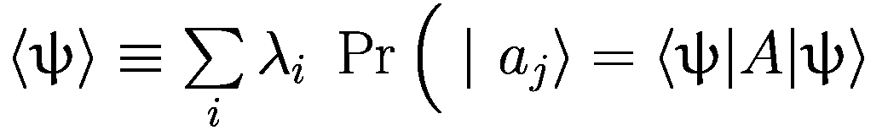

## 公设4：波函数坍缩

状态`|ψ⟩`的波函数在测量时会“坍缩”，叠加态所包含的所有信息将永久丢失。

> **注**：无人知晓波函数为何或如何坍缩。这是物理学中的一大谜团。例如，一个奇特的理论提出，这可能是平行宇宙间能量转移的结果。

波函数坍缩暗示了一个非常不祥的事实（至少从某个角度看如此）：我们不能“偷窥”盒子内部，因为这样做会破坏其量子态。这对调试量子电路来说是坏消息，但对注重隐私保护的密码学家来说却是好消息。

## 公设5：酉变换

酉变换描述了封闭量子系统随时间演化的过程。因此，给定时间`t1`的状态`|ψ⟩`和时间`t2`的状态`|ψ2⟩`，其中酉变换`U`仅依赖于`t1`、`t2`：`|ψ2⟩ = U |ψ⟩`。

> **提示**：酉变换确保所有状态的概率之和为1。所有操作（除测量外）都是可逆的，并且系统是封闭的（与外界无相互作用）。

## 线性代数与量子力学速查表

表5-1是对我们目前所学最重要概念的便捷汇编。在完成本章末尾的练习时，请将其放在手边备用。

**表5-1** 线性代数与量子力学速查表

| 名称 | 描述 |
| --- | --- |
| 括号向量记法<br>左矢(Bra) = 行向量`⟨a|`<br>右矢(Ket) = 列向量`|a⟩`<br>左矢(Bra)是右矢(Ket)的伴随（共轭转置） | `⟨0| = [1 0]` `⟨1| = [0 1]`<br>`|0⟩ = [1; 0]` `|1⟩ = [0; 1]` |
| 基向量和标准基是线性无关的；它们不能写成其他向量的线性组合。<br>任何向量都可以写成基向量的线性组合：`|ψ⟩ = c1|00⟩ + c2|01⟩ + c3|10⟩ + c4|11⟩` | 两个量子比特的基向量：<br>`|00⟩ = [1; 0; 0; 0]` `|10⟩ = [0; 1; 0; 0]`<br>`|01⟩ = [0; 0; 1; 0]` `|11⟩ = [0; 0; 0; 1]` |
| 内积`⟨a|b⟩`结果为一个标量 | `⟨0|0⟩ = [1 0][1; 0] = 1` |
| 外积`|a⟩⟨b|`：可视为将`|b⟩`变换为`|a⟩`的算符 | `|0⟩⟨0| = [[1, 0]; [0, 0]]` `|1⟩⟨1| = [[0, 0]; [0, 1]]`<br>`|1⟩⟨0| = [[0, 1]; [0, 0]]` `|0⟩⟨1| = [[0, 0]; [1, 0]]` |
| 酉矩阵：是伴随等于其逆的方复矩阵 | `U = [[a, b]; [c, d]]` `U† = [[a*, b*]; [c*, d*]]`, `UU† = U†U = I`<br>厄米矩阵：`U = U†` |
| 态矢量（波函数）`|ψ⟩` | `|ψ⟩ = Σ[i] α[i] \|e[i]⟩`, `Σ[i] \|α|² = 1` |
| 叠加态 | `|ψ⟩ = α|0⟩ + β|1⟩`，其中`|α|² + |β|² = 1` |
| 两个算符的张量积`A ⊗ B`<br>`A = [[a, b]; [c, d]]`, `B = [[e, f]; [g, h]]`<br>`A ⊗ B = [[a*B, b*B]; [c*B, d*B]]` | `A ⊗ B = [[ae, af, be, bf]; [ag, ah, bg, bh]; [ce, cf, de, df]; [cg, ch, dg, dh]]` |
| 纠缠态与可分离态：纠缠态不能表示为独立量子比特态的张量积 | `|ψ⟩ = (1/√2)|00⟩ + (1/√2)|11⟩`（纠缠态）<br>`|ψ⟩ = (1/√2)|01⟩ + (1/√2)|11⟩`（可分离态） |
| 本征态与本征值 | `M|a⟩ = λ|a⟩`<br>`λ`（lambda）是本征态`|a⟩`的本征值 |
| 泡利算符 | `X|0⟩ = |1⟩`, `X|1⟩ = |0⟩`<br>`Y|0⟩ = |0⟩`, `Y|1⟩ = -|i⟩`<br>`Z|0⟩ = |0⟩`, `Z|1⟩ = -|1⟩` |
| 状态`|a⟩`的测量概率<br>注：`⟨a|ψ⟩`是概率幅 | `|⟨a[j]|ψ⟩|²` |
| 多次测量后的期望值`⟨ψ⟩`总不相同 | `⟨ψ⟩ ≡ Σ_i λ_i Pr(|a_j⟩) = ⟨ψ|A|ψ⟩` |
| 酉变换<br>• 保持范数：概率之和为1<br>• 确保系统可逆（量子力学的要求）<br>• 确保系统封闭（与外界无相互作用） | `|ψ2⟩ = U|ψ⟩` |

扎实掌握代数知识将帮助你理解量子电路如何实现大规模并行计算，并相对于经典计算机的比特/晶体管逻辑具备优势。接下来，让我们深入了解基本门和电路。

## 量子比特的代数表示

在经典模型中，信息的基本单位是比特，用0或1表示。比特在物理上对应于流经晶体管的电压。在量子计算中，基本单位是量子比特（qubit），其在物理上对应于对光子、电子或原子的操纵。在代数上，量子比特用右矢（Ket）记法表示。

> **提示**：右矢（Ket）记法由物理学家保罗·狄拉克于1939年引入，也称为狄拉克记法。右矢通常表示为列向量，写作`|φ⟩`。

### 狄拉克符号

利用狄拉克符号，量子比特的基本量子态由向量`|0⟩`和`|1⟩`表示。这些被称为计算基态。

量子比特的量子态是二维复向量空间中的一个向量。请看下面的简单示意图。

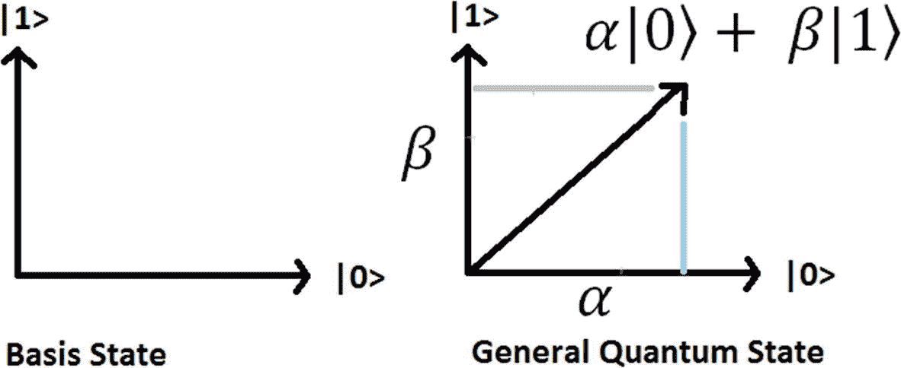

*两个平面。左图，向量`|1⟩`与向量`|0⟩`的基态平面。右图，向量`|1⟩`与向量`|0⟩`的一般量子态平面。一条`|α|向量|0⟩ + |β|向量|1⟩`的直线斜向上延伸。*

**图5-2** 量子比特的量子态

图5-2展示了用于表示量子比特状态的复向量空间。左侧是由两个单位向量组成的所谓基态，采用狄拉克符号表示状态`|0⟩`和`|1⟩`。右侧则是由两者的线性组合构成的一般量子态。因此，基态和一般量子态可以写成向量的形式：

```
|0⟩ = [1, 0]ᵀ, |1⟩ = [0, 1]ᵀ
```

```
|ψ⟩ = α|0⟩ + β|1⟩
```

其中 `α` 和 `β` 是单位向量的振幅系数。请注意，单位向量的振幅必须为 1；因此，`α` 和 `β` 必须满足约束条件 `|α|² + |β|² = 1`。这种代数表示是理解逻辑门如何影响量子比特状态的关键，稍后你将看到这一点。

那么，为什么量子比特的状态要用向量来表示，而这种表示似乎比经典比特更复杂呢？为什么一定要用向量？原因在于，当我们研究量子门和状态叠加时，会发现这种表示方法有助于构建更好的计算模型。总而言之，量子力学是一个历经数十年发展的理论，最终，向量是一个非常简单的数学对象，易于理解和操作。它很可能是最适合这项工作的工具。

### 叠加是个花哨的词

叠加容易被误解为原子粒子（或量子比特）同时存在于多种状态中的特性。这是不正确的；没有任何东西能同时处于多种状态。线性代数可以帮助我们理解这一点。

提示

叠加仅仅是 `|0⟩` 和 `|1⟩` 状态的线性组合。即 `α|0⟩ + β|1⟩`，且状态向量的长度为 1，如图 5-3 所示。

### 刃矢是列向量

如果你觉得刃矢符号令人困惑，只需改用熟悉的向量表示即可。因此，上一节的叠加态可以写成：

```
|ψ⟩ = α|0⟩ + β|1⟩ = α[1, 0]ᵀ + β[0, 1]ᵀ = [α, β]ᵀ
```

请注意，由于刃矢是向量，它们遵循与向量相同的规则，例如，标量乘法：

```
2(α|0⟩ + β|1⟩) = 2[α, β]ᵀ = [2α, 2β]ᵀ
```

## 在布洛赫球面上定位

让我们超越量子比特的代数二维表示，进入布洛赫球面：这是一个单一纯态（无噪声）量子比特的三维表示。上一节你学过的欧拉公式在这里大放异彩。考虑图 5-3；我们来定义球面上的几个重要部分。

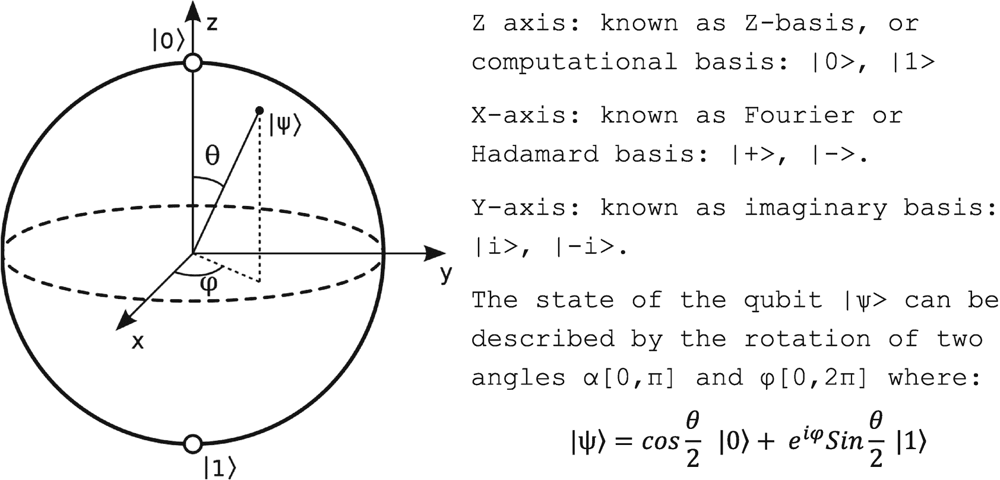

一个带有 x、y、z 轴的球体示意图。一条线从 x 轴以角度 `φ`、从 z 轴以角度 `θ` 绘制。

图 5-3

以瑞士裔美国物理学家费利克斯·布洛赫命名的布洛赫球面，是单一纯态量子比特的几何表示。

欧拉的魔法公式揭示了在球面上描述 `|ψ⟩` 的秘密。步骤如下：

- 我们从代数表示 `|ψ⟩ = α|0⟩ + β|1⟩` 开始，其中 `α`、`β` 是复数系数。
- 接下来，使用欧拉公式将复数表示为极坐标形式 `z = r * e^(iφ)`；因此，状态变为：

```
|ψ⟩ = r₁ * e^(i*φ₁) |0⟩ + r₂ * e^(i*φ₂) |1⟩
```

- 我们可以提取因子 `e^(i*φ₁)`，得到：

```
|ψ⟩ = e^(i*φ₁) [ r₁|0⟩ + r₂ * e^(i*(φ₂ - φ₁)) |1⟩ ]
```

- 项 `e^(i*φ₁)` 是一个全局相位。全局相位无法被测量，因此可以忽略。同时，我们可以将 `φ` 重命名为 `φ = φ₂ - φ₁`。应用这些规则得到：

```
|ψ⟩ = r₁|0⟩ + r₂ * e^(i*φ) |1⟩
```

- 最后，归一化条件：`r₁² + r₂² = 1` 意味着 `r₁ = cos(θ/2)` 且 `r₂ = sin(θ/2)`，其中 `θ/2` 是一个特定选择的任意角度，其原因很快会明了。因此，代入 `r₁` 和 `r₂`，我们得到：

```
|ψ⟩ = cos(θ/2) |0⟩ + e^(i*φ) * sin(θ/2) |1⟩
```

提示

欧拉公式使我们能够仅用两个极角 `θ[0,π]` 和 `φ[0,2π]` 来描述量子比特的纯态 `|ψ⟩`，而无需使用四个参数：`r₁`、`r₂` 以及 `(θ, φ)`。同时请注意，在球面上，基向量 `|0⟩`、`|1⟩` 指向相反方向（反极），而在二维笛卡尔平面中它们是正交的（垂直）。这就是为什么在 `|ψ⟩` 中使用角度 `θ/2` 的原因。

练习 5.18： 计算计算基 `|0⟩`、`|1⟩` 的基向量对应的状态 `|ψ⟩`。提示：查看球面，可知 `|0⟩`：`θ = 0`，`φ = 0`；`|1⟩`：`θ = π`，`φ = 0`。

```
|0⟩ → cos(0)|0⟩ + sin(0)|1⟩ = |0⟩
```

```
|1⟩ → cos(π/2)|0⟩ + sin(π/2)|1⟩ = |1⟩
```

练习 5.19： 计算阿达马基 `|+⟩`、`|-⟩` 的基向量对应的状态 `|ψ⟩`。提示：对于 `|+⟩`：`θ = π/2`，`φ = 0`；`|-⟩`：`θ = π/2`，`φ = π`。

练习 5.20： 计算虚基 `|i⟩`、`-|i⟩` 的基向量对应的状态 `|ψ⟩`。提示：对于 `|i⟩`：`θ = π/2`，`φ = π/2`；`-|i⟩`：`θ = π/2`，`φ = -π/2`。

## 用量子门改变量子比特的状态

量子门的目的是操纵量子比特的状态以达到期望的结果。它们是量子计算的基本构建块，就像经典逻辑门在经典世界中的作用一样。一些量子门与其经典对应物是等价的。让我们来看一看。

### 非门（泡利 X 门）

这是最简单的门，作用于单个量子比特。它是经典非门在量子领域的对应物，并与其经典对应物一样，会翻转量子比特的状态。因此：

`|0⟩ → |1⟩`, `|1⟩ → |0⟩`

对于叠加态，X 门线性作用，意味着它会翻转相应的状态；因此，`|0⟩` 变为 `|1⟩`，`|1⟩` 变为 `|0⟩`；故有：`α|0⟩ + β|1⟩ → α|1⟩ + β|0⟩`

在量子电路中，非门用 `X` 或 `Pauli X` 表示，以奥地利物理学家、量子力学奠基人之一沃尔夫冈·泡利的名字命名。

| 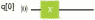 一条带有 x 的线向量 0 的示意图。`q[0]`位于图示旁边。 | 电路从量子比特 0 的基态 `|0⟩` 开始，状态沿着量子线传播，直到对该状态执行操作，然后输出继续沿着量子线传播。 |
|---|---|

另一种观察 X 门作用的方式是利用其矩阵表示，通过泡利矩阵 `X = [[0, 1], [1, 0]]`，我们可以精确地看到状态是如何被翻转的。

量子比特的状态通过使用 `X` 的矩阵表示以及 `|0⟩ = [1, 0]` 和 `|1⟩ = [0, 1]` 的向量来翻转，因此：

```
X|0⟩ = [[0, 1], [1, 0]] [1, 0] = [0+0, 1+0] = [0, 1] = |1⟩
```

```
X|1⟩ = [[0, 1], [1, 0]] [0, 1] = [0+1, 0+0] = [1, 0] = |0⟩
```

还有一种更简单的量子电路，是所有电路中最简单的一种，那就是量子线，用希腊符号 (Psi) `|ψ⟩ → |ψ⟩` 表示，它描述了随时间变化的计算状态。这看似微不足道，但在物理上却是最难实现的。由于量子线的原子尺度（想想光子、电子或单个原子），它非常脆弱，容易受到环境引入的错误影响。

X 门的另一个有趣特性是，两个非门串联会得到单位矩阵（`I`），这是线性变换中一个非常重要的工具。我们来计算一下：

|  一条带有 2 个标有 x 的方块的线向量 0 的示意图。`q[0]`位于图示旁边。`|ψ⟩ → XX |ψ⟩` | 为了理解电路的效果，我们来看看将两个 `X` 矩阵相乘会发生什么：`XX = [[0, 1], [1, 0]] [[0, 1], [1, 0]] = [[0+1, 0+0], [0+0, 1+0]] = [[1, 0], [0, 1]] = I` |
|---|---|

X 门是量子逻辑门、量子电路和量子计算最简单的例子。在下一节中，我们将介绍一个真正的量子门：哈达玛门，以及它如何利用电路和代数触发叠加态。

### 真正的量子特性：使用哈达玛门实现叠加态

哈达玛门对基态的影响形式化定义如下：

```
|0⟩ → (|0⟩ + |1⟩) / √2, |1⟩ → (|0⟩ - |1⟩) / √2
```

此外，对于叠加态 `α|0⟩ + β|1⟩`，哈达玛变换映射为：

```
α|0⟩ + β|1⟩ → α((|0⟩ + |1⟩) / √2) + β((|0⟩ - |1⟩) / √2) = (α + β)/√2 |0⟩ + (α - β)/√2 |1⟩
```

就电路和矩阵表示而言，哈达玛门作用于单个量子比特。

| 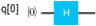 一条带有 H 的线向量 0 的示意图。`q[0]`位于图示旁边。`H = (1/√2) [[1, 1], [1, -1]]` | 将 `H` 应用于基态 `|0⟩ = [1, 0]` 和 `|1⟩ = [0, 1]`：`H|0⟩ = (1/√2) [[1, 1], [1, -1]] [1, 0] = (1/√2) [1, 1] = (1/√2)([1, 0] + [0, 1]) = (|0⟩ + |1⟩)/√2``H|1⟩ = (1/√2) [[1, 1], [1, -1]] [0, 1] = (1/√2) [1, -1] = (1/√2)([1, 0] - [0, 1]) = (|0⟩ - |1⟩)/√2` |
|---|---|

那么，引入哈达玛门的计算原因是什么？它能给我们带来什么好处？在不深入技术细节的前提下，答案是哈达玛门扩展了量子电路可能达到的状态范围。这很重要，因为状态的扩展创造了寻找捷径的可能性，从而能够更快地进行计算。可以类比国际象棋游戏。例如，如果你的马可以同时像后和马一样移动（状态的扩展），这会让局势对你有利，并让你更快地将死对方。这就是哈达玛门的作用：为我们的量子机器提供更强的马力。

## 量子态的测量比你想象中更棘手

想象一下，你家的地下室里有一个实验室。你拿到一个处于状态 `|ψ⟩ = α|0⟩ + β|1⟩` 的量子比特、一个测量装置，并被要求计算出系数 `α` 和 `β`。也就是说，要计算出量子态。这看起来像是一项简单的任务，然而，这其实是不可能的。量子力学原理指出，系统的量子态是不能直接观测到的。我们最多只能猜测出关于 `α` 和 `β` 的大致信息。这个过程被称为在计算基下的测量。

| 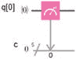 一个线向量 0 具有一个指向下方轴线上 0 点的 C X 平方的量子比特。 | 对量子态 `|ψ⟩ = α|0⟩ + β|1⟩` 进行测量的结果会得到经典比特：`α|0⟩ + β|1⟩ → 0 的概率为 |α|²`，`α|0⟩ + β|1⟩ → 1 的概率为 |β|²` |
| :--- |

因此，测量过程会给出经典比特 0 和 1 的概率，它们分别等于系数 `α` 和 `β` 模的平方。在物理上，我们可以这样想象这个过程的发生：通过一个测量装置去观测一个物理的光子、原子或电子。这就是为什么测量常被视为一个量子门。

测量会干扰量子系统的状态，并给出一个经典比特的结果。需要记住的重要一点是，在测量过程之后，系数 `α` 和 `β` 会被销毁。这意味着我们无法在单个量子比特中存储大量信息。想象一下，如果我们能测量出 `α` 和 `β` 的确切值，那么通过使用复数，理论上就可以在量子比特状态中存储无限量的经典信息。通过计算出 `α` 和 `β` 的确切值，我们就可以提取出所有那些经典信息。然而，这是不可能的，量子力学禁止这样做。

关于测量的最后一点是**量子态的归一化**：给定一个在计算基 `α|0⟩ + β|1⟩` 下的测量，那么得到经典比特 0 和 1 的概率之和必须为 1。即：

```
概率(0) + 概率(1) = |α|² + |β|² = 1
```

这意味着量子态向量的长度必须为 1（归一化）。这源于测量概率之和为 1 这一事实。在下一节中，我们将讨论单量子比特门是如何一般化的，它们是什么，以及如何用它们来构建更复杂的电路。

## 一般化的单量子比特门

到目前为止，我们已经看到了两个简单的门：由矩阵表示的 `X` 门和 `H` 门：

```
X = [[0, 1], [1, 0]], H = 1/√2 [[1, 1], [1, -1]]
```

同时也要记住，量子态的叠加态可以表示为向量 `|ψ⟩ = [α, β]^T`。那么将这两个门应用于量子态的过程，可以依据任意酉矩阵推广为：

```
H[α, β]^T, X[α, β]^T, U[α, β]^T 其中 U = H, X
```

`U` 被称为一般化的单量子比特门，其约束条件是 `U` 必须是酉矩阵。

> **提示**

> 如果一个矩阵 `U` 与其厄米转置 `U†` 相乘得到单位矩阵：`U†U = I`，则该矩阵是酉矩阵。厄米转置（也称为共轭转置）用剑号（†）符号表示：`U† = (U^T)*`，即转置矩阵的复共轭。

矩阵的转置是一个新矩阵，其行是原矩阵的列。例如，如果 `A = [[a, b], [c, d]]`，那么 `A^T = [[a, c], [b, d]]`。然后，要得到厄米转置 `A† = [[a, c], [b, d]]*`，只需对每个元素取复共轭。（`a + bi`（其中 `a` 和 `b` 是实数）的复共轭是 `a – bi`，即改变虚部（如果有的话）的符号）。

请注意，门 `H` 和 `X` 都必须是酉矩阵。这可以通过计算 `X†X = I` 和 `H†H = I` 来轻松验证：

```
X = [[0, 1], [1, 0]]  X† = [[0, 1], [1, 0]] → X†X = XX = I
H = 1/√2 [[1, 1], [1, -1]]  H† = 1/√2 [[1, 1], [1, -1]] → H†H = HH = I
```

## 酉矩阵适用于量子门

上一节引出了一个问题：为什么要费这么多周折？`X` 和 `H` 为什么必须是酉矩阵？答案是：酉矩阵能够保持向量长度不变。这对量子门很有用，因为量子门要求输入和输出状态是归一化的（向量长度为 1）。实际上，酉矩阵是唯一能保持长度不变的矩阵，因此也是唯一能用于量子门的矩阵。总而言之，一个更深层次的问题是：为什么量子门首先必须是线性的？为什么一定要使用矩阵表示？我们将尝试在后面的章节中回答这个问题，但目前，我们只能先接受这个事实。

## 其他单量子比特门

在上一节中，我们学习了单量子比特门 `X` 和 `H`。同时，还有其他一些在量子计算中有用的单量子比特门。

| `X` 门有两个伙伴门 `Y` 和 `Z`。它们组成了被称为泡利西格玛（`σ`）门的三元组。 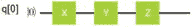 一个线向量 0 上有 x、y 和 z。图表旁边是 q 左括号 0 右括号。`X = [[0, 1], [1, 0]], Y = [[0, -i], [i, 0]], Z = [[1, 0], [0, -1]]` | 这三个矩阵对于信息处理任务（例如超密编码，一种旨在高效地在量子比特中存储经典信息的过程）非常有用。它们在分析诸如电子自旋等原子特性时也会出现。此外，它们还与空间的 XYZ 三个维度密切相关。 |
| :--- |

| 旋转门 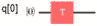 一个线向量 0 上有 T。图表旁边是 q 左括号 0 右括号。`[[cos θ, -sin θ], [sin θ, cos θ]]` | 这是我们在实空间中熟悉的按角度 `θ` 进行旋转的操作。这是一个酉矩阵，在这种特定情况下，`T` 门绕 Z 轴执行 `π/4` 的旋转。这个门对于实现通用控制是必需的。|
| :--- |

门还可以操控多个量子比特，我们将在下一节中看到。

好的，作为高级文档工程师和翻译员，我将严格遵循您的注意事项和示例格式，将给定的英文文本翻译成中文。

## 使用受控非门进行量子比特纠缠

这个门完善了量子计算所需的量子门库。受控非门（`CNOT`）是一个双量子比特门，拥有四个计算基态。

| 对于叠加态，四个基态的`CNOT`门给出：`α|00⟩ + β|01⟩ + δ|10⟩ + γ|11⟩` 其中（阿尔法）`α`，（贝塔）`β`，（德尔塔）`δ`，和（伽马）`γ` 是叠加系数。量子电路如下图所示：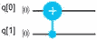 向量 0 的两条线 `q[0]` 和 `q[1]`。`q[0]` 处的一个大加号连接到 `q[1]` 处的一个小圆圈。`CNOT` 对于基态的矩阵表示如下：&#124; ![$$ \left[\begin{array}{cccc}1&amp; 0&amp; 0&amp; 0\\ {}0&amp; 1&amp; 0&amp; 0\\ {}0&amp; 0&amp; 0&amp; 1\\ {}0&amp; 0&amp; 1&amp; 0\end{array}\right] $$](images/469026_2_En_5_Chapter/469026_2_En_5_Chapter_TeX_IEq49.png) &#124; &#124;00⟩&#124;01⟩&#124;10⟩&#124;11⟩ &#124; |
| :--- |

加号（`+`）符号称为目标量子比特，而（其下方的）蓝点则是控制量子比特。它的作用很简单：

- 如果控制量子比特被设置为 1，则它翻转目标量子比特。

- 否则，它不执行任何操作。

更精确地说，如果第一个比特是控制比特，则：

- &#124;00⟩ → &#124;00⟩ *控制* 0 *无操作*

- &#124;01⟩ → &#124;01⟩ *控制* 0 *无操作*

- &#124;10⟩ → &#124;11⟩ *控制* 1 *翻转第*2*位*

- &#124;11⟩ → &#124;10⟩ *控制* 1 *翻转第*2*位*

上述内容的一个简单表示是 `|xy⟩ → |x y ⊕ x⟩`。

> **提示**

> `CNOT`门是产生纠缠所必需的，并且在各种任务中至关重要，包括量子隐形传态、超密编码以及几乎所有已知的量子算法。

例如，要纠缠两个量子比特，先对第一个量子比特应用哈达玛门（`H`），然后对第二个量子比特应用`CNOT`门，如下所示：


| 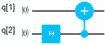 向量 0 的两条线 `q[1]` 和 `q[2]`。`q[1]` 处的一个大加号连接到 `q[2]` 处的一个小圆圈。`H` 在 `q[2]` 处。 | 对于基态，量子比特(2)上的哈达玛门给出：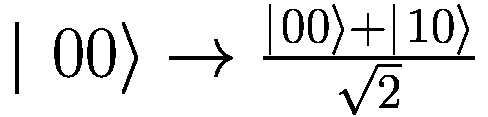 应用 `cNOT` 后，如果控制为 1，我们翻转第二个量子比特，因此：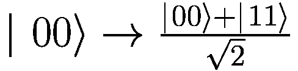 这有效地在量子比特 1 和 2 之间创造了一个纠缠态。 |
| :--- | :--- |

总而言之，`CNOT` 和单量子比特门是量子计算的强大武器库。因为它们可以在任意数量的量子比特上构建酉操作，所以被认为对于量子计算是通用的。这意味着，要构建一个能够解决任何量子任务的量子计算机，使用单量子比特门、`CNOT` 门和测量门就足够了。

## 通用量子计算相较于经典计算的优势

你可能会想，上述所有的电路和代数如何帮助解决那些在经典系统中可以轻松、甚至可能更廉价地完成的计算任务。如果你考虑经典系统中的所谓比特强度

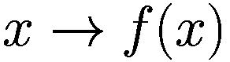

当给定某个输入 `x` 时，目标是计算函数 `f(x)`，这至少需要 `2^(k-1)` 个基本操作（其中 `k` 是比特强度）。那么，通用量子计算可以提供一个大致相同规模、包含相同经典模型的等效电路：

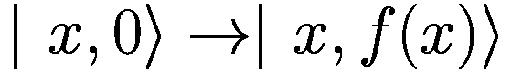

上述电路令人兴奋的地方在于，量子计算有时能提供捷径，从而更快地获得结果。这意味着你可以在少于 `2^(k-1)` 次操作中计算出 `f(x)`。对于某些量子算法，如因式分解，加速效果是指数级的。这是一个全新的算法范式，目前实现很少，但可能性是无限的。让我们通过回顾这些概念和一些练习来结束本章。

## 门恒等式速查表

这一系列恒等式对于电路优化很有用。请记住，量子门带有噪声，随着电路复杂度的增加，噪声也会累积；因此，减少它们的数量很重要。

| `HXH = Z` | 在两个哈达玛门之间夹入 `X` 门以得到 `Z`。因此 ![$$ Z=\frac{1}{\sqrt{2}}\ \left[\begin{array}{cc}1& 1\\ {}1& -1\end{array}\right]\left[\begin{array}{cc}0& 1\\ {}1& 0\end{array}\right]\frac{1}{\sqrt{2}}\left[\begin{array}{cc}1& 1\\ {}1& -1\end{array}\right]=\left[\begin{array}{cc}1& 0\\ {}0& -1\end{array}\right] $$](images/469026_2_En_5_Chapter/469026_2_En_5_Chapter_TeX_IEq52.png) |
| :--- | :--- |

| `HZH = X` | 同样的规则适用于 `Z` 门：![$$ X=\frac{1}{\sqrt{2}}\ \left[\begin{array}{cc}1& 1\\ {}1& -1\end{array}\right]\left[\begin{array}{cc}1& 0\\ {}0& -1\end{array}\right]\frac{1}{\sqrt{2}}\left[\begin{array}{cc}1& 1\\ {}1& -1\end{array}\right]=\left[\begin{array}{cc}0& 1\\ {}1& 0\end{array}\right] $$](images/469026_2_En_5_Chapter/469026_2_En_5_Chapter_TeX_IEq53.png) |

| 控制-`Z` 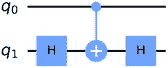 两条线 `q0` 和 `q1`。`q0` 线上有一个点。`q1` 线上有 `H`、加号和 `H`。`q0` 处的点连接到 `q1` 处的加号。 | ![$$ CZ=\left(\mathrm{I}\otimes \mathrm{H}\right)(CX)\left(\mathrm{I}\otimes \mathrm{H}\right)=\left[\begin{array}{cccc}1& 0& 0& 0\\ {}0& 1& 0& 0\\ {}0& 0& 1& 0\\ {}0& 0& 0& -1\end{array}\right] $$](images/469026_2_En_5_Chapter/469026_2_En_5_Chapter_TeX_IEq54.png) |

通常，我们可以通过在其前后加上正确的旋转，将单个 `CNOT` 转换为围绕布洛赫球旋转任意角度 Pi 的控制版本。

| 控制-`Y` 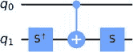 两条线 `q0` 和 `q1`。`q0` 线上有一个点。`q1` 线上有 `S` 共轭转置、加号和 `S`。`q0` 处的点连接到 `q1` 处的加号。 | `S` 门围绕布洛赫球的 `Z` 轴旋转 `π/2`：![$$ S=\left[\begin{array}{cc}1& 0\\ {}0& i\end{array}\right],{S}^{\dagger }=\left[\begin{array}{cc}1& 0\\ {}0& -i\end{array}\right] $$](images/469026_2_En_5_Chapter/469026_2_En_5_Chapter_TeX_IEq55.png) |
| :--- | :--- |

| 控制-`H` 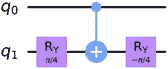 两条线 `q0` 和 `q1`。`q0` 线上有一个点。`q1` 线上有 `Ry` `π/4`、加号和 `Ry` `-π/4`。`q0` 处的点连接到 `q1` 处的加号。 | ![$$ RY(x)=\left[\begin{array}{cc}\cos \frac{x}{2}& - Sin\frac{x}{2}\\ {} Sin\frac{x}{2}& \cos \frac{x}{2}\end{array}\right],x=\frac{\pi }{4} $$](images/469026_2_En_5_Chapter/469026_2_En_5_Chapter_TeX_IEq56.png) |

| 这个有点棘手：`SWAP` 门可以用 3 个 `CNOT` 门表示：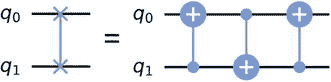 两条线 `q0` 和 `q1`。每条线上的两个点以等号方式连接：`q0` 线处的加号连接到 `q1` 处的点，`q0` 处的点连接到 `q1` 处的加号，`q0` 线处的加号连接到 `q1` 处的点。 | ![$$ \mathrm{SWAP}=(ZC)(CZ)(ZC)=\left[\begin{array}{cccc}1& 0& 0& 0\\ {}0& 0& 1& 0\\ {}0& 1& 0& 0\\ {}0& 0& 0& 1\end{array}\right] $$](images/469026_2_En_5_Chapter/469026_2_En_5_Chapter_TeX_IEq57.png) |

**练习 5.20:** 通过矩阵乘法证明 `SWAP = (ZC)(CZ)(ZC)`。提示：`Z` 门是它自己的逆；因此，`ZC = CZ`。


![$$ SWAP=(ZC)(CZ)(ZC)=\left[\begin{array}{cccc}1&amp; 0&amp; 0&amp; 0\\ {}0&amp; 1&amp; 0&amp; 0\\ {}0&amp; 0&amp; 1&amp; 0\\ {}0&amp; 0&amp; 0&amp; -1\end{array}\right]\left[\begin{array}{cccc}1&amp; 0&amp; 0&amp; 0\\ {}0&amp; 1&amp; 0&amp; 0\\ {}0&amp; 0&amp; 1&amp; 0\\ {}0&amp; 0&amp; 0&amp; -1\end{array}\right]\left[\begin{array}{cccc}1&amp; 0&amp; 0&amp; 0\\ {}0&amp; 1&amp; 0&amp; 0\\ {}0&amp; 0&amp; 1&amp; 0\\ {}0&amp; 0&amp; 0&amp; -1\end{array}\right]=\left[\begin{array}{cccc}1&amp; 0&amp; 0&amp; 0\\ {}0&amp; 0&amp; 1&amp; 0\\ {}0&amp; 1&amp; 0&amp; 0\\ {}0&amp; 0&amp; 0&amp; 1\end{array}\right] $$](images/469026_2_En_5_Chapter/469026_2_En_5_Chapter_TeX_Equan.png)

练习 5.21：以下哪个量子门类似于经典抛硬币的概率：`X`、`Z`、`Z`、`H`？

# 量子门 vs 布尔门速查表

布尔门有其对应的量子版本，可以使用所谓的 Clifford 集合（`X`、`Y`、`Z`、`H`、Toffoli 和 `S`）来构建。以下是你应该记住的另一组非常有用的恒等式。

| 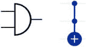 门与量子比特符号。 | 布尔 AND 等同于 Toffoli (CCX)。 `CCX` = ![$$ \left[\begin{array}{cccc}1&amp; 0&amp; 0&amp; 0\\ {}0&amp; 1&amp; 0&amp; 0\\ {}0&amp; 0&amp; 0&amp; 1\\ {}0&amp; 0&amp; 1&amp; 0\end{array}\right] $$](images/469026_2_En_5_Chapter/469026_2_En_5_Chapter_TeX_IEq58.png) |

| 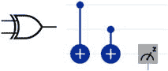 门与量子比特符号。 | 布尔 XOR 可以用 3 个量子比特和 2 个 CX 门构建。 |

| 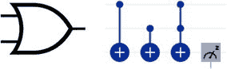 门与量子比特符号。 | 布尔 OR 由一个 XOR 门和一个 Toffoli (AND) 门组成。 |

| 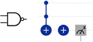 门与量子比特符号。 | NAND 门非常重要，因为任何布尔函数都可以通过使用 NAND 门的组合来实现。这个性质称为功能完备性。NAND 门由 3 个量子比特组成，在最后一个量子比特上使用 Toffoli 和 CX 门。 |

练习 5.22：半加器是一种有用的电子电路，用于将两个单个二进制数字相加，并提供输出以及一个进位值。它有两个输入，`A` 和 `B`，以及两个输出 `S`（和）和 `C`（进位）。电路和真值表如下所示。

| 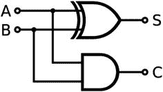 `A` 和 `B` 进入布尔 XOR，产生 `S`。`A` 和 `B` 分路，通过布尔 AND，产生 `C`。 | 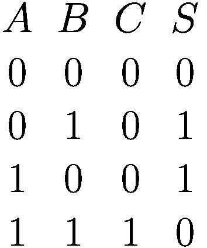 |

编写一个量子电路来实现半加器。使用上一节中的恒等式。提示：你的电路将有 4 个量子比特（`A`、`B`、`S`、`C`），其中 `S = A⊕B` 且 `C = A AND B`。

# 练习题

通过这套扩展的练习题，进一步巩固你在复数和线性代数方面的知识。

**5.23** 复数 `z = a+ib` 的共轭复数 `z*` 是什么？

**5.24** 计算 `a + ib` 与 `c + id` 的和。

**5.25** 计算 `a + ib` 与 `c + id` 的积。

**5.26** 复数 `z` 的模 `|z|` 是什么？

**5.27** 计算 ![$$ \left[a\kern0.5em b\kern0.5em c\right]\left[\begin{array}{ccc}x0&amp; x1&amp; x2\\ {}y0&amp; y1&amp; y2\\ {}z0&amp; z1&amp; z2\end{array}\right] $$](images/469026_2_En_5_Chapter/469026_2_En_5_Chapter_TeX_IEq60.png) 的乘积。

**5.28** 以下哪些门作为厄米算符？(选择 3 个): `X`、`S`、`H`、`T`、`Z`。提示：那些自身的逆是其自身的酉矩阵的门称为厄米算符。

**5.29** `X`、`Y` 和 `Z` 门分别围绕布洛赫球上的 X 轴、Y 轴和 Z 轴执行旋转。这些旋转的角度是多少？

要想编程实现量子计算机，拥有扎实的数学基础至关重要。归根结底，量子的魔力归结为巧妙的线性代数。就像藏在万能巫师幕布后面的人一样。当你听到“量子力学”这个短语时，不要害怕。它可能听起来和看起来都很诡异，但其核心只是线性代数。现在，让我们把数学放在一边，开始编写我们的第一个量子程序。