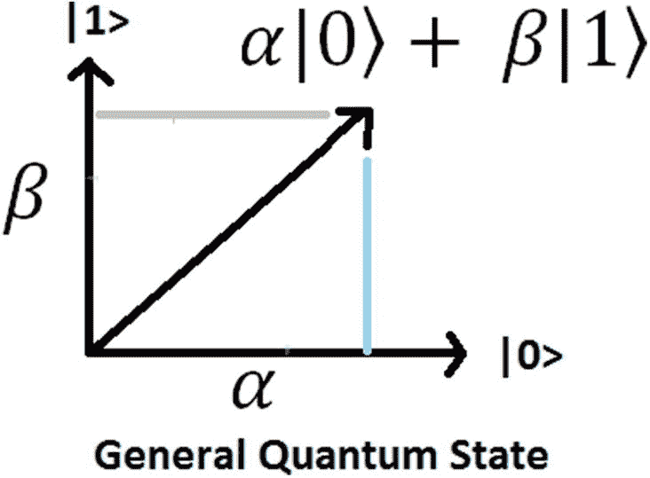
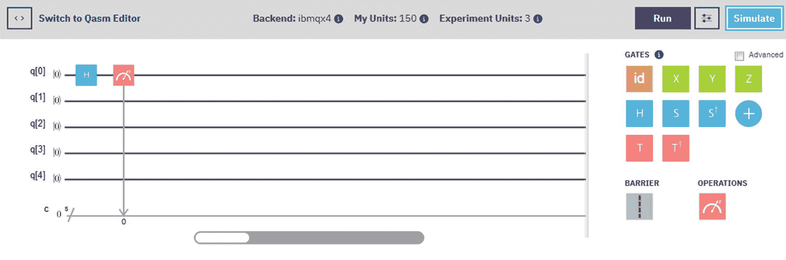
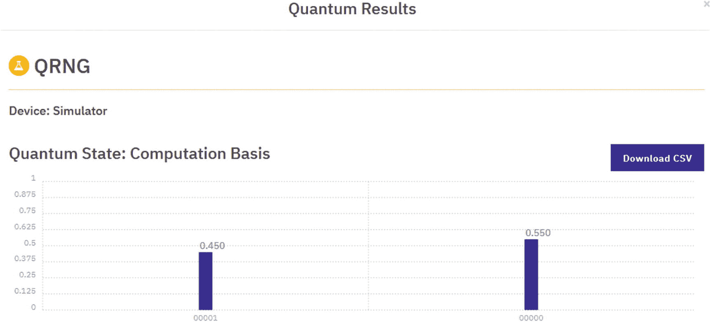
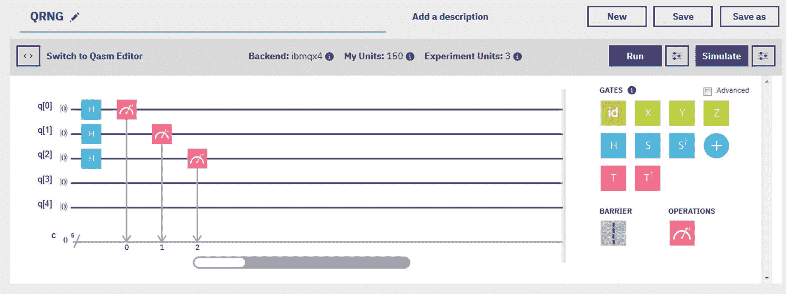
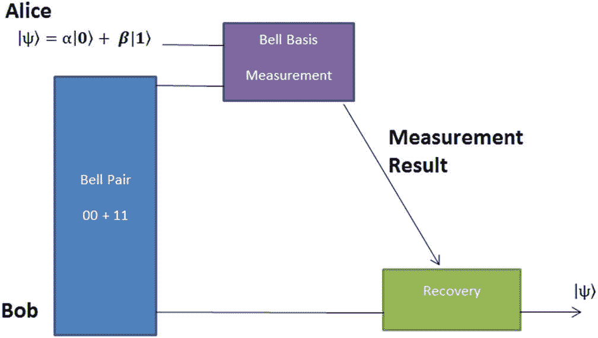
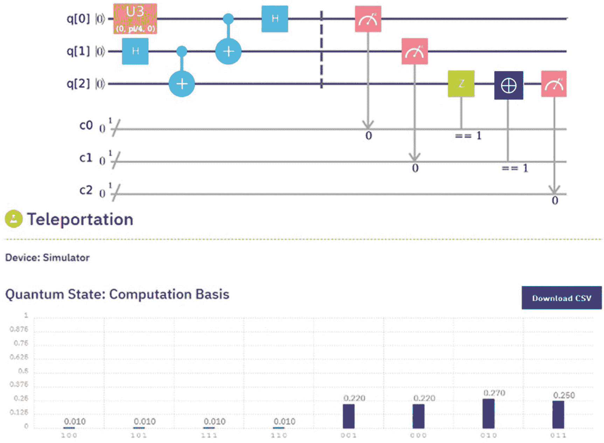
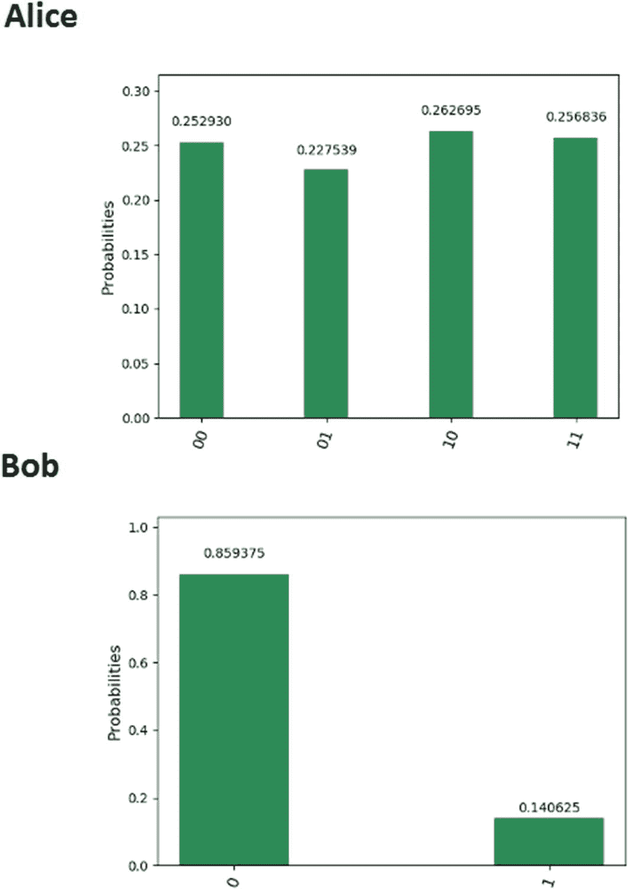
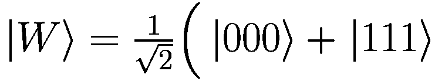
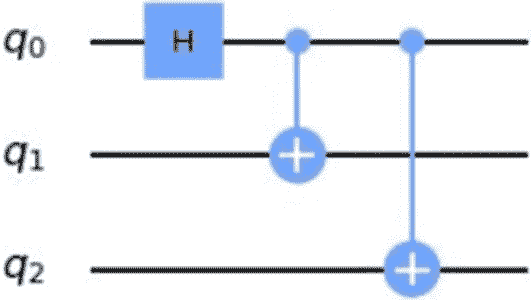

# 7. 启动引擎：从量子随机数到量子隐形传态和超密编码

本章将带你探索量子系统三种卓越的信息处理能力。我们从最简单的过程之一开始，研究量子力学的基本随机性，将其作为真正随机性的来源。接着，本章将探讨两个或许令人振奋但相互关联的过程，称为超密编码和量子隐形传态。在超密编码中，你将学习如何使用单个量子比特发送两个经典比特的信息。在量子隐形传态中，你将学习如何通过混合经典-量子信息传输过程来重建一个量子比特的量子态。所有算法都包含适用于 IBM Quantum 作曲家的电路设计以及 Python 和 QASM 代码。结果将被收集用于显示和分析，那么让我们开始吧。

## 量子随机数生成

在本节中，你将学习如何利用量子计算机的概率特性，通过 `Hadamard` 门生成随机比特或数字。

### 使用 Hadamard 门生成随机比特

`Hadamard` 是任何量子信息系统中的基本门之一。它用于将量子比特置于态的叠加中。从代数上讲，它由以下矩阵描述：

![$$ H=\frac{1}{\sqrt{2}}\left[\begin{array}{cc}1&amp; 1\\ {}1&amp; -1\end{array}\right] $$](images/469026_2_En_7_Chapter/469026_2_En_7_Chapter_TeX_Equa.png)

为了更好地理解该矩阵如何使量子比特处于叠加态，请考虑单个量子比特的几何表示：



一幅几何图，显示 `|1⟩` 相对于 `|0⟩`，其中 `β` 和 `α` 分别位于 y 轴和 x 轴上。它从原点绘制了一条对角线箭头，表示 `α|0⟩ + β|1⟩`。

**图 7-1** 量子比特一般（叠加）态 `ψ` 的几何表示

在图 7-1 中，量子比特的基态使用狄拉克符号描述，其中 ![$$ \mid \left.0\right\rangle =\left[\begin{array}{c}1\\ {}0\end{array}\right] $$](images/469026_2_En_7_Chapter/469026_2_En_7_Chapter_TeX_IEq1.png) 且 ![$$ \mid \left.1\right\rangle =\left[\begin{array}{c}0\\ {}1\end{array}\right] $$](images/469026_2_En_7_Chapter/469026_2_En_7_Chapter_TeX_IEq2.png)。回顾前一章，`kets` 态只是一个酉向量（长度为 1 的向量）。因此，一般（或叠加）态由酉向量 `ψ = α|0⟩ + β|1⟩` 定义，其中 `α` 和 `β` 是复系数。将 `H` 应用于基态，得到：

![$$ H\mid \left.0\right\rangle =\frac{1}{\sqrt{2}}\left[\begin{array}{cc}1&amp; 1\\ {}1&amp; -1\end{array}\right]\left[\begin{array}{c}1\\ {}0\end{array}\right]=\frac{1}{\sqrt{2}}\left[\begin{array}{c}1\\ {}1\end{array}\right]=\frac{1}{\sqrt{2}}\left(\left[\begin{array}{c}1\\ {}0\end{array}\right]+\left[\begin{array}{c}0\\ {}1\end{array}\right]\right)=\frac{\mid \left.0\right\rangle +\mid \left.1\right\rangle }{\sqrt{2}} $$](images/469026_2_En_7_Chapter/469026_2_En_7_Chapter_TeX_Equb.png)

![$$ H\mid \left.1\right\rangle =\frac{1}{\sqrt{2}}\left[\begin{array}{cc}1&amp; 1\\ {}1&amp; -1\end{array}\right]\left[\begin{array}{c}0\\ {}1\end{array}\right]=\frac{1}{\sqrt{2}}\left[\begin{array}{c}1\\ {}-1\end{array}\right]=\frac{1}{\sqrt{2}}\left(\left[\begin{array}{c}1\\ {}0\end{array}\right]-\left[\begin{array}{c}0\\ {}1\end{array}\right]\right)=\frac{\mid \left.0\right\rangle -\mid \left.1\right\rangle }{\sqrt{2}} $$](images/469026_2_En_7_Chapter/469026_2_En_7_Chapter_TeX_Equc.png)

对于叠加态 `ψ`：


总而言之，`Hadamard` 门扩展了量子电路可能所处的状态范围。这一点很重要，因为状态的扩展创造了寻找捷径的可能性，从而实现更快的计算。

> **提示** 量子力学指出，即使完全了解物理定律或粒子的初始条件，我们也无法确定性地预测上述系数 `α`、`β` 的值。我们最多能做到的就是计算一个概率。

有鉴于此，随机比特生成器电路的实现很简单：在 IBM Quantum Composer 中，创建一个电路，为第一个量子比特添加一个 `Hadamard` 门，然后在基态上执行测量，如图 7-2 所示。



一个窗口的截图，顶部有切换到 `Qasm` 编辑器、`run` 和 `simulate` 的选项，以及关于后端、我的单位和实验单位的数据。下方有一个电路面板，包含 5 条标记为 `q0` 到 `q4` 的水平线，右侧是一个门面板。

**图 7-2** 随机比特生成电路

在真实设备上运行此电路可能不是一个好主意，因为这可能需要一段时间（请记住，执行是排队的，根据运行队列中的作业数量，可能需要一些时间）。此外，每次在真实设备上执行都会消耗你的积分。在模拟器上运行该电路以立即获得结果（参见图 7-3）。请注意，每个结果（0 或 1）的概率都是 ½；因此，你可以生成随机比特：如果结果为 1 的概率 > ½，则得到 1，否则得到 0。



量子结果窗口的截图，显示设备为模拟器，以及量子态计算基础柱状图，并带有下载 `CSV` 选项。该图绘制了两条柱状图，分别对应 `00001` 和 `00000`。`00000` 的值为 0.550，高于 `00001` 的 0.450。

**图 7-3** 电路 7-2 的执行结果

当然，这是一种非常低效的生成随机比特的方式。更好的方法是编写一个 `Qiskit` Python 脚本，通过编程方式创建电路来完成这项工作。清单 7-1 展示了一个简单的脚本，用于使用 `x` 个量子比特生成 `n` 个随机数，其中比特数为 `2^x`。默认情况下，该脚本使用 3 个量子比特生成 10 个 8 位随机数，即 `n = 10` 和 `x = 3`，因为 `2³ = 8`。我们来仔细看看：

- 第 6 行定义了函数 `qrng`，用于创建一个使用 `n` 个量子比特的电路。

- 使用 `QISKit` API，第 8-15 行创建了一个包含 `n` 个量子比特和 `n` 个经典寄存器的 `QuantumProgram`，用于存储测量结果。

- 对所有量子比特应用一个 `Hadamard` 门，然后对每个量子比特执行一次测量，最后将结果存储在经典寄存器 `n` 中（第 17-23 行）。

- 电路被编译以在 `qasm_simulator` 上运行。电路被执行，并收集结果计数（第 26-36 行）。
- 最后，通过查看结果计数来生成随机比特。例如，给定结果 `{'100': 133, '101': 134, '011': 131, '110': 125, '001': 109, '111': 128, '010': 138, '000': 126}`。对于每个结果，如果计数大于平均概率，则写入 `1`；否则写入 `0`。平均概率通过将总执行次数（此例中为 1024）除以结果数（`2^x`，其中 `x` 是量子比特数（默认为 3） – 1024/8 = 128）来计算。因此，对于上面的结果，最终的随机二进制字符串变为 `11100010`（226）。

好的，作为一名高级文档工程师和翻译员，我将严格遵循您的格式要求，对给定的英文文本进行翻译。

译文如下：

```python
import sys, time
from qiskit import *

# Generate an 2**n bit random number where n = # of qubits
def qrng(n):
    # create n qubit(s)
    quantum_r = QuantumRegister(n, "qr")
    # create n classical registers
    classical_r = ClassicalRegister(n, "cr")
    # create a circuit
    circuit = QuantumCircuit(quantum_r, classical_r, name="QRNG")
    # Hadamard gate to all qubits
    for i in range(n):
        circuit.h(quantum_r[i])
    # measure qubit n and store in classical n
    for i in range(n):
        circuit.measure(quantum_r[i], classical_r[i])
    # backend simulator
    backend = Aer.get_backend('qasm_simulator')
    # Group of circuits to execute
    circuits = [circuit]
    shots = 1024
    result = execute(circuits, backend, shots=shots).result()
    # Show result counts
    # counts={'100': 133, '101': 134,… , '010': 138, '000': 126}
    counts = result.get_counts()
    bits = ""
    # convert the random count to binary
    for v in counts.values():
        if v > shots / (2**n):
            bits += "1"
        else:
            bits += "0"
    return int(bits, 2)

if __name__ == '__main__':
    start_time = time.time()
    numbers = []
    # generate 10 8 bit random numbers
    size = 100
    qubits = 3  # bits = 2**qubits
    for i in range(size):
        n = qrng(qubits)
        numbers.append(n)
    print(str(numbers).replace('[', '').replace(']', ''))
```

**清单 7-1** 生成 100 个 8 位随机数的量子程序

> **注**
>
> 在执行程序之前，请务必确保您的账户已配置好。您的账户 API 令牌必须存在于文件 `$HOME/.qiskit/qiskitrc` 中。这是头痛的主要来源。如果您使用 Qiskit 运行时，还需更新同一文件夹下的 `qiskit-ibm.json` 文件。

清单 7-1 的量子电路如图 7-4 所示。该电路使用 3 个量子比特来生成 0 到 255 之间的 8 位随机数。



**图 7-4** 清单 7-1 的 Q Experience 电路

让我们从多次运行中收集一些数据，并对结果进行测试。

### 对随机性结果进行测试

Linux 提供了一个名为 `ent`（熵的缩写）的简洁程序，它也被称为伪随机数序列测试程序。¹² 我们可以使用此命令来测试上一节生成的数字。

> **提示**
>
> Windows 用户 – 可从 ENT 项目网站下载 Windows32 二进制文件。本章源代码的 `Workspace\Ch07\ent.exe` 目录下也包含一个二进制文件。Mac 用户应该能够从命令行运行 Linux 二进制文件。

因此，使用清单 7-1 生成 100 个 8 位随机数，然后运行 `ent`，使用命令 `ent [infile]` 测试您的序列，如下一段所示。

```
C:\Workspace\Ch07> python p7-1-qrng.py > qrnd-stdout.txt
C:\Workspace\Ch07>ent qrnd-stdout.txt
Entropy = 3.122803 bits per byte.
Optimum compression would reduce the size of this 805 byte file by 60 percent.
Chi square distribution for 805 samples is 29149.54, and randomly would exceed this value less than 99.9 percent of the time.
Arithmetic mean value of data bytes is 46.1503 (127.5 = random).
The Monte Carlo value for Pi is 4.000000000 (error 27.32 percent).
Serial correlation coefficient is -0.356331 (totally uncorrelated = 0.0).
```

根据 `ENT` 作者的说法，卡方检验决定了随机序列的质量。如果卡方百分比分布小于 1% 或大于 99%，则该序列质量不佳。我的输出显示百分比为 99.9%，这表明数字的随机性较低。这可能是因为我使用了远程模拟器。这个模拟器可能基于默认的 UNIX 随机数生成器（一个质量较差的生成器）。看看您的序列是否表现更好。表 7-1 展示了来自 `ENT` 开发者提供的多种确定性源和量子源之间的正面交锋结果。

**表 7-1** 由 ENT¹ 收集的来自不同来源的随机性测试结果

| 来源 | 卡方百分比 |
| --- | --- |
| UNIX `rand()` | 99.9%，针对 500000 个样本（差） |
| Park 和 Miller 改进的 UNIX 生成器 | 97.53%，针对 500000 个样本（较好） |
| HotBits: 由放射性衰变¹³ 生成的随机数 | 40.98%，针对 500000 个样本（最佳） |

表 7-1 显示，不应信任 UNIX `rand()` 用于随机数生成。如果您需要大量真正的随机数（例如，用于生成加密密钥），请使用像 HotBits 这样的量子源。总而言之，本节的目的在于让您通过一个用于随机数生成的简单量子电路来初步了解。下一节将使用一种被称为超密集编码的奇特量子数据传输协议，将内容提升到新的水平。

### 超密编码

超密编码（SDC）是一种数据传输协议，展示了量子系统卓越的信息处理能力。严格来说，SDC 是一种简单的过程，允许使用单个量子比特将两个经典比特的信息传输给另一方。该协议如图 7-5 所示。

该图使用各种值 `00 + 11`、`10 + 01`、`00 I`、`01 X` 和 `11 - 10` 等，通过门和操作图标将 Alice 和 Bob 的 `q0` 和 `q1` 贝尔对连接起来。

**图 7-5** 超密编码协议

**表 7-4** 恢复后的量子比特状态

| 门 | 结果状态 | 说明 |
| --- | --- | --- |

# 超密编码

| `CNOT` | `00 + 11`<br>`10 + 01`<br>`00 - 11`<br>`10 - 11` | 我们从第 2 步中 Alice 的状态开始：`00 + 11`、`10 + 01`、`00 – 11`、`10 - 11`。如果第一个量子比特为 1，`CNOT` 门会翻转第二个量子比特，从而得到第 2 列中的状态。 |
| :--- | :--- | :--- |
| `H` | `00`<br>`01`<br>`10`<br>`-11` | 将 `Hadamard` 门应用于最后一行的第一个量子比特，得到第 2 列中的结果。当 `Bob` 在计算基态下进行测量时，他会得到四种可能的结果，每种结果的概率均为 1。这些结果与 `Alice` 在第 2 步第 1 列中想要发送的内容相匹配。请注意，最后一个结果有一个负号。然而，因为概率被计算为振幅的平方，所以 `-1` 变成了 `1`，这是正确的。 |

**表 7-3** 超密编码的编码规则

| 规则 | 结果状态 |
| :--- | :--- |
| `00`：`I`（单位门）<br>`01`：`X`<br>`10`：`Z`<br>`11`：`ZX` | `I(00 + 11) = 00 + 11`<br>`X(00 + 11) = 10 + 01`<br>`Z(00 + 11) = 00 – 11`<br>`ZX(00 + 11) = 10 – 11` |

**表 7-2** 贝尔对状态

| 门 | 结果状态 | 说明 |
| :--- | :--- | :--- |
| `H` | `|00⟩ → |00⟩ + |10⟩` | 当 `H` 门应用于第一个量子比特时，它会进入叠加态；因此，我们得到状态 `00 + 10`，其中第二个量子比特保持为 `0`。请注意，为简单起见，省略了 `Hadamard` 矩阵中的平方根 (2)。 |
| `CNOT` | `|00⟩ + |10⟩ → |00⟩ + |11⟩` | `CNOT` 门将两个量子比特纠缠在一起。特别是，如果控制位 (`.`) 为 1，它会翻转目标位 (`+`)；否则保持不变。因此，如果第一个量子比特为 1，我们就翻转第二个量子比特，得到 `00 + 11`。 |

1.  该过程从第三方（`Eve`）生成所谓的贝尔对开始。`Eve` 从处于基态 `|0⟩` 的 2 个量子比特开始。她对第一个量子比特应用 `Hadamard` 门以创建叠加态。然后，她使用第一个量子比特作为控制位（点），第二个作为目标位（`+`），应用 `CNOT` 门。这导致了表 7-2 中所示的状态。
2.  在该过程的第二步中，第一个量子比特被发送给 `Alice`，第二个发送给 `Bob`。请注意，`Alice` 和 `Bob` 可能位于遥远的地方。该协议的目标是让 `Alice` 使用她的量子比特向 `Bob` 发送两个经典比特的信息。但在她这样做之前，她需要根据她想要发送的 2 个比特信息，对她的量子比特应用一组量子规则（或门）。（见表 7-3。）
3.  因此，如果 `Alice` 发送 `00`，她对她的量子比特不做任何操作（应用单位门）。如果她发送 `01`，那么她应用 `X` 门（或比特翻转）。对于 `10`，她应用 `Z` 门。请注意，如果量子比特为 1，`Z` 门会翻转该量子比特的符号（相位）。因此，`Z|0⟩ = |0⟩`，`Z|1⟩ = -|1⟩`。最后，如果她发送 `11`，那么她对她的量子比特应用 `XZ` 门。然后 `Alice` 将她的量子比特发送给 `Bob` 以进行该过程的最后一步。
4.  `Bob` 接收 `Alice` 的量子比特（量子比特-0），并使用他的量子比特来逆转 `Eve` 创建的贝尔态的过程。也就是说，他对第一个量子比特应用 `CNOT` 门，然后应用 `Hadamard` 门（`H`），最后对两个量子比特进行测量，以提取编码在 `Alice` 量子比特中的 2 个经典比特（见表 7-4）。

现在，让我们在 `IBM Quantum` 编辑器中将其整合到一个电路中。

## 编辑器电路

图 7-6 显示了超密编码电路以及编辑器中的状态向量概率：

> 一组 2 张截图。左边的截图具有带有各种门图标的左对齐下拉菜单。右边的截图具有状态向量下拉菜单，其下方有一个振幅条形图。它只在 x 轴上的 `11` 处绘制了一个条形。

**图 7-6** 编辑器的超密编码电路

-   电路从创建一个贝尔对开始，也就是说，它将 `qubit[0]` 置于叠加态（使用 `Hadamard` 门），然后通过 `CNOT` 门将其与 `qubit[1]` 纠缠。
-   接下来的两个门代表 `Alice` 的编码规则。请记住，她应用单位门（不做任何操作）来编码比特 `00`，应用 `X` 来编码 `01`，应用 `Z` 来编码 `10`，以及应用 `ZX` 来编码 `11`。在这种特定情况下，编码的比特是 `11`。这在图 7-6 中隔离栏符号的左侧显示。请注意，隔离栏将阻止执行，直到两个量子比特都消耗完所有门。
-   在隔离栏符号的右侧是 `Bob` 的协议。他执行与 `Alice` 相反的操作。他在量子比特上应用 `CNOT` 门，然后应用 `Hadamard` 门。最后，对两个量子比特进行测量，以提取两个编码的经典比特。

在模拟器中运行前面的电路，结果应该是一个条形图，显示结果 `11` 的概率非常接近或等于 1。这个结果应该与下一节中使用 `Python` 脚本获得的结果相匹配。

## 在 Python 中运行

列表 7-2 显示了图 7-6 中电路的等效 `Python` 脚本：

-   第 17-19 行创建了两个量子比特和两个经典寄存器来保存结果。
-   接下来，使用纠缠的贝尔对创建 `superdense` 电路（第 22-14 行）。
-   `Alice` 通过应用 `ZX` 门来编码 `11`。可以选择注释掉这些语句中的任何一个来编码不同的对，然后确保结果与 `Alice` 的编码方案相匹配（第 32-35 行）。
-   `Bob` 逆转 `Alice` 的操作并测量量子比特（第 38-41 行）。
-   最后，电路在远程模拟器（`ibmq_qasm_simulator`）上执行，并使用 `Python` 出色的绘图支持显示结果。

```python
import sys,time,math
##### 导入 QISKit
from qiskit import *
##### 导入基本绘图工具
from qiskit.tools.visualization import plot_histogram
def main():
#### 创建寄存器
q = QuantumRegister(2, "q")
c = ClassicalRegister(2, "c")
#### 用于制备共享纠缠态的量子电路
superdense = QuantumCircuit(q, c, name="superdense")
superdense.h(q[0])
superdense.cx(q[0], q[1])
#### 对于 00，不做任何操作
#### 对于 10，应用 X
#### superdense.x(q[0])
#### 对于 01，应用 Z
#### superdense.z(q[0])
#### Alice：对于 11，应用 ZX
superdense.z(q[0])
superdense.x(q[0])
superdense.barrier()
#### Bob
superdense.cx(q[0], q[1])
superdense.h(q[0])
superdense.measure(q[0], c[0])
superdense.measure(q[1], c[1])
superdense.draw(filename='superdense-circ.png')
circuits = [superdense]
print(superdense.qasm())
backend = Aer.get_backend("qasm_simulator")
result = execute(circuits, backend=backend).result()
print("Counts:" + str(result.get_counts("superdense")))
plot_histogram(result.get_counts(), filename="superdense-res.png")
###########################################
# main
if __name__ ==  '__main__':
    start_time = time.time()
    main()
    print("--- %s seconds ---" % (time.time() - start_time))
```

**列表 7-2** 超密编码 `Python` 脚本

让我们在下一节中查看一次运行脚本 7-2 的结果。

## 查看结果

清单 7-2 运行一次的标准输出如下所示：

```
## 量子隐形传态

量子隐形传态是一种与超密编码密切相关的过程。或许“隐形传态”这个词有些夸张，因为我们并没有传送任何东西，至少不是科幻/《星际迷航》意义上的传送。从形式上讲，量子隐形传态是指一个量子比特的状态（`Ψ`）可以借助经典通信和上一节讨论的贝尔对从一个位置传输到另一个位置的过程。该过程总结在图 7-8 中。



一个框图连接了贝尔对 00 + 11、贝尔基测量以及通过测量结果进行恢复的各个模块：Bob、Alice 管道的 psi 右尖括号 = alpha 右尖括号 + beta psi 右尖括号。最终导向 psi 右尖括号。

**图 7-8** 量子隐形传态工作流程

1.  Alice 和 Bob 首先共享一对纠缠的贝尔对量子比特。一个给 Alice，另一个给位于不同远程位置的 Bob。想象贝尔对是由第三方（Eve）准备的。

2.  Alice 准备她要传输的量子比特，状态为 `|Ψ⟩ = α|0⟩ + β|1⟩`。然后她对她的量子比特以及 Eve 提供的贝尔对中的纠缠量子比特进行贝尔基测量。接着，Alice 通过经典方式将测量结果发送给 Bob。

3.  此时，Bob 的量子比特存在一个后验状态，该状态是 Alice 执行的测量结果的函数。这是理解该过程的关键；请记住，两者共享一个纠缠的量子比特。因此，我们将看到 Bob 如何通过应用适当的量子门来恢复 Alice 创建的原始状态 `Ψ`。

让我们通过观察 Bob 在 Alice 测量时刻、恢复操作之前的后验状态来弄清楚这一点。为此，我们写出过程中涉及的三个量子比特的联合状态。注意，为简单起见，忽略了 ket 符号。因此，给定 Alice 的状态 `|Ψ⟩ = α|0⟩ + β|1⟩`，如果我们将其与 Eve 提供的共享纠缠量子比特（来自贝尔对）结合起来，我们得到：

```
(α0 +β1) (00 + 11) = α000 + α011 + β100 +β111       (1)
```

现在我们需要使用贝尔基状态写出前两个量子比特的状态：

```
| B0 = 00 + 11
B1 = 10 + 01
B2 = 00 - 11
B3 = 10 - 01 |
00 = B0 - B1
01 = B1 - B3
10 = B1 - B3
11 = B0 - B2
```

表达式 (1) 变为：

```
(α0 +β1) (00 + 11) = B0 (α0 + β1) + B1 (α1 + β0) + B2 (α0 - β1) + B3 (-α1+ β0)      (2)
```

表达式 (2) 显示了 Alice 执行测量后三个量子比特的状态。Bob 通过查看表达式 2 中量子比特的后验状态（括号内的状态）知道如何恢复 Alice 的 `Ψ`。这更清楚地显示在表 7-5 中。

**表 7-5** 量子隐形传态恢复

| 贝尔状态 | 后验状态 | Bob 的恢复操作 |
| :--- | :--- | :--- |
| `B0` | `α0 + β1` | `Ψ` |
| `B1` | `α1 + β0` | `XΨ` |
| `B2` | `α0 - β1` | `ZΨ` |
| `B3` | `-α1 + β0` | `ZXΨ` |

总而言之，量子隐形传态协议提供了通过两个远程方之间共享纠缠贝尔对来恢复任何量子比特状态 `Ψ` 的方法，因此得名“隐形传态”。现在让我们为该协议构建一个电路，在模拟器中运行，最后查看结果。

### Composer 电路

图 7-9 展示了量子隐形传态协议的 composer 电路及其执行结果（仅为模拟器——此时尚无可用的真实设备）：



一组两张截图。顶部的截图有 6 条水平线，分别对应 `q 0`、`q 1`、`q 2`、`c 0`、`c 1` 和 `c 2`，并包含量子门、屏障和操作图标。底部的截图是隐形传态柱状图，设备为模拟器，并包含用于量子态计算基的下载 CSV 按钮。

**图 7-9** Composer 的量子隐形传态电路

-   屏障符号（虚线）左侧的量子门代表由第三方（Eve）制备的贝尔对：量子比特 1 和 2。

-   Alice 将她的量子比特（0）制备到给定状态 `Ψ`。`Ψ` 的实际值无关紧要，因为最终会由 Bob 在过程最后阶段恢复。Alice 从 Eve 处接收 `qubit[1]`；`qubit[2]` 则发送给 Bob。

-   Alice 对她的量子比特 `[0,1]` 执行测量（如虚线右侧所示），并通过经典方式将结果发送给 Bob。

-   Bob 根据上一节提到的恢复规则，依据 Alice 发送的结果，将恢复规则应用于他的量子比特（2）。最后，在对 `qubit[2]` 进行测量后，Bob 恢复了最初由 Alice 创建的状态 `Ψ`。这一切之所以可能，是因为 Alice 和 Bob 共享一对纠缠的量子比特，这正是整个方案得以运作的关键。

当然，图 7-9 的执行结果需要进一步处理，以验证 Bob 的 `Ψ` 与 Alice 的一致。最佳方法是使用 Python 脚本。在下一节中，我们将远程运行同一个电路，并查看结果以验证该协议是否有效。

### 在 Python 中运行

本节我们使用 Python 在模拟器中远程运行量子隐形传态协议。请注意，目前量子隐形传态无法在 **IBM Q Experience** 的**真实量子设备**上运行。这是因为当前硬件不支持 Alice 创建其状态 `Ψ` 所需的旋转门。因此，我们将改用远程模拟器——使用本地 Python 模拟器也完全可以。清单 7-3 展示了该协议的实际运行。其中特别说明：

-   创建三个量子比特供双方（Alice 和 Bob）共享，外加三个经典寄存器（`c0`、`c1`、`c2`）用于存储 Alice 的结果（第 20-23 行）。

-   Eve 通过对量子比特 1 和 2 施加 Hadamard 门 (`H`)，接着施加受控非门 (`CNOT`) 来制备贝尔对（第 35-37 行）。

-   Alice 通过在 Y 轴上旋转 `π/4` 弧度，将她的状态 `ѱ` 制备到量子比特 0 上（第 32 行）。
```

## 量子隐形传态实验

-   Alice 现在将她的 `qubit[0]` 与分配给她的贝尔对量子比特 `qubit[1]` 纠缠起来。然后她对两者进行测量，并将结果存储到经典寄存器 0、1 中（第 35-41 行）。

-   接下来轮到 Bob：他根据 Alice 发送的结果，对她的量子比特（2）施加 `Z` 或 `X` 门：如果经典寄存器 0 为 1，则施加 `Z` 门。如果经典寄存器 1 为 1，则施加 `X` 门。然后他测量自己的量子比特，并将结果存储到经典寄存器 2 中（第 47-50 行）。

-   该程序在远程模拟器（`ibmq_qasm_simulator`）中执行，并收集结果用于显示和验证（第 58-79 行）。

> **提示**：此程序的源代码包含在原书源代码的 `Workspace\Ch07\p07-teleport.py` 目录下。

```python
import sys,time,math
import numpy as np
# Importing QISKit
from qiskit import *
# Import basic plotting tools
from qiskit.tools.visualization import plot_histogram
def main():
# Creating registers
q = QuantumRegister(3, 'q')
c = ClassicalRegister(3,'c')
# Quantum circuit to make the shared entangled state (Bell Pair)
teleport = QuantumCircuit(q, c, name='teleport')
teleport.h(q[1])
teleport.cx(q[1], q[2])
# Alice prepares her quantum state to be teleported,
# psi = a|0> + b|1> where a = cos(theta/2), b = sin (theta/2), theta = pi/4
teleport.ry(np.pi/4,q[0])
# Alice applies CNOT to her two quantum states followed by H, to entangle them
teleport.cx(q[0], q[1])
teleport.h(q[0])
teleport.barrier()
# Alice measures her two quantum states:
teleport.measure(q[0], c[0])
teleport.measure(q[1], c[1])
# dump qasm. Note: cannot dump after c_if
circuits = [teleport]
print(circuits[0].qasm())
##### BOB Depending on the results applies X or Z, or both, to his state
teleport.z(q[2]).c_if(c[0], 1)
teleport.x(q[2]).c_if(c[1], 1)
teleport.measure(q[2], c[2])
# Execute in the simulator
backend = Aer.get_backend("qasm_simulator")
result = execute(circuits, backend=backend).result()
print("Counts:" + str(result.get_counts("teleport")))
# RESULTS
# Alice's measurement:
data = result.get_counts('teleport')
print (data)
alice = {}
alice['00'] = data['000'] + data['100']
alice['10'] = data['010'] + data['110']
alice['01'] = data['001'] + data['101']
alice['11'] = data['011'] + data['111']
plot_histogram(alice, filename='alice.png')
#BOB
bob = {}
bob['0'] = data['000'] + data['010'] +  data['001'] + data['011']
bob['1'] = data['100'] + data['110'] +  data['101'] + data['111']
plot_histogram(bob,  filename='bob.png')
###########################################
# main
if __name__ ==  '__main__':
start_time = time.time()
main()
print("--- %s seconds ---" % (time.time() - start_time))
```

**清单 7-3** 量子隐形传态的 Python 脚本

为了验证结果，必须收集模拟器返回的 Alice 和 Bob 的结果计数。绘制结果图表是验证 Bob 是否已恢复 Alice 的状态 `Ψ` 的最佳方式。以下是模拟器返回的示例输出：

```
{'100': 37, '101': 45, '111': 43, '011': 215, '001': 200, '000': 206, '010': 230, '110': 48}
```

在此 JSON 字符串中，左侧是三个量子比特结果的倒序排列。例如，在第一个结果 `1 0 0` 中：`B(1)` `A(0)` `A(0)`，其中 Alice = A, Bob = B。右侧是该特定结果对应的计数。请记住，该结果的概率（用于绘图）是通过将计数除以总发射次数（1024）计算得出的，因此：

```
P(1 0 0) = 37/1024 = 0.036
```

从执行清单 7-3 得到的 Alice 和 Bob 的结果直方图如图 7-10 所示。



一组两个柱状图：一个展示 Alice 的结果，其概率与值 00、01、10、11 对应；另一个展示 Bob 的结果，其概率与值 0 和 1 对应。Alice 的图中，10 和 01 分别具有最高概率 0.262695 和最低概率 0.227539。Bob 的图中，0 具有最高概率，1 具有最低概率。

**图 7-10** Alice 和 Bob 测量的概率结果

那么，这一切意味着什么？我们又如何知道状态 `Ψ` 已被 Bob 恢复？让我们更详细地审视这些结果。

### 查看结果

为了解读这些结果，首先我们来了解如何根据列表 7-3 返回的计数计算出概率值：

```
{'1 0 0': 37, '1 0 1': 45, '1 1 1': 43, '0 1 1': 215, '0 0 1': 200, '0 0 0': 206, '0 1 0': 230, '1 1 0': 48}
```

利用这些计数，我们可以计算出图 7-10 中爱丽丝和鲍勃各自结果所对应的概率（参见表 7-6）。

**表 7-6** 量子隐形传态实验的概率结果

| 行号 |      |      | 结果组合 | 计数 | 概率 |      | 爱丽丝 | 概率和 |
| --- | --- | --- | --- | --- | --- | --- | --- | --- |
| 0 | 爱丽丝(00) | 鲍勃(0) | 0 0 0 | 206 | 0.201171875 |      | 0 0 | 0.237304688 |
| 1 | 爱丽丝(01) | 鲍勃(0) | 0 0 1 | 200 | 0.1953125 |      | 1 0 | 0.239257813 |
| 2 | 爱丽丝(10) | 鲍勃(0) | 0 1 0 | 230 | 0.224609375 |      | 0 1 | 0.271484375 |
| 3 | 爱丽丝(11) | 鲍勃(0) | 0 1 1 | 215 | 0.209960938 |      | 1 1 | 0.251953125 |
| 4 | 爱丽丝(00) | 鲍勃(1) | 1 0 0 | 37 | 0.036132813 |      |      |      |
| 5 | 爱丽丝(01) | 鲍勃(1) | 1 0 1 | 45 | 0.043945313 |      | **鲍勃** |      |
| 6 | 爱丽丝(10) | 鲍勃(1) | 1 1 0 | 48 | 0.046875 |      | 0 | 0.831054688 |
| 7 | 爱丽丝(11) | 鲍勃(1) | 1 1 1 | 43 | 0.041992188 |      | 1 | 0.168945313 |


## 概率计算与量子状态可视化

如表 7-6 所示，要计算爱丽丝结果为`00`的总概率，我们需要将第 0 行和第 4 行的概率列相加，即 `P(A00) = 0.201 + 0.036 = 0.237`。同样的规则也适用于鲍勃。例如，`P(B0) = 0.20 + 0.19 + 0.22 + 0.20 = 0.83`（将第 0-3 行的概率列相加）。右侧展示了爱丽丝和鲍勃所有结果的概率和。这就是列表 7-3 中的脚本在绘制图 7-10 所示结果之前对数据进行处理的方式。但这意味着什么？我们又怎么知道鲍勃已经恢复了爱丽丝的`Ψ`呢？让我们来看看鲍勃量子比特的总概率：

| 鲍勃 |      |
| --- | --- |
| 0 | 0.20 + 0.19 + 0.22 + 0.20 = 0.83 |
| 1 | 0.036 + 0.043 + 0.046 + 0.041 = 0.168 |

量子力学指出，`Ψ`的概率由 `P(Ψ) = |Ψ|²` 给出。也就是说，概率密度是`Ψ`模的平方。现在请回忆，爱丽丝将`Ψ`准备为：
```
Ψ = RY(θ) 其中 θ = π/4
```
也就是说，爱丽丝在她的量子比特上绕 Y 轴施加了一个`π/4`的旋转。为了更清晰地理解这一点，让我们用几何图形来可视化状态`Ψ`（见图 7-11）。

一幅几何示意图展示了一条垂直双向线`|1⟩`，它在右侧以`θ/2`的角度绘制了 3 条线。这 3 条线中有 2 条被标记为`ψ`和`|0⟩`，距离分别为`α`和`β`，其中 `α = cos(θ/2)` 且 `β = sin(θ/2)`。

`图 7-11` 爱丽丝的`Ψ`的叠加态

请记住，叠加态`Ψ`可以用复数系数`α`和`β`描述为：
```
Ψ = α|0⟩ + β|1⟩
```
```
|0⟩的概率 = |α|²， |1⟩的概率 = |β|²
```
但是，从图 7-11 我们可以将系数表示为 `α = cos(θ/2)` 和 `β = sin(θ/2)`。因此最终，如果 `θ = π/4`，那么：

`概率 (α) = |cos(π/8)|² = 0.85`

`概率 (β) = |sin(π/8)|² = 0.14`

这与隐形传态脚本 7-3 创建的图中鲍勃的结果一致（见图 7-12）。大获成功！

一张“图 1”窗口的截图。其中包含一个条形图，横轴为概率值，纵轴为值 0 和 1。图表显示值 0 的概率最高，为 0.859375，值 1 的概率最低，为 0.140625。

`图 7-12` 鲍勃的隐形传态结果

您已经迈出了理解量子系统卓越信息处理能力的第一步。我们从一个简单的程序入手，利用量子力学固有的真随机性来生成随机数。我们还探索了两种奇特的协议：用于编码经典信息的超密编码，以及用于让远程方恢复量子比特状态的量子隐形传态。这些协议已通过`IBM Quantum`的线路以及`Python`脚本进行了描述，这些脚本可在模拟器或真实量子设备上远程执行。我们对收集到的结果进行了解释说明，以理解幕后发生的一切。下一章将探索量子计算轻松有趣的一面，通过使用量子门创建一个简单的小游戏来体验乐趣：在后续章节深入讨论严肃内容之前，先放松一下。

## 练习

### 7.1 预测给定代码片段的输出计数。
1. `{'11': 50, '00': 50}`
2. `{'00': 100}`
3. `{'11': 30, '01': 27, '10': 22, '00': 21}`
4. `{'11': 100}`

```
q = QuantumRegister(2,'q')
c = ClassicalRegister(2,'c')
qc = QuantumCircuit(q,c)
qc.h(0)
qc.h(1)
qc.measure([0,1],[0,1])
backend = BasicAer.get_backend('qasm_simulator')
job = execute(qc, backend, shots=100)
counts = job.result().get_counts()
```

### 7.2 如果以下 GHZ 电路被模拟 100 次，输出是什么？提示：



一张截图显示了一个 G H Z 电路，包含 `q0`、`q1`、`q2` 三条水平线。它标记了各种门图标。

```
{'101': 50, '010': 50}
{'000': 51, '111': 49}
{'111': 5, '000': 50, '101': 45}
```

### 7.3 如果量子比特-1 是控制位，量子比特-0 是目标位（使用小端序比特排序），`CNOT(1/sqrt(2) (|10> + |11>))` 的结果是什么？
```
1/sqrt(2) (|10> + |10>)
1/sqrt(2) (|11> + |10>)
|11>
```

### 7.4 哪些量子电路会产生贝尔态（最大纠缠态）？（选择 3 个）
```
bell = QuantumCircuit(2)
bell.h(0)  #A
bell.cx(0,1)
bell.h(0) # B
bell.x(1)
bell.cx(0,1)
bell.h(0) # C
bell.h(1)
bell.cx(0,1)
bell.h(0) # D
bell.x(1)
bell.cx(0,1)
bell.z(1)
```

### 7.5 在下面的 `QuantumCircuit` 中，有多少个量子比特？
```
bob   = QuantumRegister(8,'b')
alice = ClassicalRegister(2,'a')
eve   = QuantumRegister(4,'e')
qc = QuantumCircuit(bob,alice,eve)
```

### 7.6 给定以下量子电路，选择在 `qasm_simulator` 上运行 2000 次的最佳选项。
```
qc= QuantumCircuit(2)
qc.h(0)
qc.cx(0,1)
sim = Aer.get_backend('qasm_similator')
```
a) `execute (qc, sim, shots=2000)`
b) `execute (qc, sim, shot=2000)`
c) `execute (qc, sim, repeat=2000)`
d) `execute (qc, sim, repeats=2000)`

### 7.7 在下面使用幺正模拟器作为后端的电路中，从选项中选择 `_missing_element_`。
```
qc = QuantumCircuit(1)
qc.h(0)
backend_unitary = BasicAer.get_backend('unitary_simulator')
result = execute(qc,backend_unitary).result()._missing_element_
```
a) `get_unitary()`
b) `get_unitary_matrix()`
c) `get_unitary_result()`
d) `get_unitary_simulator()`

### 7.8 要返回每次单独运行的测量结果列表（前提是后端支持），需要在 `execute` 函数中将哪个参数设置为 true？
`memory`, `memory_shots`, `shots`, `single_shot`

### 7.9 在绘制量子电路时，以下哪个语句是无效的？
a) `qc.draw(output='mpl1')`
b) `qc.draw(output='text')`
c) `qc.draw(output='latex')`
d) `qc.draw(output='png')`

### 7.10 哪个代码片段会根据以下参数执行电路？
*   使用 QASM 模拟器
*   使用一个线性连接三个量子比特的耦合映射
*   运行电路 100 次

```
a) sim = Aer.get_backend('ibm_similator)
   execute (qc, loop=100, copulping_map=[[0,1],[0,2])

b) sim = Aer.get_backend('qasm_similator)
   execute (qc, sim, shots= 100, copulping_map=[[0,1],[1,2])

c) sim = Aer.get_backend('qasm_similator)
   execute (qc, sim, repeat= 100, copulping_map=[[0,1],[1,2])
```
