# 博弈论：有了量子力学，胜算永远在你这边

本章探讨了两个游戏谜题，展示了量子算法相对于其经典算法的非凡力量：

*   **假币谜题**：这是一个经典的称重谜题，由数学家 E.D. Schell 于 1945 年提出。它涉及用天平秤和有限的尝试次数来称量硬币，以确定哪一枚硬币重量不同（是假的）。

*   **梅明-佩雷斯魔方游戏**：这是一个量子伪心灵感应（pseudo-telepathy）的例子，即玩家能够实现只有在游戏中神秘地沟通才可能实现的结果。

在这两种情况下，量子计算都赋予了玩家近乎神奇的能力，就好像他们一直在作弊一样。让我们来看看是怎么回事。

## 假币谜题

在这个谜题中，玩家有八枚硬币和一个天平秤。其中一枚硬币是假的，因此重量较轻。游戏的目标是仅使用天平秤两次就找出哪一枚是假币。你能想出办法吗？让我们来梳理一下图 8-1 中所示的解决方案。

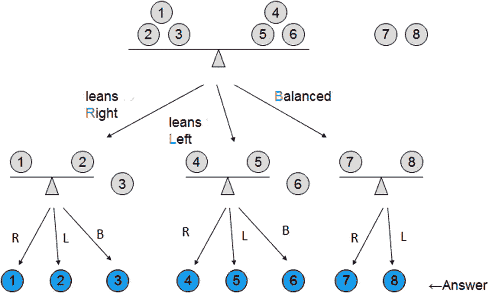

一张八枚硬币假币谜题解决方案的示意图。三组硬币被分为向右倾、向左倾和平衡。如果天平向右倾，假币在 1 到 3 中；如果向左倾，假币在 4 到 6 中；如果平衡，则假币是 7 或 8。

**图 8-1** 八枚硬币的假币谜题解决方案

1.  有 8 枚硬币，将硬币（1-3）放在天平的左侧，4-6 放在右侧。将剩下的 2 枚硬币 7 和 8 放在一边，然后称重。

2.  如果天平向右倾，假币就在 1-3 中（左侧）。记住假币更轻。因此，从左侧取出最后一枚硬币（3），再次称重（第二次）。
    *   如果天平向右倾，假币是 1。停止。
    *   如果天平向左倾，假币是 2。停止。

3.  如果天平向左倾，假币就在 4-6 中。取出最后一枚硬币（6），再次称重。
    *   如果天平向右倾，假币是 5。停止。
    *   如果天平向左倾，假币是 6。停止。

4.  如果天平平衡，假币要么是 7 要么是 8。将 7 和 8 放在天平上再次称重。
    *   如果天平向右倾，假币是 7。停止。
    *   如果天平向左倾，假币是 8。停止。

从前一节的过程中可以看出，一个经典算法可以实现，它与硬币总数 `N` 和假币数量 `k` 无关。一般而言，广义假币谜题的时间复杂度由下式给出：

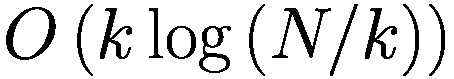

> **提示** 已经证明，在经典计算机上使用天平秤找到一枚假币所需的最少尝试次数是两次。

### 假币问题的量子解法

信不信由你，有一种量子算法可以仅使用量子天平秤一次就找到假币，而与硬币数量 `N` 无关！一般来说，对于任意数量的假币 `k`（与 `N` 无关），该算法的时间复杂度由下式给出：

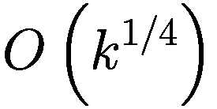

> **提示** 量子假币算法是其经典算法的四次方加速（quartic speedup）的一个例子。

因此，图 8-2 展示了针对假币谜题，量子算法相对于其经典算法的强大之处。现在，让我们深入探讨：找到一枚假币（`k = 1`）的量子算法可以概括为三个阶段：查询量子天平秤、构建量子天平秤和识别假币。

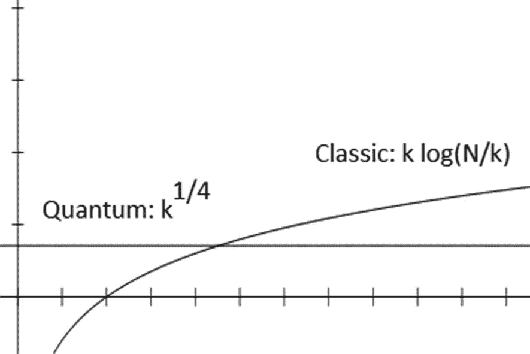

一张量子时间与经典时间的对比图。从点 2 开始，曲线呈向下凹的斜率，且斜率逐渐增加。

**图 8-2** 假币谜题的量子与经典时间复杂度对比

### 步骤 1：查询量子束平衡

量子算法将以叠加态查询光束平衡器。为此，我们使用二进制查询字符串来编码放在天平托盘上的硬币。例如，查询字符串 `11101111` 表示除索引为 `3` 的硬币外，所有硬币均在天平上。当没有包含假币时，天平平衡，否则倾斜。下表说明了这一点。

| N（硬币数量） | F（假币索引） | 查询字符串 | 结果 |
| --- | --- | --- | --- |
| 8 | 3 | `11101111` | 平衡 (0) |
| 8 | 3 | `11111111` | 倾斜 (1) |

该过程可总结如下：

1.  使用两个量子寄存器查询量子平衡，其中第一个寄存器用于查询字符串，第二个寄存器用于结果。

2.  准备所有具有偶数个 `1` 的二进制查询字符串的叠加态。

3.  为了获得具有偶数个 `1` 的态的叠加，对基态 `|0>` 执行哈达玛变换，并检查 `|x|` 的汉明重量是否为偶数。可以证明，`|x|` 的汉明重量为偶数当且仅当 `x1 ⊕ x2 ⊕ … ⊕ xN = 0`。
    > **提示**  
    > 字符串的汉明重量 (`hw`) 是与所用字母表中的零符号不同的符号数量。例如：`hw(11101) = 4`，`hw(11101000) = 4`，`hw(000000) = 0`。

4.  最后，测量第二个寄存器，如果观测到 `|0>`，则第一个寄存器就是我们想要的所有二进制查询字符串的叠加态。如果我们得到 `|1>`，则重复该过程直到观测到 `|0>`。

请注意，每次重复都以恰好一半的概率保证成功。因此，经过几次重复后，我们应该能够获得所需的叠加态。清单 8-1 展示了一个用于查询光束平衡器的量子程序的实现，其对应的图形电路如图 8-3 所示。

> **注意**  
> 为便于说明，完整的假币程序被拆分为清单 8-1 至 8-3；要运行该程序，请使用来自 `Workspace\Ch08\p_counterfeitcoin.py` 源文件的完整清单。

```
# ------- 查询量子束平衡
qr = QuantumRegister(numberOfCoins + 1, "qr")
#### 用于记录对 qr 的测量结果
cr = ClassicalRegister(numberOfCoins+1, "cr")
circuitName = "QueryStateCircuit"
circuit   = QuantumCircuit( qr, cr, name = circuitName)
N = numberOfCoins
##### 创建所有长度为 N 的字符串的均匀叠加
for i in range(N):
    circuit.h(qr[i])
##### 通过从 qr[0] 到 qr[N-1] 顺序应用 CNOT 门执行 XOR(x)
##### 并将结果存储到 qr[N]
for i in range(N):
    circuit.cx(qr[i], qr[N])
##### 测量 qr[N] 并将结果存储到 cr[N]。
##### 如果 cr[N] 为零则继续，否则重复
circuit.measure(qr[N], cr[N])
##### 查询量子束平衡
##### 如果 cr[0]...cr[N] 的值全为零
##### 通过准备 |1> 的哈达玛态，即在 qr[N] 处为 |0> - |1>
circuit.x(qr[N]).c_if(cr, 0)
circuit.h(qr[N]).c_if(cr, 0)
##### 当 cr[N] 不为零时，我们回退计算
for i in range(N):
    circuit.h(qr[i]).c_if(cr, 2**N)
清单 8-1
用于查询量子束平衡的脚本
```

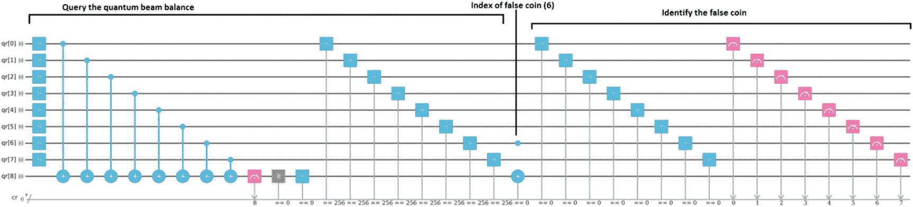
一个量子电路。不同部分包括查询量子束平衡、假币索引以及识别假币。

**图 8-3**
针对 `N = 8`，`k = 1` 且假币位于索引 `6` 的假币谜题的量子电路

图 8-3 展示了一个针对 8 枚硬币（其中 1 枚假币位于索引 6）的假币谜题的完整电路。该电路展示了在 `IBM Q Experience` 平台上描述的所有阶段。算法的第二阶段是构造光束平衡器。

### 步骤 2：构造量子平衡

在上一节中，我们构建了所有汉明重量为偶数的二进制查询字符串的叠加态。在这一步中，我们通过设置假币的位置来构造量子束。因此，给定假币相对于二进制字符串 `|x1, x2, …, xN>|0>` 的位置 `k`，量子束平衡返回：

`|x1, x2, … , xN> |0 ⊕ xk>`

这是通过一个以 `x[k]` 为控制位、第二个寄存器为目标位的 CNOT 门实现的（参见部分清单 8-2）。

```
#----- 构造量子束平衡
k = indexOfFalseCoin
#### 对所需的叠加态应用量子束平衡
#（由 cr 等于零标记）
circuit.cx(qr[k], qr[N]).c_if(cr, 0)
清单 8-2
构造量子束平衡。
```

### 步骤 3：识别假币

在查询平衡后识别假币，对二进制查询字符串应用哈达玛变换。假设我们用汉明重量为偶数的二进制字符串查询量子束平衡，那么通过测量哈达玛变换后的计算基，我们可以识别出假币，因为它是其标签与多数不同的那个（参见清单 8-3）。

```
# --- 识别假币
##### 对 qr[0] ... qr[N-1] 应用哈达玛变换
for i in range(N):
circuit.h(qr[i]).c_if(cr, 0)
##### 测量 qr[0] ... qr[N-1]
for i in range(N):
circuit.measure(qr[i], cr[i])
results   = execute([circuit], backend=backend, shots=shots).result()
answer  = results.get_counts(circuitName)
print("设备 " + str(backend) + " 计数 " + str(answer))
##### 获取最常见的标签
for key in answer.keys():
normalFlag, _ = Counter(key[1:]).most_common(1)[0]
for i in range(2,len(key)):
if key[i] != normalFlag:
print("假币索引为：", len(key) - i - 1)
清单 8-3
识别假币。
```

当最左边的位为`0`时，可以通过找到其值与其他值不同的位来确定假币的索引。例如，对于`N = 8`且假币索引为`6`，结果应为`010111111`或`001000000`。请注意，因为我们使用`cr[N]`来控制查询平衡前后的操作，因此：

- 如果最左边的位是`0`，则我们成功识别出假币。

- 如果最左边的位是`1`，则我们未能获得所需的叠加态，必须从头开始重复该过程。这可能导致与我下面展示的不同的模拟器计数结果；同时请记住，程序可能无法识别假币；因此你可能需要运行脚本几次。总而言之，可以在脚本中调整执行参数，例如假币索引、量子比特数量和硬币总数。

针对远程 IBM-Q 模拟器运行程序会得到以下结果（位于书籍源码`Workspace\Ch07\p_counterfeitcoin.py`）。请注意，我在此实例中使用的是 Windows：

```
c:\python36-64\python.exe p_counterfeitcoin.py
设备 ibmq_qasm_simulator 计数 {'001000000': 1}
假币索引为：  2
```

如果你无法访问书籍源码但仍想尝试此脚本，清单 8-4 是整个程序的精简版本。试试看吧。

# 代码清单 8-4 假币谜题主容器脚本

```python
import sys
import matplotlib.pyplot as plt
import numpy as np
# useful math functions
from math import pi, cos, acos, sqrt
from collections import Counter
# importing the QISKit
from qiskit import *
# import basic plot tools
from qiskit.tools.visualization import plot_histogram

def main(M = 16, numberOfCoins = 8 , indexOfFalseCoin = 6
, backend = None , shots = 1 ):
    if numberOfCoins = M:
        raise Exception("Please use numberOfCoins between 4 and ", M-1)
    if indexOfFalseCoin = numberOfCoins:
        raise Exception("indexOfFalseCoin must be between 0 and ", numberOfCoins-1)
    # ------- Query the quantum beam balance
    # Create registers
    qr = QuantumRegister(numberOfCoins + 1, "qr")
    # for recording the measurement on qr
    cr = ClassicalRegister(numberOfCoins+1, "cr")
    circuitName = "QueryStateCircuit"
    circuit   = QuantumCircuit( qr, cr, name = circuitName)
    N = numberOfCoins
    #Create uniform superposition of all strings of length N
    for i in range(N):
        circuit.h(qr[i])
    #Perform XOR(x) by applying CNOT gates sequentially from qr[0]
    #to qr[N-1] and storing the result to qr[N]
    for i in range(N):
        circuit.cx(qr[i], qr[N])
    # Measure qr[N] and store the result to cr[N].
    # We continue if cr[N] is zero, or repeat otherwise
    circuit.measure(qr[N], cr[N])
    # we proceed to query the quantum beam balance
    # if the value of cr[0]...cr[N] is all zero
    # by preparing the Hadamard state of |1>, i.e., |0> - |1> at qr[N]
    circuit.x(qr[N]).c_if(cr, 0)
    circuit.h(qr[N]).c_if(cr, 0)
    # we rewind the computation when cr[N] is not zero
    for i in range(N):
        circuit.h(qr[i]).c_if(cr, 2**N)
    #----- Construct the quantum beam balance
    k = indexOfFalseCoin
    # Apply the quantum beam balance on the desired superposition
    # state (marked by cr equal to zero)
    circuit.cx(qr[k], qr[N]).c_if(cr, 0)
    # --- Identify the false coin
    # Apply Hadamard transform on qr[0] ... qr[N-1]
    for i in range(N):
        circuit.h(qr[i]).c_if(cr, 0)
    # Measure qr[0] ... qr[N-1]
    for i in range(N):
        circuit.measure(qr[i], cr[i])
    print(circuit.qasm())
    results   = execute([circuit], backend=backend, shots=shots).result()
    answer    = results.get_counts(circuitName)
    print("Device " + str(backend) + " counts " + str(answer))
    #plot_histogram(answer)
    for key in answer.keys():
        normalFlag, _ = Counter(key[1:]).most_common(1)[0] #get most common label
        for i in range(2,len(key)):
            if key[i] != normalFlag:
                print("False coin index is: ", len(key) - i - 1)

#################################################
# main
#################################################
if __name__ ==  '__main__':
    M = 8                #Maximum qubits available
    numberOfCoins = 4    #Up to M-1, where M is the number of qubits
    indexOfFalseCoin = 2 #This should be 0, 1, ..., numberOfCoins - 1,
    # simulator
    name  = "qasm_simulator"
    backend   = Aer.get_backend(name)
    shots     = 1     # We perform a one-shot experiment
    main(M, numberOfCoins, indexOfFalseCoin, backend, shots)
```

## 任意数量假币的泛化

1998 年，数学家 Terhal 和 Smolin 将假币谜题泛化为任意数量的假币（`k > 1`）的情况。他们的实现使用了一个名为“天平预言机”（`B-Oracle`）的模型，其定义如下：

*   给定一个 N 位输入 `x = x1 x2 … xn ∈ {0, 1}^(N)`

*   构造一个 N 位三进制查询字符串，使得 `q = q1 q2 … qn ∈ {0, 1, -1}^(N)`，且其中 1 和 -1 的数量相同。

*   输出为 1 位，满足 `χ(x; q) = { 0 如果 q1*x1 + q2*x2 + ... + qn*xn = 0 (平衡)；否则为 1 (倾斜) }`。

> **提示**
>
> *预言机* 是算法中被视为黑盒的部分。它用于简化电路，并提供量子算法与经典算法之间的复杂度比较。一个好的预言机应具备速度、通用性和可行性。

图 8-4 展示了 `B-Oracle` 在 2 枚假币情况下的一个实例：`k = 2` 且 `N = 6`。

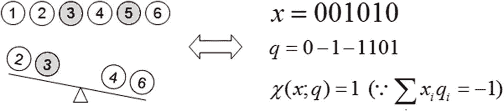

**图 8-4**：`N = 6` 且 `k = 2` 时的 `B-Oracle`

总而言之，假币谜题是量子算法相较于经典算法实现四次加速的典型范例。在下一节中，我们将探讨另一个奇异的、近乎魔法的谜题——梅明-佩雷斯魔方。

## 梅明-佩雷斯魔方

这是另一个经典谜题，最早由物理学家大卫·梅明和 A. 佩雷斯提出，作为量子伪心灵感应（即两个玩家能够对外部观察者进行某种超自然交流的能力）的一个例证。得益于纠缠的魔力，这成为了可能。让我们深入了解一下。

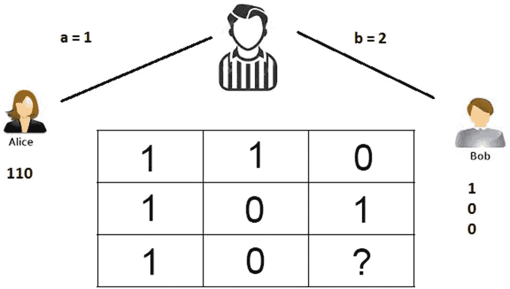

**图 8-5**：梅明-佩雷斯魔方

游戏开始，有两名玩家爱丽丝和鲍勃对阵一名裁判。魔方是一个 3x3 矩阵，遵循以下规则（见图 8-5）：

*   所有元素要么是 0，要么是 1，使得每一行元素之和为偶数，每一列元素之和为奇数。这个游戏之所以被称为*魔方*，是因为这样的方块是不可能存在的，如图 8-5 所示；不存在任何有效的组合能同时满足行和为偶数、列和为奇数（你可以尝试用纸笔自己验证）。这是由于矩阵中元素的数量为奇数导致的。

*   裁判向爱丽丝发送一个整数 `a ∈ {1, 2, 3}`，向鲍勃发送另一个整数 `b ∈ {1, 2, 3}`。爱丽丝必须回答魔方的第 `a` 行。鲍勃必须回答魔方的第 `b` 列。

*   如果爱丽丝回答的行和为偶数，鲍勃回答的列和为奇数，并且他们回答中相交位置的元素相同，则爱丽丝和鲍勃获胜。否则，裁判获胜。

*   游戏开始前，爱丽丝和鲍勃可以制定策略并共享信息。例如，他们可以决定使用图 8-5 中的矩阵来回答。但是，他们在游戏过程中不允许交流。

例如，在前述矩阵中，如果裁判向爱丽丝发送 `a = 1`，向鲍勃发送 `b = 2`，爱丽丝将回答 `110`（第 1 行），鲍勃将回答 `100`（第 2 列）。回答中相交的元素（第 1 行-第 2 列）相同（都是 1），因此他们获胜。可以证明，在经典背景下，爱丽丝和鲍勃的获胜概率最多为 `8/9`。也就是说，在魔方的九种可能排列中，有八种是他们获胜。因此，爱丽丝和鲍勃的经典获胜策略至多为 88.8%。

让我们通过一个巧妙的练习来验证这一论断，证明魔方谜题的经典获胜策略确实最多为 `8/9` (88.88%)。

### 梅明-佩雷斯魔方练习

1.  构建一个类似于图 8-5 的魔方，但使用二进制编码 `(1, -1)` 代替 `(1, 0)`，要求每行元素的乘积为 `1`（偶数），每列元素的乘积为 `-1`（奇数）。确认这确实是不可能的。

2.  为裁判给出的 `a` 和 `b` 值创建一个排列表，使用步骤 1 中的魔方，表格内容包括：

    *   排列序号。

    *   `a` 和 `b` 的值。

    *   爱丽丝和鲍勃的回答。

    *   爱丽丝和鲍勃回答的相交元素。请记住，该元素必须相等他们才能获胜。

    *   该轮游戏的结果：胜 = `W`，负 = `L`。

3.  最后，计算获胜概率并证明它最多为 `8/9`。**注意：答案在本节末尾**。

## 量子必胜策略

借助量子力学的力量和纠缠的魔力，爱丽丝和鲍勃可以做得更好。事实上，他们可以 **100%** 赢得游戏，就好像他们可以进行心灵感应交流一样，因此得名“伪心灵感应”。量子必胜策略由布拉萨德及其同事首次提出^(¹⁴)，并分为三个阶段：

*   **共享纠缠态：** 这是爱丽丝和鲍勃 100%获胜的关键。

*   **针对爱丽丝和鲍勃输入的统一变换：** 这些变换提供了要发送回裁判的响应。

*   **计算基测量：** 构建最终响应的最后阶段。

### 共享纠缠态

在量子必胜策略中，爱丽丝和鲍勃共享的纠缠态为：

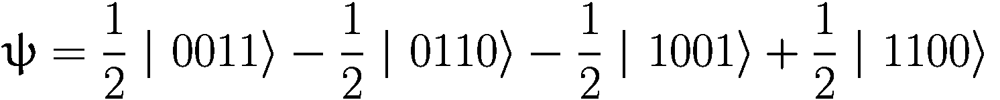

电路实现需要爱丽丝有 2 个量子比特，鲍勃有 2 个量子比特，如图 8-6 所示。

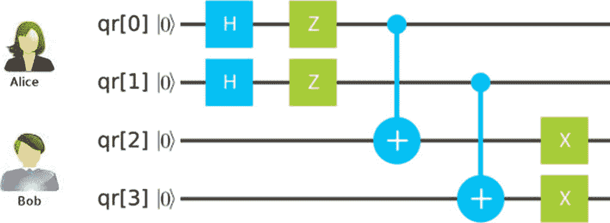

幻方的纠缠态示意图。 它包含爱丽丝的 2 个量子比特和鲍勃的 2 个量子比特。

图 8-6：幻方的纠缠态

*   我们知道 `Hadamard` 门将基态映射为 `H|0⟩ → (1/√2)(|0⟩ + |1⟩)`。因此，将其应用于前两个量子比特得到：`ψ = (1/2)|00⟩ + (1/2)|01⟩ + (1/2)|10⟩ + (1/2)|11⟩`。

*   接下来，将`Z`门应用于前两个量子比特。记住`Z`门保持 0 态不变，并将 1 映射为-1（翻转上述第三项的符号）。此时状态变为：`ψ = (1/2)|00⟩ + (1/2)|01⟩ - (1/2)|10⟩ + (1/2)|11⟩`。

*   接下来，应用`CNOT`门纠缠量子比特 0-2 和 1-3：`ψ = (1/2)|0000⟩ - (1/2)|0101⟩ - (1/2)|1010⟩ + (1/2)|1111⟩`。

*   最后，使用`X`门翻转最后 2 个量子比特，得到：`ψ = (1/2)|0011⟩ - (1/2)|0110⟩ - (1/2)|1001⟩ + (1/2)|1100⟩`。

用于构建纠缠态的 Python 脚本如代码清单 8-5 所示。

> **注意：** 幻方程序已被分解为代码清单 8-5、8-6 和 8-7。你可以从本章源代码中运行完整脚本，路径为`Workspace\Ch08\p_magicsq.py`。

```python
#### 创建纠缠态
Q_program = QuantumProgram()
Q_program.set_api(Qconfig.APItoken, Qconfig.config["url"])
#### 4 个量子比特（爱丽丝=2，鲍勃=2）
N = 4
#### 创建寄存器
qr = Q_program.create_quantum_register("qr", N)
#### 用于记录对 qr 的测量结果
cr = Q_program.create_classical_register("cr", N)
circuitName = "sharedEntangled"
sharedEntangled = Q_program.create_circuit(circuitName, [qr], [cr])
#### 创建所有长度为 2 的字符串的均匀叠加态
for i in range(2):
    sharedEntangled.h(qr[i])
#### 如果 1 的个数为奇数，则幅值为负
for i in range(2):
    sharedEntangled.z(qr[i])
#### 将前两个量子比特的内容复制到最后两个量子比特
for i in range(2):
    sharedEntangled.cx(qr[i], qr[i+2])
#### 翻转最后两个量子比特
for i in range(2,4):
    sharedEntangled.x(qr[i])
```

**代码清单 8-5**：量子必胜策略的纠缠态

有了共享纠缠态，爱丽丝和鲍勃现在可以开始游戏并从裁判那里接收输入。

### 统一变换

在收到各自的输入`a Є {1,2,3}`和`b Є {1,2,3}`后，爱丽丝和鲍勃将以下统一变换应用于共享纠缠态：爱丽丝使用`A1`、`A2`、`A3`，鲍勃使用`B1`、`B2`、`B3`：

![$$ A1=\frac{1}{\sqrt{2}}\left[\begin{array}{cccc}i&amp; 0&amp; 0&amp; 1\\ {}0&amp; -i&amp; 1&amp; 0\\ {}0&amp; i&amp; 1&amp; 0\\ {}1&amp; 0&amp; 0&amp; i\end{array}\right],A2=\frac{1}{2}\left[\begin{array}{cccc}i&amp; 1&amp; 1&amp; i\\ {}-i&amp; 1&amp; -1&amp; i\\ {}i&amp; 1&amp; 1&amp; -i\\ {}-i&amp; 1&amp; -1&amp; -i\end{array}\right],A3=\frac{1}{2}\left[\begin{array}{cccc}-1&amp; -1&amp; -1&amp; 1\\ {}1&amp; 1&amp; -1&amp; 1\\ {}1&amp; -1&amp; 1&amp; 1\\ {}1&amp; -1&amp; -1&amp; -1\end{array}\right] $$](images/469026_2_En_8_Chapter/469026_2_En_8_Chapter_TeX_Equd.png)

![$$ B1=\frac{1}{2}\left[\begin{array}{cccc}i&amp; -i&amp; 1&amp; 1\\ {}-i&amp; -i&amp; 1&amp; -1\\ {}1&amp; 1&amp; -i&amp; i\\ {}-i&amp; i&amp; 1&amp; 1\end{array}\right],B2=\frac{1}{2}\left[\begin{array}{cccc}-1&amp; i&amp; 1&amp; i\\ {}1&amp; i&amp; 1&amp; -i\\ {}1&amp; -i&amp; 1&amp; i\\ {}-1&amp; -i&amp; 1&amp; -i\end{array}\right],B3=\frac{1}{\sqrt{2}}\left[\begin{array}{cccc}1&amp; 0&amp; 0&amp; 1\\ {}-1&amp; 0&amp; 0&amp; 1\\ {}0&amp; 1&amp; 1&amp; 0\\ {}0&amp; 1&amp; -1&amp; 0\end{array}\right] $$](images/469026_2_En_8_Chapter/469026_2_En_8_Chapter_TeX_Eque.png)

## 注意

请记住，通过将上述变换应用于它们的纠缠态，爱丽丝和鲍勃可以构建它们各自发送给裁判的响应的前 2 个比特。

### 代码清单 8-6

代码清单 8-6 展示了爱丽丝和鲍勃的统一变换，以及表 8-1 中相应的等效图形电路。

```python
#------ 爱丽丝和鲍勃操作的电路。
#我们首先定义赋予相位的受控-u 门
from math import pi
def ch(qProg, a, b):
    """ 受控-哈达玛门 """
    qProg.h(b)
    qProg.sdg(b)
    qProg.cx(a, b)
    qProg.h(b)
    qProg.t(b)
    qProg.cx(a, b)
    qProg.t(b)
    qProg.h(b)
    qProg.s(b)
    qProg.x(b)
    qProg.s(a)
    return qProg

def cu1pi2(qProg, c, t):
    """ 受控-u1(phi/2)门 """
    qProg.u(0,0,pi/4.0, c)
    qProg.cx(c, t)
    qProg.u(0,0,-pi/4.0, t)
    qProg.cx(c, t)
    qProg.u(0,0,pi/4.0, t)
    return qProg

def cu3pi2(qProg, c, t):
    """ 受控-u3(pi/2, -pi/2, pi/2)门 """
    qProg.u(0,0,pi/2.0, t)
    qProg.cx(c, t)
    qProg.u(-pi/4.0, 0, 0, t)
    qProg.cx(c, t)
    qProg.u(pi/4.0, -pi/2.0, 0, t)
    return qProg

#----------------------------------------------------------------------
#### 定义爱丽丝和鲍勃在其每个输入（1、2、3）上使用的电路

#### 爱丽丝操作/电路的字典
aliceCircuits = {}

#### 爱丽丝的量子电路 1, 2, 3
for idx in range(1, 4):
    circuitName = "Alice"+str(idx)
    aliceCircuits[circuitName] = QuantumCircuit (qr, cr, name = circuitName)
    theCircuit = aliceCircuits[circuitName]
    if idx == 1:
        #A_1 的电路
        theCircuit.x(qr[1])
        theCircuit.cx(qr[1], qr[0])
        theCircuit = cu1pi2(theCircuit, qr[1], qr[0])
        theCircuit.x(qr[0])
        theCircuit.x(qr[1])
        theCircuit = cu1pi2(theCircuit, qr[0], qr[1])
        theCircuit.x(qr[0])
        theCircuit = cu1pi2(theCircuit, qr[0], qr[1])
        theCircuit = cu3pi2(theCircuit, qr[0], qr[1])
        theCircuit.x(qr[0])
        theCircuit = ch(theCircuit, qr[0], qr[1])
        theCircuit.x(qr[0])
        theCircuit.x(qr[1])
        theCircuit.cx(qr[1], qr[0])
        theCircuit.x(qr[1])
    elif idx == 2:
        theCircuit.x(qr[0])
        theCircuit.x(qr[1])
        theCircuit = cu1pi2(theCircuit, qr[0], qr[1])
        theCircuit.x(qr[0])
        theCircuit.x(qr[1])
        theCircuit = cu1pi2(theCircuit, qr[0], qr[1])
        theCircuit.x(qr[0])
        theCircuit.h(qr[0])
        theCircuit.h(qr[1])
    elif idx == 3:
        theCircuit.cz(qr[0], qr[1])
        theCircuit.swap(qr[0], qr[1]) # composer 中不支持
        theCircuit.h(qr[0])
        theCircuit.h(qr[1])
        theCircuit.x(qr[0])
        theCircuit.x(qr[1])
        theCircuit.cz(qr[0], qr[1])
        theCircuit.x(qr[0])
        theCircuit.x(qr[1])
    #在计算基上测量前两个量子比特
    theCircuit.measure(qr[0], cr[0])
    theCircuit.measure(qr[1], cr[1])

#### 鲍勃操作/电路的字典
bobCircuits = {}

#### 鲍勃在收到 1、2、3 时的量子电路
for idx in range(1,4):
    circuitName = "Bob"+str(idx)
    bobCircuits[circuitName] = QuantumCircuit( qr, cr, name = circuitName)
    theCircuit = bobCircuits[circuitName]
    if idx == 1:
        theCircuit.x(qr[2])
        theCircuit.x(qr[3])
        theCircuit.cz(qr[2], qr[3])
        theCircuit.x(qr[3])
        theCircuit.u1(pi/2.0, qr[2])
        theCircuit.x(qr[2])
        theCircuit.z(qr[2])
        theCircuit.cx(qr[2], qr[3])
        theCircuit.cx(qr[3], qr[2])
        theCircuit.h(qr[2])
        theCircuit.h(qr[3])
        theCircuit.x(qr[3])
        theCircuit = cu1pi2(theCircuit, qr[2], qr[3])
        theCircuit.x(qr[2])
        theCircuit.cz(qr[2], qr[3])
        theCircuit.x(qr[2])
        theCircuit.x(qr[3])
    elif idx == 2:
        theCircuit.x(qr[2])
        theCircuit.x(qr[3])
        theCircuit.cz(qr[2], qr[3])
        theCircuit.x(qr[3])
        theCircuit.u1(pi/2.0, qr[3])
        theCircuit.cx(qr[2], qr[3])
        theCircuit.h(qr[2])
        theCircuit.h(qr[3])
    elif idx == 3:
        theCircuit.cx(qr[3], qr[2])
        theCircuit.x(qr[3])
        theCircuit.h(qr[3])
    #在计算基上测量第三和第四个量子比特
    theCircuit.measure(qr[2], cr[2])
    theCircuit.measure(qr[3], cr[3])
```

清单 8-6 爱丽丝和鲍勃的酉变换

表 8-1 展示了适用于 IBM Q Experience Composer 的酉变换 A1-3、B1-3 的量子电路。

**表 8-1** 清单 8-6 中酉变换的量子电路

| 变换 | 电路 |
| --- | --- |
| | |

## 量子变换矩阵与电路

| ![$$ A1=\frac{1}{\sqrt{2}}\left[\begin{array}{cccc}i&amp; 0&amp; 0&amp; 1\\ {}0&amp; -i&amp; 1&amp; 0\\ {}0&amp; i&amp; 1&amp; 0\\ {}1&amp; 0&amp; 0&amp; i\end{array}\right] $$](images/469026_2_En_8_Chapter/469026_2_En_8_Chapter_TeX_IEq7.png) |  A1 = 1/√2 变换的量子电路示意图 |
| ![$$ A2=\frac{1}{2}\left[\begin{array}{cccc}i&amp; 1&amp; 1&amp; i\\ {}-i&amp; 1&amp; -1&amp; i\\ {}i&amp; 1&amp; 1&amp; -i\\ {}-i&amp; 1&amp; -1&amp; -i\end{array}\right] $$](images/469026_2_En_8_Chapter/469026_2_En_8_Chapter_TeX_IEq8.png) | 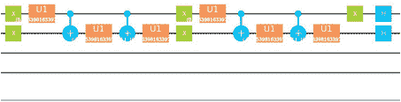 A2 = 1/2 变换的量子电路示意图 |
| ![$$ B1=\frac{1}{2}\left[\begin{array}{cccc}i&amp; -i&amp; 1&amp; 1\\ {}-i&amp; -i&amp; 1&amp; -1\\ {}1&amp; 1&amp; -i&amp; i\\ {}-i&amp; i&amp; 1&amp; 1\end{array}\right] $$](images/469026_2_En_8_Chapter/469026_2_En_8_Chapter_TeX_IEq9.png) | 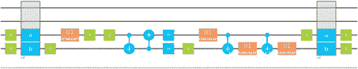 B1 = 1/2 变换的量子电路示意图 |
| ![$$ B2=\frac{1}{2}\left[\begin{array}{cccc}-1&amp; i&amp; 1&amp; i\\ {}1&amp; i&amp; 1&amp; -i\\ {}1&amp; -i&amp; 1&amp; i\\ {}-1&amp; -i&amp; 1&amp; -i\end{array}\right] $$](images/469026_2_En_8_Chapter/469026_2_En_8_Chapter_TeX_IEq10.png) | 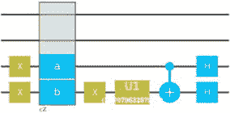 B2 = 1/2 变换的量子电路示意图 |
| ![$$ B3=\frac{1}{\sqrt{2}}\left[\begin{array}{cccc}1&amp; 0&amp; 0&amp; 1\\ {}-1&amp; 0&amp; 0&amp; 1\\ {}0&amp; 1&amp; 1&amp; 0\\ {}0&amp; 1&amp; -1&amp; 0\end{array}\right] $$](images/469026_2_En_8_Chapter/469026_2_En_8_Chapter_TeX_IEq11.png) | 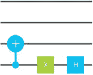 B3 = 1/√2 变换的量子电路示意图 |

在表 8-1 中，请注意 A3 未被包含在内，因为 Composer 不支持清单 8-5 所需的交换门。但这并不意味着量子程序不能在模拟器或真实设备上运行。它仅仅意味着该电路无法在 Composer 中创建。因此，在最后一步，爱丽丝和鲍勃在计算基上测量他们的量子比特。

### 在计算基下进行测量

测量结束后，爱丽丝和鲍勃每人会得到两个比特，分别代表各自的输出。为了获得第三个比特从而得到最终答案，他们应用各自的奇偶规则。也就是说，爱丽丝的求和结果必须是偶数，而鲍勃的求和结果必须是奇数。例如，对于 `a = 2`、`b = 3`（参见表 `[8-2]`）：

![$$ \left(A2\bigotimes B3\right)\mid \left.\uppsi \right\rangle =\frac{1}{2\sqrt{2}}\left[|\left.0000\right\rangle -|\left.0010\right\rangle -|\left.0101\right\rangle +|01\left.11\right\rangle +|1\left.001\right\rangle +|1\left.011\right\rangle -|\left.1100\right\rangle -|\left.1110\right\rangle \right] $$](images/469026_2_En_8_Chapter/469026_2_En_8_Chapter_TeX_Equf.png)

**表 8-2** 魔方在 `a = 2`、`b = 3` 时的答案排列

| **Ψ** | **爱丽丝的答案** | **鲍勃的答案** | **方阵** |
| --- | --- | --- | --- |
| `&#124;0000>` | 000 | 001 | ![$$ \left[\begin{array}{ccc}&amp; &amp; 0\\ {}0&amp; 0&amp; 0\\ {}&amp; &amp; 1\end{array}\right] $$](images/469026_2_En_8_Chapter/469026_2_En_8_Chapter_TeX_IEq12.png) |
| `&#124;0010>` | 000 | 100 | ![$$ \left[\begin{array}{ccc}&amp; &amp; 1\\ {}0&amp; 0&amp; 0\\ {}&amp; &amp; 0\end{array}\right] $$](images/469026_2_En_8_Chapter/469026_2_En_8_Chapter_TeX_IEq13.png) |
| `&#124;0101>` | 011 | 010 | ![$$ \left[\begin{array}{ccc}&amp; &amp; 0\\ {}0&amp; 1&amp; 1\\ {}&amp; &amp; 0\end{array}\right] $$](images/469026_2_En_8_Chapter/469026_2_En_8_Chapter_TeX_IEq14.png) |
| `&#124;0111>` | 011 | 111 | ![$$ \left[\begin{array}{ccc}&amp; &amp; 1\\ {}0&amp; 1&amp; 1\\ {}&amp; &amp; 1\end{array}\right] $$](images/469026_2_En_8_Chapter/469026_2_En_8_Chapter_TeX_IEq15.png) |
| `&#124;1001>` | 101 | 010 | ![$$ \left[\begin{array}{ccc}&amp; &amp; 0\\ {}1&amp; 0&amp; 1\\ {}&amp; &amp; 0\end{array}\right] $$](images/469026_2_En_8_Chapter/469026_2_En_8_Chapter_TeX_IEq16.png) |
| `&#124;1011>` | 101 | 111 | ![$$ \left[\begin{array}{ccc}&amp; &amp; 1\\ {}1&amp; 0&amp; 1\\ {}&amp; &amp; 1\end{array}\right] $$](images/469026_2_En_8_Chapter/469026_2_En_8_Chapter_TeX_IEq17.png) |
| `&#124;1100>` | 110 | 001 | ![$$ \left[\begin{array}{ccc}&amp; &amp; 0\\ {}1&amp; 1&amp; 0\\ {}&amp; &amp; 1\end{array}\right] $$](images/469026_2_En_8_Chapter/469026_2_En_8_Chapter_TeX_IEq18.png) |
| `&#124;1110>` | 110 | 101 | ![$$ \left[\begin{array}{ccc}&amp; &amp; 1\\ {}1&amp; 1&amp; 0\\ {}&amp; &amp; 1\end{array}\right] $$](images/469026_2_En_8_Chapter/469026_2_En_8_Chapter_TeX_IEq19.png) |

清单 `[8-7]` 展示了脚本中用于循环魔方所有回合的部分：

```
它循环遍历 `a [1,3]` 和 `b [1,3]`（包含端点）。
```

*   对于每一对 (`a`, `b`)，从清单 [8-5] 中获取爱丽丝的电路（`Alice-a`）和鲍勃的电路（`Bob-b`）。
*   将共享纠缠态 `Ψ`、`Alice-a` 和 `Bob-b` 电路提交给模拟器或真实量子设备执行。
*   从答案中为爱丽丝提取两个比特，为鲍勃提取两个比特，例如 `{'0011': 1}`。
*   应用奇偶规则：爱丽丝的求和结果必须为偶数，鲍勃的求和结果必须为奇数。
*   最后，验证答案并显示获胜概率。

```
def all_rounds(backend, real_dev, shots=10):
    nWins = 0
    nLost = 0
    for a in range(1,4):
        for b in range(1,4):
            print("For a = " + str(a) + " , b = " + str(b))
            rWins = 0
            rLost = 0
            aliceCircuit  = aliceCircuits["Alice" + str(a)]
            bobCircuit    = bobCircuits["Bob" + str(b)]
            circuitName   = "Alice" + str(a) + "Bob"+str(b)
            root = sharedEntangled.compose(aliceCircuit).compose(bobCircuit)
            if real_dev:
                device_cfg    = backend.configuration()
                device_coupling = device_cfg.coupling_map
                results = execute([root], backend=backend, shots=shots
                                  , coupling_map=device_coupling).result()
            else:
                results = execute([root], backend=backend, shots=shots).result()
            answer = results.get_counts()
            for key in answer.keys():
                kfreq = answer[key] #frequencies of keys obtained from measurements
                aliceAnswer = [int(key[-1]), int(key[-2])]
                bobAnswer   = [int(key[-3]), int(key[-4])]
                if sum(aliceAnswer) % 2 == 0:
                    aliceAnswer.append(0)
                else:
                    aliceAnswer.append(1)
                if sum(bobAnswer) % 2 == 1:
                    bobAnswer.append(0)
                else:
                    bobAnswer.append(1)
                print(str(backend) + " answer: " + key + " Alice: " + str(aliceAnswer)
                      + " Bob:" + str(bobAnswer))
                if(aliceAnswer[b-1] != bobAnswer[a-1]):
                    #print(a, b, "Alice and Bob lost")
                    nLost += kfreq
                    rLost += kfreq
                else:
                    #print(a, b, "Alice and Bob won")
                    nWins += kfreq
                    rWins += kfreq
            print("\t#wins = ", rWins, "out of ", shots, "shots")
    print("Number of Games = ", nWins+nLost)
    print("Number of Wins = ", nWins)
    print("Winning probabilities = ", (nWins*100.0)/(nWins+nLost))

#################################################
# main
#################################################
if __name__ == '__main__':
    name = "qasm_simulator"
    backend = Aer.get_backend(name)
    real_dev = False
    all_rounds(backend, real_dev)
```

清单 8-7 魔方所有回合的脚本

在远程模拟器上运行位于 `Workspace\Ch08\p_magicsq.py` 的完整脚本的输出如清单 [8-8] 所示。


```
c:\python36-64\python.exe p_magicsq.py
For a = 1 , b = 1
ibmq_qasm_simulator answer: 1000 Alice: [0, 0, 0] Bob:[0, 1, 0]
ibmq_qasm_simulator answer: 1010 Alice: [0, 1, 1] Bob:[0, 1, 0]
ibmq_qasm_simulator answer: 1111 Alice: [1, 1, 0] Bob:[1, 1, 1]
ibmq_qasm_simulator answer: 0111 Alice: [1, 1, 0] Bob:[1, 0, 0]
ibmq_qasm_simulator answer: 0000 Alice: [0, 0, 0] Bob:[0, 0, 1]
ibmq_qasm_simulator answer: 0101 Alice: [1, 0, 1] Bob:[1, 0, 0]
#wins =  10 out of  10 shots
For a = 1 , b = 2
ibmq_qasm_simulator answer: 1000 Alice: [0, 0, 0] Bob:[0, 1, 0]
ibmq_qasm_simulator answer: 1001 Alice: [1, 0, 1] Bob:[0, 1, 0]
ibmq_qasm_simulator answer: 1111 Alice: [1, 1, 0] Bob:[1, 1, 1]
ibmq_qasm_simulator answer: 0110 Alice: [0, 1, 1] Bob:[1, 0, 0]
ibmq_qasm_simulator answer: 0000 Alice: [0, 0, 0] Bob:[0, 0, 1]
ibmq_qasm_simulator answer: 0001 Alice: [1, 0, 1] Bob:[0, 0, 1]
#wins =  10 out of  10 shots
...
For a = 3 , b = 3
ibmq_qasm_simulator answer: 1000 Alice: [0, 0, 0] Bob:[0, 1, 0]
ibmq_qasm_simulator answer: 1011 Alice: [1, 1, 0] Bob:[0, 1, 0]
ibmq_qasm_simulator answer: 1101 Alice: [1, 0, 1] Bob:[1, 1, 1]
ibmq_qasm_simulator answer: 1110 Alice: [0, 1, 1] Bob:[1, 1, 1]
ibmq_qasm_simulator answer: 0111 Alice: [1, 1, 0] Bob:[1, 0, 0]
ibmq_qasm_simulator answer: 0010 Alice: [0, 1, 1] Bob:[0, 0, 1]
#wins =  10 out of  10 shots
Number of Games =  90
Number of Wins =  90
Winning probability =  100.0

清单 8-8
魔方所有回合运行时的简化标准输出
```

## 注意

如果在真实设备上运行，由于环境噪声和门误差，获胜概率将不会是 100%。

### 梅尔明-佩雷斯魔方阵习题答案

1.  这里给出一个行乘积为偶数、列乘积为奇数的魔方阵。请注意，由于单元格数量为奇数，这样的方阵是不可能的。

    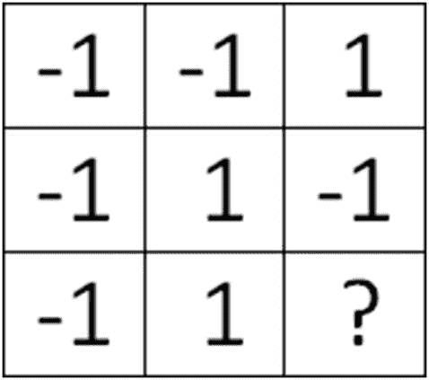

    一个 3x3 的矩阵网格。其中的条目包括-1、1 和一个问号。

2.  答案 1 中魔方阵的排列表如下：

    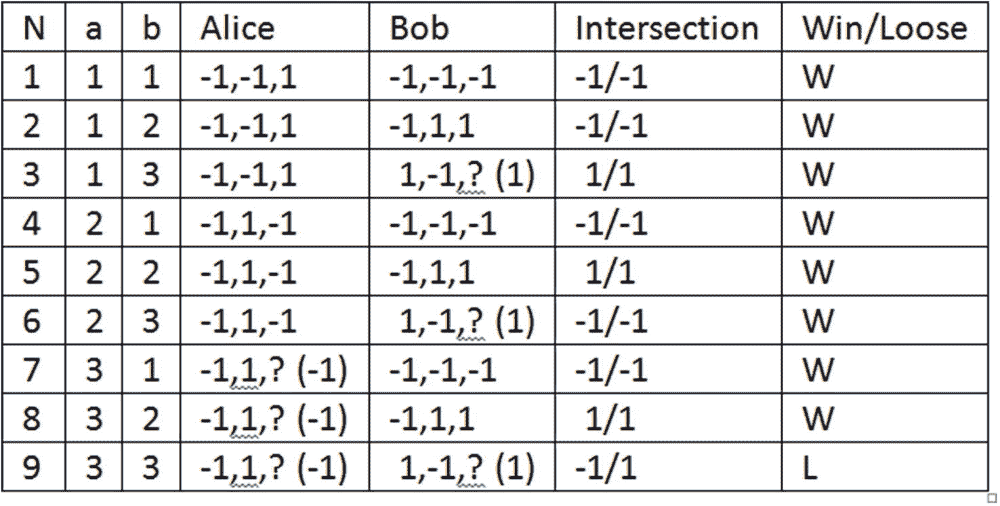

    一个排列表，包含`N`、`a`、`b`、`Alice`、`Bob`、交叉点以及胜负情况的数据。

3.  请注意，在前面的步骤中，对于第 7-9 行，`Alice` 的答案必须是-1，这样乘积才能为偶数(1)。此外，在第 3、6、9 列中，`Bob` 的答案必须是 1，这样他的乘积才能为奇数(-1)。最后，将赢的总次数除以排列总数即可得到概率。因此：

    ```
    P=\frac{\sum W}{N}=\frac{8}{9}=88.88\%
    ```

在本章中，你学习了量子纠缠的力量如何能够比经典计算提供显著的加速。通过量子天平，可以针对诸如假币问题等经典谜题实现四倍加速。对于其他问题，例如魔方阵，纠缠则在玩家之间实现了近乎神奇的“心灵感应”。总而言之，本章展示了量子力学一如既往地令人困惑、怪异且迷人。它从未让人失望。

在下一章，你将学习到可能是所有量子算法中最著名的一个：臭名昭著的肖尔整数分解算法。一个可能摧毁非对称加密的算法！

脚注 1
