# 9. 量子优势：多伊奇-乔萨、伯恩斯坦-瓦齐拉尼与西蒙算法

在本章中，我们研究三个实际用途不大但很重要的算法，因为它们是首批展示量子计算机能够比经典计算机更快地解决问题的算法。考虑算法的时间复杂度 `O(n)`：经典 vs. 量子，如表 9-1 所示（其中 `n` 是输入的大小）。

**表 9-1**
多伊奇-乔萨、伯恩斯坦-瓦齐拉尼和西蒙算法的时间复杂度

| 名称 | 经典 | 量子 |
| --- | --- | --- |
| 多伊奇-乔萨 | 2^(n-1) + 1 | 1 |
| 伯恩斯坦-瓦齐拉尼 | n | 1 |
| 西蒙 | 2^(n/2) | n |

除了显著的性能提升，这些算法还阐述了几乎适用于所有现有算法的基本概念：

*   **大规模并行性：** 通过对所有输入应用 `Hadamard` 门，我们创建了所有二进制排列的集合，最不可思议的是，它们都在同一时间被处理。这听起来可能没什么大不了的，但考虑一个 40 量子比特的处理器：它可以在同一时间处理 2⁴⁰ = 1TB 的二进制排列。这是惊人的原始算力，任何现有的超级计算机都无法匹敌。
*   **预言机：** 这些是对二进制排列执行某些变换的黑盒。当你拥有巨大的排列空间时，预言机提供了一种改变大多数排列的方法，以便它们可以相互抵消。几乎所有量子算法都会使用某种预言机。
*   **相位反冲：** 这是一个极其有用的概念，你必须充分理解它才能构建量子算法。相位反冲本质上改变了某些排列的相位（符号），以便它们（在被预言机变换后）可以相互抵消。这个过程的结果是一个缩小的排列空间，其中包含问题的解。但关于这一点，我们将在下一节中详细讨论。

这三个概念包含了量子优势的关键：想象一下，你通过量子比特的 `Hadamard` 门创建了一个大小为 2⁴⁰的二进制排列空间。在这个空间中，有一个独特的排列等待被发现，它给出了问题的解。我们需要一个机制来改变某些排列，以便它们可以相互抵消（预言机）。此外，我们需要一种方法来改变它们的相位（相位反冲），以便当我们让它们脱离叠加态时，它们会通过加法相互抵消（记住，叠加态就是量子态的加法）。最终的测量将触发这个过程，从而得到一个缩小的排列集，其中包含问题的解；所有这一切中最困难的部分是将问题编码到这样一个二进制排列空间中，而这正是所有研究进行的地方。那么，让我们来看看量子信息科学中这个精髓的部分：我们从极其重要的相位反冲概念开始。

## 相位反冲

当门对量子比特添加的特征值通过受控操作被“反冲”到另一个量子比特时，就会发生相位反冲。要实现这一点，量子比特必须处于叠加态。请记住：

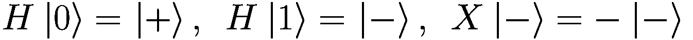

在双量子比特态中，当控制量子比特不处于 `|0>` 或 `|1>` 叠加态时，相位是全局的，没有可观测效应（全局相位无关紧要）。因此，应用控制-X 算符得到：

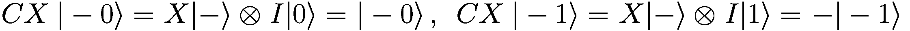

注意我们使用的是 `Qiskit` 小端比特顺序（控制比特或最低有效位在右边）。当控制（右侧）量子比特处于叠加态时，就会发生相位反冲。状态为 `|1>` 的控制量子比特会对相应的目标量子比特施加一个相位因子。这个施加的相位因子反过来又会在控制量子比特中引入一个相对相位，如下所示：

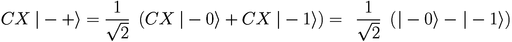

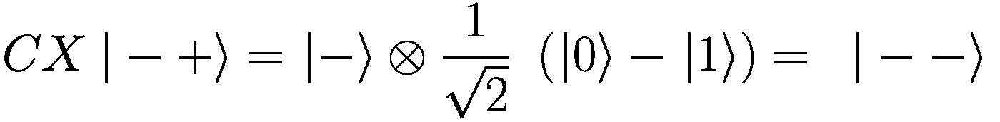

让我们通过一个简单的实验室练习来验证这一点。

**练习 9.1：** 启动量子实验室，快速为双量子比特态 `|-+>` 创建电路，并使用状态向量模拟器显示布洛赫球以可视化旋转。注意，量子比特 0 将处于 `(+)` 状态。

```python
from qiskit import *
from qiskit.visualization import *
qc = QuantumCircuit(2)
qc.h(0)
qc.x(1)
qc.h(1)
display (qc.draw())
backend = Aer.get_backend("statevector_simulator")
result = execute(qc, backend).result()
plot_bloch_multivector(result.get_statevector())
```

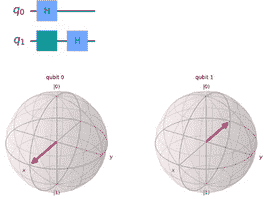 屏幕截图显示两个球体，分别标记为量子比特 0（带有一个向下对角箭头）和量子比特 1（带有一个向上对角箭头）。顶部还有 `q0` 和 `q1` 的两条水平线，以及各种门图标。

**练习 9.2：** 向电路中添加一个 `Control-X(0,1)` 算符，以可视化负相位如何从量子比特-1（目标）反冲到量子比特-0（处于叠加态的控制），从而得到状态 `|-->`。

```python
from qiskit import *
from qiskit.visualization import *
qc = QuantumCircuit(2)
qc.h(0)
qc.x(1)
qc.h(1)
qc.cx(0,1)
display (qc.draw())
backend = Aer.get_backend("statevector_simulator")
result = execute(qc, backend).result()
plot_bloch_multivector(result.get_statevector())
```

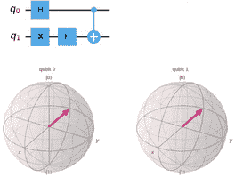 屏幕截图显示两个球体，分别标记为量子比特 0 和量子比特 1，都带有向上对角箭头。顶部还有 `q0` 和 `q1` 的两条水平线，以及各种门图标。

### 任意相位的反冲

在量子力学中，相位翻转和符号翻转可互换使用。例如，负相位反冲相当于布洛赫球上旋转 π 度。这是一个强大的概念，只要使用受控操作并且目标量子比特处于叠加态，就允许量子比特之间进行任意角度的相位反冲。这种壮举可以使用便捷的相位门来实现，该门可围绕 Z 轴旋转 λ（拉姆达）度：![$$ P\left(\lambda \right)=\left[\begin{array}{cc}1&amp; 0\\ {}0&amp; {e}^{i\lambda}\end{array}\right] $$](images/469026_2_En_9_Chapter/469026_2_En_9_Chapter_TeX_IEq1.png)。

让我们看看这是如何实现的。考虑代码清单 9-1。我们从处于 `|+1>` 状态的两个量子比特开始（图 9-1 的左侧）。然后，我们施加一个角度为 `pi/4` 度的受控相位（T 门）。这会产生一个四分之一圈（围绕 Z 轴）的相位反冲，从控制量子比特-1 反冲到处于叠加态的目标量子比特-0（图 9-1 的右侧）。

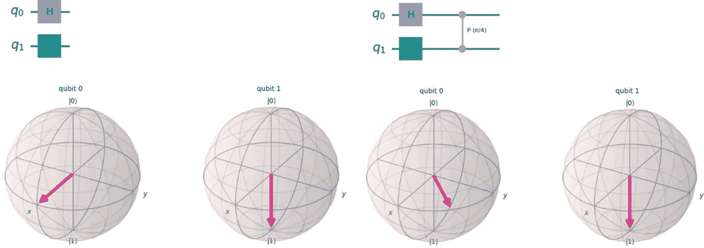

一组 2 个屏幕截图显示两个球体，分别标记为量子比特 0 和量子比特 1，在不同位置带有对角线和正常箭头。顶部还有 `q0` 和 `q1` 的两条水平线，以及各种门图标。第二个屏幕截图中，线条通过 `pi/4` 的 `P` 门连接。

**图 9-1** – 使用 `T` 门的相位反冲

```
### 代码清单 9-1

```python
from qiskit import *
from qiskit.visualization import *
from math import pi
qc = QuantumCircuit(2)
qc.h(0)
qc.x(1)
#### 添加受控-T 门：
##### 1) 注释此行以查看图 9-1 的左侧。
##### 2) 取消注释以查看图 9-1 的右侧。
#qc.cp(pi/4, 0, 1)
display (qc.draw())
backend = Aer.get_backend("statevector_simulator")
result = execute(qc, backend).result()
plot_bloch_multivector(result.get_statevector())
```

使用 T 门的相位反冲。

`练习 9.3：` 如果我们施加一个 `–pi/2` 的旋转（`S` 共轭门），量子比特-0 的位置会是什么？提示：鉴于 `S` 门绕 `Z` 轴旋转 `pi/2` 度，请更新 `qc.cp()` 指令的旋转角度。

在接下来几个部分中研究的三种算法中，都会用到相位反冲。

## 多伊奇-乔萨算法

该算法由大卫·多伊奇和理查德·乔萨于 1992 年提出。给定一个隐藏布尔函数 `f({x0,x1,..,xn})`，其中 `{x0,x1,..,xn}` 是一个比特串，如果该函数是常值函数，则返回 0；如果是平衡函数，则返回 1。布尔常值函数对任何输入都返回全 0 或全 1。布尔平衡函数对一半的输入返回 0，对另一半返回 1。任务是判断给定的函数是平衡函数还是常值函数。

`提示`

布尔平衡函数的例子包括：将输入的第一个比特复制到输出的函数，以及 XOR（异或——可通过查看其真值表验证）。布尔平衡函数主要用于密码学。

图 9-2 中的电路仅需一次调用就能以 100% 的置信度解决这一问题。让我们看看这是如何实现的。我们从以下状态开始：

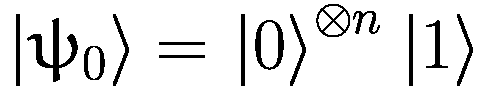

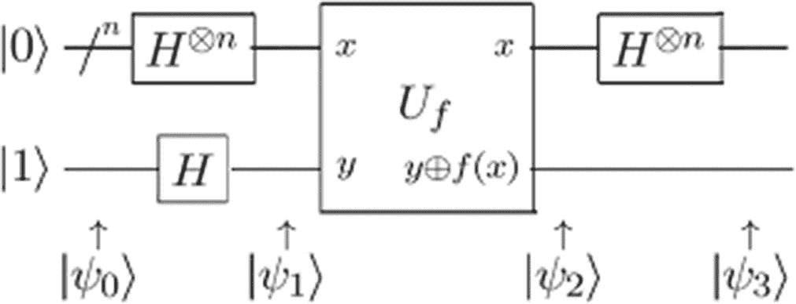

**图 9-2** 多伊奇-乔萨量子电路

`Hadamard` 门将输入比特置于叠加态，并将辅助量子比特 `|1>` 置于 `|->` 态：

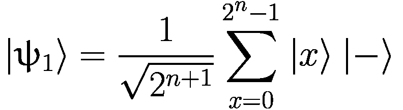

其中 `x` 是输入比特串，接着函数 `U[f]` 是一个预言机，它利用相位反冲将状态变换为 `|x⟩|y⟩ → |x⟩|y ⊕ fx⟩`：


接下来，丢弃辅助量子比特；对第一个寄存器应用 `Hadamard` 变换，我们得到：

![$$ \left.|{\uppsi}_2\right\rangle =\frac{1}{2^n}\sum \limits_{y=0}^{2^n-1}\left[\sum \limits_{x=0}^{2^n-1}{\left(-1\right)}^{fx}{\left(-1\right)}^{x.y}\right]\left.|y\right\rangle $$](images/469026_2_En_9_Chapter/469026_2_En_9_Chapter_TeX_Equh.png)

其中 `x.y` 是输入比特串 `x` 与辅助量子比特 (`y`) 的按位乘积。最后，测量第一个寄存器后，概率变为 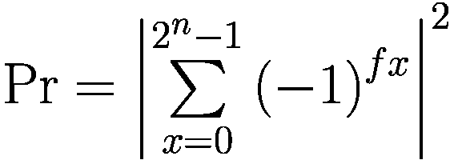，如果 `f(x)` 是平衡函数，该值计算结果为 1。让我们针对一个 3 量子比特电路实现该算法，该电路包含一个 2 比特大小的 `-x` 和一个 1 比特大小的 `-y`，用于两种函数：

1. 使用单位门的常值函数

2. 使用布尔 `XOR` 的平衡函数

在量子实验室中运行代码清单 9-2，为 2 比特函数构建多伊奇-乔萨电路；它包含两个函数 `constant2` 和 `balanced2`，分别用于创建常值函数和平衡函数 `f(x)` 的预言机。该代码首先执行以下步骤：

1. 将输入量子比特 (`x`) 置于叠加态。

2. 然后应用常值函数或平衡函数的预言机。

3. 将输入移回计算基。

4. 测量输入 `x`。如果结果为 0，则函数是常值；否则是平衡的。

### 代码清单 9-2

```python
from qiskit import QuantumRegister, ClassicalRegister, QuantumCircuit
from qiskit import Aer, execute
from qiskit.tools.visualization import plot_histogram
### 创建量子/经典寄存器和一个量子电路
qin     = QuantumRegister(2, 'x')
qout    = QuantumRegister(1, 'y')
c       = ClassicalRegister(2)
qc      = QuantumCircuit(qin,qout,c)
### 这是一个平衡函数 XOR
def balanced2(circ, input, output) :
    circ.cx(input[0],output)
    circ.cx(input[1],output)
### 这是一个什么都不改变的常值函数
def constant2(circ, input, output) :
    circ.i(output)
### 构建多伊奇-乔萨电路
#### 首先应用相位偏移，以在 f(x) == 1 时取反
qc.h(qin)
qc.x(qout)
qc.h(qout)
#### 使用 balanced2() 平衡函数 或 constant2() 常值函数
constant2(qc,qin,qout)
#balanced2(qc,qin,qout)
qc.h(qout)
qc.barrier()  # 设置屏障使电路看起来更美观
#### 然后对输入比特进行 Walsh-Hadamard 变换
qc.h(qin)
#### 对于常值函数，输出以概率 1 为 |00>
#### 对于平衡函数，输出以概率 1 为 |11>
qc.measure(qin,c)
#### display 仅在量子实验室中有效
display(qc.draw())
#### 模拟并显示结果
backend     = Aer.get_backend('qasm_simulator')
job  = execute(qc, backend, shots=512)
result  = job.result()
plot_histogram(result.get_counts())
```

用于 2 量子比特（常值或平衡函数）的多伊奇-乔萨算法。

在量子实验室中运行代码清单 9-2，得到如图 9-3 所示的结果。

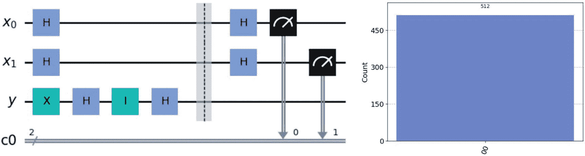

**图 9-3** 常值函数的多伊奇-乔萨电路及结果

`练习 9.4：` 修改代码清单 9-2，改用平衡的 `XOR` 函数。在量子实验室中运行，并验证电路及结果直方图与图 9-4 一致。

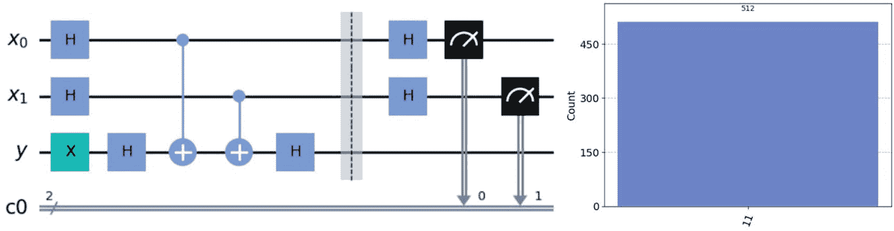

**图 9-4** `XOR` 平衡函数的多伊奇-乔萨电路及结果
```

# 伯恩斯坦-瓦齐拉尼算法 (BV)

伯恩斯坦-瓦齐拉尼算法是 1997 年提出的多伊奇-乔萨算法的扩展。¹⁶ 该算法与多伊奇-乔萨算法相似，但更为复杂：

1. 我们从相同的函数 `f({x0,x1,..,xn})` 开始，其中 `{x0,x1,..,xn}` 是一个比特串，`f(x)` 返回 0 或 1。
2. 区别在于：与多伊奇-乔萨算法中函数是平衡函数或常数函数不同，`f(x)` 返回输入 `x` 与某个秘密字符串 `s` 的按位乘积。
3. 目标是找到秘密字符串 `s`，使得 `f(x) = s . x (mod 2)`，通过使用变换 ``

    其中 `|s>` 是秘密比特串的 `n` 量子比特态置换，`|x>` 是输入空间。电路和数学解释如图 9-6 所示。

| 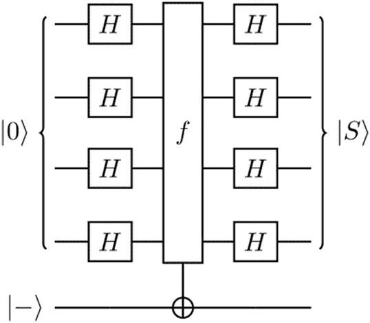一个量子电路有 2 组 4 个 H 块，分别接在管道 0 右尖括号和管道 S 右尖括号上，并连接到中央的 f 块。图 9-6 伯恩斯坦-瓦齐拉尼算法的量子电路 | 在两个量子比特上应用的哈达玛门给出：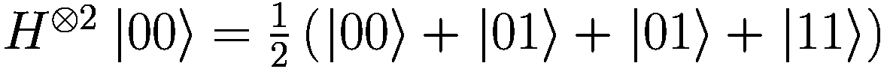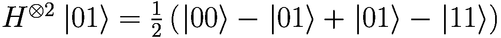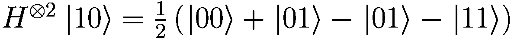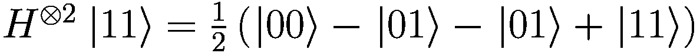这可以表示为对输入比特串 `x` 的求和：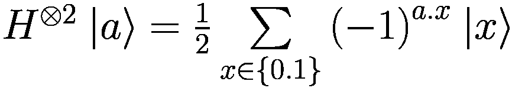 |

**提示**

请记住 ``。

## 练习 9.6：通过乘法证明 ``。

``

## 练习 9.7：通过乘法证明 ``

一个适用于任意秘密字符串大小的通用算法如代码清单 9-3 所示，电路和结果在图 9-7 中。

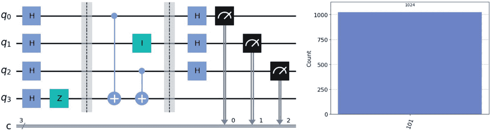

一组 2 张截图。左边显示一个电路，有 5 条水平线，分别代表 `q0`、`q1`、`q2`、`q3` 和 `c`，并带有各种门和屏障图标。右边显示一个计数与 101 的条形图。图表绘制了一个计数为 1024 的条形。

**图 9-7** 隐藏比特串 `101` 的伯恩斯坦-瓦齐拉尼电路和结果

# 初始化

```python
import matplotlib.pyplot as plt
import numpy as np
from qiskit import *
from qiskit.visualization import *
```

# 生成器，用于一个以 n 个量子比特为输入的隐藏函数

```python
def bv_oracle (n, s) : #, qc) :
```

反转 `s` 以匹配 `Qiskit` 的量子比特顺序。

```python
s   = s[::-1]
qc  = QuantumCircuit(n + 1)
for q in range(n):
    if s[q] == '0':
        qc.i(q)
    else:
        qc.cx(q, n)
return qc
```

# 伯恩斯坦-瓦齐拉尼 (BV) 算法的 n 量子比特输入版本

```python
def bv_circuit (n, s):
```

我们需要一个包含 `n` 个量子比特，外加一个辅助量子比特的电路。还需要 `n` 个经典比特来写入输出。

```python
bv = QuantumCircuit( n + 1, n)
```

将辅助量子比特置于 `|->`。

```python
#bv.x(n)
bv.h(n)
bv.z(n)
```

在查询 oracle 之前应用哈达玛门。

```python
for i in range(n):
    bv.h(i)
```

应用屏障。

```python
bv.barrier()
```

应用内积 oracle。

```python
bv = bv.compose(bv_oracle (n, s))
```

应用屏障。

```python
bv.barrier()
```

在查询 oracle 之后应用哈达玛门。

```python
for i in range(n):
    bv.h(i)
```

测量。

```python
for i in range(n):
    bv.measure(i, i)
return bv
```

# 主程序

```python
s           = '101'    # 隐藏的二进制字符串
n           = len(s)     # 用于表示 s 的量子比特数
bvc         = bv_circuit (n, s)
```

## 在模拟器中运行

```python
backend     = Aer.get_backend('qasm_simulator')
results     = execute(bvc, backend).result()
answer      = results.get_counts()
display (bvc.draw())
print ('s =',s , ' n =',n , ' Result =', answer)
plot_histogram(answer)
```

代码清单 9-3 适用于任意隐藏字符串 (`s`) 的通用伯恩斯坦-瓦齐拉尼算法。

练习 9.8：在量子实验室中对不同大小和排列的多种秘密字符串运行代码清单 9-3。验证结果是否正确。

练习 9.9：对于秘密字符串 `011` 和 `110`，oracle 电路会是什么样子？提示：使用量子实验室，并记住 `Qiskit` 使用小端序比特排序（最低有效位绘制在电路顶部）。

# 西蒙算法

西蒙算法于 1997 年提出^(¹⁷)，是首个相对于最优经典解法展现出指数级加速的量子算法。事实上，这项工作启发了著名的量子傅里叶变换，而该变换正是肖尔因子分解算法的基础。与之前的算法类似，我们有一个预言机`f(x)`，它以两种方式将输入映射到输出：

*   **一对一**：每个输入唯一映射到一个输出。例如，`f(0) = 0`，`f(1) = 1`，`f(2) = 2`，`f(3) = 3`

*   **二对一**：两个输入映射到同一个输出。例如，`f(0) = 0`，`f(1) = 1`，`f(2) = 0`，`f(3) = 1`

关键在于存在一个隐藏的比特串`b`，使得当`x1 ⊕ x2 = b`时，有`f(x1) = f(x2)`。任务是找到隐藏的比特串`b`，使得`b = x1x2x3...`代表`f(x)`的一对一映射。让我们看一下图 9-8 中的内部结构。

| 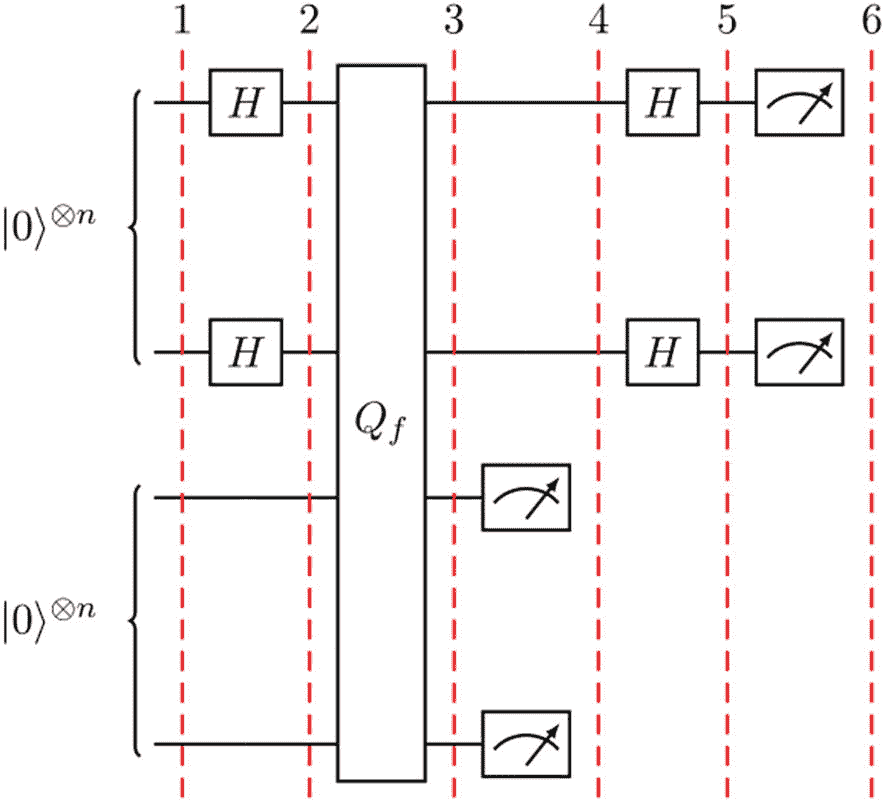 一个量子电路有 2 组连接组件，用于表示\|0⟩的 n 个量子比特。它连接了 4 个 H 模块和 4 个电流表模块与 Q f 模块。图 9-8 西蒙算法的量子电路 | 1) 初始化两个 n 量子比特寄存器。\| ѱ1⟩ = \| 0⟩^(⊗n) \| 0⟩^(⊗n) 2) 对第一个寄存器应用哈达玛门：\| ψ2⟩ = (1/√(2^n)) Σ\_{x∈{0,1}} \|x⟩ \|0⟩^(⊗n) 3) 应用预言机`Qf`：\| ψ3⟩ = (1/√(2^n)) Σ\_{x∈{0,1}} \|x⟩ \|f(x)⟩ 4) 测量第二个寄存器：\| ψ4⟩ = (1/√2) (\|x⟩ + \|y⟩), y = x ⊕ b 5) 对第一个寄存器应用哈达玛门：\| ψ5⟩ = (1/√(2^(n+1))) Σ\_{x∈{0,1}} [(-1)^(x.z) + (-1)^(y.z)] \|z⟩ 6) 测量第一个寄存器：(-1)^(x.z) = (-1)^(y.z) |
| --- |

最后，通过多次执行此电路并解方程`x.z = y.z`（其中`y = x ⊕ b`），我们得到一个方程组，从中可以找到秘密字符串`b`：

```
{ b.z1 = 0
  b.z2 = 0
  ...
  b.zn = 0 }
```

我们来看一下`b = 10`时的工作原理：

1.  两个寄存器初始化为零状态`| ѱ1⟩ = | 00⟩ | 00⟩`。

2.  对第一个寄存器应用哈达玛门。这将构建 2 个量子比特的所有排列。因此，`| ψ2⟩ = (1/2) (|00⟩ + |01⟩ + |10⟩ + |11⟩)`。

3.  这是整个问题的关键。必须为`b = 10`定义预言机`Q[f]`。为此，遵循以下两条规则：

    1.  从第一个寄存器的量子比特应用`CX`门到第二个寄存器的量子比特。这样做是为了将第一个寄存器的状态复制到第二个寄存器。

    2.  找到`s`中第一个 1 的索引`(i)`，然后应用从`(i)`到第二个寄存器中每个 1 出现位置的索引的 n-`CX`门（n 是`s`中 1 的个数）。因此，对于字符串`10`，预言机如下所示：

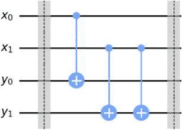 一个电路截图，显示有`x0`、`x1`、`y0`、`y1`四条水平线，以及各种门和屏障图标。

`| ψ3⟩ = (1/2) (|00⟩ |0⊕0⊕0, |0⊕0⊕0⟩⟩ + |01⟩ |0⊕0⊕1, |0⊕0⊕1⟩⟩ + |10⟩ |0⊕1⊕0, |0⊕1⊕0⟩⟩ + |11⟩ |0⊕1⊕1, |0⊕1⊕1⟩⟩)`

`| ψ3⟩ = (1/2) (|00⟩ |00⟩ + |01⟩ |11⟩ + |10⟩ |11⟩ + |11⟩ |00⟩)`

4.  如果我们测量第二个寄存器，得到`00`或`11`的概率各为 50%。例如，如果我们测量到`11`，那么`| ψ4⟩ = (1/√2) (|01⟩ + |10⟩)`。

5.  对第一个寄存器应用哈达玛门后：`| ψ5⟩ = (1/2) (|00⟩ - |01⟩ - |10⟩ + |11⟩ + |00⟩ + |01⟩ - |10⟩ - |11⟩) = (|00⟩ - |10⟩)`。

6.  最后，测量第一个寄存器，以相等的概率得到`| 00⟩ - | 10⟩`。这给出了方程组`{ b.00 = 0, b.10 = 0 }`。

7.  解方程组得到`b2(1) + b1(0) = 0`，`b2 = 1`，`b1 = 0`。因此`b = b2b1 = 10`。

列表 9-4 展示了针对 n 量子比特字符串`(b)`的通用算法。其输出如图 9-9 所示。

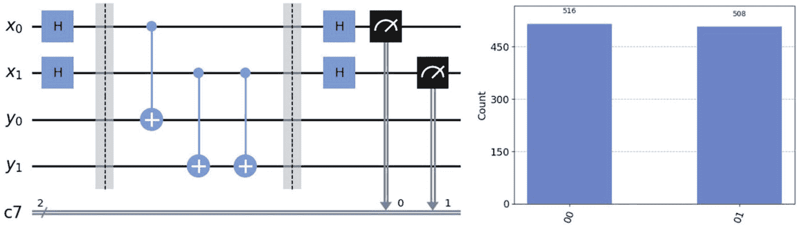

一组 2 张截图。左边的图片显示一个电路，有`x0`、`x1`、`y0`、`y1`、`c7`五条水平线，以及各种门和屏障图标。右边的图片显示的是计数对`00`和`01`的条形图。图中`00`的计数最高（516），`01`的计数最低（508）。

图 9-9 `b = 10`时的西蒙算法电路及其输出

**注意**：列表 9-4 使用了`qiskit`教科书包，这不是标准模块；需要使用以下命令单独安装：`pip install git+https://github.com/qiskit-community/qiskit-textbook.git#subdirectory=qiskit-textbook-src`。

# 西蒙算法

列表 9-4 针对 n 量子比特任意字符串`(b)`的西蒙算法

```python
from qiskit import *
from qiskit.visualization import *
from qiskit_textbook.tools import simon_oracle
def dotprod(a, b):
    temp_sum = 0
    for i in range(len(a)):
        temp_sum += int(a[i])*int(b[i])
    return temp_sum % 2
##### 主函数
b = '10'
n = len(b)
#### 第一个寄存器
x = QuantumRegister(n, 'x')
#### 第二个寄存器
y = QuantumRegister(n, 'y')
##### 测量
c = ClassicalRegister (n)
qc = QuantumCircuit(x, y, c)
#### 在第一个寄存器应用 H 门
qc.h(x)
qc.barrier()
qc = qc.compose(simon_oracle(b))
qc.barrier()
#### 在第一个寄存器应用 H 门
qc.h(x)
#### 测量第一个寄存器
qc.measure(x, c)
display(qc.draw())
backend = Aer.get_backend('qasm_simulator')
job = execute(qc, backend=backend)
counts = job.result().get_counts()
display(plot_histogram(counts))
for code in counts:
    print("(" + str(b) + " dot " + str(code) + ")%2 = " + str(dotprod(b, code)))
```

**练习 9.10**：在量子实验室中运行列表 9-4，并为三个比特串`110`、`101`构建西蒙预言机。

## 西蒙预言机构建规则

在构建西蒙预言机时，请牢记这两条规则。它们是整个算法的关键：

1.  将第一个寄存器的状态复制到第二个寄存器。即，对第一个寄存器的所有量子比特应用`CX`门，作用于第二个寄存器中对应的量子比特。
2.  找到字符串(`s`)中第一个 1 的索引(`i`)，然后从(`i`)出发应用**n-CX**门，作用于第二个寄存器中每个 1 出现的索引位置，其中`n`是字符串中 1 的个数。这等价于 `|x⟩ → |s.x⟩ if qubit(i) == 1`。

从这些规则可以看出，`CX`门的总数等于字符串中的量子比特数加上 1 的个数。让我们更仔细地看看。另外，请注意规则一适用于所有排列。

## 剖析西蒙预言机

在本节中，我们将练习为 3 位字符串构建西蒙预言机：表 9-2 显示了一些排列，以及预言机所需的`CX`门。请记住，Qiskit 使用小端位顺序；零索引从字符串的右侧（电路的底部）开始。同时，请记住所有排列都以序列 `CX(0,0) CX(1,1) CX(2,2)` 开始。

**表 9-2**

3 位字符串的西蒙预言机

| 000 |    | 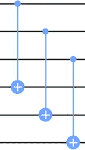 一个屏幕截图，在 6 条水平线上有 3 个正门图标。 |
|-----|----|-----------------------------------------------------------------------------------------------------------------------------|
| 001 | `CX(0,0)` | 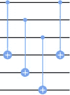 一个屏幕截图，在 6 条水平线上有 4 个正门图标。 |
| 111 | `CX(1,1) CX(1,2) CX(1,3)` | 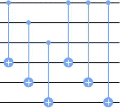 一个屏幕截图，在 6 条水平线上有 2 组 3 个正门图标。 |

**练习 9.11：** 完成西蒙预言机 3 位排列的门序列。

![$$ {\displaystyle \begin{array}{cc}000&amp; CX\left(0,0\right)\ CX\left(1,1\right)\ CX\left(2,2\right)\\ {}001&amp; CX\left(0,0\right)\ CX\left(1,1\right)\ CX\left(2,2\right) CX\left(0,0\right)\\ {}010&amp; CX\left(0,0\right)\ CX\left(1,1\right)\ CX\left(2,2\right) CX\left(1,1\right)\\ {}011&amp; ?\end{array}}\ {\displaystyle \begin{array}{cc}100&amp; ?\\ {}101&amp; ?\\ {}110&amp; ?\\ {}111&amp; CX\left(0,0\right) CX\left(1,1\right)\ CX\left(2,2\right) CX(0.0) CX\left(0,1\right) CX\left(0,2\right)\end{array}} $$](img/469026_2_En_9_Chapter_TeX_Equm.png)

**练习 9.12：** 编写一个 Python 函数，为任意位字符串构建西蒙预言机。在量子实验室中测试你的函数，以可视化预言机并验证其正确性。提示：使用以下已实现规则 1 的骨架（添加规则 2）。你可以将自己的函数与官方 Qiskit 的 `qiskit_textbook.tools` 包中的 `simon_oracle(b)` 进行比较。

```python
#### 用于西蒙预言机的 n 量子比特版本
def oracle (s):
    # 为符合 qiskit 的量子比特排序，反转 b
    s   = s[::-1]
    n   = len(s)
    qc  = QuantumCircuit(n * 2)

    # 全部为 0，直接退出
    if '1' not in s:
        return qc

    # s 中第一个非零比特的索引
    i = s.find('1')

    for q in range(n):
        # 规则 1：复制；|x>|0> -> |x>|x>
        qc.cx(q, q+n)

    # 添加规则 2：|x> -> |s.x> if q(i) == 1
    # ...

    return qc
```

## 扩展练习

**9.13** 从以下列表中选择对合门（选择 3 个）：`S`、`T`、`X`、`Y`、`H`（提示：对合门等于其自身的逆门 `M = M^(-1)`）。

**9.14** `T`门是一个相位门，其相位值是多少？

**9.15** 对于以下量子电路，哪个代码片段将使给定的量子比特处于等概率状态（处于所有状态的概率相等）。

```python
qc=QuantumCircuit(2)
a) qc.h(0) qc.cx(0,1) b) qc.h(0) qc.h(1) c) qc.x(0) qc.h0)
```

**9.16** 哪个代码片段会创建一个具有三个量子比特和三个经典比特的量子电路？

```python
a) QuantumCircuit(3,3) b) QuantumCircuit(3) c) QuantumCircuit([3,3])
```

**9.17** 下列哪个多量子比特门代表受控 Z 门？

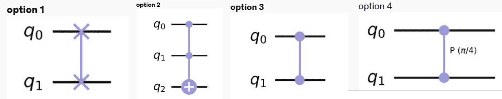

一个窗口的屏幕截图，有 4 个标记为选项 1 到 4 的选项。选项 1 有 2 条水平线 q 0 和 q 1，通过 2 个交叉标记连接。选项 2 有 3 条线 q 0、q 1 和 q 2，通过 2 个点和 1 个正门图标连接。选项 3 和 4 有 2 条线 q 0 和 q 1，通过 2 个点连接。

**9.18** 在以下量子电路中，应在缺失的代码中添加哪个语句才能获得所需状态 `1/sqrt(2) [1 0 0 0 0 0 0 1]`（选择 2 个）。

```python
qc = QuantumCircuit(3)
qc.h(0)
qc.cx([0,1],[1,2])
backend = BasicAer.get_backend('statevector_simulator')
job = execute(qc, backend, shots=1024)
result = job.result()
## 缺失的代码
a) result.get_statevector(qc)
b) sv = StateVector.from_label('000')
sv.evolve(qc).draw()
c) result.get_state(qc)
d) result.get_stateevolve(qc)
```

## 9.19 哪个选项将实现一个表示单量子比特 `Z` 门的算符？

```
a) op = Operator(([1,0,0,1]])
b) op = Operator(([j,0,0,-j]])
c) qc = QuantumCircuit(2)
qc.z(0)
op = Operator(qc)
```

## 9.20 以下代码片段中 `result` 变量的输出是什么？

```
q = QuantumRegister(1,'q')
qc = QuantumCircuit(q)
qc.y(0)
backend_unitary = BasicAer.get_backend('unitary_simulator')
result = execute(qc,backend_unitary).result().get_unitary(decimals=3)
a) ([0, -i],[i,0])
b) ([0, -i])
c) [0, -0.70i],[0.70i,0])
```

本节中的算法构成了更强大的 `Grover` 搜索和 `Shor` 因子分解算法的基础。让我们在下一章中看看这些卓越的创造。

脚注 1 2 3