# 10. 高级算法：利用 Grover 和 Shor 算法进行非结构化搜索与整数分解

本章介绍的两个算法为实用量子计算的潜能带来了激动人心的前景：

- **Grover 搜索**：这是由 Lov Grover 创建的一种非结构化量子搜索算法，能够使用黑盒函数或预言机以高概率找到输入。它可以在 `O(√N)` 步内找到一个项目，而经典平均需要 `N/2` 步。

- **Shor 整数分解**：著名的量子因子分解算法，专家们认为它可能使当前的非对称密码学陷入困境。Shor 可以在大约 `log(n³)` 步内分解整数，而最快的经典算法数域筛则需要 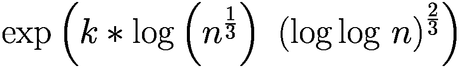 步。

让我们开始吧。

## 量子非结构化搜索

格罗弗算法是一种非结构化搜索的量子过程，用于在包含 `N` 个元素的数字大海（haystack）中寻找一个 `n` 位的条目。如图 10-1 所示，格罗弗量子算法在 `O(√N)` 步内提供了显著的加速。与经典解决方案相比，这看起来可能不算多，但当我们谈论数百万个条目时，`10⁶` 的平方根要比 `10⁶` 快得多。

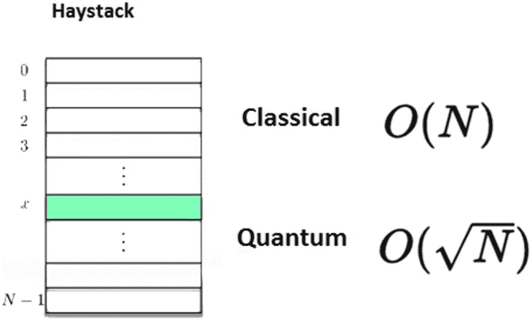
*一幅由垂直排列的矩形堆叠成的示意图，标有经典 `O(N)` 的 0 到 3，以及量子 `O(√N)` 的 `x` 到 `N-1`。*
*图 10-1*
*非结构化搜索的时间复杂度*

如果 `x` 是我们正在寻找的元素，那么格罗弗算法可以用以下伪代码描述：
1. 根据给定的函数 `f: {0, 1, ..., N-1} → {0,1}` 准备输入。注意，输入的规模是 `2^n`，其中 `n` 是比特数，而 `N` 是步骤数或大海（haystack）的规模。最终目标是找到 `x` 使得 `f(x) = 1`。
2. 对输入中的所有量子比特应用基态叠加。
3. 对输入量子比特执行相位反转。
4. 对输入执行关于均值的反转。
5. 重复步骤 3 和 4 至少 `√N` 次。此时将有很高的概率找到 `x`。

让我们更仔细地看看关键的相位反转和关于均值的反转步骤。

### 相位反转

这是算法中的第一步，必须在大海中所有状态的叠加态中执行。如果我们正在寻找的元素是 `x'`，其中 `f(x') = 1`，那么叠加态可以表示为 `∑α|x⟩`。最终，相位反转的作用是：

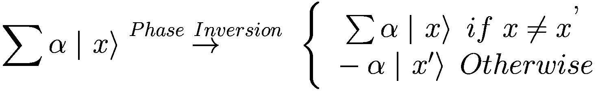

也就是说，如果给定的 `x` 不是我们要找的元素（`x ≠ x'`），那么它保持叠加态不变；否则，它会反转相位（即量子比特复系数 `α` 的符号——参见图 10-2 的图示）。

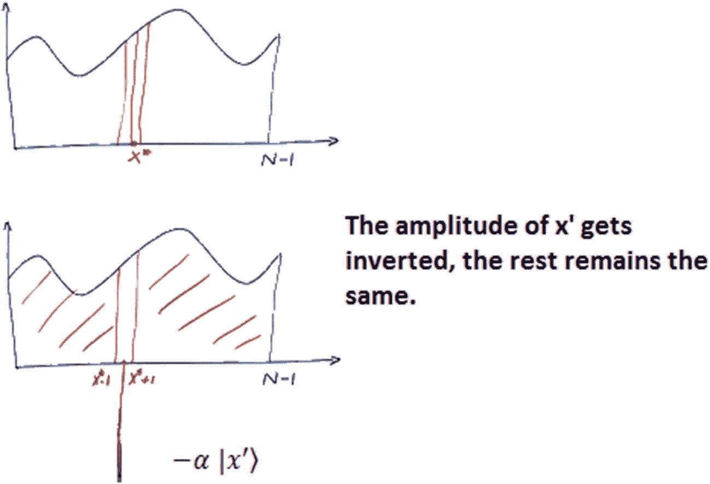
*两个相位表示图，展示了信号的幅度，由波在水平轴上的位置和波的高度表示。信号的幅度被反转，而信号的其余部分保持不变。*
*图 10-2*
*相位反转的图示*

这是格罗弗算法的第一步；我们将会看到相位反转如何帮助找到我们正在寻找的元素，但现在让我们先看第二步：关于均值的反转。

### 关于均值的反转

给定之前的叠加态 `∑α|x⟩`，我们将均值 `μ` 定义为幅度的平均值：

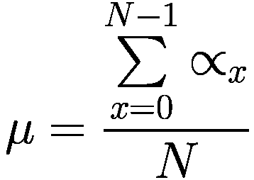

现在我们必须围绕这个均值翻转幅度。即：

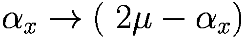
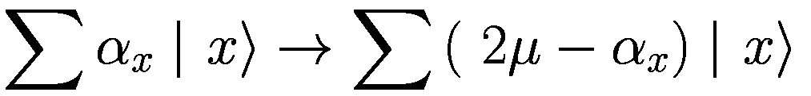

为了更好地理解这一点，图 10-3 展示了关于均值反转的图示。

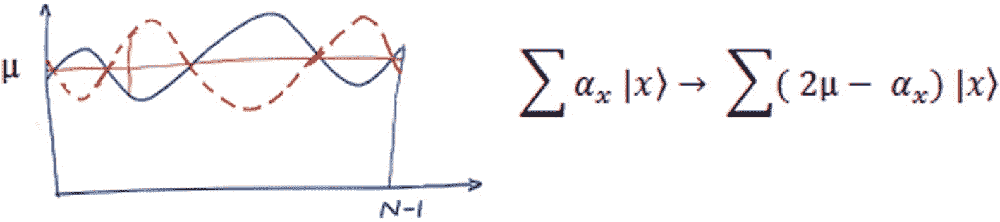
*一幅微米与 `n-1` 的关系图，绘制了两条振荡波和一条水平波。右侧的方程显示为 `∑αx|x⟩ → ∑(2μ - αx)|x⟩`。*
*图 10-3*
*关于均值反转的图形表示*

图 10-3 展示了由波函数 `Ψ` 定义的量子比特的叠加态。该函数的均值或 `μ` 在图表中以水平线显示。关于均值的反转的作用是让波函数 `Ψ` 关于均值 `μ` 进行镜像，从而产生一个镜像波（用虚线显示）。这相当于绕 `μ` 轴旋转波。让我们把所有这些步骤放在一起看看它们是如何运作的，以便理解这一切。

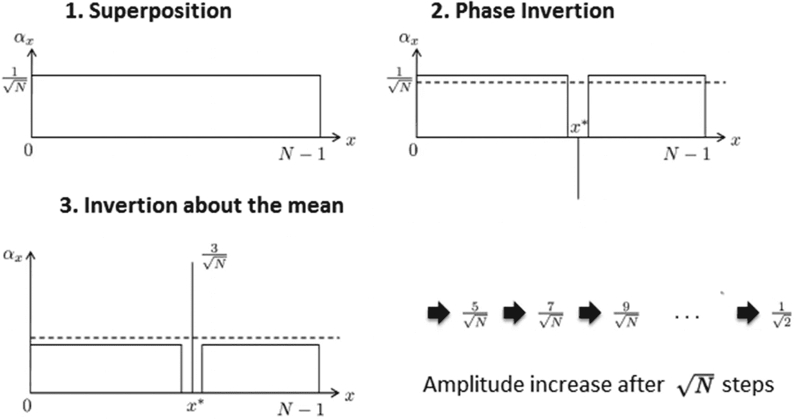
*3 个图示分别展示了：以 `αx` 对 `x` 的矩形块表示的叠加态；以被 `x*` 分隔的两个块表示的相位反转；以一条虚线水平线下的两个块表示的关于均值的反转；以及经过 `√N` 步后的幅度增加。*
*图 10-4*
*单次格罗弗迭代*

在图 10-4 中：
- 所有量子比特的叠加态将所有幅度置于 `1/√N`。
- 接下来，相位反转将 `x'` 的幅度置于 `-1/√N`。注意，这会产生略微降低均值 `μ` 的效果，如图 10-4 步骤 2 中的虚线所示。
- 在关于均值的反转之后，平均幅度略微下降，但 `x'` 的幅度大幅升高，比均值 `μ` 高出约 `2/√N`。
- 如果我们重复这个序列，`x'` 的幅度每次增加约 `2/√N`，直到在大约 `√N` 步后，幅度变为 `1/√2`。
- 此时，如果我们测量量子比特，根据量子力学定义，找到 `x'`（我们正在寻找的元素）的概率是幅度的平方，即 `1/2`。
- 因此，我们完成了。在大约 `√N` 步内，我们找到了标记元素 `x'`。

现在，让我们把所有这些整合到一个量子电路和相应的代码实现中。

#### 实际实现

我们将研究 IBM Quantum 中格罗弗算法的一个电路。该电路使用两个量子比特展示了该算法的一次迭代，如图 10-5 所示。

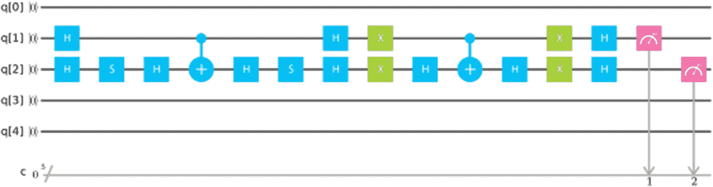
*格罗弗算法量子电路图。它包含 3 个主要部分：Oracle、扩散运算符和 Hadamard 门。*
*图 10-5*
*2 量子比特且 `A = 01` 的格罗弗算法量子电路*

一个创建图 10-5 中电路的 Python 脚本如代码清单 10-1 所示。

代码清单 10-1 使用两个量子比特对 2 比特输入执行了一次格罗弗算法交互。尽管上一节中的伪代码指出总迭代次数大约为 `sqrt(N)` 步，但关于平均值的反演要求将该值乘以 `π/4` 并提取其 *floor* 值（参见图 10-8 旁边的证明）。因此，我们得到 `IT = floor(sqrt(N) * π/4)`，其中 `N = 2^bits`。所以，对于两个比特，我们得到 `IT = floor(sqrt(4) * π/4) = floor(1.57) = 1`。

脚本首先创建一个包含 2 个量子比特和两个用于存储测量结果的经典寄存器的量子电路。接着，使用 Hadamard 门将所有量子比特置于叠加态。在迭代之前，使用相位门（`S`）和表 10-1 中的规则准备输入。

**表 10-1**
代码清单 10-1 的输入准备规则

| 输入 (`A`) | 门/量子比特 |
|-----------|--------------|
| `00`      | `S(01)`      |
| `10`      | `S(0)`       |
| `01`      | `S(1)`       |
| `11`      | 无         |

接下来，在对应于算法一次迭代的输入量子比特上执行相位反演，随后进行关于平均值的反演。最后，测量结果并在本地或远程模拟器中执行电路。打印结果计数。

```
import sys,time,math
import numpy as np
from qiskit import *
##### 导入基本绘图工具
from qiskit.tools.visualization import plot_histogram
##### 设置要搜索的输入比特
def input_phase (circuit, qubits):
    ##### 取消注释以设置 A = 00
    ##### 注释以设置 A = 11
    #circuit.s(qubits[0])
    #circuit.s(qubits[1])
    return
# circuit: 格罗弗 2-量子比特电路
# qubits: 包含 2 个量子比特的数组
def invert_over_the_mean (circuit, qubits):
    for i in range (2):
        circuit.h(qubits[i])
        circuit.x(qubits[i])
    circuit.h(qubits[1])
    circuit.cx(qubits[0], qubits[1])
    circuit.h(qubits[1])
    for i in range (2):
        circuit.x(qubits[i])
        circuit.h(qubits[i])
def invert_phase (circuit, qubits):
    ##### Oracle
    circuit.h(qubits[1])
    circuit.cx(qubits[0], qubits[1])
    circuit.h(qubits[1])
def main():
    ##### 创建量子比特/寄存器
    size = 2
    q = QuantumRegister(size, 'q')
    c = ClassicalRegister(size, 'c')
    ##### 量子电路
    grover = QuantumCircuit(q, c, name = 'grover')
    ##### loops = sqrt(2^n) * PI/4
    #loops = math.floor(math.sqrt(2**size) * (math.pi/4))
    ##### 1. 将所有量子比特置于叠加态
    for i in range (size):
        grover.h(q[i])
    ##### 设置输入
    input_phase(grover, q)
    ##### 2. 相位反演
    invert_phase(grover, q)
    input_phase(grover, q)
    ##### 3. 关于平均值反演
    invert_over_the_mean (grover, q)
    ##### 测量
    for i in range (size):
        grover.measure(q[i], c[i])
    circuits = [grover]
    ##### 在模拟器上执行量子电路
    backend = Aer.get_backend("qasm_simulator")
    result = execute(circuits, backend=backend).result()
    counts = result.get_counts()
    print("Counts:" + str(counts))
###########################################
##### 主函数
if __name__ ==  '__main__':
    start_time = time.time()
    main()
    print("--- %s seconds ---" % (time.time() - start_time))
```

**代码清单 10-1**
图 10-5 中电路的 Python 脚本

### 泛化电路

广义而言，图 10-5 中的电路可以泛化到任意数量的输入量子比特，如图 10-6 所示。

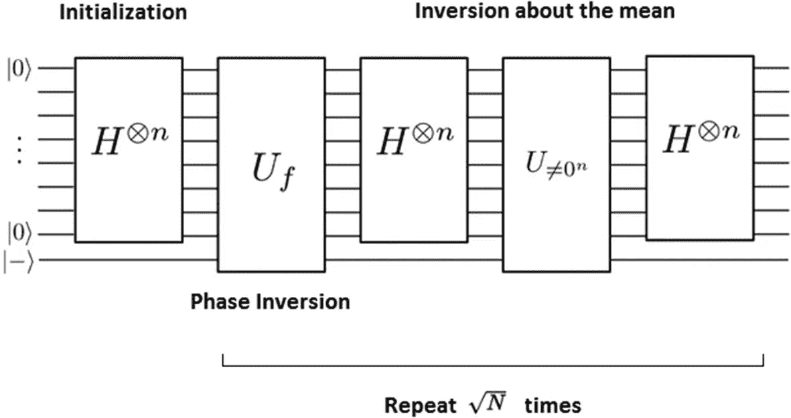

泛化格罗弗算法针对任意数量量子比特的电路图包含以下步骤。将量子比特初始化为等幅叠加态，应用 Oracle，应用扩散运算符，并重复步骤 2 和 3 直到找到解。

**图 10-6**
针对任意数量量子比特的格罗弗算法泛化

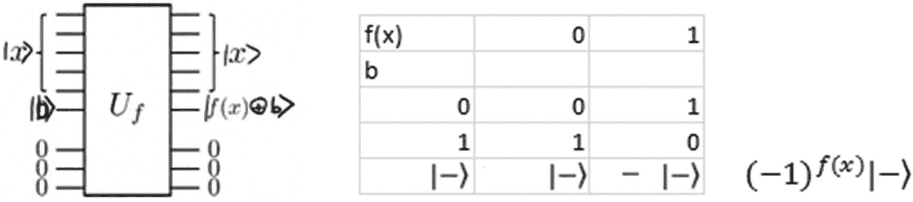

量子隐形传态算法的量子电路图，包含 3 个主要部分。贝尔态制备电路、CNOT 门和 Hadamard 门。

**图 10-7**
相位反演电路

-   图 10-6 中的第一个框通过将 Hadamard 门应用于大小为 `n` 的输入，将所有量子比特置于叠加态。这是初始化步骤。

-   接下来，相位反演电路（`U[f]`）接收叠加输入 `Ψ = Σα ∣ x⟩` 和一个相位输入（减态）。这产生了将相位精确放置在我们所需位置的效果。因此，输出变为 `Σα (−1)^(f(x)) ∣ x⟩`。但如何实现这一点呢？答案是通过对减态输入应用异或运算，我们获得了期望的效果 `∣ b⟩ → ∣ f(x) ⊕ b⟩`，如图 10-7 所示。`f(x)` 和 `b` 之间异或真值表的第三行（图 10-7 右侧）显示了相位反演的效果。

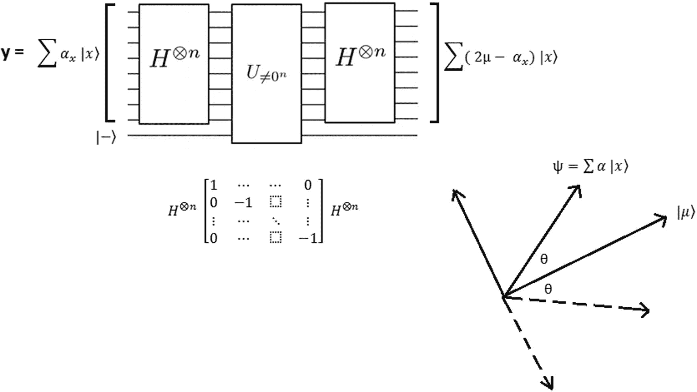

肖尔算法的量子电路图，包含以下步骤。将量子比特初始化为叠加态，应用模指数 Oracle，应用量子傅里叶变换，并测量量子比特。

**图 10-8**
关于平均值的反演电路

-   最后，如图 10-3 所示，关于平均值的反演等同于关于 `∣ μ⟩ = 1/sqrt(N) Σ_x ∣ x⟩` 进行反射。为了更好地可视化这一点，叠加态 `Ψ` 和平均值 `μ` 可以表示为二维空间中的向量，如图 10-8 所示。为了反射 `Ψ`，创建一个与 `μ` 正交的向量，然后将 `Ψ` 投影到以相同角度 `θ` 的新的象限上。

关于平均值反演将 `Σα[x] ∣ x⟩ → Σ(2μ − α[x]) ∣ x⟩` 的证明包含三个步骤，如图 10-8 中的电路所示。

1.  将 `∣ μ⟩` 变换为全零向量 `∣ 0, ..., 0⟩`。这通过将 Hadamard 门应用于输入来实现。

2.  关于全零向量 `∣ 0, ..., 0⟩` 进行反射。这可以通过乘以稀疏矩阵 `[[1, ..., 0], [0, -1, ...], [..., ..., ...], [0, ..., -1]]` 来实现。

3.  通过再次应用 Hadamard 门将 `∣ 0, ..., 0⟩` 变换回 `∣ μ⟩`。因此：

#### Grover 算法与无序搜索

以下公式展示了 Grover 算法中的关键矩阵变换：

![$$ {H}^{\bigotimes n}\ \left[\begin{array}{cccc}1& \cdots & \cdots & 0\\ {}0& -1& & \vdots \\ {}\vdots & \cdots & \ddots & \vdots \\ {}0& \cdots & & -1\end{array}\right]\ {H}^{\bigotimes n}={H}^{\bigotimes n}\ \left(\left[\begin{array}{ccc}2& \cdots & 0\\ {}\vdots & \ddots & \vdots \\ {}0& \cdots & 0\end{array}\right]-I\right){H}^{\bigotimes n}={H}^{\bigotimes n}\ \left[\begin{array}{ccc}2& \cdots & 0\\ {}\vdots & \ddots & \vdots \\ {}0& \cdots & 0\end{array}\right]{H}^{\bigotimes n}-{H}^{\bigotimes n}I\ {H}^{\bigotimes n} $$](images/469026_2_En_10_Chapter/469026_2_En_10_Chapter_TeX_Eque.png)

![$$ =\kern0.5em \left[\begin{array}{ccc}2/N& \cdots & 2/N\\ {}\vdots & \ddots & \vdots \\ {}2/N& \cdots & 2/N\end{array}\right]-I=\left[\begin{array}{ccc}\frac{2}{N}-1& \cdots & 2/N\\ {}\vdots & \ddots & \vdots \\ {}2/N& \cdots & \frac{2}{N}-1\end{array}\right] $$](images/469026_2_En_10_Chapter/469026_2_En_10_Chapter_TeX_Equ1.png)

(1)
```

注意，``。最后，将矩阵 (1) 应用于状态 `Ψ = α[x] | x⟩`，得到：

```
![$$ \left[\begin{array}{ccc}\frac{2}{N}-1&amp; \cdots &amp; 2/N\\ {}\vdots &amp; \ddots &amp; \vdots \\ {}2/N&amp; \cdots &amp; \frac{2}{N}-1\end{array}\right]\left[\begin{array}{c}{\alpha}_0\\ {}\vdots \\ {}{\alpha}_x\\ {}\vdots \\ {}{\alpha}_{N-1}\end{array}\right]\to \left[\begin{array}{c}\\ {}\vdots \\ {}2/N\sum {\alpha}_y-{\alpha}_x\\ {}\vdots \\ {}\end{array}\right]=2\upmu -{\alpha}_x\ where\ 2/N\sum {\alpha}_y=2\mu $$](images/469026_2_En_10_Chapter/469026_2_En_10_Chapter_TeX_Equf.png)
```

以上就是用于无序搜索的 Grover 算法。它快速、强大，并且很快将在数据中心投入工作，启动各种数据库搜索。鉴于其相比经典算法的显著性能提升，几年后，当量子计算机变得更加商业化时，大多数网络搜索很可能将由这个量子引擎执行。在结束之前，值得一提的是，截至撰写本文时，`IBM Quantum` 尚不存在能够找到真实物品的有用实现或实验。希望这种情况在未来会有所改变，但就目前而言，Grover 算法仍停留在理论层面。在下一节中，我们将通过分析著名的整数分解 Shor 算法来强势收尾。

## 使用 Shor 算法进行整数分解

密码学和密码分析之间的猫鼠游戏从未停歇：前者设计新的方法来加密我们的日常数据；后者则不断探测弱点，寻找突破口以瓦解加密体系。当前的非对称密码学依赖于分解极大质数（数百位数字级别）的公认难度。本节将剖析 Shor 算法的内部工作原理，这是一种利用量子计算机实现整数分解指数级加速的方法。随后，我们将使用名为 `ProjectQ` 的库进行实现。接下来，我们将对示例整数进行模拟并评估结果。最后，我们将探讨量子系统中整数分解的当前和未来发展方向。让我们开始吧。

### 用量子分解挑战非对称密码学

在具有里程碑意义的论文《Polynomial-Time Algorithms for Prime Factorization and Discrete Logarithms on a Quantum Computer》^((18))中，Peter Shor 提出了一种量子分解方法，该方法利用了数学家们长期熟知的一个原理：寻找元素 `a` 在乘法群 `modulo N` 中的周期（也称为阶）；即满足以下条件的最小正整数：

```
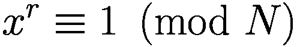
```

其中 `N` 是要分解的数，`r` 是 `x modulo N` 的周期。

> **提示**
> 大整数分解是一个困扰了数学家千年的问题。1976 年，G. L. Miller 提出，利用随机化，可以将分解问题简化为寻找元素 `A` 在模 `N` 下的周期，从而大大简化了这一难题。这也是 Shor 算法背后的基本思想。

Shor 将他的算法分为三个阶段，其中两个阶段由经典计算机在多项式时间内完成：

1.  **输入准备**：在经典计算机上完成，时间复杂度为多项式时间 `log (n)`。
2.  **寻找周期 `r`**：通过量子电路寻找元素 `a` 的周期 `r`，使得 `a^r ≡ 1 (mod N)`。据 Shor 所述，这在量子计算机上需要 `O((log n)² (log log n)(log log log n))` 步。
3.  **后处理**：在经典计算机上完成，时间复杂度为多项式时间 `log (n)`。

但为什么这个方法会如此令人兴奋？将其时间复杂度（大 O 表示法）与当前经典的冠军算法“数域筛法”进行比较（如表 10-2 所示，以及另一位热门算法——历史悠久的二次筛法）。

**表 10-2** 常见分解算法的时间复杂度

| 算法 | 时间复杂度 |
| :--- | :--- |
| Shor 算法 | `(log n)² (log log n) (log log log n)` |
| 数域筛法 | `` |
| 二次筛法 | `` |

令人难以置信的是，Shor 算法具有多项式时间复杂度，远优于经典计算机上已知最快的分解方法——数域筛法的指数级时间。事实上，专家估计，Shor 算法可以在几分钟内分解一个 200 多位数的整数。这样的壮举将动摇目前用于生成所有网络通信加密密钥的非对称密码学的基础。

> **提示**
> 对称密码学对量子计算具有高度抵抗力，因此也对 Shor 算法具有高度抵抗力。

但先别惊慌；在真正的量子计算机上进行实际应用仍然任重道远。不过，我们可以使用流畅的 Python 库 `ProjectQ` 在经典系统上模拟该算法。我们将在后续章节中运行 `ProjectQ` 的实现，但接下来，让我们看看周期查找如何高效地解决分解问题。

#### 周期寻找

周期寻找是肖尔算法的基本构建模块。通过使用模运算，问题被简化为寻找函数 `f(x) = a^x mod N`（见图 10-9）的周期（`r`）。

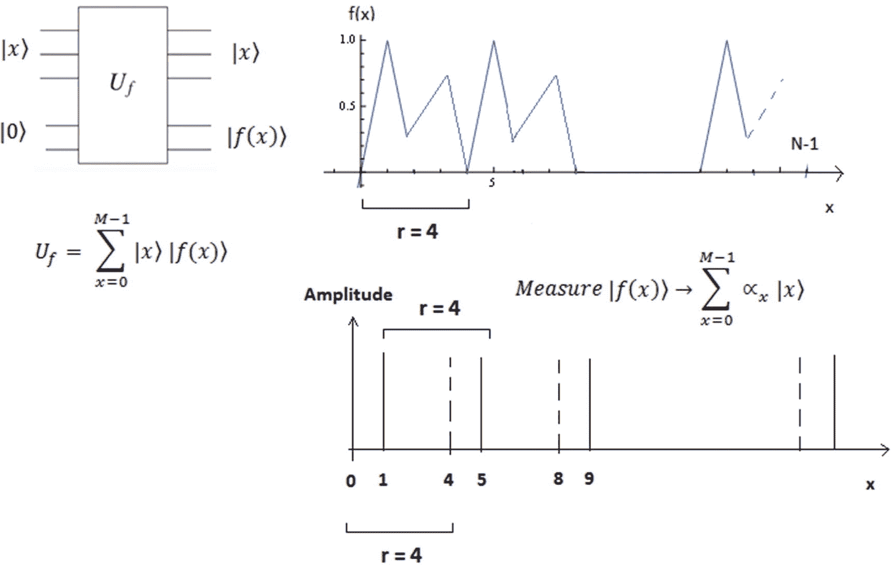

**图 10-9** 周期函数 `f(x)`

图 10-9 给出了一个周期 `r = 4` 的周期函数 `f(x)` 的示例。为了使算法有效，`f(x)` 必须满足三个条件：

1.  `f(x)` 在每个周期内是一一对应的，即 `f(x)` 的值不能重复。在图 10-9 中，这些值由每个周期每条线的顶点表示。
2.  对于任意给定的 `M` 或周期数，`r` 必须能整除 `M`。例如，给定 `M = 100` 且周期 `r = 4`，则 `M/r = 25`。
3.  `M` 除以 `r` 必须大于 `r`。即 `M > r²`。

肖尔算法将 `f(x)` 转换为一个量子电路 `U[f]`，其中的输入处于叠加态。如果我们测量 `U[f]` 中的第二个寄存器，我们可能会看到振幅 `` 的值，如图 10-9 的振幅图所示。这里，振幅恰好相隔 4 个单位，这正是我们要寻找的周期。在这个特定例子中，我们得到了周期为 `r = 4` 的周期叠加。但是，我们该如何处理这个周期叠加呢？肖尔依赖于另一个技巧：傅里叶采样或量子傅里叶变换。

##### 傅里叶采样

傅里叶采样是一种数据操作过程，具有以下属性：

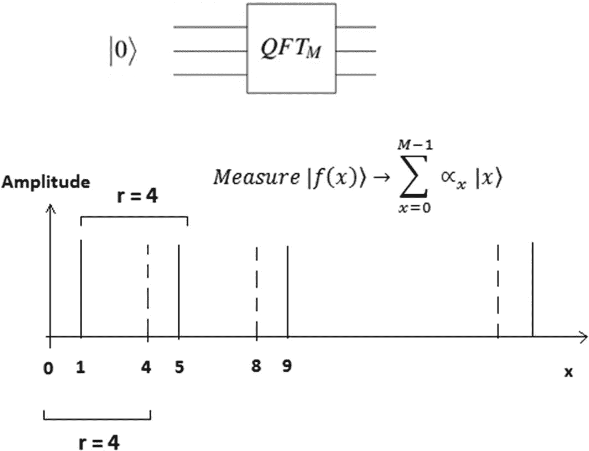

**图 10-10** 显示周期叠加的傅里叶采样

*   它允许在不改变输出分布的情况下进行输入平移。
*   这很好，因为现在我们有了一个周期叠加，其中非零振幅是周期的倍数（见图 10-10）。

但是傅里叶采样的输出是什么呢？它又有何帮助？答案是，其输出是 `M/r` 的一个随机倍数。在这个例子中，给定 `M = 100` 和 `r = 4`，我们得到 `100/4 = 25` 的一个随机倍数。这对我们的目标是有利的。让我们看看具体如何实现。

##### 将傅里叶采样结果输入欧几里得最大公约数算法

# 量子计算：傅里叶采样与Shor算法

如果我们多次运行傅里叶采样，我们将得到 `M/r` 的随机倍数。例如，我们可能会得到 `50`、`75`、`25` 等。现在，如果我们对我们得到的随机输出应用欧几里得最大公约数（`gcd`），那么瞧！通过将 `M` 除以 `gcd`，我们就得到了周期 `r`。因此：

`r = M/gcd(50, 75, ...) = 100 /25 = 4`

这就是通过量子电路寻找周期的概要。为了理解这种方法如何高效地找到一个因子，让我们通过分解数字 `N = 21` 的例子来运行一遍。我们的任务依赖于两个非常高效的操作：

*   模运算：`a = b (mod N)`。例如，`3 = 15 (mod 12)`。
*   最大公约数 `gcd(a, b)`。例如，`gcd(15, 21) = 3`。

因此，对于 `N = 21`，我们需要解方程 `x² ≡ 1 (mod 21)`。也就是说，找到非平凡平方根 `x`，使得：

*   `N` 能整除 `(x + 1)(x - 1)`。
*   `N` 不能整除 `(x ± 1)`。
*   最后，通过应用 `gcd(N, x+1)` 恢复出一个质因数。

为了找到 `N = 21` 的非平凡因数，随机选择一个 `x`。例如，给定 `N = 21`，选择 `x = 2`，因此：

```
20 ≡ 1 (mod 21)
21 ≡ 2 (mod 21)
22 ≡ 4 (mod 21)
23 ≡ 8 (mod 21)
24 ≡ 16 (mod 21)
25 ≡ 11 (mod 21)
26 ≡ 1 (mod 21)。得到周期 r = 6。
```

在这个例子中，`2⁶ = (2³)²`。因此，`2³ = 8` 是一个非平凡因数，使得 `21` 能整除 `(8 + 1)(8 - 1)`。最后，我们通过最大公约数 `gcd(N, x+1) = gcd(21, 9) = 3` 恢复出一个因数。概括地说，随机选择一个 `x`，然后遍历 `x⁰, x¹,…, x^r ≡ mod N`。如果我们运气好，`r` 是偶数，即 `(x^(r/2))² ≡ 1 (mod N)`。这样我们就得到了 1 模 N 的一个非平凡平方根。

> **提示**：
>
> 已经证明，我们运气好（即对于 `x² ≡ 1 (mod N)`，`r` 是偶数）的概率是 ½。反之，如果运气不好，那么我们必须重复整个过程。然而，鉴于成功概率很高，这在全局中影响甚微。

现在，让我们使用简洁的 Python 库 ProjectQ 来运行这个算法。

## 使用 ProjectQ 实现肖尔算法

ProjectQ 是一个用于量子计算的开源平台，它使用 Stéphane Beauregard^(¹⁹) 提出的电路实现了肖尔算法。该电路使用 `2n + 3` 个量子比特，其中 `n` 是要分解的数字 `N` 的比特数。Beauregard 的方法分为以下步骤：

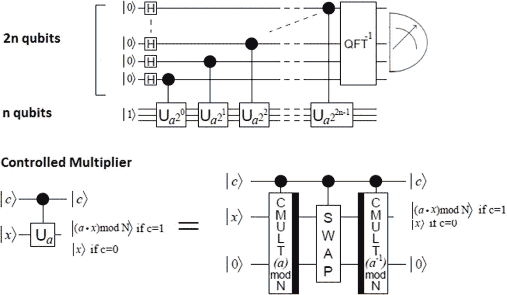

**图 10-11** 用于周期寻找的 Beauregard 量子电路

1.  如果 `N` 是偶数，则返回因子 2。
2.  经典地判断对于 `p ≥ 1` 和 `q ≥ 2`，`N = p^q` 是否成立，如果成立则返回因子 `p`（在经典计算机上，这可以在多项式时间内完成）。
3.  选择一个随机数 `a`，使得 `1 < a ≤ N – 1`。使用欧几里得最大公约数算法，判断 `gcd(a, N) > 1` 是否成立。如果成立，则返回因子 `gcd(a,N)`。
4.  使用求阶量子电路来找到 `a` 模 `N` 的阶 `r`。在量子计算机上，这一步在多项式时间内完成。
5.  如果 `r` 是奇数，或者 `r` 是偶数但 `a^(r/2) = -1 (mod N)`，则返回步骤 (3)。否则，计算 `gcd(a^(r/2) - 1 , N)` 和 `gcd(a^(r/2) + 1 , N)`。测试其中是否有一个是 `N` 的非平凡因子，如果是则返回该因子（在经典计算机上，这可以在多项式时间内完成）。

Beauregard 通过在傅里叶空间中使用一系列受控加法和乘法来实现周期寻找，以求解 `f(x) = a^x (mod N) → a^r ≡ 1 mod N`（见图 10-11）：

*   一个受控乘法器 `U[a]` 将 `∣x⟩` 映射为 `∣ ax (mod N)⟩`，其中：
    *   `a` 是一个经典互素数，用作 `a^x (mod N)` 的底数。
    *   `x` 是量子寄存器。
    *   `c` 是控制量子比特的寄存器，使得如果 `c = 1`，则 `U[a] = ax (mod N)`，否则为 `x`。
*   受控乘法器 `U[a]` 又被实现为一系列双受控模加法器门，使得：
    *   如果两个控制量子比特 `c1 = c2 = 1`，输出为 `f(x) = ∣φ(a + b mod N)⟩`。即，傅里叶空间中的 `a + b (mod N)`。注意，这个门将两个数相加：一个互素数（`a`）和一个量子数（`b`）。
    *   如果任一控制量子比特（`c1`，`c2`）处于 `|0>` 态，则 `f(x) = ∣φ(b)⟩`。
*   双受控模加法器门又建立在 Draper 的量子加法电路之上。^(²⁰) 该电路在傅里叶空间中实现将一个经典值（`a`）加到量子值（`b`）上的加法。

## 使用 ProjectQ 进行因数分解

让我们安装 ProjectQ 并对该算法进行测试。首先要做的是使用 Python 包管理器下载并安装 ProjectQ（注意，为简单起见，我使用的是 Windows。Linux 用户应该能够遵循相同的步骤）：

```
C:\> pip install projectq
```

接下来，从 Project Q 的示例文件夹^((21))或 `Workspace\Ch10\p10-shor.py` 的书籍源代码中获取 `shor.py` 脚本。现在，运行该脚本并输入一个数字进行因数分解（请参阅列表 10-2）。

```
C:\>python shor.py
Number to factor: 21
Factoring N = 21: ..........
Factors found : 7 * 3 = 21
Gate class counts:
AllocateQubitGate : 166
CCR : 1467
CR : 7180
CSwapGate : 50
CXGate : 200
DeallocateQubitGate : 166
HGate : 2600
MeasureGate : 11
R : 608
XGate : 206
Gate counts:
Allocate : 166
CCR(0.098174770425) : 18
CCR(0.196349540849) : 30
CCR(0.392699081699) : 70
CCR(0.490873852124) : 18
CCR(0.785398163397) : 80
CCR(0.981747704246) : 38
CCR(1.079922474671) : 20
CCR(1.178097245096) : 16
...
R(5.252350217719) : 1
R(5.301437602932) : 1
R(5.497787143782) : 1
X : 206
Max. width (number of qubits) : 13.
--- 5.834410190582275 seconds ---
```
**列表 10-2** 正在运行 ProjectQ 的 Shor 算法。请记住，成功的几率并非完美；因此，你可能需要运行几次才能获得正确的因子。

对于 `N = 21`，脚本会输出一组非常有用的统计数据，例如：

*   使用的量子比特数。给定 `N = 21`，我们需要 5 个比特，因此 `总量子比特数 = 2 * 5 + 3 = 13`。
*   按类型分类使用的门总数：在这种情况下，双控 `CCR = 1467`，`CR = 7180`，`CSwap = 50`，`CX = 200`，`R = 608`，`X = 206` 以及其他门，总共使用了 12646 个量子门。

ProjectQ 使用 Beauregard 算法实现量子周期查找，如列表 10-3 所示：

*   `run_shor` 函数接受三个参数：
    *   ProjectQ 提供的量子引擎或模拟器，以及
    *   `N`：要分解的数字
    *   `a`：用作 `a^x mod N` 底数的相对质数
*   然后，当量子输入寄存器 `x` 处于叠加态时，该函数从 `a = 0` 循环到 `a = ln(N)`；然后，它执行 `f(a) = a^x mod N` 的量子电路，如图 10-11 所示。
*   接下来，它对 `x` 寄存器执行基于先前结果的傅里叶采样，并进行测量。

最后，它将测量值求和为 `[0,1]` 范围内的一个数字。然后，它使用连分数展开来返回分母或潜在周期（`r`）。

```python
def run_shor(eng, N, a):
    n = int(math.ceil(math.log(N, 2)))
    x = eng.allocate_qureg(n)
    X | x[0]
    measurements = [0] * (2 * n)  # will hold the 2n measurement results
    ctrl_qubit = eng.allocate_qubit()
    for k in range(2 * n):
        current_a = pow(a, 1
        # Rotations conditioned on previous outcomes
        for i in range(k):
            if measurements[i]:
                R(-math.pi/(1 << (k - i))) | ctrl_qubit
        H | ctrl_qubit
        # and measure
        All(Measure) | ctrl_qubit
        eng.flush()
        measurements[k] = int(ctrl_qubit)
        if measurements[k]:
            X | ctrl_qubit
    All(Measure) | x
    # turn the measured values into a number in [0,1)
    y = sum([(measurements[2 * n - 1 - i]*1. / (1 << (i + 1)))
             for i in range(2 * n)])
    # continued fraction expansion to get the period
    r = Fraction(y).limit_denominator(N-1).denominator
    # return the (potential) period
    return r
```

列表 10-3 ProjectQ 周期查找量子子例程

下一节整理了不同 `N` 值的因数分解结果集。

### 模拟结果

ProjectQ 的周期查找子例程是在经典计算机上对量子电路的模拟，因此用它来分解大数并不实用。事实上，在家用电脑上，它无法在合理的时间内分解超过 4 位数的数字。表 10-3 显示了我从笔记本上收集到的、`N` 值高达 2491 的一系列结果。

**表 10-3** 不同 `N` 值的因数分解结果

| 数字 (`N`) | 量子比特数 | 时间 (秒) | 内存 (MB) | 量子门数量 |
| :--- | :--- | :--- | :--- | :--- |
| 15 | 11 | 2.44 | 50 | `CCR =792` `CR =3186` `CSwap = 32` `CX = 128` `H = 1408` `R =320` `X = 130` `Measure = 9` |
| 105 | 17 | 27.74 | 200 | `CCR =3735` `CR =25062` `CSwap = 98` `CX = 392` `H = 6666` `R =1568` `X = 393` `Measure = 15` |
| 1150 | 25 | 17542.12 (4.8 小时) | 500 | `CCR =15366` `CR =139382` `CSwap = 242` `CX = 968` `H = 24222` `R =5829` `X = 981` `Measure = 23` |
| 2491 | 27 | 246164.74 (68.3 小时) | 2048 | `CCR = 20601` `CR = 194670` `CSwap = 288` `CX = 1152` `H = 31126` `R =7509` `X = 1166` `Measure = 25` |

分解 4 位数 2491 花费了超过 68 小时，运行环境为 64 位 Windows 7 PC，配备英特尔® 酷睿 i-5 CPU @ 2.6 GHz 和 16 GB 内存。我尝试通过分解 `N = 8122` 来更进一步，但在一周后放弃了。总而言之，这些结果表明该算法对于较小的 `N` 值可以成功模拟；然而，它需要在真实的量子计算机上实现才能测试其真正的能力。

在本章中，您已经看到了两种算法，它们激发了人们对实际量子计算可能性的兴奋：Grover 算法，一种非结构化量子搜索方法，能够以平均 `N` 的平方根步数找到输入。这比平均 `N/2` 步的最佳经典解决方案快得多。可以预期未来的所有网络搜索都将由 Grover 算法执行。

Shor 算法用于在量子计算机上进行因数分解，专家们认为这可能会使当前的非对称密码学陷入困境。Shor 算法可以说是目前最著名的量子算法，它通过提供比最佳经典解决方案指数级的加速，成为了量子计算能力的一个绝佳范例。

脚注 1 2 3 4