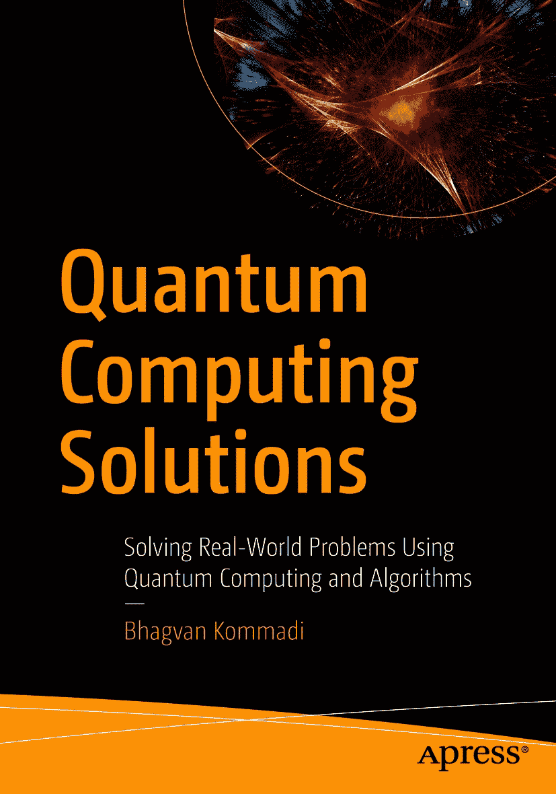

ISBN 978-1-4842-6515-4 电子版 ISBN 978-1-4842-6516-1 [`doi.org/10.1007/978-1-4842-6516-1`](https://doi.org/10.1007/978-1-4842-6516-1)  
© 2020 Bhagvan Kommadi 版权所有

本书受版权保护。出版商保留所有权利，无论涉及整体还是部分资料，具体包括翻译权、重印权、插图重用权、朗诵权、广播权、微缩胶片或其他物理方式的复制权、传输或信息存储与检索权、电子改编权、计算机软件改编权，以及使用目前已知或未来开发的任何相似或不同方法进行使用的权利。

在本出版物中使用通用描述性名称、注册商标名称、商标、服务标志等，即使未作明确声明，也不意味着此类名称不受相关保护性法律法规的约束，因此可供公众自由使用。

出版商、作者及编辑假定，本书中的建议和信息在出版之日是真实准确的。出版商、作者及编辑均不对本书所含内容或可能存在的任何错误或疏漏提供明示或暗示的保证。对于已出版地图中的管辖权主张及机构隶属关系，出版商保持中立立场。

本书全球图书贸易分销由 Springer Science+Business Media New York 负责，地址：1 NY Plaza, New York NY 10004。电话：1-800-SPRINGER，传真：(201) 348-4505，电子邮箱：orders-ny@springer-sbm.com，或访问网站 www.springeronline.com。Apress Media, LLC 是一家加利福尼亚有限责任公司，其唯一股东（所有人）为 Springer Science + Business Media Finance Inc (SSBM Finance Inc)。SSBM Finance Inc 是一家特拉华州公司。

*撰写一本关于量子计算的书，其难度超乎我的想象，但其收获之丰也远超我的预期。没有父母的支持，这一切都不可能实现。*

