# 1. 量子解决方案概述

## 引言

> *量子计算……是一种利用自然的全新方式。它将是第一项通过与平行宇宙协作来执行有用任务的技术。*
> 
> —戴维·多伊奇

本章概述了量子解决方案。您将看到量子计算如何应用于实际生活。问题与解决方案均会呈现，并附带解决方案的优势。这些优势包括自动化、成本降低与利润提升、效率提升以及缺陷减少。

本章涵盖的解决方案涉及密码学、优化和网络安全等领域。

让我们首先回顾量子计算的历史及迄今取得的关键成就。

理查德·费曼于 1965 年提出了量子电动力学（见图 1-1）。量子电动力学研究电子通过光子的电磁力进行的相互作用。他发明了名为*反粒子*的粒子。反粒子是与镜像粒子电荷相反的粒子。

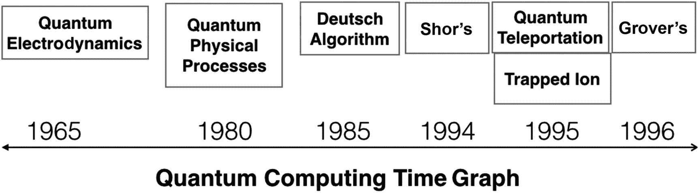

图 1-1 量子计算时间图谱

1980 年，他提出了与量子物理过程相关的新概念。他提出量子态可用二进制数表示。

戴维·多伊奇于 1985 年提出了名为*通用量子计算机*的概念。通用量子计算机基于双态系统，由一组量子门构成。*量子门*是一组基本操作。

彼得·肖尔于 1994 年发明了基于量子纠缠的质因数分解方法。该方法用于找出大数的质因数。与先前方法相比，该算法的效率大大提高。这项研究激发了其他大学的研究兴趣。

离子阱概念最初由美国国家标准与技术研究院（NIST）和加州理工学院于 1995 年提出。该概念涉及将离子捕获并降温至量子状态。1996 年，贝尔实验室科学家洛弗·格罗弗提出了格罗弗算法，该算法涉及使用量子算法进行搜索。一个由加州大学、麻省理工学院（MIT）、哈佛大学和 IBM 成员组成的研究团队发明了核磁共振技术，用以修改液态下的量子信息。

大卫·迪文森佐提出了真正量子计算机技术的基本特征。在大卫·迪文森佐之前，塞思·劳埃德在洛斯阿拉莫斯国家实验室工作时，发明了分子量子计算机。他的方案基于链状分子结构。该结构具有重复的小块图案（见图 1-2）。

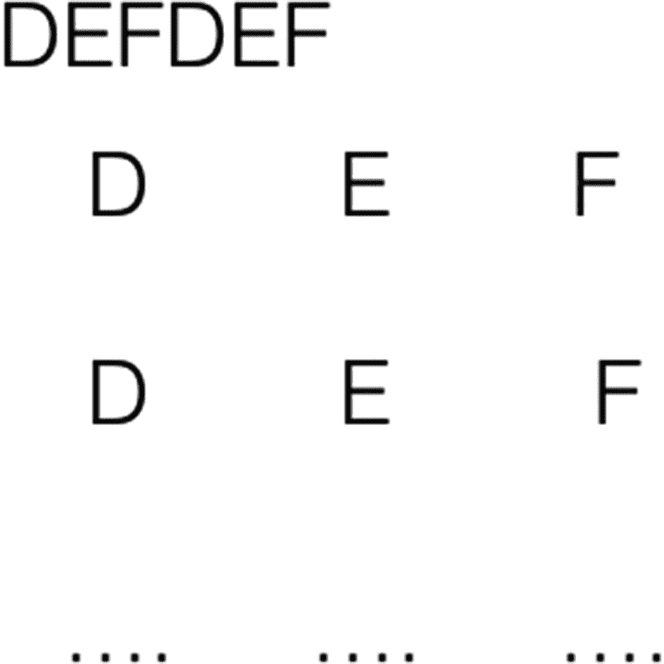

图 1-2 链状分子结构

该方案是第一台量子计算机概念的基础。塞思·劳埃德的方案未能实现，但在 2000 年，大卫·迪文森佐为量子计算机技术制定了一份标准清单。这些标准涉及量子计算与通信模型。

- 量子计算机由特性明确的量子比特组成，并且是一个可扩展的物理系统。
- 它需要具备创建一组量子比特的能力。
- 量子计算机能够设置量子比特的初始状态。这类似于台式计算机上的重置按钮。
- 量子计算机具有较长的退相干时间。
- 量子计算机具有与内存数据保留相关的纠错能力。
- 量子计算机基于一组通用的量子门。量子算法需要能在其上执行。这些算法可能涉及在布洛赫球上旋转量子比特以及纠缠量子比特。
- 它需要具备测量量子比特状态的功能。
- 量子计算机需要具备交换静态与动态量子比特的能力。
- 信息需要能够远距离传输。量子比特需要在源端和目的端之间传输。
- 信息在传输后需要保留在量子比特中。

继迪文森佐之后，范·米特发表了其构建量子计算机的论文。该技术从范·米特的论文演进至物理量子计算机。D-Wave 推出了自己的量子计算机。最新进展是 IBM 正在构建一台 53 量子比特的量子计算机。谷歌已拥有一台 72 量子比特的量子计算机。IBM 的量子计算机将可通过其 IBM Bluemix 云环境访问。

## 现实问题与解决方案

量子解决方案涉及构建量子算法，以改进量子计算、人工智能、数据科学和机器学习领域的计算任务。与量子计算机的创新相比，量子解决方案的发展正在加速。在本章中，我们将探讨各种解决方案，例如优化问题、量子密码学和网络安全。本章将解释涉及 AI 算法的量子解决方案及其在不同领域的应用。本书的其他章节将提供代码示例，这些示例将基于现实问题，例如银行业的风险评估和欺诈检测。在制药领域，我们将探讨药物发现和蛋白质折叠解决方案。在制造业领域，将介绍供应链优化和采购解决方案。在公用事业行业，将详细解释能源分配和优化问题及其解决方案。在媒体和科技领域，将涵盖广告排期和收入优化解决方案。

量子机器学习正在应用的领域包括纳米粒子、材料发现、化学设计、药物设计、模式识别和分类。适用的用例包括创建可应用于太空技术、可穿戴技术、可再生能源、纳米技术、新药物和化学组合、遗传科学、生物识别、物联网设备和宇宙发现的新材料。

> **注意**  
> 罗斯定律指出，量子计算机的计算能力每 12 个月翻一番，而摩尔定律的翻倍周期是 18 个月。

> *“量子计算机有潜力解决那些让经典计算机计算时间超过宇宙年龄的问题。”*  
> ——大卫·多伊奇，牛津大学教授

巴克莱银行、高盛集团等金融机构正在研究量子计算在投资组合优化、资产定价、资本项目预算和数据安全等领域的潜在应用。在航空航天领域，空客公司正在探索其在通信和密码学方面的应用。

洛克希德·马丁公司正在研究如何验证和确认复杂系统。美国海军计划开发用于优化问题的算法，例如与水下自主机器人相关的数据存储和高能效数据检索。NASA 正在探索其在通信、分布式导航和系统诊断方面的应用。阿里巴巴、谷歌和 IBM 等科技公司正在致力于抗黑客密码学、软件调试和机器学习等应用。生命科学公司正在寻求量子计算在个性化医疗和药物发现中的应用。

以下列表展示了来自不同领域的用例。这些用例证明，量子计算可以通过利用量子技术及其高性能处理特性来帮助人类生活。

- **经济与金融**（见图 1-3）
  - 分析并模拟股票投资组合以辅助投资决策
  - 更有效地进行实时欺诈检测和风险优化

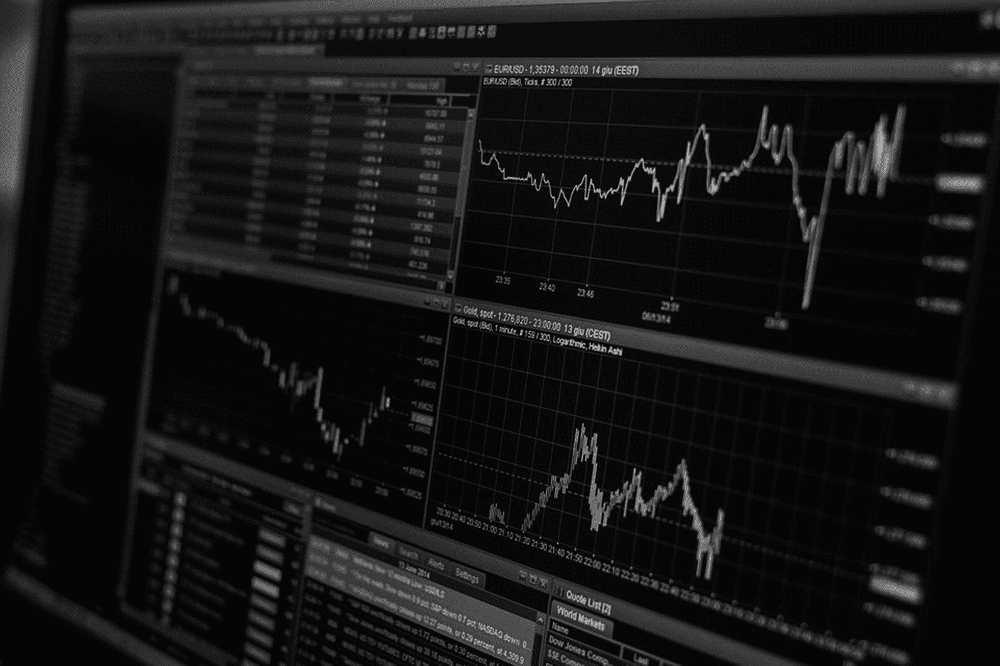
*图 1-3 – 股票市场*

- **医学**（见图 1-4）
  - 医学科学的研究与开发（例如，分析通常规模庞大的 DNA 序列）
  - 依赖于大量图像处理和分析的生物工程与远程医疗
  - 更快、更准确地诊断癌症等危重疾病
  - 大规模药物发现与生产

*图 1-4 – 医学科学*

- **自然科学**（见图 1-5）
  - 预测与时间序列分析
  - 植物基因组分析
  - 农业与种植应用

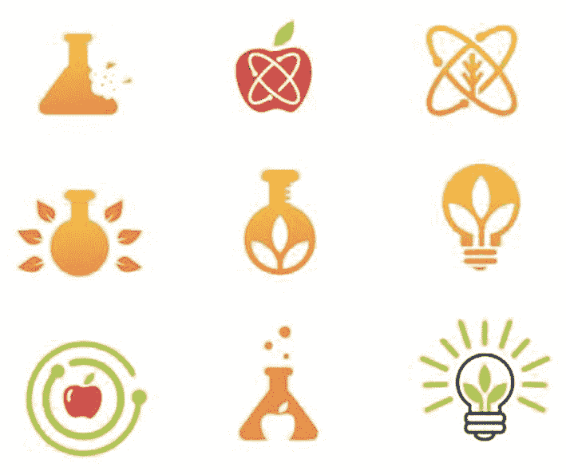
*图 1-5 – 自然科学*

- **信息技术**（见图 1-6）
  - 大数据仓库的数据搜索与分析
  - 对当前计算机而言过于复杂和耗时的软件测试与模拟

*图 1-6 – 信息技术*

- **管理优化**（见图 1-7）
  - 供应链与采购（关于空间与成本效率、分销渠道、运输优化等方面的情景分析与决策）
  - 资产与资源管理（用于节约成本和生命周期管理的概率建模）
  - 普遍的分析能力，从而促成更具洞察力的决策过程

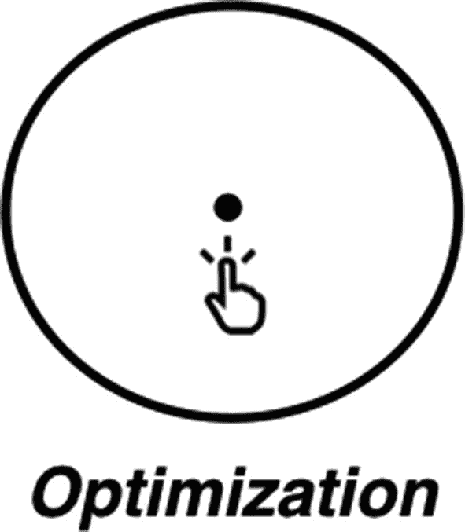
*图 1-7 – 优化*

## 解决方案的优势

量子解决方案的基础设施通常提供高度的自动化，并能显著提升性能和弹性。由量子计算框架驱动的平台通过持续学习和深度学习不断演进。在演进过程中，系统将成为一个自主且自给自足的平台。该平台将能够做出关键决策。

这种新的计算范式将改变软件的编写方式。该框架已从基础编程软件发展为模式和模型。这一范式将改变应用程序的部署和管理方式。这些解决方案基于以深度学习为基础的框架、量子计算平台以及一套新工具。这些量子解决方案框架将使组织能够创建、测试和部署新应用程序，而无需任何人工介入。开发周期将有助于利用深度学习和量子计算算法重建软件。

量子解决方案的基础设施需要具备高度可扩展性。量子解决方案平台需要高性能的计算能力，以便能够处理数据负载并保证服务保障和性能。当前的应用程序在毫秒级和每秒数百万次循环的级别上缺乏性能和相应的服务水平。高质量的量子解决方案将使用量子算法和量子 AI 技术构建。新的量子解决方案基础设施将利用 GPU 级别的计算能力与量子计算相结合。这种基础设施将利用开源软件和云来满足弹性的容量需求。

> **注意**  
> 量子云由量子模拟器和处理应用程序组成。IBM、谷歌、Rigetti 和微软提供用于信息处理的量子云服务。

量子解决方案基础设施将支持物联网。数据连接和实时洞察力是实时量子解决方案的重要因素。该解决方案基础设施将具备保护数据传输、数据摄取和数据处理的功能。数据将从各种数据源获取，以创建实时洞察。物联网解决方案的部署将包括所有连接的设备。政策和治理框架将成为量子解决方案的一部分。

量子解决方案基础设施需要是安全的。企业将拥有涉及基础设施网络安全的量子解决方案。需要对服务器进行监控，并且需要摄取、集成和存储安全数据以供分析。需要使用无监督学习来过滤安全和监控事件。威胁情报模型已经构建完成，并在服务器上部署了人员、地点和应用程序。通过事件仪表板可以预防威胁。

## 自动化手动与半手动流程

量子解决方案涉及业务流程的自动化。自动化通过改变企业运营方式来助力其发展。量子解决方案运用了人工智能、机器学习、机器人流程自动化和业务流程自动化等方法。这些方法能立即为企业带来效益。参见图 1-8。

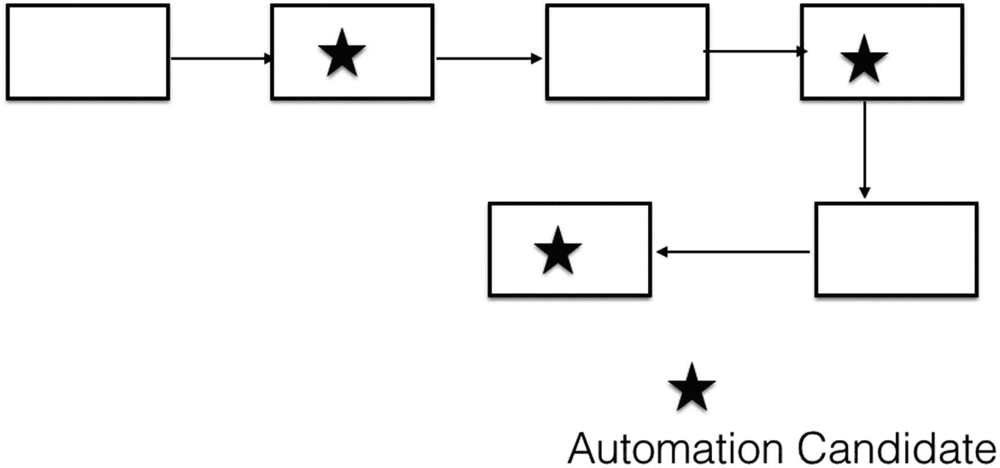
*图 1-8：流程自动化*

处理大数据是量子解决方案凭借其高性能数据处理能力所能实现的最大自动化成果。在为业务流程添加自动化时，会出现人为错误和问题。预测性和规范性分析是可以为企业业务决策增加价值的解决方案。

数据来自企业组织中的不同服务器、应用程序、设备和部门。数据需要经过存储、清洗和分析，才能用于制定可执行的决策。量子解决方案有助于处理大数据以及创建仪表盘和报告。

## 降低成本并提高利润

部署和管理所需的工作量和成本需要与解决方案的质量相平衡。拥有更少的资源、最小化运营成本并交付高质量的解决方案，是企业 IT 的关键目标。量子解决方案通过相比经典算法实现指数级加速，有助于削减基础设施成本。参见图 1-9。

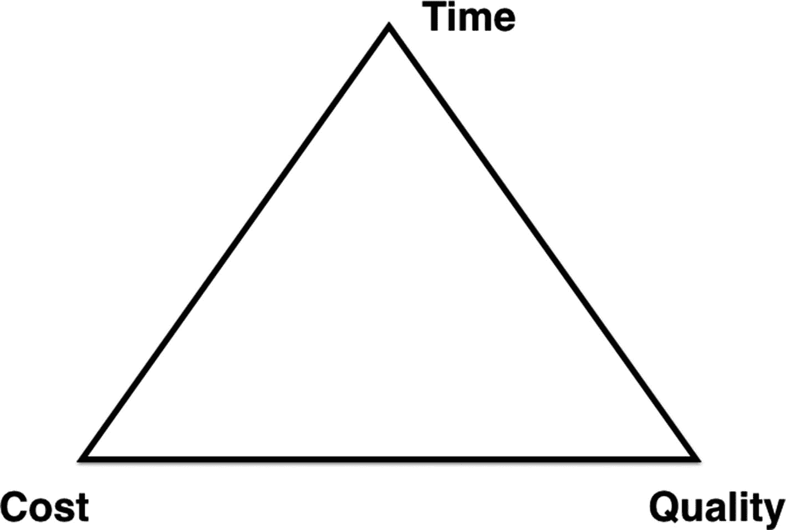
*图 1-9：展示 IT 挑战的三角图*

许多企业面临着与应用程序维护所需资源相关的挑战（占 80%）。已部署解决方案的运营成本是解决方案开发或软件包成本的两倍。开发人员的资源成本与软件服务器成本之比为 18:1。银行每年花费约十亿美元来维护其每周 7 天、每天 24 小时运行的应用和解决方案。这构成了银行 IT 的总体拥有成本及维护挑战。

其他挑战涉及遗留应用和产品、过时的技术平台，以及 IT 部门缺乏技能熟练的资源。上市时间在业务的各个方面都是一个重要因素。技术平台不具备满足预期上市速度的能力。变更或需求的量级和复杂性与企业可用的资源不匹配。

拥有有效的解决方案对于应对已部署解决方案维护成本的指数级增长至关重要。量子解决方案通过提供算法的指数级加速来削减所需资源，从而解决这一问题。

量子解决方案基础设施将具备高性能、安全、可用和弹性的特点，并且能够满足上市时间需求。所需人员只需具备普通技能，但能够轻松部署这些解决方案并进行维护升级。总体而言，企业将能够快速满足客户需求，并更快地开发产品。参见图 1-10。

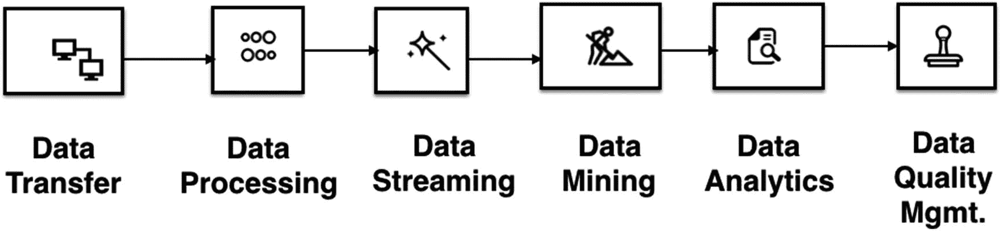
*图 1-10：数据管理流程*

量子解决方案基础设施将拥有数据模型、模式和算法来快速处理数据。首先，数据可以来自各种来源，处理能力有助于创建报告。利用报告和仪表盘，决策速度将更快。企业的总体拥有成本将会下降。

其次，这种复杂性是阻碍以应对市场所需的速度执行产品开发的一个重大限制因素。在缺乏周密规划的情况下，技术平台将无法预见交互的复杂性。管理量级和复杂性依赖于高技能的劳动队伍，而对此类人才的需求早已远超供给。

因此，如果没有有效的解决方案，应用程序的维护成本将呈指数级增长。此外，日益增加的复杂性意味着安全漏洞的风险更高，使组织更容易受到威胁。

## 提高效率并减少缺陷

解决方案基础设施的可管理性是量子解决方案的关键。由于处理和管理应用程序的复杂性，解决方案基础设施的成本和安全性将受到影响。利用基于深度学习的威胁情报模型，可以实现对已部署应用程序的可视性和监控。新的部署、升级和发布可以通过变更和影响分析来处理。这种分析有助于识别 IT 问题，并确保已部署的应用程序无问题、无错误地运行。在生产阶段修复缺陷的成本比设计阶段高出 100 倍。参见图 1-11。

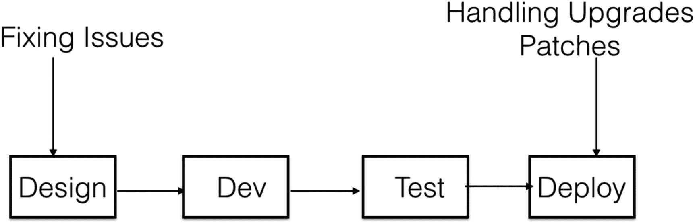
*图 1-11：解决方案开发流程*

## 解决方案

在本节中，我们将探讨密码学、优化和网络安全领域的各种量子解决方案。

### 密码学

银行将热衷于保护其支付网关和解决方案，使其免受未来量子计算能力带来的安全威胁。需要使支付解决方案具备“抗量子”能力。此外，基于区块链的银行和金融解决方案也需要通过使用后量子密码算法来改进。

抗量子账本是面向银行和金融服务的下一代解决方案。量子密码学基于量子密钥分发。量子密钥分发涉及将一个共享的短密钥扩展为无限的共享密钥流。这要求提高后量子密码算法的效率。

金融公司需要开始投资于后量子密码学。如果基于区块链的解决方案未升级到后量子密码算法，它们将不具备抗量子能力。目前正在运行的密码系统包括 `DES`、`Triple DES`、`AES`、`RSA`、`Merkle hash-tree signatures`、`Merkle–Hellman knapsack encryption`、`Buchmann–Williams class-group encryption`、`ECDSA`、`HFEv-` 等（见图 1-12）。这些系统将在量子算法和计算能力面前失效。`Shor’s algorithm` 是一种量子算法，威胁着 `RSA`、`DSA` 和 `ECDSA` 密码算法。

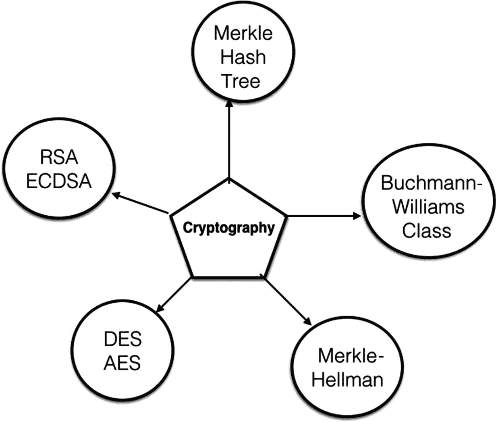

图 1-12 — 密码学模型

基于量子计算机的算法可以通过密钥大小的平方根因子来破解对称密钥密码算法。要找到 256 位哈希函数的原像，量子算法只需花费 `2¹²⁸` 时间。`Shor’s algorithm` 有助于大数的量子因子分解。这要求安全系统具备抗量子能力。椭圆曲线密码学已被证明可将破解过程提升 21%。该方法基于多项式乘法并添加随机噪声。

量子算法优于经典算法，因为它们可以在更快的硬件上执行。量子算法也基于量子力学。理论上，量子力学方法已被证明比经典方法更快。量子力学涉及复杂的亚原子粒子相互作用。亚原子粒子可以是电子。电子可以同时存在于多个离散状态中，这被称为*叠加态*。

海森堡不确定性原理指出，量子系统包含关于物体速度和位置的信息。任何对速度的测量都会影响位置，因为观察行为会改变状态。亚原子粒子可以处于纠缠态。当一个粒子发生变化时，即使它们彼此分离，也会影响另一个粒子。量子力学使用复数来捕捉电子状态的复杂性。

`Grover’s algorithm` 可以解决电话簿搜索问题，其步数级别与电话簿号码数的平方根成正比（`O(√n)` 时间）。假设一个电话簿有 1 亿个电话号码。`Grover’s algorithm` 可以用 10,000 步找到一个号码。`Grover’s quantum algorithm` 使用基于量子力学的方法来加速搜索。

### 优化

优化问题存在于我们日常生活的不同领域，例如金融、银行、医疗保健、物流和汽车行业。在财富管理中，投资组合选择基于寻找最佳资产以平衡风险与预期收益。投资组合选择是一个 NP 难问题。NP 难问题对于当前计算机来说是一个难以快速求解但不是不可能的问题。量子退火是一种用于解决这些 NP 难问题的量子算法。

在退火方法中，问题被编码成一个类似的物理问题。系统的最低能量状态与待解决问题的解相同。此系统在退火器中构建，并向最低能量状态演化。在现实中，退火器通过冷却过程达到最低能量。在量子退火中，隧道效应使系统迅速移动到最低点。见图 1-13。

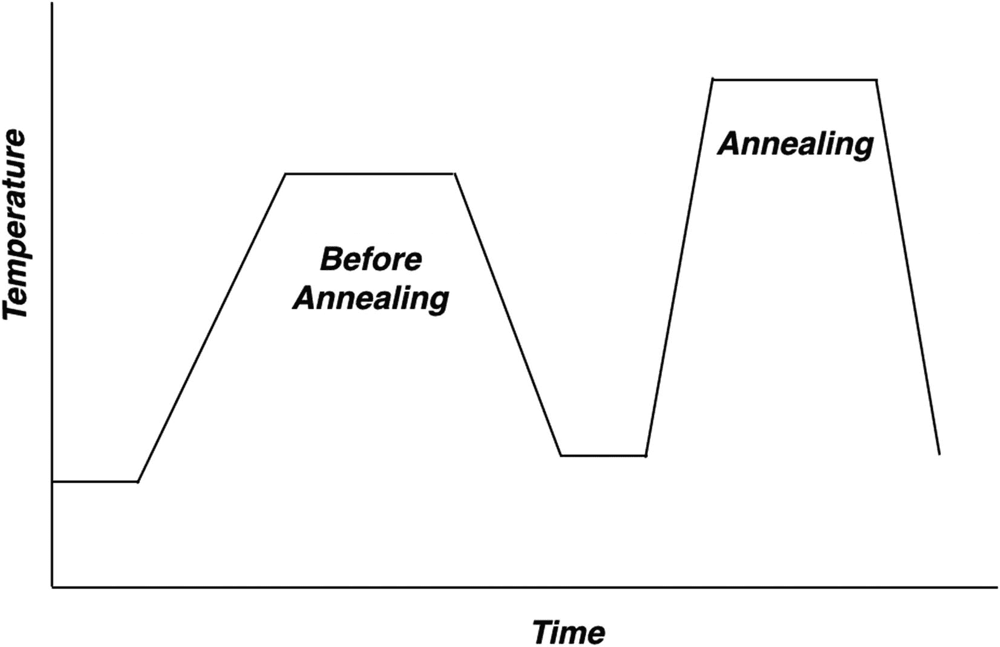

图 1-13 — 量子退火过程

量子退火技术有助于寻找最优交易路径。大量交易订单被执行，这会影响到资产价格。在执行交易时需要考虑执行成本。算法需要为大额订单设定交易速率。这有助于平衡交易速度，最小化市场风险敞口，并最小化对市场的影响。

另一个领域是优化套利机会。套利是利用不同资产价格的差异以较低风险获取利润。典型的例子通常涉及将欧元兑换成美元、美元兑换成日元、日元兑换回欧元。由于价格差异，这种交易可能会产生少量利润。这被称为*跨币种套利*。在不同市场的资产中寻找最优套利机会是一个 NP 难问题。量子退火方法有助于找到成本最低的路径。

信用评分是另一个可以使用量子退火解决的领域。个人的信用评分与个人的收入、年龄、财务历史、抵押品和当前负债相关。风险评估会考察客户档案中的各种因素。这是一个计算上具有挑战性的问题，属于 NP 难问题。

车辆路径问题是另一个可以使用量子退火解决的优化问题。Dantzig 和 Ramser 于 1959 年提出了车辆路径问题。优化的目标是为服务于客户订单的一组车辆确定最优路线。解决方案是确定从起点到终点交付订单所涉及的一组路线。客户订单所需的车辆数量也是一个优化目标。量子退火是一种用于在一组给定的候选函数中确定局部最小路径的优化技术。这是一种将具有许多局部最小值的函数离散化以确定函数可观测量的方法。量子退火过程不同于模拟退火，因为它基于量子隧道效应。粒子通过能量屏障从高能态隧穿到低能态。

量子退火从一个系统不同状态的等权重叠加开始。含时薛定谔方程驱动系统随时间演化。随着时间增加，该系统会影响所有状态的振幅。最终，系统达到基态，即系统的瞬时哈密顿量。

### 网络安全

后量子安全领域出现了应用于静态、传输中、使用中及动态数据的新应用。这些解决方案涉及数据访问、业务流程、多方身份验证和多方授权。这些产品基于应对中间人检测、量子安全加密、抗钓鱼攻击、生物识别安全、可审计性和职责分离的算法与技术。参见图 1-14。

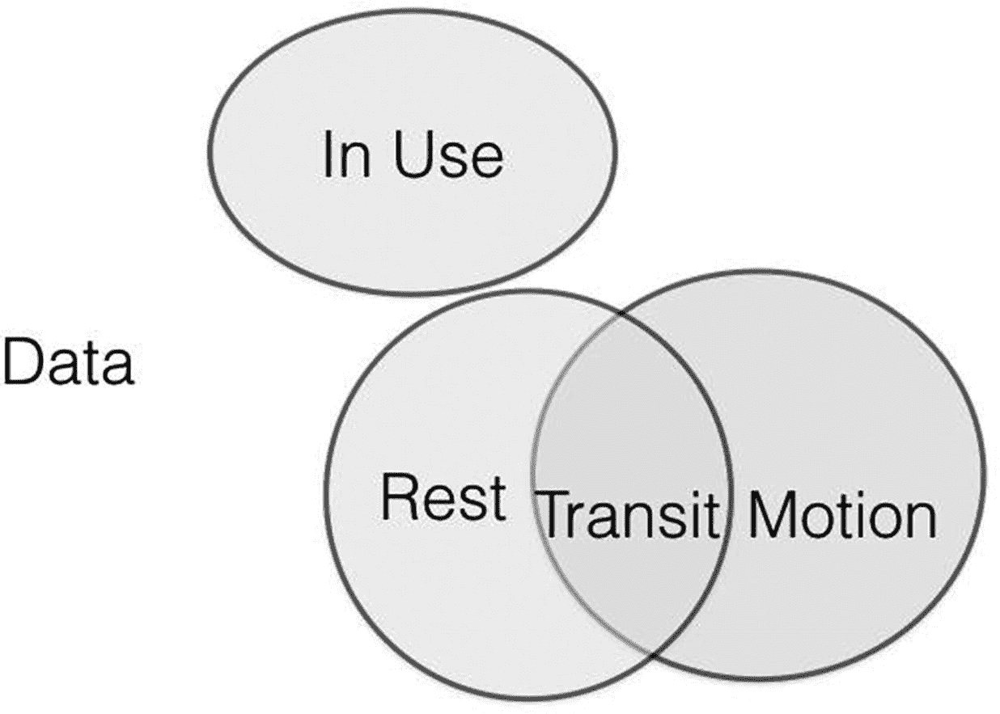

**图 1-14** 使用中/静态/传输中/动态数据

静态数据可能被内部人员或外部黑客截取和滥用。传输中的数据可能被黑客修改以在网络中滥用。机密业务数据和可识别个人身份信息是传输中数据的典型用例。关键任务数据无法通过基于角色的访问和控制来保障安全。企业需要数据治理来保护和确保数据安全。

网络安全解决方案涉及对客户交易和数据进行加密、解密、签名和验证。黑客可能截取并窃取安全数据。安全数据包含客户的信用卡号码和社会安全号码等信息。利用量子计算机，黑客拥有更高的计算能力。像`Shor's`这样的量子算法已被证明能够破解当前的密码系统。后量子密码设计者正在提高新型加密和解密算法的效率。需要混合系统和高速度的量子抗性算法来增强后量子密码算法。`McEliece`公钥加密、`NTRU`公钥加密以及基于格密码的公钥加密系统已被证明具有量子抗性。

## 总结

在本章中，我们研究了密码学、优化和网络安全领域的各种解决方案，以及量子计算如何被应用并开发出相应的解决方案。

