# 量子计算背后的数学

## 引言

> *数学是神与人对话的语言。*
> 
> ——柏拉图

在本章中，我们将介绍与量子计算相关的数学概念。我们将研究量子算符、集合、向量、矩阵和张量。

## 初始设置

你需要安装 `Python 3.5` 来运行本章的代码示例。你可以从 [https://www.python.org/downloads/release/python-350/](https://www.python.org/downloads/release/python-350/) 下载它。

## 量子算符

二进制形式的数字被用于对经典计算机的门电路进行建模。量子力学原理被用于对量子计算机的量子门和量子操作进行建模。

首先，让我们来看一个希尔伯特空间（记为 `H`）。希尔伯特空间是一个由向量内积构成的向量空间。这些向量是单位向量。它们代表了系统的状态。

图 2-1 定义了两个向量 `z` 和 `u` 的内积。该向量定义在希尔伯特空间上，而 `z^*` 是 `z` 的复共轭。在希尔伯特空间上定义了一个标准正交基。一个双自旋量子系统由两个标准正交基的状态表示。`H` 中的一组标准正交向量集 `N` 具有空间 `N` 的元素，其中每个元素都是一个单位向量，并且任意两个不同的元素是正交的。

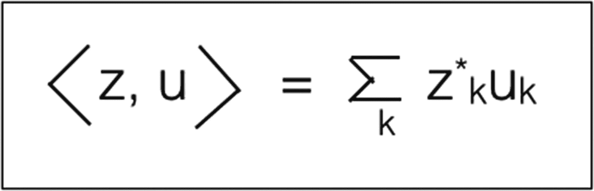

**图 2-1** 内积

我们来看一下用于表示量子系统基态的狄拉克符号；见图 2-2。狄拉克符号优于计算机计算中使用的基于向量的海森堡符号。

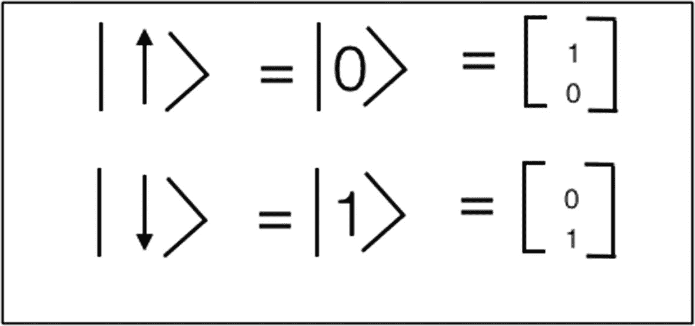

**图 2-2** 狄拉克符号

现在，我们来看一下克罗内克积；见图 2-3。克罗内克积与量子比特的组合有关。它用于计算多量子比特系统中量子比特的乘积。

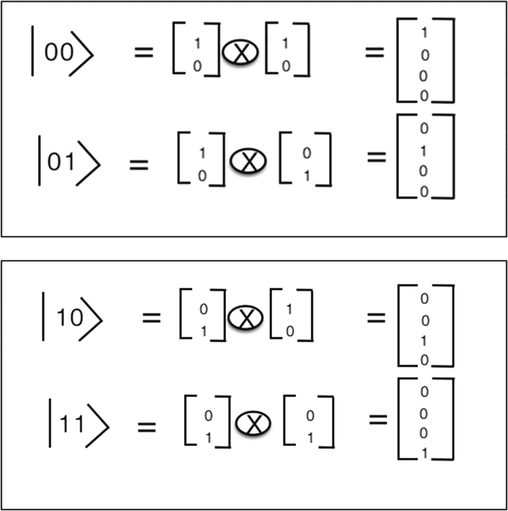

**图 2-3** 克罗内克积

让我们来看看用于量子逻辑和电路设计的量子门。首先，我们来谈谈数字电路和传统的数字门。数字电路分为时序电路和组合电路。时序电路是具有相同系统状态的电路，系统的输入/输出是时间的函数。组合电路是指其输出仅取决于输入的电路。`MUX`、`DEMUX`、编码器和解码器是基于组合电路的优秀应用示例。

存储寄存器用于存储和处理数据。用于这些电路的传统数字门列举如下：

*   **与门**：逻辑与运算
*   **或门**：逻辑或运算
*   **或非门**：逻辑或运算的反向
*   **与非门**：逻辑与运算的反向
*   **异或门**：异或运算
*   **同或门**：异或运算的反向
*   **非门**：反相运算

经典计算机基于算术逻辑单元（`ALU`）和控制器。控制器控制指令流以及周期中任何指令步骤的执行。`ALU` 基于数字电路。`ALU` 用于执行数学和逻辑运算。中央处理器包含一个 `ALU` 和一个控制单元（`CU`）。见图 2-4。

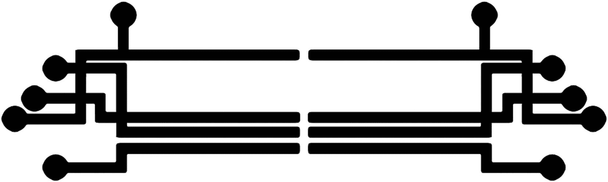

**图 2-4** 数字电路

量子计算机将有一个量子处理单元和用于处理信息的量子电路。量子电路包含一组量子门。量子门用于修改量子比特。量子门用于展示量子比特的量子态随时间的演化。量子比特的量子态在量子门的输出端发生变化。量子计算机遵循范数守恒和可逆性的原则。范数守恒指定了归一化概率幅的平方和应等于应用门之后的状态。未被测量的量子态的演化与可逆性相关。

> **注意**
> 
> 一个 *量子处理单元* 是一个量子芯片，相当于经典中央处理器。一个量子芯片由 `QPU`、控制单元和其他组件构成。芯片中的量子比特数量与数字电路的量子电路组件有关。

量子运算符基于运用量子力学原理的数学函数。它们作用于量子态，而量子态由向量和张量表示。请参见图 2-5。

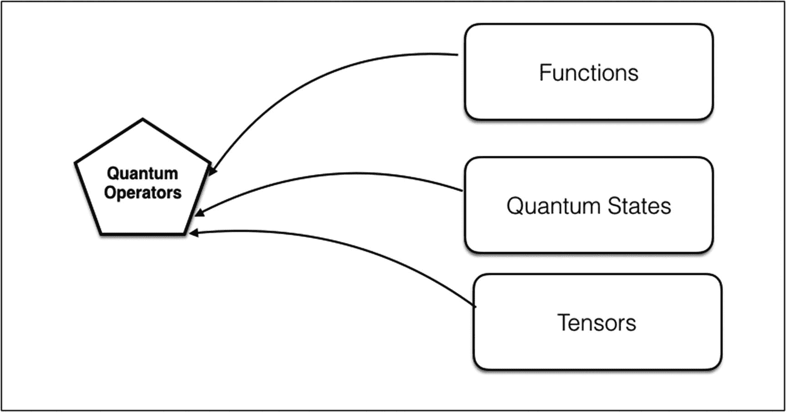

**图 2-5** 量子运算符

量子门可分为 Hadamard 门、相移门以及受控门和不受控门。举例来说，量子门可以是 `X`、`Y`、`Z`、`Rx`、`Ry`、`Rz`、`S`、`T`、`CNOT`、`Toffoli`、`Swap` 和受控相移门。

以下是量子门的完整列表：

*   Pauli 门
    *   `I`、`X`、`Y`、`Z`
*   Hadamard 门 `H`
*   相位门
    *   `PHASE(theta)`、`S`、`T`
*   受控相位门
    *   `CZ`
    *   `CPhase00(alpha)`
    *   `CPhase01(alpha)`
    *   `CPhase10(alpha)`
    *   `CPhase(alpha)`
*   笛卡尔旋转门
    *   `RX(theta)`
    *   `RY(theta)`
    *   `RZ(theta)`
*   受控 X 门
    *   `CNOT`
    *   `CCNOT`
*   交换门
    *   `SWAP`
    *   `CSWAP`
    *   `ISWAP`
    *   `PSWAP(alpha)`

布洛赫球用于表示量子比特态以及该态经过量子门变换后的结果。旋转发生在三维空间中围绕 x 轴、y 轴和 z 轴。请参见图 2-6。

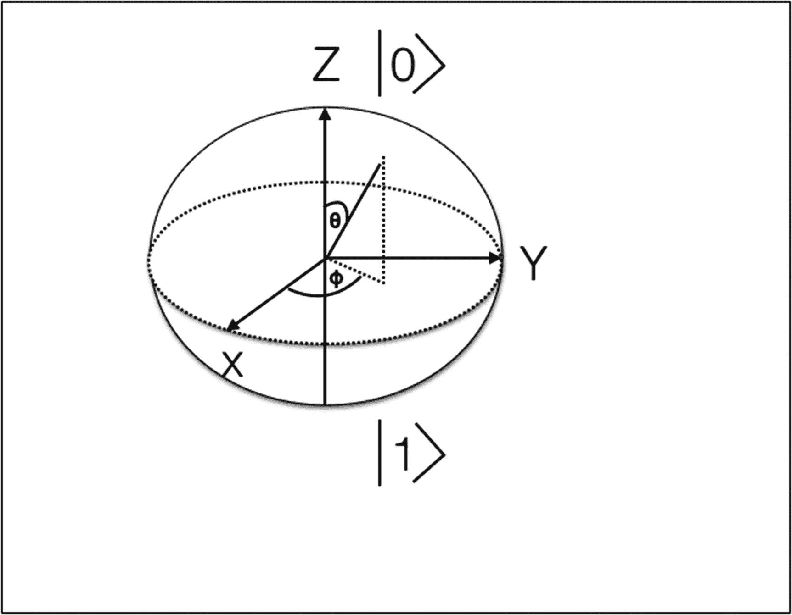

**图 2-6** 布洛赫球

表 2-1 列出了布洛赫球上每个量子门及其相关的量子态变换。

**表 2-1** 量子门变换

| 量子门 | 量子态变换 |
| --- | --- |
| `X` | 在布洛赫球上绕 x 轴旋转 180 度 |
| `Y` | 在布洛赫球上绕 y 轴旋转 180 度 |
| `Z` | 在布洛赫球上绕 z 轴旋转 180 度 |
| `H` | `H` 门将 `X` 映射到 `Z`，将 `Z` 映射到 `X` |
| `I` | 单位门 |
| `S` | `S` 门将 `X` 映射到 `Y` |
| `S`† | `S` 门的逆将 `X` 映射到 `-Y`，绕 z 轴旋转 -180 度 |
| `T` | 绕 z 轴旋转 90 度 |
| `T`† | 绕 z 轴旋转 -90 度 |
| `Toffoli` | 受控 `CNOT` 门 |
| `Swap` | 交换量子比特的状态 |
| `NOT` | 经典非运算 |
| `CNOT` | 对目标量子比特执行 Pauli `X` 门操作，不改变控制量子比特 |
| `Rx` | 绕 x 轴旋转 `theta` 度 |
| `Ry` | 绕 y 轴旋转 `theta` 度 |
| `Rz` | 绕 z 轴旋转 `theta` 度 |
| `X90` | 绕 x 轴旋转 -90 度 |
| `Y90` | 绕 y 轴旋转 90 度 |
| `mX90` | 绕 x 轴旋转 -90 度 |
| `mY90` | 绕 y 轴旋转 -90 度 |
| `CZ` | Cphase 门 |
| `CRk` | 参数化的受控相移，角度为 `Pi/2k` 度 |
| `CR` | 受控相移，角度为 `theta` 度 |

现在让我们看一个 Python 代码示例，展示量子运算中的 Hadamard 门、Swap 门和 Identity 门。

### 代码示例

**`quantum_operations.py`**

# 量子操作示例

```python
import numpy as nump

def multi_quantum_state(*args):
    ret = nump.array([[1.0]])
    for q in args:
        ret = nump.kron(ret, q)
    return ret

zero_quantum_state = nump.array([[1.0], [0.0]])
one_quantum_state = nump.array([[0.0], [1.0]])
Hadmard_quantum_gate = 1.0 / 2**0.5 * nump.array([[1, 1], [1, -1]])
new_quantum_state = nump.dot(Hadmard_quantum_gate, zero_quantum_state)
print("dot product : Hadamard quantum gate and zero  quantumstate", new_quantum_state)

SWAP_quantum_gate = nump.array([[1,0,0,0],
[0,0,1,0],
[0,1,0,0],
[0,0,0,1]])
t0_quantum_state = multi_quantum_state(zero_quantum_state, one_quantum_state)
t1_quantum_state = nump.dot(SWAP_quantum_gate, t0_quantum_state)
print("SWAP Quantum  Gate - T1 Quantum state", t1_quantum_state)

Identity_quantum_gate = nump.eye(2)
t0_quantum_state = multi_quantum_state(zero_quantum_state, one_quantum_state)
t1_quantum_state = nump.dot(multi_quantum_state(Hadmard_quantum_gate, Identity_quantum_gate), t0_quantum_state)
print("Multi Quantum State of H Quantum gate and I Quantum gate", t1_quantum_state)
```

## 执行命令

```bash
pip3 install numpy
python3 quantum_operations.py
```

## 输出

```text
dot product : Hadamard quantum gate and zero  quantumstate [[0.70710678] [0.70710678]]
SWAP Quantum  Gate - T1 Quantum state
[[0.] [0.] [1.] [0.]]
Multi Quantum State of H Quantum gate and I Quantum gate
[[0.] [0.70710678] [0.] [0.70710678]]
```

# 集合

宇宙中的任何事物都可以是一个对象，它可以是生物或非生物。一个*集合*是一组对象的全体。集合中的对象被称为*成员*（或*元素*）。以下是集合的一些例子：

- 英语中的辅音字母
- 质数
- 算术数列

使用大写字母来表示集合。集合的元素用小写字母表示。一个很好的例子是 `N` 代表自然数集合。集合使用花括号 `{ }` 以枚举法表示。例如，`A = {1,2,3,4,5}` 是一个所有小于 6 的整数组成的集合。集合中的每个成员只列出一次，顺序不重要。另一种表示集合的方法是描述法。`C = {y : y` 是英文字母中的辅音字母`}`。

集合分为以下几种类型：

- 空集
- 有限集
- 无限集
- 单元素集

空集的成员数量为 0。单元素集的成员数量为 1。有限集具有有限数量的元素。空集的一个很好例子是平方为 -2 的实数集合。

集合的阶是有限集中唯一成员的数量。这也被称为集合的*基数*。如果两个集合的基数相同，则它们相等。子集是其元素都是超集成员的集合。例如，`A = {1,2}` 和 `B = {1,2,3,4}`。在这种情况下，`A` 是 `B` 的*子集*，而 `B` 是 `A` 的*超集*。

一个*幂集*是给定集合所有子集构成的集合。全集 `U` 是给定集合的超集。如果两个集合的交集是空集，则它们不相交。维恩图用于表示集合之间的关系（图 2-7）。

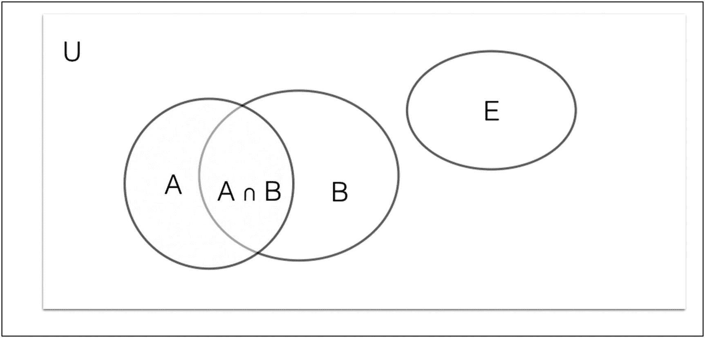

两个集合的*并集*是包含属于 `A` 或 `B` 或两者中所有元素的集合。例如，`A = {1,2,3}`，`B = {4,5,6}`，则 `A U B = {1,2,3,4,5,6}`。

两个集合的*交集*是包含两个集合所有公共元素的集合。例如，`A = {1,2,3}`，`B = {2,4,5}`，则 `A ∩ B = {2}`。

集合 `A` 和 `B` 的*差集*是属于 `A` 但不属于 `B` 的元素组成的集合。例如，`A = {1,2,3}`，`B = {2,4,5}`，则 `A - B = {1,3}`。

一个集合的*补集*是包含全集 `U` 中但不含有集合 `A` 元素的集合。

现在让我们看一个 Python 代码示例，展示并集、交集、差集和对称差集等集合运算。

## 代码示例

`set_operations.py`

```python
primes11={3,5,7,11,14};
primes12={3,5,7,11,13,17,19,34}
primes=primes11 & primes12
print("union of sets", primes11,",",primes12," is")
print(primes)

primes1={3,5,7,11,13};
primes2={3,5,7,11,13,17,19,23}
primes=primes1 & primes2
print("intersection of sets", primes1,",", primes2," is")
print(primes)

primes3={3,5,7,11,13,17,19}
primes4={2,3,5,7,11};
primes=primes3-primes4
print("difference of sets",primes3,",",primes4," is")
print(primes)

primes4={3,5,7,11,13,17,19}
primes5={3,5,7,11,91,101};
primes=primes4 ^ primes5
print("symmetric difference of sets",primes4,",",primes5," is")
print(primes)
```

## 执行命令

```bash
python3 set_operations.py
```

## 输出

```text
union of sets {3, 5, 7, 11, 14} ,{33, 3, 5, 7, 11, 13, 17, 19} is:
{11, 3, 5, 7}
intersection of sets {3, 5, 7, 11, 14 {34, 3, 5, 7, 11, 13, 17, 19} is:
{11, 3, 5, 7}
difference of sets {3, 5, 7, 11, 13, 17, 19} ,{2, 3, 5, 7, 11} is:
{17, 19, 13}
symmetric difference of sets {3, 5, 7, 11, 13, 17, 19} ,{3, 5, 101, 7, 11, 91} is:
{17, 19, 101, 91, 13}
```

# 向量

*向量*被定义为由 n 个实数构成的有序集合。下面是一个例子：

```
C = (c1,c2,c3,.....cn)
C is an n-dimensional vector.
```

向量的加法是通过对应维度的元素相加来计算的。类似地，向量的减法是通过各维度元素相减来计算的。

```
C = (c1,c2,c3,.....cn)
D = (d1, d2, d3,... dn)
C + D = (c1+d1, c2+d2,..., cn+dn)
C - D = (c1-d1, c2-d2,..., cn-dn)
```

向量与标量的乘法是通过将标量与每个维度元素相乘来实现的。

```
E = sF = (sf1, sf2, .....,sfn)
```

现在我们来看一个 Python 代码示例，展示向量的运算，如点积、标量乘法、求和、差、积和除法。

## 代码示例

`vector_operations.py`

## 矩阵

*矩阵*是数字按行和列排列成的矩形阵列。它由圆括号`()`或方括号`[]`表示。矩阵中的条目称为矩阵的*元素*。矩阵的阶定义为行数和列数。例如，对于`A = [1 2]`，`1×2`就是该矩阵的阶。

*行矩阵*是只有一行而列数任意的矩阵。`A = [1,2,3]`就是一个行矩阵。*列矩阵*是只有一列而行数任意的矩阵。

图 2-8 展示了一个 2×2 矩阵。

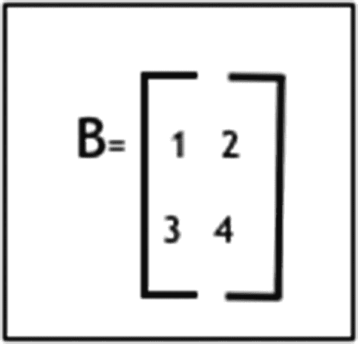

图 2-8

2×2 矩阵

图 2-9 展示了一个列矩阵的例子。

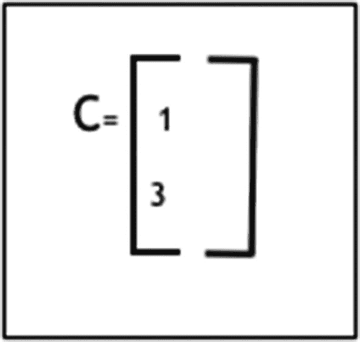

图 2-9

列矩阵

以下是不同类型的矩阵：

*   行矩阵

*   列矩阵

*   单元素矩阵

*   零矩阵

*   矩形矩阵

*   方阵

*单元素矩阵*是只有一个元素的矩阵。例如，`A = [1]`就是一个单元素矩阵。*零矩阵*是所有元素都为零的矩阵；例如，`A = [0 0]`就是一个零矩阵。*矩形矩阵*是行数不等于列数的矩阵。参见图 2-10。

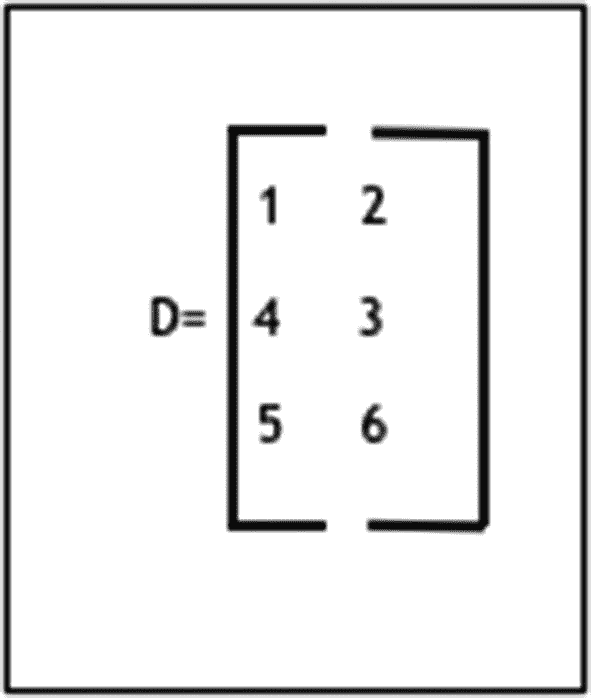

图 2-10

矩形矩阵

*方阵*是行数等于列数的矩阵。参见图 2-11。


图 2-11

方阵

*对角矩阵*是主对角线以外的所有元素都为零的方阵。参见图 2-12。

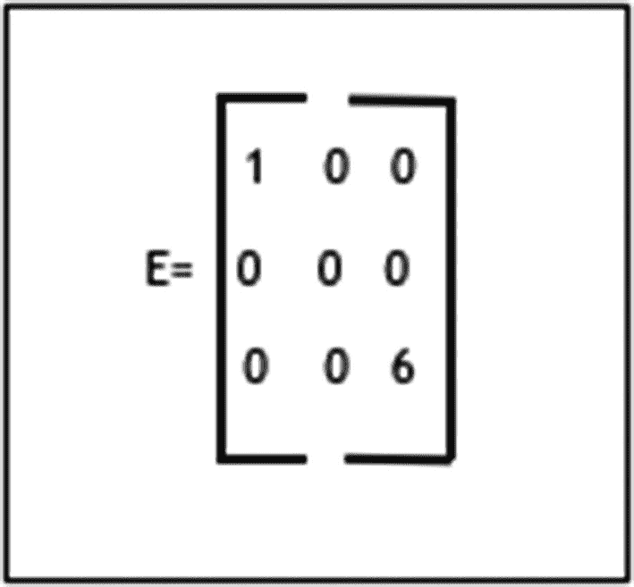

图 2-12

对角矩阵

*单位矩阵*是主对角线上的元素为 1 的方阵。参见图 2-13。

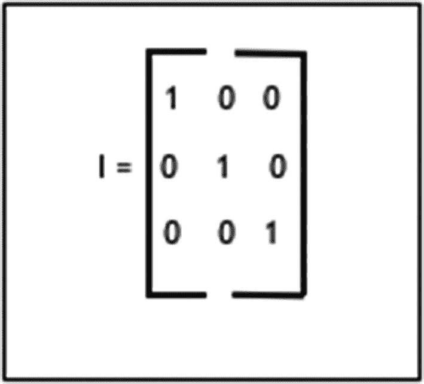

图 2-13

单位矩阵

*标量矩阵*是主对角线上的元素都相等，且所有非对角元素都为零的方阵。参见图 2-14。

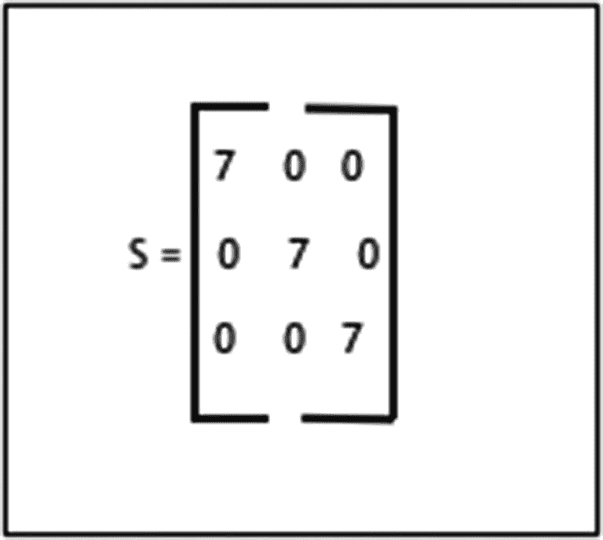

图 2-14

标量矩阵

*三角矩阵*是主对角线以上或以下的元素都为零的方阵。上三角矩阵是主对角线以下的元素为零（见图 2-15），下三角矩阵是主对角线以上的元素为零（见图 2-16）。

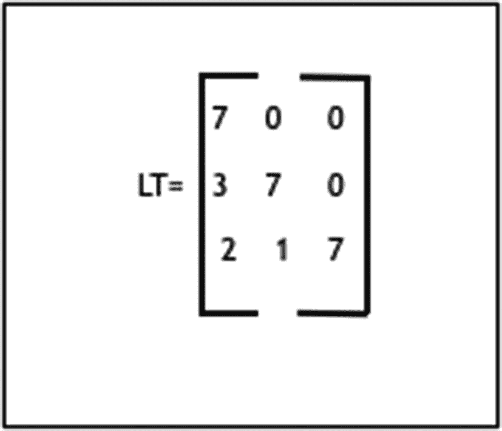

图 2-16

下三角矩阵

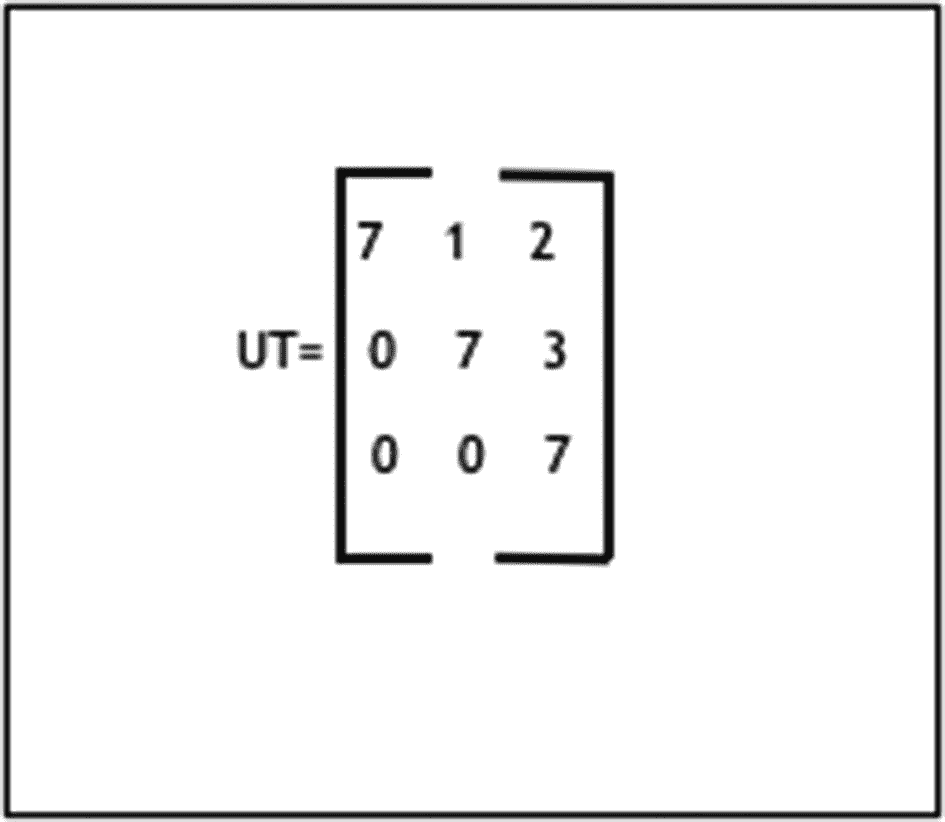

图 2-15

上三角矩阵

矩阵的*迹*是方阵对角线上元素之和。它用`tr()`表示。例如，矩阵`A`的迹等于`tr(A)`。

只有相同类型的矩阵才能相加，和是通过将矩阵的对应元素相加得到的。类似地，相同类型的矩阵可以进行减法，结果是通过对应元素相减得到的。

矩阵乘法可行的条件是，第一个矩阵的列数等于第二个矩阵的行数。矩阵的标量乘法与标量被乘到矩阵的每个元素相关。

矩阵可以通过将行变为列、列变为行来进行转置。转置用上标`^T`表示。

方阵`matrix A`的行列式为`x1* y2 - x2*y1`。见图 2-17。

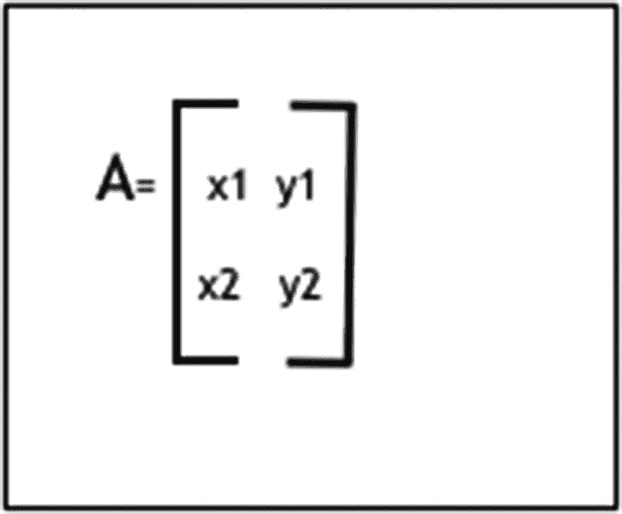

图 2-17 行列式

三阶矩阵的行列式是行或列的元素与各自的余子式乘积之和。见图 2-18。

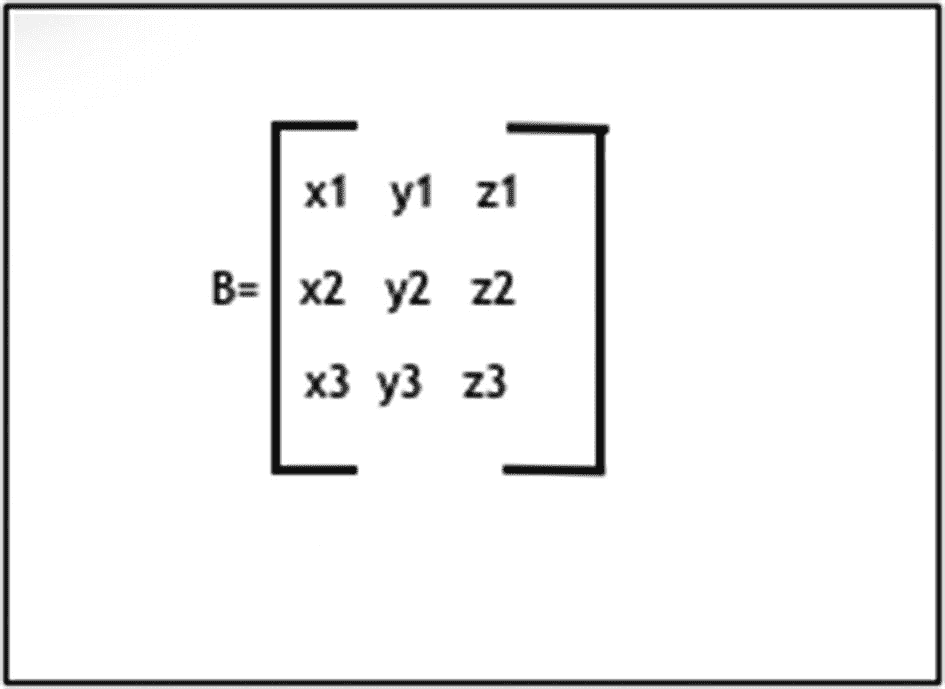

图 2-18 三阶矩阵的行列式

```
x1 X1 +x2 X2 +x3 X3
y1 Y1 + y2 Y2 + y3 Y3
z1 Z1 + z2 Z2 + z3 Z3
```

矩阵`A`的逆矩阵定义为`A^(-1)`。因此，`AA^(-1) = I`（单位矩阵）。

```
A-1 = adj A/ det A
```

`adj A`是伴随矩阵，通过用对应的余子式替换方阵的元素，然后对得到的矩阵进行转置得到。`det A`是`A`的行列式。

现在让我们看一个 Python 代码示例，展示矩阵运算，如加法、减法、乘积、点积、除法和转置。

### 代码示例

`matrix_operations.py`

```
from numpy import array
vector1 = array([1, 2, 3])
vector2 = array([2, 3, 4])
print("dot product of", vector1,", ",vector2,"is")
product = vector1.dot(vector2)
print(product)
scalarval = 0.3
scalarprod = scalarval*vector1
print("scalar multiplied",scalarval,",",vector1,"is")
print(scalarprod)
print("sum of", vector1,", ",vector2,"is")
sum = vector1 + vector2
print(sum)
print("difference of", vector1,", ",vector2,"is")
diff = vector1 - vector2
print(diff)
print("product of", vector1,", ",vector2,"is")
prod = vector1 * vector2
print(prod)
print("division of", vector1,", ",vector2,"is")
dividedby = vector1 / vector2
print(dividedby)
```

### 执行命令

```
pip3 install bumpy
python3 vector_operations.py
```

### 输出

```
dot product of [1 2 3] ,  [2 3 4] is

scalar multiplied 0.3 , [1 2 3] is
[0.3 0.6 0.9]
sum of [1 2 3] ,  [2 3 4] is
[3 5 7]
difference of [1 2 3] ,  [2 3 4] is
[-1 -1 -1]
product of [1 2 3] ,  [2 3 4] is
[ 2  6 12]
division of [1 2 3] ,  [2 3 4] is
[0.5        0.66666667 0.75      ]
```

# 矩阵与张量的Python操作

## 矩阵运算

以下Python代码演示了如何使用`numpy`库进行基本的矩阵运算。

```python
import numpy
mat1 = numpy.array([[1, 3], [4, 6]])
mat2 = numpy.array([[7, 9], [11, 15]])
print ("Addition of  matrices ", mat1,",", mat2,"is")
print (numpy.add(mat1,mat2))
print ("Subtraction of  matrices ", mat1,",", mat2,"is")
print (numpy.subtract(mat1,mat2))
print ("Product of  matrices ", mat1,",", mat2,"is")
print (numpy.multiply(mat1,mat2))
print ("Dot Product of  matrices ", mat1,",", mat2,"is")
print (numpy.dot(mat1,mat2))
print ("Division of  matrices ", mat1,",", mat2,"is")
print (numpy.divide(mat1,mat2))
print ("Transpose of ", mat1,"is")
print (mat1.T)
```

### 执行命令

```bash
pip3 install numpy
python3 matrix_operations.py
```

### 输出

```
Addition of  matrices  [[1 3] [4 6]] , [[ 7  9] [11 15]] is
[[ 8 12]  [15 21]]
Subtraction of  matrices  [[1 3] [4 6]] , [[ 7  9] [11 15]] is
[[-6 -6] [-7 -9]]
Product of  matrices  [[1 3] [4 6]] , [[ 7  9] [11 15]] is
[[ 7 27] [44 90]]
Dot Product of  matrices  [[1 3] [4 6]] , [[ 7  9] [11 15]] is
[[ 40  54] [ 94 126]]
Division of  matrices  [[1 3] [4 6]] , [[ 7  9] [11 15]] is
[[0.14285714 0.33333333] 0.36363636 0.4       ]]
Transpose of  [[1 3] [4 6]] is [[1 4] [3 6]]
```

## 张量

`张量`是一个多维数组（见图 2-19）。一维张量是向量。二维张量是矩阵。

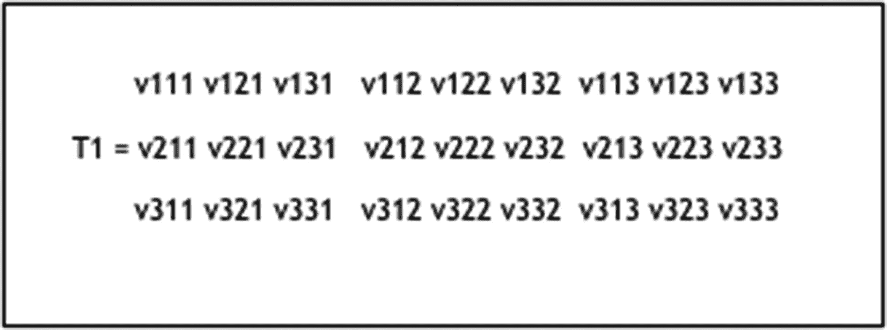

图 2-19 张量示例

加法、减法和乘法运算可以像向量和矩阵一样在张量上执行。

现在让我们看一个`Python`代码示例，展示集合运算，如加法、减法、乘积、除法和点积。

### 代码示例

`tensor_operations.py`

```python
from numpy import array
from numpy import tensordot
tensor1 = array([
[[1,2,3],    [4,5,6],    [7,8,9]],
[[13,12,13], [14,15,16], [17,18,19]],
[[24,22,23], [24,25,26], [27,28,29]],
])
tensor2 = array([
[[1,4,3],    [4,5,6],    [7,8,9]],
[[11,13,13], [14,15,16], [17,18,19]],
[[21,25,23], [24,26,26], [27,28,29]],
])
print("tensor1",tensor1)
print("tensor2",tensor2)
print("sum of tensors", "is")
sum = tensor1 + tensor2
print(sum)
print("difference of tensors",  "is")
diff = tensor1 - tensor2
print(diff)
print("product of tensors",  "is")
prod = tensor1 * tensor2
print(prod)
print("division of tensors",  "is")
division = tensor1 / tensor2
print(division)
print("dot product of tensors",  "is")
dotproduct = tensordot(tensor1, tensor2, axes=0)
print(dotproduct)
```

### 执行命令

```bash
pip3 install numpy
python3 tensor_operations.py
```

### 输出

```
tensor1  [
[[1,2,3],    [4,5,6],    [7,8,9]],
[[13,12,13], [14,15,16], [17,18,19]],
[[24,22,23], [24,25,26], [27,28,29]],
]
tensor2 [
[[1,4,3],    [4,5,6],    [7,8,9]],
[[11,13,13], [14,15,16], [17,18,19]],
[[21,25,23], [24,26,26], [27,28,29]],
]
sum of tensors is [
[[ 2  6  6] [ 8 10 12] [14 16 18]]
[[24 25 26] [28 30 32] [34 36 38]]
[[45 47 46] [48 51 52] [54 56 58]]
]
difference of tensors is [
[[ 0 -2  0] [ 0  0  0] [ 0  0  0]]
[[ 2 -1  0] [ 0  0  0] [ 0  0  0]]
[[ 3 -3  0] [ 0 -1  0] [ 0  0  0]]
]
product of tensors is [
[[  1   8   9] [ 16  25  36] [ 49  64  81]]
[[143 156 169][196 225 256][289 324 361]]
[[504 550 529] [576 650 676] [729 784 841]]
]
division of tensors is [
[[1\.    0.5    1\.   ] [1\.   1\.    1\.   ][1\.         1\.         1\.  ]]
[[1.18181818 0.92307692 1\. ][1\.   1\.   1\. ][1\.  1\.   1\. ]]
[[1.14285714 0.88       1\. ][1\.  0.96153846 1.][1\.  1\.        1\. ]]
]
dot product of tensors is
```

注意，由于张量的大小，输出中没有显示点积。

## 总结

在本章中，我们研究了量子算子、集合、向量、矩阵和张量。这些是量子计算所需的数学概念。