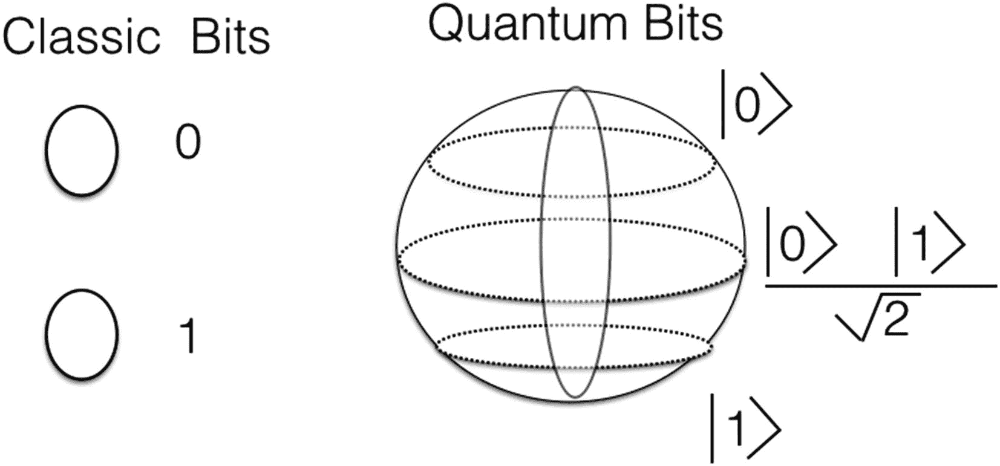
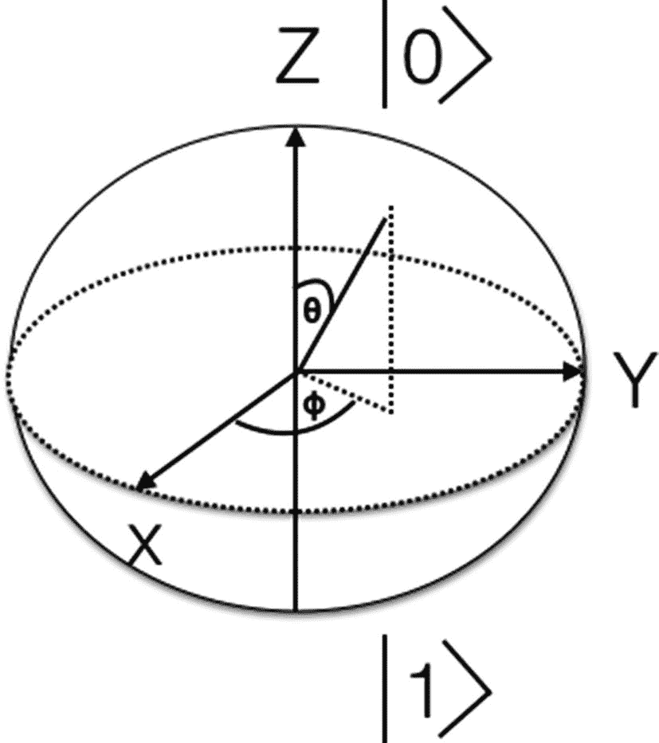
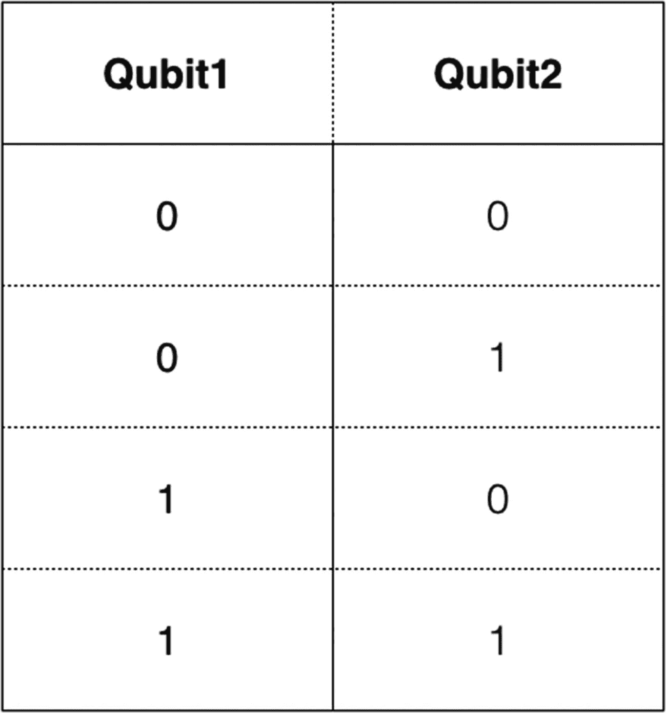
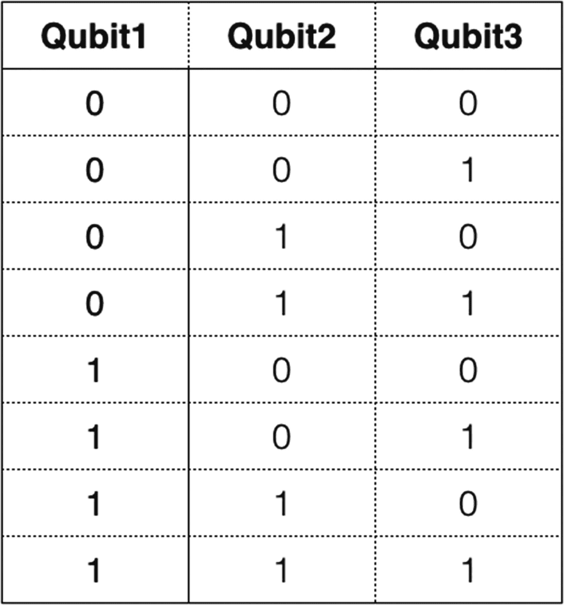
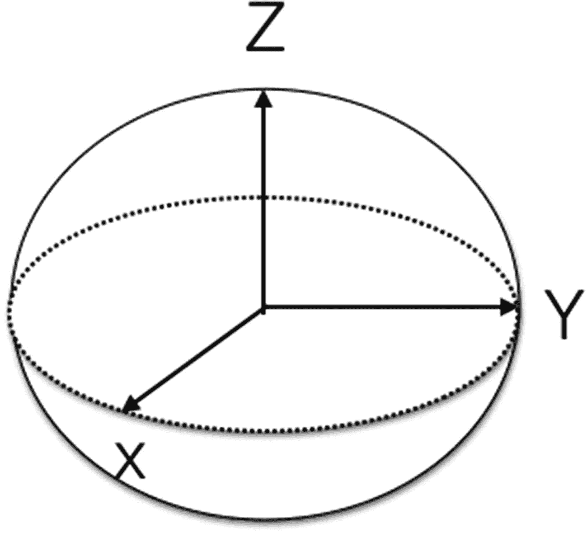
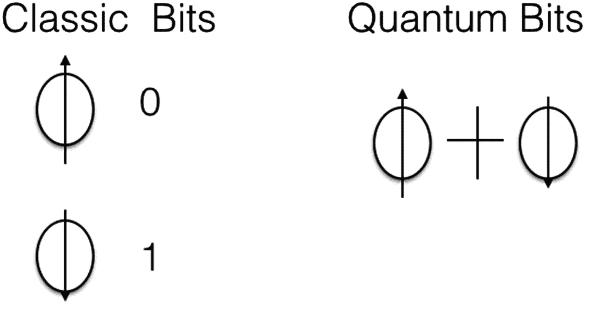
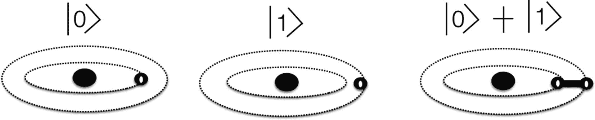
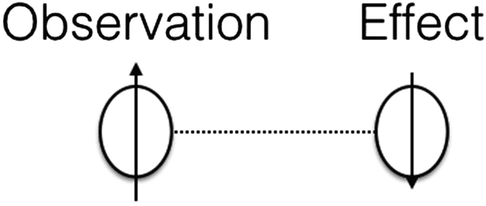
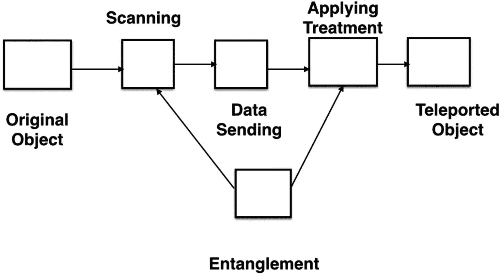

# 3. 量子子系统与性质

## 引言

> *量子力学数学非常精确地描述了我们的宇宙是如何运作的。*
> 
> —安东尼·加勒特·利西

本章涵盖量子子系统及其性质。详细讨论了单量子比特系统和多量子比特系统。本章还介绍了量子态、协议、操作和变换。

量子计算机处理与现实问题相关的信息，并利用量子力学解决这些问题。经典计算机使用要么是`0`要么是`1`的比特。由于它基于经典计算机导线中的电流，我们必须选择这些选项之一。量子单元基于量子叠加原理，其中`0`和`1`是叠加的。这开启了无限的可能状态，这些状态基于`0`和`1`及其在连续范围内的权重。在经典计算机中，基于十进制系统的值被转换为二进制数。类似地，量子单元使用二维希尔伯特空间来定义。见图 3-1。



图 3-1 经典比特与量子比特

## 初始设置

你需要设置 Python 3.5 来运行本章中的代码示例。你可以从 [`https://www.python.org/downloads/release/python-350/`](https://www.python.org/downloads/release/python-350/) 下载它。

## 单量子比特系统

量子比特是量子计算框架的基础。通过使用量子比特（*量子位*），量子计算机的性能优于经典计算机。量子计算机将信息存储在量子比特中。一个量子比特代表一个量子粒子，比如一个电子，其电荷可以是`0`或`1`，也可以是`0`和`1`同时存在。布洛赫球面用于显示量子比特状态的位置。该球面半径为一个单位。希尔伯特空间用于对球面表面进行建模。希尔伯特空间与向量空间中向量的内积有关。长度和角度测量在内积中显示。见图 3-2。



图 3-2 布洛赫球面

现在让我们看一个演示单量子比特系统的 Python 代码示例。


### 代码示例

**single_qubit_system.py**

```python
import numpy as nump
import scipy as scip
import scipy.linalg
Zero_state = nump.array([[1.0], [0.0]])
One_state = nump.array([[0.0], [1.0]])
NormalizeQuantumState = lambda quantum_state: quantum_state / scip.linalg.norm(quantum_state)
Plus_State = NormalizeQuantumState(Zero_state + One_state)
print("normalized quantum state of",Zero_state, "+", One_state,"is", Plus_State)
```

### 执行命令

```bash
pip3 install numpy
pip3 install scipy
python3 single_qubit_system.py
```

### 输出结果

```
normalized quantum state of [[1.][0.]] + [[0.][1.]] is
[[0.70710678][0.70710678]]
```

## 多量子比特系统

多量子比特系统可以通过克罗内克积来表示。我们来看两个量子粒子，`c` 和 `d`。它们的状态可以如下建模：

```
|ψc>= α0 |0> + βc |1> (粒子 C)
|ψdi>= αd|0> + βd |1> (粒子 D)
```

一个多量子比特寄存器是一个量子系统，其中量子比特处于叠加态。一个包含 `s` 个量子比特的经典寄存器有 `2s` 个唯一状态。量子系统将由处于叠加态的 `2p` 个状态组成。该系统可以处于 `2s` 个状态中的一个、两个、三个……甚至全部状态。我们来看一个包含 2 个量子比特及其可能状态的量子系统（见图 3-3）。



图 3-3 — 双量子比特系统

现在，我们来看一个包含 3 个量子比特及其可能状态的系统（见图 3-4）。



图 3-4 — 三量子比特系统

多量子比特系统中量子比特的量子状态将是一个包含复数系数的向量。真实的逻辑状态被称为*可观测量*。对该状态进行测量，并观测结果。量子系统将具有滤波器，用于识别量子状态。基于不同的可观测量集合，可以建模出不同的函数。

一个 2 量子比特系统由以下方程指定：

`q(0) + q(1) = 1`

单量子比特测量用于建模 2 量子比特的测量操作。量子寄存器可以被部分测量。未测量的剩余部分通过恒等量子操作进行变换。

## 量子状态

一个量子比特存在于 0、1，或介于 0 与 1 之间的量子状态。这有助于量子计算机通过量子状态建模大量的可能性。`S` 个量子比特相当于 `2^S` 个多重状态。介于 0 与 1 之间的状态被称为*量子叠加*。叠加被建模为波函数。一个波函数在数学上可以有无限多个状态。

量子状态是孤立量子系统的状态。它定义了可观测量子比特测量时的概率分布。量子状态分类如下：

* 纯态
* 混合态

两个量子状态可以相互混合，以产生另一个量子状态。这类似于物理学中物质波的混合。

布洛赫球面用于表示量子状态（见图 3-5）。一个量子比特可以处于叠加态，如下所示：



图 3-5 — 布洛赫球面

```
amp1|0> + amp2|1> = |amp>  其中 |0> 和 |1> 是列向量
```

`amp1` 和 `amp2` 被称为*概率幅*，它们是复数。

量子比特测量的结果中会计算模方和概率。

```
|amp1²| + |amp2²| = 1
```

叠加态也可以如下表示（见图 3-6）：



图 3-6 — 叠加

```
|ψ⟩  =   1/√2 * (|0> + |1>)
```

图 3-6 展示了处于叠加态的量子比特与经典比特的 0 和 1 状态之间的对比。

一个量子粒子的状态被建模为一个量子比特。图 3-7 展示了量子粒子的叠加态。



图 3-7 — 量子粒子的叠加态

现在我们来看一个 Python 代码示例，以展示量子比特和状态的叠加。

### 代码示例

**superposition.py**

```python
import numpy as nump
zero_quantum_state = nump.array([[1.0], [0.0]])
one_quantum_state = nump.array([[0.0], [1.0]])
quantum_amp1 = 1.0 / 2**0.5
quantum_amp2 = 1.0 / 2**0.5
superposition_quantum_state = quantum_amp1 * zero_quantum_state + quantum_amp2 * one_quantum_state
print("superposition of", zero_quantum_state, " and ", one_quantum_state," is ",superposition_quantum_state)
```

### 执行命令

```bash
pip3 install numpy
python3 superposition.py
```

### 输出结果

```
superposition of [[1.][0.]]  and  [[0.][1.]]  is  [[0.70710678][0.70710678]]
```

## 量子协议

在本节中，我们将讨论基于量子协议的纠缠和隐形传态。

### 量子纠缠

*量子纠缠*是多个量子粒子相互之间的相互作用。这种相互作用导致纠缠，并且这些量子粒子最终可能在空间中分离。

这种基于量子协议的现象由阿尔伯特·爱因斯坦、鲍里斯·波多尔斯基和内森·罗森于 1935 年在一项量子力学实验中发现。他们试图证明量子力学在逻辑上的不可能性。

纠缠系统中，基于该系统的量子粒子状态的改变会影响另一个粒子，并且这种影响是可检测的。纠缠系统中的粒子能够感知彼此的状态。见图 3-8。



图 3-8 — 纠缠

## 量子隐形传态

量子隐形传态是将信息从源点传输到目的地。经典通信网络和信道用于传输信息。基于量子协议的隐形传态发生在源点和目的地存在量子粒子纠缠时。当前的记录是 1,400 公里（约 870 英里）的距离。可以在源点和目的地之间创建量子信道。量子粒子的量子状态从源点被隐形传态到目的地。见图 3-9。



图 3-9 — 隐形传态


## 量子操作

量子操作可以通过布洛赫球面（见图 3-10）进行可视化。一个量子比特的量子态可以用球面上的一个点来表示。球面上的两个刻度盘分别表示球面的角坐标和方位角坐标。球面可以使用希尔伯特空间来建模。如前所述，希尔伯特空间基于两个向量内积的向量空间。内积有助于测量长度和角度。


**图 3-10** 量子操作：布洛赫球面

**注意**  
布洛赫球面用于表示量子操作。旋转发生在单位半径三维球面的 x、y 和 z 轴上。

量子门是使用量子比特的量子操作。量子操作是量子电路的基本构建块。量子电路是构建量子计算机的基础模块。

我们首先来看阿达玛门。阿达玛门是一种对基态进行操作的量子门，它将 `|0>` 变为 `(|0>+|1>)* 1/√2`，将 `|1>` 变为 `(|0> - |1>)* 1/√2`。这种门变换会产生叠加态。

阿达玛门可以用矩阵表示，如下所示：

```
H = 1/√2 (|0> + |1>)  - |1>) <1|
```

现在，我们来看交换门。交换门用于交换量子门的量子态。

它可以用矩阵形式表示如下：

```
SWAP = |01>
```

**注意**  
狄拉克符号用于书写方程。保罗·狄拉克是第一个提出用独特符号表示向量和张量的人。与矩阵相比，这种表示法更为高效。

X 门是量子版本的 NOT 门。CNOT 门是受控非门。CNOT 门取反一个比特；控制位仅等于 1 时有效。托佛利门是受控非门，是量子版本的 AND 门。如果两个控制位都等于 1，托佛利门则取反一个比特。泡利 X 门是一种将量子比特绕 x 轴旋转 180 度的量子操作。泡利 Z 门是一种将量子比特绕 z 轴旋转 180 度的量子操作。

现在，我们来看一些 CNOT、X、Z 和测量门的实现，以演示量子门。接下来展示了用 Python 实现 CNOT 门、X 门、Z 门、归一化操作和测量门的代码。

### 代码示例

**Multi_Qubit_System.py**

```
import math
import random
def ApplyCNOTQuantumGate(zerozero,zeroone,onezero,oneone):
    onezero, oneone = oneone, onezero
    return GetQuantumbits(zerozero,zeroone,onezero,oneone)
def ApplyHQuantumGate(zerozero,zeroone,onezero,oneone):
    a = zerozero
    b = zeroone
    c = onezero
    d = oneone
    zerozero = a + c
    zeroone  = b + d
    onezero  = a - c
    oneone   = b - d
    normalize()
    return GetQuantumbits(zerozero,zeroone,onezero,oneone)
def ApplyXQuantumGate(zerozero,zeroone,onezero,oneone):
    a = zerozero
    b = zeroone
    c = onezero
    d = oneone
    zerozero = c
    zeroone  = d
    onezero  = a
    oneone   = b
    return GetQuantumbits(zerozero,zeroone,onezero,oneone)
def ApplyZQuantumGate(zerozero,zeroone,onezero,oneone):
    onezero *= -1
    oneone  *= -1
    return GetQuantumbits(zerozero,zeroone,onezero,oneone)
def ApplyNormalization(zerozero,zeroone,onezero,oneone):
    norm = (abs(zerozero) ** 2 + abs(zeroone) ** 2 +
            abs(onezero) ** 2 + abs(oneone) ** 2) ** 0.5
    zerozero /= norm
    zeroone  /= norm
    onezero  /= norm
    oneone   /= norm
    return GetQuantumbits(zerozero,zeroone,onezero,oneone)
def MeasureQuantumbit(zerozero,zeroone,onezero,oneone):
    zerozeroprob = abs(zerozero) ** 2
    zerooneprob  = abs(zeroone)  ** 2
    onezeroprob  = abs(onezero)  ** 2
    randomchoice = random.random()
    if randomchoice < zerozeroprob:
        return (1, 0)
    elif randomchoice < zerozeroprob + zerooneprob:
        return (0, 1)
    elif randomchoice < zerozeroprob + zerooneprob + onezeroprob:
        return (2, 0)
    else:
        return (0, 2)
def GetQuantumbits(zerozero,zeroone,onezero,oneone):
    comp = []
    if abs(zerozero) > 0:
        ls += [comp[0] + " |00>"]
    if abs(zeroone)  > 0:
        ls += [comp[1] + " |01>"]
    if abs(onezero)  > 0:
        ls += [comp[2]  + " |10>"]
    if abs(oneone)   > 0:
        ls += [comp[3]   + " |11>"]
    comp = " + ".join(ls)
    return comp
a_quantum_state = 1
b_quantum_state = 0
c_quantum_state = 0
d_quantum_state = 0
zerozero_quantum_state = complex(a_quantum_state)
zeroone_quantum_state  = complex(b_quantum_state)
onezero_quantum_state  = complex(c_quantum_state)
oneone_quantum_state   = complex(d_quantum_state)
result1 = ApplyCNOTQuantumGate(zerozero_quantum_state,zeroone_quantum_state,onezero_quantum_state,oneone_quantum_state)
print("cnot gate operation - result",result1)
result2 = ApplyXQuantumGate(zerozero_quantum_state,zeroone_quantum_state,onezero_quantum_state,oneone_quantum_state)
print("xgate operation - result",result2)
result3 = ApplyZQuantumGate(zerozero_quantum_state,zeroone_quantum_state,onezero_quantum_state,oneone_quantum_state)
print("zgate operation - result",result3)
result4 = ApplyNormalization(zerozero_quantum_state,zeroone_quantum_state,onezero_quantum_state,oneone_quantum_state)
print("normalize operation - result",result4)
result5 = MeasureQuantumbit(zerozero_quantum_state,zeroone_quantum_state,onezero_quantum_state,oneone_quantum_state)
print("measure gate operation - result",result5)
```

### 执行命令

```
python3 Multi_Qubit_System.py
```

### 输出

```
cnot gate operation - result  |00>
xgate operation - result  |10>
zgate operation - result  |00>
normalize operation - result  |00>
measure gate operation - result (0, 0)
```

## 量子变换

量子变换涉及使用量子比特进行的量子态变换。本节我们将探讨克罗内克变换和测量门。

### 克罗内克变换

张量积用于对多量子比特系统进行建模。克罗内克积是向量和矩阵的张量积。

多量子态使用多个量子比特和向量来表示。量子态的维度随系统中量子比特数量的增加而呈指数增长。

**注意**  
两个量子态之间的张量积使用符号 `⊗` 表示。多量子比特态使用狄拉克符号表示为 `|100>`，这与 `|1> ⊗ |0> ⊗ |0>` 相同。

### 测量门变换

现在我们来看测量门。测量门通过量子操作来变换信息。测量变换可以用以下方程表示：

```
amp1|0> + amp2|1> = |amp>
```

其中 `amp1` 和 `amp2` 是量子比特的振幅。

你需要定义投影算子来模拟测量变换。

```
Proj0 = |0>  <1|
```

这里定义的状态展示了测量门变换：

```
|ψ> = (1/4) (|00> + |01> + |10> +|11>)
```

现在，我们来看一个用 Python 演示克罗内克变换的代码示例。

### 代码示例

**multi_kronecker.py**

```
import numpy as nump
def multi_quantum_state(*args):
    ret = nump.array([[1.0]])
    for q in args:
        ret = nump.kron(ret, q)
    return ret
zero_quantum_state = nump.array([[1.0], [0.0]])
one_quantum_state = nump.array([[0.0], [1.0]])
three_quantum_states = nump.kron(nump.kron(zero_quantum_state, one_quantum_state), one_quantum_state)
print("three  quantum states -kronecker",three_quantum_states)
```

### 执行命令

```
pip3 install numpy
python3 multi_kron.py
```

### 输出

```
three  quantum states -kronecker product
[[0.][0.]
 [0.][1.]
 [0.][0.]
 [0.][0.]]
```

## 小结

在本章中，我们研究了单量子比特和多量子比特系统。详细讨论了诸如纠缠、叠加和隐形传态等量子比特系统现象。最后，介绍了量子态、量子门和量子变换。

