# 4. 量子信息处理框架

## 引言

> *“经典计算如同独唱——一条纯净的音调彼此相继。量子计算则像交响乐——众多音调相互干涉。”*
> ——塞斯·劳埃德

本章概述了量子信息处理的框架。你将了解量子信息处理框架如何应用于现实生活。针对所讨论的量子算法，本章提供了代码示例。此外，本章还详细讨论了量子电路。

## 初始设置

你需要安装 `Python 3.5` 才能运行本章中的代码示例。你可以从 `https://www.python.org/downloads/release/python-350/` 下载。

## 量子电路

量子电路是量子计算的关键组成部分。正如我们所知，量子计算基于量子力学原理。例如，叠加态和量子纠缠等量子力学原理在量子计算中被广泛应用。量子比特与经典比特类似。希尔伯特状态空间具有与线性叠加相关的特征值。状态值将是 `|0>` 和 `|1>`。这些本征态通过酉操作进行运算。

让我们看看什么是希尔伯特空间。希尔伯特空间类似于有限维复数向量的内积空间。两个复数向量的内积与表示这些向量的两个矩阵的内积相同。现在让我们看看什么是特征值。`特征值`是满足线性方程 `B |v > = v|v>` 的复数。`|v>` 是一个非零向量，它是线性算子 `B` 的特征向量。

让我们回顾一下前面章节讨论过的叠加原理。量子力学中的叠加原理与量子系统的状态有关。假设 `|u>` 和 `|v>` 是量子系统的两种状态。叠加态 `α|u> + β |v>` 是一个有效的状态，前提是 `|α|² + |β|² = 1`。薛定谔方程是量子计算中使用的另一个量子力学原理。量子系统的状态随时间演化。这种时间演化通过薛定谔方程进行数学解释。

图 4-1 展示了一个包含哈达玛门的量子电路示例。输入和输出都将以量子比特形式呈现。哈达玛门在前面的章节中已经介绍过。就其使用频率而言，它是一个流行的量子门。它通过在布洛赫球上进行旋转和反射来对单量子比特门进行操作。绕 y 轴旋转 90 度，绕 x 轴旋转 180 度。

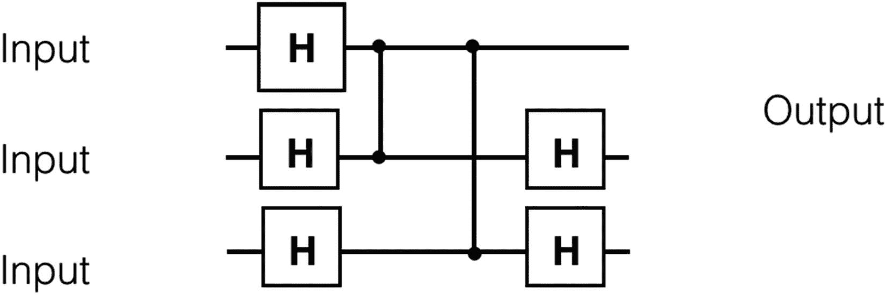

图 4-1

量子电路

量子电路模型基于量子比特的量子纠缠。量子纠缠没有经典对应物。与经典计算机相比，量子计算机利用叠加原理能够以指数级的规模存储数据。使用 `M` 个比特的经典计算机只能存储 `2^(M)` 种组合中的一种。量子计算机则可以存储 `2^(M)` 种信息组合。让我们看看什么是量子纠缠。我们在前面的章节中讨论过量子纠缠。纠缠与一对相互依赖状态的纠缠粒子有关。当它们相隔巨大距离时，也能观察到这种现象。

量子电路用于构建量子计算机。电路由导线和量子门组成。量子逻辑门基于单量子比特门或多量子比特门。这些门是可逆的。量子门用于传输和修改信息。

现在让我们来看图 4-2 中所示的受控非门电路。受控非门是一种多量子比特逻辑门。它是通用量子比特门之一。CNOT 门有两个输入量子比特。这些量子比特分别是控制量子比特和目标量子比特。同样地，CNOT 算子以两个量子比特作为输入。对于这对输入量子比特，一个被称为`控制`量子比特，另一个被称为`目标`量子比特。当你将控制量子比特变为 `|1>` 时，目标量子比特的值会发生翻转。否则，目标量子比特保持不变。

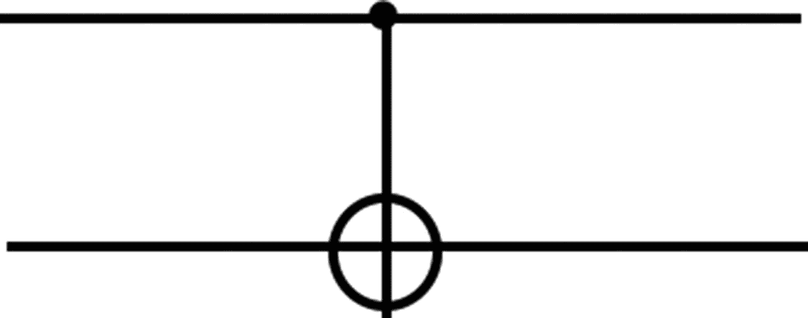

图 4-2

CNOT 门电路

图 4-3 展示了矩阵形式的 CNOT 门电路。

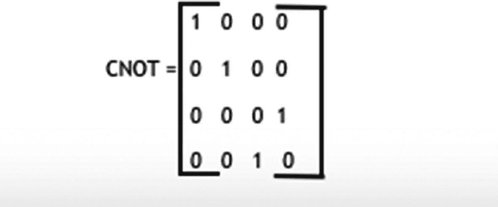

图 4-3

矩阵形式的 CNOT 门电路

让我们看看另一种类型的电路。受控-U 门电路基于受控-U 门。该门对两个量子比特的输入进行操作。第一个量子比特是控制量子比特。图 4-4 展示该电路。受控-U 门包含 `U`，它是一个酉矩阵。该酉矩阵对 `m` 个量子比特进行操作。受控-U 门的一个基本示例是受控非门。

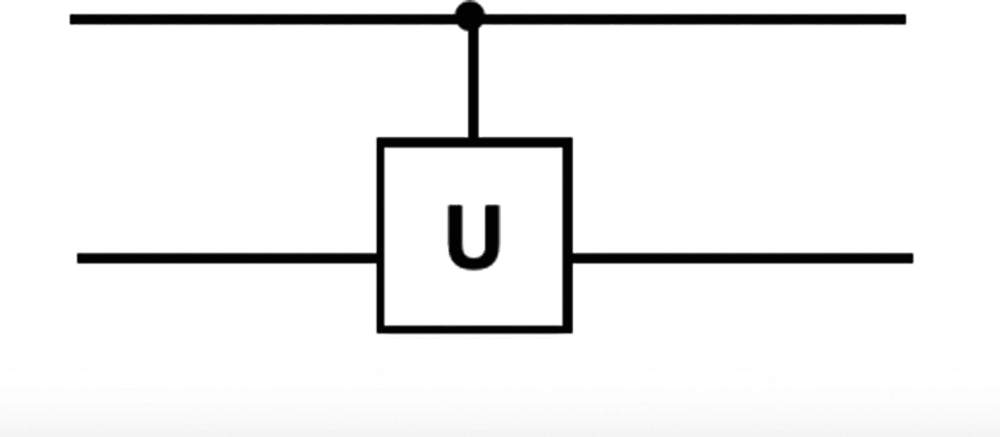

图 4-4

受控-U 门电路

图 4-5 展示了矩阵形式的受控-U 门电路。

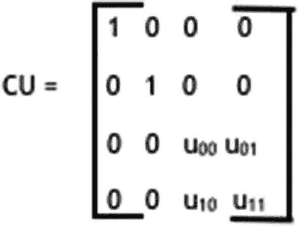

图 4-5

受控-U 门电路矩阵

托佛利门电路是另一种类型的电路，如图 4-6 所示。托佛利门与哈达玛门组合构成一个三量子比特逻辑门。

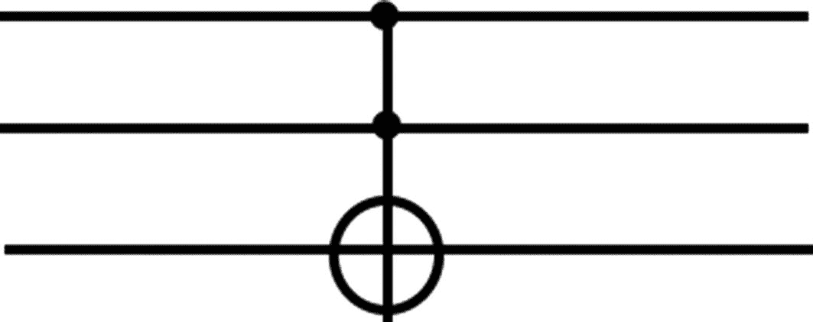

图 4-6

托佛利门电路

托佛利门有三个输入比特和三个输出比特。在三个输入比特中，两个是控制比特，第三个是目标比特。如果控制比特的值为 1，则目标比特翻转。如果控制比特的值不为 1，则控制比特不变。

图 4-7 展示了矩阵形式的托佛利门电路。

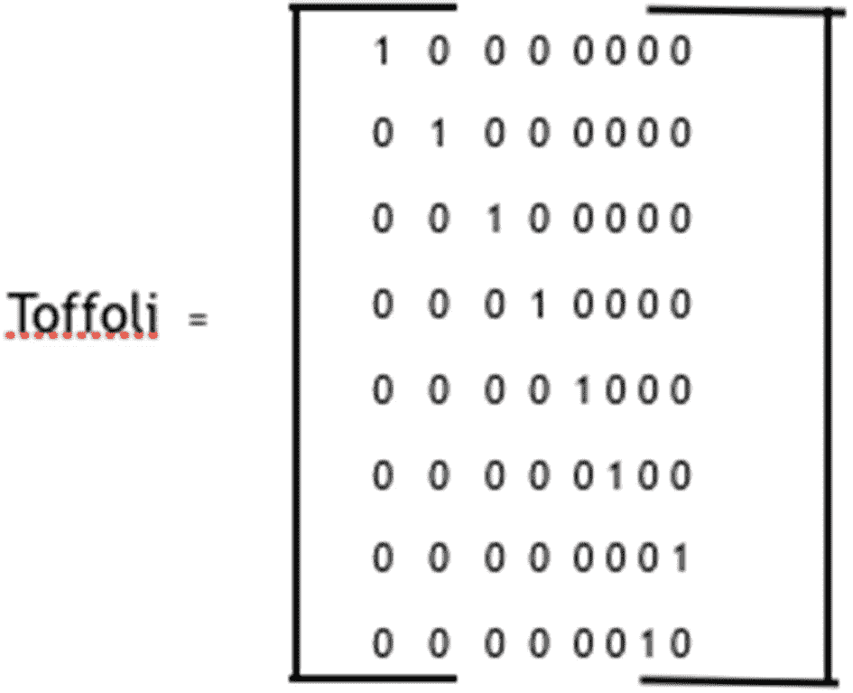

图 4-7

托佛利门电路矩阵

在了解了不同类型的量子电路之后，量子电路模型的最后一步是在计算基上进行的投影测量。这一步是不可逆的。测量有两种类型：延迟测量和隐式测量。`延迟`测量方法允许将量子操作转换为经典等效操作。在这种方法中，测量可以从电路中间阶段移至末端。在`隐式`测量方法中，未被测量的量子比特可以被隐式测量。此方法不会导致通用性损失。

> **注意**
> 量子电路对其机械类比——量子寄存器，执行可逆更改。

## 量子通信

`量子通信`是将量子态从一个点发送到另一个点的过程，如图 4-8 所示。`超密编码`是一种流行的通信协议，由 Bennett 和 Wiesner 于 1992 年首次提出。`量子隐形传态`则涉及无需量子通信即可移动量子态，它是超密编码的一种逆方法。`量子隐形传态`是一种无需在接收方和发送方之间建立量子通信信道即可转移量子态的方法。

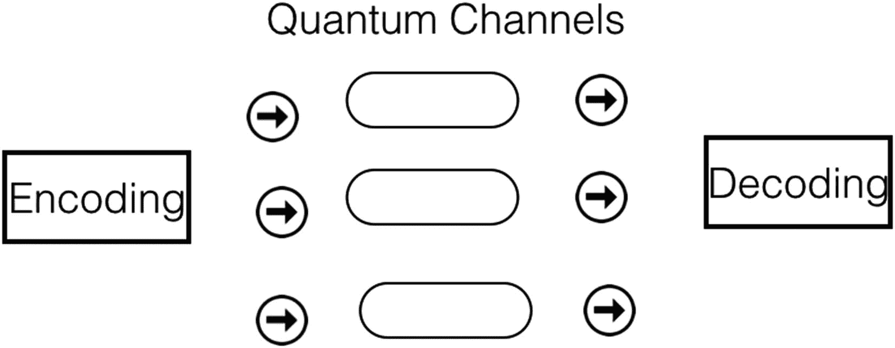

图 4-8

量子通信

在超密编码中，经典信息比特从源端传输到目的地。而在量子隐形传态中，则是利用两个经典比特之间的通信信道来传输量子比特。

超密协议包含一组指令集和输出结果。如果协议能产生预期的输出，则该协议有效。超密协议基于量子纠缠。当单个公共源可以产生多个量子系统时，就会发生量子纠缠。这些量子系统的状态不遵循贝尔不等式规则。相互纠缠的系统即使相隔遥远距离也会相互影响。

我们已经了解了超密量子通信协议；其他协议还包括连续变量、卫星和线性光学量子通信协议。入射光的电场通过零差探测器进行测量，测量结果是一个连续值。连续变量量子通信基于零差探测器的测量结果。卫星通信协议则基于地对卫星和卫星对卫星的通信信道。线性光学量子通信协议基于光纤通信信道。

## 量子噪声

量子噪声的产生源于量子起源的物理实体所具有的不确定性。频谱密度用于测量噪声强度，它以依赖于时间的方式在特定频率下进行测量。量子器件在场被放大时会产生噪声。由于量子场模式的不对易性，量子计算机也会产生噪声。图 4-9 以量子计算形式和波形表示了噪声。

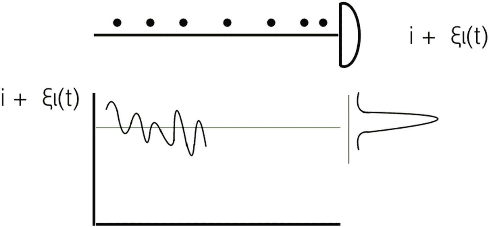

图 4-9

量子噪声

H.B. Callen 和 T.A. Welton 用数学方程表示了频谱密度。Roger H. Koch 首次通过实验测量了量子噪声的频谱实体。频谱密度与时间段的信号周期图相关。在数学上，傅里叶分析是一种通过将函数分解为一组周期图来测量频谱密度的好方法。周期图在数学上是一个时间段序列。

> **注意**
> 量子噪声是由于电路中的信号变化而产生的。信号变化是由于电子的离散特性造成的。

## 量子纠错

量子纠错方法有助于保护量子信息免受量子噪声和退相干误差的影响。量子纠错方法最早于 1995 年提出。图 4-10 展示了量子电路中的纠错过程。

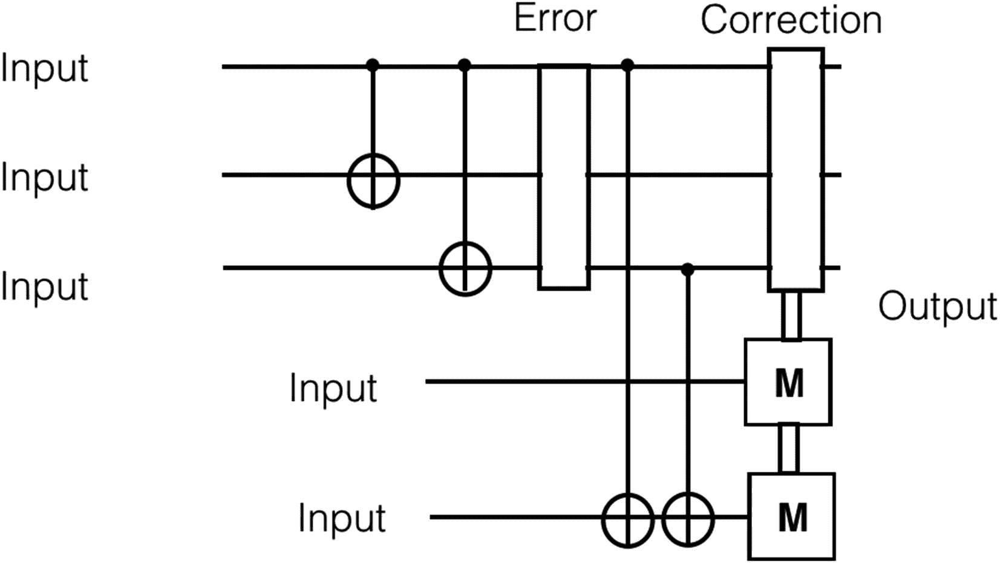

图 4-10

量子纠错

让我们看看经典纠错技术，例如编码。编码与数据克隆有关。由于不可克隆原理，这种技术对量子纠错没有帮助。该原理指出，未知的量子态不能被精确复制。量子纠错不允许存在大量副本。由于量子叠加会失效，因此无法通过直接测量来防止错误。量子错误可能由量子比特翻转、相位偏移和连续错误引起。

现在让我们看看如何修复量子错误。相干技术有助于减少控制误差。由退相干引起的错误是时间依赖性的。对错误进行建模有助于测量误差，而正算子值测度则用于测量这些误差。追踪丢失的量子比特是另一种对量子比特丢失和移除进行建模的方法。纠错首先需要验证系统中量子比特的存在。量子比特的丢失源于重要的控制因素。由 Peter Shor 设计的 Shor 码协议有助于识别和修复来自量子比特的错误。

现在让我们看看 Shor 码协议。Shor 码是一组由三个量子比特的相位翻转码和比特翻转码构成的代码。这种量子代码有助于防范量子比特上的错误影响。量子态通过幺正操作进行运算，从而得到基于量子纠错的代码。该结果将是更大希尔伯特空间`D`子空间的一部分。希尔伯特空间是有限维复向量的内积空间。

### 量子计算的局限性

在探讨不同的量子算法之前，我们先来看一下量子计算的局限性。量子计算机容易因环境而产生错误和问题。退相干的发生是由于对量子比特的状态进行测量导致状态函数坍缩。退相干会在计算中引起错误。量子比特的数量会以指数方式影响退相干的概率。退相干由量子比特翻转、自发对称性破缺和相位翻转编码协议引起。量子比特翻转码根据一定概率翻转量子比特。如果在量子系统上对`F`进行变换可以通过对量子子系统进行变换操作来实现，那么自发对称性破缺协议基于对称群`F`。量子比特相位翻转码则基于根据一定概率进行的相位翻转。

在经典计算中，小错误可以通过使用纠错协议来消除。而在量子计算中，小错误无法被修复。量子系统与环境纠缠在一起，因此错误在计算开始之前就已经被引入。量子比特的初始化会因幺正变换而引入错误。

## 量子算法

算法用于计算和数据处理。现实生活中的情境通过启发式方法和各种技术进行建模和求解。一个算法包含一组用于执行任务的指令。量子算法有助于为经典计算机无法解决的复杂问题提供解决方案。

量子编程语言有助于使用量子算法创建量子软件。量子算法包含以下步骤：将量子数据编码为量子比特、作用于量子比特的幺正量子门链、以及在测量量子比特后终止。幺正量子门类似于作用于量子比特的幺正矩阵。幺正矩阵的逆矩阵等于其共轭转置。

量子计算基于量子力学特性，例如叠加和纠缠。具体来说，量子算法利用了这些原理。

注意

`算法`一词源于`代数学`一词，以阿拉伯数学家阿尔·花拉子密的名字命名。

让我们从 Deutsch–Jozsa 算法开始了解一些量子算法。

## 多伊奇-乔萨算法

多伊奇-乔萨算法由大卫·多伊奇（David Deutsch）和理查德·乔萨（Richard Jozsa）于 1992 年提出。该算法于 1998 年由理查德·克莱夫（Richard Cleve）等人进行了改进。此方法具有非确定性特征，曾为量子计算与经典计算在问题难度之间树立了一道屏障。该技术涉及具有正负值的量子振幅。该算法用于识别黑盒预言函数。图 4-11 展示了一个预言函数的示例。

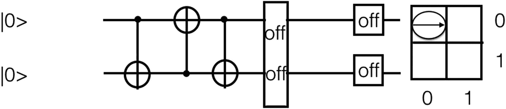

**图 4-11** 预言函数

该算法使用一个黑盒（预言）函数，该函数接收二进制值作为输入，并输出 0 或 1。该方法用于判断所使用的函数 `g` 是常函数还是平衡函数。

在接下来的章节中，我们将讨论该算法的实现。首先，让我们来看看量子寄存器。量子寄存器包含一个构造函数、`GetMeasure` 方法和 `ApplyOperation` 方法。`GetMeasure` 方法用于计算量子态及其概率。`ApplyOperation` 方法将类实例变量 `data` 更新为输入门矩阵与数据实例的乘积。

### 代码示例

**Quantum_Register.py**

```python
import numpy as nump
from itertools import product
from Quantum_Gate import Quantum_Gate

class Quantum_Register:
    def __init__(self, n_qbits, init):
        self._n = n_qbits
        assert len(init) == self._n
        self._data = nump.zeros((2 ** self._n), dtype=nump.complex64)
        self._data[int('0b' + init, 2)] = 1

    def Get_Measure(self):
        probs = nump.real(self._data) ** 2 + nump.imag(self._data) ** 2
        states = nump.arange(2 ** self._n)
        mstate = nump.random.choice(states, size=1, p=probs)[0]
        return f'{mstate:>0{self._n}b}'

    def Apply_Gate(self, gate):
        assert isinstance(gate, Quantum_Gate)
        assert self._n == gate._n
        self._data = gate._data @ self._data
```

现在让我们来看看量子门的实现。它包含一个构造函数、矩阵乘法方法和幂方法。矩阵乘法方法对输入数据和实例数据进行运算，返回一个克罗内克积。幂方法接收输入参数并返回量子门。

I、H、X、Y 和 Z 门在该类中进行了初始化。`U_Quantum_Gate` 门方法根据输入参数创建一个量子门。

### 代码示例

**Quantum_Gate.py**

```markdown
# Quantum Algorithm Implementations

## Deutsch-Jozsa Algorithm

### `Quantum_Gate` Class Implementation

```python
import numpy as nump
from itertools import product

class Quantum_Gate:
    def __init__(self, matrix):
        self._data = nump.array(matrix, dtype=nump.complex64)
        assert len(self._data.shape) == 2
        assert self._data.shape[0] == self._data.shape[1]
        self._n = nump.log2(self._data.shape[0])
        assert self._n.is_integer()
        self._n = int(self._n)

    def __matmul__(self, other):
        return Quantum_Gate(nump.kron(self._data, other._data))

    def __pow__(self, n, modulo=None):
        x = self._data.copy()
        for _ in range(n - 1):
            x = nump.kron(x, self._data)
        return Quantum_Gate(x)

IGate = Quantum_Gate([[1, 0], [0, 1]])
HGate = Quantum_Gate(nump.array([[1, 1], [1, -1]]) / nump.sqrt(2))
XGate = Quantum_Gate([[0, 1], [1, 0]])
YGate = Quantum_Gate([[0, -1j], [1j, 0]])
ZGate = Quantum_Gate([[1, 0], [0, -1]])

def U_Quantum_Gate(f, n):
    m = n + 1
    U = nump.zeros((2**m, 2**m), dtype=nump.complex64)

    def bin2int(xs):
        r = 0
        for i, x in enumerate(reversed(xs)):
            r += x * 2 ** i
        return r

    for xs in product({0, 1}, repeat=m):
        x = xs[:~0]
        y = xs[~0]
        z = y ^ f(*x)
        instate = bin2int(xs)
        outstate = bin2int(list(x) + [z])
        U[instate, outstate] = 1
    return Quantum_Gate(U)
```

函数 `g1_func`、`g2_func`、`g3_func` 和 `g4_func` 如下方代码示例所示。`g1_func` 接收 `v` 并返回 `v`。`g2_func` 接收 `v` 作为输入值，并返回值 1。`g3_func` 接收 `v` 和 `w` 作为输入值，并返回 `v` 和 `w` 的二进制异或结果。`g4_func` 接收 `v`、`w` 和 `x` 作为输入值，并返回零值。`CheckIfConstant` 方法接收输入函数和一个整数，用于验证该函数是常函数还是平衡函数。

### 代码示例

**`Deutsch_Jozsa_Algorithm.py`**

```python
from Quantum_Register import Quantum_Register
from Quantum_Gate import HGate, IGate, UGate

def Check_If_Constant(g, n):
    qr = Quantum_Register(n + 1, '0' * n + '1')
    qr.Apply_Gate(HGate ** (n + 1))
    qr.Apply_Gate(UGate(g, n))
    qr.Apply_Gate(HGate ** n @ IGate)
    return qr.Get_Measure()[:~0] == '0' * n

def g1_func(v):
    return v

def g2_func(w):
    return 1

def g3_func(v, w):
    return v ^ w

def g4_func(v, w,x):
    return 0

print('g(v) = v 是 {}'.format('常函数' if Check_If_Constant(g1_func, 1) else '平衡函数'))
print('g(v) = 1 是 {}'.format('常函数' if Check_If_Constant(g2_func, 1) else '平衡函数'))
print('g(v, w) = v ^ w 是 {}'.format('常函数' if Check_If_Constant(g3_func, 2) else '平衡函数'))
print('g(v, w, x) = 0 是 {}'.format('常函数' if Check_If_Constant(g4_func, 3) else '平衡函数'))
```

### 执行命令

```bash
pip3 install numpy
python3 Deutsch_Jozsa_Algorithm.py
```

### 输出

```
g(v) = v 是 平衡函数
g(v) = 1 是 常函数
g(v, w) = v ^ w 是 平衡函数
g(v, w, x) = 0 是 常函数
```

**注意：** 一个平衡布尔函数输出的布尔值 0 和 1 的数量相等。常函数的输出值是一个常数。

## 西蒙算法

现在让我们来看看西蒙量子算法。该算法有助于识别一个黑盒函数 `h(x)`，其中 `h(x) = h(y)` 且 `x = y ⊕ t`。请注意，`t ∈ {0, 1}^n`，而 `⊕` 表示基于模 2 的按位加法。该算法的目标是通过使用 `h` 来找到 `t`。这个量子算法的性能在指数级上优于其经典对应算法。该算法启发了肖尔（Shor）提出了肖尔算法。

让我们来看看该算法的 Python 代码实现。

`RetrieveOnetoOneMap` 方法将输入掩码作为参数，并返回输出，该输出是一个位图函数。`RetrieveValidTwoToOneMap` 方法接收搜索掩码和随机种子作为输入参数。它返回的输出是一个二对一映射函数。

### 代码示例

**`Simons_Algorithm.py`**
```

```python
from collections import defaultdict
import numpy as nump
from mock import patch
from collections import defaultdict
from operator import xor
from typing import Dict, Tuple, List
import numpy.random as rand
from pyquil import Program
from pyquil.api import QuantumComputer
from pyquil.gates import H, MEASURE

def RetrieveOnetoOneMap(mask: str) -> Dict[str, str]:
    n_bits = len(mask)
    form_string = "{0:0" + str(n_bits) + "b}"
    bit_map_dct = {}
    for idx in range(2**n_bits):
        bit_string = form_string.format(idx)
        bit_map_dct[bit_string] = InvokeBitwiseXorOperation(bit_string, mask)
    return bit_map_dct

def RetrieveValidTwotoOneMap(mask: str, random_seed: int = None) -> Dict[str, str]:
    if random_seed is not None:
        rand.seed(random_seed)
    bit_map = RetrieveOnetoOneMap(mask)
    n_samples = int(len(bit_map.keys()) / 2)
    range_of_2to1_map = list(rand.choice(list(sorted(bit_map.keys())), replace=False, size=n_samples))
    list_of_bitstring_tuples = sorted([(k, v) for k, v in bit_map.items()], key=lambda x: x[0])
    bit_map_dct = {}
    for cnt in range(n_samples):
        bitstring_tup = list_of_bitstring_tuples[cnt]
        val = range_of_2to1_map[cnt]
        bit_map_dct[bitstring_tup[0]] = val
        bit_map_dct[bitstring_tup[1]] = val
    return bit_map_dct
```

`Simons_Algorithm`类用于查找满足一组值的黑盒函数。它有一个构造函数和以下方法：`RetrieveSimonCircuit`、`CalculateUnitaryOracleMatrix`、`RetrieveBitMaskRetrieveSampleIndependentBits`、`RetrieveInverseMaskEquation`、`AppendToDictofIndepBits`、`RetrieveMissingMsbVector`和`CheckValidMaskIfCorrect`。`RetrieveSimonCircuit`方法将量子比特作为输入，并返回输出，即量子电路。

`Simons_Algorithm`类的`CalculateUnitaryOracleMatrix`方法接受比特字符串的输入映射。输出将是一个稠密矩阵，该矩阵是字典中值的排列。`Simons_Algorithm`类的`RetrieveBitMask`方法接受量子计算机和比特字符串作为输入。输出是一个比特字符串映射。

`RetrieveSampleIndependentBits`方法接受量子计算机和比特字符串作为输入。独立比特向量会随着比特字符串更新。`RetrieveInverseMaskEquation`方法根据输入函数创建比特掩码。`AppendToDictofIndepBits`方法接受一个数组作为输入。此方法将独立向量添加到字典中。`RetrieveMissingMsbVector`方法在独立比特向量集合中搜索来源值。该方法通过添加单位向量来修改集合。`CheckValidMaskIfCorrect`方法验证给定的掩码是否正确。

现在来看看什么是独立向量。如果两个向量不为零且不平行，则它们线性无关。线性独立向量通常是非零向量。反过来也是如此。在独立向量之后，我们再看看什么是比特掩码。比特掩码有助于检索给定字节中的比特。

```python
class `Simons_Algorithm`:
    def `__init__`(`self`):
        `self`.unitary_function_mapping = None
        `self`.n_qubits = None
        `self`.n_ancillas = None
        `self`._qubits = None
        `self`.computational_qubits = None
        `self`.ancillas = None
        `self`.simon_circuit = None
        `self`._dict_of_linearly_indep_bit_vectors = {}
        `self`.search_mask = None
        `self`.bit_map = None
        `self`.classical_register = None

    def `RetrieveSimonCircuit`(`self`) -> `Program`:
        simon_circuit = `Program`()
        oracle_name = "SIMON_ORACLE_FUNCTION"
        simon_circuit.defgate(`oracle_name`, `self`.unitary_function_mapping)
        simon_circuit.inst([`H`(i) for i in `self`.computational_qubits])
        simon_circuit.inst(tuple([`oracle_name`] + sorted(`self`._qubits, reverse=True)))
        simon_circuit.inst([`H`(i) for i in `self`.computational_qubits])
        return simon_circuit

    def `_Initialize_Attributes`(`self`, bitstring_map: `Dict[str, str]`) -> None:
        `self`.bit_map = `bitstring_map`
        `self`.n_qubits = len(list(`bitstring_map`.keys())[0])
        `self`.n_ancillas = `self`.n_qubits
        `self`._qubits = list(range(`self`.n_qubits + `self`.n_ancillas))
        `self`.computational_qubits = `self`._qubits[:`self`.n_qubits]
        `self`.ancillas = `self`._qubits[`self`.n_qubits:]
        `self`.unitary_function_mapping, _ = `self`.CalculateUnitaryOracle(`bitstring_map`)
        `self`.simon_circuit = `self`.RetrieveSimonCircuit()
        `self`._dict_of_linearly_indep_bit_vectors = {}
        `self`.search_mask = None

    @staticmethod
    def `CalculateUnitaryOracle`(bitstring_map: `Dict[str, str]`) -> `Tuple[nump.ndarray, Dict[str, str]]`:
        n_bits = len(list(`bitstring_map`.keys())[0])
        ufunc = `nump`.zeros(shape=(2 ** (2 * n_bits), 2 ** (2 * n_bits)))
        index_mapping_dct = `defaultdict`(dict)
        for b in range(2**n_bits):
            pad_str = `nump`.binary_repr(b, n_bits)
            for k, v in `bitstring_map`.items():
                index_mapping_dct[`pad_str` + k] = `InvokeBitwiseXorOperation`(`pad_str`, v) + k
                i, j = int(`pad_str`+k, 2), int(`InvokeBitwiseXorOperation`(`pad_str`, v) + k, 2)
                ufunc[i, j] = 1
        return ufunc, index_mapping_dct

    def `RetrieveBitMask`(`self`, qc: `QuantumComputer`, bitstring_map: `Dict[str, str]`) -> str:
        `self`._Initialize_Attributes(`bitstring_map`)
        `self`.RetrieveSampleIndependentBits(`qc`)
        `self`.RetrieveInverseMaskEquation()
        if `self`.CheckValidMaskIfCorrect():
            return `self`.search_mask
        else:
            raise Exception("No valid mask found")

    def `RetrieveSampleIndependentBits`(`self`, quantum_computer: `QuantumComputer`) -> None:
        while len(`self`._dict_of_linearly_indep_bit_vectors) < `self`.n_qubits:
            bit_vec = `self`.QuantumComputerSampleVector(`quantum_computer`)
            `self`.AppendToDictofIndepBits(bit_vec)

    def `AppendToDictofIndepBits`(`self`, z: `nump.ndarray`) -> None:
        if (`z` == 0).all() or (`z` == 1).all():
            return None
        msb_z = `RetrieveMostSignificantBit`(`z`)
        if msb_z not in `self`._dict_of_linearly_indep_bit_vectors.keys():
            `self`._dict_of_linearly_indep_bit_vectors[msb_z] = z
        else:
            conflict_z = `self`._dict_of_linearly_indep_bit_vectors[msb_z]
            not_z = [`xor`(conflict_z[idx], z[idx]) for idx in range(len(z))]
            if (`nump`.asarray(not_z) == 0).all():
                return None
            msb_not_z = `most_significant_bit`(`nump`.asarray(not_z))
            if msb_not_z not in `self`._dict_of_linearly_indep_bit_vectors.keys():
                `self`._dict_of_linearly_indep_bit_vectors[msb_not_z] = not_z

    def `RetrieveMissingMsbVector`(`self`) -> int:
        missing_msb = None
        for idx in range(`self`.n_qubits):
            if idx not in `self`._dict_of_linearly_indep_bit_vectors.keys():
                missing_msb = idx
                break
        if missing_msb is None:
            raise ValueError("Expected a missing provenance, but didn't find one.")
        augment_vec = `nump`.zeros(shape=(`self`.n_qubits,))
        augment_vec[missing_msb] = 1
        `self`._dict_of_linearly_indep_bit_vectors[missing_msb] = augment_vec.astype(int).tolist()
        return missing_msb

    def `CheckValidMaskIfCorrect`(`self`) -> bool:
        mask_str = ''.join([str(b) for b in `self`.search_mask])
        return all([`self`.bit_map[k] == `self`.bit_map[`InvokeBitwiseXorOperation`(k, mask_str)] for k in `self`.bit_map.keys()])

`PADDED_BINARY_BIT_STRING` = "{0:0{1:0d}b}"

def `CheckValidIfUnitary`(matrix: `nump.ndarray`) -> bool:
    rows, cols = matrix.shape
    if rows != cols:
        return False
    return `nump`.allclose(`nump`.eye(rows), matrix.dot(matrix.T.conj()))

def `RetrieveMostSignificantBit`(lst: `nump.ndarray`) -> int:
    return `nump`.argwhere(`nump`.asarray(lst) == 1)[0][0]

def `InvokeBitwiseXorOperation`(bs0: str, bs1: str) -> str:
    if len(bs0) != len(bs1):
        raise ValueError("Bit strings are not of equal length")
    n_bits = len(bs0)
    return `PADDED_BINARY_BIT_STRING`.format(`xor`(int(bs0, 2), int(bs1, 2)), n_bits)

def `RetrieveBinaryBackSubstitute`(W: `nump.ndarray`, s: `nump.ndarray`) -> `nump.ndarray`:
    m = `nump`.copy(s)
    n = len(s)
    for row_num in range(n - 2, -1, -1):
        row = W[row_num]
        for col_num in range(row_num + 1, n):
            if row[col_num] == 1:
                m[row_num] = `xor`(s[row_num], s[col_num])
    return m[::-1]

search_mask = '110'
bm = `RetrieveValidTwotoOneMap`(`search_mask`, random_seed=42)
expected_map = {
    '000': '001',
    '001': '101',
    '010': '000',
    '011': '111',
    '100': '000',
    '101': '111',
    '110': '001',
    '111': '101'
}
for k, v in `bm`.items():
    assert v == `expected_map`[k]

reverse_bitmap = `defaultdict`(list)
for k, v in `bm`.items():
    reverse_bitmap[v].append(k)
expected_reverse_bitmap = {
    '001': ['000', '110'],
    '101': ['001', '111'],
    '000': ['010', '100'],
    '111': ['011', '101']
}
for k, v in `reverse_bitmap`.items():
    assert sorted(v) == sorted(`expected_reverse_bitmap`[k])

with `patch`("pyquil.api.QuantumComputer") as quantum_computer:
    quantum_computer.run.side_effect = [
        (`nump`.asarray([0, 1, 1], dtype=int), ),
        (`nump`.asarray([1, 1, 1], dtype=int), ),
        (`nump`.asarray([1, 1, 1], dtype=int), ),
        (`nump`.asarray([1, 0, 0], dtype=int), ),
    ]
    simon_algo = `Simons_Algorithm`()
    result_mask = simon_algo.`RetrieveBitMask`(`quantum_computer`, bm)
    print("mask", search_mask," result mask", result_mask)
```

### 执行命令
```
pip3 install numpy
pip3 install pyquil
python3 Simons_Algorithm.py
```

### 输出结果
```
mask 110  result mask [1, 1, 0]
```

## 肖尔算法

彼得·肖尔（Peter Shor）于 1994 年率先提出了一种用于整数因式分解的量子算法。肖尔算法能在多项式时间内完成整数`M`的因式分解，其时间复杂度为`O(logN)`，性能优于经典算法。此外，该算法具有破解 RSA 加密方法的潜力。

该算法接收一个数字`M`，并在`1`到`M`之间找到一个能整除`M`的整数`q`。算法分为两步：将因式分解问题归约为求阶方法，以及执行求阶技术。

我们先来看经典解法。对于`b < M`，计算最大公约数`gcd(b,M)`。该计算采用欧几里得方法执行，步骤如下：

- 如果`gcd(b,M) != 1`，则存在`M`的非平凡因子，问题解决。
- 如果`gcd(b,M) == 1`，则求`g(x) = ax mod M`的周期，以找到满足`g(x+r) = g(x)`的`r`（此步骤为步骤 1）。
    - 如果`r`为奇数，则返回步骤 1。
    - 如果`ar/2 = -1 (mod M)`，则返回步骤 1。
    - `gcd(ar/2 +- 1, M)`是`M`的一个非平凡因子，问题解决。

接下来看量子算法。该算法的量子电路基于`g(x) = ax mod M`中的`M`和`a`：给定`M`，有`Q= 2q`且`Q/r > M`。输入和输出量子比特分别具有从`0`到`Q-1`的值的叠加态，且各包含`q`个量子比特。`g(x)`函数用于变换量子比特的状态。最终状态将是多个`Q`状态的叠加，即`Q²`个状态。

我们来看肖尔算法在 Python 中的实现。

肖尔算法用于质因数分解。`QuantumMap`类具有`state`和`amplitude`属性。`QuantumEntanglement`类具有`amplitude`、`register`和`entangled`属性。`QuantumEntanglement`类的`UpdateEntangled`方法接收`state`和`amplitude`等输入参数。`RetrieveEntangles`方法返回纠缠态的列表。

### 代码示例

`Shors_Algorithm.py`

```python
class QuantumMap:
    def __init__(self, state, amplitude):
        self.state = state
        self.amplitude = amplitude

class QuantumEntanglement:
    def __init__(self, amplitude, register):
        self.amplitude = amplitude
        self.register = register
        self.entangled = {}
    def UpdateEntangled(self, fromState, amplitude):
        register = fromState.register
        entanglement = QuantumMap(fromState, amplitude)
        try:
            self.entangled[register].append(entanglement)
        except KeyError:
            self.entangled[register] = [entanglement]
    def RetrieveEntangles(self, register = None):
        entangles = 0
        if register is None:
            for states in self.entangled.values():
                entangles += len(states)
        else:
            entangles = len(self.entangled[register])
        return entangles
```

`QuantumRecord`类具有`numBits`、`numStates`、一个`entangled`列表和一个`states`数组。`QuantumRecord`类的`SetPropagate`属性接收`fromRegister`作为参数，并在该寄存器上设置传播。`UpdateMap`方法接收`toRegister`、`mapping`和`propagate`等输入参数，该方法会设置归一化的`tensorX`和`tensorY`列表。`QuantumRecord`类的`FindMeasure`方法返回输出结果，即最终的`X`状态。`RetrieveEntangles`方法接收`register`作为输入，返回输出结果，即纠缠态的值。`RetrieveAmplitudes`方法返回输出结果，即量子态的振幅数组。

### 代码示例

```python
class QuantumRecord:
    def __init__(self, numBits):
        self.numBits = numBits
        self.numStates = 1
        self.states = []
        self.entangled = []
    # ... (其他方法定义省略)
    def measure:
        finalState = state
        finalX = x
        break
    if finalState is not None:
        for state in self.states:
            state.amplitude = complex(0.0)
        finalState.amplitude = complex(1.0)
        self.UpdatePropagate()
        return finalX
    def RetrieveEntangles(self, register = None):
        entangles = 0
        for state in self.states:
            entangles += state.entangles(None)
        return entangles
    def RetrieveAmplitudes(self):
        amplitudes = []
        for state in self.states:
            amplitudes.append(state.amplitude)
        return amplitudes
```

`FindListEntangles`方法打印纠缠列表。`FindListAmplitudes`方法打印寄存器振幅的值。`InvokeHadamard`方法接收`lambda x`和量子比特作为输入，返回`codomain`数组作为输出。`InvokeQModExp`方法接收输入参数`aval`、指数`expval`和运算符值`modval`，通过`InvokeModExp`方法计算状态。

`InvokeQft`方法接收参数`x`和量子比特`Q`作为输入，通过`InvokeQft`方法返回状态与振幅的量子映射。`FindPeriod`方法接收输入`a`和`N`，并返回该函数的周期`r`作为输出。

`ExecuteShors`方法接收参数`N`、`attempts`、`neighborhood`和`numPeriods`作为输入，该方法应用肖尔算法来找出给定数字`N`的质因数。

```python
def FindListEntangles(register):
    print("纠缠态：" + str(register.RetrieveEntangles()))
def FindListAmplitudes(register):
    amplitudes = register.amplitudes()
    for x, amplitude in enumerate(amplitudes):
        print('状态 #' + str(x) + '的振幅值：' + str(amplitude))
def InvokeHadamard(x, Q):
    codomain = []
    for y in range(Q):
        amplitude = complex(pow(-1.0, RetrieveBitCount(x & y) & 1))
        codomain.append(QuantumMap(y, amplitude))
    return codomain
def InvokeQModExp(a, exp, mod):
    state = InvokeModExp(a, exp, mod)
    amplitude = complex(1.0)
    return [QuantumMap(state, amplitude)]
def InvokeQft(x, Q):
    fQ = float(Q)
    k = -2.0 * math.pi
    codomain = []
    for y in range(Q):
        theta = (k * float((x * y) % Q)) / fQ
        amplitude = complex(math.cos(theta), math.sin(theta))
        codomain.append(QuantumMap(y, amplitude))
    return codomain
def DeterminePeriod(a, N):
    nNumBits = N.bit_length()
    inputNumBits = (2 * nNumBits) - 1
    inputNumBits += 1 if ((1 << inputNumBits) < N * N) else 0
    Q = 1 << inputNumBits
    print("Q = " + str(Q) + "\ta = " + str(a))
    print("寄存器已创建")
    print("对输入寄存器执行阿达玛变换")
    inputRegister = []
    for x in range(Q):
        inputRegister.append(InvokeHadamard(x, Q))
    print("阿达玛变换已应用")
    print("将输入寄存器映射到输出寄存器")
    outputRegister = []
    for x in range(Q):
        outputRegister.append(InvokeQModExp(a, x, N))
    print("模指数运算已应用")
    print("对输出寄存器应用量子傅里叶变换")
    qftRegister = []
    for x in range(Q):
        qftRegister.append(InvokeQft(x, Q))
    print("量子傅里叶变换已应用")
    print("获取输出寄存器的测量值")
    y = random.randint(0, Q - 1)
    print("测量输出寄存器\ty = " + str(y))
    print("获取周期寄存器的测量值")
    x = random.randint(0, Q - 1)
    print("测量 QFT 寄存器\tx = " + str(x))
    print("通过连分数获取周期")
    r = RetrieveContinuedFraction(x, Q, N)
    print("确定的候选周期\tr = " + str(r))
    return r
def RetrieveBitCount(x):
    sumBits = 0
    while x > 0:
        sumBits += x & 1
        x >>= 1
    return sumBits
def RetrieveGcd(a, b):
    while b != 0:
        tA = a % b
        a = b
        b = tA
    return a
def RetrieveExtendedGCD(a, b):
    fractions = []
    while b != 0:
        fractions.append(a // b)
        tA = a % b
        a = b
        b = tA
    return fractions
def RetrieveContinuedFraction(y, Q, N):
    fractions = RetrieveExtendedGCD(y, Q)
    depth = 2
    def RetrievePartial(fractions, depth):
        c = 0
        r = 1
        for i in reversed(range(depth)):
            tR = fractions[i] * r + c
            c = r
            r = tR
        return c
    r = 0
    for d in range(depth, len(fractions) + 1):
        tR = RetrievePartial(fractions, d)
        if tR == r or tR >= N:
            return r
        r = tR
    return r
def InvokeModExp(a, exp, mod):
    fx = 1
    while exp > 0:
        if (exp & 1) == 1:
            fx = fx * a % mod
        a = (a * a) % mod
        exp = exp >> 1
    return fx
def RetrieveRandom(N):
    a = math.floor((random.random() * (N - 1)) + 0.5)
    return a
def RetrieveNeighBorCandidates(a, r, N, neighborhood):
    if r is None:
        return None
    for k in range(1, neighborhood + 2):
        tR = k * r
        if InvokeModExp(a, a, N) == InvokeModExp(a, a + tR, N):
            return tR
    for tR in range(r - neighborhood, r):
        if InvokeModExp(a, a, N) == InvokeModExp(a, a + tR, N):
            return tR
    for tR in range(r + 1, r + neighborhood + 1):
        if InvokeModExp(a, a, N) == InvokeModExp(a, a + tR, N):
            return tR
    return None
def ExecuteShorsAlgorithm(N, attempts = 1, neighborhood = 0.0, numPeriods = 1):
    periods = []
    neighborhood = math.floor(N * neighborhood) + 1
    print("N 值为" + str(N))
    print("邻域值为 = " + str(neighborhood))
    print("周期数为 = " + str(numPeriods))
    for attempt in range(attempts):
        print("\n 尝试 #" + str(attempt))
        a = RetrieveRandom(N)
        while a < 2 or a >= N:
            a = RetrieveRandom(N)
        d = RetrieveGcd(a, N)
        if d > 1:
            print("通过经典方式确定因子，重新尝试")
            continue
        r = DeterminePeriod(a, N)
        print("验证候选周期、邻近值及其倍数")
        r = RetrieveNeighBorCandidates(a, r, N, neighborhood)
        if r is None:
            print("未确定周期，重新尝试")
            continue
        if (r % 2) > 0:
            print("周期为奇数，重新尝试")
            continue
        d = InvokeModExp(a, (r // 2), N)
        if r == 0 or d == (N - 1):
            print("周期是平凡的，重新尝试")
            continue
        print("找到周期\tr = " + str(r))
        periods.append(r)
        if(len(periods) < numPeriods):
            continue
        print("\n 确定所有周期的最小公倍数")
        r = 1
        for period in periods:
            d = RetrieveGcd(period, r)
            r = (r * period) // d
        b = InvokeModExp(a, (r // 2), N)
        f1 = RetrieveGcd(N, b + 1)
        f2 = RetrieveGcd(N, b - 1)
        return [f1, f2]
    return None
results = ExecuteShorsAlgorithm(35, 20, 0.01, 2)
print("结果为：\t" + str(results[0]) + ", " + str(results[1]))
```

### 执行命令

```
pip3 install numpy
python3 Shors_Algorithm.py
```

### 输出

```
N = 35
邻域 = 1
周期数 = 2
尝试 #0
正在打印周期...
Q = 2048     a = 4
寄存器已创建
对输入寄存器执行阿达玛变换
阿达玛变换已应用
将输入寄存器映射到输出寄存器
模指数运算已应用
对输出寄存器应用量子傅里叶变换
量子傅里叶变换已应用
获取输出寄存器的测量值
测量输出寄存器      y = 9
获取周期寄存器的测量值
测量 QFT 寄存器      x = 1024
通过连分数获取周期
Traceback (most recent call last):
File "Shors_Algorithm.py", line 384, in <module>
results = ExecuteShorsAlgorithm(35, 20, 0.01, 2)
File "Shors_Algorithm.py", line 343, in ExecuteShorsAlgorithm
r = DeterminePeriod(a, N)
File "Shors_Algorithm.py", line 230, in DeterminePeriod
r = RetrieveContinuedFraction(x, Q, N)
File "Shors_Algorithm.py", line 281, in RetrieveContinuedFraction
tR = RetrievePartial(fractions, d)
NameError: name 'RetrievePartial' is not defined
apples-MacBook-Air:chapter4 bhagvan.kommadi$ python3 Shors_Algorithm.py
N 值为 35
邻域值为 = 1
周期数为 = 2
尝试 #0
周期为...
Q = 2048     a = 24
寄存器已实例化
对输入执行阿达玛变换
已调用阿达玛变换操作
将输入寄存器映射到输出
已调用模指数运算
对输出执行量子傅里叶变换
已调用量子傅里叶变换
获取输出上的测量值
测量输出寄存器      y = 1
获取周期性测量值
测量 QFT       x = 1707
通过连分数获取周期
确定的候选周期     r = 6
验证候选周期、邻近值及其倍数
周期是平凡的，重新尝试
尝试 #1
通过经典方式确定因子，重新尝试
尝试 #2
周期为...
Q = 2048     a = 23
寄存器已实例化
对输入执行阿达玛变换
已调用阿达玛变换操作
将输入寄存器映射到输出
已调用模指数运算
对输出执行量子傅里叶变换
已调用量子傅里叶变换
获取输出上的测量值
测量输出寄存器      y = 16
获取周期性测量值
测量 QFT       x = 1196
通过连分数获取周期
确定的候选周期     r = 12
验证候选周期、邻近值及其倍数
找到周期     r = 12
尝试 #3
周期为...
Q = 2048     a = 2
寄存器已实例化
对输入执行阿达玛变换
已调用阿达玛变换操作
将输入寄存器映射到输出
已调用模指数运算
对输出执行量子傅里叶变换
已调用量子傅里叶变换
获取输出上的测量值
测量输出寄存器      y = 4
获取周期性测量值
测量 QFT       x = 1365
通过连分数获取周期
确定的候选周期     r = 3
验证候选周期、邻近值及其倍数
未确定周期，重新尝试
尝试 #4
周期为...
Q = 2048     a = 19
寄存器已实例化
对输入执行阿达玛变换
已调用阿达玛变换操作
将输入寄存器映射到输出
已调用模指数运算
对输出执行量子傅里叶变换
已调用量子傅里叶变换
获取输出上的测量值
测量输出寄存器      y = 1
获取周期性测量值
测量 QFT       x = 683
通过连分数获取周期
确定的候选周期     r = 3
验证候选周期、邻近值及其倍数
周期是平凡的，重新尝试
尝试 #5
周期为...
Q = 2048     a = 29
寄存器已实例化
对输入执行阿达玛变换
已调用阿达玛变换操作
将输入寄存器映射到输出
已调用模指数运算
对输出执行量子傅里叶变换
已调用量子傅里叶变换
获取输出上的测量值
测量输出寄存器      y = 29
获取周期性测量值
测量 QFT       x = 1024
通过连分数获取周期
确定的候选周期     r = 2
验证候选周期、邻近值及其倍数
找到周期     r = 2
确定所有周期的最小公倍数
结果为：     1, 35
```

## 格罗弗算法

`Grover` 算法用于搜索数据库。该搜索算法可以在包含 `M` 条记录的数据库中，以 `O(√N)` 的时间和 `O(logN)` 的空间找到一条记录。该方法由洛夫·格罗弗于 1996 年发现。他发现，与其他量子算法相比，他的方法能提供二次加速。此外，`Grover` 方法相比经典算法具有指数级的速度提升。

`Grover` 算法用于对函数求逆。假设 `y = g(x)`。`Grover` 算法能够在给定输入 `y` 时找到 `x`。在数据库中搜索 `y` 的值，类似于寻找 `x` 的匹配项。它在通过对可能解集进行穷举搜索来解决 NP 难题时非常流行。你可以使用 `Grover` 算法，在 `√M` 步内，从包含 `M` 条记录的电话簿中搜索一个电话号码。

`Grover` 算法包含以下步骤：

1.  将系统初始化为初始状态。

2.  执行格罗弗迭代 `r(M)` 次。

3.  测量振幅 `Ω`。

4.  从 `Ωw`（结果）中找到 `w`。

让我们来看看 `Grover` 算法的 Python 实现。

`Grover` 搜索算法通过计算平均振幅和 `Grover` 振幅来搜索一组数据中的目标值。该图表根据 `Grover` 算法推导出的振幅绘制而成。图表展示了具有最高振幅的目标值。`ApplyOracleFunction` 方法接收输入 `x`，并返回 `x` 的十六进制摘要作为输出。`ApplyGrover’s` 算法将目标、对象、`nvalue` 和轮次作为输入，并返回振幅作为输出。

该算法的目标是在字符串对象组 `{'14', '5', '13', '7','9','11','97'}` 中搜索 `9`。根据值 `1 / 集合长度 (9) 的平方根` ，从字典（字符串对象组）中搜索振幅。

### 代码示例

`Grovers_Algorithm.py`

# Grover 算法实现与量子子程序

```python
import matplotlib.pyplot as plot
import numpy as nump
import string
import hashlib
from math import sqrt, pi
from collections import OrderedDict
from statistics import mean

def RenderGraph(amplitude_value, n):
    y_position = nump.arange(n)
    plot.bar(y_position, amplitude_value.values(), align="center", color="g")
    plot.xticks(y_position, amplitude_value.keys())
    plot.ylabel('Amplitude Value')
    plot.title('Grovers Algorithm')
    plot.show()

def ApplyOracleFunction(xvalue):
    return hashlib.sha256(bytes(xvalue, 'utf-8')).hexdigest()

def ApplyGroverAlgorithm(target, objects, nvalue, rounds):
    y_pos = nump.arange(nvalue)
    amplitude = OrderedDict.fromkeys(objects, 1/sqrt(nvalue))
    for i in range(0, rounds, 2):
        for k, v in amplitude.items():
            if ApplyOracleFunction(k) == target:
                amplitude[k] = v * -1
        average = mean(amplitude.values())
        for k, v in amplitude.items():
            if ApplyOracleFunction(k) == target:
                amplitude[k] = (2 * average) + abs(v)
                continue
            amplitude[k] = v-(2*(v-average))
    return amplitude

target_algorithm = '9'
objects_grover = ('14', '5', '13', '7','9','11','97')
number = len(objects_grover)
amplitude_grover = OrderedDict.fromkeys(objects_grover, 1/sqrt(number))
amplitude_grover[target_algorithm] = amplitude_grover[target_algorithm] * -1
print(amplitude_grover)
average_grover = mean(amplitude_grover.values())
print("Mean is {}".format(average_grover))
for k, v in amplitude_grover.items():
    if k == target_algorithm:
        amplitude_grover[k] = (2 * average_grover) + abs(v)
        continue
    amplitude_grover[k] = v-(2*(v-average_grover))
print(amplitude_grover)

needle_value = "2d711642b726b04401627ca9fbac32f5c8530fb1903cc4db02258717921a4881"
haystack_value = string.ascii_lowercase
num = len(haystack_value)
num_rounds = int((pi / 4) * sqrt(num))
print("number of rounds are {}".format(num_rounds))
RenderGraph(ApplyGroverAlgorithm(needle_value, haystack_value, num, num_rounds), num)
```

### 执行命令

```bash
pip3 install numpy
python3 Grovers_Algorithm.py
```

### 输出

```
OrderedDict([('4', 0.3779644730092272), ('5', 0.3779644730092272), ('3', -0.3779644730092272), ('7', 0.3779644730092272), ('9', 0.3779644730092272), ('11', 0.3779644730092272), ('97', 0.3779644730092272)])
Mean is 0.26997462357801943
OrderedDict([('4', 0.16198477414681167), ('5', 0.16198477414681167), ('3', 0.9179137201652661), ('7', 0.16198477414681167), ('9', 0.16198477414681167), ('11', 0.16198477414681167), ('97', 0.16198477414681167)])
number of rounds are 4
```

## 量子子程序

量子计算机模拟器旨在模拟一个大小为 `n` 个量子比特的量子计算机。现在已有量子计算机模拟软件包，可用于编写量子计算相关的软件。这些软件包就像黑盒一样，抽象了量子算法的方法和技术。量子傅里叶变换、`QPhase` 和矩阵求逆子程序都可在这些软件包中找到，以帮助解决现实世界中的复杂问题。

这些软件包包括 `Project Q`、`IBM Quantum Experience`、`PennyLane`、`QuidPro`、`Liquid` 等。可以使用这些软件包来模拟量子电路，进行分析和计算。

这些应用程序是使用量子子程序包为量子和经典算法开发的。代码被编译，输入文件用于量子算法执行。量子电路使用子程序 API 包进行建模。量子电路包含一组控制门，并在模拟的量子电路上执行测量。

量子算法的执行是在一组量子电路上进行的，这些电路代表并建模了现实世界的问题。对结果进行后处理以进行分析。

## 总结

在本章中，我们探讨了量子电路、量子通信、量子噪声、量子纠错以及量子计算的局限性。详细讨论了 Deutsch–Jozsa 算法、Simon 算法、Shor 算法和 Grover 算法等量子算法。还通过示例介绍了量子子程序和算法。