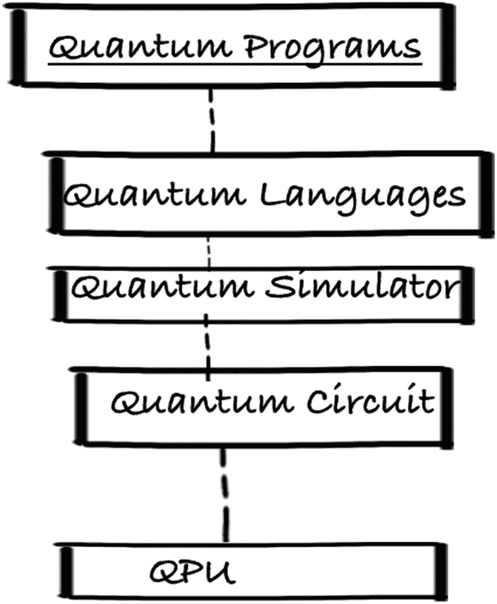
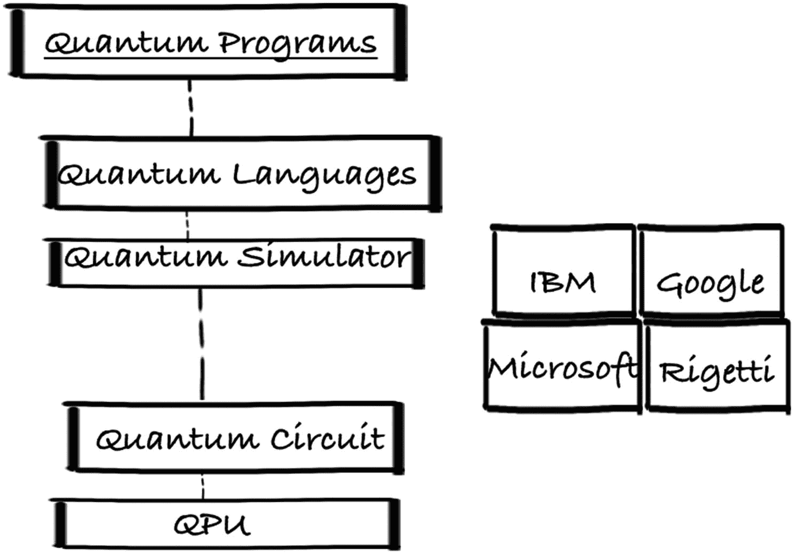
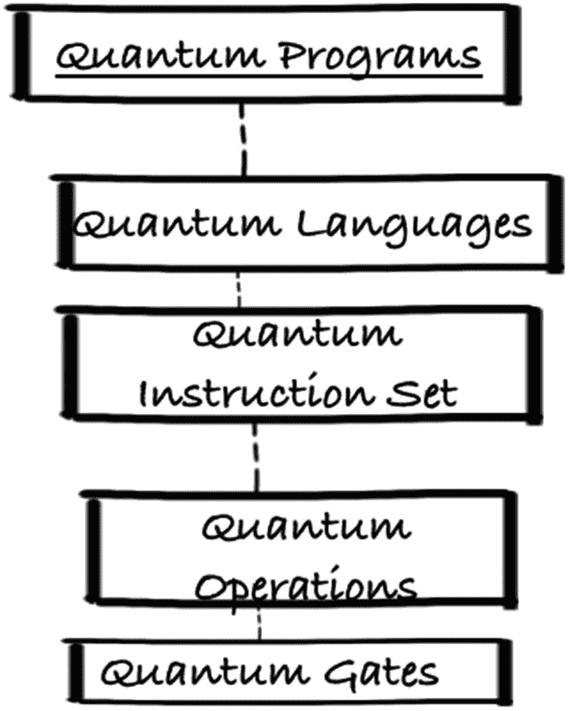
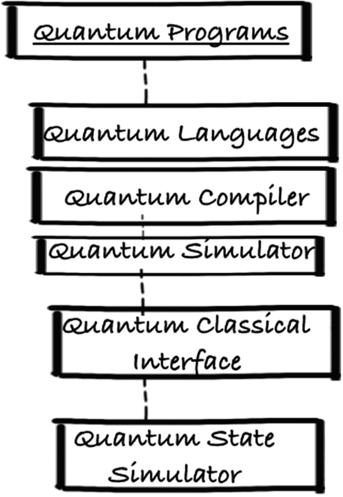
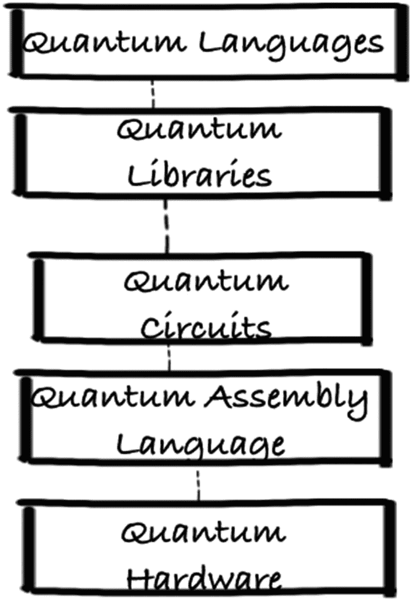
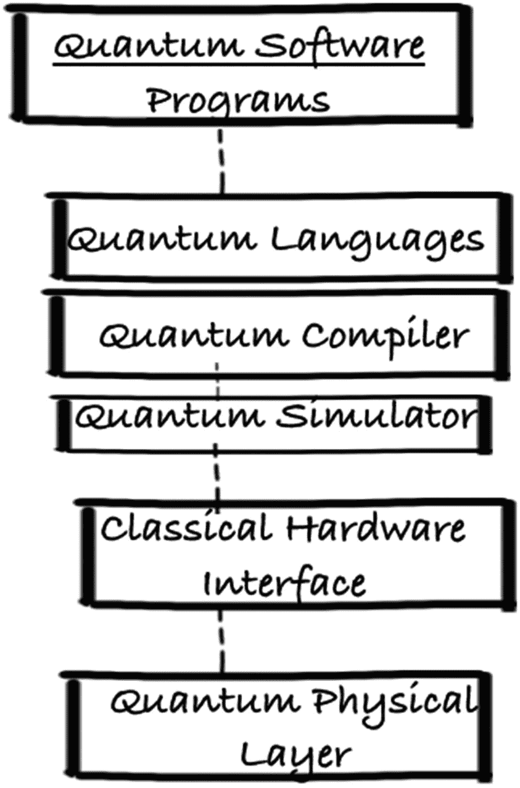

# 5. 量子模拟器

## 引言

> *“未来量子计算最重要的应用很可能是对量子系统的计算机模拟，因为这是一个我们确知经典计算机通常无法有效模拟量子系统的领域。”*
> 
> ——戴维·多伊奇

本章概述了量子模拟器。你将看到量子模拟器在现实世界中如何被使用。本章详细介绍了量子模拟器的代码示例，并讨论了量子语言和平台。

## 初始设置

你需要安装 Python 3.5 来运行本章的代码示例。你可以从 [`https://www.python.org/downloads/release/python-350/`](https://www.python.org/downloads/release/python-350/) 下载。


## 量子语言

肖尔质因数分解算法、格罗弗搜索算法和量子近似优化等量子算法被用于开发实际应用，并通过模拟量子计算机来借助这些应用解决现实问题。当模拟量子计算设备时，软件应用程序会使用量子语言编写，应用程序代码则通过模拟器执行。

量子语言是一种包含量子指令的典型编程语言（见图 5-1）。量子指令作用于量子电路中的量子门。量子电路在量子模拟器中建模。



图 5-1
量子语言

量子语言是一种类似 `C` 的语言，拥有数据类型和方法。这些数据类型和方法与经典计算机语言相似。此外，该语言还提供了量子数据类型和方法。

量子计算机在经典机器上进行模拟，因此量子模拟器具备在经典机器上执行任务的功能。该模拟器基于量子力学原理和量子计算机模型。尤里·马宁和理查德·费曼提出了一个假设：可以利用量子力学原理执行模拟。量子计算机基于离子阱方法和超导量子比特构建。

离子阱量子计算机基于悬浮在电磁场中的受限离子。每个离子中存储着量子比特。每个离子都具有包含量子比特的电子态。通过利用库仑力，离子的量化运动可用于转移量子信息。超导量子比特是量子计算机的基本单元。

量子计算机利用量子原理运行，并借助亚原子粒子状态来管理量子信息。叠加是一种量子状态，代表亚原子粒子的可能状态。绝热量子计算是量子计算机的另一种方法，基于绝热定理。这种数学方法用于执行量子计算任务。

IBM、谷歌、微软和 Rigetti 的量子模拟器都提供了编程 API、软件开发工具包和云服务。量子模拟器帮助程序员执行模拟和计算任务（见图 5-2）。



图 5-2
量子模拟器

量子模拟器可以在经典计算机上执行。虽然已有商用量子计算机，但量子比特的数量是不同实现之间的区别所在。

注意

量子计算机不能违反丘奇-图灵论题。因此，可以实现基于图灵机的量子模拟器。

## 量子比特测量

量子计算任务包含编码信息和量子测量子任务。编码基于用于解决现实问题的量子算法。处于不同状态（如叠加态）的量子比特需要在量子计算任务期间进行测量。

量子比特测量会产生一个输出，该输出是叠加态。玻恩规则指出，输出将是一个叠加态，且输出与该叠加态系数的平方成正比。重复采样是量子计算软件开发工具包的一个特性。采样直方图基于由结果计数得出的频率来创建。

## 量子指令集

使用量子语言开发的软件程序通过量子编译器编译，以创建量子指令集（见图 5-3）。编译器以量子汇编语言生成代码。代码优化是编译器的一个特性。



图 5-3
量子指令集

量子汇编语言有助于使用量子门和量子操作来建模量子电路。量子处理器有助于在量子计算机上执行指令集。量子计算需要无噪声和无错误。可靠量子比特和容错量子计算方法被用于量子计算。

注意

量子指令集类似于经典计算机中存在的经典指令集。

### 代码示例

```
import cirq
qbit = cirq.GridQubit(0, 0)
quantum_circuit = cirq.Circuit.from_ops(
cirq.X(qbit)**0.5,
cirq.measure(qbit, key="m")
)
print("Quantum Circuit:", quantum_circuit)
quantum_simulator = cirq.Simulator()
results = quantum_simulator.run(quantum_circuit, repetitions=20)
print("Results ",results)
```

### 执行命令

```
pip3 install cirq
python3 quantum_circuit.py
```

### 输出

```
Quantum Circuit: (0, 0): ───X⁰.5───M('m')───
Results  m=11000011010011101100
```

现在让我们来看看一个全栈通用量子计算机。全栈通用量子计算机基于经典计算机堆栈。

## 全栈通用量子模拟器

量子模拟器基于费曼关于用量子系统模拟计算任务的猜想。塞斯·劳埃德提出了可用于全栈通用量子模拟器的量子原理。全栈通用量子模拟器基于量子计算模型的概念。量子设备用于构建量子计算机，它可以与经典计算机并行工作。量子处理器用于执行任何需要加速的计算任务。这种混合方法使用经典计算机和量子计算机来执行任务。见图 5-4。



图 5-4
全栈通用量子模拟器

量子加速器和量子辅助优化是用于量子计算的最新技术。全栈量子模拟器基于量子计算层和组件。


### 代码示例

```python
import cirq
import random

def rand2d(rows, cols):
    return [[random.choice([+1, -1]) for _ in range(cols)] for _ in range(rows)]

def random_instance(length):
    h = rand2d(length, length)
    jr = rand2d(length - 1, length)
    jc = rand2d(length, length - 1)
    return (h, jr, jc)

def one_step(h, jr, jc, x_half_turns, h_half_turns, j_half_turns):
    length = len(h)
    yield rot_x_layer(length, x_half_turns)
    yield rot_z_layer(h, h_half_turns)
    yield rot_11_layer(jr, jc, j_half_turns)

def rot_x_layer(length, half_turns):
    rot = cirq.XPowGate(exponent=half_turns)
    for i in range(length):
        for j in range(length):
            yield rot(cirq.GridQubit(i, j))

def rot_z_layer(h, half_turns):
    gate = cirq.ZPowGate(exponent=half_turns)
    for i, h_row in enumerate(h):
        for j, h_ij in enumerate(h_row):
            if h_ij == 1:
                yield gate(cirq.GridQubit(i, j))

def rot_11_layer(jr, jc, half_turns):
    gate = cirq.CZPowGate(exponent=half_turns)
    for i, jr_row in enumerate(jr):
        for j, jr_ij in enumerate(jr_row):
            if jr_ij == -1:
                yield cirq.X(cirq.GridQubit(i, j))
                yield cirq.X(cirq.GridQubit(i + 1, j))
            yield gate(cirq.GridQubit(i, j),
                       cirq.GridQubit(i + 1, j))
            if jr_ij == -1:
                yield cirq.X(cirq.GridQubit(i, j))
                yield cirq.X(cirq.GridQubit(i + 1, j))
    for i, jc_row in enumerate(jc):
        for j, jc_ij in enumerate(jc_row):
            if jc_ij == -1:
                yield cirq.X(cirq.GridQubit(i, j))
                yield cirq.X(cirq.GridQubit(i, j + 1))
            yield gate(cirq.GridQubit(i, j),
                       cirq.GridQubit(i, j + 1))
            if jc_ij == -1:
                yield cirq.X(cirq.GridQubit(i, j))
                yield cirq.X(cirq.GridQubit(i, j + 1))

h, jr, jc = random_instance(3)
length = 3
qubits = [cirq.GridQubit(i, j) for i in range(length) for j in range(length)]
simulator = cirq.Simulator()
circuit = cirq.Circuit()
circuit.append(one_step(h, jr, jc, 0.1, 0.2, 0.3))
circuit.append(cirq.measure(*qubits, key="x"))
results = simulator.run(circuit, repetitions=100)
print(results.histogram(key='x'))
```

### 执行命令

```bash
pip3 install cirq
python3 simulator.py
```

### 输出

```
Counter({0: 83, 8: 3, 32: 3, 4: 2, 256: 2, 1: 2, 128: 2, 16: 1, 64: 1, 257: 1})
```

## 量子汇编编程

量子计算机拥有量子处理器，这些处理器是物理芯片，可以包含一组量子比特。量子计算机有用于控制的电子单元以及用于管理内存和数据的组件。量子处理器可以基于门模型或退火方法。门模型量子处理单元具有量子电路和计算任务，这些任务通过量子门执行。量子退火用于退火量子处理单元。

量子解释器和编译器用于编译软件代码以生成汇编代码。量子汇编语言用于创建汇编代码，该代码包含可在量子模拟器或量子计算机上执行的量子指令集。参见图 5-5。



图 5-5
量子汇编语言

量子物理原理用于创建量子计算机和模拟器。程序员可以借助软件开发工具包，使用量子编程语言开发应用程序。

量子计算机架构基于不同的方法，例如绝热计算模型。量子电路是利用量子汇编中的量子门开发的。这些电路可以在量子模拟器上模拟，以执行量子汇编代码。代码中包含用于操作电路中量子门的指令集。

### 代码示例

```python
import qiskit

class QASM_JobManager:
    def __init__(self):
        self.data = []

    def createProgram(self,quantum,classical):
        qr = qiskit.QuantumRegister(quantum)
        cr = qiskit.ClassicalRegister(classical)
        program = qiskit.QuantumCircuit(qr, cr)
        return qr,cr,program

    def measure(self,program,qr,cr):
        program.measure(qr,cr)

    def getQASMBackend(self):
        backend = qiskit.BasicAer.get_backend('qasm_simulator')
        return backend

    def executeProgramOnQASM(self,program,backend):
        job = qiskit.execute( program, backend  )
        return job

jobManager = QASM_JobManager()
quantumRegister,classicalRegister,program = jobManager.createProgram(1,1)
jobManager.measure(program,quantumRegister,classicalRegister)
backend = jobManager.getQASMBackend()
print("The device name:",backend.name())
job = jobManager.executeProgramOnQASM(program,backend)
print( job.result().get_counts() )
```

### 执行命令

```bash
pip3 install qiskit
python3 quantum_assembly.py
```

### 输出

```
The device name: qasm_simulator
{'0': 1024}
```

## 量子硬件平台

量子硬件平台可由 Google、Rigetti、Microsoft 和 IBM 提供（参见图 5-6）。它们实现量子计算模型来执行量子计算。用于构建量子计算机的方法包括：离子阱、光子学系统和超导量子比特。量子比特是当前的限制因素，也是这些平台之间的区别所在。



图 5-6
量子硬件

量子随机存取存储器基于在量子设备上运行的主经典设备。这基于混合量子编程模型，你可以从像 Python 这样的典型编程语言开始，然后使用量子编程语言来处理量子计算任务。在 Microsoft 的实现中，C# 用于典型编程任务，而 Q# 用于量子计算。

量子寄存器基于多量子比特系统。它类似于经典计算机寄存器。量子寄存器在量子设备中对量子比特进行操作，是一个由多个量子比特组成的系统。这相当于经典处理器寄存器。量子计算机操纵量子寄存器内的量子比特。它能够模拟量子比特的 2^X 种组合。而经典寄存器只能处理经典比特的 x 种组合。

### 商用量子计算机

商用量子计算平台列举如下：

*   Rigetti
*   Google
*   IBM
*   Microsoft

Rigetti 计算平台包含以下组件：

*   Quil
*   PyQuil
*   QUILC
*   量子虚拟机 (QVM)

Google 量子计算游乐场支持脚本编写，并具有以下特性：

*   基于浏览器的 IDE
*   22 个量子比特的量子寄存器
*   程序与编译
*   程序中的嵌套逻辑
*   量子门建模
*   数学函数支持
*   可视化模式

IBM 量子体验包含以下模块：

*   量子电路编辑器
*   量子电路可视化工具
*   量子门支持
*   量子寄存器
*   Qiskit Notebooks（基于 Jupyter）

Microsoft 量子开发工具包支持 Microsoft Q# 和 QDK。它包含一个模拟器和开源 AI，供开发者使用量子电路、门和模拟器创建程序。

## 总结

在本章中，我们探讨了量子语言、量子比特测量、量子指令集、全栈通用量子模拟器、量子汇编编程以及量子硬件平台。本章还提供了关于量子汇编、量子电路和模拟器的代码示例。

