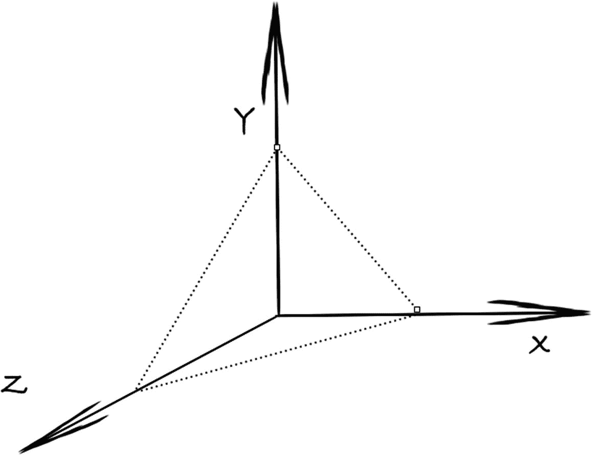
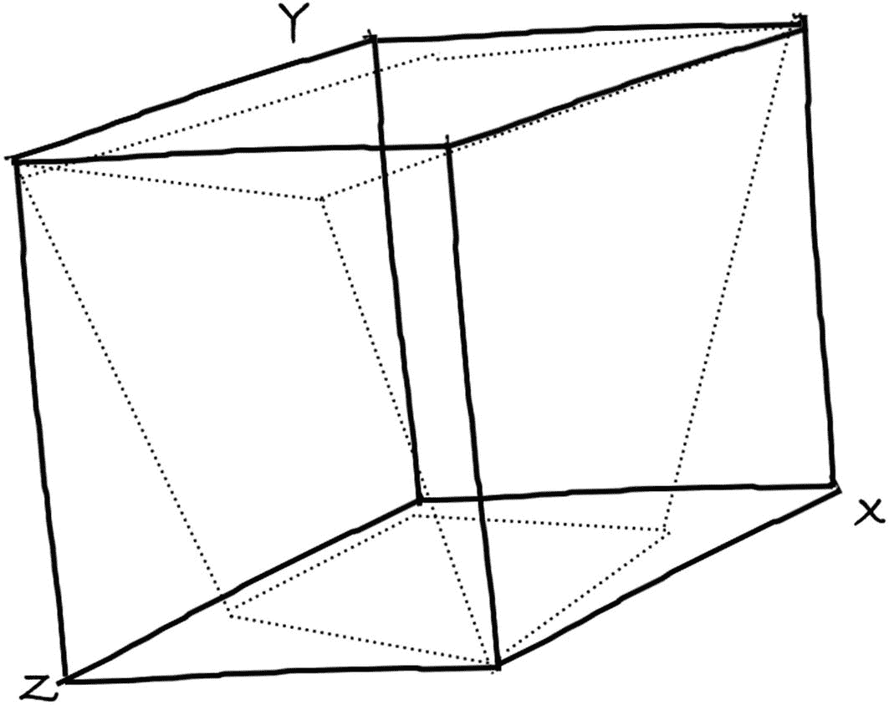
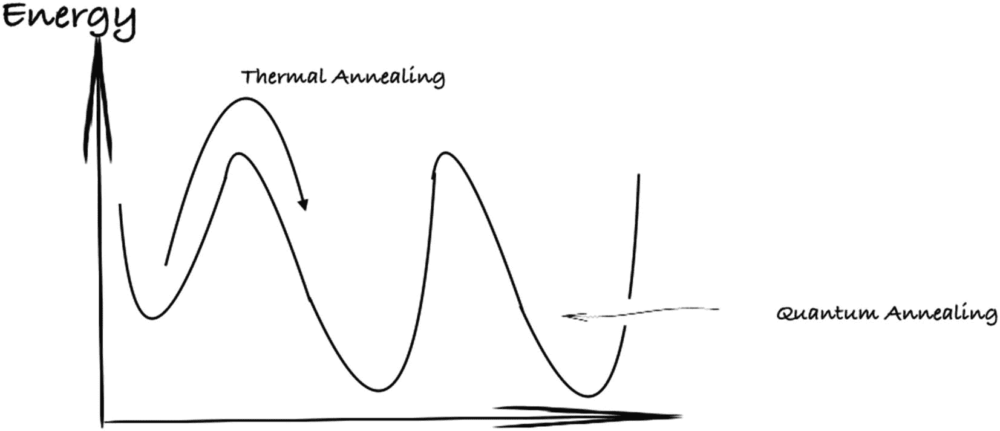
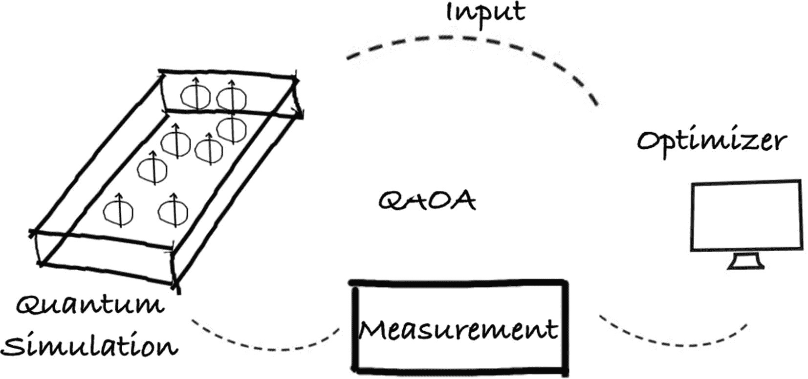
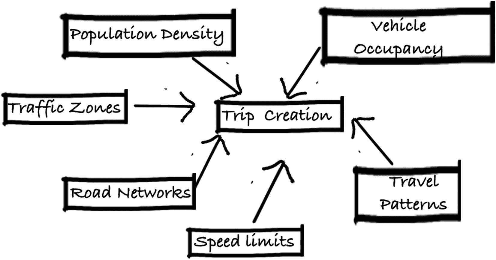
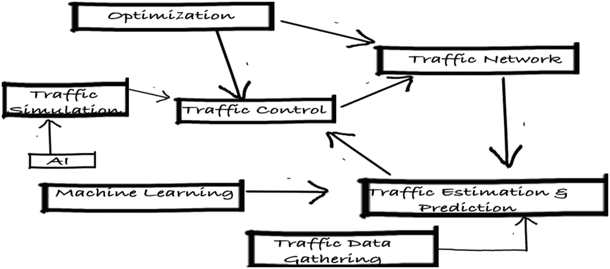
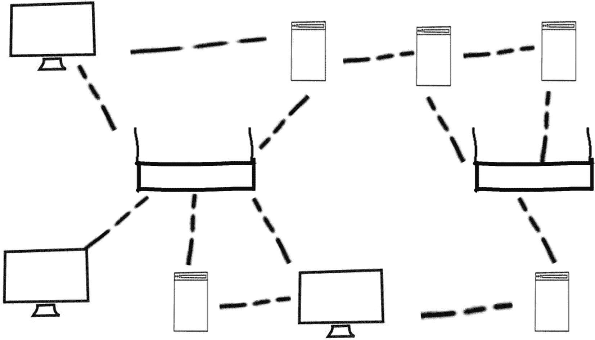
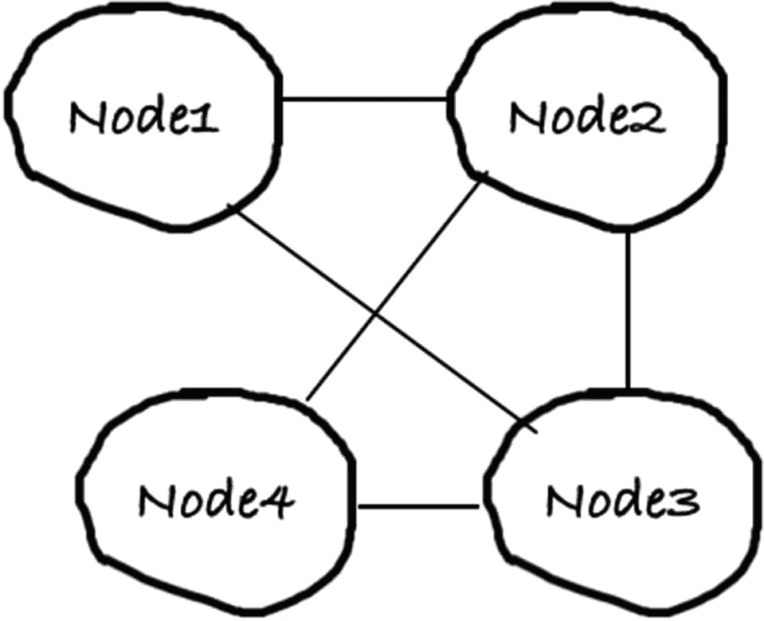
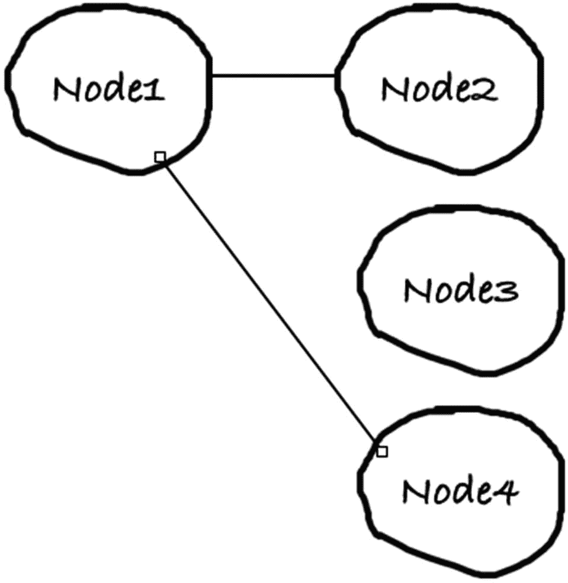

# 6. 量子优化算法

## 引言

> “量子理论的数学框架已经通过了无数成功的检验，现在被普遍认为是对所有原子现象的一致且准确的描述。”
> ——埃尔温·薛定谔

本章概述了量子优化算法。你将了解量子优化如何在现实生活中应用。文中还提供了量子优化应用程序的代码示例。

## 初始设置

你需要安装 `Python 3.5` 才能运行本章中的代码示例。你可以从 [`www.python.org/downloads/release/python-350/`](https://www.python.org/downloads/release/python-350/) 下载它。

## 近似优化算法

在本节中，我们将介绍近似算法，例如半定规划和近似组合优化。

近似组合优化有助于快速找到接近最优值的解。然而，该技术可能无法给出最佳解。该方法有助于为旅行商问题找到一条短路径。旅行商问题描述的是，一个推销员需要在 `M` 个城市之间旅行。推销员可以每个城市只访问一次，但需要回到起点。经典的解决方案是将第一个城市设为起点和终点。下一步是识别城市的所有可能排列 `(M-1)!`。需要检查每个排列的成本或目标。该问题的目标是识别成本最低的排列。见图 6-1。



*图 6-1 – 近似组合优化*

针对此问题，可以使用动态规划，将其分解为子问题。从第一个城市开始，对于所有其他城市，创建一个从新城市开始的子问题。这些子问题将形成递归，以识别销售人员最便宜的旅行路线。

近似优化算法通过计算最小生成树的成本来确定最优路线。最小生成树是城市连通路径的一个子集，它没有环路，且总边成本较低。

现在让我们来看一下半定规划算法。

### 半定规划

半定规划是优化中的一项重要技术。通用性是该方法背后的关键原理。优化问题中的变量矩阵被约束为半正定矩阵。“半定规划”这个术语来源于与半正定性相关的约束条件。



*图 6-2 – 半定规划*

量子半定规划技术包含以下步骤：

1.  应用预言函数进行违反约束的搜索。
2.  生成一个密度矩阵。
3.  计算密度矩阵上酉算子的相位估计。
    a.  估算 `Tr[e^(-密度矩阵)]`。
    b.  检查输出是否为 `λ`。如果是，则返回值 `λ - 1e^(-λ)`。
4.  执行步骤 1，并测量第二个系统的密度矩阵。
5.  如果输出是 `λ`，则接受它；否则，拒绝它。
6.  不断迭代，直到这一步被接受。

```
密度矩阵 = Σk k λ k | Ψk > < λ k'|
```

> **注意：** 密度矩阵表示量子系统的统计状态。在经典系统中，概率分布与其等价。

半定规划可以用数学方式表示。给定 `n` 个实数 `c1, cn ∈ R`，以及 `p × p` 厄米矩阵 `D : B1,..,...,...Bp`，目标是最大化 `Transpose (DX)`，满足 `Transpose(B i X) < c i X >= 0`。变量 `X` 被约束为半正定矩阵。



*图 6-3 – 量子退火：半定规划*

通过半定规划方法解决的问题可以是无约束的，也可以是带有等式和不等式等约束条件的。量子半定规划算法的输入包括一个稀疏矩阵、量子态和量子算子。一个典型的稀疏矩阵每行最多有 `n` 个非零元素。

量子退火是另一种半定规划技术。它与量子系统的行为相关。这有助于解决 NP 难优化问题。像旅行商这样的优化问题可以使用量子退火来解决。解是物理系统的基态，它基于哈密顿函数。哈密顿函数描述了物理系统的能量和运动。经典的等价算法是模拟退火、随机搜索和梯度下降算法。

> **注意：** 哈密顿算子与量子粒子的势能和动能之和相关。哈密顿算子是厄米的。厄米算子的特征值是实数，且特征函数是正交的。特征值显示了数据的分布或线性变换的特征向量。

半定规划与线性规划相关，是通过将向量替换为半正定矩阵来实现的。它基于线性规划和凸二次规划。半定规划通过使用块对角矩阵、对称矩阵和半定矩阵来推广线性规划。这些方法用于结构设计和基于控制理论的应用中。这些方法也用于化学工业，以确定如何最优地混合化学材料。

最大割问题是一个应用了半定规划的著名问题。最大割问题与在图中识别最大割有关。在一个给定的网络或图中，目标是根据顶点之间边的权重来识别一个顶点子集。最大割问题用于大规模集成电路应用。

该问题的输入是顶点数、边数和带边权重的邻接表。每条边都有起点和终点。目标是识别具有最高总边权重的割。

现在让我们来看一个 `Python` 中的半定规划示例。

数学问题如下：

最小化 `Transpose (CX)`

满足 `Transpose(A i X) < b i X >= 0`。变量 `X` 被约束为半正定矩阵。

在以下 `Python` 代码中，`CMatrix` 是随机生成的。`A` 和 `b` 矩阵也是随机生成的。`CVXPy` 提供了一个用于解决凸优化问题的数学 API。针对生成的问题计算最优值。

### 代码示例

```python
import cvxpy as cvxp
import numpy as nump
n = 3
p = 3
nump.random.seed(1)
CMat = nump.random.randn(n, n)
AMat = []
bMat = []
for i in range(p):
    AMat.append(nump.random.randn(n, n))
    bMat.append(nump.random.randn())
XMat = cvxp.Variable((n,n), symmetric=True)
constraints = [XMat >> 0]
constraints += [
    cvxp.trace(AMat[i]@XMat) == bMat[i] for i in range(p)
]
problem = cvxp.Problem(cvxp.Minimize(cvxp.trace(CMat@XMat)), constraints)
problem.solve()
print("The optimal value of the problem is", problem.value)
print("A solution X is")
print(XMat.value)
```

### 命令

```
pip3 install cvxpy
pip3 install nump
python3 sdp_cvx.py
```

### 输出

```
The optimal value of the problem is 2.654351510231541
A solution X is
[[ 1.60805795 -0.59770492 -0.69576152]
 [-0.59770492  0.22229041  0.24689363]
 [-0.69576152  0.24689363  1.39679885]]
```

类似地，现实生活中的问题可以是最大化或最小化问题。它们可以像前面代码一样建模，并将约束条件建模为线性方程。

## QAOA

量子近似优化算法与使用多项式时间方法识别优化问题的解有关（见图 6-4）。`QAOA` 解决的典型问题是 NP 困难问题。

`QAOA` 方法在量子虚拟机上执行。诸如最大割和图分割等问题均使用 `QAOA` 来解决。`QAOA` 方法包含以下步骤：

1.  使用泡利算符对成本函数进行编码。
2.  使用量子计算框架和算法对问题进行建模。
3.  使用采样计算基态解。

**提示**

泡利算符与角动量运算相关。角动量运算表示量子粒子在三个空间方向上的自旋。



图 6-4 – 量子近似优化

最大割问题可以使用 `QAOA` 方法解决，且与在图论中寻找最大割有关。基态使用哈密顿函数建模，并对状态进行测量。测量多体量子态，从而以更高的概率获得最大割解。在给定的网络或图中，目标是根据顶点之间的边的规模来识别顶点的子群。

让我们来看一个可以应用`QAOA`的现实问题（见图 6-5）。交通运输中的交通建模依赖于交通分区、出行表、公路网络、车辆容量和土地利用模型。土地利用模型包括趋势、土地利用和分区规划、活动区域以及地图。交通系统包含街道、公路、停车、速度、出行时间和限速。交通网络将包含交通量和车辆容量。出行模式识别了交通方式选择、典型的源到目的路径以及出行特征。沃德罗普第一原理基于网络和道路使用者平衡。所有被使用路径的出行时间相等，且比任何一条未被使用的路径的出行时间短一条车的通行时间。该原理有助于最小化一次出行的平均时间。还有其他原理和算法来平衡道路使用者和网络交通流。



图 6-5 – 交通规划：因素

## 交通规划：因素

出行是基于起点、目的地、车辆和城市交通网络生成的。该网络在不同时区和空间中拥有不断移动的车辆、骑自行车的人和行人。交通规划是一项持续的活动，街道网络基础设施也在不断更新。交通建模使用诸如仿真和机器学习等技术完成。交通控制则利用历史数据，估计某个时间段内的车辆数量，并管理整个网络的交通流。



图 6-6 – 交通规划：人工智能与机器学习

最大流-最小割方法用于最大化交通网络中的交通流。该方法基于从起点到目的地的最大交通流，等同于将起点与目的地分开的最小割。此方法可应用于计算机网络数据包流。

通过网络的数据包流可以使用最大流-最小割方法进行建模。网络中的信息流经过节点到达目的地。目标是最大化能够流经一个计算机网络的数据包数量。



图 6-7 – 数据包流：计算机网络

类似地，此方法也可用于为学生分配宿舍，前提是每个学生都想住进自己选择的宿舍。目标是最大化获得宿舍的学生数量。

让我们看看如何在`Python`中使用`QAOA`解决最大割问题。以下示例使用了`Grove`框架和`PyQuil`。

### 代码示例

```python
import numpy as nump
from grove.pyqaoa.maxcut_qaoa import maxcut_qaoa
import pyquil.api as pyquilapi

qvm_session = pyquilapi.QVMConnection()
configuration_ring = [(0,1),(1,2),(2,3),(3,0)]
steps = 2
inst = maxcut_qaoa(graph=configuration_ring, steps=steps)
betas, gammas = inst.get_angles()
t = nump.hstack((betas, gammas))
param_program = inst.get_parameterized_program()
program = param_program(t)
wave_function = qvm_session.wavefunction(program)
wave_function = wave_function.amplitudes
for state_index in range(inst.nstates):
    print(inst.states[state_index], nump.conj(wave_function[state_index])*wave_function[state_index])
```

### 命令

```bash
pip3 install nump
pip3 install grove
pip3 install pyquil
qvm  -S  （单独的终端窗口 1）
python3 qaoa.py  （终端窗口 2）
```

### 输出

```text
0000 (5.030591151913648e-10+0j)
0001 (7.986230289234977e-06+0j)
0010 (7.986230289234498e-06+0j)
0011 (2.2019121467156433e-07+0j)
0100 (7.98623028923483e-06+0j)
0101 (0.49996761419335345+0j)
0110 (2.2019121467149302e-07+0j)
0111 (7.98623028923475e-06+0j)
1000 (7.98623028923475e-06+0j)
1001 (2.2019121467149302e-07+0j)
1010 (0.49996761419335345+0j)
1011 (7.98623028923483e-06+0j)
1100 (2.2019121467156433e-07+0j)
1101 (7.986230289234498e-06+0j)
1110 (7.986230289234977e-06+0j)
1111 (5.030591151913648e-10+0j)
```

`0101` 和 `1010` 的波函数振幅为 `0.499`。这些就是该配置中的最大割。图 6-8 展示了 `0101` 配置。



图 6-8 – `0101` 配置

图 6-9 展示了 `1010` 配置。



图 6-9 – `1010` 配置

类似地，交通网络和计算机网络也可以像之前代码中那样表示。约束条件可以通过交通限制和网络节点容量来添加。在这种情况下的目标是最大化流量并最小化割。

现在让我们来看组合优化算法。

## 组合优化

组合优化用于解决现实问题，例如旅行商问题和个人的饮食计算。优化算法使用可能的输入，并找出最大或最小的输出。假设 `c(x)` 是目标函数。如果目标是最大化 `c(x)`，并且建模的约束条件是 `d(x)` 和 `b(x)`，那么我们有以下条件：

```text
d(x) < 0
b(x) = 0
```

组合优化算法通过离散值找到使目标函数最大化的解。如果目标函数和约束条件是线性的，这种优化算法被称为线性规划。

经典优化算法在量子优化中有其对应方法。我们将在下一节中探讨量子半定规划方法。

现在让我们来看基于量子半定规划的量子非确定性多项式算法。

## 量子 NP (BQNP)

有界误差量子多项式时间算法是可在量子计算机上运行的多项式时间级技术。计算纽结不变量和量子模拟算法都属于`BQNP`算法。

`BQNP`算法的一个典型例子是肖尔算法。该算法基于素数乘积的因式分解。它能够在多项式时间内以有界误差执行。执行时间取决于肖尔算法的操作数量。

肖尔算法以数学家彼得·肖尔的名字命名，是一种用于整数因式分解的量子算法。该量子算法于 1994 年提出。它涉及这样一个问题：“给定一个整数 `K`，找出其质因数。”

在量子计算机上，对整数 `K` 进行因式分解时，肖尔算法以多项式时间运行。其执行时间与 `log K` 成多项式关系。该算法的输入大小为 `log K`。确切地说，它的时间复杂度为 `O((log N)3)`。整数的因式分解问题可以使用`BQP`算法在量子计算机上建模。该算法比经典算法快指数级。肖尔算法的效率等同于量子傅里叶变换算法的效率。

## 总结

在本章中，我们研究了与近似优化、半定规划、组合优化和量子非确定性多项式算法相关的技术。此外，我们还详细讨论了近似优化算法。