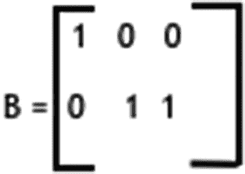
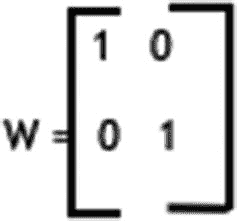
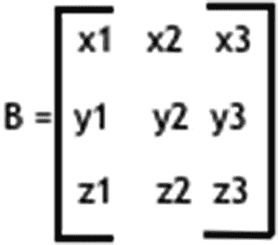
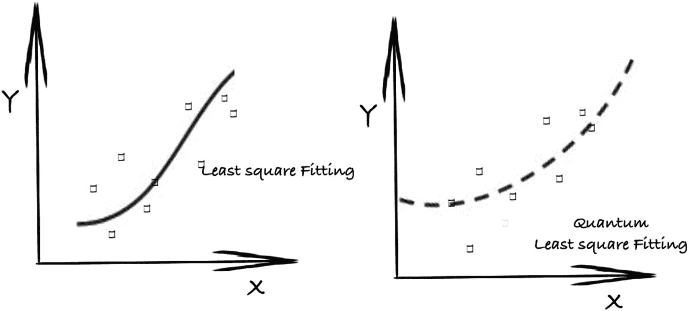
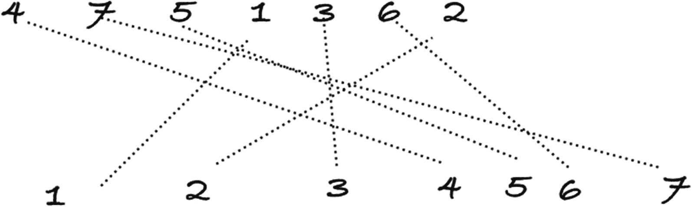
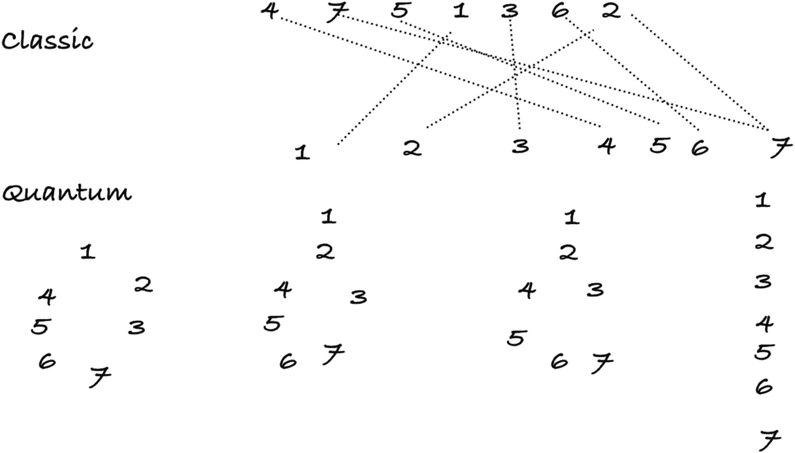

# 7. 量子算法

## 引言

> “如果你不能对它编程，你就没有理解它。”

> ——大卫·多伊奇

本章为你概述量子算法。你将看到量子算法在现实世界中是如何实现的。本章还提供了量子算法的代码示例，例如量子最小二乘拟合和量子排序。

## 初始设置

你需要安装 Python 3.5 来运行本章的代码示例。你可以从 `https://www.python.org/downloads/release/python-350/` 下载。

## 量子最小二乘拟合

在本节中，我们将研究一种名为量子最小二乘拟合的算法。

量子信息论有助于高效地解决回归和预测问题。基于量子力学原理的量子算法增强了最小二乘拟合算法的效率。在量子状态层析成像中，量子状态被拟合到一组函数上。量子状态层析成像与量子状态的重构相关。在层析成像过程中，测量量子状态，并创建相同量子状态的系综。

> **提示**
> 量子状态层析成像是检查量子状态的方法。

经典的最小二乘拟合适用连续函数。一个连续函数在每个区间内都是连续的。在每个区间内，值都是连续的。连续性有三个规则，如下所示：
- 函数需要在某点有定义。
- 函数在某点需要有单侧极限。
- 函数在某点的左极限或右极限需要等于该点的函数值。

例如，`f(x) = x²` 是一个连续函数。连续函数的图形是连续的，没有跳跃和渐近线。渐近线是函数趋于无穷大的点。定义域包含一组函数有值的点。假设 `f(x)` 是 `y` 的一个线性函数。那么 `x = A^(-1)y`，其中 `A` 是一个方阵。`A` 的伪逆定义如下：

`A^(+) = (A^(T)A)^(-1) A^(T)`

现在，我们来看看最小二乘拟合方法的量子对应形式。量子最小二乘拟合方法基于寻找一个简单的、连续的函数，该函数能够拟合 `M` 个（定义域）点的离散集合 `{x[j], y[j]}`。该函数可以是非线性的，但需要强制进行线性拟合。该函数用数学形式表示如下：

`f(x, λ) = Σ [j=1]^(M) fjλ[j]`

其中 `λ[j]` 是一个分量，属于 `λ` 和 `f(x, λ)`。

最小二乘拟合算法分为三个步骤：
1. 使用量子算法求伪逆。
2. 使用算法评估拟合质量。
3. 使用学习算法确定拟合参数 `λ`。

适应度函数衡量解的质量。这是通过衡量解与最优解的接近程度来完成的。适应度得分通过使用适应度参数计算得出。欧几里得距离和曼哈顿距离方法用于计算适应度。欧几里得距离通过计算垂直距离平方和得出。两点 `(x[1], y[1])` 和 `(x[2], y[2])` 之间的欧几里得距离如下：

`√ (x[1]-x[2])² + (y[1]-y[2])²`

> **提示**
> 曼哈顿距离定义为点与直线之间的最小距离。点 `(x[1], y[1])` 到直线 `cx + dy + e = 0` 的曼哈顿距离计算如下：`|cx[1]+dy[1]+e| / max(|c|, |d|)`。

该算法需要以下提到的输入：
- 期望数据向量
- 基矩阵
- 权重向量
- 拟合矩阵
- 拟合矩阵的迹

现在，我们来详细了解算法中使用的一些术语。

基矩阵的元素是线性无关的。它由线性无关的向量组合而成。假设我们有一个矩阵 `B`，定义如下：


*图 7-1: 矩阵 B*

矩阵 `B` 的列是线性无关的。移除冗余的列向量以找到矩阵的基。如果你尝试移除第一列，张成空间将移至 y 轴。矩阵 `W` 的基使用重要且关键的列定义如下：


*图 7-2: 矩阵 B 的基*

向量数据类型是固定大小的列表。数学向量是具有起点和方向的特定长度的线段。向量的例子包括功、力、加速度和速度。在二维空间中，向量的一个例子是 `b[1]i + b[2]j`。在三维空间中，向量表示为 `b[1]i + b[2]j + b[3]k`。n 维向量定义为 `b[0] + b[1]t[1] + b[2]t[2] + ... + b[n]t[n]`。

让我们看看矩阵迹的定义。矩阵的迹是从左上角到右下角的对角线元素之和。它等于矩阵特征值之和。

假设我们有一个矩阵 `B`，定义如下：


*图 7-3: 矩阵的迹*

该矩阵的迹定义为 `x[1] + y[2] + z[3]`。

回到算法本身，该算法通过量子最小二乘拟合为数据提供了更好的拟合。图 7-4 展示了量子最小二乘拟合。经典的最小二乘拟合算法可能更接近于一条穿过数据的平均曲线。量子最小二乘拟合则试图最小化不同数据点之间的偏差。

现在让我们研究一下偏差的计算。偏差是真实值与预测数据均值之间的差异。产生偏差是因为假设线性函数是拟合函数。量子最小二乘拟合有助于降低偏差，如图 7-4 所示。


*图 7-4: 量子最小二乘拟合*

### 代码示例

```python
import numpy as nump
from scipy import linalg as lina
from scipy.linalg import lstsq

def get_least_squares_fit(data, basis_matrix, weights=None, PSD=False, trace=None):
    c_mat = basis_matrix
    d_mat = nump.array(data)
    if weights is not None:
        w = nump.array(weights)
        c_mat = w[:, None] * c_mat
        d_mat = w * d_mat
    rho_fit_mat, _, _, _ = lstsq(c_mat.T, d_mat)  # Fitting calculation
    print(rho_fit_mat)
    size = len(rho_fit_mat)
    dim = int(nump.sqrt(size))
    if dim * dim != size:
        raise ValueError("fitted vector needs to be a square matrix")
    rho_fit_mat = rho_fit_mat.reshape(dim, dim, order="F")
    if PSD is True:
        rho_fit_mat = convert_positive_semidefinite_matrix(rho_fit_mat)
    if trace is not None:
        rho_fit_mat *= trace / nump.trace(rho_fit_mat)
    return rho_fit_mat

def convert_positive_semidefinite_matrix(mat, epsilon=0):
    if epsilon < 0:
        raise ValueError('epsilon needs to be positive')
    dim = len(mat)
    v, w = lina.eigh(mat)
    for j in range(dim):
        if v[j] < epsilon:
            tmp = v[j]
            v[j] = 0.
            x = 0.
            for k in range(j + 1, dim):
                x += tmp / (dim - (j + 1))
                v[k] = v[k] + tmp / (dim - (j + 1))
    matrix_psd = nump.zeros([dim, dim], dtype=complex)
    for j in range(dim):
        matrix_psd += v[j] * nump.outer(w[:, j], nump.conj(w[:, j]))
    return matrix_psd

data = [12, 21, 23.5, 24.5, 25, 33, 23, 15.5, 28, 19]
u_matrix = nump.arange(0, 10)
basis_matrix = nump.array([u_matrix, nump.ones(10)])
rho_fit_val = get_least_squares_fit(data, basis_matrix)
```

### 命令

```
### 输出

```
[ 0.45757576 20.39090909]
```

解为 `v = 0.4575u + 20.39`。

**提示：** 你可以修改之前用于经典方法和量子方法的代码，用于季节性销售数据预测：`v = w[1]u + c`。

## 量子排序

排序算法按照指定顺序对一组元素进行排列。经典排序方法有不同类型：冒泡排序、选择排序、归并排序、插入排序、快速排序、堆排序。

冒泡排序、选择排序和堆排序通过将元素逐一移动到最终位置来操作。插入排序、快速排序等方法将元素放置在接近最终位置的临时位置上，如图 7-5 所示。


**图 7-5** 经典排序方法

在现实生活中，电话目录和字典分别是按姓名和字母顺序排序的例子。排序可分为两种不同的技术：原地排序和非原地排序。原地排序是指在组内移动元素，不占用额外内存或空间。非原地排序是指使用额外空间来排序元素。冒泡排序基于原地排序，而归并排序基于非原地排序。

让我们来看看 Python 中的快速排序算法。快速排序算法选取一组元素，将其按升序排列。程序的输入为 `4, 9, 18, 11, 3, 2, 0`。排序后的元素为 `0, 2, 3, 4, 9, 11, 18`。

### 代码示例

```python
def sort_quick_sort_method(group):
    if len(group) <= 1:
        return group
    pivot_value = group[len(group) // 2]
    left_value = [x for x in group if x < pivot_value]
    middle_value = [x for x in group if x == pivot_value]
    right_value = [x for x in group if x > pivot_value]
    return sort_quick_sort_method(left_value) + middle_value + sort_quick_sort_method(right_value)

print(sort_quick_sort_method([4, 9, 18, 11, 3, 2, 0]))
```

### 命令

```
python3 quick_sort_method.py
```

### 输出

```
[0, 2, 3, 4, 9, 18, 11]
```

数据按升序排列。

量子排序方法的性能可能为 `O(M log M)`，与经典排序方法类似。在空间受限的排序中，量子排序方法优于经典方法，如图 7-6 所示。量子算法有助于使用量子比特对复杂问题进行建模；当空间受限时，这些方法非常适用。


**图 7-6** 量子排序

我们将探讨量子算法中排序效率优于经典算法的方法。量子排序方法使用量子算法对元素进行排序，只需 `0.526 log M + O(M)` 步，而经典插入排序的效率为 `O(M log M)`。Ambainis 下界方法具有 `O(M)` 的效率，用于识别下界。该算法通过 Grover 搜索算法找到最小值并在列表上迭代。此方法由 Christoph Durr 和 Peter Hoyer 发现。

Grover 搜索算法可用于在电话目录中查找电话号码。电话目录包含人员、公司和企业的姓名。目录将存储在数据库中。当使用浏览器在线搜索时，基于输入的名称，必须在数据库中进行搜索。数据大多数情况下是未排序的。它可能基于某个标识符进行索引，以提高性能。输入可以是名字、中间名和姓氏。让我们看看一种改进的量子排序算法，它有助于加速这一过程。字典结构可以具有排序后的键（使用量子排序算法）以加快搜索速度。

上述量子算法的另一个版本经过以下步骤：

1.  识别并存储组中的最小元素。
2.  使用这些元素创建一个堆。
3.  将 `k` 从 `1` 迭代到 `m`，从堆中找到最小值，并将该元素插入到位置 `k` 处的另一个堆中。

该算法的效率为 `O(√M log(1/queries))`。

量子纠缠发生在量子粒子相互作用并分离时。它们共享相同的量子力学状态。这些纠缠的粒子成对连接。量子系统中的量子粒子包括电子、原子、光子和分子。量子粒子的状态与位置、自旋、动量和偏振有关。这种远程连接粒子的现象挑战了相对论。当状态发生变化时，纠缠的伙伴会相互影响。这被用于量子密码学和基于量子隐形传态的应用中。

量子纠缠是量子粒子叠加态的一个独特属性。现在让我们看看叠加的定义。当量子系统可以处于多个状态（多于一个）时，就会发生叠加状态。叠加状态可以表示为波函数。在数学上，波函数是量子态与复数系数的线性组合。在纠缠的情况下，孪生粒子的波函数无法分离。数学上，量子系统的波函数不等于粒子波函数的乘积。

两个量子比特的纠缠状态可以表示为：

`|E1> = (1/√2) (|00> ± |11>)`

`|E2> = (1/√2) (|01> ± |10>)`

量子比特的状态可以是 `|00>`、`|11>`、`|01>` 和 `|10>`。

回到使用量子算法进行排序，量子纠缠原理可用于对包含 `M` 个元素的数组进行排序。该原理基于量子纠缠的特性：如果我们识别出其中一个量子比特，就能知道另一个量子比特。该算法经过以下步骤：

1.  输入为一个包含 `M` 个元素的列表。
2.  元素可以转换为二进制表示。
3.  在每个元素的最高有效位上加 1。
4.  基于纠缠特性创建两个集合。
5.  将列表分成两个集合。
6.  删除两个最高有效位。
7.  从步骤 3 开始迭代，直到找到单个比特。应用一个量子单比特比较门。

现在，让我们来看看算法中提到的几个术语。一个数的二进制表示是该数在基数为 2 的计数系统中的表示。它使用数字 1 和 0 表示。零值在二进制形式中是 0，一值在二进制状态中相当于 1，10 在二进制数系统中相当于 2。类似地，3、4 和其他数字通过在二进制系统的左右数位上加或减来表示。

让我们看看最高有效位的定义。最高有效位是二进制形式中值最大的位。例如，二进制数 `01000100` 的最高有效位是 0（即该数最左边的起始位）。

现在，我们来看量子单比特比较器的定义。在经典计算中，XNOR 门是比较门。该门接收两个比特作为输入，如果比特相等则输出 1。量子比较器会翻转目标中的量子比特。这个量子比特是基于量子输入寄存器选择的。比较器检查两个量子态，并选择值较大的那个。

量子排序提高了从数据库中排序数据的效率，类似于 Grover 搜索算法。Grover 搜索有助于以 `O(√M)` 的阶数搜索大型数据存储，而经典搜索算法则需要 `O(M)`。举例来说，在包含 100 万条记录的电话簿中搜索，需要 1000 步。搜索市场规模约为 200 亿美元，许多像谷歌和 IBM 这样的大公司正专注于使用量子算法进行搜索优化。Grover 算法在挑战对称密码学方面潜力巨大。

现在让我们看一下对称密码算法。对称密码算法的一个例子是高级加密标准（AES）。AES 算法基于对称密钥和对称分组密码。AES 算法提供 128 位、192 位和 256 位的密钥来加密和解密数据。密钥的对称性在于使用相同的密钥进行加密和解密。

现在回到量子排序，我们来看看 Python 中的 Grover 搜索算法。

#### 代码
```

```python
import numpy as nump
import string
import hashlib
from math import sqrt, pi
from collections import OrderedDict
from statistics import mean

def GetOracleFunction(xvalue):
    return hashlib.sha256(bytes(xvalue, 'utf-8')).hexdigest()

def ExecuteGroverAlgorithm(target, objects, nvalue, rounds):
    y_pos = nump.arange(nvalue)
    amplitude = OrderedDict.fromkeys(objects, 1/sqrt(nvalue))
    for i in range(0, rounds, 2):
        for k, v in amplitude.items():
            if GetOracleFunction(k) == target:
                amplitude[k] = v * -1
        average = mean(amplitude.values())
        for k, v in amplitude.items():
            if GetOracleFunction(k) == target:
                amplitude[k] = (2 * average) + abs(v)
                continue
            amplitude[k] = v-(2*(v-average))
    return amplitude

target_algorithm = '3'
objects_grover = ('4', '5', '3', '7','9','11','97')
number = len(objects_grover)
amplitude_grover = OrderedDict.fromkeys(objects_grover, 1/sqrt(number))
amplitude_grover[target_algorithm] = amplitude_grover[target_algorithm] * -1
average_grover = mean(amplitude_grover.values())
print("Mean is {}".format(average_grover))

for k, v in amplitude_grover.items():
    if k == target_algorithm:
        amplitude_grover[k] = (2 * average_grover) + abs(v)
        continue
    amplitude_grover[k] = v-(2*(v-average_grover))

print(amplitude_grover)

needle_value = "2d711642b726b04401627ca9fbac32f5c8530fb1903cc4db02258717921a4881"
haystack_value = string.ascii_lowercase
num = len(haystack_value)
num_rounds = int((pi / 4) * sqrt(num))
print("number of rounds are {}".format(num_rounds))

amplitude_grover = ExecuteGroverAlgorithm(needle_value, haystack_value, num, num_rounds)
print(amplitude_grover)
```

### 命令

```
pip3 install numpy
pip3 install hashlib
python3 quantum_sort.py
```

### 输出

```
Mean is 0.26997462357801943 OrderedDict([('4', 0.16198477414681167), ('5', 0.16198477414681167), ('3', 0.9179137201652661), ('7', 0.16198477414681167), ('9', 0.16198477414681167), ('11', 0.16198477414681167), ('97', 0.16198477414681167)])
number of rounds are 4
OrderedDict([('a', 0.11024279785874247), ('b', 0.11024279785874247), ('c', 0.11024279785874247), ('d', 0.11024279785874247), ('e', 0.11024279785874247), ('f', 0.11024279785874247), ('g', 0.11024279785874247), ('h', 0.11024279785874247), ('i', 0.11024279785874247), ('j', 0.11024279785874247), ('k', 0.11024279785874247), ('l', 0.11024279785874247), ('m', 0.11024279785874247), ('n', 0.11024279785874247), ('o', 0.11024279785874247), ('p', 0.11024279785874247), ('q', 0.11024279785874247), ('r', 0.11024279785874247), ('s', 0.11024279785874247), ('t', 0.11024279785874247), ('u', 0.11024279785874247), ('v', 0.11024279785874247), ('w', 0.11024279785874247), ('x', 0.8343639122151143), ('y',0.11024279785874247), ('z', 0.11024279785874247)])
```

> **提示**
>
> Oracle 函数是一个黑盒，是算法的一部分。Oracle 函数将作为另一个算法的输入。

现在让我们看看量子本征求解器。

## 量子本征求解器

量子本征求解器有助于识别矩阵 `G` 的特征值。该求解器计算特定哈密顿量的最低特征值的上限。该方法在性能上优于迭代量子相位估计和量子相位估计技术。量子相位估计技术用于计算分子的基态能量。

> **提示**
>
> 哈密顿矩阵用于表示系统可能的能量。它代表了系统的不同状态。

上下文中的系统可以存在于多个状态中，每个状态都有一个特定的能量值。特征值是系统的状态值，它们代表与系统状态相关的能量。

现在，让我们看看量子半定规划。

## 量子半定规划

量子半定规划与凸优化有关。凸优化基于线性函数和约束。约束是数学等式或不等式。量子半定规划在第 6 章中通过代码示例进行了详细讨论。

## 总结

在本章中，我们研究了与量子算法相关的技术，例如量子最小二乘拟合和量子排序。详细讨论了量子本征求解器的概念。