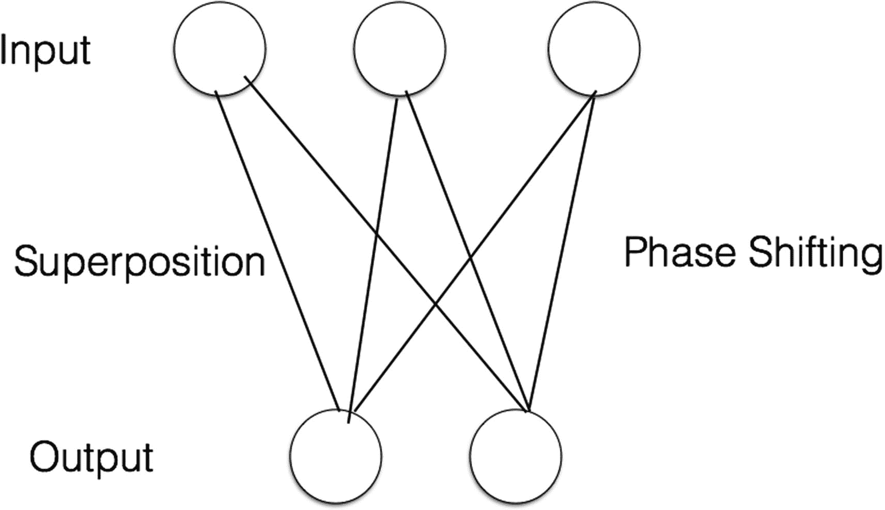
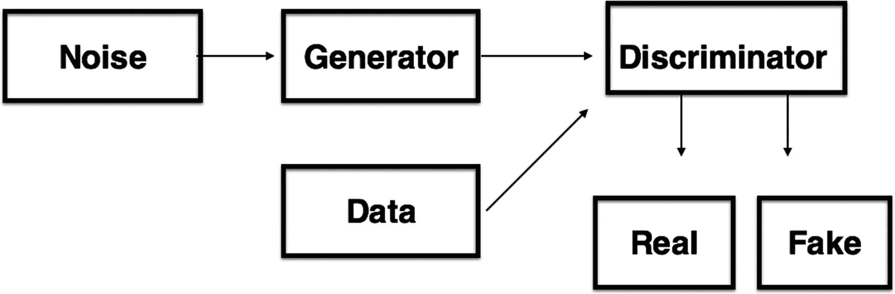

# 8. 量子神经网络算法

## 引言

> “受我们这个时代的科学和科幻小说的双重激励，我们这一代研究人员和工程师在成长过程中不断追问：如果这样会怎样？下一步是什么？我们继而投身于计算机视觉、人工智能、实时语音翻译、机器学习和量子计算等新兴学科。”

> —伊丽莎白·贝尔

本章将介绍量子神经网络这一主题。您将看到量子神经网络如何在现实生活中实现。本文提供了与量子人工神经网络（ANN）、量子联想记忆、量子点、量子生成对抗网络（GAN）和量子随机存取存储器相关的量子神经网络主题的代码示例。

## 初始设置

您需要安装 Python 3.5 才能运行本章中的代码示例。您可以从`https://www.python.org/downloads/release/python-350/`下载它。

## 量子人工神经网络

在本节中，我们将探讨量子人工神经网络。量子神经网络是经典神经网络在量子领域的对应物，其基础是量子力学原理。量子神经网络建立在量子信息处理与大脑量子效应之上。量子人工神经网络常用于模式分类算法。

> 提示

> 模式分类是指针对给定输入值，在多个可能的分组中识别出正确归属类别的过程。

让我们先来了解经典神经网络。

## 经典神经网络

神经网络包含输入层、输出层和隐藏层。网络会根据输出层的使用方式对输入进行调整。神经网络的概念源于对人脑的模拟。自 20 世纪 40 年代以来，神经网络就已属于人工智能的一部分。其发展得益于反向传播方法——当输出的预期值与输入的结果不相等时，该方法有助于调整隐藏层。

例如，一个旨在识别板球的神经网络可能会出错，反而识别出网球。深度学习神经网络是多层的高级神经网络，它通过提取多种特征来识别上下文中的物体。

深度学习神经网络就像一条传送带，将粗糙的铁棒逐渐加工成特定的零件。在深度学习的每个阶段，网络都具备识别和提取特征的能力。人工神经网络基于数学模型，由相互连接的“神经元”组成。神经元携带的信息与加权连接相对应。作为输入值的神经元信号通过神经连接传递，这些连接是带有权重的。深度学习神经网络能够利用适当的权重对输入数据进行学习、调整和归一化。

## 神经网络的量子类比

在了解经典神经网络之后，我们现在可以探讨其在量子领域的对应物。经典人工神经网络具备并行处理大数据的能力，从而拥有强大的计算力。量子神经网络因基于量子力学原理的量子并行性，也能处理类似规模的大数据。一个包含 M 个量子比特的量子寄存器，拥有量子计算机可处理的多种不同配置。

量子纠缠和量子叠加是测量量子比特状态的关键原理。一个量子神经网络由相互连接的输入神经元、隐藏神经元和输出神经元构成。霍普菲尔德模型就是量子神经网络的一个例子。霍普菲尔德模型于 1982 年被引入人工神经网络领域。约翰·霍普菲尔德发现了神经网络中的对称键和量子自旋玻璃现象。

> 提示

> 霍普菲尔德网络可应用于图像处理与分析，以及医学图像分析与修复。

神经计算方法基于数据处理的非线性技术。量子计算方法具有进化特性，因为它基于量子力学的进化算子。哥本哈根诠释指出，在量子系统中，进化行为与非进化行为是相互融合的。模式召回并非进化算子，而是一个非幺正过程。费曼对量子力学的诠释采用了路径积分方法。伊丽莎白·贝尔曼和格策尔提出了一种量子神经网络的时序模型。见图 8-1。



图 8-1  

量子神经网络

量子神经网络在其模型中使用量子点分子和光学光子。QNN 的时序模型由虚拟神经元的数学方程构建。QNN 中虚拟神经元的数量由时间离散化参数决定。威奇塔州立大学创建了一个基于 QNN 空间模型的新模型，该空间模型使用量子点分子阵列。

来自萨塞克斯大学的罗恩·克里斯利提出了一种不同的方法，该方法与依赖于狭缝位置的网络权重有关。一种基于神经计算的量子神经网络被用于现实生活中的模式识别。

### 代码示例

```python
import pennylane as qnnL
from pennylane import numpy as numcal
from pennylane.optimize import AdamOptimizer as AdamO
try:
    device = qnnL.device('strawberryfields.fock', wires=1, cutoff_dim=10)
except:
    print("please install the package strawberryfields")
def GetQNNLayer(varr):
    """ 量子神经网络的一层
    """
    qnnL.Rotation(varr[0], wires=0)
    qnnL.Squeezing(varr[1], 0., wires=0)
    qnnL.Rotation(varr[2], wires=0)
    qnnL.Displacement(varr[3], 0., wires=0)
    qnnL.Kerr(varr[4], wires=0)
@qnnL.qnode(device)
def GetQNN(vars, xcoor=None):
    """ 返回量子神经网络
    """
    qnnL.Displacement(xcoor, 0., wires=0)
    for var in vars:
        GetQNNLayer(var)
    return qnnL.expval.X(0)
def GetQNNSquareLoss(labelValues, predictionValues):
    """ 获取平方损失函数
    """
    lossValue = 0
    for label, prediction in zip(labelValues, predictionValues):
        lossValue = lossValue + (label - prediction) ** 2
    lossValue = lossValue / len(labelValues)
    return lossValue
def GetQNNCost(variables, featureValues, labelValues):
    """ 最小化成本函数
    """
    predictions = [GetQNN(variables, xcoor=x) for x in featureValues]
    return GetQNNSquareLoss(labelValues, predictions)
sincurvevalues = numcal.loadtxt("sin_curve_values.txt")
xcoordinate= sincurvevalues[:, 0]
ycoordinate = sincurvevalues[:, 1]
numcal.random.seed(0)
layer_recount = 4
variable_initial = 0.05 * numcal.random.randn(layer_recount, 5)
optimizer = AdamO(0.01, beta1=0.9, beta2=0.999)
variable = variable_initial
for iteration in range(500):
    var_cost = optimizer.step(lambda v: GetQNNCost(v, xcoordinate, ycoordinate), variable)
    print("Iteration value: {:5d} | Cost is: {:0.7f} ".format(iteration + 1, GetQNNCost(var_cost, xcoordinate, ycoordinate)))
```

### 命令

```bash
pip3 install numpy
pip3 install pennylane
python3 qnn.py
```

### 输出

```
Iteration value:     1 | Cost is: 0.2689702
Iteration value:     2 | Cost is: 0.2768397
Iteration value:     3 | Cost is: 0.2801266
Iteration value:     4 | Cost is: 0.2819382
Iteration value:     5 | Cost is: 0.2830613
Iteration value:     6 | Cost is: 0.2837995
Iteration value:     7 | Cost is: 0.2842974
Iteration value:     8 | Cost is: 0.2846337
Iteration value:     9 | Cost is: 0.2848555
Iteration value:    10 | Cost is: 0.2849926
...........................................
...........................................
...........................................
Iteration value:   494 | Cost is: 0.2406537
Iteration value:   495 | Cost is: 0.2406112
Iteration value:   496 | Cost is: 0.2405687
Iteration value:   497 | Cost is: 0.2405263
Iteration value:   498 | Cost is: 0.2404840
Iteration value:   499 | Cost is: 0.2404417
Iteration value:   500 | Cost is: 0.2403996
```

## 量子联想记忆

量子联想记忆基于一种量子神经计算方法。记忆与回忆是模式联想过程的组成部分。模式在记忆步骤中被持久化存储。回忆步骤则由模式联想和模式补全组成。

记忆是一种量子算法，它使用 `m` 个量子比特创建量子态，以建模 `q` 个模式。该算法使用多项式数量的基本操作，这些操作涉及 1、2 和 3 个量子比特。算法使用受控非门和弗雷德金量子门进行数学运算。为了使用 `m` 个量子神经元建模 `q` 个模式，该算法按 `mq` 步的数量级执行。

量子联想记忆中的回忆步骤基于格罗弗搜索算法。该搜索算法在包含 `m` 个项目的数据库中，以 `√m` 时间量级找到目标项目。记忆和回忆算法被融合在一起，形成了量子联想记忆过程。

量子联想记忆算法由丹·文图拉和托尼·马丁内斯创建。该算法与基于量子电路的计算机上的联想记忆模拟相关。在量子联想记忆中，量子比特处于叠加态。格罗弗算法可以通过量子联想记忆算法进行修改，以便根据搜索输入，通过记忆状态进行搜索。

量子联想记忆在神经网络领域应用广泛。这种记忆的存储容量与神经网络中神经元的数量呈指数关系。该记忆模型基于人脑的记忆方式，人脑中的处理过程就是基于神经网络的。

> **提示**
> 量子联想记忆算法基于一个多项式时间算法，该算法使用基于训练数据集的量子比特集来创建量子态。

现在，让我们来看一个叫做量子点的概念。

## 量子点

量子点是尺寸在纳米级别的粒子。这些粒子在受到光照时会发光。粒子发射光的波长可以通过量子点的大小、形状和材料来改变。尺寸为 2 到 3 纳米的量子点会产生蓝绿光谱区域。尺寸为 5 到 6 纳米的量子点则发射与橙色、红色和红外光谱区域相关的光。量子点的大小与发射光的寿命相关。量子点越大，寿命越长。

纳米粒子比量子点尺寸更大。纳米粒子的尺寸为 8 到 100 纳米。量子点器件基于量子点构建。在量子点器件中，量子点通过隧穿效应与引线连接。计算稳态粒子的电流时，会使用多种一阶方法。泡利、林德布拉德、雷德菲尔德和冯·诺依曼所采用的方法被用于计算库仑阻塞效应。还有一些二阶方法，例如冯·诺依曼的 `-2vN` 方法，可用于分析协同隧穿、双粒子隧穿以及展宽效应。

> **提示**
> 量子点有助于制造荧光和基于 `FRET` 的生物传感器。这些生物传感器用于识别生物分子，例如酸、酶、糖类、抗体和抗原。

现在，我们来看一下量子随机存取存储器的概念。

## 量子随机存取存储器

量子随机存取存储器基于 `m` 个量子比特，来创建包含 `2^m` 个不同存储单元的地址空间。该内存模型用于实现 `m` 个存储单元的叠加。与传统的量子 RAM 设计不同，该模型基于 `O(log 2^m)` 个开关。该模型有助于使用更低的功耗进行寻址。这是通过利用纠缠原理实现的。

`QRAM` 是量子计算机的基础。基于量子比特的地址寄存器和输出寄存器有助于管理 `QRAM` 中的内存。内存访问算法基于相干量子叠加。`QRAM` 用于量子搜索、碰撞识别、元素唯一性检测、信号的相干路由以及加密数据搜索。

让我们来看一下量子生成对抗网络算法。

## 量子 GAN

在经典机器学习中，生成对抗网络是一种工具。生成器用于生成数据的统计特征。它试图模仿当前的数据集。判别器则用于区分真实数据和伪造数据。生成器和判别器的学习过程会收敛。当生成器生成的统计特征使得判别器无法区分真实数据和生成数据时，收敛便发生了。见图 8-2。



**图 8-2** QGAN

量子生成对抗网络（`QGANs`）是使用了量子处理器的生成对抗网络。塞斯·劳埃德和克里斯蒂安·韦德·布鲁克首先提出了这种对抗学习算法。该算法运行在具有包含量子比特的量子寄存器的量子计算机上。量子比特存在于 0 和 1 两种状态。量子计算机在非常高维的向量空间中处理向量。这些向量承载着需要被处理的信息。

让我们来看一个量子生成对抗网络的实现。该实现基于两个量子电路：一个生成器和一个判别器。

### 代码示例

# Quantum GAN 示例代码

```python
import pennylane as qganPenny
from pennylane import numpy as numcal
from pennylane.optimize import GradientDescentOptimizer as GDO

device = qganPenny.device('default.qubit', wires=3)

def GetQGANReal(phi, theta, omega):
    qganPenny.Rot(phi, theta, omega, wires=0)

def GetQGANGenerator(wireArray):
    qganPenny.RX(wireArray[0], wires=0)
    qganPenny.RX(wireArray[1], wires=1)
    qganPenny.RY(wireArray[2], wires=0)
    qganPenny.RY(wireArray[3], wires=1)
    qganPenny.RZ(wireArray[4], wires=0)
    qganPenny.RZ(wireArray[5], wires=1)
    qganPenny.CNOT(wires=[0,1])
    qganPenny.RX(wireArray[6], wires=0)
    qganPenny.RY(wireArray[7], wires=0)
    qganPenny.RZ(wireArray[8], wires=0)

def GetQGANDiscriminator(wireArray):
    qganPenny.RX(wireArray[0], wires=0)
    qganPenny.RX(wireArray[1], wires=2)
    qganPenny.RY(wireArray[2], wires=0)
    qganPenny.RY(wireArray[3], wires=2)
    qganPenny.RZ(wireArray[4], wires=0)
    qganPenny.RZ(wireArray[5], wires=2)
    qganPenny.CNOT(wires=[1,2])
    qganPenny.RX(wireArray[6], wires=2)
    qganPenny.RY(wireArray[7], wires=2)
    qganPenny.RZ(wireArray[8], wires=2)

@qganPenny.qnode(device)
def GetQGANRealDiscCircuit(phi, theta, omega, discWeights):
    GetQGANReal(phi, theta, omega)
    GetQGANDiscriminator(discWeights)
    return qganPenny.expval.PauliZ(2)

@qganPenny.qnode(device)
def GetQGANDiscCircuit(genWeights, discWeights):
    GetQGANGenerator(genWeights)
    GetQGANDiscriminator(discWeights)
    return qganPenny.expval.PauliZ(2)

def GetQGANRealTrue(discWeights):
    trueDiscriminatorOutput = GetQGANRealDiscCircuit(phi, theta, omega, discWeights)
    probabilityRealTrue = (trueDiscriminatorOutput + 1) / 2
    return probabilityRealTrue

def GetQGANFakeTrue(genWeights, discWeights):
    fakeDiscriminatorOutput = GetQGANDiscCircuit(genWeights, discWeights)
    probabilityFakeTrue = (fakeDiscriminatorOutput + 1) / 2
    return probabilityFakeTrue

def GetQGANDiscriminatorCost(discWeights):
    cost = GetQGANFakeTrue(genWeights, discWeights) - GetQGANRealTrue(discWeights)
    return cost

def GetQGANGeneratorCost(genWeights):
    return -GetQGANFakeTrue(genWeights, discWeights)

phi = numcal.pi / 6
theta = numcal.pi / 2
omega = numcal.pi / 7
numcal.random.seed(0)
epsValue = 1e-2
genWeights = numcal.array([numcal.pi] + [0] * 8) + numcal.random.normal(scale=epsValue, size=[9])
discWeights = numcal.random.normal(size=[9])
gdo = GDO(0.1)

print("训练判别器 ")
for iteration in range(50):
    discriminator_weights = gdo.step(GetQGANDiscriminatorCost, discWeights)
    discriminator_cost = GetQGANDiscriminatorCost(discriminator_weights)
    if iteration % 5 == 0:
        print("迭代 {}: 判别器成本 = {}".format(iteration+1, discriminator_cost))
        print(" 判别器 - 真实为真: ", GetQGANRealTrue(discWeights))
        print("判别器 - 生成为真: ", GetQGANFakeTrue(genWeights, discWeights))

print("训练生成器.")
for iteration in range(200):
    generator_weights = gdo.step(GetQGANGeneratorCost, genWeights)
    generator_cost = -GetQGANGeneratorCost(generator_weights)
    if iteration % 5 == 0:
        print("迭代次数 {}: 生成器成本 = {}".format(iteration, generator_cost))
        print("判别器 - 真实为真: ", GetQGANRealTrue(discWeights))
        print("判别器 - 生成为真: ", GetQGANFakeTrue(genWeights, discWeights))
        print("成本为: ", GetQGANDiscriminatorCost(discriminator_weights))
```

### 命令

```bash
pip3 install numpy
pip3 install pennylane
python3 qgan.py
```

### 输出

# 训练过程日志

```
Training the discriminator
Iteration num 1: discriminator cost is = -0.10942017805789161
Iteration num 6: discriminator cost is = -0.10942017805789161
Iteration num 11: discriminator cost is = -0.10942017805789161
Iteration num 16: discriminator cost is = -0.10942017805789161
Iteration num 21: discriminator cost is = -0.10942017805789161
Iteration num 26: discriminator cost is = -0.10942017805789161
Iteration num 31: discriminator cost is = -0.10942017805789161
Iteration num 36: discriminator cost is = -0.10942017805789161
Iteration num 41: discriminator cost is = -0.10942017805789161
Iteration num 46: discriminator cost is = -0.10942017805789161
discriminator - real true:  0.1899776355995153
discriminator - fake true:  0.13399334520305328
Training the generator.
Iteration num 0: generator cost is = 0.1339934177809623
Iteration num 5: generator cost is = 0.1339934177809623
Iteration num 10: generator cost is = 0.1339934177809623
Iteration num 15: generator cost is = 0.1339934177809623
Iteration num 20: generator cost is = 0.1339934177809623
Iteration num 25: generator cost is = 0.1339934177809623
Iteration num 30: generator cost is = 0.1339934177809623
Iteration num 35: generator cost is = 0.1339934177809623
Iteration num 40: generator cost is = 0.1339934177809623
Iteration num 45: generator cost is = 0.1339934177809623
Iteration num 50: generator cost is = 0.1339934177809623
Iteration num 55: generator cost is = 0.1339934177809623
Iteration num 60: generator cost is = 0.1339934177809623
Iteration num 65: generator cost is = 0.1339934177809623
Iteration num 70: generator cost is = 0.1339934177809623
Iteration num 75: generator cost is = 0.1339934177809623
Iteration num 80: generator cost is = 0.1339934177809623
Iteration num 85: generator cost is = 0.1339934177809623
Iteration num 90: generator cost is = 0.1339934177809623
Iteration num 95: generator cost is = 0.1339934177809623
Iteration num 100: generator cost is = 0.1339934177809623
Iteration num 105: generator cost is = 0.1339934177809623
Iteration num 110: generator cost is = 0.1339934177809623
Iteration num 115: generator cost is = 0.1339934177809623
Iteration num 120: generator cost is = 0.1339934177809623
Iteration num 125: generator cost is = 0.1339934177809623
Iteration num 130: generator cost is = 0.1339934177809623
Iteration num 135: generator cost is = 0.1339934177809623
Iteration num 140: generator cost is = 0.1339934177809623
Iteration num 145: generator cost is = 0.1339934177809623
Iteration num 150: generator cost is = 0.1339934177809623
Iteration num 155: generator cost is = 0.1339934177809623
Iteration num 160: generator cost is = 0.1339934177809623
Iteration num 165: generator cost is = 0.1339934177809623
Iteration num 170: generator cost is = 0.1339934177809623
Iteration num 175: generator cost is = 0.1339934177809623
Iteration num 180: generator cost is = 0.1339934177809623
Iteration num 185: generator cost is = 0.1339934177809623
Iteration num 190: generator cost is = 0.1339934177809623
Iteration num 195: generator cost is = 0.1339934177809623
discriminator - real true:  0.1899776355995153
discriminator -  fake true:  0.13399334520305328
Cost is:  -0.10942017805789161
```

## 总结

在本章中，我们探讨了与量子神经网络算法相关的技术，例如量子神经网络和量子生成对抗网络。本章详细讨论了量子点、量子联想记忆和量子随机存取存储器的概念。