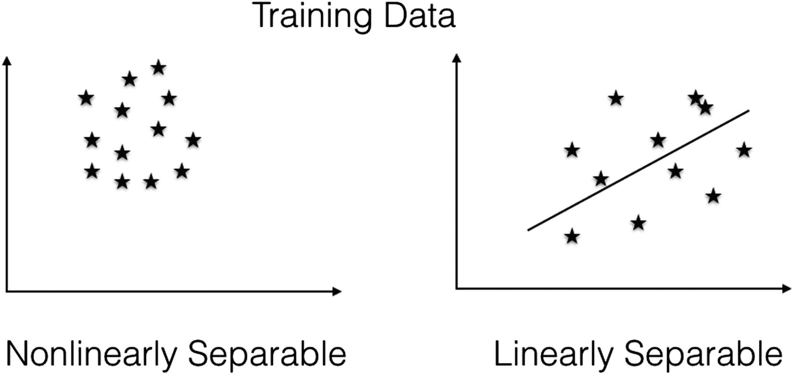
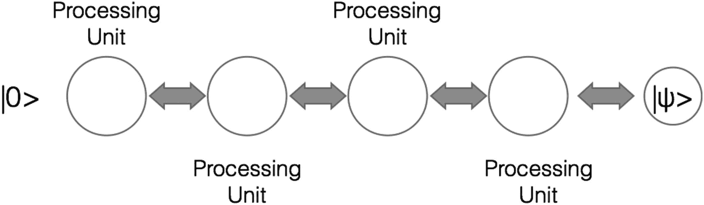
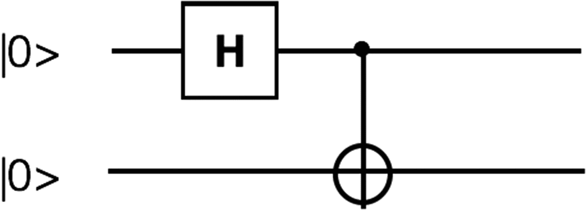
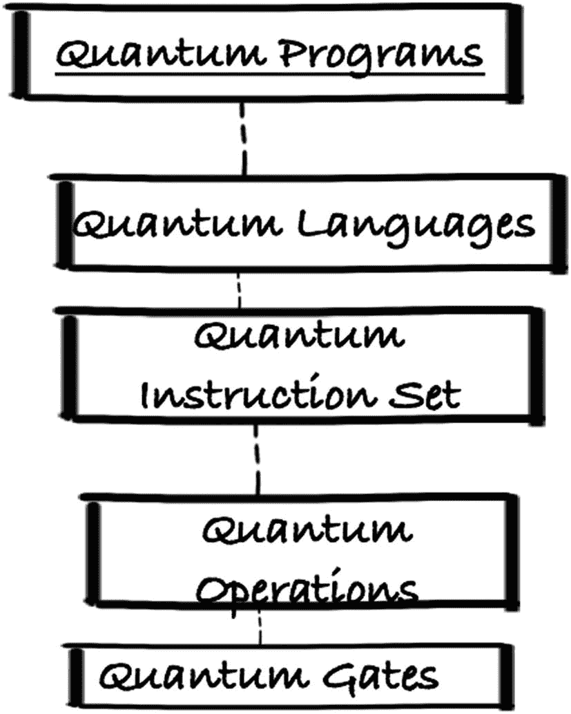
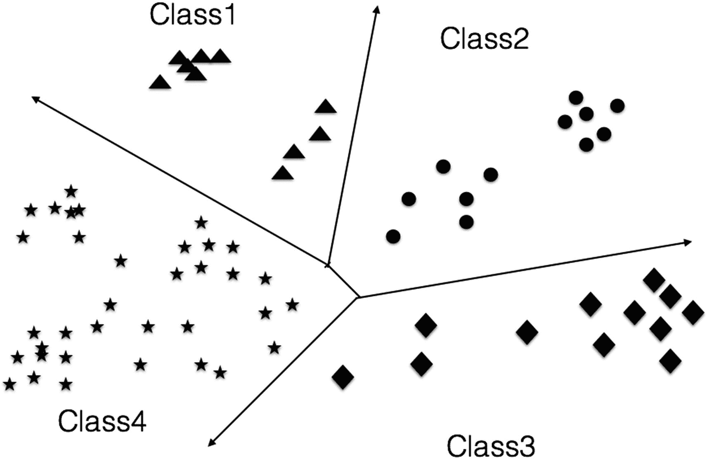
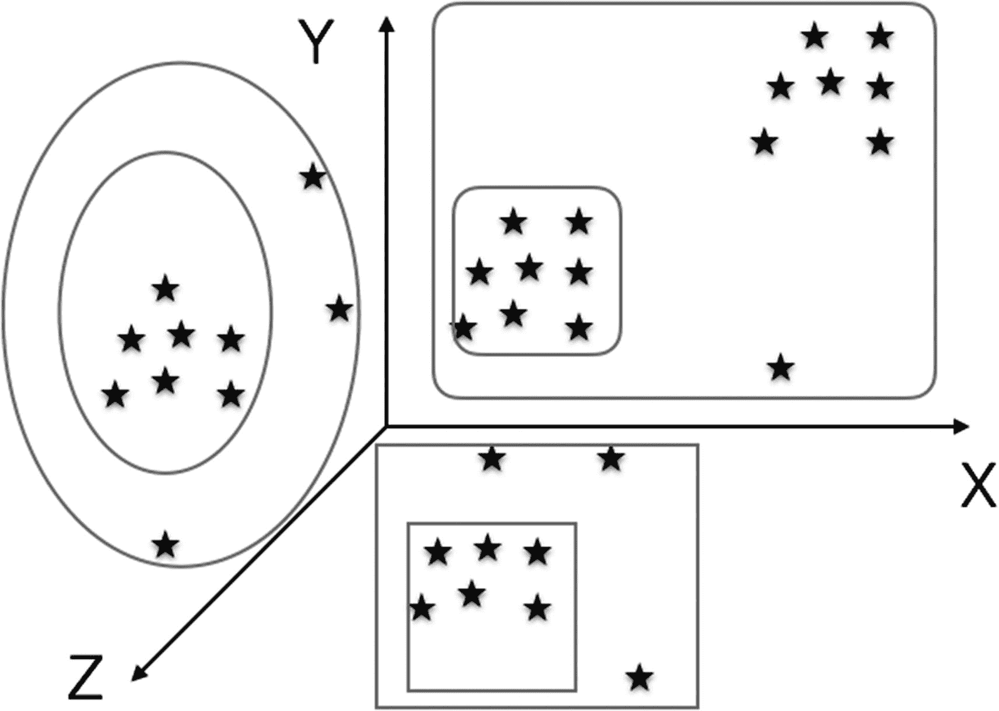
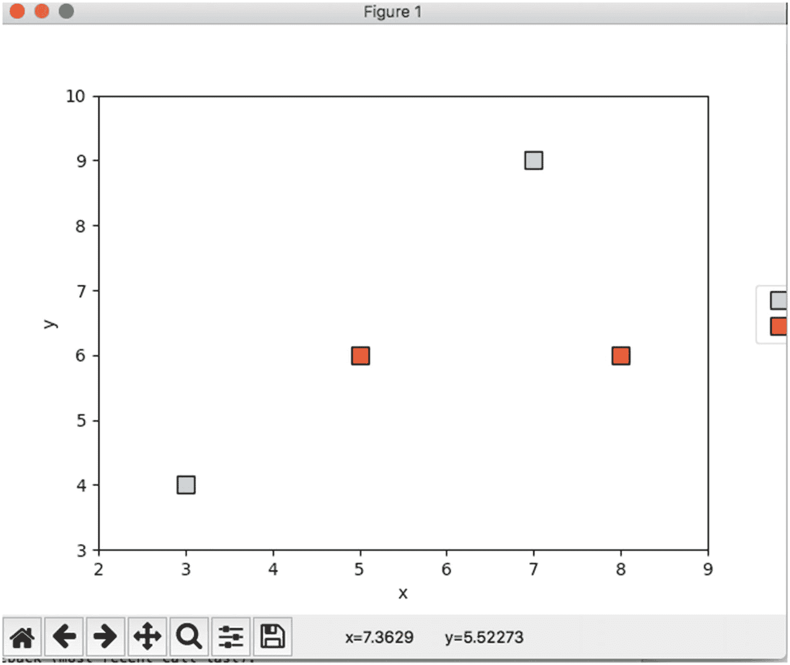

# 9. 量子分类算法

## 引言

> 重点已不再是量子力学是一种极其（对爱因斯坦而言，是难以接受的）奇特的理论，而在于世界本身就是一个极其奇特的地方。
> 
> — N. David Mermin

本章涵盖量子分类算法的主题。你将了解量子分类算法在现实生活中的实现方式。本章提供了不同算法的代码示例，例如量子分类器、支持向量机和稀疏支持向量机。

## 初始设置

你需要安装 Python 3.5 才能运行本章中的代码示例。你可以从 [`www.python.org/downloads/release/python-350/`](https://www.python.org/downloads/release/python-350/) 下载。


## 分类器

在经典计算中，通过使用机器学习算法来识别模式。量子机器学习技术有助于将机器学习方法转化为算法。算法是量子计算的基本单元。量子计算领域正在进行新的研究；具体而言，量子计算正通过融入数据挖掘技术而不断发展。模式识别可以使用量子计算算法来完成。监督学习方法作用于带标签的输入数据集和特征向量。这些方法有助于识别特征向量的标签。参见图 9-1。



图 9-1

线性可分

线性可分的数据集，可以通过一个平面、一条直线或一个超平面将输入集分割开来。一个集合的点位于第一个半空间中，第二个集合的点位于另一个半空间中。

量子机器学习方法基于监督学习和无监督学习。振幅修正方法应用于`k-nearest neighbor`（K 近邻）和聚类量子算法中。量子矩阵计算用于量子核方法。量子核方法支持向量机和高斯过程。监督式量子机器学习是变分量子分类器方法的基础。

我们来详细了解一下量子分类器。

## 量子分类器

量子分类器由编码器和处理器等组件构成（见图 9-2）。编码器将数据向量转换为量子态。经典预处理器将输入数据转换为量子电路。量子电路初始化为零量子态。处理器组件从编码后的量子态中检索信息。量子态变换器将量子电路中编码后的量子态，转换为通过测量和后处理检索到的信息。



图 9-2

量子分类器

我们使用 `QClassify` 框架来演示量子分类器。`QClassifiers` 是变分量子分类器。该包包含用于分类器任务的类。分类器任务基于量子门。使用云端的量子模拟器来模拟量子电路上的量子门。

一个量子电路包含一个哈达玛门和两个单量子比特测量门。测量门作用于一个辅助比特和指定的量子比特。量子方法将数据修改为编码后的放大数据格式。使用 `QClassifier` 来构建具体的电路。`QClassify` 对象包含组件信息。该包用于根据问题的上下文进行定制。量子二元分类器基于量子核方法。

**提示**

核函数是用于计算图形或文本中任意两点之间距离的数学函数。

让我们看一个与二维点集二元分类相关的示例。该示例被建模为一个包含 2 个量子比特的量子电路。处理器具有多个选项，例如 `layer_xyz`、`measure_top` 和 `prob_one`。量子比特可以取值 0 或 1，也可以处于 0 和 1 的叠加态。编码器选项也同样被设置。使用选定的量子比特和分类器选项创建分类器。

输入向量具有 `[1,1]` 矩阵值。参数值为 3.067 和 3.3311。使用 `input_vector` 和 `parameters` 创建量子电路。该程序是量子电路的输出。

我们来看一个量子分类器的代码实现。

### 代码示例

```
import qclassify
from qclassify.preprocessing import *
from qclassify.encoding_circ import *
from qclassify.qclassifier import QClassifier as QuantumClassifier
from qclassify.proc_circ import *
from qclassify.postprocessing import *
encoding_opts={
'preprocessing':id_func,
'encoding_circ':x_product,
}
process_opts={
'proc_circ':layer_xz,
'postprocessing':{
'quantum':measure_top,
'classical':prob_one,
}
}
quantum_bits = [0, 1]
classify_opts = {
'encoder_options':encoding_opts,
'proc_options':process_opts,
}
qCircuit = QuantumClassifier(quantum_bits, classify_opts)
circuit_values = [1, 1]
params = [2.0672044712460114, 1.3311348339721203]
quantum_circuit_prog = qCircuit.circuit(circuit_values, params)
print(quantum_circuit_prog)
```

### 命令

```
pip3 install qclassify
python3 quantum_classifier.py
```

### 输出

```
RX(1) 0
RX(1) 1
CZ 0 1
RX(3.0672044712460114) 0
RX(3.3311348339721203) 1
DECLARE ro BIT[1]
MEASURE 0 ro[0]
```

现在，让我们详细了解一下变分量子分类器。


## 变分量子分类器

量子算法在量子比特和量子逻辑门的基础上运行。算法需要无差错的逻辑门和量子比特。变分量子电路被用于机器学习。在这些电路中，逻辑门参数通过学习方法进行训练。输入向量是训练模型的特征。它们与量子系统的振幅是等价的。一个变分量子电路包含单量子比特门和双量子比特门。它有一个用于分类输入的单量子比特测量门。训练方法基于量子方法。见图 9-3。



**图 9-3** – 量子电路

让我们来看看鸢尾花问题，即识别不同鸢尾花物种的模式。鸢尾花有三种不同类型：山鸢尾、维吉尼亚鸢尾和杂色鸢尾。在这些花中识别出的模式是花瓣和花萼的长与宽。其尺寸以厘米为单位测量。数据被分为训练数据集和验证数据集。每个数据集都包含不同类别花朵的花瓣长度、花瓣宽度、花萼宽度和花萼长度。见图 9-4。


**图 9-4** – 鸢尾花（来源：[`pixabay.com/photos/iris-flower-flora-blue-blossom-2339883/`](https://pixabay.com/photos/iris-flower-flora-blue-blossom-2339883/)）

分类解决方案对数据集进行迭代，当使用量子机器学习模型和数据时，便能达到所需的准确率。变分量子分类器算法基于监督学习。

我们可以使用`PennyLane`框架进行量子计算和优化（见图 9-5）。该包包含一个用于执行量子电路的量子模拟器。变分量子电路是在参数经过训练的量子电路上进行模拟的。`PennyLane`具有与逻辑门、状态操作和测量门相关的特性。它可以处理多种类型的测量门。该包包含基于不同变分量子电路的模板，用于创建和训练机器学习模型。嵌入、层、子程序以及状态制备是多种类型的量子电路。这些电路被称为*拟设电路*。



**图 9-5** – PennyLane 框架

量子优化器用于修改量子机器学习模型。该包包含多种类型的优化器，例如梯度下降优化器、基于涅斯捷罗夫动量的梯度下降优化器、自适应学习优化器以及均方根传播优化器。

变分量子分类器算法基于监督学习。一个包含单量子比特门和双量子比特门的量子电路在量子设备上进行建模和模拟。下一节的代码示例展示了计算量子态旋转角的实现过程。该类包含基于两个量子比特振幅对四维向量进行编码的方法。

该类中的方法具有创建变分分类器、基于变分分类器创建量子电路、计算预测损失、预测准确率以及计算成本的功能。数据集包含坐标`x`、`y`以及填充值。代码运行 80 步以进行优化。每次迭代都会输出准确率和成本函数。

让我们来看一个变分量子分类器的代码示例。

### 代码示例

```python
import pennylane as quantumPenny
from pennylane import numpy as nump
from pennylane.optimize import  NesterovMomentumOptimizer as NMO
device = quantumPenny.device('default.qubit', wires=2)
def CalcAngles(xval):
beta0_val = 2 * nump.arcsin(nump.sqrt(xval[1]) ** 2 / nump.sqrt(xval[0] ** 2 + xval[1] ** 2 + 1e-12) )
beta1_val = 2 * nump.arcsin(nump.sqrt(xval[3]) ** 2 / nump.sqrt(xval[2] ** 2 + xval[3] ** 2 + 1e-12) )
beta2_val = 2 * nump.arcsin(nump.sqrt(xval[2] ** 2 + xval[3] ** 2) / nump.sqrt(xval[0] ** 2 + xval[1] ** 2 + xval[2] ** 2 + xval[3] ** 2))
return nump.array([beta2_val, -beta1_val / 2, beta1_val / 2, -beta0_val / 2, beta0_val / 2])
def CalcState(arr):
quantumPenny.RY(arr[0], wires=0)
quantumPenny.CNOT(wires=[0, 1])
quantumPenny.RY(arr[1], wires=1)
quantumPenny.CNOT(wires=[0, 1])
quantumPenny.RY(arr[2], wires=1)
quantumPenny.PauliX(wires=0)
quantumPenny.CNOT(wires=[0, 1])
quantumPenny.RY(arr[3], wires=1)
quantumPenny.CNOT(wires=[0, 1])
quantumPenny.RY(arr[4], wires=1)
quantumPenny.PauliX(wires=0)
def CalcLayer(Warr):
quantumPenny.Rot(Warr[0, 0], Warr[0, 1], Warr[0, 2], wires=0)
quantumPenny.Rot(Warr[1, 0], Warr[1, 1], Warr[1, 2], wires=1)
quantumPenny.CNOT(wires=[0, 1])
@quantumPenny.qnode(device)
def FindCircuit(weight, angle=None):
CalcState(angle )
for W in weight:
CalcLayer(W)
return quantumPenny.expval(quantumPenny.PauliZ(0))
def GetVariationalClassifier(var, angle=None):
weight = var[0]
bias_val = var[1]
return FindCircuit(weight, angle=angle) + bias_val
def CalcSquareLoss(label, prediction):
loss_val = 0
for l, p in zip(label, prediction):
loss_val = loss_val + (l - p) ** 2
loss_val = loss_val / len(label)
return loss_val
def CalcAccuracy(label, prediction):
loss_val = 0
for l, p in zip(label, prediction):
if abs(l - p) < 1e-5:
loss_val = loss_val + 1
loss_val = loss_val / len(label)
return loss_val
def CalcCost(weight, feature, label):
prediction = [GetVariationalClassifier(weight, angle=f) for f in feature]
return CalcSquareLoss(label, prediction)
data_iris_flowers = nump.loadtxt("iris_flower_data.txt")
XVal = data_iris_flowers[:, 0:2]
pad = 0.3 * nump.ones((len(XVal), 1))
XPad = nump.c_[nump.c_[XVal, pad], nump.zeros((len(XVal), 1)) ]
norm = nump.sqrt(nump.sum(XPad ** 2, -1))
X_norm = (XPad.T / norm).T
ftrs = nump.array([CalcAngles(x) for x in X_norm])
YVal = data_iris_flowers[:, -1]
nump.random.seed(0)
num_data = len(YVal)
num_train = int(0.75 * num_data)
index = nump.random.permutation(range(num_data))
feats_train = ftrs[index[:num_train]]
YValT = YVal[index[:num_train]]
ftrs_val = ftrs[index[num_train:]]
Y_val = YVal[index[num_train:]]
quantumbits = 2
layers = 6
varinit = (0.01 * nump.random.randn(layers, quantumbits, 3), 0.0)
opt = NMO(0.01)
batsize = 5
var = varinit
for it in range(50):
bat_index = nump.random.randint(0, num_train, (batsize, ))
features_train_batch = feats_train[bat_index]
Ytrainbat = YValT[bat_index]
var = opt.step(lambda v: CalcCost(v, features_train_batch, Ytrainbat), var)
predict_train = [nump.sign(GetVariationalClassifier(var, angle=f)) for f in feats_train]
predict_val = [nump.sign(GetVariationalClassifier(var, angle=f)) for f in ftrs_val]
accuracy_train = CalcAccuracy(YValT, predict_train)
accuracy_val = CalcAccuracy(Y_val, predict_val)
print("it value: {:5d} | Cost Features: {:0.7f} | Accuracy training: {:0.7f} | Accuracy for validation: {:0.7f} "
"".format(it+1, CalcCost(var, ftrs, YVal), accuracy_train, accuracy_val))
```

### 命令

```bash
pip3 install pennylane
python3 variational_classifier.py
```


### 输出

```
it value:     1 | Cost Features: 1.4490948 | Accuracy training: 0.4933333 | Accuracy for validation: 0.5600000
it value:     2 | Cost Features: 1.3309953 | Accuracy training : 0.4933333 | Accuracy for validation: 0.5600000
it value:     3 | Cost Features: 1.1582178 | Accuracy training: 0.4533333 | Accuracy for validation: 0.5600000
it value:     4 | Cost Features: 0.9795035 | Accuracy training: 0.4800000 | Accuracy for validation: 0.5600000
it value:     5 | Cost Features: 0.8857893 | Accuracy training: 0.6400000 | Accuracy for validation: 0.7600000
it value:     6 | Cost Features: 0.8587935 | Accuracy training: 0.7066667 | Accuracy for validation: 0.7600000
it value:     7 | Cost Features: 0.8496204 | Accuracy training: 0.7200000 | Accuracy for validation: 0.6800000
it value:     8 | Cost Features: 0.8200972 | Accuracy training: 0.7333333 | Accuracy for validation: 0.6800000
it value:     9 | Cost Features: 0.8027511 | Accuracy training: 0.7466667 | Accuracy for validation: 0.6800000
it value:    10 | Cost Features: 0.7695152 | Accuracy training: 0.8000000 | Accuracy for validation: 0.7600000
...........................................................................
...........................................................................
it value:    47 | Cost Features: 0.5413240 | Accuracy training: 0.9466667 | Accuracy for validation: 1.0000000
it value:    48 | Cost Features: 0.5239643 | Accuracy training: 0.9466667 | Accuracy for validation: 1.0000000
it value:    49 | Cost Features: 0.5100842 | Accuracy training: 0.9466667 | Accuracy for validation: 1.0000000
it value:    50 | Cost Features: 0.5006861 | Accuracy training: 0.9466667 | Accuracy for validation: 1.0000000
```

训练数据和测试数据约占数据集的 75%。验证集约占数据集值的 25%。训练数据用于拟合模型的参数，测试数据用于评估模型的性能。验证数据用于微调机器学习模型。

损失和准确率是在训练数据和验证数据集上衡量的。当验证损失相对于训练损失增加时，模型会出现过拟合。目标是相对于损失，验证准确率较高。需要选择具有代表性的数据集以避免数据源偏差。偏差可以基于数据总体中的统计期望值和实际值来估计。需要根据度量均方误差来计算观察到的模型误差。均方误差需要被最小化。

## 经典支持向量机

经典支持向量机（SVM）基于监督机器学习。SVM 使用数据进行训练，并用于预测输入是否属于特定类别。训练数据包含 SVM 所要预测的类别集合。SVM 中使用支持向量来最大化类别集合之间的距离。见图 9-6。



图 9-6

支持向量机

SVM 的量子对应版本使用特征映射来呈现量子电路信息。核函数概念被用于分类方法中。特征映射修饰了特征。特征是上下文中所讨论主题的可测量属性。分类是关于寻找输入信息各个类别之间的距离。

量子支持向量机基于量子处理器来求解问题。它基于监督学习。多类分类器建立在量子支持向量机之上。量子处理器拥有用于处理内存中量子比特的量子随机存取存储器（QRAM）。

提示

QRAM 由三个组件组成：存储器阵列、输入寄存器和输出寄存器。存储器阵列可以是经典的或基于量子的。寄存器由量子比特组成。

让我们详细了解一下量子稀疏支持向量机。

## 量子稀疏支持向量机

有多种技术，如最小二乘法，可用于模拟量子稀疏支持向量机。Harrow-Hassidim-Lloyd（HHL）算法用于求解基于线性方程组的系统，以利用训练好的量子比特进行预测。这是经典计算技术和量子计算技术的混合算法。

正则化是稀疏支持向量机技术的一部分。它与目标函数中对参数权重施加的惩罚有关。由特征组成的高维空间可用于获得准确的预测。L2 范数惩罚被用作正则化算法，而 L1 范数优于 L2 范数。支持向量机中的目标函数使用带有 L1 范数的合页损失最小化。见图 9-7。



图 9-7

量子支持向量机

线性规划是半定规划（SDP）的一种形式，它使用了稀疏支持向量机的公式。量子稀疏支持向量机使用量子半定规划求解器。求解半定规划的算法步骤如下所示：

1.  在字典中创建参数。
2.  将数据集创建为输入对象。
3.  算法基于输入数据集和参数执行。
4.  打印包含成功率和详细信息的结果。
5.  在输出中打印预测标签。

提示

正半定矩阵是厄米特矩阵，它具有正特征值。

ReNomQ 是一个基于量子原理的机器学习框架。可以使用此框架对量子电路进行建模。可以使用该软件包执行量子计算。量子支持向量机是使用绝热量子计算模型建模的。

让我们看一个量子支持向量机的例子。

### 代码示例

```
import renom_q.ml.quantum_svm
quantum_svm = renom_q.ml.quantum_svm.QSVM()
xval = [[3, 4], [5, 6], [7, 9], [8, 6]]
yval = [1, -1, 1, -1]
quantum_svm.plot_graph(xval, yval)
```

### 命令

```
pip3 install renorm_q
python3 quantum_svm.py
```

### 输出

图 9-8 显示了输出。



图 9-8

输出

## 总结

在本章中，我们研究了与量子分类器算法相关的技术，例如量子分类器、变分量子分类、量子支持向量机和量子稀疏向量机。

