# 10. 量子数据处理

## 引言

> *“量子注意力函数是量子机器学习的关键。”*
> ——Amit Ray

本章涵盖了量子数据处理这一主题（见图 10-1）。您将看到量子数据处理算法如何在日常生活中得以实现。文中提供了诸如 `k-means`、`k-medians` 和量子聚类等算法的代码示例。

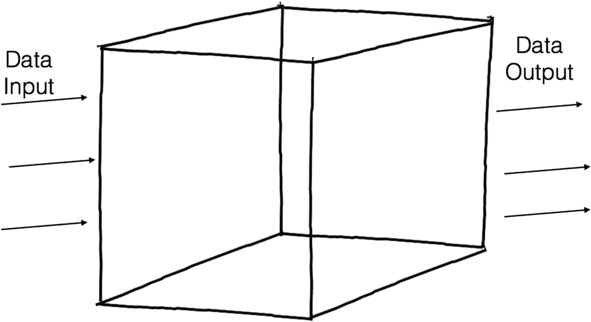
图 10-1 数据处理

## 初始设置

您需要安装 Python 3.5 才能运行本章中的代码示例。您可以从 `https://www.python.org/downloads/release/python-350/` 下载它。

## 经典 K-Means

经典 `K-Means` 技术将输入数据划分为 `k` 个簇。这 `k` 个簇必须互不相同，且每个数据点仅属于一个簇。簇的选取基于质心与数据点之间`最小`的平方距离之和。参见图 10-2。

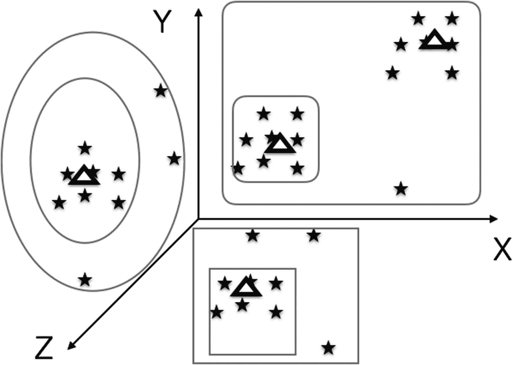
图 10-2 K-Means

伪算法的步骤如下所示：

1. 初始化后，随机选取 `k` 个质心。
2. 根据数据点与质心之间的最小距离，为每个数据点选择一个质心。
3. 基于每个簇中数据点的平均值，重新计算每个簇的质心。
4. 重复前两个步骤。

数据集的选择需要满足均值为 0、标准差为 1 的条件。此技术适用于初始选取的不同质心簇，计算基于 `K-Means` 算法。通过比较执行的迭代次数，来选取最佳解决方案。当簇质心的数量与数据集中的不同类型相关联时，便可采用此技术。当变量较多时，该技术的性能更优。该方法面临的挑战在于预测 `k` 值。

**提示**

在 `K-Means` 中，`k` 代表输入数据中的簇数量。

我们来看一下 `K-Means` 算法的代码实现。

### 代码示例

```
import matplotlib.pyplot as plot
import seaborn as seasns; seasns.set()
import numpy as nump
from sklearn.cluster import KMeans as skKMeans
from sklearn.datasets.samples_generator import make_blobs
X, y_true = make_blobs(n_samples=250, centers=4,
cluster_std=0.60, random_state=0)
plot.scatter(X[:, 0], X[:, 1], s=50);
plot.show()
kmeans_res = skKMeans(n_clusters=4)
kmeans_res.fit(X)
y_val_kmeans = kmeans_res.predict(X)
plot.scatter(X[:, 0], X[:, 1], c=y_val_kmeans, s=50, cmap="viridis")
centers = kmeans_res.cluster_centers_
plot.scatter(centers[:, 0], centers[:, 1], c="grey", s=200, alpha=0.5);
plot.show()
```

### 命令

```
pip3 install seaborn
pip3 install numpy
python3 k-means.py
```

### 输出结果

样本数据绘制并展示在图 10-3 的图表中。

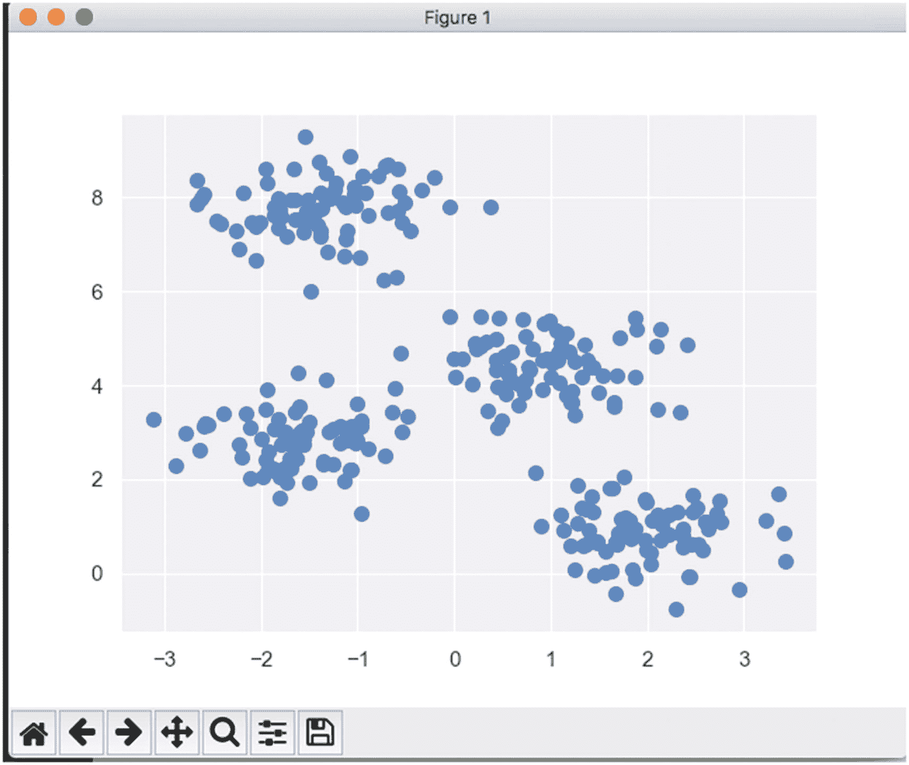
图 10-3 K-Means 样本

应用 `K-Means` 算法后，其绘图结果展示在图 10-4 的图表中。

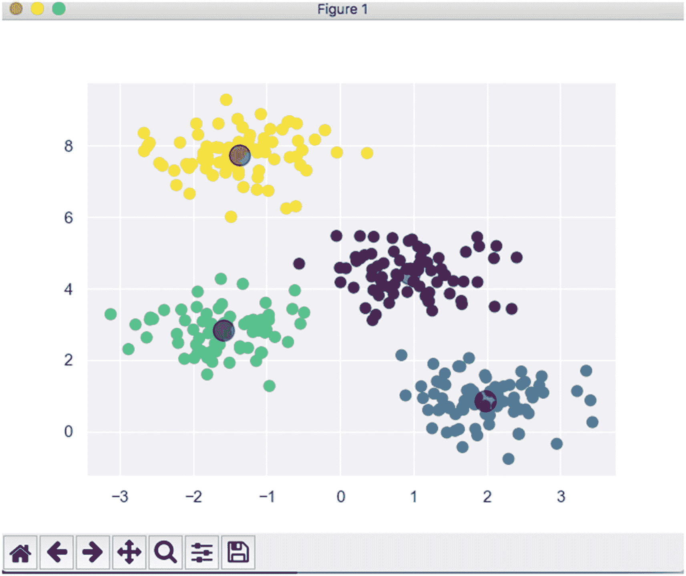
图 10-4 K-Means 结果

现在，我们来看一下量子 `K-Means` 数据处理技术。

## 量子 K-Means

量子 `K-Means` 技术（见图 10-5）是使用一个可包含训练向量的量子电路来应用的。训练向量是初始质心，并且在每一步之后都会重新计算质心。通过使用旋转后的训练向量可以改变电路。训练向量的数量根据簇的数量增加。伪算法步骤如下所示：

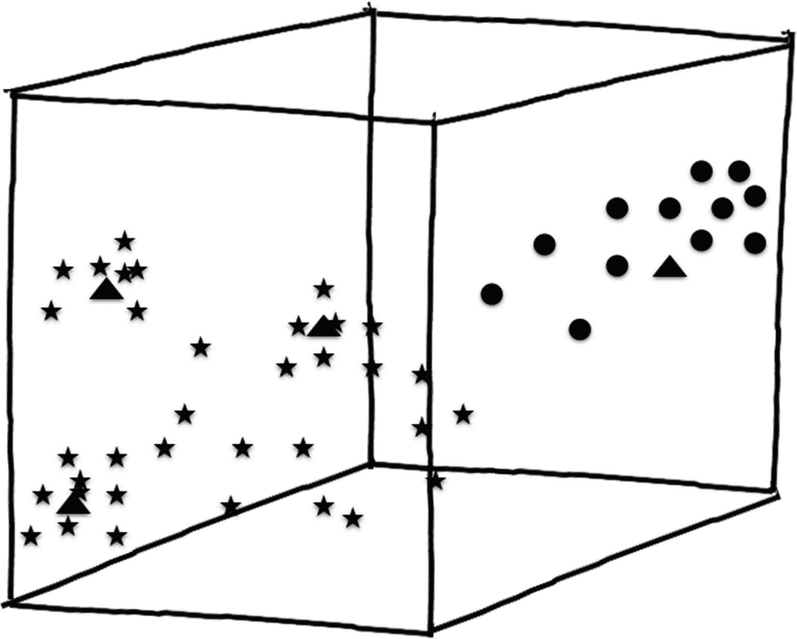
图 10-5 量子 K-Means

1. 输入 `k` 个簇组，并输入数据点。
2. 随机初始化 `k` 个质心。
3. 遍历所有输入的数据点，为其确定所属的簇组。
4. 计算量子干涉电路。
5. 筛选干涉概率。
6. 将高概率质心添加到字典中。
7. 对数据点集计算上述三个步骤。

对于 `k` 个簇，可以为量子 `K-Means` 技术建模 `N` 台量子机器。量子态由算法结果得到的质心组构成。可以通过将输入数据分解为不同的数据集，分配给每台量子机器执行算法，从而实现并行化。对量子态进行聚合，并用于迭代。

上一章讨论的鸢尾花数据集可以基于花瓣和花萼的宽度与高度，聚类成三个组（`setosa`、`versicolor`、`virginica`）。该技术试图识别簇内变异较小的簇组。另一个应用是根据人们的收入和支出将其划分为 `k` 个簇。

**提示**

迹距离和保真度是量子计算中使用的量子距离度量方法。

我们来看一下代码实现。

### 代码示例

## 量子 K-Means 算法

```python
import matplotlib.pyplot as plot
import pandas as pand
from qiskit import QuantumRegister, ClassicalRegister
from qiskit import QuantumCircuit
from qiskit import Aer, execute
from numpy import pi
figure, axis = plot.subplots()
axis.set(xlabel='特征 1', ylabel='特征 2')
data_input = pand.read_csv('kmeans_input.csv',
    usecols=['特征 1', '特征 2', '类别'])
isRed = data_input['类别'] == 'Red'
isGreen = data_input['类别'] == 'Green'
isBlack = data_input['类别'] == 'Black'
### 筛选数据
redData = data_input[isRed].drop(['类别'], axis=1)
greenData = data_input[isGreen].drop(['类别'], axis=1)
blackData = data_input[isBlack].drop(['类别'], axis=1)
y_p = 0.141
x_p = -0.161
xgc = sum(redData['特征 1']) / len(redData['特征 1'])
xbc = sum(greenData['特征 1']) / len(greenData['特征 1'])
xkc = sum(blackData['特征 1']) / len(blackData['特征 1'])
### 计算质心的 y 坐标
ygc = sum(redData['特征 2']) / len(redData['特征 2'])
ybc = sum(greenData['特征 2']) / len(greenData['特征 2'])
ykc = sum(blackData['特征 2']) / len(blackData['特征 2'])
### 绘制质心
plot.plot(xgc, ygc, 'rx')
plot.plot(xbc, ybc, 'gx')
plot.plot(xkc, ykc, 'kx')
plot.plot(x_p, y_p, 'bo')
### 设置坐标轴范围
plot.axis([-1, 1, -1, 1])
plot.show()
### 计算 theta 和 phi 值
phi_list = [((x + 1) * pi / 2) for x in [x_p, xgc, xbc, xkc]]
theta_list = [((x + 1) * pi / 2) for x in [y_p, ygc, ybc, ykc]]
quantumregister = QuantumRegister(3, 'quantumregister')
classicregister = ClassicalRegister(1, 'classicregister')
quantum_circuit = QuantumCircuit(quantumregister, classicregister, name="qc")
backend = Aer.get_backend('qasm_simulator')
quantum_results_list = []
for i in range(1, 4):
    quantum_circuit.h(quantumregister[2])
    quantum_circuit.u3(theta_list[0], phi_list[0], 0, quantumregister[0])
    quantum_circuit.u3(theta_list[i], phi_list[i], 0, quantumregister[1])
    quantum_circuit.cswap(quantumregister[2], quantumregister[0], quantumregister[1])
    quantum_circuit.h(quantumregister[2])
    quantum_circuit.measure(quantumregister[2], classicregister[0])
    quantum_circuit.reset(quantumregister)
job = execute(quantum_circuit, backend=backend, shots=1024)
result = job.result().get_counts(quantum_circuit)
quantum_results_list.append(result['1'])
print(quantum_results_list)
class_list = ['Red', 'Green', 'Black']
quantum_p_class = class_list[quantum_results_list.index(min(quantum_results_list))]
distances_list = [((x_p - i[0])**2 + (y_p - i[1])**2)**0.5 for i in [(xgc, ygc), (xbc, ybc), (xkc, ykc)]]
classical_p_class = class_list[distances_list.index(min(distances_list))]
print("""使用量子距离算法，
该新数据点属于""", quantum_p_class,
    '类别。\n')
print('欧几里得距离列表如下：', distances_list, '\n')
print("""基于欧几里得距离计算，
该新数据点与""", classical_p_class,
    '类别相关。')
```

### 命令

```
pip3 install qiskit
pip3 install qiskit-ibmq-provider
pip3 install pandas
pip3 install matlab
python3 quantum_k_means.py
```

### 输出结果

输入数据点从包含红色、绿色和黑色的 Excel 文件中读取。新增一个数据点，使用量子 k-means 算法判断其所属的颜色类别。图 10-6 展示了输出结果。

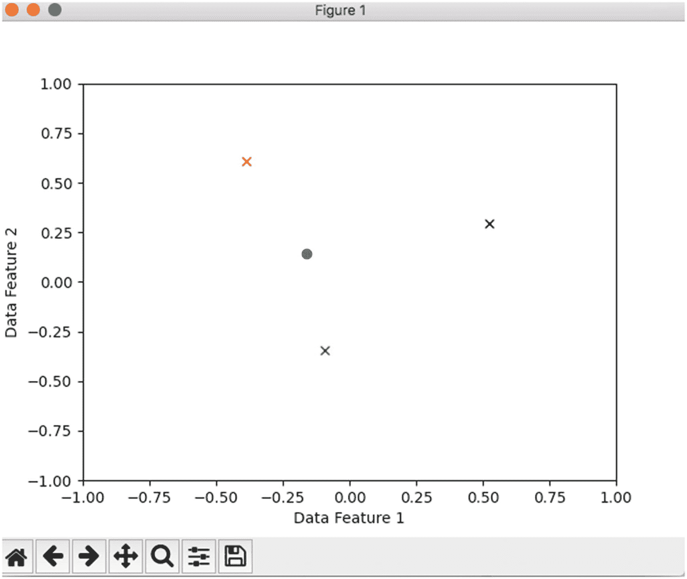

图 10-6 输出结果

利用量子距离算法，新数据点`[72, 60, 125]`被归为绿色类别。测量所得的距离基于欧几里得距离。

```
[0.520285324797846, 0.4905204028376393, 0.7014755294377704]
```

现在，让我们来看看经典的 k-中位数算法。

## 经典 K-中位数算法

k-中位数技术（见图 10-7）基于数据集的中位数选择质心。k-means 算法则选择簇内数据点的均值作为质心。从质心到簇内数据点的距离计算采用曼哈顿度量。两点`(x1,y1)`和`(x2, y2)`之间的欧几里得距离公式如下：

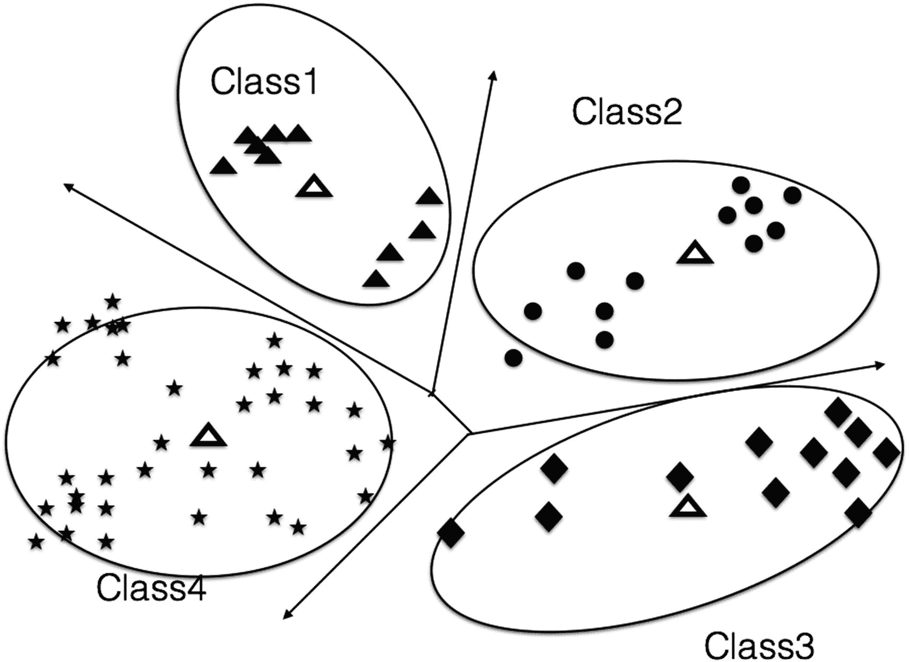

图 10-7 K-中位数算法

```
√(x2-x1)²+(y2-y1)²
```

曼哈顿度量的公式如下：

```
|x2-x1| + |y2-y1|
```

**提示**

k-中位数与 k-means 的区别在于簇中心的选择方式。k-means 选择均值作为质心，而 k-中位数则选择簇内数据点的中位数。

让我们来看一下 k-中位数算法的代码实现。

### 代码示例

# 量子K-中位数算法

```
import numpy as nump
from k_medians_utils import *
PREFIX = ''
FILE = PREFIX + 'iris.data.txt'
[xval, yval] = read(FILE)
[n, d] = nump.shape(xval)
k = len(nump.unique(yval))
mi = nump.min(xval, axis=0)
ma = nump.max(xval, axis=0)
di = ma - mi
stop = 0
c = nump.zeros(n)
median = nump.random.rand(k, d) * nump.ones((k, d))
median = median * di
median = median + mi
med_t = nump.copy(median)
imax = 100
for i in range(imax):
    med_t = nump.copy(median)
    for j in range(n):
        dist = nump.sqrt(nump.sum(nump.power(xval[j,:] - median, 2), axis=1))
        idx = nump.argmin(dist)
        val = nump.min(dist)
        c[j] = idx
    for j in range(k):
        a = nump.arange(n)
        idx = a[c == j]
        l = len(idx)
        if l:
            median[j,:] = nump.median(xval[idx,:], axis=0)
        else:
            median[j,:] = median[j,:] + (nump.random.rand(d) * di)
    stop = nump.sum(nump.sum(nump.power(median - med_t,2), axis=0))
    if(stop == imax):
        break
accur = getAccuracy(c, yval, k)
silhou = getSilhouette(xval, c, median)
print(accur, silhou)
```

**`k_medians_utils.py`**

```
import numpy as nump
import os
VERBOSE = False
def read(FILE):
    if os.path.isfile(FILE):
        file = open(FILE, 'r')
        lines = tuple(file)
        file.close()
        data = []
        for line in lines:
            data.append(line.rstrip().split(","))
        if VERBOSE:
            print(data[-1])
    else:
        print(FILE, 'does not exist')
        exit(0)
    data = nump.array(data)
    x = data[:,0:-1]
    x = x.astype(nump.float)
    y = nump.zeros(len(data))
    uniq = nump.unique(data[:,-1])
    for i in range(0,len(uniq)):
        idx = (data[:,-1] == uniq[i])
        if any(idx):
            y[idx] = i
    return(x, y)
def getAccuracy(c, y, k):
    if VERBOSE:
        print(c)
        print(y)
    n = len(y)
    kk = nump.zeros(k)
    o = 0
    e = 0
    idxx = []
    for i in range(k):
        a = nump.arange(n)
        idxa = a[y == i]
        for j in range(len(idxa)):
            kk[int(c[j+o])] = kk[int(c[j+o])] + 1
        if idxx:
            for l in idxx:
                kk[l] = 0
        o = o + len(idxa)
        idx = nump.argmax(kk)
        idxx.append(idx)
        val = kk[idx]
        e = e + (val/len(y[y == i]))
        kk = nump.zeros(k)
    e = e/k
    return(e)
def accuracy_(c, y, k1, k2):
    if VERBOSE:
        print(c)
        print(y)
    n = len(y)
    kk = nump.zeros(k2)
    o = 0
    e = 0
    idxx = []
    for i in range(k1):
        a = nump.arange(n)
        idxa = a[y == i]
        for j in range(len(idxa)):
            kk[int(c[j+o])] = kk[int(c[j+o])] + 1
        if idxx:
            for l in idxx :
                kk[l] = 0
        o = o + len(idxa)
        idx = nump.argmax(kk)
        idxx.append(idx)
        val = kk[idx]
        e = e + (val/len(y[y == i]))
        kk = nump.zeros(k2)
    e = e/k1
    return(e)
def getSilhouette(x, c, me):
    if VERBOSE:
        print(c)
        print(y)
    n = len(c)
    s = nump.zeros((n,3))
    for i in range(n):
        dist = nump.sqrt(nump.sum(nump.power(x[i,:] - me,2), axis=1))
        dd = nump.argsort(dist)
        aa = nump.arange(n)
        for j in range(2):
            aa = nump.arange(n)
            idx = aa[c == dd[j]]
            l = len(idx)
            if l:
                for o in idx :
                    s[o,j] = s[o,j] + nump.sqrt(nump.sum(nump.power(x[i,:] - x[o,:] ,2)))
                s[o,j] = s[o,j]/l
    s = nump.mean((s[:,0] - s[:,1])/nump.amax(s[:,0:2], axis=1))
    return(s)
def actionselection(action, probability, numactions, numdims):
    for i in range(numdims):
        a = nump.random.choice(nump.arange(0, numactions), p = probability[:,i])
        mask = nump.zeros(numactions,dtype=bool)
        #print(i, a, mask)
        mask[a] = True
        action[mask,i] = 1
        action[~mask,i] = 0
    return(action)
def probabilityupdate(action, probability, numactions, numdims, signal, alpha, beta):
    if(numactions > 1):
        for i in range(numdims):
            a = nump.where(action[:,i] == 1)
            mask = nump.zeros(numactions,dtype=bool)
            mask[a] = True
            if not signal[i]:
                probability[mask,i] = probability[mask,i] + alpha * (1 - probability[mask,i])
                probability[~mask,i] = (1 - alpha) * probability[~mask,i]
            else:
                probability[mask,i] = (1 - beta) * probability[mask,i]
                probability[~mask,i] = (beta/(numactions-1)) + (1-beta) * probability[~mask,i]
    return(probability)
```

上一章讨论的鸢尾花数据集可根据花瓣和花萼的宽度与高度聚为三个不同的组（山鸢尾、变色鸢尾、维吉尼亚鸢尾）。k-中位数聚类算法在将数据点聚类至山鸢尾、变色鸢尾和维吉尼亚鸢尾这三个组时，准确率达到 90%。

接下来详细探讨量子 k-中位数算法。

#### 命令

```
pip3 install nump
python3 k-medians.py
```

#### 输出结果

```
0.9 -0.2609494581992614
```

量子 k-中位数技术通过使用数据点的中位数来计算簇组中的簇质心。中位数基于所有数据点的最小距离进行计算。该技术与最小化数据点与数据集的中位数之间距离的总和相关。距离的最小化基于使用 Grover 搜索的量子最小化算法进行计算。点之间的欧几里得距离被用作距离算法。

伪算法的步骤如下所示：

1. 输入为`k`个簇组和输入数据点。
2. 基于数据点的中位数，随机初始化`k`个质心。
3. 遍历所有输入数据点，以确定其所属的簇组。
4. 计算量子干涉电路。
5. 筛选干涉概率。
6. 将高概率的质心添加到字典中。
7. 对数据点集合重复前三个步骤。

**提示** Grover 搜索算法使用酉 oracle 函数，基于函数`f(x)`创建叠加态。

现在让我们来看一下经典的聚类算法。

## 经典聚类

经典聚类技术用于根据一组特征将输入数据划分为多个组。一个组将包含具有共同点的数据点。会创建多个组来处理不同的数据点。这基于无监督机器学习技术。聚类在一组未标记的输入数据中识别模式和特征。

以下是不同类型的经典聚类技术：
* 基于划分
* 基于层次
* 基于密度
* 基于网格
* 基于模型

经典聚类技术用于图像处理、计算生命科学、医疗保健和经济学应用。见`图 10-8`。

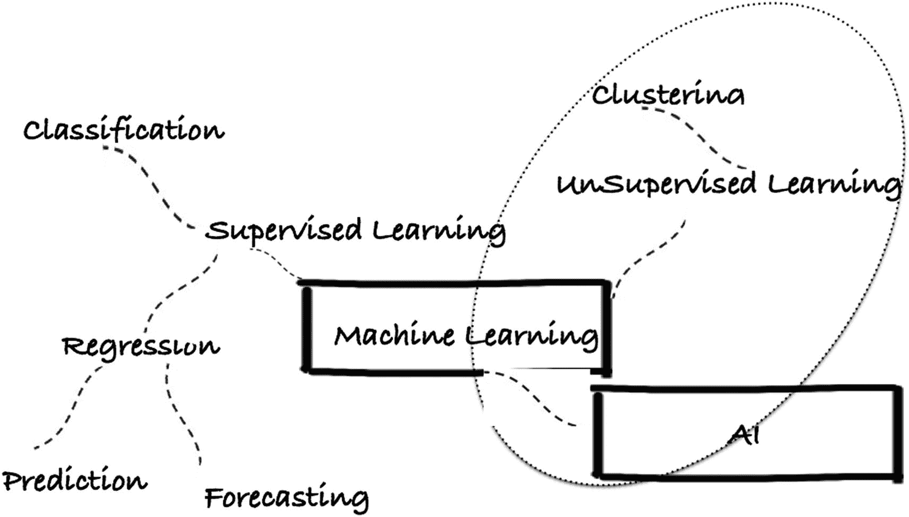

`图 10-8` 聚类

现在开始探究量子聚类技术。

## 量子聚类

量子聚类算法（见`图 10-9`）基于梯度下降技术。它用于在恒定学习率下寻找量子势，并计算聚类中心。通过利用基于量子力学的原理，量子聚类技术能够发现具有复杂形状的群组。该技术通过计算群组中心来识别任意形状的群组。

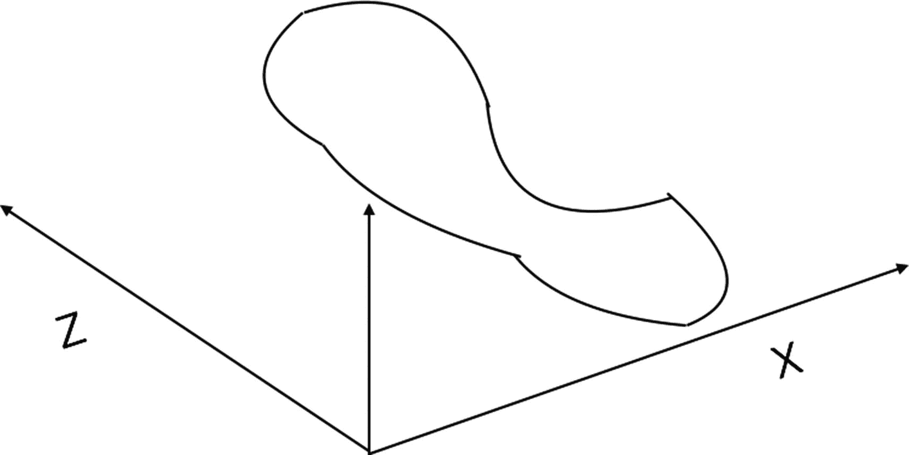

`图 10-9` 量子聚类

量子聚类基于量子力学中的逆问题。量子聚类技术有助于获得一个基于势函数估计的粒子分布。该算法会找到群组中心，并为每个中心群组分配其中心。波函数通过薛定谔方程的解来识别。

接下来，我们来看看量子聚类算法的步骤：
1. 识别每个数据特征的权重，并根据输入数据选择参数。
2. 将群组数量/测量尺度设置为零。
3. 基于量子聚类距离方法计算加权度量。
4. 估计参数以及基于数据的势能。
5. 群组编号加 1。
6. 在群组中心处识别出最小势能。
7. 通过距离度量对所有数据点进行分组，且该距离需小于测量尺度。当符合距离度量标准的数据点数量为零时，算法结束。否则，算法返回步骤 5。

量子聚类算法只有一个参数。该算法基于划分，是一种无监督学习技术。由于分组需要预处理，处理时间较长。测量尺度是静态的，且该方法不依赖于特征。在这种方法中，分组的精度取决于学习量。

> 提示： 量子系统在时间和空间上是确定性的，并由波函数描述。

接下来，我们看一个量子聚类技术的代码示例。

### 代码示例

```python
import numpy as nump
import quantum_cluster

types = ['f8', 'f8', 'f8','f8','U50']
data_res = nump.loadtxt('iris_input.csv', delimiter=',')
print(data_res)
data_res = data_res[:,:4]
sigma_val=0.55
repetitionsVal=100
stepSizeVal=0.1
clusteringTypeVal='v'
isRecalculate=False
isReturnHistory=True
isStopCondition=True
voxelSizeVal = None
xval,xHistoryVal = quantum_cluster.getGradientDescent(data_res, sigma=sigma_val, repetitions=repetitionsVal, stepSize=stepSizeVal, clusteringType=clusteringTypeVal, recalculate=isRecalculate, returnHistory=isReturnHistory, stopCondition=isStopCondition, voxelSize=voxelSizeVal)
clusters_res = quantum_cluster.PerformFinalClusteringAlgo(xval, stepSizeVal)
quantum_cluster.displayClusteringValues(xHistoryVal, clusters_res)
```

`quantum_cluster.py`

```python
import numpy as nump
from scipy.spatial import distance as spatDistance
from sklearn.decomposition import PCA as decomPCA
import matplotlib.pyplot as plot
from mpl_toolkits.mplot3d import Axes3D as mplAxes3D

def getVGradient(data:nump.ndarray, sigma, x:nump.ndarray=None, coeffs:nump.ndarray=None):
    if x is None:
        x = data.copy()
    if coeffs is None:
        coeffs = nump.ones((data.shape[0],))
    twoSigmaSquared = 2*sigma**2
    data = data[nump.newaxis,:,:]
    x = x[:,nump.newaxis,:]
    differences = x-data
    squaredDifferences = nump.sum(nump.square(differences), axis=2)
    gaussian = nump.exp(-(1/twoSigmaSquared)*squaredDifferences)
    laplacian = nump.sum(coeffs*gaussian*squaredDifferences, axis=1)
    parzen = nump.sum(coeffs*gaussian, axis=1)
    v = 1 + (1/twoSigmaSquared)*laplacian/parzen
    dv = -1*(1/parzen[:,nump.newaxis])*nump.sum(differences*((coeffs*gaussian)[:,:,nump.newaxis])*(twoSigmaSquared*(v[:,nump.newaxis,nump.newaxis])-(squaredDifferences[:,:,nump.newaxis])), axis=1)
    v = v-1
    return v, dv

def getSGradient(data:nump.ndarray, sigma, x:nump.ndarray=None, coeffs:nump.ndarray=None):
    if x is None:
        x = data.copy()
    if coeffs is None:
        coeffs = nump.ones((data.shape[0],))
    twoSigmaSquared = 2 * sigma ** 2
    data = data[nump.newaxis, :, :]
    x = x[:, nump.newaxis, :]
    differences = x - data
    squaredDifferences = nump.sum(nump.square(differences), axis=2)
    gaussian = nump.exp(-(1 / twoSigmaSquared) * squaredDifferences)
    laplacian = nump.sum(coeffs*gaussian * squaredDifferences, axis=1)
    parzen = nump.sum(coeffs*gaussian, axis=1)
    v = (1 / twoSigmaSquared) * laplacian / parzen
    s = v + nump.log(nump.abs(parzen))
    ds = (1 / parzen[:, nump.newaxis]) * nump.sum(differences * ((coeffs*gaussian)[:, :, nump.newaxis]) * (
        twoSigmaSquared * (v[:, nump.newaxis, nump.newaxis]) - (squaredDifferences[:, :, nump.newaxis])), axis=1)
    return s, ds

def getPGradient(data:nump.ndarray, sigma, x:nump.ndarray=None, coeffs:nump.ndarray=None):
    if x is None:
        x = data.copy()
    if coeffs is None:
        coeffs = nump.ones((data.shape[0],))
    twoSigmaSquared = 2 * sigma ** 2
    data = data[nump.newaxis, :, :]
    x = x[:, nump.newaxis, :]
    differences = x - data
    squaredDifferences = nump.sum(nump.square(differences), axis=2)
    gaussian = nump.exp(-(1 / twoSigmaSquared) * squaredDifferences)
    p = nump.sum(coeffs*gaussian, axis=1)
    dp = -1*nump.sum(differences * ((coeffs*gaussian)[:, :, nump.newaxis]) * twoSigmaSquared, axis=1)
    return p, dp

def getApproximateParzenValues(data:nump.ndarray, sigma, voxelSize):
    newData = getUniqueRows(nump.floor(data/voxelSize)*voxelSize+voxelSize/2)[0]
    nMat = nump.exp(-1*spatDistance.squareform(nump.square(spatDistance.pdist(newData)))/(4*sigma**2))
    mMat = nump.exp(-1 * nump.square(spatDistance.cdist(newData, data)) / (4 * sigma ** 2))
    cMat = nump.linalg.solve(nMat, mMat)
    coeffs = nump.sum(cMat, axis=1)
    coeffs = data.shape[0]*coeffs/sum(coeffs)
    return newData, coeffs

def getUniqueRows(x):
    y = nump.ascontiguousarray(x).view(nump.dtype((nump.void, x.dtype.itemsize * x.shape[1])))
    _, inds, indsInverse, counts = nump.unique(y, return_index=True, return_inverse=True, return_counts=True)
    xUnique = x[inds]
    return xUnique, inds, indsInverse, counts

def getGradientDescent(data, sigma, repetitions=1, stepSize=None, clusteringType='v', recalculate=False, returnHistory=False, stopCondition=True, voxelSize=None):
    n = data.shape[0]
    useApproximation = (voxelSize is not None)
    if stepSize is None:
        stepSize = sigma/10
    if clusteringType == 'v':
        gradientFunction = getVGradient
    elif clusteringType == 's':
        gradientFunction = getSGradient
    else:
        gradientFunction = getPGradient
    if useApproximation:
        newData, coeffs = getApproximateParzenValues(data, sigma, voxelSize)
    else:
        coeffs = None
    if recalculate:
        if useApproximation:
            x = nump.vstack((data, newData))
            data = x[data.shape[0]:]
        else:
            x = data
    else:
        if useApproximation:
            x = data
            data = newData
        else:
            x = data.copy()
    if returnHistory:
        xHistory = nump.zeros((n, x.shape[1], repetitions+1))
        xHistory[:,:,0] = x[:n,:].copy()
    if stopCondition:
        prevX = x[:n].copy()
    for i in range(repetitions):
        if ((i>0) and (i%10==0)):
            if stopCondition:
                if nump.all(nump.linalg.norm(x[:n]-prevX, axis=1) < 1e-5):
                    break
                prevX = x[:n].copy()
        gradientValue, _ = gradientFunction(data, sigma, x=x, coeffs=coeffs)
        x = x - stepSize * gradientValue
        if returnHistory:
            xHistory[:,:,i+1] = x[:n,:].copy()
    if returnHistory:
        xHistory = xHistory[:,:,:i+1]
        return x, xHistory
    else:    
        return x, None

def PerformFinalClusteringAlgo(x, stepSize):
    clusters = nump.zeros((x.shape[0],))
    clusterIndex = 0
    for i in range(x.shape[0]):
        if clusters[i]==0:
            clusterIndex = clusterIndex+1
            clusters[i] = clusterIndex
            temp = nump.argwhere(clusters==0)
            spatDistances = nump.linalg.norm(x[temp[:,0]]-x[i], axis=1)
            temp = nump.argwhere(spatDistances<=(stepSize/2))
            if temp.shape[0]>0:
                clusters[temp[:,0]] = clusterIndex
    clusters[clusters==0] = clusterIndex
    return clusters

def displayClusteringValues(xHistory, clusters):
    plot.ion()
    if xHistory.shape[1] > 3:
        pca = decomPCA(3)
        pca.fit(xHistory[:,:,0])
        newXHistory = nump.zeros((xHistory.shape[0], 3, xHistory.shape[2]))
        for i in range(xHistory.shape[2]):
            newXHistory[:,:,i] = pca.transform(xHistory[:,:,i])
        xHistory = newXHistory
    ax = plot.axes(projection='3d')
    sc = ax.scatter(xHistory[:, 0, 0], xHistory[:, 1, 0], xHistory[:, 2, 0], c=clusters, s=20)
    ax.set_xlim((nump.min(xHistory[:, 0, :]), nump.max(xHistory[:, 0, :])))
    ax.set_ylim((nump.min(xHistory[:, 1, :]), nump.max(xHistory[:, 1, :])))
    ax.set_zlim((nump.min(xHistory[:, 2, :]), nump.max(xHistory[:, 2, :])))
    for i in range(xHistory.shape[2]):
        sc._offsets3d = (nump.ravel(xHistory[:, 0, i]), nump.ravel(xHistory[:, 1, i]), nump.ravel(xHistory[:, 2, i]))
        plot.gcf().suptitle('step #' + str(i) + '/' + str(xHistory.shape[2]-1))
        plot.pause(0.01)
    plot.ioff()
    plot.close()
```

### 命令

```
pip3 install nump
python3 QCAlgo.py
```

### 输出

使用量子聚类算法，可以创建聚类。图 10-10 显示了第四步之后的输出。
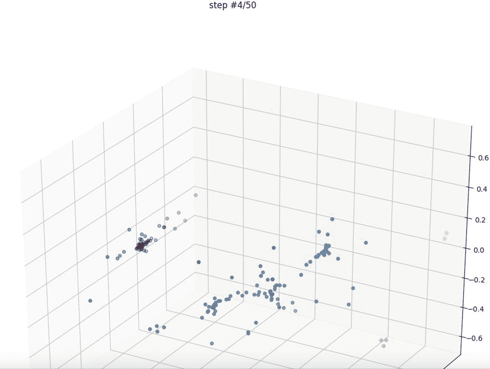
**图 10-10** 四步后的量子聚类输出

图 10-11 显示了 29 步后的输出，图 10-12 显示了 46 步后的输出。
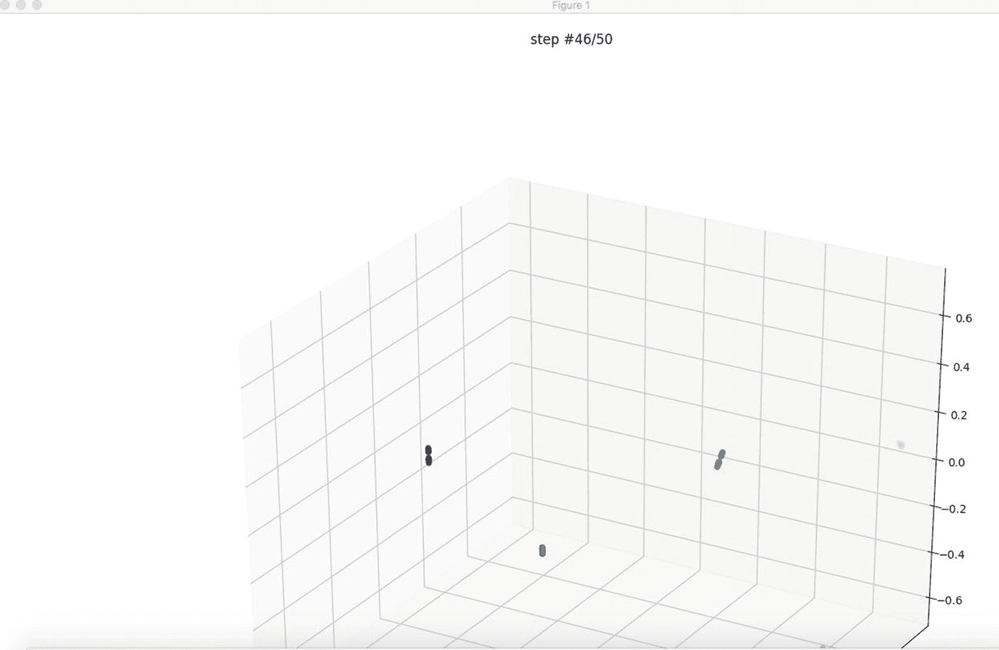
**图 10-12** 46 步后的输出
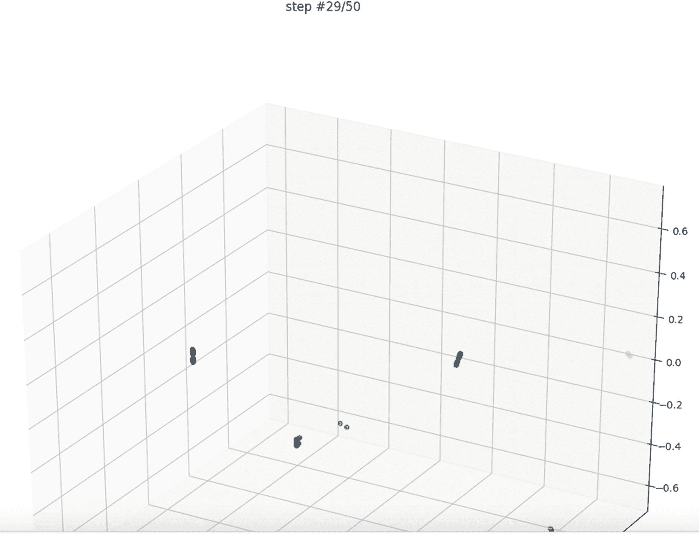
**图 10-11** 29 步后的输出

图 10-13 显示了 50 步结束时的输出。
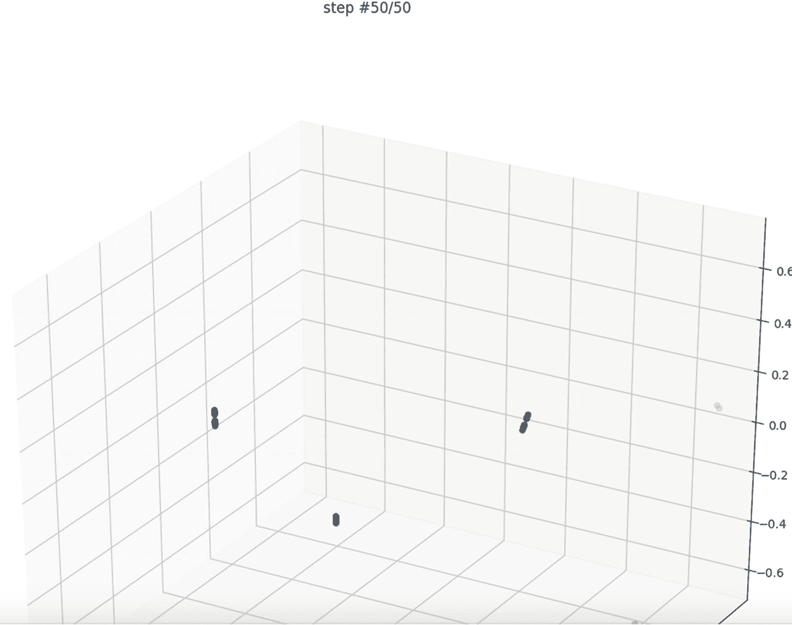
**图 10-13** 50 步后的输出

## 量子流形嵌入

量子流形嵌入（见图 10-14）包含若干为欧几里得空间的片段。欧几里得空间代表了量子系统中的量子态。该欧几里得空间有与 `m` 个维度相关的 `m` 个向量。经典流形是嵌入在高维欧几里得系统中的 `m` 维形状。`Isomap` 是流形嵌入算法的一个示例。`Isomap` 有助于利用底层的流形找到全局最优解。
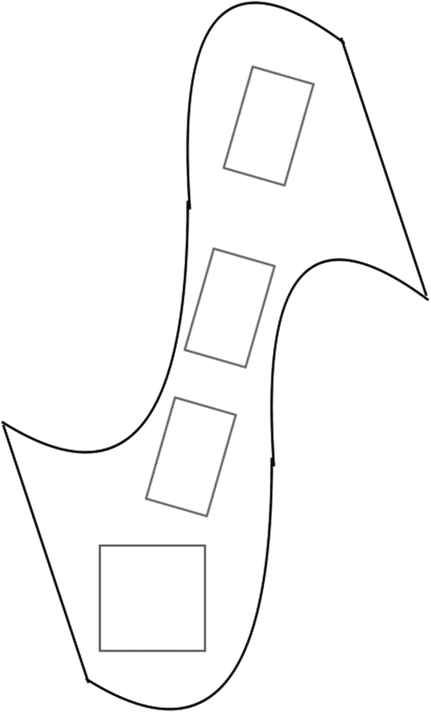
**图 10-14** 流形嵌入

## 小结

在本章中，我们研究了与量子数据处理算法相关的技术，例如量子 k-means、量子 k-medians、量子聚类和量子流形嵌入。