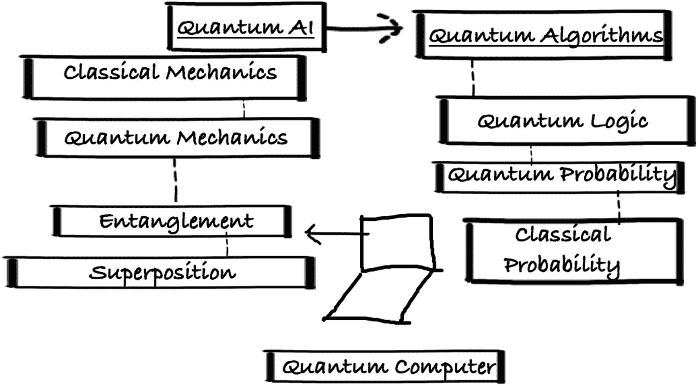
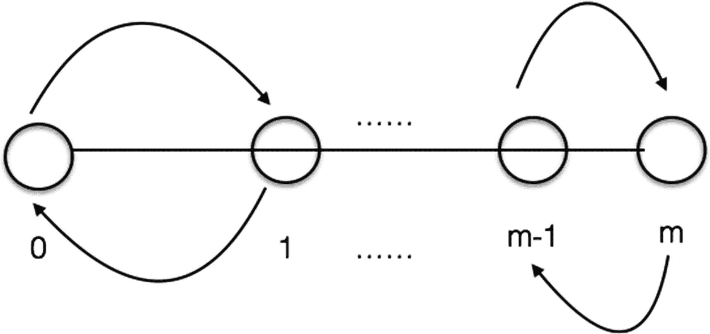
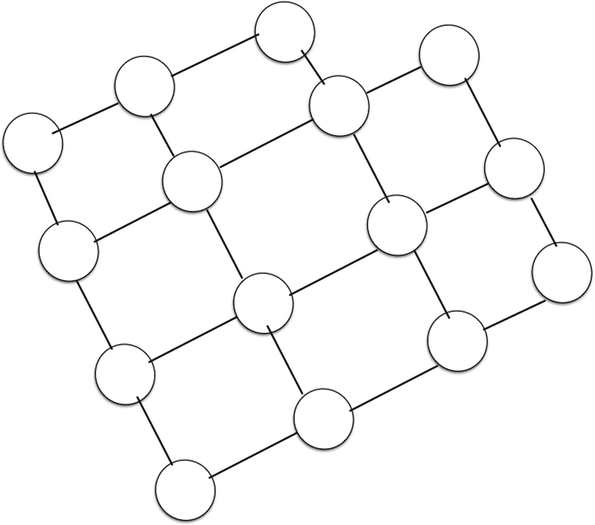
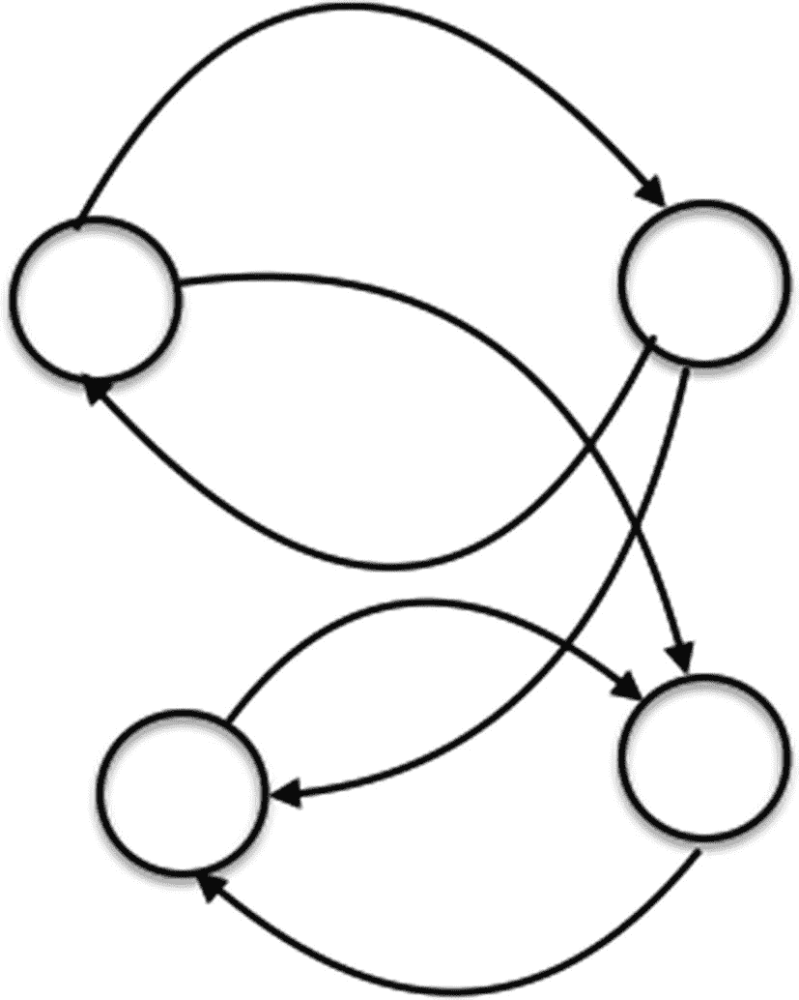
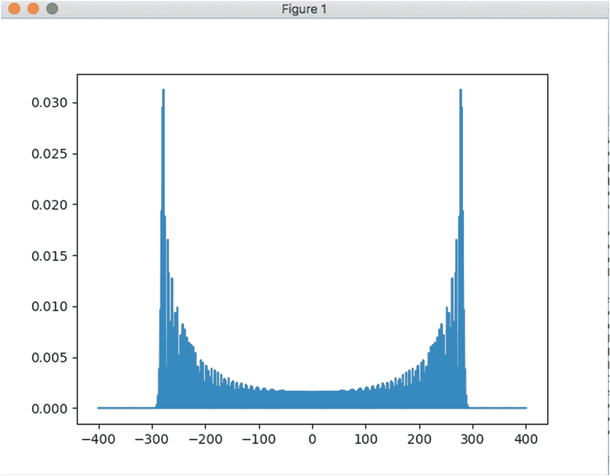
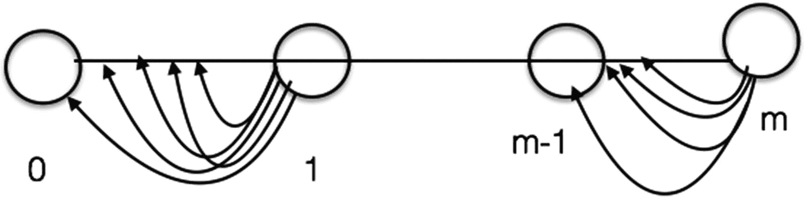
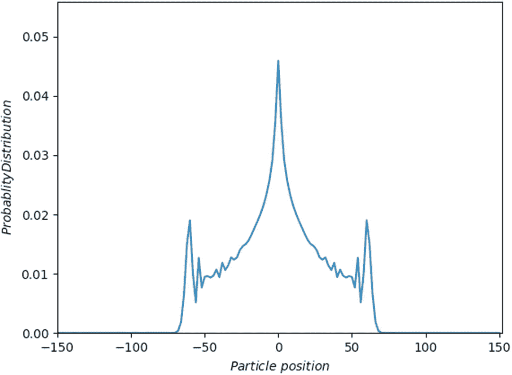
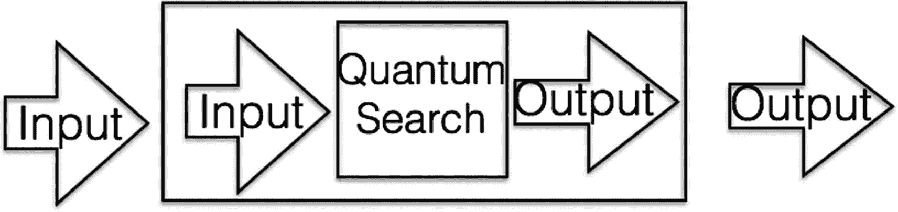

# 11. 量子人工智能算法

## 引言

> *“如果我们把量子理论当真，视之为对真实事件的描绘，那么每一次测量就不仅仅是扰动：它会深刻地重塑现实的根基。”*

>

> —尼克·赫伯特

本章将涵盖量子人工智能算法的主题。你将了解量子人工智能算法在日常生活中的实现方式。文中针对特定算法（如量子概率、量子行走、量子搜索、量子深度学习和量子并行）提供了代码示例。

## 初始设置

你需要安装`Python` 3.5才能运行本章的代码示例。你可以从[`https://www.python.org/downloads/release/python-350/`](https://www.python.org/downloads/release/python-350/)下载。

## 量子概率

量子计算框架具有基于概率的事件，这些事件被建模为希尔伯特多维子空间。所讨论的系统在希尔伯特空间中被称为“态矢量”。事件概率通过使用矢量在子空间上的投影并计算投影长度的平方来得出。

现在，我们来详细看看希尔伯特空间。它是一个数学矢量空间，具有矢量的点积或内积。该空间与距离函数相关，被称为“内积空间”。

量子概率（见图 11-1）基于数学量子理论。一个量子概率空间代表一个在物理空间中尚不为人所熟知的系统。



图 11-1

量子概率

量子概率空间是一对 `(B, ρ)`，其中 `B` 是一个 Q-代数，`ρ : B → D` 是一个满足以下性质的函数：

(a) `ρ(aB + bC) = aρ(B) + bρ(C)`（B, C ∈ A, a, b ∈ D），

(b) `ρ(B∗ ) = ρ(B) ∗`（B ∈ B），

(c) `ρ(B∗B) ≥ 0`（B ∈ B）

一个投影 `Q ∈ B` 是系统上的一个观测量。一个作为单位分解的测量划分 `{Q1, ..., Qm}` 会产生测量结果 `Q1, …, Qm`。`ρ(Q)` 越大，测量结果为 `Q` 的可能性就越大。

概率定律基于 `ρ(Q)`，其中 `Q ∈ B`。如果 `ρ(Q)=1`，则结果 `Q` 将是 `Q` 值的测量结果。

> **提示**  

> 量子概率基于冯·诺依曼公理以及基于柯尔莫哥洛夫概率的松弛约束。

## 经典随机行走

经典随机行走（见图 11-2）基于粒子在线上穿行的行为。粒子的运动基于概率规则。最简单的粒子行走被建模为以单位步长向左或向右移动的时间步长。该运动向左的概率为 `q`，向右的概率为 `1-q`。这些概率与之前的位置无关。



图 11-2

经典随机行走

现在，让我们来看看量子行走技术。

## 量子行走

量子行走（见图 11-3）基于处于叠加态的量子粒子的穿行。概率与向左和向右的运动相关联。叠加态的概率之和并不单一。量子行走基于粒子的自旋。通过旋转带有自旋的粒子，可以实现随机量子行走。量子行走用于基于量子计算模型创建量子算法。量子行走有两种类型：离散时间和连续时间量子行走。



图 11-3

量子随机行走

掷硬币行走模型（见图 11-4）基于希尔伯特空间的硬币算子和单位算子。掷硬币行走模型中使用的算子是 `D ⊗ M`，其中 `D` 是代表粒子运动的硬币算子，`M` 是希尔伯特空间 `GP` 的单位算子。该行走模型基于抛硬币的过程。该计算模型基于对硬币状态进行建模的量子态的叠加。阿达马算子是最常用的硬币算子。应用硬币算子后，再应用一个位移算子。叠加态由 `m=1` 和 `m=-1` 的叠加产生。掷硬币量子行走中的概率分布不是正态分布。这种量子行走的标准差不是 `√s`，而是与步数 `s` 成正比。假设量子粒子向右移动的概率为 1。经过 `s` 步后，粒子位于 `m=s` 处。这种情况被称为“弹道情况”。假设量子粒子的运动具有单位速度。在弹道情况下，量子粒子的速度是自由粒子速度的一半。



图 11-4

掷硬币行走模型

让我们看一下抛硬币量子行走的代码实现。

### 代码示例

```python
import math
import pylab as pythonLab
def GetProbabilities(posn):
    return [sum([abs(amp) ** 2 for amp in place]) for place in posn]
def ApplyNormalisation(posn):
    N = math.sqrt(sum(GetProbabilities(posn)))
    return [[amp / N for amp in place] for place in posn]
def GetTimeStep(posn):
    return ApplyNormalisation([[x[0] + x[1], x[0] - x[1]] for x in posn])
def GetShift(coin):
    newposn = [[0, 0] for i in range(len(coin))]
    for j in range(1, len(position) - 1):
        newposn[j + 1][0] += coin[j][0]
        newposn[j - 1][1] += coin[j][1]
    return ApplyNormalisation(newposn)
minval, maxval = -400, 401
position = [[0, 0] for i in range(minval, maxval)]
position[-minval] = [1 / math.sqrt(2), 1j / math.sqrt(2)]
for time in range(-minval):
    position = GetShift(GetTimeStep(position))
pythonLab.plot(range(minval, maxval), GetProbabilities(position))
pythonLab.show()
```

### 命令

```
pip3 install pylab
python3 quantum_walk.py
```

### 输出

图 11-5 展示了量子行走的输出。



图 11-5

量子行走输出

现在，让我们来看一下连续时间的量子行走。

连续时间量子行走（见图 11-6）基于马尔可夫过程。一个马尔可夫过程被建模为一个图，该图有 `M` 个顶点，它们之间通过边相互连接。假设 `γ` 是顶点之间每单位时间的跳跃率。约束条件是行走只能在边上的节点之间进行。行走由随机生成矩阵 `P` 表示。所有顶点上的重叠积分平方和为 1。



图 11-6

连续时间量子行走

量子行走是使用量子力学波函数进行建模的。该波函数是所有可能波路径的相干叠加。概率分布基于量子干涉效应。量子行走有助于解决现实生活中的问题，并且它们在时间多项式阶数上更快。诸如元素区分性、识别三角形和 NAND 树评估等问题都可以使用量子行走来解决。格罗弗搜索算法可以建模为量子行走算法。

> **提示**  

> 量子行走基于量子力学行走，用于模拟量子随机运动物理。

让我们来看一下抛硬币量子行走的代码实现。

### 代码示例

## 连续量子游走

```
from qutip import *
import numpy as nump
import matplotlib.pyplot as matplot
from math import *
import seaborn as seabrn
ket0 = basis(2,0).unit()
ket1 = basis(2,1).unit()
psip = (basis(2,0)+basis(2,1)*1j).unit()
psim = (basis(2,0)-basis(2,1)*1j).unit()
def GetCoin(coin_angle):
    C_hat = qutip.Qobj([[cos(radians(coin_angle)), sin(radians(coin_angle))],
                        [sin(radians(coin_angle)), -cos(radians(coin_angle))]])
    return C_hat
def GetShift(t):
    sites = 2*t+1
    shift_l = qutip.Qobj(nump.roll(nump.eye(sites), 1, axis=0))
    shift_r = qutip.Qobj(nump.roll(nump.eye(sites), -1, axis=0))
    S_hat = tensor(ket0*ket0.dag(),shift_l) + tensor(ket1*ket1.dag(),shift_r)
    return S_hat
def GetWalk(t,coin_angle):
    sites = 2*t+1
    C_hat = GetCoin(coin_angle)
    S_hat = GetShift(t)
    W_hat = S_hat*(tensor(C_hat,qeye(sites)))
    return W_hat
def ApplyDephasing(t,qstate,p_c):
    sites=2*t+1
    dstate = (1-p_c)*qstate+p_c*(tensor(sigmaz(),qeye(sites))*qstate*tensor(sigmaz(),qeye(sites)))
    return dstate
def ApplyDepolarization(t,qstate,p_c):
    sites=2*t+1
    dstate = (1-p_c)*qstate+p_c/3*(tensor(sigmax(),qeye(sites))*(qstate)*tensor(sigmax(),qeye(sites))*
             tensor(sigmay(),qeye(sites))*(qstate)*tensor(sigmay(),qeye(sites))*
             tensor(sigmaz(),qeye(sites))*(qstate)*tensor(sigmaz(),qeye(sites)))
    return dstate
def GetQWalk_gen_markov(t,qubit_state,coin_angle,p_c):
    sites=2*t+1
    Position_state = basis(sites,t)
    Psi = ket2dm(tensor(qubit_state,Position_state))
    W_hat = GetWalk(t,coin_angle)
    for i in range(t):
        Psi = W_hat*ApplyDephasing(t,Psi,p_c)*W_hat.dag()
    return Psi
def GetMeasurement(t,Psi,z):
    sites=2*t+1
    prob=[]
    for i in range(0,sites,z):
        M_p = basis(sites,i)*basis(sites,i).dag()
        Measure = tensor(qeye(2),M_p)
        p = abs((Psi*Measure).tr())
        prob.append(p)
    return prob
def GetPlotParticlePos(P_p):
    lattice_positions = range(-len(P_p)+1,len(P_p)+1,2)
    matplot.plot(lattice_positions,P_p)
    matplot.xlim([-len(P_p)+1,len(P_p)+1])
    matplot.ylim([min(P_p),max(P_p)+0.01])
    matplot.ylabel(r'$Probablity Distribution$')
    matplot.xlabel(r'$Particle \ position$')
    matplot.show()
Psi_t = GetQWalk_gen_markov(150,psip,65,0.01)
P_p  = GetMeasurement(150,Psi_t,2)
GetPlotParticlePos(P_p)
```

### 命令

```
pip3 install git+https://github.com/qutip/qutip
python3 continuous_quantum_walk.py
```

### 输出

图 11-7 展示了连续时间量子游走的输出结果。



**图 11-7** – 连续量子游走

现在，让我们来看看经典搜索算法。

## 经典搜索

在经典搜索算法中，需要在一个由 `M` 个项目组成的给定集合中，识别出具有特定属性的项目。一个项目可能具备也可能不具备该指定属性。该搜索算法的复杂度与识别特定项目所需的查询次数成正比。这些项目通常存储在数据存储中，并在关系数据库中拆分为不同的实体。如果数据存储是 NoSQL 类型的，它们则存储在不同的集合中。这些项目可以分别根据属性或值进行排序或筛选。

让我们来看看量子搜索算法。

## 量子搜索

量子计算机可用于执行搜索算法。叠加态有助于降低量子算法中的搜索复杂度。量子搜索算法的复杂度与 `√M` 次查询成正比。量子搜索使用波状振幅和干涉概念进行建模。参见图 11-8。



**图 11-8** – 量子搜索

现在，我们来看看多元件天线阵列。在多元件天线阵列中，不同的相位可以在特定方向上产生辐射。阵列分析通过幺正变换进行，振幅的平方得到各个分量的概率。这些变换基于分量的旋转和反射。这个例子类似于量子搜索。量子搜索确定一系列能够找到解决现实问题方案的量子逻辑门。该算法与上下文特定时刻的振幅成正比。量子搜索算法广受欢迎，并解决了许多现实问题。

> **提示：** 量子搜索算法基于包含 Hadamard 门和 CNOT 门的量子电路。

接下来，让我们详细了解一下量子深度学习。

## 量子深度学习

量子算法用于解决复杂的现实问题。深度学习是量子算法中常用的一种技术。基于玻尔兹曼机的量子计算框架有助于提供量子深度学习框架。该框架有助于机器学习的模型学习和训练过程。

量子机器学习基于量子数据和混合量子经典模型。量子数据模型基于量子数据源，并使用量子计算机生成的数据。该模型基于叠加和纠缠原理。一个表示联合概率分布的 `2⁵³` 个元素的希尔伯特空间可以使用量子计算机求解。量子 Tensor Flow 框架拥有创建机器学习模型的基础设施概念，这些模型可以使用量子数据模型和算法。量子数据模型可用于化学模拟、量子物质建模、量子控制、量子通信网络和量子计量学。

混合量子经典模型用于数据泛化，并使用混合量子经典技术进行求解。量子神经网络就是基于参数化量子计算模型的技术之一。

> **提示：** 量子深度学习用于分类领域的量子模式识别。

量子机器学习应用于现实场景。例如，量子化学问题与优化高维且困难的目标函数相关。量子计算框架被应用于解决计算上具有挑战性的问题，例如变分量子本征求解器。

变分量子本征求解器旨在识别某些算子的本征值。本征值识别是一个复杂且具有挑战性的问题。量子相位估计方法可用于计算给定本征向量的本征值。您可以优化一个变分电路，以降低用户定义哈密顿量的期望能量平方值。该哈密顿量可以表示为两个泡利算符之和。

### 代码示例

## 运行命令

```
pip3 install nump
python3 quantum_eigen_solver.py
```

好的，作为高级文档工程师和翻译员，我将严格遵循您提供的注意事项和示例，将给定的英文文本翻译成中文。

### 输出

```
Cost - step     1:  0.3269168 | Variable values: [ 0.95937, 1.49547]
Cost - step     2:  0.0461959 | Variable values: [ 1.20723, 1.11786]
Cost - step     3:  0.0065278 | Variable values: [ 1.30040, 0.97591]
Cost - step     4:  0.0009224 | Variable values: [ 1.33543, 0.92255]
Cost - step     5:  0.0001303 | Variable values: [ 1.34859, 0.90250]
Cost - step     6:  0.0000184 | Variable values: [ 1.35354, 0.89496]
Cost - step     7:  0.0000026 | Variable values: [ 1.35540, 0.89212]
Cost - step     8:  0.0000004 | Variable values: [ 1.35610, 0.89106]
Cost - step     9:  0.0000001 | Variable values: [ 1.35636, 0.89066]
Cost - step    10:  0.0000000 | Variable values: [ 1.35646, 0.89051]
Cost - step    11:  0.0000000 | Variable values: [ 1.35650, 0.89045]
Cost - step    12:  0.0000000 | Variable values: [ 1.35651, 0.89043]
Cost - step    13:  0.0000000 | Variable values: [ 1.35652, 0.89042]
Cost - step    14:  0.0000000 | Variable values: [ 1.35652, 0.89042]
Cost - step    15:  0.0000000 | Variable values: [ 1.35652, 0.89042]
Cost - step    16:  0.0000000 | Variable values: [ 1.35652, 0.89042]
Cost - step    17:  0.0000000 | Variable values: [ 1.35652, 0.89041]
Cost - step    18:  0.0000000 | Variable values: [ 1.35652, 0.89041]
Cost - step    19:  0.0000000 | Variable values: [ 1.35652, 0.89041]
Cost - step    20:  0.0000000 | Variable values: [ 1.35652, 0.89041]
```

## 量子并行性

量子并行性建立在量子存储器寄存器的概念之上。量子存储器寄存器可以存在于叠加态中，这有助于实现并行化。如果`m`是寄存器中的量子比特数，则可能的状态数为`2^m`。一次量子操作相当于指数数量的经典操作。量子并行组件被建模为在寄存器上执行的函数的参数。

> **提示**

> 量子并行性基于存储器寄存器中量子态的叠加。

## 总结

在本章中，我们研究了与量子人工智能算法相关的技术，例如量子概率、量子行走、量子搜索、量子深度学习和量子并行性。