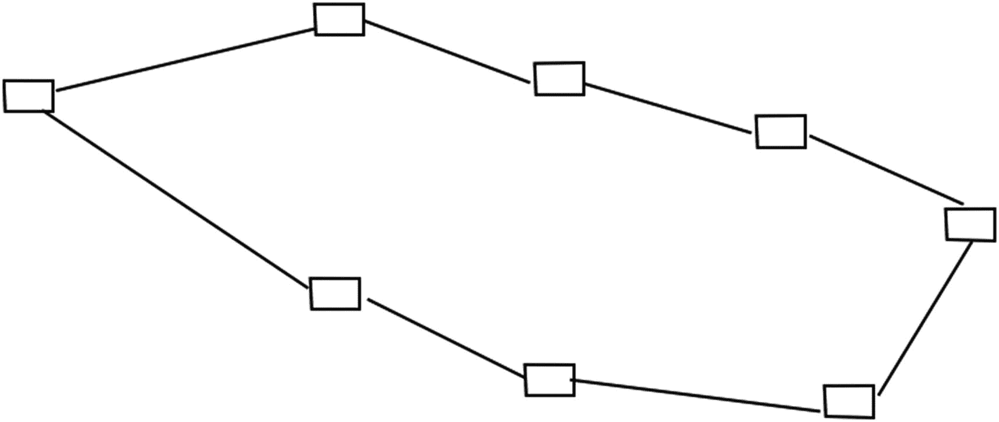
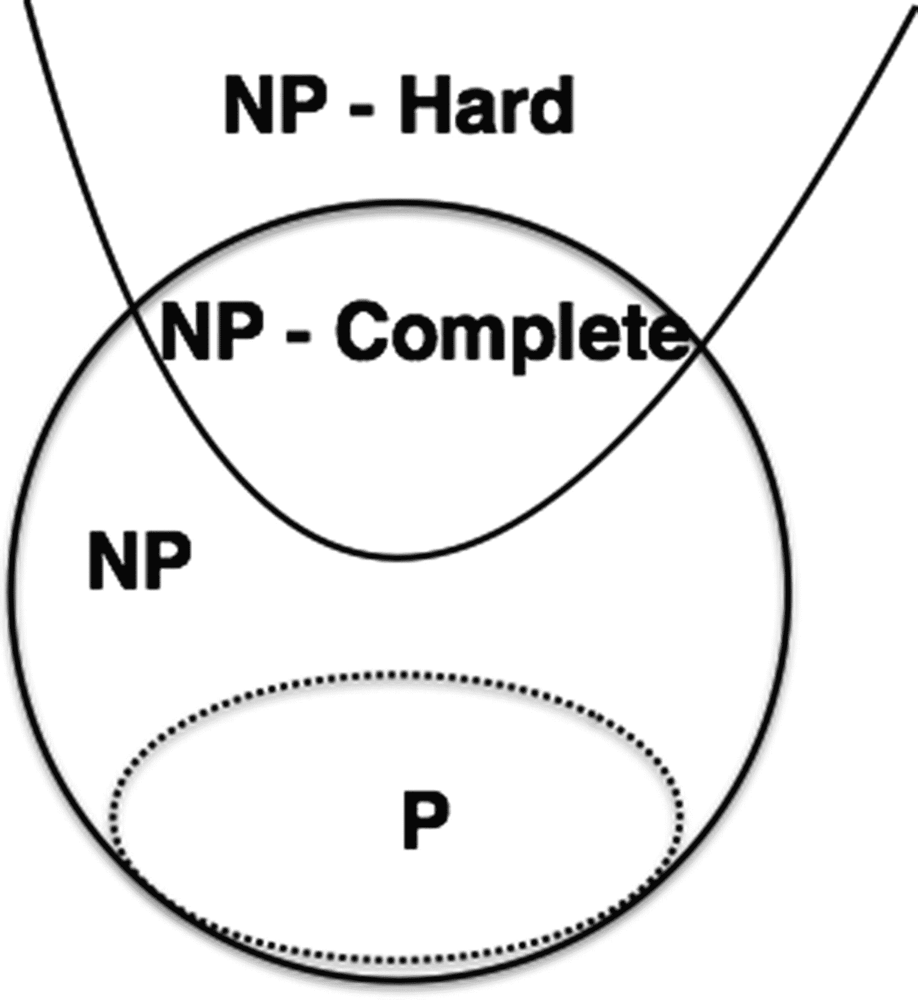
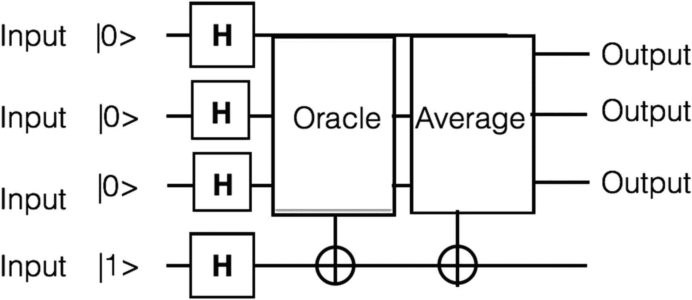
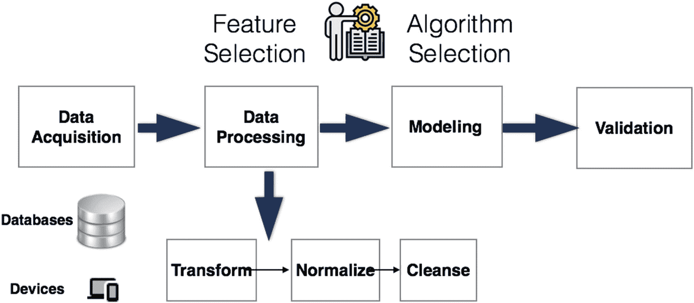
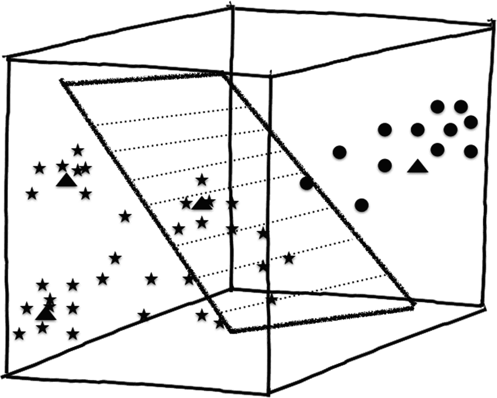
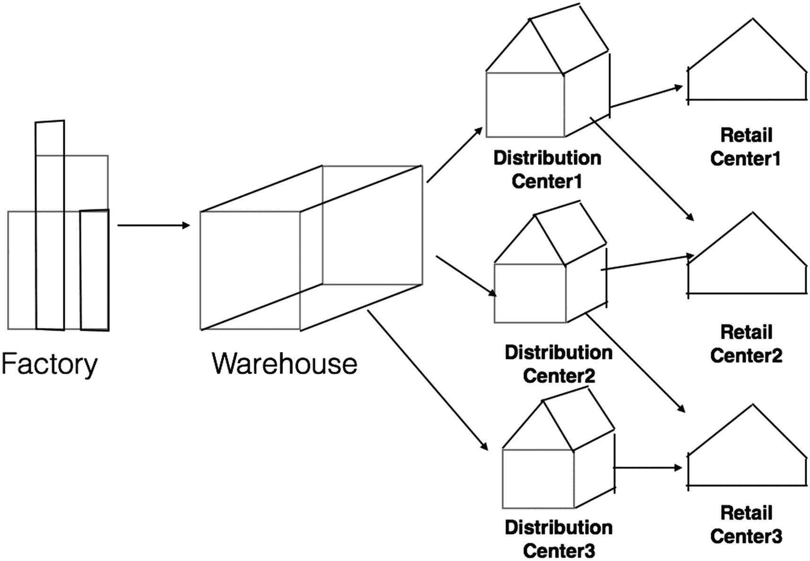
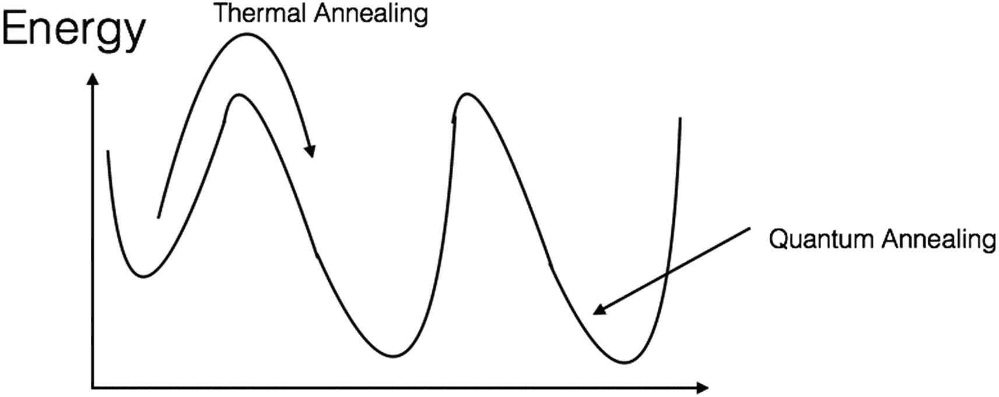

# 12. 量子解决方案

## 引言

> “对我而言，量子计算是一种新的、更深入、更好的方式来理解物理定律，从而理解整个物理现实。”
> ——大卫·多伊奇

本章涵盖量子解决方案的主题。您将看到量子人工智能算法如何在不同的实际解决方案中实现。本章涵盖的解决方案包括旅行商问题、任务调度、欺诈检测和分配问题。

## 初始设置

您需要安装 Python 3.5 才能运行本章中的代码示例。您可以从 [`www.python.org/downloads/release/python-350/`](https://www.python.org/downloads/release/python-350/) 下载。

## 旅行商问题

旅行商问题（图 12-1）是计算机科学领域中的一个优化问题。这个问题属于一组 NP 难题。此问题与销售人员的行程有关，该行程包含 `N` 个城市。销售人员每个城市只能访问一次，并且在访问完其他城市后才能返回起始城市。这种只访问一个城市的情景称为哈密顿圈。城市之间的旅行会产生相关的成本。销售人员试图最小化整个行程的旅行成本。



**图 12-1**
旅行商问题

Jeongho Bang 提出了一种使用 Grover 搜索算法解决旅行商问题的量子技术。旅行商在多個点之间移动，沿途经过多个城市。解决方案包括评估所有可能的路线组合及其相关成本。最佳路线基于成本、距离和时间参数。其他参数与交通类型有关。

这个问题是指数级的。在指数级问题中，增加单个点会增加复杂度。随着城市数量的不断增加，经典计算框架无法解决该问题。量子计算模型通过使用量子叠加来帮助解决旅行商问题。量子计算机使用量子退火技术。

> **提示**
> 旅行商问题是一个 NP 难题，因为要找到连接图上所有点的最低成本路径非常复杂。参见图 12-2。



**图 12-2**
非确定性：多项式时间（NP-hard）

## 任务调度

在一组资源上调度作业或任务是一个现实的计算挑战。随着约束和资源数量的增加，问题变得 NP 难。使用经典计算框架时，线性规划方法可用于解决调度问题。经典的计算方法以 `O(P^Q)` 的时间复杂度顺序解决问题，其中 `P` 是任务数量，`Q` 是资源数量。Grover 搜索算法则在一个包含 `R` 个可搜索项集合的平方根级别上解决问题。

量子调度方法具有以下伪代码：



**图 12-3**
Grover 算法：Oracle 电路

1.  初始状态在所有可能解的等幅叠加中创建。
2.  使用量子计算中的算术可逆方法计算特定属性。
3.  为调度方法创建一个 Oracle 电路。
4.  使用 Grover 搜索方法找到所需的解。参见图 12-3。

> **提示**
> NP 难问题是一个非确定性多项式时间难度问题。

现在让我们来看看欺诈检测解决方案。

## 欺诈检测

当入侵者在系统中进行欺诈交易时，通常会在数据分析中产生一个异常值。这在异常值意外出现的大数据分析中可以观察到。当使用机器学习方法训练数据模型时，可以检测到异常。这可以在多个领域观察到，例如医学洞察、数据分析、数据清洗和监控。参见图 12-4。



**图 12-4**
数据处理

为了检测异常，我们可以分析数据并找到与正常数据模式的偏差。量子算法被用于数据分析中以检测异常。量子支持向量机和核主成分分析是用于欺诈检测的两种量子技术。这些技术有助于在量子安全、量子数据传输和量子验证领域发现新的量子观测结果。参见图 12-5。



**图 12-5**
量子机器学习

> **提示**
> 根据剑桥词典，欺诈是“通过欺骗他人获取金钱的犯罪行为”。


## 配送解决方案

配送规划与优化问题涉及多车场物流、配送计划、车辆路线、物流整合、运输车辆拼载、单点和多点卸货、仓库规划及退货处理。经典技术常用于配送规划和车辆路径规划。参见图 12-6。



图 12-6

配送规划

配送规划涵盖排程路线流程、资源规划、车辆路径与资源分配、报告、假设分析以及重新优化。量子算法有助于创建运输排程。这些算法有助于提升效率，使企业摆脱孤岛式的规划方法。

以下是配送规划中的约束条件：

*   定义变量来跟踪每个排程的成本（直接成本、机会成本、总成本、逆向机会成本）。
*   为每个队列（卡车排程）计算成本跟踪变量。
*   假设卡车速度以计算从出发地到目的地所需的时间。
*   订单交付时间是选择排程的重要因素。
*   机会成本被定义为直接成本的一部分。这与卡车未被充分利用的运力有关。
*   逆向机会成本是对卡车尺寸过大时的惩罚。
*   对于每个排程，单次运行的最长时间是优化的最重要因素。
*   对于每次运行，卡车根据运力拣选订单，并将返回出发地。
*   对于优化而言，卡车的数量是一个重要因素。

对于给定的一天，基于多个出发点和多个目的地之间的预订信息，确定货物交付的最优路线。解决方案应输出以下内容：

*   所有可能的路线组合及其相关成本
*   基于成本（距离、时间、最少卡车数量）的最优路线
*   通过累积交付日期得出的备选方案

该问题本质上是指数级的，这意味着出发地/目的地每增加一个点，需要评估的组合数量就会呈指数级增长。例如，有三出发点时，存在八种不同的组合需要评估；出发点每增加一个，不同的组合数量就会翻倍，达到 16 种。

虽然经典计算机可以解决初期阶段的问题，但随着出发地/目的地点数量的增加，其性能会逐渐下降，最终崩溃。而量子计算机可以利用量子叠加的特性，提供稳定且更优的性能。

在车辆路径优化中，目标是找到多辆车访问一组地点时的最优路线。当只有一辆车时，问题简化为旅行商问题。最优路线是总距离最短的路线。然而，如果没有其他约束，最优解决方案是只分配一辆车访问所有地点，并为这辆车找到最短路线。

定义最优路线的一个更好方法是最小化所有车辆中最长单一路线的长度。如果目标是尽快完成所有交付，那么这就是正确的定义。我们可以通过对车辆增加约束来泛化车辆路径问题，包括以下内容：

*   *容量约束*：车辆需要在它们访问的每个地点取货，但具有最大承载能力。

配送规划解决方案的目标是最小化配送车辆的最长单一路线。想象一家公司需要在一个由相同矩形街区组成的城市中拜访其客户。

要解决这个问题，你需要创建一个距离维度，用于计算每辆车沿着其路线行驶的累计距离。然后，你可以设置一个与每条路线上最大总距离成比例的成本。路径规划程序使用维度来跟踪车辆路线上累积的量。距离矩阵由出发地和目的地的配对计算得出。解决方案的运行需要提供取货点和送货点的输入数据。

量子退火技术（见图 12-7）被用于配送规划问题。数据通过 JSON 文件传入和传出程序。量子退火过程目前支持没有时间窗约束的最优车辆路径问题。送货地点目前以与车场的距离（英里）表示，车场假设位于坐标 (0,0) 处。

量子退火过程类似于模拟退火。模拟退火中的热激活被量子隧穿效应所取代。该技术用于计算实际生活中的问题（如配送规划）的最小值和最大值。



图 12-7

量子退火

坐标在 `data.json` 文件中指定。输出的是最短路线距离。卡车信息在 `trucks.json` 中。取货和送货信息在 `pickup_deliveries.json` 中。

提示

配送解决方案与货物从制造商到仓库以及从仓库到门店的交付相关。

让我们看看应用于配送规划的量子退火技术。


### 代码示例

```python
import time
import math
import numpy as np
import os
import random
import json
import argparse

def distance(point1, point2):
    return math.sqrt((point1[1] - point2[1]) ** 2 + (point1[0] - point2[0]) ** 2)

def calcuatetSpinConfiguration():
    def Spin_config_at_a_time_in_a_TROTTER_DIM(tag):
        config = list(-np.ones(NCITY, dtype=np.int))
        config[tag] = 1
        return config

    def Spin_config_in_a_TROTTER_DIM(Tag):
        spin = []
        spin.append(Config_at_init_time)
        for i in range(TOTAL_TIME - 1):
            spin.append(list(Spin_config_at_a_time_in_a_TROTTER_DIM(Tag[i])))
        return spin

    Spin = []
    for i in range(TROTTER_DIM):
        Tag = np.arange(1, NCITY)
        np.random.shuffle(Tag)
        Spin.append(Spin_config_in_a_TROTTER_DIM(Tag))
    return Spin

def calculateShortestRoute(Config, max_distance):
    Length = []
    for i in range(TROTTER_DIM):
        Route = []
        for j in range(TOTAL_TIME):
            Route.append(Config[i][j].index(1))
        Length.append(calculateTotaldistance(Route, max_distance))
    min_Tro_dim = np.argmin(Length)
    Best_Route = []
    for i in range(TOTAL_TIME):
        Best_Route.append(Config[min_Tro_dim][i].index(1))
    return Best_Route

def calculateTotaldistance(route, max_distance):
    Total_distance = 0
    for i in range(TOTAL_TIME):
        Total_distance += distance(POINT[route[i]], POINT[route[(i + 1) % TOTAL_TIME]]) / max_distance
    return Total_distance

def calculateRealTotaldistance(Route):
    Total_distance = 0
    for i in range(TOTAL_TIME):
        Total_distance += distance(POINT[Route[i]], POINT[Route[(i + 1) % TOTAL_TIME]])
    return Total_distance

def calculateRealdistance(Route):
    Total_distance = 0
    for i in range(len(Route)):
        if i < len(Route) - 1:
            Total_distance += distance(POINT[Route[i]], POINT[Route[(i + 1)]])
    return Total_distance

def moveQuantumMonteCarlo(config, Ann_para):
    c = np.random.randint(0, TROTTER_DIM)
    a_ = list(range(1, TOTAL_TIME))
    a = np.random.choice(a_)
    a_.remove(a)
    b = np.random.choice(a_)
    p = config[c][a].index(1)
    q = config[c][b].index(1)
    delta_cost = delta_costc = delta_costq_1 = delta_costq_2 = delta_costq_3 = delta_costq_4 = 0
    for j in range(NCITY):
        l_p_j = distance(POINT[p], POINT[j]) / max_distance
        l_q_j = distance(POINT[q], POINT[j]) / max_distance
        delta_costc += 2 * (-l_p_j * config[c][a][p] - l_q_j * config[c][a][q]) * (config[c][a - 1][j] + config[c][(a + 1) % TOTAL_TIME][j]) + 2 * (-l_p_j * config[c][b][p] - l_q_j * config[c][b][q]) * (config[c][b - 1][j] + config[c][(b + 1) % TOTAL_TIME][j])
    para = (1 / BETA) * math.log(math.cosh(BETA * Ann_para / TROTTER_DIM) / math.sinh(BETA * Ann_para / TROTTER_DIM))
    delta_costq_1 = config[c][a][p] * (config[(c - 1) % TROTTER_DIM][a][p] + config[(c + 1) % TROTTER_DIM][a][p])
    delta_costq_2 = config[c][a][q] * (config[(c - 1) % TROTTER_DIM][a][q] + config[(c + 1) % TROTTER_DIM][a][q])
    delta_costq_3 = config[c][b][p] * (config[(c - 1) % TROTTER_DIM][b][p] + config[(c + 1) % TROTTER_DIM][b][p])
    delta_costq_4 = config[c][b][q] * (config[(c - 1) % TROTTER_DIM][b][q] + config[(c + 1) % TROTTER_DIM][b][q])
    delta_cost = delta_costc / TROTTER_DIM + para * (delta_costq_1 + delta_costq_2 + delta_costq_3 + delta_costq_4)
    if delta_cost <= 0:
        config[c][a][p] *= -1
        config[c][a][q] *= -1
        config[c][b][p] *= -1
        config[c][b][q] *= -1
    elif np.random.random() < np.exp(-BETA * delta_cost):
        config[c][a][p] *= -1
        config[c][a][q] *= -1
        config[c][b][p] *= -1
        config[c][b][q] *= -1
    return config

def verifyRouteConfiguration(routes, pick_deliveries):
    for i in range(len(routes)):
        route = routes[i]
        for j in range(len(route)):
            route_index = route[j]
            for k in range(len(pick_deliveries)):
                pick_delivery = pick_deliveries[k]
                pick = pick_delivery["pickup"]
                delivery = pick_delivery["delivery"]
                if route_index == delivery and route_index != 0:
                    check = verifyPick(pick, delivery, route)
                    if not check:
                        return False
    return True

def verifyPick(pick_index, delivery_index, route):
    picked = False
    delivery_passed = False
    for i in range(len(route)):
        route_i = route[i]
        if pick_index == route_i:
            picked = True
        if delivery_index == route_i and picked:
            return True
    return False

if __name__ == '__main__':
    parser = argparse.ArgumentParser()
    parser.add_argument("-i", "--inputs", type=argparse.FileType('r'), help="以 JSON 文件形式输入的参数")
    parser.add_argument("-d", "--distances", type=argparse.FileType('r'), help="以 JSON 文件形式输入的距离数据")
    parser.add_argument("-t", "--trucks", type=argparse.FileType('r'), help="以 JSON 文件形式输入的卡车数据")
    parser.add_argument("-p", "--pickups", type=argparse.FileType('r'), help="以 JSON 文件形式输入的取货数据")
    args = parser.parse_args()

    REDUC_PARA = 0.99
    inputs = json.load(args.inputs)
    distances = json.load(args.distances)
    trucks = json.load(args.trucks)
    pickup_deliveries = json.load(args.pickups)

    TROTTER_DIM = int(inputs["trotter_dimension"])
    ANN_PARA = float(inputs["initial_annealing"])
    ANN_STEP = int(inputs["annealing_step"])
    MC_STEP = int(inputs["montecarlo_step"])
    BETA = float(inputs["inverse_temperature"])
    NCITY = len(distances)
    POINT = [[0] * 2] * NCITY
    TOTAL_TIME = NCITY
    num_trucks = len(trucks)

    for i in range(NCITY):
        distance_node = distances.pop()
        node = [0] * 2
        node[0] = float(distance_node["x"])
        node[1] = float(distance_node["y"])
        POINT[NCITY - 1 - i] = node

    max_distance = 0
    for i in range(NCITY):
        for j in range(NCITY):
            node_distance = distance(POINT[i], POINT[j])
            if max_distance <= distance(POINT[i], POINT[j]):
                max_distance = distance(POINT[i], POINT[j])

    Config_at_init_time = list(-np.ones(NCITY, dtype=np.int))
    Config_at_init_time[0] = 1

    print("开始退火过程 ...")
    t0 = time.clock()
    np.random.seed(100)
    spin = calcuatetSpinConfiguration()
    LengthList = []
    truck_routes = []
    check = False

    for t in range(ANN_STEP):
        for i in range(MC_STEP):
            con = moveQuantumMonteCarlo(spin, ANN_PARA)
            rou = calculateShortestRoute(con, max_distance)
            length = calculateRealTotaldistance(rou)
            nprou = np.array(rou)
            truck_routes = np.split(nprou, num_trucks)
            check = verifyRouteConfiguration(truck_routes, pickup_deliveries)
            LengthList.append(length)
        print("第 {} 步：退火过程参数：{}".format(t + 1, ANN_PARA))
        ANN_PARA *= REDUC_PARA

    check = verifyRouteConfiguration(truck_routes, pickup_deliveries)
    if check:
        truck = 0
        for route in truck_routes:
            route_distance = calculateRealdistance(route)
            print("卡车", truck, "的路线", route, "，距离", route_distance)
            truck = truck + 1

    Route = calculateShortestRoute(spin, max_distance)
    Total_Length = calculateRealdistance(Route)
    Elapsed_time = time.clock() - t0
    print("最短路线：{}".format(Route))
    print("最短距离：{}".format(Total_Length))
    print("处理时间：s {}".format(Elapsed_time))
```

### 命令

```bash
pip3 install nump
python3 quantum_annealer.py -i input.json -d data.json -t trucks.json -p pickup_deliveries.json
```


### 输入

输入文件包含以下属性：

- `trotter_dimension`：离散经典自旋的维度
- `initial_annealing`：退火因子的初始值
- `annealing_step`：退火步数
- `montecarlo_step`：蒙特卡洛模拟步数
- `inverse_temperature`：初始反温度

示例输入 JSON 文件如下所示：

**input.json**

```json
{
"trotter_dimension": 11,
"initial_annealing": 1,
"annealing_step": 1,
"montecarlo_step": 12000,
"inverse_temperature":39
}
```

**data.json**

数据文件包含以下属性：

```json
id : 订单标识符
quantity : 订单数量
x :  x 坐标
y : y 坐标
[{"id": 0,"x": 15.048516730800019, "y": 20.81882158337833},
{"id": 1,"x": 21.47333104880339, "y": 27.44976598047904},
{"id": 2,"x": 8.733804547248988, "y": 5.190413472062651},
{"id": 3,"x": 32.984718431911894, "y": 19.850028824298047},
{"id": 4,"x": 20.482480291595763, "y": 1.3540523373289077},
{"id": 5,"x": 28.030738187870487, "y": 14.783008504999733},
{"id": 6,"x": 14.594496509157707, "y": 2.2840975315280936},
{"id": 7,"x": 14.988697645586926, "y": 29.21707544497128},
{"id": 8,"x": 5.553788771696674, "y": 22.21852944451273},
{"id": 9,"x": 31.95387042131473, "y": 9.878857190484847},
{"id": 10,"x": 15.52849215384657, "y": 10.543857553552229},
{"id": 11,"x": 28.837242557836202, "y": 14.368927860603366},
{"id": 12,"x": 22.776355118030853, "y": 26.698862282083887},
{"id": 13,"x": 13.377480255985654, "y": 24.833880312965892},
{"id": 14,"x": 26.031165662014942, "y": 16.32287381266326},
{"id": 15,"x": 22.609038273840298, "y": 18.014879226920108},
{"id": 16,"x": 32.28095220079001, "y": 34.223176908480426},
{"id": 17,"x": 0.4255279487934993, "y": 26.28113259271511},
{"id": 18,"x": 20.032208383820727, "y": 17.778060168894424},
{"id": 19,"x": 10.227058813719593, "y": 5.158935686180674}]
```

**pickup_deliveries.json**

`pickup_deliveries` 数据文件包含以下属性：

```json
id :   订单标识符
pickup :   取货点索引
delivery :  送货点索引
[{"pickup":0, "delivery":13,"quantity": 4},
{"pickup":13, "delivery":18,"quantity": 5},
{"pickup":18, "delivery":12,"quantity": 5},
{"pickup":12, "delivery":1,"quantity": 5},
{"pickup":16, "delivery":3,"quantity": 5},
{"pickup":3, "delivery":15,"quantity": 5},
{"pickup":15,"delivery":14,"quantity": 5},
{"pickup":14,"delivery":11,"quantity": 5},
{"pickup":9,"delivery":5,"quantity": 5},
{"pickup":5,"delivery":4,"quantity": 5},
{"pickup":4,"delivery":6,"quantity": 5},
{"pickup":6,"delivery":2,"quantity": 5},
{"pickup":19,"delivery":10,"quantity": 5},
{"pickup":10,"delivery":17,"quantity": 5},
{"pickup":17,"delivery":7,"quantity": 5},
{"pickup":7,"delivery":8,"quantity": 5}
]
```

**trucks.json**

卡车数据文件包含以下属性：

```json
id : 卡车标识符
capacity: 卡车容量
[{"id": 0,"capacity": 11185},
{"id": 1,"capacity": 11195},
{"id": 2,"capacity": 11195},
{"id": 3,"capacity": 11195}
]
```

### 输出

```
t0  =  time.clock ()
No: Step: 1, Annealing process Parameter: 1.0
Route for truck 0   [ 0 13 18 12  1] distance  24.885118421529263
Route for truck 1   [16  3 15 14 11] distance  32.16401175641577
Route for truck 2   [9 5 4 6 2] distance  34.18795492132374
Route for truck 3   [19 10 17  7  8] distance  55.9719642261916
quantum_annealer.py:225: DeprecationWarning: time.clock has been deprecated in Python 3.3 and will be removed from Python 3.8: use time.perf_counter or time.process_time instead
Elapsed_time  =  time.clock () - t0
SHORTEST ROUTE : [0, 13, 18, 12, 1, 16, 3, 15, 14, 11, 9, 5, 4, 6, 2, 19, 10, 17, 7, 8]
SHORTEST DISTANCE: 166.92311095246916
PROCESSING TIME: s 22.243867
```

## 总结

在本章中，我们探讨了应用不同量子技术的量子解决方案。我们结合代码示例详细介绍了配送规划解决方案。

