# 13. 演化中的量子解决方案

## 引言

> “量子力学打破了先前框架——经典力学的模式，它确立了科学的预测必然是概率性的。”
> ——布赖恩·格林

本章涵盖演化中的量子解决方案这一主题。你将看到量子人工智能算法如何在不同真实场景的解决方案中实现。本章涵盖的解决方案涉及量子退火、量子密钥分发和量子隐形传态。

## 初始设置

你需要安装 Python 3.5 来运行本章的代码示例。你可以从 [`www.python.org/downloads/release/python-350/`](https://www.python.org/downloads/release/python-350/) 下载。

## 量子退火

量子退火过程与计算低能量解决方案的真实问题相关。量子比特代表具有低值的超导环的能量状态。量子处理单元由超导环构成。每个量子比特在量子退火过程结束后都会达到叠加态。叠加态的值可以是 0 或 1。在量子退火过程中，能量从最小值移动到更高值，形成一个谷底，能量图看起来像一个带有两个谷底的双势阱（见图 13-1）。

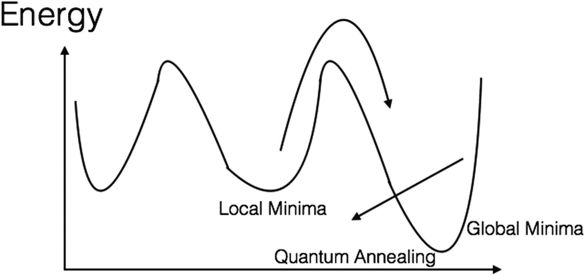

量子比特处于零或一状态的概率是相同的。这可以通过对量子比特施加外部磁场来改变。具有两个谷底的双势阱是由反相磁场产生的。偏置与外部磁场的定量值相关。耦合器用于将量子比特连接到偏置（见图 13-2）。

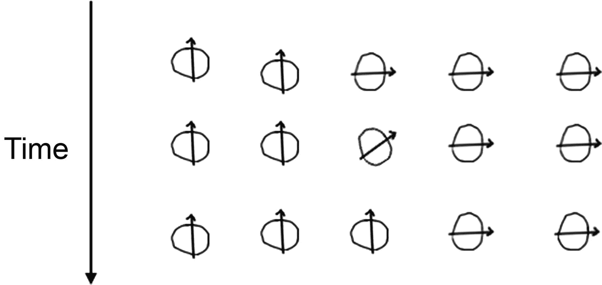

每个量子比特都有一个偏置。量子比特受到耦合器的影响。对于每个问题，用户可以自主选择偏置和耦合器的值。在量子退火过程中，能量景观由偏置和耦合构成。

> **提示**
> 量子退火由 Tadashi Kadowaki 和 Hidetoshi Nishimori 于 1998 年提出。

## 量子密钥分发

量子密钥分发（见图 13-3）与企业长期安全相关。它基于量子密码学，而量子密码学又建立在量子物理学基础之上。它有助于加密对称密钥的安全分发。量子粒子通过光网络进行传输，这些粒子即光子。

量子密钥分发是指基于密码技术和协议来分发与共享秘密密钥。这些秘密密钥是私有的，并在双方之间交换。如果密钥被篡改，其量子特性将不再有效。企业安全解决方案基于开源的量子密钥分发软件。目前这些安全技术仍处于研究阶段。针对使用量子密钥分发软件的系统发起的安全攻击是一个特殊的研究领域。

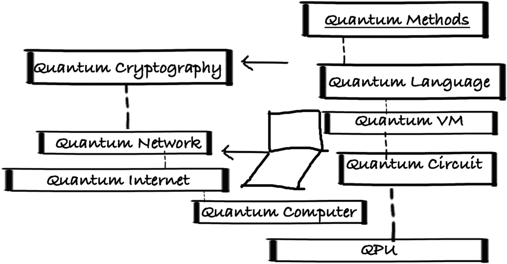

研究中使用的量子密码技术基于完全混合和高速抵抗方法。以下方法，如 `McEliece`、`NTRU` 和基于格的加密，在应对使用量子方法的安全攻击方面仍处于研究阶段。量子方法基于哈希、编码、格和多元二次算法（见图 13-4）。

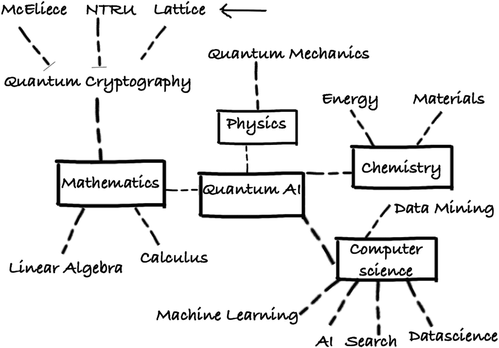

量子密钥分发基于光纤或自由空间量子信道。该量子信道用于将光的量子态从源发送端传输到目标接收端。在这种情况下，量子信道并非安全。双方之间的量子通信链路通过身份验证来确保安全。量子密钥交换协议基于量子特性。

新兴的量子互联网基于量子密码应用、量子密钥分发和安全标识。量子密钥分发利用了量子力学的力量。在基于量子密钥分发的通信中检测到的干扰很难被改变，这有助于保护信息安全。

量子密钥分发方法基于离散变量和连续变量。例如，`Silberhorn` 和 `Grangier` 是量子密钥分发方法。`Frodo` 和 `Sike` 基于量子密钥交换。`Picnic` 和 `Tesla` 使用签名方法。量子密码系统基于多元、椭圆、格、同源、哈希和混合签名。

**提示**
量子密钥分发基于光子（即数据比特）的密码数据交换。

现在，让我们来看一下量子隐形传态技术。

## 量子隐形传态

量子隐形传态是将量子态从源位置传输到目标位置，且不改变其实际状态的过程。量子隐形传态基于量子物理学中的量子纠缠原理。纠缠涉及多个粒子具有互斥状态的情况。互斥意味着找到一个粒子的状态，用于计算下一个粒子的状态。两个量子纠缠的光子可以知晓对方光子的状态（见图 13-5）。

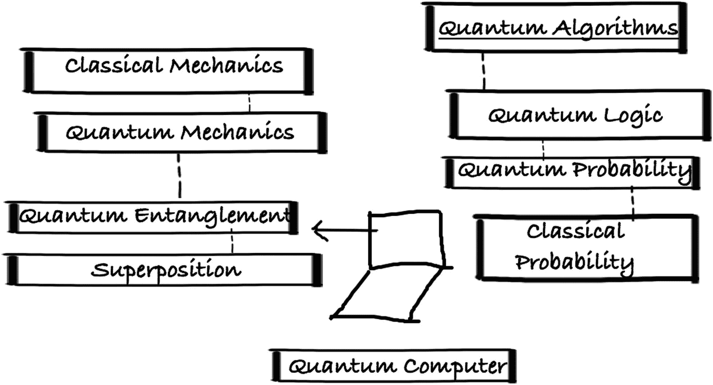

每个光子可以具有以下四种不同的贝尔态：

- `00 + 11`
- `00 – 11`
- `01 + 10`
- `01 – 10`

量子隐形传态过程始于在量子信道中纠缠一对光子。光子 `X` 由爱丽丝发送，光子 `Y` 发送给接收者鲍勃。当爱丽丝对 `X` 执行操作时，鲍勃可以看到 `Y` 的状态变化。假设爱丽丝拥有量子态未知的光子 `Z`，她希望将此状态隐形传态到光子 `Y` 中。对光子 `X` 和 `Z` 进行贝尔测量。由于 `X` 和 `Y` 是纠缠的，`Y` 的量子态可以转变为 `Z` 的量子态。鲍勃可以利用爱丽丝的贝尔测量结果完成隐形传态。爱丽丝通过经典通信信道发送贝尔测量结果，鲍勃据此知道如何将 `Y` 变为 `Z` 的状态（见图 13-6）。

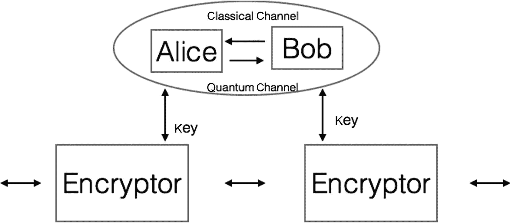

让我们来看另一种形式的量子纠缠。爱因斯坦-波多尔斯基-罗森（EPR）对由处于最大纠缠态的光子组成。爱丽丝拥有其中一个 EPR 光子，鲍勃拥有另一个。在量子隐形传态和量子纠缠中，粒子可以是任意类型的光子、原子和轻子。粒子可以具有两个自由度。粒子的量子态可以编码为量子比特。

量子隐形传态过程基于不可克隆定理。不可克隆定理有助于确保不存在任何方法可以将未知量子态从一个系统复制到另一个系统（见图 13-7）。

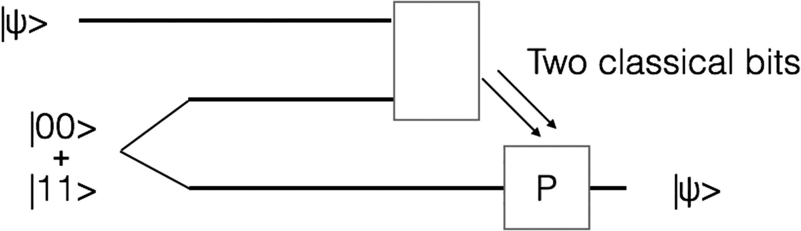

**提示**
量子隐形传态由陆朝阳、潘建伟及其同事于 2015 年发现。

现在让我们开始探讨量子纠缠和量子隐形传态的实现。首先介绍布洛赫球面，它用于可视化量子比特向量（见图 13-8）。

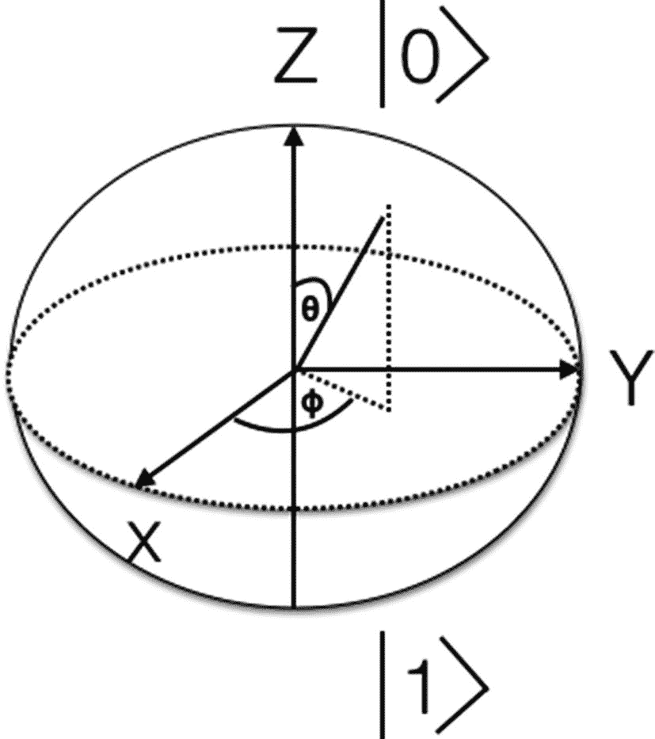

让我们通过代码来了解布洛赫球面。

### 代码示例

```
from qiskit import Aer as qisAer
from qiskit import QuantumCircuit as QC
from qiskit import execute
from matplotlib import pyplot as plot
from qiskit.tools.visualization import plot_bloch_multivector as bloch_state_vector
quantum_circuit = QC(1, 1)
quantum_circuit.x(0)
simulator = qisAer.get_backend('statevector_simulator')
result = execute(quantum_circuit, backend=simulator).result()
statevector = result.get_statevector()
print('\n statevector is ', statevector)
bloch_state_vector(statevector)
plot.savefig("images/statevector.png")
plot.show()
simulator = qisAer.get_backend('unitary_simulator')
result = execute(quantum_circuit, backend=simulator).result()
unitary_matrix = result.get_unitary()
print('\nunitary matrix is \n', unitary_matrix)
```

### 命令

## 量子纠缠

### 布洛赫球面

```
pip3 install qiskit
python3 BlochSphere.py
```

### 输出

```
statevector is  [0.+0.j 1.+0.j]
unitary matrix is
[[0.+0.j 1.+0.j]
[1.+0.j 0.+0.j]]
```

图 13-9 展示了布洛赫球面的绘图。
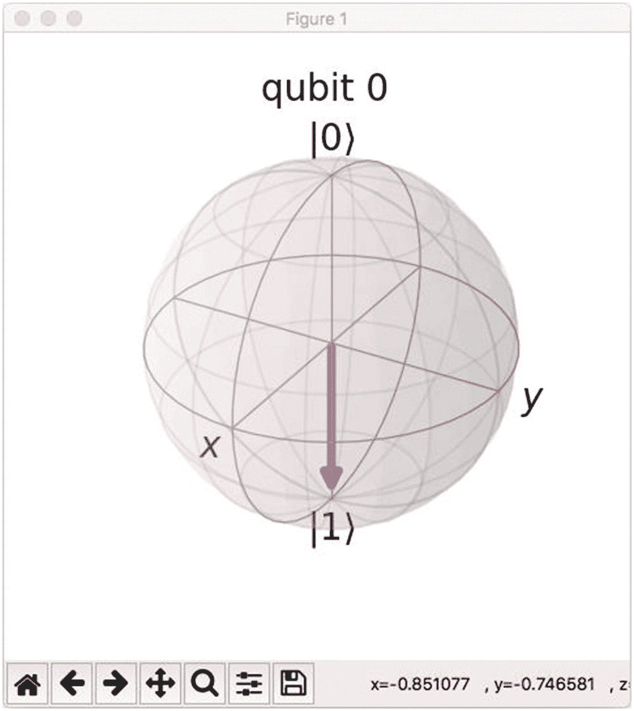
图 13-9 布洛赫球面绘图

现在，让我们来看一下量子纠缠。

### 代码示例

```python
from qiskit import IBMQ as Quantum_Simulator
from qiskit import QuantumRegister as QReg
from qiskit import ClassicalRegister as CReg
from qiskit import QuantumCircuit
from qiskit import Aer
from qiskit import *
from qiskit.tools.monitor import job_monitor as tools_monitor
from qiskit.tools.visualization import plot_histogram
from matplotlib import pyplot as plot

def create_circuit():
    qr = QReg(4)
    cr = CReg(4)
    circuit = QuantumCircuit(qr, cr)
    circuit.h(qr[0])
    circuit.cx(qr[0], qr[1])
    circuit.cx(qr[1], qr[2])
    circuit.measure(qr, cr)
    return circuit

def execute_simulator(circuit, shots=1024):
    print('\n executing the qasm simulator...\n')
    simulator = Aer.get_backend('qasm_simulator')
    result = execute(circuit, backend=simulator, shots=shots).result()
    return result

def execute_machine(circuit, device_name="ibmq_essex", shots=1024):
    print('\nexecuting on the {}...\n'.format(device_name))
    Quantum_Simulator.load_account()
    provider = Quantum_Simulator.get_provider('ibm-q')
    device = provider.get_backend(device_name)
    job = execute(circuit, backend=device, shots=shots)
    tools_monitor(job)
    return job.result()

def create_circuit_diagram(circuit, title=''):
    circuit.draw(output='mpl')
    plot.title(title)
    plot.savefig("images/qe_circ.png")
    plot.show()

def create_results(circuit, result, title=''):
    counts = result.get_counts(circuit)
    print(counts)
    plot_histogram(counts)
    plot.title(title)
    plot.savefig("images/qe_res.png")
    plot.show()

if __name__ == '__main__':
    circ = create_circuit()
    res = execute_simulator(circ)
    create_circuit_diagram(circ, '4 quantum bits based qauntum entaglement circuit')
    create_results(circ, res, '4 quantum bits based qauntum entaglement')
```

### 命令

```
pip3 install qiskit
python3 Quantum_Entanglement.py
```

### 输出

```
executing the qasm simulator...
{'0000': 526, '0111': 498}
```

图 13-10 展示了量子纠缠，图 13-11 展示了量子概率。
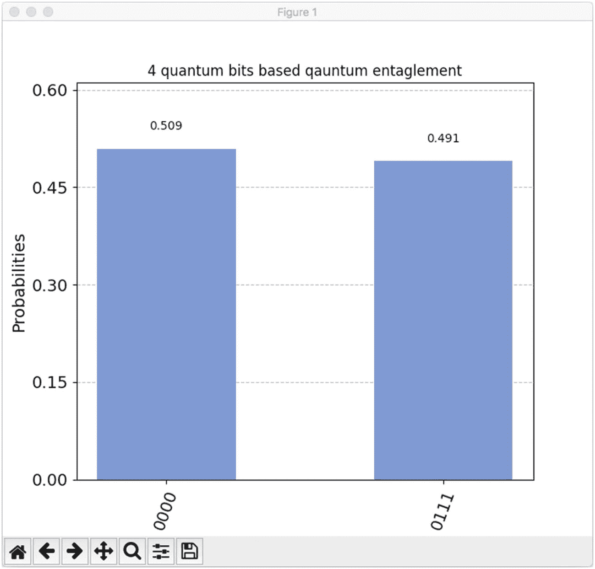
图 13-11 量子概率
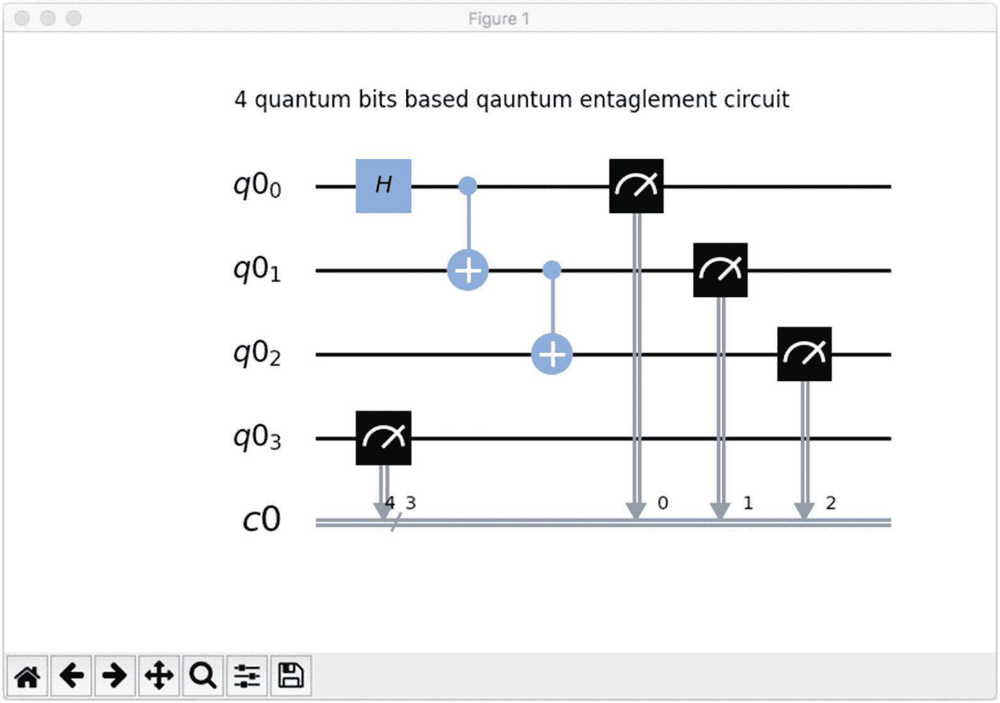
图 13-10 量子纠缠

现在让我们来看看量子隐形传态。

### 代码示例

## 量子隐形传态示例

### Python 代码

```python
from qiskit import QuantumCircuit as QC
from qiskit import IBMQ as Quantum_Simulator
from qiskit import Aer as Quantum_AER
from qiskit import execute
import matplotlib.pyplot as plot
from qiskit.tools.monitor import job_monitor as tools_monitor
from qiskit.tools.visualization import plot_histogram as histogram

def create_circuit():
    circ = QC(4, 4)
    circ.x(0)
    circ.barrier()
    circ.h(1)
    circ.cx(1, 2)
    circ.cx(0, 1)
    circ.h(0)
    circ.barrier()
    circ.measure(0, 0)
    circ.measure(1, 1)
    circ.barrier()
    circ.cx(1, 3)
    circ.cz(0, 3)
    circ.barrier()
    circ.measure(2, 2)
    return circ

def execute_simulator(circ, shots=1024):
    print('\nexecute the qasm simulator...\n')
    sim = Quantum_AER.get_backend('qasm_simulator')
    result = execute(circ, backend=sim, shots=shots).result()
    return result

def execute_machine(circ, device_name="ibmq_essex", shots=1024):
    print('\nexecuting on {}...\n'.format(device_name))
    Quantum_Simulator.load_account()
    provider = Quantum_Simulator.get_provider('ibm-q')
    device = provider.get_backend(device_name)
    job = execute(circ, backend=device, shots=shots)
    tools_monitor(job)
    return job.result()

def create_circuit_diagram(circ, title=''):
    circ.draw(output='mpl')
    plot.title(title)
    plot.savefig("images/qt_circ.png")
    plot.show()

def create_results_plot(result, title=''):
    counts = result.get_counts()
    print('\ncounts are : {}\n'.format(counts))
    histogram(counts)
    plot.title(title)
    plot.savefig("images/qt_res.png")
    plot.show()

if __name__ == '__main__':
    circ = create_circuit()
    create_circuit_diagram(circ, ' quantum teleportation circuit')
    result = execute_simulator(circ)
    create_results_plot(result, ' quantum teleportation output')
```

### 命令

```
pip3 install qiskit
python3 Quantum_Teleportation.py
```

### 输出

```
execute the qasm simulator...
counts are : {'0100': 230, '0010': 229, '0101': 296, '0011': 269}
```

### 图片说明

图 `13-12` 展示了量子隐形传态，图 `13-13` 展示了量子隐形传态的结果。

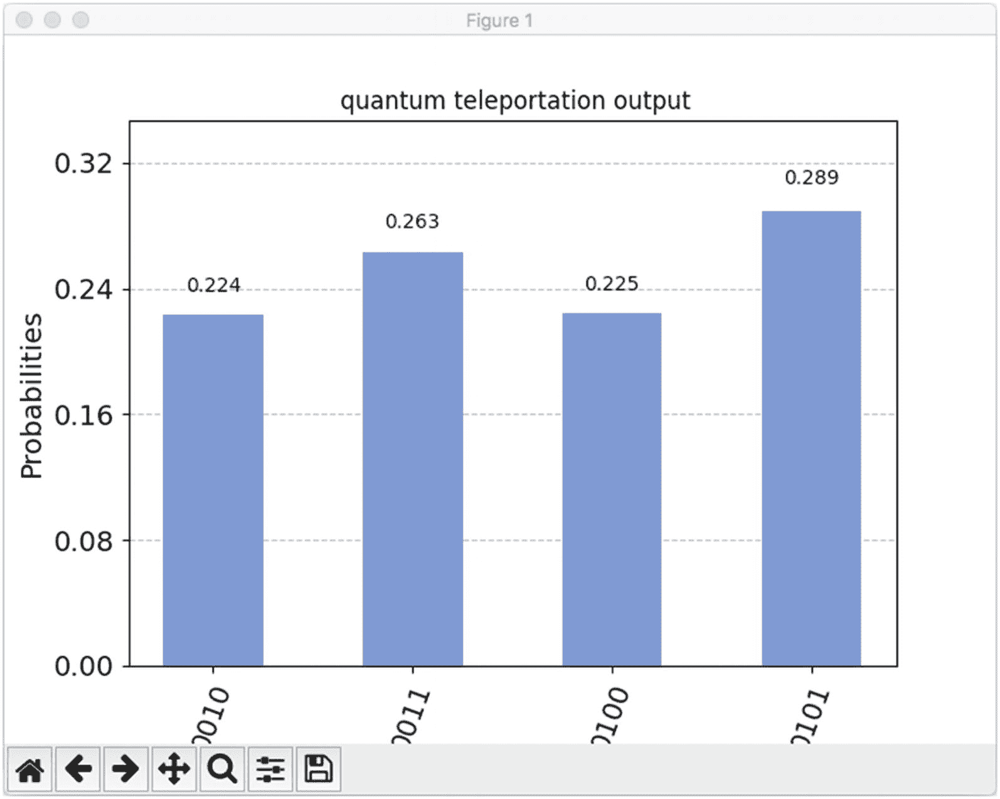

*图 `13-13` 量子隐形传态结果*

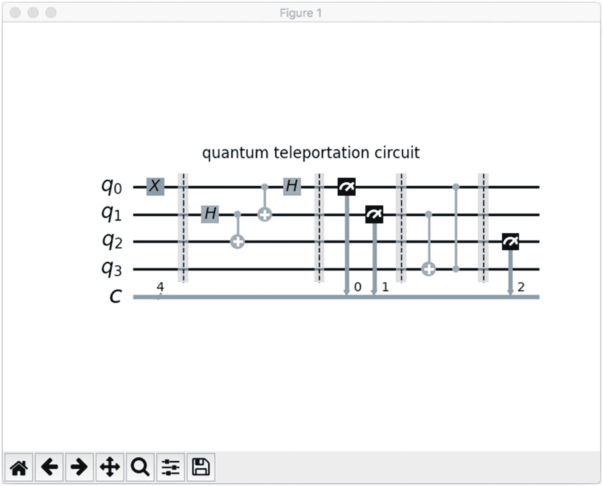

*图 `13-12` 量子隐形传态*

## 总结

在本章中，我们探讨了在现实生活中用于创建量子解决方案的量子技术。我们通过示例详细介绍了量子隐形传态。