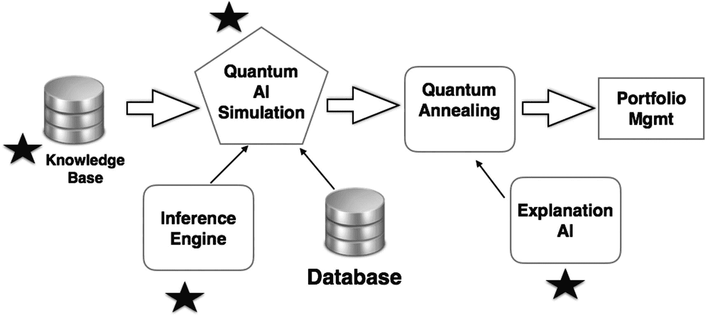
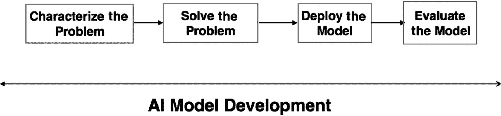
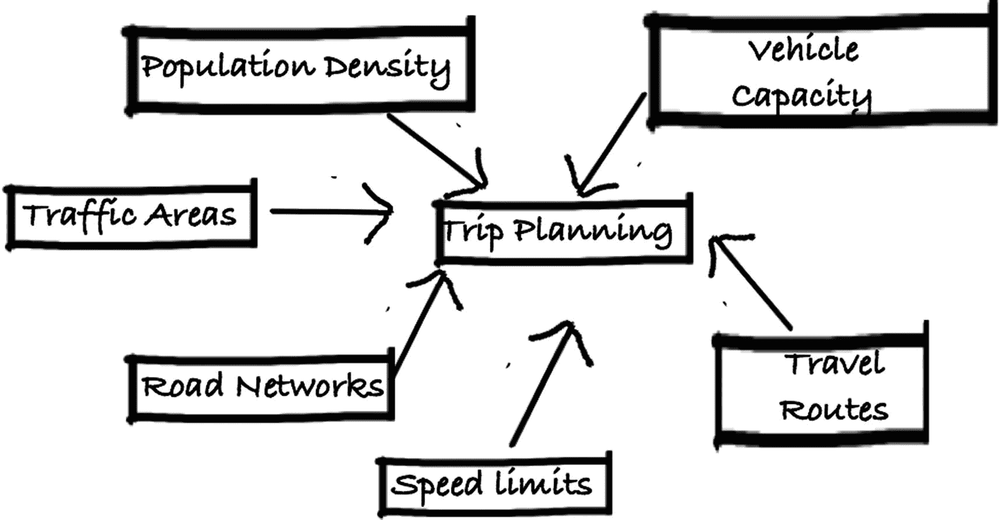
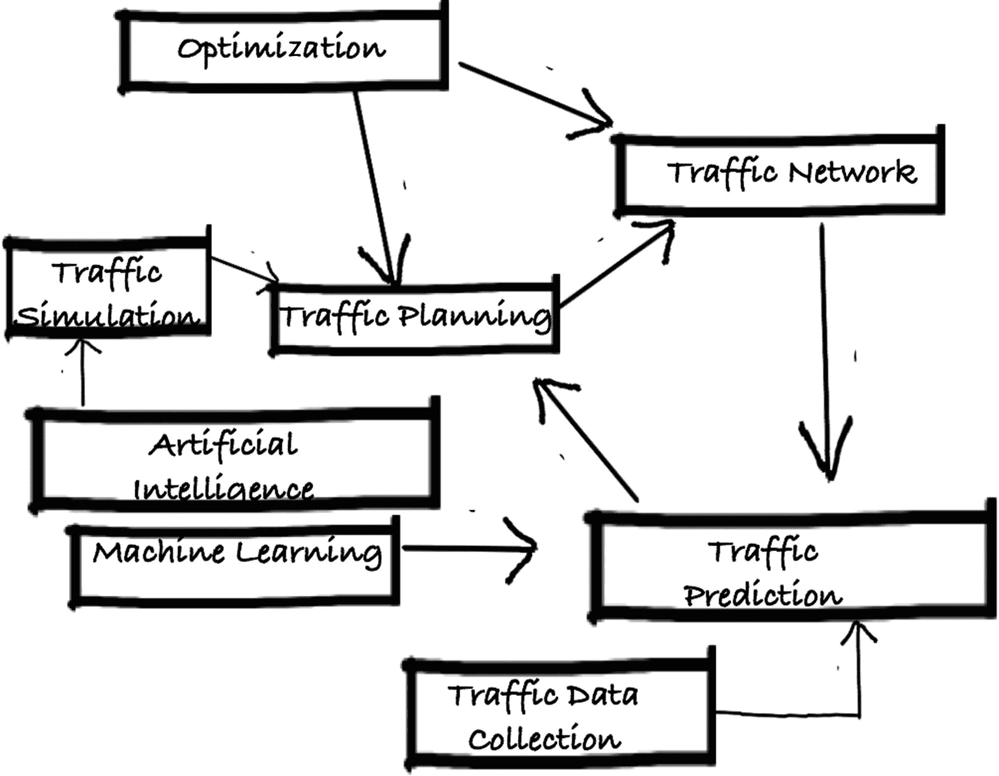

# 14. 下一步行动

本章涵盖后续步骤。我们将讨论最佳实践、案例研究、信息来源以及量子软件的未来。

## 最佳实践

本节介绍的最佳实践专门针对量子计算框架。首先，通过针对具体问题或痛点设计来构建量子电路。然后，在服务器上使用不同的模拟器执行这些试验。最后，汇总试验结果并收集统计数据，形成总结。试验结果会借助软件工具进行可视化展示。

一个与量子计算相关的软件框架将包含包导入、变量初始化 API、门控修改 SDK、电路可视化器、试验模拟器和结果可视化器。如你所知，量子计算基于量子比特。而经典计算则基于比特。量子比特代表量子粒子的状态值。叠加态指的是量子比特同时拥有多个值的状态。纠缠则是指两个量子比特及其数值变化之间的关系。

让我们来看看量子计算框架。

首先，`Strawberry Fields` 框架用于创建与图形和网络相关的程序。该框架支持机器学习功能，并用于解决现实中的化学问题。其次，由谷歌开发的 `Cirq`，用于创建量子电路并在这些电路上模拟现实问题。`Cirq` 具备与互操作功能相关的特性。另一个框架，`TensorFlow Quantum`，拥有机器学习的相关功能。你可以轻松地增强现有的 `TensorFlow` 应用程序，使其适用于基于量子的解决方案。`TensorFlow Quantum` 框架使用了混合量子经典方法和技术，例如量子卷积神经网络。微软的 `Q#` 语言有助于利用 `F#` 和 `C#` 库创建应用程序。最后，`Qiskit` 是一个基于 IBM 的框架，有助于创建用于模拟现实应用的流水线和量子电路。

让我们来看看创建量子计算库的最佳实践。

-   库需要公开专注于使用量子计算模型解决现实应用的 API。函数和方法是为基于量子计算技术实现的算法和方法而创建的。
-   库的设计应首先基于重要的用例，以确保 SDK 简单易用。SDK 中的不同组件处理不同的用例。并为每个组件的使用创建了示例。
-   库需要为向前兼容性而创建。不推荐使用旧的 SDK 以避免兼容性问题。为已弃用的方法提供了填充操作和方法。
-   库的每个方法和操作都需要有明确的目标和用途。
-   库可以包含经典的确定性方法。
-   库需要具有可重复使用的方法和操作。
-   方法和函数的参数需要根据算法或方法的输入和输出参数来选择。
-   库需要具有能帮助开发者理解方法、操作和类型用途的命名空间名称。

## 案例分析

英特尔、IBM、微软和谷歌已开始对量子算法进行研究。具体来说，IBM、英特尔和谷歌正专注于量子计算机。量子算法研究领域包括机器学习和人工智能技术及方法。语音助手、数字助理和聊天机器人可以使用量子自然语言处理算法来提高输入处理的效率和速度。量子计算机有助于药物设计、材料科学、分子建模和物流优化。人工智能可以与量子机器学习融合的关键领域包括监督学习、支持向量机和神经网络。

量子算法和量子计算机将应用于复杂的现实场景。经典计算机将继续用于流程自动化、常规任务执行和简单算法等领域。量子计算机将应用于量子模拟、优化、量子人工智能和量子密码学等领域。它们将应用于制药、网络安全、金融、材料科学和电信等不同垂直行业。

现在，让我们考虑量子计算正在被应用的不同场景。

### 典型应用

以下是正在开发应用程序的领域：

-   量子机器学习
-   计算化学
-   金融投资组合优化
-   物流与调度
-   药物设计
-   网络安全
-   量子密码学
-   电路、软件和系统故障模拟

量子计算机可以在几秒钟内解决现实问题，而经典超级计算机则需要数小时。在金融服务领域，可以模拟不同的投资组合。在日常生活中，客户进行金融投资，但投资回报是不可预测的。他们可能需要一些建议来获得更好的回报。量子人工智能模拟器是一个基于量子人工智能的工作系统。量子计算机可以根据客户的风险策略模拟其金融投资组合，以预测回报。

### 金融投资组合管理

客户在选择不同风险策略时拥有多种选项。

-   *保护者*：极低风险
-   *稳定者*：低风险
-   *优化者*：低至中等风险
-   *创造者*：中高风险
-   *最大化者*：高风险

模拟基于交易情境的数学模型。决策变量以及带有假设条件的模型会被明确指定。针对不同场景，提供了初始条件和备选方案。

投资组合管理是指根据风险策略，选择最佳资产进行投资以获得更高回报。这是一个 NP 难题。NP 难题的复杂性和难度至少与最难的非确定性多项式时间问题相当。量子退火是用于解决此 NP 难题的量子人工智能技术。退火是将玻璃降至最低能态的等效方法。这是模拟退火人工智能技术中使用的一种经典方法。难题的解将处于最低能态。当退火器收敛到最低能态时，就可以确定问题的最小值。

研究发现，量子退火能够解决 NP 难题，并且它具有由玻尔兹曼分布定义的概率模型的估计平均值。量子退火利用量子现象来加速 NP 难题的求解。

量子退火是一种寻找函数最小值和最大值的优化方法。它会提供一组候选函数来寻找最优的最小值和最大值。量子退火与量子隧穿过程有关。这是一个粒子从高能态穿过势垒到达低能态的过程。量子退火的初始条件是叠加态。系统基于含时薛定谔方程演化。这会影响时间增加时的系统状态振幅。系统的哈密顿量源自系统的基态。

量子退火用于训练玻尔兹曼机和量子深度神经网络。用于寻找概率平均值的采样方法是基于马尔可夫链的蒙特卡洛算法。玻尔兹曼模型和方程是分子动力学理论的基础。最概然速率、平均速率和均方根速率使用玻尔兹曼分布进行计算。

交易问题需要通过定义目标和业务场景来表征。解决问题的方法将是一种基于模拟退火的量子人工智能算法。部署将在交易和财富管理公司中进行。通过收集解决方案指标来进行持续评估。

交易问题的特征包括股票价格、共同基金价格、模拟和预测时间以及不同的备选路径。模拟中使用的方法是量子退火。模型包含的实体是股票和共同基金。模型变量是股票和共同基金的价格。解决方案将是行权价格和要为投资组合选择的资产。部署将在交易和财富管理公司的基础设施上进行。环境将包括能够处理所需内存、计算处理能力和磁盘空间的服务器。系统规模调整是为了处理客户投资组合（数量级为一万只股票）并对其进行超过 10 年的模拟。通过在服务器上执行解决方案来进行解决方案的持续评估。收集解决方案的指标，包括所选的投资组合以及基于风险状况的预期收益。

基于量子人工智能模拟的退火器将包含一个知识库、推理引擎、数据存储和解释模块。知识库将是股票和共同基金的历史数据。推理引擎将包含交易和投资组合管理的规则和事实。数据存储用于投资组合管理。解释模块有助于根据目标、风险策略和所选初始投资组合来衡量指标。

在金融世界中，基于蒙特卡洛的采样方法用于评估股票和共同基金的价值。模拟资产价格的随机波动。蒙特卡洛方法用于发现交易和投资策略中的风险度量。它们有助于为基于风险的投资策略寻找路径依赖的回报。使用蒙特卡洛量子方法估算股票、共同基金、期权和期货组合的收益和风险。波动率有助于识别变异，可以通过对数收益的标准差来计算。

量子人工智能模拟会沿着时间向前推进的步骤进行。初始资产价格取自用户输入或股票市场网站。量子人工智能模型包含资产价格演变过程。使用随机过程或离散化方法来解决问题。由于随机数据生成，资产价格可能存在预期之外的相关性。准随机数生成器有助于替代完全随机数生成器。准随机数基于准随机序列，这种序列具有低差异的特性。

量子蒙特卡洛方法有助于使用随机布朗运动来模拟股票价格。该模型包含大量没有交易价格的零散和大额资产。模型中的假设包括允许卖空和不支付股息的股票。模型的目标是风险价值。它与客户投资组合的预期损失相关。

例如，期权价格从 11.4 到 11.2 之间的值开始。期权的行权价大约为 15。期权的到期期限大约为 1 年。股票价格的预期波动率约为 0.2（20%）。针对 0.15 到 0.25 之间的不同波动率值进行计算模拟。一次模拟中的步数约为 10,000 步。

蒙特卡洛模拟基于马尔可夫链。它们与量子行走相关，而量子行走类似于随机行走。量子蒙特卡洛方法应用于股票定价、基于风险的投资策略、收益计算、投资组合收益计算以及资产投资影响分析。

量子人工智能模拟有助于预测不确定的结果。一个包含数据存储中所有状态的随机行走可以演变成一个包含多种股票和共同基金的交易系统。从可能的状态中得出概率平均值是模拟的目标。基于蒙特卡洛方法的量子算法会被计算 m 次，以获得客户投资组合中股票和共同基金的 m 种随机组合。

一个量子人工智能模拟器可以针对超过 10,000 个未来场景执行模拟。这些场景将不会包含以下关键因素：

-   市场崩盘
-   公司特定事件
-   政治意外
-   意外加息

模拟结果并不准确，因为这些关键因素可能会破坏交易市场的稳定性，带来下跌风险和上涨潜力。量子人工智能模拟可以处理股票、共同基金以及美式、欧式、亚式、回溯式和百慕大式等期权。模拟模型将包含以下变量：

-   今日股票价格
-   行权价
-   到期年限
-   无风险利率
-   波动率
-   模拟次数
-   步数

影响模拟的其他参数包括商品价格、通货膨胀率以及交易市场中的其他资产。从数学上讲，使用正态分布的模拟如下所示：

```
# Stock_Price(t+1) = Stock_Price(t) *Pow(e, (drift+random_value))
# drift = average_stock_price - (variance/2)
# random_value = ( standard_deviation * normal_inverse)
# normal_inverse 是正态分布的逆函数。
```

分布可以用 `Q(x)` 建模为频率分布，或者用密度函数 `r(x)` 建模（x 是连续的）。

如果有一个实值函数 `f(X)`，其频率的概率分布为 `Q(x)`，那么 `f(X)` 的期望值如下：

```
E(f(x)) = Σ f(x) Q(x) 其中 Q(x) > 0 且 Σ Q(x) = 1
```

X 是离散的。

`f(X)` 的平均值是 `(1/n) Σ f(xi)`，其中 i 的范围是 1 到 N。

模拟模型中的投资期限通常在 1 到 25 年之间。资产的下跌和上涨价格是输入项。该模型模拟包含股票、共同基金和期权的投资组合的风险中性路径。Bumping 与更改模型中参数的敏感性并执行模拟有关。

量子人工智能模拟器中复杂的部分是知识库、推理引擎和解释模块。

知识库是通过将来自不同来源的领域专业知识转换和迁移到一个语义模型中创建的。该领域包含普遍发生的一般原则、实体和事件。领域中的实体可能具有关系和底层结构。知识库捕获了操作员在领域中不同职能级别执行的任务。组织模型包含职能级别。任务模型详细描述了操作员的任务。应用模型将包含与操作员系统相关的信息。本体论是知识库的关键部分。静态本体论与领域实体及其关系相关。动态本体论与实体的状态和转换规则相关。认知本体论与状态转换指南相关。领域动作、谓词、过程、对象层次结构和有限状态表是模型的一部分。

一个基于知识的系统可以是一个预测天气的系统，它拥有气象学知识。它可以高精度地预报天气。作为气象学家的知识工程师会以事实和规则的形式添加他们的知识。类似地，军事战略家可以利用国防知识库提出军事策略。知识库将包含一套标准的攻防策略。参见图 14-1。



图 14-1

投资组合管理

与交易和咨询知识库相关的统计模型将根据历史数据和股票市场的最新趋势而演变。市场事件、交易领域中的对象、可观察的模式、交易策略和业务策略都是交易系统知识库的一部分。知识库将包含结构性知识、策略性知识和支持性知识类型。结构性知识将包含交易领域中不同的抽象级别。策略性知识与解决交易世界中不同问题的方法和技术相关。支持性知识用于处理交易领域中的意外情况和问题原因。

推理引擎执行规则，知识库需要根据这些规则识别对象状态和实体属性的变化。引擎根据知识库中的规则解决问题。推理引擎有助于回答模拟过程中出现的问题。

解释模块包含用于衡量解决方案有效性的陈述性规则。解释涉及评估系统结果并通过推理确定原因。解释和推理基于不同的规则类型，例如因果规则、触发规则、数据规则、假设规则和筛选规则。量子人工智能模拟器基于一组事件识别要执行的场景。参见图 14-2。



图 14-2

人工智能模型开发

从银行业转到其他垂直领域，比如医疗保健。在医疗保健领域，量子人工智能可用于分析基因 DNA 序列。基因组序列的规模很大。量子人工智能可用于生物工程和远程医疗中的图像处理和分析。癌症等危重疾病可以通过这些技术进行诊断。它还有助于药物发现和研究。这些技术提供了更好的预测和时间序列分析。

量子处理能力有助于交通管理、传感器数据分析、供应链规划、采购决策、大数据搜索、运输优化、资源规划和资产管理。与比特类似，量子比特是量子计算机的计算基础。

现在让我们来看看交通管理。

### 交通管理

交通领域中的交通建模依赖于交通区域、出行表格、高速公路网络、车辆容量以及土地利用模型。土地利用模型包含趋势、土地利用与分区规划、活动区域以及地图。一个交通系统涵盖街道、高速公路、停车设施、出行时间以及限速要求。交通网络将具有交通流量和车辆容量。出行模式指明了使用方式、典型的起点到终点路径以及出行特征。沃德罗普第一原理基于网络和道路使用者平衡。所有使用中的路径的行程时间相等，且比未使用的路径少一辆车的时间。该原理有助于最小化单次出行的平均时间。还存在其他原理和算法来平衡道路使用者与网络交通流量。参见图 14-3。



图 14-3

出行规划

出行是基于起点、终点、车辆和城市交通网络生成的。该网络包含车辆、骑行者、行人，他们在不同的时区和空间中持续移动。交通规划是一项持续的活动，街道网络基础设施也在不断更新。交通建模通过仿真和机器学习等技术完成。交通控制则利用历史数据、估算一段时间内的车辆数量，并管理整个网络中的交通流量。



图 14-4

交通规划

最大流-最小割方法被用于最大化交通网络中的车流量。这种方法基于从起点到终点的最大交通流量，等同于将起点与终点分离的最小割。该方法也可应用于计算机网络的数据包流量。

通过网络的数据包流量可以使用最大流-最小割方法进行建模。网络中，信息流经各个节点到达目的地。目标是最大化能够流经计算机网络的数据包数量。类似地，这种方法也可以用于为大学生分配宿舍，前提是每个学生都希望住到自己选择的宿舍中。目标是最大化获得宿舍的学生人数。

在其他垂直领域，量子算法和技术被用于预测分析。在医疗保健领域，量子退火方法有助于优化蛋白质折叠和药物发现中的非不良效应。其他领域包括药物设计和个性化医疗。在制造业中，量子计算技术可用于解决供应链优化问题。典型问题涉及分销、生产、采购和物流。在媒体行业，量子方法被应用于安排广告和优化收入。

让我们来看一下在智慧城市中实现的量子算法和技术。

### 智慧城市

智慧城市中的问题包括大数据处理，并需要实时分析与决策。一个城市包含汽车（自动驾驶和人工驾驶）、卡车、三轮车、公交车以及其他交通工具。交通信号灯位于城市的不同街道上。每条街道的交通历史数据可用于规划工作日和周末不同出行时间的行程。智慧城市交通管理和驾驶规划解决方案帮助市民规划行程。

现在，让我们来看一下量子计算和算法的局限性。

### 量子计算的局限性

量子计算硬件存在振动以及辐射、光和其他因素等外部交互的问题。退相干与在不同点测量状态并导致量子态坍缩有关。退相干的概率随着量子比特数量的增加呈指数级增长。相位误差由使用量子方法引入。经典方法可以通过使用纠错方法来导致小误差。测试是一个问题，因为无法创建未知状态的多个副本。量子计算方法需要叠加态，但可以实现一个现实模型，因为叠加需要降低系统熵。

## 量子计算新闻来源

以下是有关量子计算的新闻来源：

*   [`IBM 研究博客`](https://www.ibm.com/blogs/research/category/quantcomp/)
*   [`微软量子`](https://cloudblogs.microsoft.com/quantum/)
*   [`滑铁卢研究所量子博客`](https://uwaterloo.ca/institute-for-quantum-computing/news)
*   [`ACM SIGARCH`](https://www.sigarch.org/tag/quantum-computing/)
*   [`量子比特报告`](https://qubitreport.com/)

现在，让我们来看一下量子软件及其未来。

## 量子计算的未来

量子处理单元上的量子比特数量正持续增长，并在过去十年中每年翻一番。诸如`IBM`等公司的目标，是扩大制造工艺以生产规模达`10,000`个量子比特的量子处理单元。`谷歌`、`IBM`、`微软`和`NASA`正在其研究和公司 IT 基础设施中使用量子计算机。

据 D-Wave 公司首席执行官 Vern Brownell 称：
```

> `谷歌`已经创建了他们所谓的量子人工智能实验室，正在那里探索利用我们的计算机进行人工智能或学习应用。而`NASA`有一系列正在研究的问题，从寻找系外行星到解决物流问题等。我想在五年内，这项技术将在各行各业得到广泛应用。虽然量子计算领域的商业应用大多还只是理论上的期望，但专家一致认为量子计算在一个领域具有价值：优化。利用量子计算创建一个能够“思考”如何让商业运营更快、更智能、更便宜的程序，可能会彻底改变无数行业。

量子人工智能与受生物大脑和量子力学启发的学习模型相关。这些模型基于对量子比特的数学运算，用于解决现实生活中的问题。分布式系统和基于并行架构的系统用于运行这些算法和模型。由于一个量子比特可以处理`0`和`1`等多种状态，因此可以用`n`个量子比特在短时间内解决巨大的问题。

海森堡不确定性原理利用了关于粒子动量和位置的信息。任何计算位置的观测都会导致粒子动量出现误差。同样，任何动量的计算都会导致位置出现误差。量子人工智能算法基于量子比特的一组变换。计算过程不会测量系统状态，而测量正是导致信息误差的原因。单个量子算法无法找到 NP 完全问题的所有解。上下文中问题的结构被用作解决 NP 完全问题的基础。

量子人工智能无法帮助改变日常办公任务，如阅读、写作和数学计算。在读取大数据、撰写报告或执行数学计算时，量子计算机将派不上用场。企业中的顺序操作将需要经典计算机。未来，组织中的复杂算法将在量子计算机上执行。

经典计算机和服务器将用于一系列包含手动和自动化操作的标准流程。这些操作可能与验证、检查、工作流、通信、通知、数据收集和数据存储有关。数据流和推送模型将需要标准计算机来收集数据并流式传输给各个订阅方。

### 面向量子计算的企业软件和服务

在企业软件和服务领域，与化学、制药和制造相关的解决方案正在不断发展。药物发现以及研发缩减是制药领域应用量子技术和方法的关键领域。量子软件正在被开发用来解决现实生活中的优化问题。另一个应用领域是自动驾驶。网络安全/密码学是量子软件和解决方案正在发展的另一个领域。

### 量子机器学习

量子机器学习（QML）是另一个正在发展新解决方案和产品的领域。

## 总结

在本章中，我们探讨了量子技术用于在现实生活中创建量子解决方案的后续步骤。