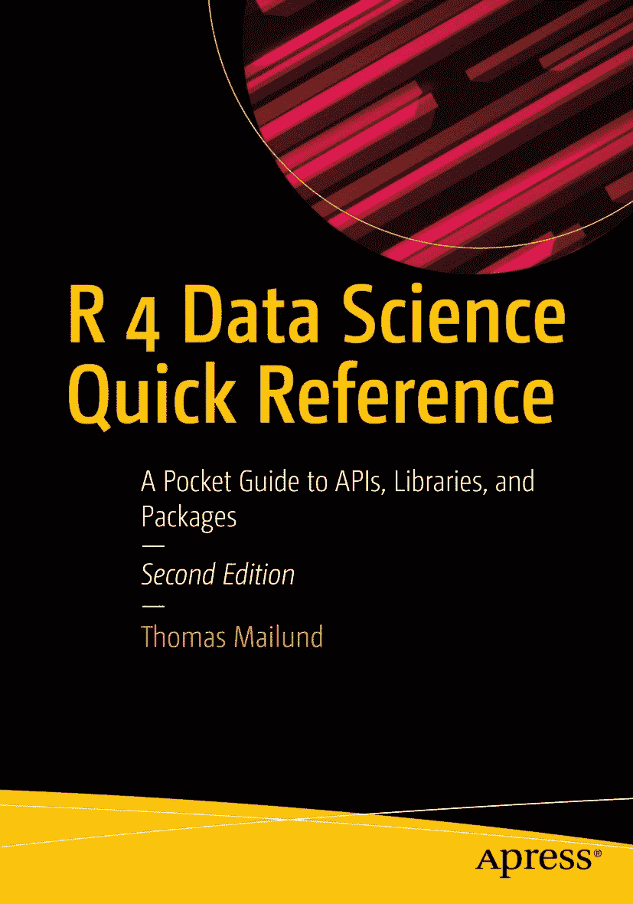

ISBN 978-1-4842-8779-8 e-ISBN 978-1-4842-8780-4 [`doi.org/10.1007/978-1-4842-8780-4`](https://doi.org/10.1007/978-1-4842-8780-4) © Thomas Mailund 2019, 2022 本作品受版权保护。所有权利均由出版商独家授权，无论涉及材料的全部或部分，特别是翻译、重印、重用插图、朗诵、广播、以缩微胶卷或任何其他物理方式进行复制，以及信息存储与检索的传输、电子改编、计算机软件，或使用现在已知或今后开发的类似或不同的方法。本出版物中使用的一般描述性名称、注册商标、商标、服务标志等，即使没有明确声明，也不意味着此类名称免于相关保护法律和法规的约束，因此可自由用于一般用途。出版人、作者和编辑可假定本书中的建议和信息在出版之日是真实准确的。出版人、作者或编辑均不对本书所载材料或可能存在的任何错误或遗漏提供明示或暗示的保证。出版人对已出版地图和机构归属中的管辖权主张保持中立。

本 Apress 印记由注册公司 APress Media, LLC（Springer Nature 的一部分）出版。

注册公司地址为：1 New York Plaza, New York, NY 10004, U.S.A.

关于作者 关于技术审校

