# comparing line to a (better) model y ~ xˆ2 + x + 1
model2    
##  1 model   0     38.9
##  2 model   0.25  42.7
##  3 model   0.5   46.5
##  4 model   0.75  50.2
##  5 model   1     54.0
##  6 model2  0     43.2
##  7 model2  0.25  42.3
##  8 model2  0.5   44.2
##  9 model2  0.75  49.0
## 10 model2  1     56.8
spread_predictions(new_dat, model, model2)
## # A tibble: 5 × 3
##       x model model2
##      
## 1  0     38.9   43.2
## 2  0.25  42.7   42.3
## 3  0.5   46.5   44.2
## 4  0.75  50.2   49.0
## 5  1     54.0   56.8
```

它们展示的是相同的数据，只是表格格式不同。名称`gather`和`spread`类似于`tidyr`函数`pivot_longer`和`pivot_wider`，但这些名称取自`tidyr`中已被弃用的`gather`和`spread`函数。

之前，我们在新数据上进行了预测，当然，你也可以在原始数据上进行。

```
gather_predictions(dat, model, model2)
## # A tibble: 100 × 4
##    model     x     y  pred
##       
##  1 model 0.633  45.7  48.5
##  2 model 0.385  43.4  44.7
##  3 model 0.566  46.1  47.4
##  4 model 0.922  53.5  52.8
##  5 model 0.976  56.0  53.6
##  6 model 0.933  54.1  53.0
##  7 model 0.381  43.4  44.7
##  8 model 0.256  43.7  42.8
##  9 model 0.257  42.0  42.8
## 10 model 0.197  42.2  41.9
## # . . . with 90 more rows
spread_predictions(dat, model, model2)
## # A tibble: 50 × 4
##        x     y model model2
##        
##  1 0.633  45.7  48.5   46.4
##  2 0.385  43.4  44.7   42.9
##  3 0.566  46.1  47.4   45.2
##  4 0.922  53.5  52.8   54.1
##  5 0.976  56.0  53.6   55.9
##  6 0.933  54.1  53.0   54.4
##  7 0.381  43.4  44.7   42.9
##  8 0.256  43.7  42.8   42.3
##  9 0.257  42.0  42.8   42.3
## 10 0.197  42.2  41.9   42.2
## # . . . with 40 more rows
```

如果你有原始数据，也可以获取残差。

```
gather_residuals(dat, model, model2)
## # A tibble: 100 × 4
##    model     x     y  resid
##        
##  1 model 0.633  45.7 -2.76
##  2 model 0.385  43.4 -1.27
##  3 model 0.566  46.1 -1.32
##  4 model 0.922  53.5  0.690
##  5 model 0.976  56.0  2.37
##  6 model 0.933  54.1  1.10
##  7 model 0.381  43.4 -1.24
##  8 model 0.256  43.7  0.890
##  9 model 0.257  42.0 -0.797
## 10 model 0.197  42.2  0.281
## # . . . with 90 more rows
spread_residuals(dat, model, model2)
## # A tibble: 50 × 4
##        x     y  model  model2
##          
##  1 0.633  45.7 -2.76  -0.713
##  2 0.385  43.4 -1.27   0.500
##  3 0.566  46.1 -1.32   0.938
##  4 0.922  53.5  0.690 -0.552
##  5 0.976  56.0  2.37   0.0826
##  6 0.933  54.1  1.10  -0.348
##  7 0.381  43.4 -1.24   0.505
##  8 0.256  43.7  0.890  1.39
##  9 0.257  42.0 -0.797 -0.275
## 10 0.197  42.2  0.281 -0.0587
## # . . . with 40 more rows
```

根据你通常进行的数据科学类型，你可能需要采样以获得经验分布，或者将数据拆分为训练数据和测试数据以避免过拟合。使用`modelr`，你有用于此目的的函数。

你可以使用`bootstrap()`函数通过自助法构建 *n* 个数据集。

```
bootstrap(dat, n = 3)
## # A tibble: 3 × 2
##   strap               .id
##                 
## 1  1
## 2  2
## 3  3
```

它会随机采样数据点，并从中创建`n`个新的数据集。生成的 tibble 有两列：第一列`strap`包含每个样本的数据，第二列是 id。

`crossv_mc()`函数——蒙特卡洛交叉验证——创建交叉验证数据，也就是说，它将你的数据拆分为训练数据和测试数据。它创建`n`个随机数据集，分为测试数据和训练数据。

```
crossv_mc(dat, n = 3)
## # A tibble: 3 × 3
##   train               test                .id
##                               
## 1   1
## 2   2
## 3   3
```

默认情况下，测试数据占采样数据的 20%；你可以使用`test`参数更改此设置。

`crossv_kfold`和`crossv_loo`分别提供 k 折数据和留一法数据。

```
crossv_kfold(dat, k = 3)
## # A tibble: 3 × 3
##   train               test                .id
##                   
## 1   1
## 2   2
## 3   3
crossv_loo(dat)
## # A tibble: 50 × 3
##    train               test                .id
##                  
##  1      1
##  2      2
##  3      3
##  4      4
##  5      5
##  6      6
##  7      7
##  8      8
##  9      9
## 10     10
## # . . . with 40 more rows
```

作为一个例子，假设你采样了三个自助法数据集。样本在`strap`列中，所以我们可以对其进行映射，并为每个采样的数据集拟合一个线性模型。


```r
samples |> 
  mutate(
    # 遍历所有自助样本，并对每个样本拟合模型
    fits = strap |> map(\(dat) lm(y ~ x, data = dat))
  )
fitted_models
## # A tibble: 3 × 3
##   strap               .id   fits
##                  
## 1  1     
## 2  2     
## 3  3     
fitted_models$fits[[1]]
##
## Call:
## lm(formula = y ~ x, data = dat)
##
## Coefficients:
## (Intercept)            x
##       38.46        15.54
```

接着，我们可以遍历这三个模型，并使用 `broom` 包的 `glance()` 函数检查它们：

```r
fitted_models$fits |>
  map(glance) |>
  bind_rows()
## # A tibble: 3 × 12
##   r.squared adj.r.squared sigma statistic  p.value
##                          
## 1     0.871         0.869  1.85      325\. 5.07e-23
## 2     0.813         0.809  1.89      209\. 4.12e-19
## 3     0.904         0.902  1.58      451\. 4.63e-26
## # . . . with 7 more variables: df ,
## #   logLik ,  AIC , BIC ,
## #   deviance , df.residual , nobs 
```

如果我们对 `x` 的**经验分布**感兴趣，那么我们可以提取自助数据中的分布，然后继续分析。

```r
get_x <- function(models) {
  models |>
    filter(term == "x") |>
    select(estimate) %>% as.double()
}
fitted_models$fits |> map_dbl(get_x)
## [1] 15.54085 13.25745 15.50705
```

如果你想比较**模型**（而不是数据样本），`modelr` 也提供了支持。你可以创建一个想要拟合的公式列表。`formulae()` 函数可以帮你创建这样一个列表。

```r
models <- formulae(~y, linear = ~x, quadratic = ~I(xˆ2) + x)
```

第一个参数是响应变量（公式左侧），其余参数是（命名的）参数，用于描述解释变量，即模型公式的右侧部分。

如果你使用数据、要使用的拟合函数（此处是 `lm()`）以及你想要拟合的公式来调用 `fit_with()`，那么你就能得到所需的结果——每个公式对应一个拟合模型。

```r
fits <- dat |> fit_with(lm, models)
fits |> 
  map(glance) |> 
  bind_rows()
## # A tibble: 2 × 12
##   r.squared adj.r.squared sigma statistic   p.value
##                           
## 1     0.873         0.871 1.83       330\.  3.67e-23
## 2     0.983         0.983 0.674      1379\. 1.86e-42
## # . . . with 7 more variables: df ,
## #   logLik ,  AIC , BIC ,
## #   deviance , df.residual , nobs 
```

你可以在 `modelr` 中找到许多模型质量度量指标，例如**均方根误差**：

```r
fits |> map_dbl(rmse, data = dat)
##    linear quadratic
## 1.7973686 0.6533399
```

**平均绝对误差**：

```r
fits |> map_dbl(mae, data = dat)
##    linear quadratic
## 1.5265158 0.5116268
```

以及更多其他指标。

由于过拟合始终是一个问题，你可能希望使用至少尝试考虑模型复杂度的质量度量指标。`broom` 包的 `glance()` 函数中就提供了一些这样的指标。

```r
fits |> map_dbl(~ glance(.x)$AIC)
##   linear quadratic
## 206.5262  107.3281
```

然而，如果可能的话，你应该使用**测试数据**来衡量模型的泛化能力。为此，你首先需要将模型拟合到训练数据上，然后在测试数据上进行预测。在下面的例子中，我在剔除一个样本的数据上拟合了 `lm(y ~ x)` 模型，然后在测试数据上进行了应用。接着，我使用 RMSE 来衡量泛化质量。

```r
samples <- dat |> crossv_loo()
training_fits <- samples$train |> map(~lm(y ~ x, data = .))
training_fits |> map2_dbl(samples$test, rmse) |> head(10)
##         1         2         3         4         5
## 2.8223916 1.3057640 1.3454227 0.7254241 2.5129973
##         6         7         8         9        10
## 1.1552629 1.2763827 0.9248123 0.8273398 0.2941659
```

脚注 [1]

# 13. 绘图：`ggplot2`

`ggplot2` 包包含大量用于创建各种图形的函数。要全面覆盖需要一整本书——事实上已有好几本这样的书——因此我无法在此详述。在本章中，我只会尝试让你了解该包的工作原理。

当你加载 `tidyverse` 时，`ggplot2` 包也会被加载，但你也可以单独使用它：

```r
library(ggplot2)
```

## `ggplot2` 的基本绘图组件

与 R 的基础图形不同，使用 `ggplot2` 时，你不需要通过绘制线条、点或任何所需元素到图形画布上来创建独立的图形组件。相反，你需指定如何将数据映射到抽象的图形美学属性，例如 x 和 y 坐标、颜色、形状等。然后指定这些美学属性应如何在图形中呈现，例如 x 和 y 坐标应该绘制为散点图还是线条。在此基础上，你还可以添加图形信息，例如散点图中的点应该是什么形状、颜色美学属性映射到什么颜色等。你通过**分步添加**属性来构建图形，这使得修改图形变得容易。如果你想在图中添加一条线性回归线，只需一个命令即可；由于 `ggplot2` 已经知道你的哪些数据变量被映射到了 x 和 y 坐标，它会自动计算线性回归并将其添加到图中。如果你想以对数比例绘制数据，只需告诉 `ggplot2` 轴应进行对数变换即可。

起初，`ggplot2` 可能看起来比 R 的基础图形更复杂，但你很快就会习惯。

`ggplot2` 的主要组件如下：

*   **数据**——显然，你有要绘制的数据。
*   **美学属性**——美学属性将数据映射到抽象的图形概念，例如 x 和 y 坐标、颜色和填充。
*   **几何对象**——几何对象决定了你要制作的图形类型，例如是直方图、散点图还是箱线图。
*   **统计变换**——统计变换指定了在绘图前应如何汇总数据。你的数据并非总是需要汇总，也就是说，统计变换可以是恒等映射。散点图不会对 x 和 y 坐标进行汇总计算，但回归线或直方图会。
*   **标度**——标度指定了通过美学属性映射到图形概念的数据应如何在图上实际放置。你的 x 和 y 坐标数据可能以米为单位，但这些米应映射到图上的点。标度负责处理这件事。
*   **坐标系**——坐标系允许你转换将数据缩放为图形组件的结果。例如，如果你想让图形以对数比例显示 y 轴，那么坐标变换可以完成此操作。
*   **分面**——分面根据数据中的变量将图形拆分为子图。

你可以使用 `ggplot()` 函数创建 `ggplot2` 图形。然后可以添加上述一个或多个组件。在打印该图形对象之前，不会发生任何事情；打印它才会生成图形。一个典型的模式是立即打印它，并在创建图形对象的同一语句中添加组件。

```r
ggplot(. . . ) + . . . 组件 . . .
```

要向图形添加组件，你使用**加法**。`ggplot2` 包**不**使用管道操作符。不过，你经常会看到数据通过管道传递给 `ggplot()` 调用，但在那之后，你必须记得使用加法而不是管道。

一个**图层**创建了你可以看到的（部分）图形。它至少必须包含数据、美学属性、一个统计变换（可以是恒等映射）和一个几何对象（该对象可能指定了统计变换）。在图形显示你的数据之前，你的图形必须至少有一个图层。


## 向绘图对象添加组件

我们能创建的最简单的图形是空图形。你可以通过调用不带任何参数的 `ggplot()` 来创建它。

```
p <- ggplot()
```

你可以通过调用 `summary()` 函数来查看它的组成部分，但这里的大部分信息并不相关。我会在后续讲解中，高亮显示与本小节所见组件相关的行。

```
summary(p)
## data: [x]
## faceting: 
##     compute_layout: function
##     draw_back: function
##     draw_front: function
##     draw_labels: function
##     draw_panels: function
##     finish_data: function
##     init_scales: function
##     map_data: function
##     params: list
##     setup_data: function
##     setup_params: function
##     shrink: TRUE
##     train_scales: function
## vars: function
## super:  
```

要创建图形，你需要打印该图形对象。你可以显式地执行此操作：

```
print(p)
```

或者直接将其输入到你的 R 终端中：

```
p
```

但在本例中，图形是空的——我们在创建 `p` 时并未向其中添加任何内容——因此我没有展示结果。

由于在 R 脚本中将对象放在最外层会打印该对象，因此 `ggplot` 对象并不总是先赋值给变量再绘制。你完全可以只写 `ggplot()` 对象。

```
ggplot()
```

为什么会有人创建空图形对象呢？你无法打印空对象。嗯，你可以打印，但你会得到一个空白的画布，所以这没什么意义。不过，你可以通过向其中添加组件来逐步构建图形。你可以从空图形开始，然后在单独的命令中添加所需的一切。

### 添加数据

你可以将数据作为参数添加到 `ggplot()` 中。如果你想向空图形添加数据，则需要使用几何对象；请参阅下面的示例。如果你在 `ggplot()` 函数中添加了数据，那么之后添加到图形中的所有组件都能访问这些数据。

使用一些随机测试数据，我们可以创建一个包含关联数据的图形对象。

```
dat <- tibble(
foo = runif(100),
bar = 20 * foo + 5 + rnorm(100, sd = 10),
baz = rep(1:2, each = 50)
)
p <- ggplot(data = dat)
```

如果你调用 `summary(p)`，你会看到以下行：

```
## data: foo, bar, baz [100x3]
```

出现在顶部。它显示了数据中的变量。这些变量尚未映射到任何图形对象；那是美学映射的职责。

### 添加美学映射

我们在图形中看到的是点、线、颜色等。要创建这些图形，`ggplot2` 需要知道数据中的哪些变量应被解释为坐标，哪些决定线条粗细，哪些决定颜色等。美学映射正是为此服务的。

思考一下这个图形对象：

```
p <- ggplot(data = dat, aes(x = foo, y = bar, color = baz))
```

在此，我们指定了 `foo` 决定 x 坐标，`bar` 决定 y 坐标，`baz` 决定颜色。如果你查看图形的摘要，你会在 `data` 行下面看到从数据变量到图形对象的映射：

```
## data: foo, bar, baz [100x3]
## mapping:  x = ~foo, y = ~bar, colour = ~baz
```

打印（或显示）此图形将得到一个空图形，其 x 轴和 y 轴与数据中 x 和 y（`foo` 和 `bar`）值的范围相匹配。除此之外图形是空的，因为它没有指定几何对象。

### 添加几何对象

几何对象指定了图形的类型。它们使用从数据到图形属性的美学映射，并基于此创建图形。

最直接的图形之一是散点图。我们可以将 `geom_point()` 几何对象添加到之前创建的图形中，以获得散点图。

```
p <- ggplot(data = dat, aes(x = foo, y = bar, color = baz)) +
geom_point()
```

如果你调用 `summary(p)`，你会在输出底部看到以下行：

```
## geom_point: na.rm = FALSE
## stat_identity: na.rm = FALSE
## position_identity
```

它们告诉你，你有一个点几何对象，并且将数据映射到摘要的统计量是恒等统计量。当我们将其绘制成点时，我们不对数据进行任何摘要统计。你可以通过打印图形对象来创建图形；你可以在图 13-1 中看到结果。

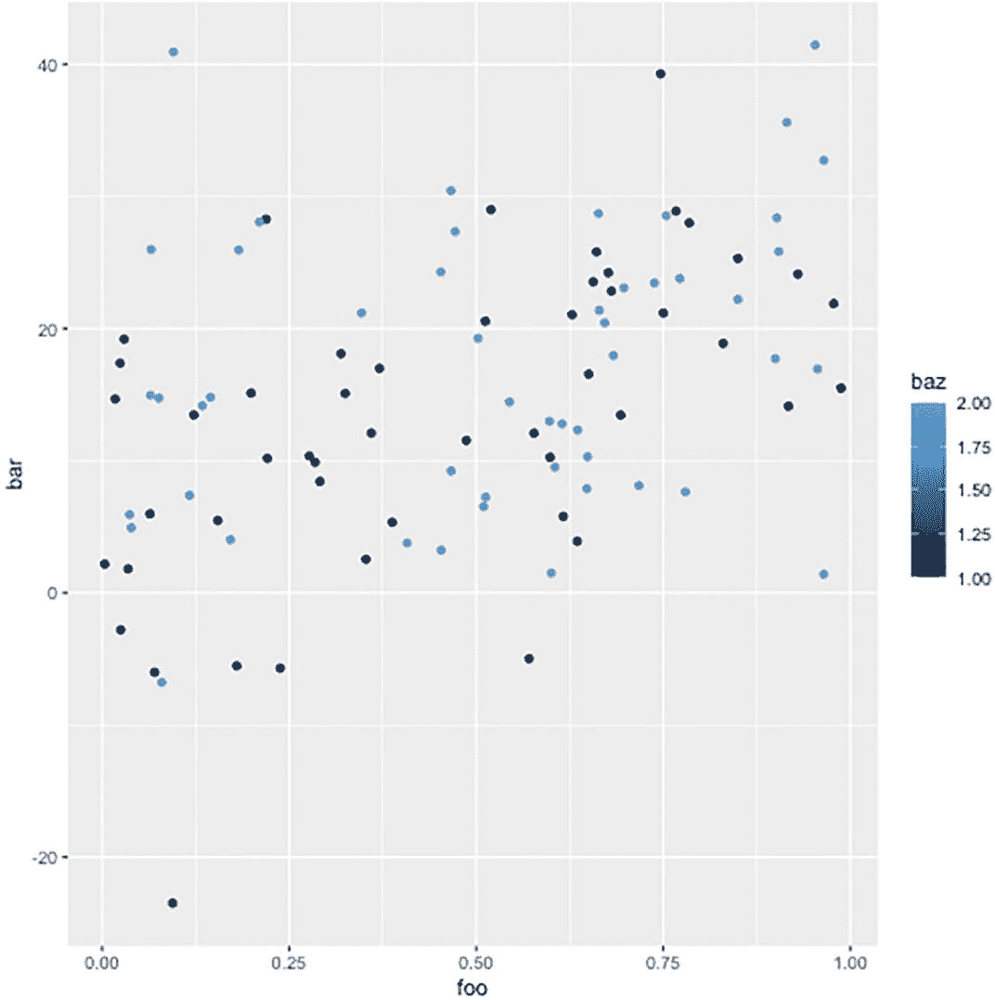

使用 `ggplot2` 创建了一个散点图。带有轻微颜色深浅变化的点散布在整个图上。

**图 13-1**

**点几何图形**

```
print(p)
```

你可以直接将数据和美学映射添加到几何对象中。这在你想将替代数据叠加到图形上时尤其有用，但作为示例，考虑将相同的数据和美学映射移到 `geom_point()` 调用中。

```
p <- ggplot() +
geom_point(data = dat, aes(x = foo, y = bar, color = baz))
```

如果你查看摘要，你会看到美学映射现在已与几何对象分组在一起：

```
## mapping: x = ~foo, y = ~bar, colour = ~baz
## geom_point: na.rm = FALSE
## stat_identity: na.rm = FALSE
## position_identity
```

但除此之外，变化不大。这可用于向图形添加额外数据。这也表明，有时从一个空图形对象开始，然后在不同的几何对象中添加不同的数据集是有意义的。

由于 `baz` 是数值型的，它被解释为一个连续变量。你可以通过将其转换为因子来获得离散的颜色映射。

```
ggplot(data = dat, aes(x = foo, y = bar, color = factor(baz))) +
geom_point()
```

你可以在图 13-2 中看到结果。

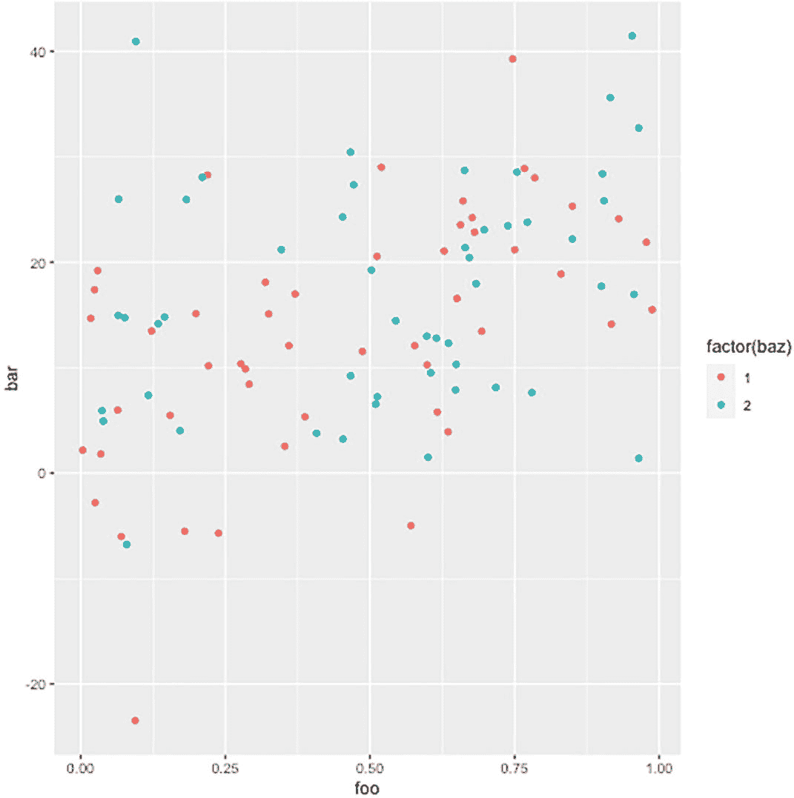

在 `ggplot2` 中添加了颜色变化美学参数的散点图。两个深浅不同的点，分别标记为因子 1 和因子 2，散布在图中。

**图 13-2**

**离散颜色美学**

你可以更改因子中的水平来重新排序图例。有关操作因子的更多信息，请参阅第 10 章。

另一个简单的几何对象是线图。

```
ggplot(data = arrange(dat, foo),
aes(x = foo, y = bar, color = factor(baz))) +
geom_line()
```

在结果见图 13-3。在绘图之前，我使用 `arrange()` 根据 x 轴对数据进行了排序。否则，线条将不会从左到右，而是来回跳跃（如果你想理解我的意思，可以试一下）。

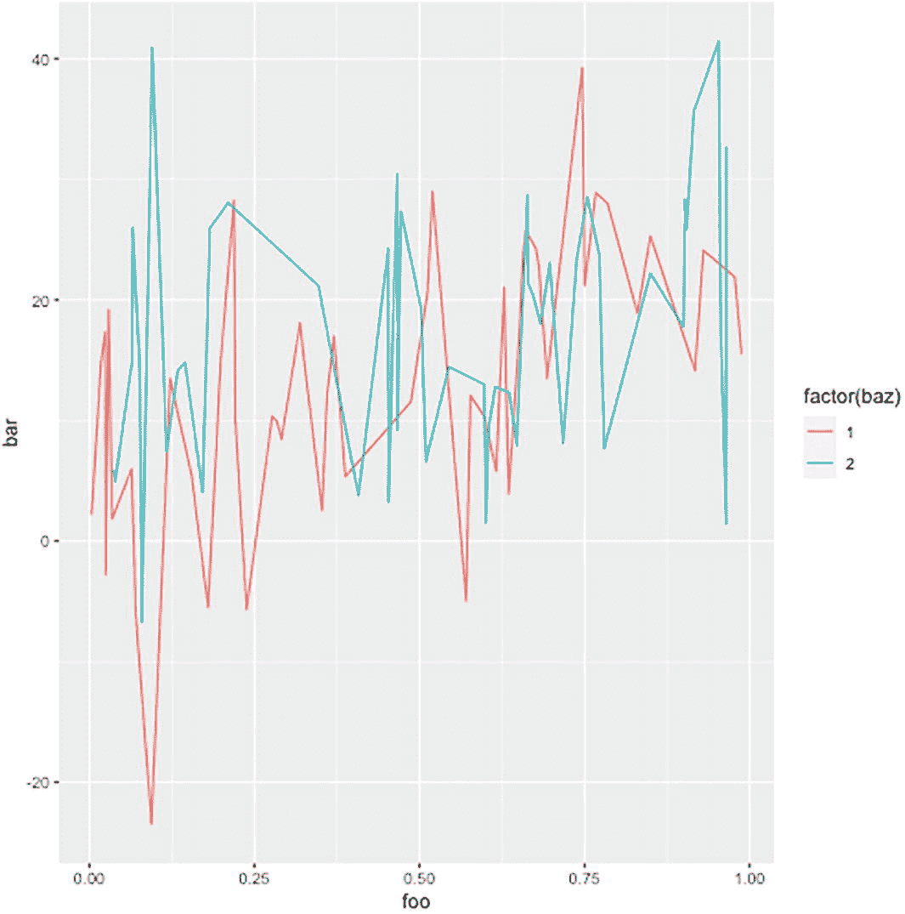

`ggplot2` 中的线图几何对象。深浅不同的线条，标记为因子 1 和因子 2，起伏波动，形成紧密排列的尖锐峰值。

**图 13-3**

**线图**

你可以有多个几何对象；请看下面的例子。

```
p <- ggplot(data = dat,
aes(x = foo, y = bar, color = baz)) +
geom_point() +
geom_smooth(formula = y ~ x, method = "loess")
```

如果你调用 `summary(p)`，你会在输出底部看到两个图层。

```
## geom_point: na.rm = FALSE
## stat_identity: na.rm = FALSE
## position_identity
##
## geom_smooth: na.rm = FALSE, orientation = NA, se = TRUE
## stat_smooth: na.rm = FALSE, orientation = NA, se = TRUE, method = loess
## position_identity
```

注意，平滑几何对象没有使用恒等统计量。它显示了数据的摘要，并且从数据到该摘要的映射由 `stat_smooth` 统计量处理。

我们可以打印该图形：

```
print(p)
```


参考以下排版后的内容：

查看图 13-4 中的结果。

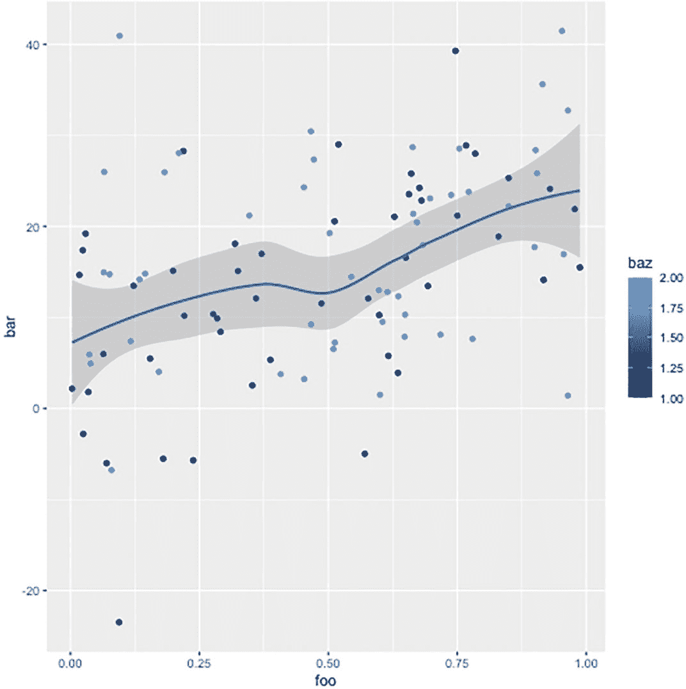

**图 13-4：包含两个几何对象的图**

一个`ggplot2`图，添加了两个几何对象。`bar`相对于`foo`的散点图中包含不同深浅的点，以及一条逐渐倾斜的线。

如果我们使用离散颜色，它也会对数据进行分组。因此，如果我们将`baz`再次设为因子，我们将得到不同颜色的数据点，并得到两条平滑线。

```
ggplot(data = dat, aes(x = foo, y = bar, color = factor(baz))) +
geom_point() +
geom_smooth(formula = y ~ x, method = "loess")
```

查看图 13-5 中的结果。

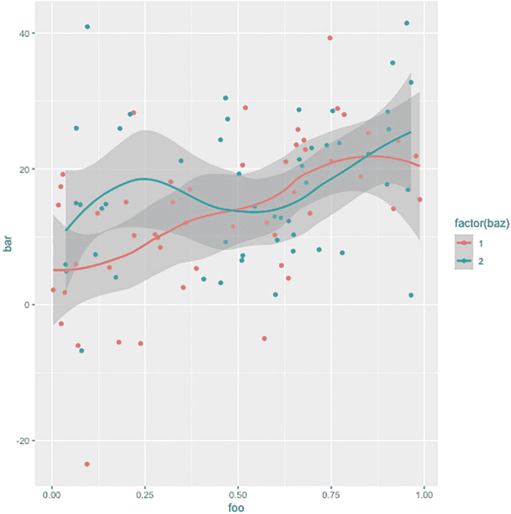

**图 13-5：包含两个几何对象和离散颜色的图**

一个`ggplot2`图，包含两个几何对象和一个颜色变化的美学参数。它具有带有阴影的散点和两条对应的线。

你可以使用`geom_histogram()`构建直方图（参见图 13-6）。

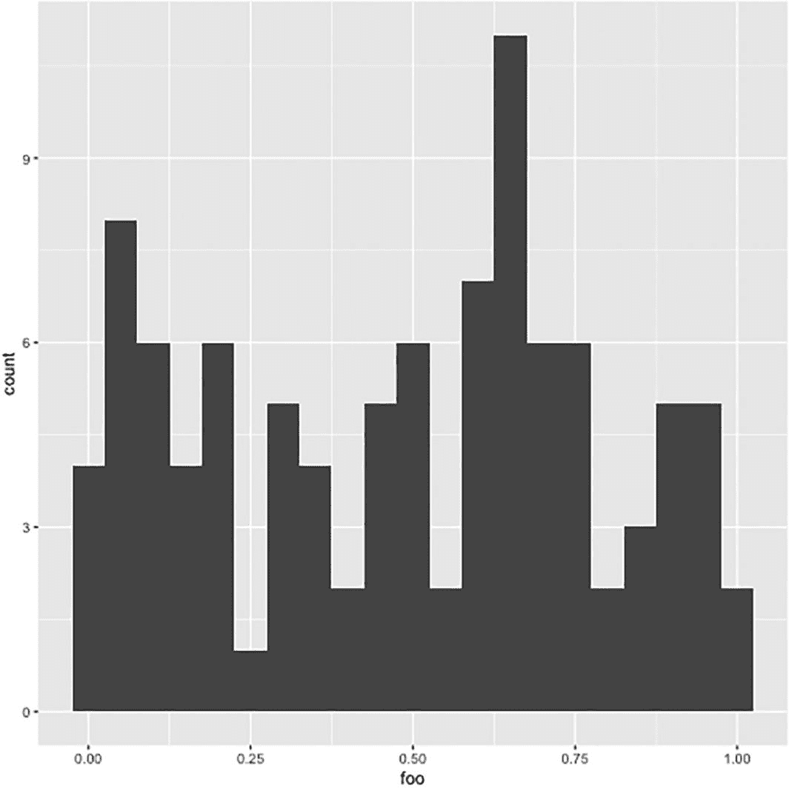

**图 13-6：直方图**

使用`ggplot2`绘制的直方图。该直方图绘制了`count`相对于`foo`的分布，其中最高的柱形在 Y 轴上超过了 9。

```
ggplot(data = dat, aes(x = foo)) +
geom_histogram(binwidth = 0.05)
```

注意，此几何对象只需要一个 x 轴。

通过`summary(p)`，你将看到其统计量是`stat_bin`。

```
## geom_bar: na.rm = FALSE
## stat_bin: binwidth = NULL, # ...此处有更多内容...
```

如果你想要密度图，可以使用`geom_density()`。

```
ggplot(data = dat, aes(x = bar)) +
geom_density()
```

你会看到其统计量是`stat_density`。

```
## geom_density: na.rm = FALSE
## stat_density: na.rm = FALSE
```

我想你已经看明白其中的模式了。

### 分面

添加网格分面的效果是，我们会得到子图，数据根据提供给`facet_grid()`的公式被分割成不同的组；参见图 13-7。

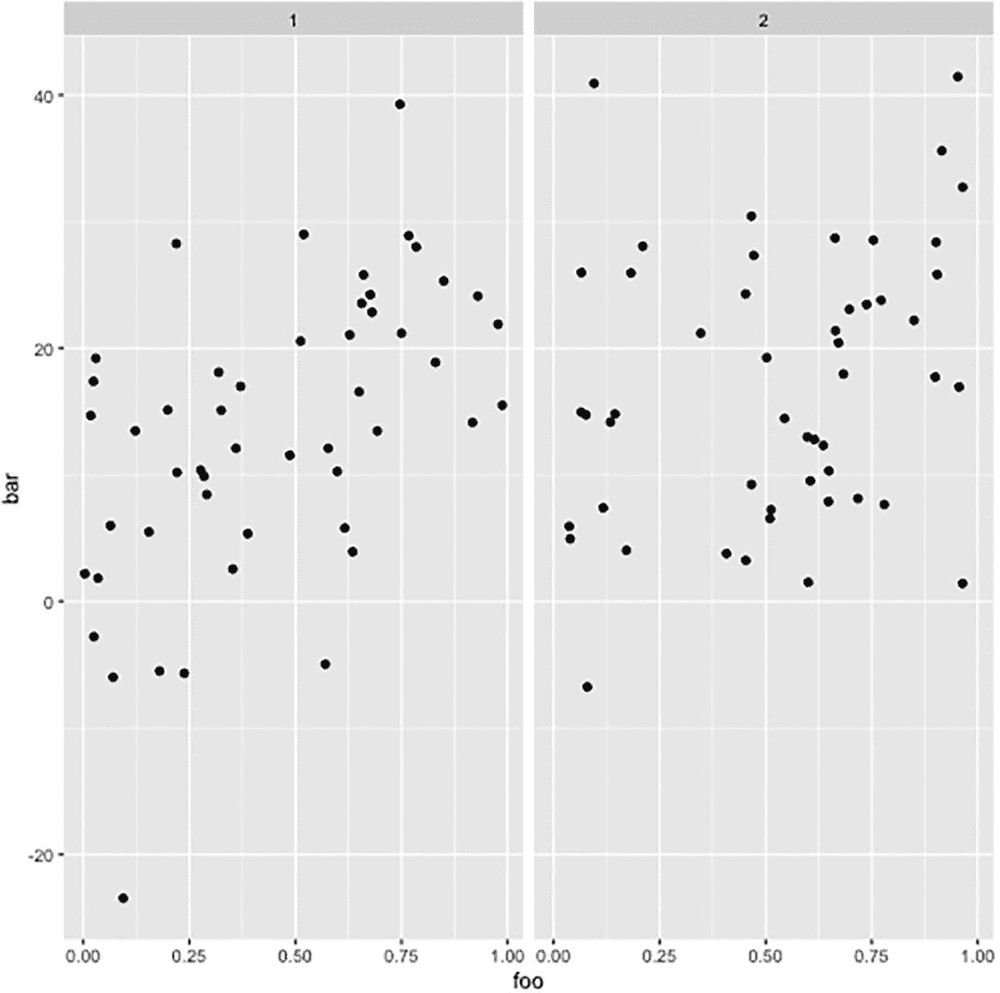

**图 13-7：对图进行分面**

一个带有网格分面的散点图，包含 2 个子图。图 1 和图 2 包含散布在绘图区域中的单色点。

```
ggplot(data = dat, aes(x = foo, y = bar)) +
geom_point() + facet_grid(~ factor(baz))
```

在前面的图中，当你查看它们的摘要时，你会在`faceting`下看到类为`FacetNull`。

```
## faceting: 
```

当我们添加网格分面后，现在会看到：

```
## faceting: 
```

你可以通过在公式两侧都设置变量来绘制二维网格图：

```
dat2 <- tibble(
foo = rep(1:5, each = 20),
bar = rep(1:2, each = 50),
x = foo * bar + rnorm(100),
y = -foo
)
ggplot(data = dat2, aes(x = x, y = y)) +
geom_point() + facet_grid(factor(foo) ~ factor(bar))
```

结果如图 13-8 所示。

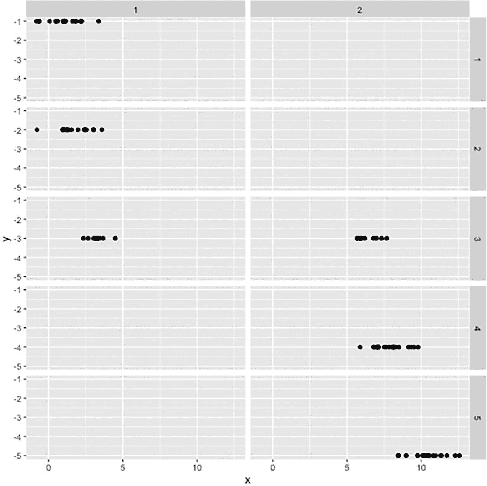

**图 13-8：两个变量的分面网格**

一个带有网格分面的散点图，包含两侧的变量。十个图排列成 2 列，其中的点呈直线分布。

你可以使用两个以上的变量，但（自然）只能有两个维度。如果使用超过两个变量，不同的类别将作为标签显示在分面两侧。你将看到公式中出现所有因子组合。例如，考虑以下情况：

```
dat3 <- tibble(
foo = factor(rep(1:5, each = 20)),
bar = factor(rep(1:2, each = 50)),
baz = factor(rep(1:5, times = 20)),
qux = factor(rep(1:2, times = 50)),
x = rnorm(100),
y = rnorm(100)
)
ggplot(data = dat3, aes(x = x, y = y)) +
geom_point() + facet_grid(foo + bar ~ baz + qux)
```

结果如图 13-9 所示。

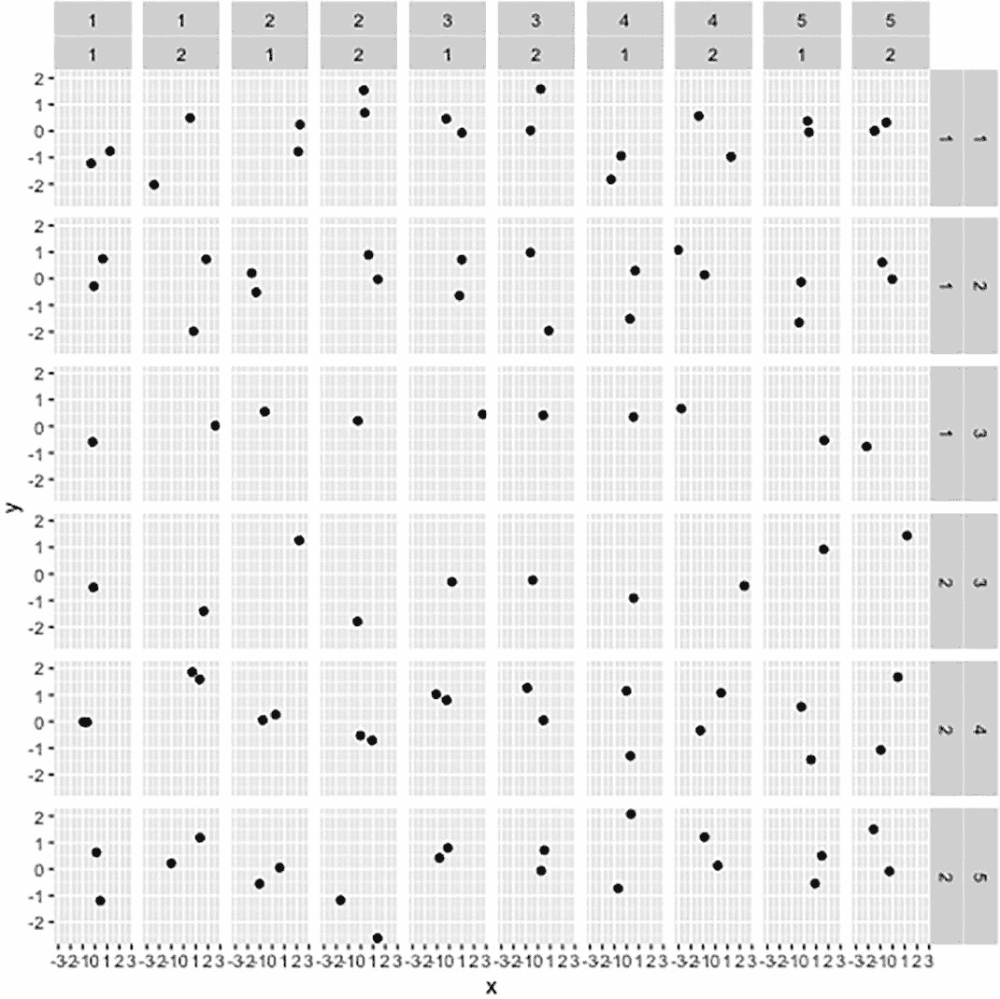

**图 13-9：包含四个变量的分面图**

一个`ggplot2`图，其网格分面中包含 4 个变量。各图排列成 10 列 6 行，变量位于两侧。

### 添加坐标系

前面所有图都是在笛卡尔坐标系（默认坐标系）中绘制的。你可以更改图的坐标系。例如，可以翻转轴，比如图的 x 轴：

```
ggplot(data = dat, aes(x = foo, y = bar)) +
geom_point() + coord_flip()
```

或者，你也可以使用极坐标系代替笛卡尔坐标系。

```
ggplot(data = dat, aes(x = foo, y = bar)) +
geom_point() + coord_polar()
```

参见图 13-10 和图 13-11。

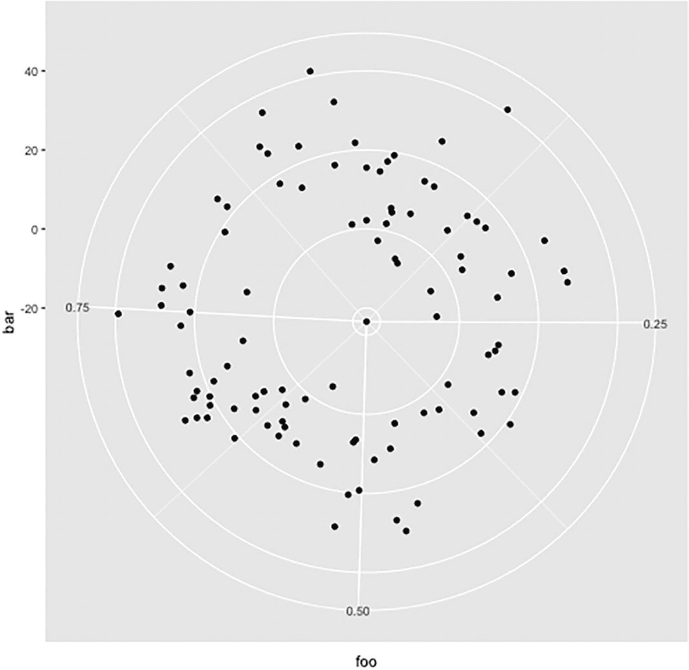

**图 13-11：极坐标图**

使用`ggplot2`在极坐标中绘制点的雷达图。左侧、底部和右侧的径向距离分别测量为 0.75、0.50 和 0.25。

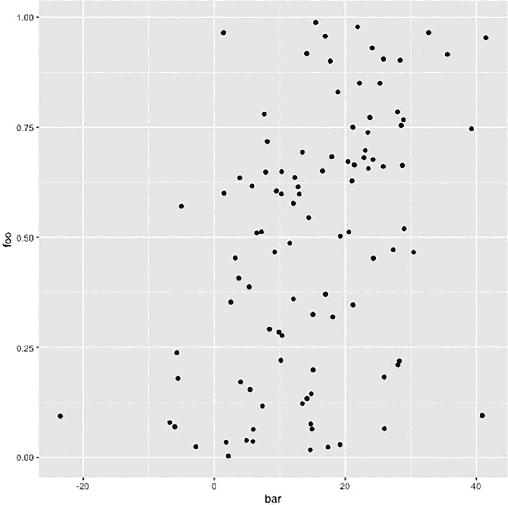

**图 13-10：x 坐标翻转的图**

`foo`相对于`bar`的散点图，展示了在`ggplot2`中翻转 X 轴的功能。

### 修改刻度

`ggplot2`将数据映射到坐标或颜色的方式非常灵活。美学映射将数据映射到`x`或`y`坐标，或颜色和填充（用于填充区域的颜色），但之后你可以修改相应的图属性。用于执行此操作的函数以`scale_`开头，后面跟上要更改的属性，再然后是你要执行的操作。你修改的操作取决于你要更改的内容，例如坐标或颜色等。

例如，如果你想将`y`轴设置为对数刻度，可以使用`scale_y_log10()`；如果你想将连续变量映射到离散颜色，可以使用`scale_color_binned()`：

```
ggplot(data = dat, aes(x = bar, y = foo, color = baz)) +
geom_point() +
scale_y_log10() +
scale_color_binned()
```

参见图 13-12。

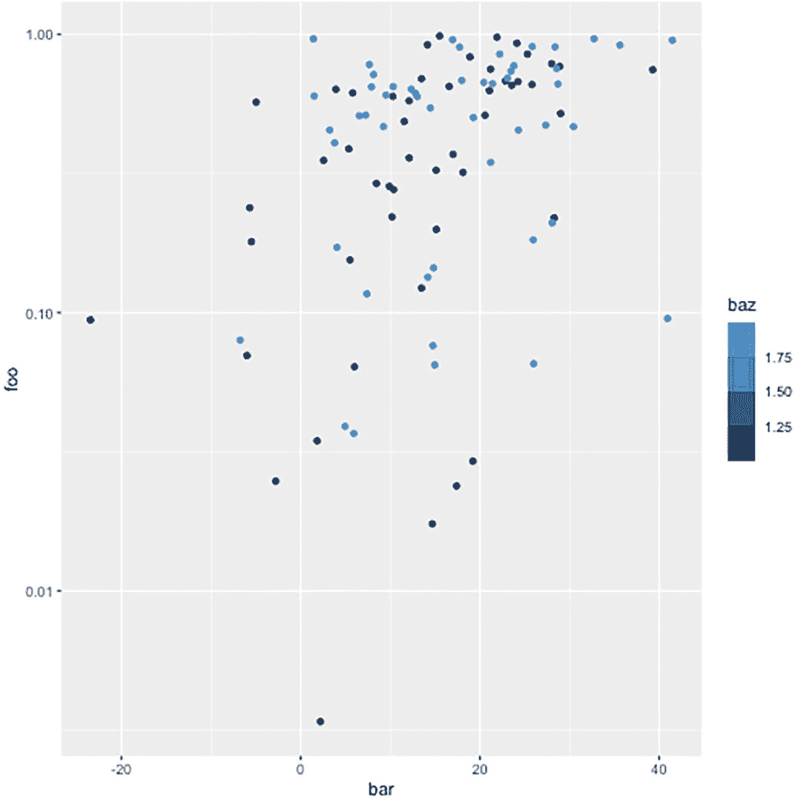

**图 13-12：重新调整 y 坐标和颜色刻度的图**

`foo`相对于`bar`的散点图，展示了在`ggplot2`中修改轴范围和`baz`刻度颜色变化的功能。

所有这些转换函数的列表过于冗长，无法在此章节中列出，因此我建议你参阅包文档以获取更多信息。

受限于篇幅，我只能让你初步了解使用`ggplot2`实现的图形语法能做些什么，但我希望我已经传达出，通过这个包，你能够使用一种强大的语言来构建图形。其功能远不止我展示的这些，我强烈建议你自行更详细地探索这个包。

# 14. 结论

R 语言，在`Tidyverse`的扩展下，是数据科学领域的一种强大语言。它为数据分析流程中的每一步都提供了强大的支持。阅读完本书后，你应该对`Tidyverse`包的工作原理及其使用方法有了扎实的理解。本书并未涉及对特定数据使用哪种数据科学和机器学习模型，只说明了它们如何融入流程。涵盖实际的数据分析、要使用的方法以及支持这些方法的包超出了本书的范围。每一种统计或机器学习方法都可能需要一本书来阐述，而 R 包中有许多这样的模型。本书主要是一本语法指南，它所涵盖的内容可以与你需要应用于数据的任何模型结合使用，因此它是你将数据分析适配到`Tidyverse`框架的优秀基础。


# 索引 A

- `accumulate()` 函数

# B

- Broom 包：实现 `tidy()`、`glance()` 和 `augment()` 函数

# C
- **列类型（Column types）**
    - 字符（characters）
    - `col_` 函数
    - 函数调用（function call）
    - 函数规范（function specification）
    - 整数类型（integer type）
    - 逻辑类型（logical type）
    - 有序参数（ordered argument）
    - 字符串规范格式（string specification format）
    - 时间解析器（time parser）
    - 时间点类型规范（time point type specification）
    - 警告消息（warning messages）

# D, E
- **数据框操作（Data frame manipulation）**
    - `arrange()` 函数
    - 列选择（column selection）
    - 列名（column names）
    - 移除列（remove columns）
    - `rename()` 函数
    - `select()` 函数
        - `Sepal.Length`
        - 源代码（source code）
        - `desc()` 函数
    - `dplyr`
        - `Seedplyr` 函数
        - 虚构国家（fictional countries）
        - `dplyr` 工具
        - 收入（income）
        - `mean_income`
        - `mutate()` 函数
        - 管道（pipeline）
            - `filter()` 函数
            - 分组/汇总（grouping/summarization）
            - 数据宽汇总（data-wide summarization）
            - `distinct()` 函数
            - `group_by()` 函数
            - 分组变量（grouping variables）
            - `group_vars()` 函数
            - `mutate()` 函数
            - `summarise()` 函数
            - `ungroup()` 函数
        - 连接表（joining tables）
            - `anti_join()` 函数
            - `bind_rows()` 和 `bind_columns()` 函数
            - `distinct()` 函数
            - `full_join()` 函数
            - `inner_join()` 函数
            - `left_join()`/`right_join()` 函数
            - `reduce()` 函数
            - `rename_at()` 函数
            - `semi_join()` 函数
            - `suffix` 参数修改
    - `abs()` 函数
    - `case_when()`
    - 厘米（centimeters）
    - `ifelse()`
    - `mutate()` 函数参数
    - `transmute()` 函数
    - `units` 包
    - `Vectorize()` 函数
    - 排序（sorting）
    - **数据导入（Data importing）**
        - 列（Column）参见列类型（Column types）
        - 注释选项（comment option）
        - 文件头部（file headers）
        - 解析时间/日期（parsing time/dates）
            - 代码日期规范（codes date specifications）
            - 显式格式字符串（explicit format string formats）
            - `locale()` 函数
            - `parse_datetime()` 函数
            - 解析时间快捷方式（parsing time shortcuts）
        - 字符串（strings）
        - 读取表格数据（reading tabular data）
        - 空格分隔列（space-separated columns）
        - `spec()` 函数
        - 表格数据（tabular data）
        - 写入数据（writing data）
        - `dplyr` 函数
            - 列选择（column selection）
            - 过滤（filtering）

# F
- **因子（Factors）**
    - `as_factor()` 函数
    - 连接（concatenation）
    - 创建（creation）
    - `expand()` 函数
    - `explicit_na()` 函数
    - `factor()` 函数
    - `fct_unify()` 函数
    - `infreq()` 函数
    - `inorder()` 函数
    - `levels` 参数
    - `levels()` 函数
    - 投影（projection）
        - `collapse()` 函数
        - `drop()` 函数
        - `lump()` 函数
        - `other_level` 参数
        - `prop` 参数
    - `recode()` 函数
    - 重新排序水平（reorder levels）
- **过滤（Filtering）**
    - `compact()` 函数
    - 数据框（data frames）
        - `any_var()`/`all_var()` 函数
        - `between()` 函数
        - `distinct()` 函数
        - `filter()` 函数
        - `filter_all()` 函数
        - `filter_at()` 函数
        - `filter_if()` 函数
        - `iris_df()` 函数
        - `select()` 函数
        - `stringr` 包
    - 高阶函数（high-order function）
        - `negate()` 函数
    - `forcats` 包（参见 Factors）

# G, H
- `ggplot2` 包（参见 Plotting）

# I, J, K
- **索引 tibble（Indexing tibbles）**
    - 数据框（data frames）
    - 行/列子集（rows/columns subset）
        - 单括号索引（single-bracket index）
        - 单索引（single index）
        - 整洁选择向量（tidy selection vector column）

# L
- **Lambda 表达式（Lambda expressions）**

# M
- **magrittr 管道运算符（magrittr pipe operator）**
    - 数据框数据问题（data frame data problems）
    - `%<>%` 运算符
    - `pivot_longer()` 和 `drop_na()`
    - 绘图函数（plotting function）
    - 重新赋值运算符（reassignment operator）
    - tee 运算符（tee operator）
    - `tidyverse` 包
- **映射函数（Mapping function）**
    - 数据框（data frames）
        - `invisible()` 函数
        - 列表（lists）
        - `lmap()` 函数
        - `map()` 和 `length()` 函数
        - `map_chr()` 和 `map_int()` 函数
        - `map_depth()`
        - `map_df()` 函数
        - `map_dfr()` 和 `map_dfc()` 函数
        - `map_if()` 函数
        - `map_lgl()` 函数
        - `modify()` 函数
        - `pmap()` 函数
        - `rnorm()` 函数
        - 向量表达式（vector expressions）
- **`modelr` 包**
    - `add_predictions()`/`add_residuals()` 函数
    - 自举数据集（bootstrap data sets）
        - `bootstrap()` 函数
        - `crossv_mc()` 函数
    - 数据框拟合/检查模型（data frame fitting/inspecting models）
        - `fit_with()` 函数
        - `formulae()` 函数
        - `gather_predictions()` 和 `spread_predictions()`
    - 泛化（generalization）
        - `glance()` 函数
    - 均方根误差（root mean square error）
    - `seq_range()` 函数

# N, O
- **嵌套数据（Nesting data）**

# P, Q
- **管道（Pipelines）**
    - 组合运算符（composition operator）
    - 虚构国家（fictional countries）
    - 函数式编程（functional programming）
    - 函数参数符号（function arguments notation (|> and %>%)）
    - magrittr（参见 magrittr pipe operator）
    - 嵌套函数（nested function）
- **数据透视（Pivoting data）**
    - 整数（integers）
    - 逻辑/数值（logical/numeric values）
    - `mean_income`
    - `names_to`/`values_to` 参数
    - 参数（parameters）
    - `pivot_wider()` 函数
    - 范围规范（range specification）
    - 整洁选择语言（tidy selection language）
- **绘图（Plotting）**
    - 添加数据（add data）
    - 美学（aesthetics）
    - 组件（components）
    - 分面（facets）
    - 几何对象（geometries）
        - 美学（aesthetics）
        - `arrange()` 函数
        - 离散颜色（discrete color）
        - 离散颜色美学（discrete color aesthetics）
    - 几何图形（geometry plot）
        - `geom_histogram()` 函数
        - `geom_point()` 函数
    - 直方图（histogram plot）
    - 折线图（line plot）
    - 统计（statistics）
        - `summary()` 函数
    - `ggplot()` 对象
    - 绘图对象（plot object）
    - 极坐标（polar coordinates）
    - 刻度修改（scale modification）
    - `summary()` 函数
- **`purrr` 函数（purrr functions）**
    - 特性（features）
        - 过滤（filtering）
        - Lambda 表达式（lambda expressions）
        - 映射（mapping）
        - 偏应用/组合（partial evaluation/composition）
        - 归约/累加器（reduce/accumulator）

# R
- **范围（Ranges）**
    - `reduce()` 函数
- **改革（Reformation）**
    - 列编码（column encodings）
        - 字母字符和空格（alphabet characters and spaces）
        - `convert` 参数
        - 正则表达式（regular expression）
        - `remove` 参数
        - `separate()`/`extract()` 函数
        - `separate()` 函数
        - `separate_rows()`
        - `unite()` 函数
    - 数据属性（data properties）
        - 展开/交叉/补全（expanding/crossing/completing）
            - `complete()` 函数
            - `crossing()` 函数
            - `expand()` 函数
            - `nesting()` 函数
        - 缺失值（missing values）
            - `drop_na()` 函数
            - `fill()` 函数
            - `mean_income` 表
        - 嵌套数据（nesting data）
        - 数据透视（pivoting data）
        - `tidyr` 包
- **R 编程语言（R programming language）**
    - 数据结构（data structures）
    - 函数调用（function calls）
    - `magrittr` 包
    - 模型规范（model specifications）
    - `read.table()` 函数
    - Tidyverse

# S
- **字符串操作（String manipulation）**
    - `boundary()` 函数
    - 列 （参见 Column types）
        - `convert` 参数
        - `count()` 函数
        - `detect()` 函数
        - `extract` 选项
        - 过滤器（filters）
        - `indent` 参数
        - `invert_match()` 函数
        - `locate_all()` 函数
        - `locate()` 函数
        - 小写/大写（lowercase/uppercase）
        - 嵌套数据（nesting data）
        - 数据透视（pivoting data）
        - `separate()`/`extract()` 函数
        - `side` 参数
        - `split()` 函数
        - `squish()` 函数
        - `stringr` 包
    - 整洁选择（tidy selection）
    - `tidyverse` 包
    - `title()` 函数
    - 转换（transformation）
        - `dup()` 函数
        - `glue()` 函数
        - `replace_all()`
        - `str_sub()` 函数
        - 子串（substring）
        - `trim()` 函数
        - `trunc()` 函数
        - `width` 参数
        - `wrap()` 函数

# T, U, V, W, X, Y, Z
- **表格表示（Table representation）**
    - 改革（参见 Reformation）
    - `tibble` 对象
- **Tibble 包（Tibble packages）**
    - `as_tibble()` 函数
    - `data.frame` 版本（`data.frame` version）
    - 错误消息（error message）
    - 实现（implementation）
    - 索引（参见 Indexing tibbles）
    - `print()` 函数
    - 表格数据（tabular data）
    - `tibble()` 函数
    - 整洁选择（tidy selection）
    - 宽度选项（width option）
- **整洁选择（Tidy selection）**
    - 补集运算符（complement operator）`!`
    - `all_of()`/`any_of()` 函数
    - `&` (交集)/`|` (并集)
    - 列（columns）
        - 列选择（column selection）
        - `contains()` 函数
    - 数据属性（data properties）
        - `ends_with()` 函数
        - `everything()` 函数
        - 索引语言（indexing language）
        - `matches()` 函数
        - 范围（range）
        - 选择函数（select function）
        - `starts_with()` 函数
        - 字符串选择（string selection）
        - `tidyr` 包
- **Tidyverse 包（Tidyverse packages）**
    - 数据分析（data analysis）
    - 数据导入（data importing）
    - 开发（development）
    - `forcats` 包
    - `ggplot2` 包
    - Lambda 表达式（lambda expressions）
    - `lubridate` 包
    - 编程接口（programming interfaces）
    - 字符串操作（string manipulation）
    - 表格（tables）
    - tibble
- **时间格式（Time formats）**
    - `force_tz()` 函数
    - `interval()` 函数
    - `int_aligns()` 函数
    - `int_flip()` 函数
    - `int_length()` 函数
    - `int_overlaps()` 函数
    - `int_standardize()` 函数
    - `int_start()`/`int_end()`
    - 源代码（source code）
    - 时间点（points）
    - `with_tz()` 函数
    - 时区（zones）
