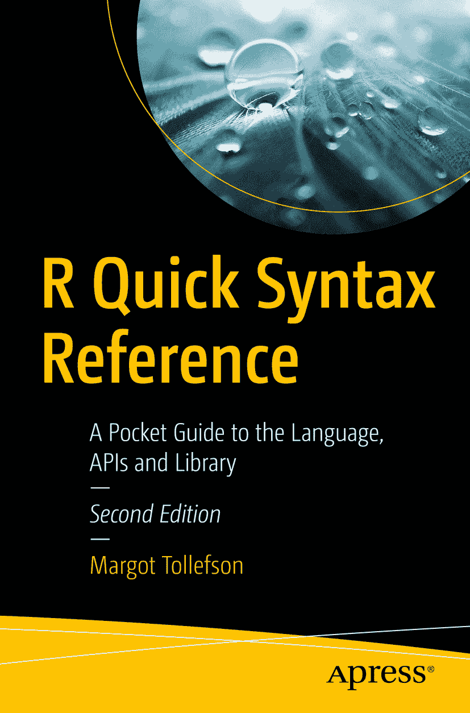

# 版权信息

ISBN `978-1-4842-4404-3`  
e-ISBN `978-1-4842-4405-0`  
[`doi.org/10.1007/978-1-4842-4405-0`](https://doi.org/10.1007/978-1-4842-4405-0)

© Margot Tollefson 2019

# 版权声明

标准 Apress 商标名称、徽标和图像可能出现在本书中。我们并非在每次出现商标名称、徽标或图像时都使用商标符号，而仅以编辑方式使用这些名称、徽标和图像，以惠及商标所有者，无意侵犯商标权。在本出版物中使用商品名称、商标、服务标记及类似术语，即使未予明确标识，也不应被视为对其是否拥有专有权的意见表达。

尽管本书中的建议和信息在出版时被认为是真实和准确的，但作者、编辑和出版商均不对可能出现的任何错误或遗漏承担法律责任。出版商对本书所载内容不提供任何明示或暗示的担保。

本书由 Springer Science+Business Media New York 向全球图书发行，地址：233 Spring Street, 6th Floor, New York, NY 10013。电话：1-800-SPRINGER，传真：(201) 348-4505，电子邮件：`orders-ny@springer-sbm.com`，或访问 `www.springeronline.com`。

Apress Media, LLC 是加利福尼亚州有限责任公司，其唯一成员（所有者）是 Springer Science + Business Media Finance Inc (SSBM Finance Inc)。SSBM Finance Inc 是一家特拉华州公司。