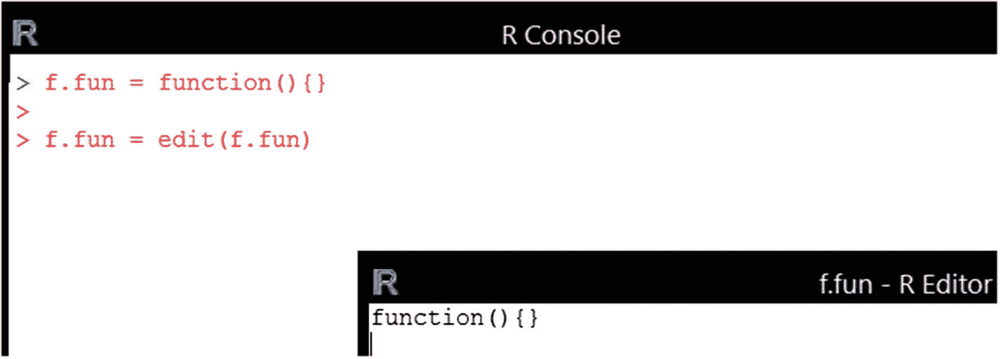
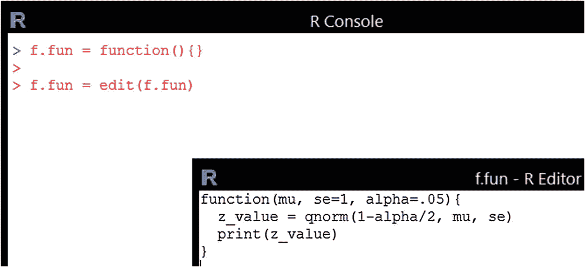

# 6. 打包函数

R 拥有超过 10，000 个包，其中大部分包含函数。函数是 R 的核心，赋予了 R 极大的灵活性。函数是 R 对象，其`mode`和`class`均为`function`。打包函数是作为 R 包一部分创建的函数。在计算机上，包存储在库中，并被安装到库中以供使用。

## 库

初始安装 R 时，以下包也会随同安装到硬盘的某个文件夹中：`base`、`boot`、`class`、`cluster`、`codetools`、`compiler`、`datasets`、`foreign`、`graphics`、`grDevices`、`grid`、`KernSmooth`、`lattice`、`MASS`、`Matrix`、`methods`、`mgcv`、`nlme`、`nnet`、`parallel`、`rpart`、`spatial`、`splines`、`stats`、`stats4`、`survival`、`tcltk`、`tools`和`utils`。

在 Windows 系统中，初始安装后安装的任何包都可以安装到不同的库（另一个文件夹）中。该文件夹在 R 安装时创建。在 OS X 系统中，所有已安装的包都位于同一个文件夹和库中。在 Linux 系统中，初始安装后安装的任何包都会安装到不同的库（另一个文件夹）中。该文件夹在安装第一个额外包时创建。

要查看已安装包的列表（包含每个包的描述和包文件夹名称），可在 R 提示符下输入`library(lib.loc = .Library)`。运行不带参数的`library()`函数会列出库中的包及其描述。要查看关于包的更多详细信息，可在 R 提示符下输入`installed.packages()`。在 R Studio 中，已安装的包会列在右下角窗口的“包”选项卡下。

有些 R 函数的运行需要依赖其他 R 函数。当 R 运行时，只有那些已从库加载到 R 中的包才是程序可访问的。如果尝试运行某个函数但必需的包尚未加载，R 会报错。错误信息中会包含缺失包的名称。如果某个包存在于计算机的某个库中，可以通过在 R 提示符下输入`library('package name')`来加载（使其可访问）该包，其中`'package name'`是包名。或者在 R Studio 中，在“包”选项卡下勾选该包左侧的复选框来加载它。

如果包不在任何一个库中，安装新包的过程很简单（参见第[1]章）。一旦安装完成，便可使用`library()`函数或 R Studio 中的“包”选项卡加载该包。（如果在函数内部调用，应使用`require()`代替`library()`。参见`library()`帮助页面。）在任何时候，在 R 提示符下输入`search()`都会给出当前工作空间中已加载包的列表。在 R Studio 中，已加载的包会显示勾选标记。

要查看某个包中的函数（和数据集），可在 R 提示符下输入`help(package='package name')`，其中`'package name'`是包名。请注意，必须已安装该包，`help(package='package name')`才能返回包的内容。在 R Studio 中，在“帮助”选项卡下输入包名即可访问该包中的所有对象。包中的某些文件可能是数据集，但对于大多数包而言，文件通常是函数。

# 默认包与原始函数

当用户启动 R 会话时，包 `base`、`datasets`、`utils`、`grDevices`、`graphics`、`stats` 和 `methods` 是默认加载到工作空间中的包。（可通过修改函数 `options()` 中的 `defaultPackages` 来更改加载的默认包。详见第 15 章。）通常，根据用户的计算需求，无需再加载其他包。

那些用 C 语言编写并在 R 编译时一同编译的函数被称为 **原始** 函数。根据在 R 提示符下输入 `?primitive` 或在 R Studio 帮助选项卡下输入 `primitive` 所显示的帮助页面，所有原始函数都位于总是被加载的 `base` 包中。使用原始函数的优势在于这些函数已经编译完成，因此运行速度更快。原始函数包括运算符、大多数数学函数，以及 R 运行和结构的基础函数。原始函数的列表可在 [`http://cran.r-project.org/doc/manuals/R-ints.html#g_t_002eInternal-vs-_002ePrimitive`](http://cran.r-project.org/doc/manuals/R-ints.html%2523g_t_002eInternal-vs-_002ePrimitive) 或 `base` 包的帮助页面中找到。根据参数的传递方式，原始函数分为 `built-in` 或 `special` 类型。用 R 编写的函数属于 `closure` 类型。函数 `is.primitive()` 用于测试一个对象是否为原始函数。

# 使用帮助页面

R 中的每个函数都有一个帮助页面，且每个帮助页面的结构基本相同。与 R 中的许多其他内容一样，帮助页面起初可能会令人望而生畏。然而，帮助页面通常包含丰富的信息。

给定一个函数名，如果包含该函数的包已被加载，在 R 提示符下输入 `?function` 或 `help(function)`（其中 `function` 是函数名）即可调出该函数的帮助页面。如果包已安装但未加载，输入 `?package::name`（其中 `package` 是包名，`name` 是函数名）即可调出帮助页面。在 R Studio 中，也可以在“帮助”选项卡下，通过在搜索框中输入函数名来访问帮助页面。

有些函数共享同一个帮助页面。使用任一函数名均可调出该帮助页面。在 Windows 和 OS X 版本的 R 中，帮助页面会在单独的窗口中打开。在 Linux 中，帮助页面会在终端中显示。在 R Studio 中，帮助页面会在右下方的窗口中打开。

## 标识符

帮助页面的第一行列出函数名，后跟花括号中的函数包名，然后是“R Documentation.”（R 文档）字样。

## 标题

在标识符下方是一个标题，用于简要说明该函数的功能。例如，对于函数 `lm()`，其标题是“Fitting Linear Models.”（拟合线性模型）。

## 描述

在标题下方，是以“Description”（描述）为标题的部分，用来描述函数的使用方式。描述可长可短，取决于函数的复杂程度。对于函数 `lm()`，您会看到以下描述：

```
lm 用于拟合线性模型。它可用于执行回归、单层方差分析和协方差分析（不过 aov 可能为这些分析提供更便捷的接口）。
```

## 用法

“Description”（描述）下方是“Usage”（用法）部分。在“Usage”部分中，函数及其所有可能的参数都会被列出。对于有默认值的参数，会给出其默认值。Usage 部分会列出 S4 的用法。对于许多函数，还会列出 S3 的用法。

对于函数 `lm()`，其“Usage”部分包含以下内容：

```
lm(formula, data, subset, weights, na.action, method = "qr", model = TRUE, x = FALSE, y = FALSE, qr = TRUE,
singular.ok = TRUE, contrasts = NULL, offset, ...)
```

带有默认值的参数是指那些参数已被设定为某个值的参数。

# 参数

在`Usage`（用法）部分之下是名为`Arguments`（参数）的部分。在`Arguments`部分中，会列出`Usage`部分中的参数，并对每个参数进行描述。描述包括该参数的合法取值。

例如，从 `lm()` 的帮助页面中，列出的前两个参数如下：

| `formula` | 一个属于`formula`类的对象（或可强制转换为该类的对象）：对待拟合模型进行符号描述。模型规范的细节在`Details`（详细说明）部分给出。 |
| --- | --- |
| `data` | 一个可选的 data frame、列表或环境（或可通过 `as.data.frame` 强制转换为 data frame 的对象），其中包含模型中的变量。如果在 `data` 中未找到，则变量取自 `environment(formula)`，通常是从调用 `lm` 的环境中获取。 |

因此，对于函数 `lm()`，第一个参数是一个公式，第二个参数可以是一个 `data.frame`，但第二个参数是可选的。

## 详细说明

有时会有一个名为`Details`（详细说明）的部分，对参数提供更详细的说明。在 `lm()` 函数示例中，`Details`部分给出了设置公式的规则，以及函数针对公式的不同输入时的行为。

## 返回值

下一部分名为`Value`（返回值）。`Value`部分描述了函数的返回内容。对于某些函数，哪些函数可以操作输出，以及可以从输出中提取哪些组件，这些相关内容会在此部分列出。

函数 `lm()` 的`Value`部分的前几行如下：

`lm` 返回一个类为 `"lm"` 的对象，或者对于多个响应变量，返回类为 `c("mlm", "lm")`的对象。

函数 `summary` 和 `anova` 用于获取并打印结果的摘要和方差分析表。通用访问器函数 `coefficients`、`effects`、`fitted.values` 和 `residuals` 用于提取 `lm` 返回值的各种有用特征。

一个 `"lm"` 类的对象是一个列表，至少包含以下组件：

*   `coefficients` 一个命名的系数向量
*   `residuals` 残差，即响应值减去拟合值。
* …

## 其他可选部分

在`Value`（返回值）部分之后，可能会有其他部分提供更多信息。对于函数 `lm()`，还有另外三个部分：`Using time series`（使用时间序列）、`Note`（注意）和`Author(s)`（作者）。其他函数可能包含`Warning`（警告）、`Source`（来源）或其他标题的部分。

## 另请参阅

`See Also`（另请参阅）部分紧随`References`（参考文献）部分之后。`See Also`部分提供了与本帮助页面函数相关的其他函数的信息。对于函数 `lm()`，其`See Also`部分的前三行如下：

```
summary.lm 用于摘要，anova.lm 用于 ANOVA 表；aov 提供不同的接口。
通用函数 coef, effects, residuals, fitted, vcov。
predict.lm (通过 predict) 用于预测，包括置信区间和预测区间；confint 用于参数的置信区间。
```

`See Also`部分为寻找与用户当前使用方法相关的函数提供了很好的线索。

### 示例

大多数页面都有的最后一部分是`示例`。该部分给出了函数的使用示例。查看实际的使用示例非常有帮助。以下是来自`lm()`函数帮助页面的示例内容：

```
require(graphics)
## Annette Dobson (1990) "An Introduction to Generalized Linear Models".
## Page 9: Plant Weight Data.
ctl <- c(4.17,5.58,5.18,6.11,4.50,4.61,5.17,4.53,5.33,5.14)
trt <- c(4.81,4.17,4.41,3.59,5.87,3.83,6.03,4.89,4.32,4.69)
group <- gl(2, 10, 20, labels = c("Ctl","Trt"))
weight <- c(ctl, trt)
lm.D9 <- lm(weight ~ group)
lm.D90 <- lm(weight ~ group - 1) # omitting intercept
anova(lm.D9)
summary(lm.D90)
```

在这个示例中，公式的结构是通过演示而非解释来呈现的。示例中还展示了一些用于操作`lm`类对象的函数。由于`graphics`包默认已加载，因此通常不需要调用`require(graphics)`。

# 用户自定义函数、脚本和 S4 方法

用户自定义函数和脚本通常能让 R 用户的工作变得更加轻松。如果一项重复性任务涉及多行不同的代码，创建一个函数或脚本来完成该任务可以节省时间。在 `S4` 中，泛型函数的方法是 `S4` 的函数层面的体现，需要特殊处理。

设计图形是用户定义函数或脚本有意义的场景之一。绘制图形通常需要多行代码，而且图形的设计通常是一个交互过程。在命令行 R 中，创建一个函数来绘制图形并对函数进行修改，通常比使用上箭头键修改代码行要容易得多。

另一个用户定义函数或脚本有用的场景是，当用户想尝试 R 包中未提供的统计技术时。通常，用户可以利用现有的函数为该技术创建一个自定义函数或脚本。

在 R Studio 中，“源”窗口（左上角的窗口）提供了一个创建和运行代码的地方，这些代码可以保存为外部的 R 脚本，或作为内部函数保存。“源”窗口也是加载 R 脚本或其他文本文件的地方。

## 脚本

脚本是用 R 编写并存储在程序外的代码。包含 R 脚本的文件是文本文件，扩展名为`.R`。R 脚本可以包含函数定义。在命令行 R 中，使用`source()`函数运行脚本。例如，假设工作目录中的文件`lm.example.R`包含以下内容：

```
print( x )
print( y )
print( lm( y~x)  )
```

然后，对该文件运行`source()`函数会得到：

```
> source( "lm.example.R" )
[1]  1  2  3  4  5  6  7  8  9 10
[1] 21 22 23 24 25 26 27 28 29 30
Call:
lm(formula = y ~ x)
Coefficients:
(Intercept)            x
20            1
```

请注意，这里只打印了函数的结果。

在 R Studio 中，事情要简单得多。不需要在外部编辑脚本。如果脚本已存在于 R 之外，可以将脚本加载到“源”窗口中。点击窗口上方第一个菜单中带有绿色箭头的黄色文件夹图标。然后，浏览到脚本所在的位置并点击该文件。文件将在“源”窗口中打开。要运行该文件，请点击“源”窗口菜单栏右侧的“Run”或“Source”图标。要运行文件的一部分，请高亮选中该部分，然后点击“Run”图标。

要输入一个新脚本，请点击上方窗口上方菜单栏中最左边的图标，然后选择第一个选项“R Script”。“源”窗口将打开一个空白页面。只需输入代码行。运行代码或部分代码以调试脚本。R Studio 会帮助调试，标记出语法错误。完成后，您可以保存脚本。点击“源”窗口菜单中的软盘图标，然后为文件输入一个名称。R Studio 会自动为文件添加`.R`扩展名。要在保存代码时运行它，请勾选“Source to Save”复选框。

## 函数的结构

非原始函数都具有相同的结构。函数的第一行是`function`这个词，后跟一对圆括号，括号内可能有参数，也可能没有。在大多数情况下，括号后面跟一个左花括号。通常，函数体放在第一行下面，最后一行是右花括号后面的一行空行，右花括号通常独占一行。通常，函数会被赋予一个名称。例如：

```
> d.fun = function(){
+ print( 1:5 )
+ }
> d.fun
function(){
print( 1:5 )
}
> d.fun()
[1] 1 2 3 4 5
```

在这个例子中，首先，函数被赋值给`d.fun`；接着，列出了`d.fun()`的内容；最后，运行了函数`d.fun()`。

如果函数只包含一条语句——该语句可以放在与`function`语句同一行，也可以放在后续一行或多行——则花括号不是必需的。例如：

```
> c.fun = function() print(1:5)
> c.fun
function() print(1:5)
> c.fun()
[1] 1 2 3 4 5
```

同样，函数被赋予了一个名称，列出了函数，并运行了函数。

参数是函数使用的对象或值，必须在运行函数时输入到函数中，除非参数存在默认值。参数在创建函数时放在圆括号内，用逗号分隔。通过将参数设置为某个值来提供默认值。具有默认值的参数在运行函数时不必指定。如果未指定值，函数将使用默认值。

下面是一个具有两个参数的函数示例，其中`a`没有默认值，必须指定，而`b`的默认值为 3：

```
> e.fun = function( a, b=3 ){
+ print( a:b )
+ }
> e.fun
function( a, b=3 ){
print( a:b )
}
> e.fun( 10 )
[1] 10  9  8  7  6  5  4  3
> e.fun()
Error in a:b : 'a' is missing
```

再次，函数被赋予名称、列出并运行。请注意，由于`a`是第一个参数，而`b`有默认值，因此不加名称地提供`a`。在第二次尝试运行`e.fun()`时，没有为`a`提供参数，因此`e.fun()`返回一个错误。

通常，用户在函数中使用花括号来包含语句组，例如用于`if`、`else`、`for`、`while`和`repeat`组。函数中左花括号的数量必须与右花括号的数量相同；否则，函数将无法保存。花括号不匹配是 R 代码中常见的错误来源，并在 R Studio 中被标记出来。

R 中的代码行（无论是在函数内还是在 R 提示符下）都可以中断并在下一行继续。R 会查找诸如右括号、花括号或引号之类的东西来标记一条语句或语句的一部分的结束。

空行在 R 函数中是合法的。此外，任何文本都可以通过在文本前放置井号（`#`）来注释掉。在一行中，井号后面的任何内容都会被忽略。编写函数的一条建议是：每次只写一小块，每一步都进行调试，并使用大量的注释。

## 如何将函数输入到 R 中

本节介绍四种使用命令行将函数输入到 R 中的方法，以及一种使用 R Studio 的方法。第一种方法涉及使用编辑器。第二种方法涉及内联输入，如前一节所示。第三种方法涉及在 R 外部创建函数，并使用`dget()`将函数导入 R 中。第四种方法是第二和第三种方法的变体，涉及从 R 外部的源复制并粘贴。第五种方法是使用 R Studio 的“源”窗口。

### 使用编辑器

在 Windows 和 OS X 操作系统中，`utils` 包中有一个 `edit()` 函数，该函数在创建新函数时非常有用。`edit()` 函数的作用是调用一个编辑功能。

在 Windows 系统中，默认的编辑功能是内置编辑器。其他可选的编辑器包括 `xedit()`、`emacs()`、`xemacs()`、`vi()` 和 `pica()`，但只有系统上安装了这些编辑器时才能选择。默认编辑器在 `options()` 中列出，并且可以随时更改（参见第 15 章）。

对于 OS X 系统，唯一可用的编辑器是 `vi` 编辑器，它工作得很好。

对于 Linux 操作系统，在终端窗口中调用 `edit()` 效果不佳。更好的编辑器是 `emacs()`，它适用于 Linux 系统。

以上大部分信息来自 `edit()` 的帮助页面。在 R 提示符下输入 `?edit` 可以获取有关编辑函数的更多信息。

要使用编辑器创建一个函数对象，首先需要将函数赋值给一个名称。例如，设名称为 `f.fun`。要创建函数 `f.fun()`，首先在 R 提示符下输入 `f.fun = function(){}`。此时，对象 `f.fun` 包含一个没有参数和语句的函数。

下一步是编辑该函数。为简便起见，此处示例仅展示 `edit()` 函数。其他编辑器的行为类似。在 R 提示符下输入 `f.fun = edit(f.fun)`。一个编辑窗口会打开供编辑（图 7-1）。



图 7-1

创建函数：第一步和第二步

第三步，在括号内输入参数，并在花括号内输入函数语句（图 7-2）。



图 7-2

创建函数：第三步

第四步是退出编辑器。要退出编辑器，请点击编辑窗口右上角的 `x`。此时会弹出一个窗口，提供保存文件、不保存退出或取消请求并返回编辑的选项。（如果文件未做任何更改，则不会显示选项屏幕。）点击 `Yes` 保存更改，`No` 恢复到之前的版本，或 `Cancel` 返回编辑。

如果函数语法正确，函数将被保存。否则，`edit()` 会返回一个错误，例如：

```
Error in .External2(C_edit, name, file, title, editor) :
unexpected '}' occurred on line 4
use a command like
x <- edit()
to recover
```

# 在 R 中创建与编辑函数

要恢复已完成的工作，请输入 `f.fun = edit()`。使用不带任何内容的括号非常重要。如果在括号内输入了函数名，则编辑更改将丢失，并恢复为编辑前的版本。请注意，错误消息会提供有关 R 代码问题的信息。

以下展示了使用编辑器创建函数 `f.fun()` 时，R 控制台的输入和输出，随后是函数列表，以及将第一个参数设置为零后运行该函数的结果。

```
> f.fun = function(){}
> f.fun = edit( f.fun )
> f.fun
function(mu, se=1, alpha=.05){
z_value = qnorm(1-alpha/2, mu, se)
print(z_value)
}
> f.fun( 0 )
[1] 1.959964.
```

## 内联输入

如本章第一节所示，函数也可以内联输入。设 `b.fun` 为创建用来列出数字三到六的新函数名称。那么，创建函数、列出代码和运行函数的步骤如下：

```
> b.fun = function(){
+ print( 3:6 )
+ }
> b.fun
function(){
print( 3:6 )
}
> b.fun()
[1] 3 4 5 6
```

如果在内联输入函数的过程中出现语法错误，R 会给出错误提示并返回 R 提示符。例如：

```
> b.fun = function(){
+ print( 3:6
+ }
Error: unexpected '}' in:
"print( 3:6
}"
```

对于较长的函数，使用 R 编辑器或外部编辑器通常可以减少挫折感。

## 外部编辑器：`dget()` 以及复制粘贴

可以使用外部编辑器来创建函数。任何能生成文本文件的编辑器，例如 `Notepad`、`TextEdit` 或 `gedit`，都可以用来创建 R 函数。创建函数的规则与第一节中描述的相同。函数创建完成后，可以通过 `dget()` 函数或复制粘贴的方式将其导入工作空间。（`dget()` 函数及其对应的 `dput()` 函数是在 R 中导入和导出函数的一种方式。）

假设函数位于与 R 工作空间相同文件夹下的 `function.txt` 文件中，并且该函数语法正确。那么，以下代码行会将此函数导入到对象 `g.fun` 中：

```
g.fun = dget( "function.txt" )
```

（请注意，R 接受更复杂的文件路径，包括硬盘上的绝对地址和 URL。）

如果文本文件语法不正确，R 会返回一个错误，其中包含有关文件中语法问题的信息。

如果文件不包含函数，或者包含多个函数，R 会尝试运行该代码。

该文件也可以从外部源——或从 R 会话的其他地方——复制并粘贴到 R 的对象中。首先，将函数复制到计算机的剪贴板。然后，在 R 提示符下输入要调用的对象名称，后跟等号。此时光标应位于等号的右侧。接下来，粘贴。

如果函数语法正确，光标会停在右括号的右侧。按下 `Return` 键完成此过程。如果函数语法不正确，复制粘贴将会给出一个包含语法问题信息的错误。

## 在 R Studio 中

在 R Studio 中，要创建新函数，请打开一个新的 R 脚本（最左侧的图标）。使用 R 脚本而非文本文件，这样你可以在调试时从 Source 窗口运行代码。不要输入函数声明或外围的花括号。首先输入要作为参数的变量，并为它们赋值。当代码行正确运行后，点击 Source 窗口上方的魔棒图标，并选择“Extract Function”。R Studio 会提示你输入名称，并在 Source 窗口中创建带有名称赋值的函数。参数应位于正确的位置，但你可能需要对结果进行一些编辑。运行生成的脚本会将函数赋值给工作空间内的对应名称。

在 R Studio 右上角的 Environment 选项卡下点击一个已有的函数，会在 Source 窗口中以独立的选项卡打开该函数。你不能编辑或运行该代码，但可以复制它，然后打开一个新的 R 脚本，并将代码粘贴到该 R 脚本中进行编辑。

# S4 方法

S4 方法用于构建 S4 的函数结构。一个 S4 方法包括：所创建函数的名称、该函数将要处理的数据的类，以及函数定义。该方法还可以指定在何处存储该方法（如果与创建工作区不同的话），以及是否密封该定义（即不允许未来修改）。S4 方法的定义依赖于一个同名的泛型函数的存在。

在 S3 中，泛型函数是指其行为方式取决于某个参数所属类的函数。在 S4 中，所有函数都是泛型的。在 S4 中，泛型函数要么被创建，要么已存在，然后为该泛型函数创建方法。一个方法依赖于该方法所使用的数据对象的类。`setMethod()` 的帮助页面指出，当对 S3 泛型函数运行 `setMethod()` 时，S4 通常会自动创建泛型函数，但对于新函数，则必须手动创建。方法可以添加到已有的 S4 泛型函数中。

## 创建泛型函数：`setGeneric()`

函数 `setGeneric()` 用于创建一个泛型函数。`setGeneric()` 有十个参数，其中两个通常需要赋值。第一个是 `name`，它是一个字符串，包含要分配给该函数的名称。S4 函数名称的标准是 `小写开头后接大写`。第二个是 `def`，它是一个函数定义，在某些情况下是可选的。对于新的泛型函数，参数 `def` 被设置为等于 `standardGeneric()` 函数，该函数通常有一个参数 `f`，其值被设置为用引号括起来的函数名称。`setGeneric()` 的其余参数是可选的，或具有应使用的默认值。在 R 提示符下输入 `?setGeneric` 和 `?standardGeneric`，或使用 R Studio 中的“帮助”选项卡，以获取关于这两个函数的更多信息。

## 定义方法：`setMethod()`

函数 `setMethod()` 与 `setGeneric()` 类似，但还包括了与方法相关的类。第一个参数是 `f`，它是一个字符串，表示要分配给该函数的名称。对于新定义的函数，在创建方法之前，必须先用所需的名称创建泛型函数。（参见后续示例。）如果泛型函数已存在，则名称必须匹配。第二个参数是 `signature`，它是一个字符向量，给出了该方法所使用的数据对象相关的类。

第三个参数 `definition` 定义了该方法的函数。函数定义通常是 S3 和 S4 的混合体；然而，通过签名类传入的变量使用 `@` 或 `slots()` 函数进行下标引用，而不是使用 `$` 或 `[[`。但是，假设在类 `mats` 中有一个槽 `mat`，且 `mat` 是一个矩阵，那么 `mat` 可以使用 S3 和 S4 方法的组合进行下标引用；例如，`mats@mat[ 1:3, 4 ]`。

`setMethod()` 的最后三个参数通常保留为其默认值。参数 `where` 告诉 R 在哪里存储该方法，默认是正在为其定义函数的包的命名空间。参数 `valueClass` 已过时，默认设置为 `NULL`。参数 `sealed` 允许你冻结对该方法的修改，默认设置为 `FALSE`。

此信息来自 `setMethod()` 的帮助页面，可通过在 R 提示符下输入 `?setMethod` 或使用 R Studio 中的“帮助”选项卡访问。

## 示例：创建与运行方法

第二个创建和运行方法的示例如下（第 5 章中有一个示例）：

```
> setClass( "xyz", slots=c( x="numeric", y="numeric" ) )
> setMethod( "lmFunction", signature="xyz", function( x="xyz", y="missing", ... )
{ print( lm( x@y ~ x@x ) ) } )
Error in setMethod("lmFunction", signature = "xyz", function(x = "xyz",  :
no existing definition for function ‘lmFunction’
> setGeneric( "lmFunction", function( x, y, ... ) { standardGeneric( "lmFunction" ) } )
[1] "lmFunction"
> setMethod( "lmFunction", signature="xyz", function( x="xyz", y="missing", ... )
{ print( lm( x@y ~ x@x ) ) } )
> xy1=new( "xyz", x=1:10, y=21:30 )
> lmFunction( xy1 )
Call:
lm(formula = x@y ~ x@x)
Coefficients:
(Intercept)          x@x
20            1
```

可以看出，只有在泛型函数定义之后，才能定义方法。请注意，在 `setMethod()` 中定义的 `x` 包含了来自 `xy1` 定义的 `x` 和 `y`，并且 `y` 被设置为 `missing`。在 `setMethod()` 中，被设置为 `missing` 的变量不会被使用。还要注意，该函数是一个新函数，不在任何已加载的包中。

## 测试函数属性

有一些测试函数用于确定函数的属性。函数 `isGeneric()`、`isS4()`、`isS3method()` 和 `isS3stdGeneric()` 可以帮助确定是否可以使用某个函数名称定义 S4 方法。例如：

```
> isGeneric( "lm" )
[1] FALSE
> isS4( "lm" )
[1] FALSE
> isS3method( "lm" )
[1] FALSE
> isS3stdGeneric( "lm" )
[1] FALSE
> setClass( "lm", slots=c( fo="formula", df="data.frame" ) )
Error in setClass("lm", slots = c(fo = "formula", df = "data.frame")) :
"lm" has a sealed class definition and cannot be redefined
```

这里，`lm()` 有一个密封的类定义，因此无法为该函数定义新方法。对于某些 S3 函数，可以定义方法。例如：

```
> isGeneric( "plot" )
[1] FALSE
> isS4( "plot" )
[1] FALSE
> isS3method( "plot" )
[1] FALSE
> isS3stdGeneric( "plot" )
plot
TRUE
> setClass( "plot", slots=c( x="numeric", y="numeric" ) )
> setMethod( "plot", signature="plot", definition=function( x, y ,... ){ plot( x@x, x@y ) } )
> tester=new( "plot", x=1:10, y=21:30 )
> plot ( tester )
> isGeneric( "plot" )
[1] TRUE
> isS4(  "plot"  )
[1] FALSE
> isS3method( "plot" )
[1] FALSE
> isS3stdGeneric( "plot" )
[1] FALSE
```

请注意，在为 `plot()` 创建方法后，该函数变成了一个 S4 泛型函数，而不再是 S3 标准泛型函数，至少在工作区环境中是如此。

## 其他相关函数

还有许多其他与 S4 方法相关的函数。函数 `selectMethod()`、`findMethod()`、`getMethod()`、`existsMethod()` 和 `hasMethod()` 都被分组在同一个帮助页面中。函数 `selectMethod()` 和 `getMethod()` 返回该函数及其方法所属的类。函数 `existsMethod()` 和 `hasMethod()` 根据是否找到该方法而返回逻辑值 `TRUE` 或 `FALSE`。这些函数的区别在于它们是否允许继承。函数 `selectMethod()` 和 `existsMethod()` 允许继承。函数 `findMethod()` 返回该方法的位置。

所有这些函数的第一个参数都是 `f`，即泛型函数的名称。第二个参数是 `signature`，一个由类名称组成的字符向量，这些类是为其定义方法的类。函数 `selectMethod()` 和 `getMethod()` 行为相似，不同之处在于 `selectMethod()` 有三个 `getMethod()` 没有的参数：`useInherited`、`verbose` 和 `doCache`，这几个参数通常不会使用。

# 关于 S4 方法的 R 函数

所有函数（除了`selectMethod()`）都有一个参数`where`，这是一个可选的字符变量，用于指定查找方法的环境。`selectMethod()`和`getMethod()`都有参数`optional`、`mlist`和`fdef`。参数`optional`如果设置为`TRUE`，则告诉 R 在`selectMethod()`未找到方法时返回`NULL`而不是报错。该参数似乎不影响`getMethod()`。两个函数的默认值都是`FALSE`。根据这些函数的帮助页面，其他参数很少使用。更多信息可以通过在 R 提示符下输入`?getMethod`或使用 R Studio 的帮助选项卡来获取。

函数`removeMethod()`用于移除一个方法。该函数接受参数`f`、`signature`和`where`，这些参数的含义如前所述。请注意，要修改一个方法，必须先将该方法移除，然后在修改后重新赋值。更多信息，请在 R 提示符下输入`?removeMethod`或使用 R Studio 的帮助选项卡。

泛型函数有时也需要被移除。泛型函数通过`removeGeneric()`来移除。该函数是同一帮助页面下的一组函数之一：**Tools for Managing Generic Functions**。`removeGeneric()`的参数是`f`和`signature`，含义如前所述。帮助页面中列出的其他函数包括：已描述过的`isGeneric()`；用于查找函数位置的`findFunction()`；用于移除与某函数关联的所有方法的`removeMethods()`；以及用于列出所有泛型函数的`getGenerics()`。对于后两个函数，可以指定位置（使用`.GlobalEnv`表示工作区）。函数`standardGeneric()`也在这个帮助页面中。请在 R 提示符下输入`?removeGeneric`或使用 R Studio 的帮助选项卡以获取更多信息。

函数`showMethods()`用于显示 S4 泛型函数的方法。该函数接受八个参数。第一个是`f`，即函数的名称。该参数是可选的。如果不使用，函数将返回所有 S4 泛型函数。第二个是`where`，即查找函数的环境。默认情况下，`where`设置为工作区的父环境。要查看工作区中的方法，请将`where`设置为`.GlobalEnv`。

第三个参数是`classes`，用于限制搜索范围的类列表。该参数是可选的。第四个参数是`includeDefs`，一个逻辑变量。如果为`TRUE`，则打印出函数。默认值为`FALSE`。第五个参数是`inherited`，一个逻辑变量。如果为`TRUE`，则在会话中使用过的继承方法将包含在方法列表中。默认值是`includeDefs`的相反值。

第六个参数是`showEmpty`，一个逻辑变量。详情请参见帮助页面。第七个参数是`printTo`，它告诉 R 将函数调用的结果打印到哪里。默认情况下，函数打印到标准输出，通常是终端。最后一个参数是`fdef`，它允许你选择使用哪个泛型函数定义。该参数是可选的。输入`?showMethods`获取更多信息，或使用 R Studio 的帮助选项卡。

CRAN 对 S4 方法的介绍可以通过在 R 提示符下输入`?methods::Introduction`或使用 R Studio 的帮助选项卡来找到。

# 如何使用脚本或函数

虽然脚本只是存储在 R 外部的代码列表，但函数是名为`function`模式的对象，并存储在工作区中。大多数函数需要特定类型的参数，这些参数必须正确地输入到函数中。例如，如果一个函数需要矩阵，而输入的是数据框，函数将返回错误。由于外部表通常以数据框的形式读入 R 工作区，因此将数据框用于矩阵是一个非常常见的错误。本章涵盖如何调用函数、如何使用函数中的参数、如何访问函数的输出，以及如何使用脚本进行简单的 Twitter 挖掘的示例。

## 调用函数

调用函数很简单。在 R 提示符下输入函数名，后跟一组括号，括号内可能包含参数，也可能不包含，具体取决于函数。如果函数确实需要参数，则参数在括号内用逗号分隔。

有时必须使用参数名，但并非总是如此。对于没有名称输入的值，R 会将这些值分配给调用中未命名的参数，从第一个未命名变量开始，按顺序分配，直到未命名参数用尽。参数的顺序就是函数定义括号内参数的顺序。

为了说明参数的使用，下面以一个名为`f.fun()`的函数为例。函数`f.fun()`根据给定的均值、标准差和 alpha，计算正态分布的分位数。该函数返回分布的 (1-alpha/2) × 100 百分位数。参数`se`和`alpha`有默认值，而`mu`没有。

示例从定义函数开始，随后是五次不同的函数调用：

```
> f.fun = function(  mu, se=1, alpha=.05 ){
q_value = qnorm( 1-alpha/2, mu, se )
print( q_value )
}
> f.fun( mu=0, se=1, alpha=0.05 )
[1] 1.959964
```

在第一次调用中，每个参数都通过名称指定。在 R 中，如果通过名称指定，参数可以按任意顺序排列。

```
> f.fun( 0, 1, 0.10 )
[1] 1.644854
```

在第二次调用中，参数的值不带名称输入。由于参数是按顺序输入的，函数知道哪个参数对应哪个值。参数`mu`取值为 0，`se`取值为 1，`alpha`取值为 0.10，这与函数括号内参数的顺序一致。

```
> f.fun( 0, alpha=0.20 )
[1] 1.281552
```

在第三次调用中，第一个参数不带名称输入，第三个参数带名称输入。第二个参数取默认值。参数`mu`取值为 0，`se`取值为 1，`alpha`取值为 0.20。

```
> f.fun( 4, 4 )
[1] 11.83986
```

在第四次调用中，前两个参数的值不带名称输入，第三个参数取默认值。参数`mu`取值为 4，`se`同样取值为 4。参数`alpha`取默认值 0.05。

```
> f.fun( se=1, 0, 0.2 )
[1] 1.281552
```

在第五次调用中，第二个参数被命名，而第一个和第三个未命名，因此`mu`取值为 0，`alpha`取值为 0.2，而`se`取值为 1。请注意，命名参数可以放在列表中的任何位置。

# 参数

给定一个函数，该函数的参数列表可在其帮助页面中找到。大多数帮助页面会区分该函数的 S3 和 S4 版本。S3 版本列出了函数 S3 形式的参数。S4 版本则仅列出那些必须包含的参数，以及 `"..."` 参数。在 S4 中，泛型函数的每个方法都各不相同，因此参数可能因方法而异。

对于某些函数，用户需要了解该函数背后的理论才能理解其参数，但对于许多函数而言，参数是直截了当的。如上一节所述，调用函数时，具有默认值的参数不必指定值。

函数的参数必须具有正确的模式和类别。在函数的帮助页面中，参数描述列在 `Arguments` 部分，有时会给出其模式和/或类别，但并非总是如此。有时，模式和/或类别是显而易见的。有时，可以在 `Details` 部分找到更多信息。有时，查看 `Examples` 部分就足以弄清参数的形式。

有一个需要稍加解释的参数是 `"..."` 参数。`"..."` 参数告知用户可能还有更多参数可以输入。这些参数将传递给由高级函数调用的底层函数。示例如下。

该示例首先列出两个向量 `x` 和 `y`，然后继续两次调用 `lm()` 函数，并为参数 `tol` 赋予了不同的值。（函数 `lm()` 用于拟合线性模型。）在 `lm()` 的帮助页面中，没有 `tol` 参数。然而，却有 `"..."` 参数，这表明 `lm()` 会调用另一个函数，并且可以为该函数输入参数。

`lm.fit()` 是 `lm()` 调用的一个底层函数，并且 `lm.fit()` 具有 `tol` 参数。（参数 `tol` 给出了 QR 分解中用于判断矩阵是否奇异的容差。）在第一次调用 `lm()` 时，由于未指定 `tol`，因此使用了 `tol` 的默认值。在第二次调用中，`lm()` 将 `tol` 的值传递给了 `lm.fit()`。

```
> x
[1] 2.001 2.000 2.000
> y
[1] 4.03 4.00 4.01
> lm( y~x )
Call:
lm(formula = y ~ x)
Coefficients:
(Intercept)            x
-45.99        25.00
> lm( y~x, tol=.001 )
Call:
lm(formula = y ~ x, tol = 0.001)
Coefficients:
(Intercept)            x
4.013           NA
```

在第一次调用中，`tol` 的默认值为 1.0e-7，因此 `lm.fit()` 在由一列常量 1 和 `x` 组成的矩阵中未发现线性相关性。结果拟合了两个系数。

在第二次调用中，`tol` 被设置为 1.0e-3，`lm()` 判定由一列常量 1 和 `x` 组成的矩阵中存在线性相关性，因此只拟合了一个系数。

## 函数的输出

函数的输出因函数而异。绘图函数主要生成图形。摘要函数给出汇总结果。检验假设的函数会给出检验结果。

大多数打包函数会将某些结果直接输出到屏幕，但大多数打包函数也具有可通过下标访问的输出。例如，查看函数 `lm()` 的帮助页面，在 `Value` 部分下，`coefficients`、`residuals`、`fitted.values`、`rank`、`weights`、`df.residual`、`call`、`terms`、`contrasts`、`xlevels`、`offset`、`y`、`x`、`model` 和 `na.action` 都是可以从对该函数的调用中访问的值。

访问值最常用的方法是使用 `$` 运算符，当然也可以使用索引下标。对于大多数函数，输出是列表模式。列表的元素可以是任何模式。

对于上一节中拟合的第一个简单回归模型，可访问的 15 个值如下所示：

```
> a.lm = lm( y~x )
> a.lm$coef
(Intercept)           x
-45.995      25.000
> a.lm$res
1             2             3
-4.336809e-19 -5.000000e-03  5.000000e-03
> a.lm$fit
1     2     3
4.030 4.005 4.005
> a.lm$rank
[1] 2
> a.lm$weights
NULL
> a.lm$df
[1] 1
> a.lm$call
lm(formula = y ~ x)
> a.lm$terms
y ~ x
attr(,"variables")
list(y, x)
attr(,"factors")
x
y 0
x 1
attr(,"term.labels")
[1] "x"
attr(,"order")
[1] 1
attr(,"intercept")
[1] 1
attr(,"response")
[1] 1
attr(,".Environment")

attr(,"predvars")
list(y, x)
attr(,"dataClasses")
y         x
"numeric" "numeric"
> a.lm$contrasts
NULL
> a.lm$xlevels
named list()
> a.lm$offset
NULL
> a.lm$y
NULL
> a.lm$x
named list()
> a.lm$model
y     x
1 4.03 2.001
2 4.00 2.000
3 4.01 2.000
> a.lm$na.action
NULL
```

在示例中，对 `lm()` 的调用被赋了一个名称，但 `lm()` 也可以直接被下标引用。例如 `lm(y~x)$coef`。从函数调用中访问的值通常用于另一个函数。

运行 R 函数需要稍加注意，但通过一些尝试和决心，其结果可能非常有用。

# 脚本示例：挖掘推特（Twitter）

## 介绍

本示例演示了一种挖掘推特的方法，并展示了从一次挖掘调用中获取的结果。该示例以脚本形式存储在硬盘上，并非一个函数。脚本中混合使用了 S3 和 S4 对象。`tm`（此处使用的文本挖掘包）中的大多数对象都是 S4 对象和方法。

## 设置推特开发者账户

要挖掘推特，您必须在推特上创建一个开发者账户并创建一个应用。要创建开发者账户，您必须拥有一个推特账户。如果您已有推特账户，请在 `https://developer.twitter.com` 创建开发者账户。否则，请先注册一个推特账户，然后再创建开发者账户。

要在开发者网站开通账户，请点击顶部菜单右侧的 `Apply` 按钮。按照指示操作。当账户获批后，您为开发者账户选择的名称应显示在开发者页面顶部菜单的右侧。点击名称下方的下拉菜单，选择 `Apps` 选项。

在打开的窗口中，选择 `Create an App` 按钮。按照指示创建一个应用。在应用创建后打开的页面上，点击 `Details` 并查看 `Keys and tokens` 选项卡。在此处，您将找到消费者 API 密钥和 API 秘密密钥：

```
Consumer API keys
############################################## (API key)
############################################## (API secret key)
```

（上述的井号在实际结果中会变成字母和数字。）

消费者 API 密钥下方有一个用于重新生成密钥的按钮。您可以随时重新生成密钥。该按钮下方是用于生成令牌的按钮。

选择生成令牌的按钮。结果将是：

```
Access token & access token secret
######################################### (Access token)
######################################### (Access token secret)
```

（井号在实际结果中大多会是字母和数字。）令牌下方是访问级别。默认访问权限为读写：

```
Read and write (Access level)
```

访问级别下方是用于撤销或重新生成令牌的按钮。令牌可以随时撤销或重新生成。R 语言中的 `twitteR` 包使用这些令牌和密钥来连接推特 API。

当运行 R 或 R Studio 时，推特开发者应用必须处于开启状态，否则当 R 尝试连接推特时程序会崩溃，您所有的工作都将丢失。

## R 脚本

脚本中首先加载了 `twitteR` 和 `tm`（用于文本挖掘）这两个库。脚本如下：

```r
library( twitteR )
library( tm )
# 连接推特；consumer_key、consumer_secret、
# access_token、access_secret 是由推特生成的。
setup_twitter_oauth(
consumer_key    = "#########################",
consumer_secret = "#########################################",
access_token    = "#########################################",
access_secret   = "##########################################"
)
# 获取最多 100 条关于"Clinton"且位于北纬 42 度、西经 95.5 度
# 70 英里范围内的推文。推文按时间倒序获取。
tweetsClinton = searchTwitter( "Clinton", n = 100, geocode = "42,-95.5,70mi" )
# tweetsClinton 及其元素（tweetsClinton 是一个列表）的类型和类。
print( typeof( tweetsClinton ) )
print( class(  tweetsClinton ) )
print( typeof( tweetsClinton[[1]] ) )
print( class(  tweetsClinton[[1]] ) )
# 将 tweetsClinton 中的 S4 对象处理成 S3 矩阵，
# 矩阵内容为每条推文中某个特定单词的出现次数。
# 单词被分配为行名。
tweetsClintonDF = twListToDF( tweetsClinton )
ClintonCorpus = Corpus( VectorSource( tweetsClintonDF$text ) )
ClintonTDM = TermDocumentMatrix( ClintonCorpus )
ClintonMatrix = as.matrix( ClintonTDM )
# 创建一个数据框，第一列为单词，
# 第二列为单词频率。仅保留
# 频率大于 12 的单词。输出结果。
ClintonFrqMat = data.frame( Word = rownames( ClintonMatrix ),
Frequency = rowSums( ClintonMatrix ) )
ClintonFrqMatReduced = ClintonFrqMat[ ClintonFrqMat[ , 2 ] > 12, ]
print( ClintonFrqMatReduced )
```

## 运行结果与分析

在 R 中运行该脚本得到：

```
> source('~/Documents/RQSRexample.R')
[1] "Using direct authentication"
[1] "list"
[1] "list"
[1] "S4"
[1] "status"
attr(,"package")
[1] "twitteR"
Word Frequency
and                   and        19
for                   for        13
hillary           hillary        23
https               https        77
clinton           clinton        43
that                 that        15
the                   the        58
was                   was        16
trump               trump        18
you                   you        14
georgepapa19 georgepapa19        15
```

这些推文未经任何方式清洗。通常，推文会被简化为有实际意义的单词。注意 `clinton` 在推文中只出现了 43 次。这些推文既包括与 Clinton 相关的推文，也包括包含单词 `Clinton` 的推文。

上述信息的来源包括 R 帮助页面和 Stack Overflow。

## 获取更多信息

关于上述函数的更多信息，可以在 R 提示符下输入 `??tm::tm` 或 `??twitteR::twitteR`，或使用 R Studio 中的 `Help` 选项卡找到。
