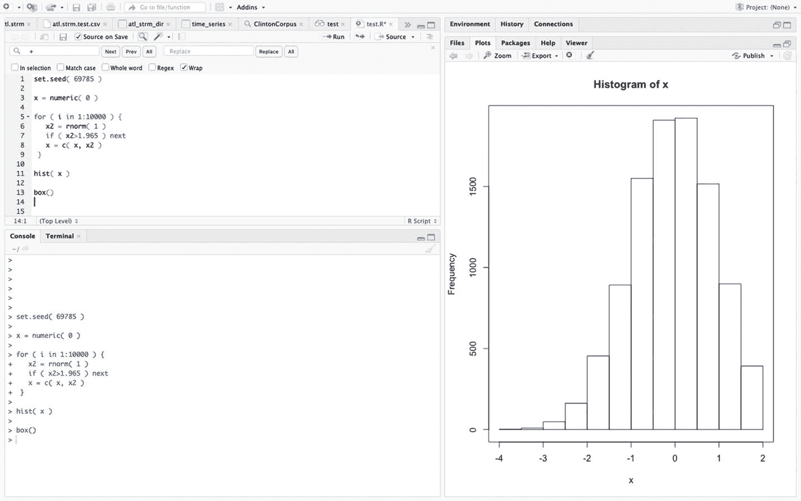
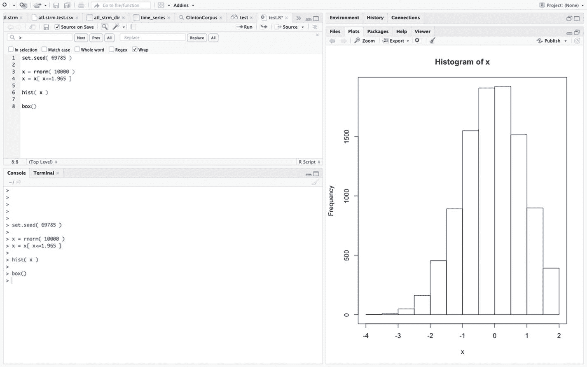
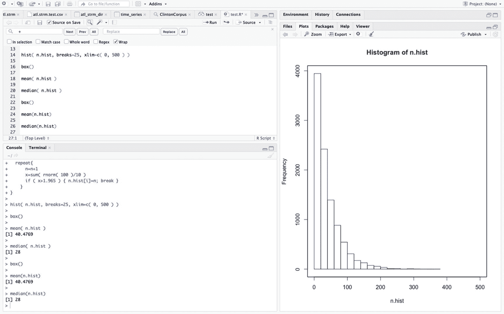
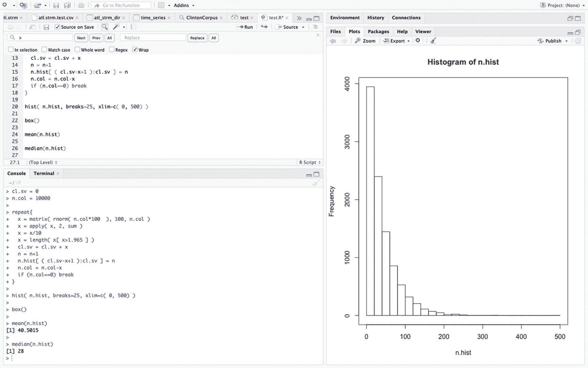

# 13. 流程控制示例

本章提供了一些流程控制的示例，以及使用索引完成相同示例的方法。第一个示例使用了嵌套的`for`循环和`if/else`语句。第二个示例使用了`while`语句。第三个示例是嵌套的`for`循环。第四个示例使用了`for`循环、`if`语句和`next`语句。第五个示例是`for`循环、`repeat`循环、`if`语句和`break`语句。

## 带`if/else`语句的嵌套`for`循环

在此示例中，我们基于`if/else`测试对矩阵进行逐元素替换。

首先，生成一个两行五列的矩阵`x`，并显示该矩阵。接着，两个`for`循环遍历`x`的行和列索引。在每个循环周期，一组`if/else`语句测试矩阵中的元素是否大于五。

如果元素的值大于五，则将该元素的值替换为一。否则，控制权转移到`else`语句。在`else`语句中，该元素的值被替换为零。

最后，显示结果矩阵。示例如下：

```
> x = matrix( 1:10, 2, 5 )
> x
     [,1] [,2] [,3] [,4] [,5]
[1,]    1    3    5    7    9
[2,]    2    4    6    8   10
> for ( i in 1:2 ) {
+   for ( j in 1:5 ) {
+     if ( x[i,j]>5 ) x[i,j]=1
+     else x[i,j]=0
+   }
+ }
> x
     [,1] [,2] [,3] [,4] [,5]
[1,]    0    0    0    1    1
[2,]    0    0    1    1    1
```

## 使用索引

不使用循环完成相同的替换会更简单。首先，生成并显示矩阵`x`。然后，根据原始值将`x`中的元素设置为新值。注意，替换执行的顺序很重要，因为一小于六。最后，显示结果矩阵。示例如下：

```
> x = matrix( 1:10, 2, 5 )
> x
     [,1] [,2] [,3] [,4] [,5]
[1,]    1    3    5    7    9
[2,]    2    4    6    8   10
> x[ x <= 5 ] = 0
> x[ x > 5 ] = 1
> x
     [,1] [,2] [,3] [,4] [,5]
[1,]    0    0    0    1    1
[2,]    0    0    1    1    1
```

在我的电脑上，使用一个 43,830 行、35 列的矩阵，两种方法耗时均不到一秒。

## 一个`while`循环

在此示例中，使用`while`循环来找出，对于一组在 0 到 1 之间均匀随机分布的变量，其和超过五需要多少次迭代。

首先为随机数生成器设置种子，并将`n`和`x`设为零，然后启动一个`while`循环来递增`n`并对`x`求和。每次迭代时，使用均匀分布的随机数生成器生成一个数并加到`x`上。当`x`大于五时，循环停止。打印出`n`和`x`的值。示例如下：

```
> set.seed( 129435 )
> n=0
> x=0
> while ( x < 5 ) {
+   n = n + 1
+   x = x + runif( 1 )
+ }
> n
[1] 7
> x
[1] 5.179325
```

## 使用索引

要使用索引完成相同的任务，首先生成一个长度超出预期求和的均匀随机变量向量。

然后，使用函数`cumsum()`（它沿着向量创建累积和）来找出何时总和大于五。由于`x`的元素总是大于零，因此沿着向量的累积和总是增加的。

接下来，使用函数`length()`查找累积和小于等于五的元素个数。然后，打印出`n`和`x`的值，其中`x`等于`x[n]`。

```
> set.seed( 129435 )
> x = runif( 25 )
> x = cumsum( x )
> n = length( x[ x <= 5 ] ) + 1
> x = x[n]
> n
[1] 7
> x
[1] 5.179325
```

请注意，该示例的两部分中，随机数生成器都被设置为相同的种子值，因为生成了相同的前七个数字，所以两部分的结果是匹配的。

在我的电脑上，如果我将前面示例中的 5 替换为 1,000,000，将 25 替换为 3,000,000，使用索引的方法几乎是瞬间完成的，而使用循环的方法则大约需要 5 秒。

# 嵌套 `for` 循环

有时，我们需要计算矩阵各列之间的差值。在此示例中，使用嵌套的 `for` 循环来查找这些差值。

首先，生成一个包含两行四列的矩阵 `x`，并为它指定列名。接着，显示该矩阵。然后，生成一个包含两行六列的零矩阵 `xp`，用于存放差值结果，并为该矩阵指定空列名。

接下来，将计数器 `k`（用于矩阵 `xp` 的列）设置为零。随着两个 `for` 循环的递增，`k` 在每个步骤中都会增加一。

然后，运行这两个 `for` 循环。在循环中，用矩阵 `x` 中不同列之间的差值填充 `xp` 的元素。这两个循环遍历矩阵 `x` 的列，确保不会重复列组合，并且两列永远不会相同。在每一步中，根据 `x` 中的名称为 `xp` 的列分配名称。

最后，显示结果矩阵 `xp`。示例如下：

```r
> x = matrix( 1:8, 2, 4 )
> colnames( x ) = paste( "c", 1:4, sep="" )
> x
c1 c2 c3 c4
[1,]  1  3  5  7
[2,]  2  4  6  8
> xp = matrix( 0, 2, 6 )
> colnames( xp ) = rep( "", 6 )
> xp
[1,] 0 0 0 0 0 0
[2,] 0 0 0 0 0 0
> k=0
> for ( i in 1:3 ) {
+   for ( j in (i+1):4 ) {
+     k = k+1
+     xp[,k] = x[,i]-x[,j]
+     colnames( xp )[k] = paste( colnames(x)[i], "-",
colnames(x)[j], sep="" )
+   }
+ }
> xp
c1-c2 c1-c3 c1-c4 c2-c3 c2-c4 c3-c4
[1,]    -2    -4    -6    -2    -4    -2
[2,]    -2    -4    -6    -2    -4    -2
```

请注意，`xp` 的列数等于 `p(p-1)/2`，其中 `p` 是 `x` 的列数。

## 使用索引

要使用索引解决此问题，需要创建两个索引向量。

首先，生成初始矩阵 `x`，为其指定列名并显示。然后，创建两个长度相同的索引集合 `ind.1` 和 `ind.2`。这两个集合中的相应索引永远不会相同，并且所有可能的组合都存在且仅出现一次。

接下来，通过从第一个索引集合中的 `x` 列中减去第二个索引集合中的 `x` 列，来创建结果矩阵 `xp`。然后，使用 `paste()` 和两个索引集创建并分配 `xp` 的列名。

最后，显示矩阵 `xp`。示例如下：

```r
> x = matrix( 1:8, 2, 4 )
> colnames( x ) = paste( "c", 1:4, sep="" )
> x
c1 c2 c3 c4
[1,]  1  3  5  7
[2,]  2  4  6  8
> ind.1 = rep( 1:3, 3:1 )
> ind.1
[1] 1 1 1 2 2 3
> ind.2 = numeric( 0 )
> for( i in 2:4 ) ind.2 = c( ind.2, i:4 )
> ind.2
[1] 2 3 4 3 4 4
> xp = x[,ind.1] - x[,ind.2]
> colnames( xp ) = paste( "c", ind.1, "-c", ind.2, sep="" )
> xp
c1-c2 c1-c3 c1-c4 c2-c3 c2-c4 c3-c4
[1,]    -2    -4    -6    -2    -4    -2
[2,]    -2    -4    -6    -2    -4    -2
```

请注意，使用 `for` 循环来创建第二个索引集。此外，在两个索引集中都重复了列索引。

对于大型矩阵，第二种方法比第一种方法更快。在我的计算机上，使用两种方法对两个各有 43,830 行和 35 列的矩阵进行了列差值计算。两种方法都得到了相同的 43,830 行乘 595 列的矩阵。循环方法耗时超过 1.0 分钟，而索引方法耗时不到 1.0 秒。

## `for` 循环、`if` 语句和 `next` 语句

在此示例中，生成标准正态随机数并与 1.965 进行比较。仅保留小于或等于 1.965 的那些值。

首先，将随机数生成器的种子设置为一个任意值。然后，将 `x` 设置为数值型的 `NULL` 值。在接下来的 `for` 循环中，进行 10,000 次迭代，每次迭代生成一个标准正态随机数。如果该数字大于 1.965，则开始下一个循环。否则，将该数字添加到一个数值向量中。绘制最终向量的直方图。结果见图 13-1。示例如下：

```r
> set.seed( 69785 )
> x = numeric( 0 )
> for ( i in 1:10000 ) {
+   x2 = rnorm( 1 )
+   if ( x2>1.965 ) next
+   x = c( x, x2 )
+ }
> hist( x )
> box()
```



图 13-1

使用循环生成小于 1.965 的标准正态随机变量的直方图

## 使用索引

使用索引要简单得多。首先，将随机数生成器种子设置为与上一个示例相同的值。接下来，生成长度为 10,000 的标准正态随机变量向量。然后，仅保留向量中小于或等于 1.965 的那些值。最后，生成该向量的直方图。直方图如图 13-2 所示。示例如下：

```r
> set.seed( 69785 )
> x = rnorm( 10000 )
> x = x[ x <= 1.965 ]
> hist( x )
> box()
```



图 13-2

使用索引生成小于 1.965 的标准正态随机变量的直方图

请注意，由于种子相同并且使用了相同的 10,000 个数字，因此两个直方图相同。

如果将上述示例中的 10,000 增加到 100,000，在我的计算机上，使用循环的方法大约需要 34 秒，而使用索引的方法需要不到 1 秒。

# “for”循环、“repeat”循环、“if”语句和“break”语句

在本例中，在一个 `repeat` 循环内生成大小为 100 的标准正态随机样本。该 `repeat` 循环位于一个执行 10,000 次迭代的 `for` 循环之内。

对于每个样本，样本总和除以十，然后与 1.965 进行比较。（由于生成的数字的期望值为零，标准误为 1，且这些数字相互独立，因此样本总和除以十是一个标准正态变量。）如果该值小于 1.965，则 `repeat` 循环继续。否则，`repeat` 循环停止，记录循环次数，并开始下一次 `for` 循环。最后，将循环次数的向量绘制成直方图，并找出这些次数的平均值和中位数。

首先，设置随机数生成器的种子。然后，创建一个向量 `n.hist` 来保存结果，并为 `for` 循环的每次迭代预留一个位置。接着，打开 `for` 循环，并将计数器 `n` 设为零。然后，打开 `repeat` 循环。

在 `repeat` 循环的开头，计数器 `n` 增加 1。然后，抽取样本，除以十，并求和。将结果赋值给 `x`。接着，在一个 `if` 语句中将 `x` 的值与 1.965 进行比较。如果该值大于 1.965，则将索引 `i` 对应的 `n.hist` 设为计数器 `n`，并通过 `break` 语句跳出 `repeat` 循环。否则，`repeat` 循环继续循环。

最后，运行 `hist()` 生成 `n.hist` 的直方图，运行 `mean()` 找出 `n.hist` 的平均值，并运行 `median()` 找出 `n.hist` 的中位数。直方图见图 13-4。示例如下：

```
> set.seed( 69785 )
> n.hist = numeric( 10000 )
> for ( i in 1:10000 ) {
+   n=0
+   repeat{
+     n=n+1
+     x=sum( rnorm( 100 )/10 )
+     if ( x>1.965 ) { n.hist[i]=n; break }
+   }
+ }
> hist( n.hist, breaks=25, xlim=c( 0, 500) )
> box()
> mean( n.hist )
[1] 40.4769
> median( n.hist )
[1] 28
```



图 13-3

对于 100 个标准正态变量之和除以 10 的结果超过 1.965 所需的次数——使用 `for` 循环

注意平均值接近 40，这相当于平均需要观察到一个概率为 0.0247 的事件所需的预期试验次数。然而，中位数要小得多，因为该分布高度偏斜。

## 使用索引

为了使用索引完成此示例，我们发现 `repeat` 循环是必需的，但可以省去 `for` 循环。

再次设置随机数生成器的种子——与示例第一部分相同的数字——并将 `n.hist` 定义为包含 10,000 个元素的 `numeric` 向量。然后，将计数器 `n` 设为零，计数器 `cl.sv` 设为零，计数器 `n.col` 设为 10,000。

接着，打开 `repeat` 循环。将矩阵 `x` 定义为一个具有 100 行和 `n.col` 列（初始为 10,000）的矩阵。`x` 的元素是随机生成的标准正态数字，元素数量为 100 乘以 `n.col` 的乘积。

接下来，使用 `apply()` 函数对矩阵的每一列求和，并将结果赋给 `x`。然后，将 `x` 除以 10。接着，找出 `x` 中大于 1.965 的元素组成的向量的长度，并将其赋给 `x`。

然后，将 `x` 加到 `cl.sv` 上，这样 `cl.sv` 就包含了已找到大于 1.965 结果的列数。接着，`n` 增加 1。接下来，将 `n.hist` 的某些值设为 `n`，其中使用 `cl.sv` 和 `x` 来指示在向量 `n.hist` 的什么位置放入 `n` 的值。

接着，`n.col` 减去 `x` 的值。`repeat` 循环持续进行，直到 `n.col` 等于零。在每次迭代中，`n` 增加 1。

使用 `hist()` 生成 `n.hist` 的直方图，使用 `mean()` 计算 `n.hist` 的平均值，使用 `median()` 计算 `n.hist` 的中位数。直方图见图 13-4。示例如下：

```
> set.seed( 69785 )
> n.hist = numeric( 10000 )
> n = 0
> cl.sv = 0
> n.col = 10000
> repeat{
+   x = matrix( rnorm( n.col*100  ), 100, n.col )
+   x = apply( x, 2, sum )
+   x = x/10
+   x = length( x[ x>1.965 ] )
+   cl.sv = cl.sv + x
+   n = n+1
+   n.hist[ ( cl.sv-x+1 ):cl.sv ] = n
+   n.col = n.col-x
+   if (n.col==0) break
+ }
> hist( n.hist, breaks=25, xlim=c( 0, 500) )
> box()
> mean(n.hist)
[1] 40.5015
> median(n.hist)
[1] 28
```



图 13-4

对于 100 个标准正态变量之和除以 10 的结果超过 1.965 所需的次数——使用索引

再次，平均值接近 40，中位数为 28。

两种方法所用时间大致相同。如果将上面的 10,000 替换为 100,000，那么在我的电脑上，循环方法大约需要 44 秒，索引方法大约需要 45 秒。

由于两种方法生成随机样本的过程不同，即使随机数生成器的种子相同，两种方法的结果也不完全相同。

# 函数 `ifelse()` 和 `switch()`

`ifelse()` 和 `switch()` 这两个函数在函数或脚本中执行流程控制。`ifelse()` 函数评估一个逻辑表达式，并根据结果从两个值中选择一个。`switch()` 函数将一个值作为参数，并根据第一个参数的值返回另一个值。

## `ifelse()` 函数

`ifelse()` 函数接受三个参数。第一个参数是一个逻辑对象，或任何可强制转换为逻辑类型的对象，例如原子模式的对象，或仅有一层深度且每个元素仅取一个值的 `list` 模式对象。此外，你也可以使用一个返回可强制转换为逻辑类型值的函数。第二个参数是当第一个参数为真时要返回的值。第三个参数是当第一个参数为假时要返回的值。

第一个参数的每个元素会被单独测试。`character` 模式的元素和缺失元素会返回 `NA`。否则，对于给定元素，返回的值是第二个（或第三个）参数中相同位置的值。例如，如果第一个参数是向量 `(T,T,F,T)`，第二个参数是向量 `(1,2,1,2)`，第三个参数是 `(4,5,6,4)`，那么 `ifelse()` 会返回 `(1,2,6,2)`。即：

```
> ifelse( c( T, T, F, T ), c( 1, 2, 1, 2 ), c( 4, 5, 6, 4 ) )
[1] 1 2 6 2
```

如果可能，结果会保持与第一个参数相同的维度。否则，会返回一个长度为第一个参数长度、模式为 `list` 的向量。例如：

```
> a.mat = matrix( 0:3, 2, 2 )
> a.mat
     [,1] [,2]
[1,]    0    2
[2,]    1    3
> a.list = list( a.mat, c( "a", "b", "c" ) )
> a.list
[[1]]
     [,1] [,2]
[1,]    0    2
[2,]    1    3

[[2]]
[1] "a" "b" "c"

> ifelse( a.mat, 1:4, 30:33 )
     [,1] [,2]
[1,]   30    3
[2,]    2    4
> ifelse( a.mat, 1:4, a.list )
[[1]]
     [,1] [,2]
[1,]    0    2
[2,]    1    3

[[2]]
[1] 2

[[3]]
[1] 3

[[4]]
[1] 4
```

请注意，在第二次调用 `ifelse()` 时，`a.mat` 的第一个元素结果为 `FALSE`，而 `a.list` 的第一个元素是一个矩阵，因此生成了一个列表。

如果第一个参数的长度小于第二个（或第三个）参数的长度，则只会使用第二个（或第三个）参数中与第一个参数长度相等的前面那些元素。例如：

```
> ifelse( c( T, F ), 1:5, 10:15 )
[1]  1 11
```

`1:5` 的第一个元素是 `1`，`10:15` 的第二个元素是 `11`，因此返回了 `(1,11)`。

如果第一个参数的长度大于第二个（或第三个）参数的长度，则第二个（或第三个）参数会循环。例如：

```
> ifelse( c( T, F, F, F, T ), 1:3, 10:12 )
[1]  1 11 12 10  2
```

第二个参数循环为 `(1,2,3,1,2)`，第三个参数循环为 `(10,11,12,10,11)`。

如果结果元素的模式不同，则结果会采用层级最高元素的模式。层级顺序（从低到高）为：`logical`、`integer`、`double`、`complex`、`character`、`list`。模式为 `NULL` 和 `raw` 的对象会引发错误。例如：

```
> ifelse( c( T, F, F, F, T ), 1:5+1i, 1:5 )
[1] 1+1i 2+0i 3+0i 4+0i 5+1i
> ifelse( c( T, F, F, F, T ), as.raw( 2:6 ), as.raw( 12:16 ) )
Error in ifelse(c(T, F, F, F, T), as.raw(2:6), as.raw(12:16)) :
  incompatible types (from raw to logical) in subassignment type fix
```

三个参数中的任何一个都可以是一个函数。如果函数被求值，则会先返回函数的计算结果。最后一个结果即是替换的结果。例如：

```
> f.fun = function( mu, se=1, alpha=.05 ){
    q_value = qnorm( 1-alpha/2, mu, se )
    print( q_value )
  }
> ifelse( f.fun( 1:2, alpha=1.0 ), f.fun( 1:2 ), f.fun( 3 ) )
[1] 1 2
[1] 2.959964 3.959964
[1] 2.959964 3.959964
> ifelse( f.fun( 0:2, alpha=1.0 ), f.fun( 1:2 ), f.fun( 3 ) )
[1] 0 1 2
[1] 2.959964 3.959964
[1] 4.959964
[1] 4.959964 3.959964 2.959964
```

请注意，在第一次调用 `f.fun()` 时，`alpha` 被设置为 `1.0`，因此返回的是中位数。另外，在第一次调用中，前两个函数被求值，而在第二次调用中，所有三个函数都被求值。

如果结果被赋值给一个对象，则函数的结果会打印在控制台，但 `ifelse()` 的结果会传递给该对象。例如：

```
> a=ifelse ( f.fun( 1:2, alpha=1.0 ), f.fun( 1:2 ), f.fun( 3 ) )
[1] 1 2
[1] 2.959964 3.959964
> a
[1] 2.959964 3.959964
```

`ifelse()` 函数可以嵌套使用。例如，可以使用嵌套的 `ifelse()` 函数生成一个长度为六、具有两个状态的一阶马尔可夫链，其转移矩阵为：

![$$ \left[\begin{array}{cc}0.7&amp; 0.3\\ {}0.8&amp; 0.2\end{array}\right] $$](images/323823_2_En_14_Chapter/323823_2_En_14_Chapter_TeX_Equa.png)

设“A”为第一个状态，“B”为第二个状态：

```
> set.seed( 6978 )
> mc="A"
> for ( i in 2:6 ) {
+   rn = runif( 1 )
+   mc = c( mc, ifelse( mc[i-1]=="A", ifelse( rn < .7, "A", "B" ), ifelse( rn < .8, "A", "B" ) ) )
+ }
> mc
[1] "A" "A" "B" "B" "B" "B"
```

你可以在 R 提示符下输入 `?ifelse`，或使用 R Studio 中的“帮助”选项卡，查找关于 `ifelse()` 的更多信息。

## `switch()` 函数

`switch()` 函数接受任意数量的参数。第一个参数告诉 `switch()` 要返回后面参数中的哪一个。第一个参数之后的所有参数都是要返回的对象。第一个参数必须是数值型、逻辑型、复数型、字符型或 `NA`，并且必须是一个单一元素。其余参数可以是任何模式和维度。参数之间用逗号分隔。

如果第一个参数是数值型，则向下取整为整数；如果是逻辑型，则 `TRUE` 强制转换为 `1`，`FALSE` 强制转换为 `0`；如果是复数型，则丢弃虚部，只将实部当作数值型处理。会给出一个警告。

该函数返回由第一个参数指定的参数。例如，如果第一个参数是 `3`，则返回第四个参数。即：

```
> switch( 3, 5, "a", "b", 6 )
[1] "b"
```

如果第一个参数大于参数数量减一、小于一、或者是 `NA`，则返回一个 `NULL` 对象。例如：

```
> switch( 0, 1, 2, 3 )
> mode( switch( 0, 1, 2, 3 ) )
[1] "NULL"
```

当第一个参数是一个字符串时，`switch()` 的行为会有所不同。该函数会查找第一个参数之后的参数名称，试图找到一个匹配项。除了可能一个没有名称的元素外，其余所有后续参数都必须有名称。（参数可以通过在列表中输入名称，后跟等号，再跟一个可选的数值来命名。）

如果存在一个没有名称的参数，那么当找不到与字符串匹配的参数时，该参数将作为默认值。如果没有无名称的参数，则默认值为 `NULL` 对象。例如：

```
> switch( "e", a=1, b=2, c=3, d=4, e=f.fun( 0 ) )
[1] 1.959964
> switch( "e", a=1, b=2, c=3, d=4, 25 )
[1] 25
> switch( "e", a=1, b=2, c=3, d=4 )
> mode( switch( "e", a=1, b=2, c=3, d=4 ) )
[1] "NULL"
```

无名称的参数可以出现在列表中的任何位置，但不能是第一个参数。如果输入了多个无名称的参数，`switch()` 会返回一个错误。

# `switch()`函数的字符串匹配参数处理

当第一个参数是字符串时，后续的参数不必被赋值，只需有名称即可。如果该字符串匹配了一个没有赋值的名称，那么`switch()`会继续沿着参数列表查找，并返回下一个有赋值的参数的值。如果后续所有参数都没有赋值，`switch()`会返回一个`NULL`对象。例如：

```
> switch( "b", a=1, b=, c=3, d= )
[1] 3
> switch( "b", a=1, b=, c=, d= )
> mode( switch( "b", a=1, b=, c=, d= ) )
[1] "NULL"
```

请注意，第一个参数被引号括起来，而后续参数的名称则没有。`switch()`函数可以嵌套使用。

你可以在 R 提示符下输入`?switch`，或使用 R Studio 中的“帮助”选项卡，查找关于`switch()`的更多信息。
