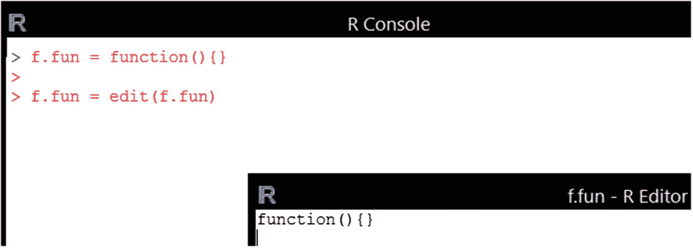
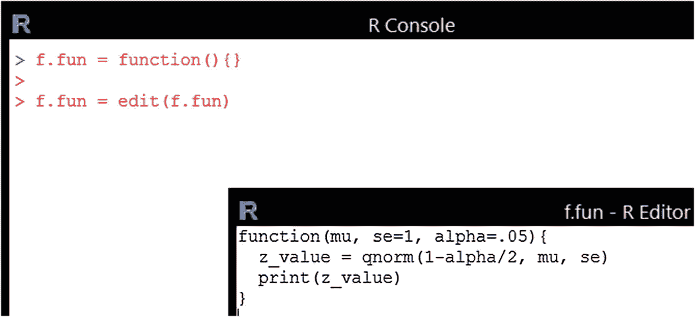

# 用户自定义函数、脚本和 S4 方法

用户自定义函数和脚本通常能让 R 用户的工作变得更加轻松。如果一项重复性任务涉及多行不同的代码，创建一个函数或脚本来完成该任务可以节省时间。在 `S4` 中，泛型函数的方法是 `S4` 的函数层面的体现，需要特殊处理。

设计图形是用户定义函数或脚本有意义的场景之一。绘制图形通常需要多行代码，而且图形的设计通常是一个交互过程。在命令行 R 中，创建一个函数来绘制图形并对函数进行修改，通常比使用上箭头键修改代码行要容易得多。

另一个用户定义函数或脚本有用的场景是，当用户想尝试 R 包中未提供的统计技术时。通常，用户可以利用现有的函数为该技术创建一个自定义函数或脚本。

在 R Studio 中，“源”窗口（左上角的窗口）提供了一个创建和运行代码的地方，这些代码可以保存为外部的 R 脚本，或作为内部函数保存。“源”窗口也是加载 R 脚本或其他文本文件的地方。

## 脚本

脚本是用 R 编写并存储在程序外的代码。包含 R 脚本的文件是文本文件，扩展名为`.R`。R 脚本可以包含函数定义。在命令行 R 中，使用`source()`函数运行脚本。例如，假设工作目录中的文件`lm.example.R`包含以下内容：

```
print( x )
print( y )
print( lm( y~x)  )
```

然后，对该文件运行`source()`函数会得到：

```
> source( "lm.example.R" )
[1]  1  2  3  4  5  6  7  8  9 10
[1] 21 22 23 24 25 26 27 28 29 30
Call:
lm(formula = y ~ x)
Coefficients:
(Intercept)            x
20            1
```

请注意，这里只打印了函数的结果。

在 R Studio 中，事情要简单得多。不需要在外部编辑脚本。如果脚本已存在于 R 之外，可以将脚本加载到“源”窗口中。点击窗口上方第一个菜单中带有绿色箭头的黄色文件夹图标。然后，浏览到脚本所在的位置并点击该文件。文件将在“源”窗口中打开。要运行该文件，请点击“源”窗口菜单栏右侧的“Run”或“Source”图标。要运行文件的一部分，请高亮选中该部分，然后点击“Run”图标。

要输入一个新脚本，请点击上方窗口上方菜单栏中最左边的图标，然后选择第一个选项“R Script”。“源”窗口将打开一个空白页面。只需输入代码行。运行代码或部分代码以调试脚本。R Studio 会帮助调试，标记出语法错误。完成后，您可以保存脚本。点击“源”窗口菜单中的软盘图标，然后为文件输入一个名称。R Studio 会自动为文件添加`.R`扩展名。要在保存代码时运行它，请勾选“Source to Save”复选框。

## 函数的结构

非原始函数都具有相同的结构。函数的第一行是`function`这个词，后跟一对圆括号，括号内可能有参数，也可能没有。在大多数情况下，括号后面跟一个左花括号。通常，函数体放在第一行下面，最后一行是右花括号后面的一行空行，右花括号通常独占一行。通常，函数会被赋予一个名称。例如：

```
> d.fun = function(){
+ print( 1:5 )
+ }
> d.fun
function(){
print( 1:5 )
}
> d.fun()
[1] 1 2 3 4 5
```

在这个例子中，首先，函数被赋值给`d.fun`；接着，列出了`d.fun()`的内容；最后，运行了函数`d.fun()`。

如果函数只包含一条语句——该语句可以放在与`function`语句同一行，也可以放在后续一行或多行——则花括号不是必需的。例如：

```
> c.fun = function() print(1:5)
> c.fun
function() print(1:5)
> c.fun()
[1] 1 2 3 4 5
```

同样，函数被赋予了一个名称，列出了函数，并运行了函数。

参数是函数使用的对象或值，必须在运行函数时输入到函数中，除非参数存在默认值。参数在创建函数时放在圆括号内，用逗号分隔。通过将参数设置为某个值来提供默认值。具有默认值的参数在运行函数时不必指定。如果未指定值，函数将使用默认值。

下面是一个具有两个参数的函数示例，其中`a`没有默认值，必须指定，而`b`的默认值为 3：

```
> e.fun = function( a, b=3 ){
+ print( a:b )
+ }
> e.fun
function( a, b=3 ){
print( a:b )
}
> e.fun( 10 )
[1] 10  9  8  7  6  5  4  3
> e.fun()
Error in a:b : 'a' is missing
```

再次，函数被赋予名称、列出并运行。请注意，由于`a`是第一个参数，而`b`有默认值，因此不加名称地提供`a`。在第二次尝试运行`e.fun()`时，没有为`a`提供参数，因此`e.fun()`返回一个错误。

通常，用户在函数中使用花括号来包含语句组，例如用于`if`、`else`、`for`、`while`和`repeat`组。函数中左花括号的数量必须与右花括号的数量相同；否则，函数将无法保存。花括号不匹配是 R 代码中常见的错误来源，并在 R Studio 中被标记出来。

R 中的代码行（无论是在函数内还是在 R 提示符下）都可以中断并在下一行继续。R 会查找诸如右括号、花括号或引号之类的东西来标记一条语句或语句的一部分的结束。

空行在 R 函数中是合法的。此外，任何文本都可以通过在文本前放置井号（`#`）来注释掉。在一行中，井号后面的任何内容都会被忽略。编写函数的一条建议是：每次只写一小块，每一步都进行调试，并使用大量的注释。

## 如何将函数输入到 R 中

本节介绍四种使用命令行将函数输入到 R 中的方法，以及一种使用 R Studio 的方法。第一种方法涉及使用编辑器。第二种方法涉及内联输入，如前一节所示。第三种方法涉及在 R 外部创建函数，并使用`dget()`将函数导入 R 中。第四种方法是第二和第三种方法的变体，涉及从 R 外部的源复制并粘贴。第五种方法是使用 R Studio 的“源”窗口。

### 使用编辑器

在 Windows 和 OS X 操作系统中，`utils` 包中有一个 `edit()` 函数，该函数在创建新函数时非常有用。`edit()` 函数的作用是调用一个编辑功能。

在 Windows 系统中，默认的编辑功能是内置编辑器。其他可选的编辑器包括 `xedit()`、`emacs()`、`xemacs()`、`vi()` 和 `pica()`，但只有系统上安装了这些编辑器时才能选择。默认编辑器在 `options()` 中列出，并且可以随时更改（参见第 15 章）。

对于 OS X 系统，唯一可用的编辑器是 `vi` 编辑器，它工作得很好。

对于 Linux 操作系统，在终端窗口中调用 `edit()` 效果不佳。更好的编辑器是 `emacs()`，它适用于 Linux 系统。

以上大部分信息来自 `edit()` 的帮助页面。在 R 提示符下输入 `?edit` 可以获取有关编辑函数的更多信息。

要使用编辑器创建一个函数对象，首先需要将函数赋值给一个名称。例如，设名称为 `f.fun`。要创建函数 `f.fun()`，首先在 R 提示符下输入 `f.fun = function(){}`。此时，对象 `f.fun` 包含一个没有参数和语句的函数。

下一步是编辑该函数。为简便起见，此处示例仅展示 `edit()` 函数。其他编辑器的行为类似。在 R 提示符下输入 `f.fun = edit(f.fun)`。一个编辑窗口会打开供编辑（图 7-1）。



图 7-1

创建函数：第一步和第二步

第三步，在括号内输入参数，并在花括号内输入函数语句（图 7-2）。



图 7-2

创建函数：第三步

第四步是退出编辑器。要退出编辑器，请点击编辑窗口右上角的 `x`。此时会弹出一个窗口，提供保存文件、不保存退出或取消请求并返回编辑的选项。（如果文件未做任何更改，则不会显示选项屏幕。）点击 `Yes` 保存更改，`No` 恢复到之前的版本，或 `Cancel` 返回编辑。

如果函数语法正确，函数将被保存。否则，`edit()` 会返回一个错误，例如：

```
Error in .External2(C_edit, name, file, title, editor) :
unexpected '}' occurred on line 4
use a command like
x <- edit()
to recover
```

# 在 R 中创建与编辑函数

要恢复已完成的工作，请输入 `f.fun = edit()`。使用不带任何内容的括号非常重要。如果在括号内输入了函数名，则编辑更改将丢失，并恢复为编辑前的版本。请注意，错误消息会提供有关 R 代码问题的信息。

以下展示了使用编辑器创建函数 `f.fun()` 时，R 控制台的输入和输出，随后是函数列表，以及将第一个参数设置为零后运行该函数的结果。

```
> f.fun = function(){}
> f.fun = edit( f.fun )
> f.fun
function(mu, se=1, alpha=.05){
z_value = qnorm(1-alpha/2, mu, se)
print(z_value)
}
> f.fun( 0 )
[1] 1.959964.
```

## 内联输入

如本章第一节所示，函数也可以内联输入。设 `b.fun` 为创建用来列出数字三到六的新函数名称。那么，创建函数、列出代码和运行函数的步骤如下：

```
> b.fun = function(){
+ print( 3:6 )
+ }
> b.fun
function(){
print( 3:6 )
}
> b.fun()
[1] 3 4 5 6
```

如果在内联输入函数的过程中出现语法错误，R 会给出错误提示并返回 R 提示符。例如：

```
> b.fun = function(){
+ print( 3:6
+ }
Error: unexpected '}' in:
"print( 3:6
}"
```

对于较长的函数，使用 R 编辑器或外部编辑器通常可以减少挫折感。

## 外部编辑器：`dget()` 以及复制粘贴

可以使用外部编辑器来创建函数。任何能生成文本文件的编辑器，例如 `Notepad`、`TextEdit` 或 `gedit`，都可以用来创建 R 函数。创建函数的规则与第一节中描述的相同。函数创建完成后，可以通过 `dget()` 函数或复制粘贴的方式将其导入工作空间。（`dget()` 函数及其对应的 `dput()` 函数是在 R 中导入和导出函数的一种方式。）

假设函数位于与 R 工作空间相同文件夹下的 `function.txt` 文件中，并且该函数语法正确。那么，以下代码行会将此函数导入到对象 `g.fun` 中：

```
g.fun = dget( "function.txt" )
```

（请注意，R 接受更复杂的文件路径，包括硬盘上的绝对地址和 URL。）

如果文本文件语法不正确，R 会返回一个错误，其中包含有关文件中语法问题的信息。

如果文件不包含函数，或者包含多个函数，R 会尝试运行该代码。

该文件也可以从外部源——或从 R 会话的其他地方——复制并粘贴到 R 的对象中。首先，将函数复制到计算机的剪贴板。然后，在 R 提示符下输入要调用的对象名称，后跟等号。此时光标应位于等号的右侧。接下来，粘贴。

如果函数语法正确，光标会停在右括号的右侧。按下 `Return` 键完成此过程。如果函数语法不正确，复制粘贴将会给出一个包含语法问题信息的错误。

## 在 R Studio 中

在 R Studio 中，要创建新函数，请打开一个新的 R 脚本（最左侧的图标）。使用 R 脚本而非文本文件，这样你可以在调试时从 Source 窗口运行代码。不要输入函数声明或外围的花括号。首先输入要作为参数的变量，并为它们赋值。当代码行正确运行后，点击 Source 窗口上方的魔棒图标，并选择“Extract Function”。R Studio 会提示你输入名称，并在 Source 窗口中创建带有名称赋值的函数。参数应位于正确的位置，但你可能需要对结果进行一些编辑。运行生成的脚本会将函数赋值给工作空间内的对应名称。

在 R Studio 右上角的 Environment 选项卡下点击一个已有的函数，会在 Source 窗口中以独立的选项卡打开该函数。你不能编辑或运行该代码，但可以复制它，然后打开一个新的 R 脚本，并将代码粘贴到该 R 脚本中进行编辑。