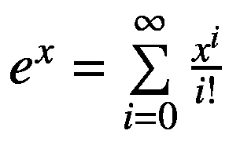
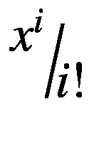
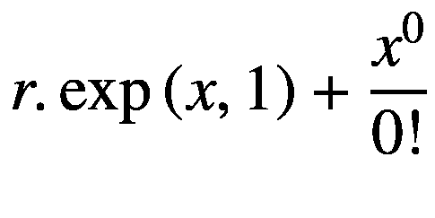
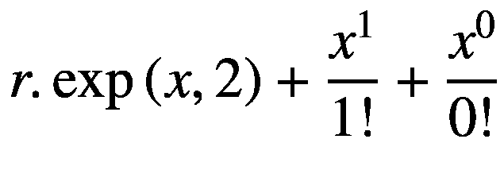
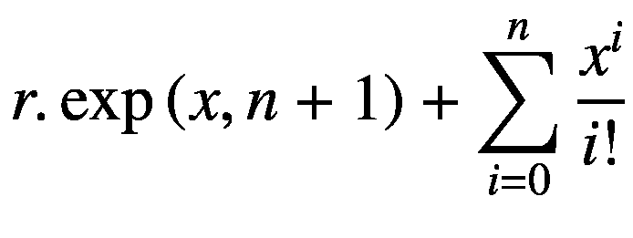
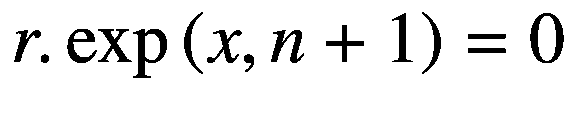

# 实用技巧

如果没有关于 R 中一些棘手部分的建议，这本书就不算完整。当你觉得一切设置都正确，但事情仍然没有按预期进行，而你却不知道原因时，本章可以为你提供帮助。本章还描述了 R 中一些不太明显的部分。

# 值替换：NA、NaN、Inf 和 -Inf

本节内容涉及缺失数据（`NA`）或非法元素（`NaN`、`Inf` 或 `-Inf`）。假设你想用一个数值（例如 `0`）来替换缺失值。直观的方法可能会输入如下代码：

```
mat[ mat==NA ] = 0
```

但这样行不通。正确的方法应该输入以下代码：

```
mat [ is.na( mat ) ] = 0
```

例如：

```
> mat = matrix( c( 1, NA, 3, 4 ), 2, 2 )
> mat
     [,1] [,2]
[1,]    1    3
[2,]   NA    4
> mat[ mat==NA ]=2
> mat
     [,1] [,2]
[1,]    1    3
[2,]   NA    4
> mat[ is.na( mat ) ]=2
> mat
     [,1] [,2]
[1,]    1    3
[2,]    2    4
```

同样的方法也适用于非法值。在 R 语言中，`NaN`、`Inf` 和 `-Inf` 是为非法运算定义的。例如：

```
> 1/0
[1] Inf
> -1/0
[1] -Inf
> 0/0
[1] NaN
> log( -1 )
[1] NaN
Warning message:
In log(-1) : NaNs produced
```

在这个例子中，正数除以零得到正无穷；负数除以零得到负无穷；零除以零未定义，因此返回 `NaN`。尝试计算负一的自然对数会返回 `NaN`并附带一个警告，因为负一的对数未定义。

函数 `is.finite()`、`is.infinite()` 和 `is.nan()` 可替代 `is.na()`，分别用于检测有限值、`Inf` 和 `-Inf`、以及 `NaN` 元素。例如：

```
> mat = matrix( c( 1, NaN, Inf, -Inf ), 2, 2 )
> mat
     [,1] [,2]
[1,]    1  Inf
[2,]  NaN -Inf
> mat[ is.finite( mat ) ]=2
> mat
     [,1] [,2]
[1,]    2  Inf
[2,]  NaN -Inf
> mat[ is.infinite( mat ) ]=3
> mat
     [,1] [,2]
[1,]    2    3
[2,]  NaN    3
> mat[ is.nan( mat ) ]=4
> mat
     [,1] [,2]
[1,]    2    3
[2,]    4    3
```

注意，`is.infinite()` 将 `Inf` 和 `-Inf` 同等对待。

函数 `sign()` 对于等于 `-Inf` 的参数返回 `-1`。因此，处理符号问题的一个简单方法是先获取对象的符号，然后在为 `-Inf` 赋值后，将替换后对象的绝对值乘以符号对象。例如：

```
> mat=matrix( c( 1, 2, Inf, -Inf ), 2, 2 )
> mat
     [,1] [,2]
[1,]    1  Inf
[2,]    2 -Inf
> sg.mat = sign( mat )
> sg.mat
     [,1] [,2]
[1,]    1    1
[2,]    1   -1
> mat[ is.infinite( mat ) ] = 4
> mat
     [,1] [,2]
[1,]    1    4
[2,]    2    4
> mat = sg.mat*abs( mat )
> mat
     [,1] [,2]
[1,]    1    4
[2,]    2   -4
```

你可以在 R 提示符下输入 `?is.na` 获取关于 `NA` 和 `is.na()` 的更多信息。你可以在 R 提示符下输入 `?is.finite` 获取关于 `NaN`、`Inf`、`-Inf`、`is.nan()`、`is.finite()` 和 `is.infinite()` 的更多信息。或者你也可以使用 R Studio 的帮助页面。

# if 语句与逻辑向量

## 概述

当进行逻辑测试时，被测试的对象长度往往大于一。R 语言不喜欢这种情况，并会给出警告，提示只使用了第一个逻辑元素。假设你想测试一个逻辑对象中是否有任何元素为 TRUE。此时，`any()` 函数会很有用。如果对象中存在任何 `TRUE`，`any()` 函数返回 `TRUE`，否则返回 `FALSE`。例如：

```
> a.logical=c( T, T, F, T )
> a.logical
[1]  TRUE  TRUE FALSE  TRUE
> test=8
> test
[1] 8
> if ( a.logical==T ) test=1
Warning message:
In if (a.logical == T) test = 1 :
the condition has length > 1 and only the first element will be used
> test
[1] 1
> if ( any( a.logical ) ) test=2
> test
[1] 2
> if ( any( !a.logical ) ) test=3
> test
[1] 3
> if ( any( !a.logical[1:2] ) ) test=4
> test
[1] 3
```

## 注意事项

注意，在第三次和第四次测试中，测试是针对 `FALSE` 值的。`!` 用于逻辑取反对象 `as.logical`，以测试 `FALSE`。

## `all()` 函数

函数 `all()` 用于测试所有元素是否均为 TRUE。

## 获取帮助

你可以在 R 提示符下输入 `?any` 或使用 R Studio 的帮助标签页，获取关于 `any()` 和 `all()` 的更多信息。

# 列表以及 `list()` 和 `c()` 函数

向列表中添加元素可能会令人困惑。应该使用 `list()` 还是 `c()`？创建列表时，要放入列表的元素用逗号分隔。但是，假设你想添加一些元素，那么通常你会希望使用 `c()`。例如：

```
list( 1:4, paste0( "a", 1:7 ) )
[[1]]
[1] 1 2 3 4
[[2]]
[1] "a1" "a2" "a3" "a4" "a5" "a6" "a7"
> list( list( 1:4, paste0( "a", 1:7 ) ), 1:3 )
[[1]]
[[1]][[1]]
[1] 1 2 3 4
[[1]][[2]]
[1] "a1" "a2" "a3" "a4" "a5" "a6" "a7"
[[2]]
[1] 1 2 3
> c(list( 1:4, paste0( "a", 1:7 ) ), 1:3 )
[[1]]
[1] 1 2 3 4
[[2]]
[1] "a1" "a2" "a3" "a4" "a5" "a6" "a7"
[[3]]
[1] 1
[[4]]
[1] 2
[[5]]
[1] 3
> c( list( 1:4, paste0( "a", 1:7 ) ), list( 1:3 ) )
[[1]]
[1] 1 2 3 4
[[2]]
[1] "a1" "a2" "a3" "a4" "a5" "a6" "a7"
[[3]]
[1] 1 2 3
```

最后一个结果很可能就是你想要的。（另一种获得相同结果的方法是在上述表达式中使用 `append()` 代替 `c()`。）

# 从函数中获取数据

编写函数时，有时函数的目的是将结果打印到控制台；有时目的是导出一个对象（如果未赋值给对象，则会打印到控制台）；有时则需要两种类型的输出。函数`print()`和`cat()`用于向控制台写入内容。要输出一个对象，该对象必须是函数中的最后一个语句，或者位于`return()`函数内。例如：

```
> a.fun = function(){
+ a = rnorm( 5 )
+ return( a )
+ }
> a.fun()
[1]  2.0435770  0.1182068 -0.8160913 -0.3456415  1.2234314
> b.fun = function(){
+ b = rnorm( 5 )
+ b
+ }
> b.fun()
[1] -0.26273333 -0.90655351 -1.25978662 -0.06758578  2.41723700
```

第一个函数使用了`return`，第二个函数没有。两次函数运行时的随机种子不同，因此生成的数字也不同。

# 递归函数

R 语言中的函数可以递归地调用。递归函数是一种在满足条件之前会不断调用自身的函数。我们使用定义指数分布的级数来说明递归函数的工作原理。

回顾：



因此，我们希望创建一个函数，该函数在每一步中针对`i`从`0`、`1`一直到某个停止点`n`，累加  的值。由于  每一步都在减小，并最终变得任意小，因此我们使用  的大小来设定停止点。

该函数如下所示：

```
> r.exp =
function( x, i=0 ){
if ( abs( x^i/factorial( i ) ) > 1.0e-8 ) {
r.exp( x, i+1 ) + x^i/factorial( i )
}
else {

}
}
```

在递归的第一步，`i`等于零，所以 `r.exp()` 的值是



在第二步，其值为



如果`i`等于`n`是最后一步，此时  小于我们的停止点 `1.0e-8`，那么对于`i`等于`n`的情况，`r.exp()` 的值等于



但是



所以递归停止。由于函数中 `if` 部分的表达式是该函数最后执行的语句，因此函数会返回该结果。

为了理解这个函数的工作方式，我们令 `x` 等于一：

```
> r.exp(1)
[1] 2.718282
> exp(1)
[1] 2.718282
```

注意，当 `x` 等于一时，这个函数给出的结果与函数 `exp()` 相同。
