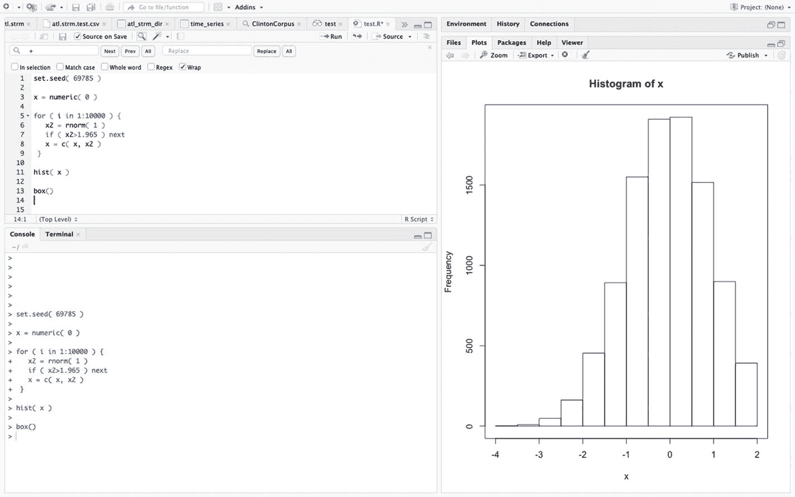
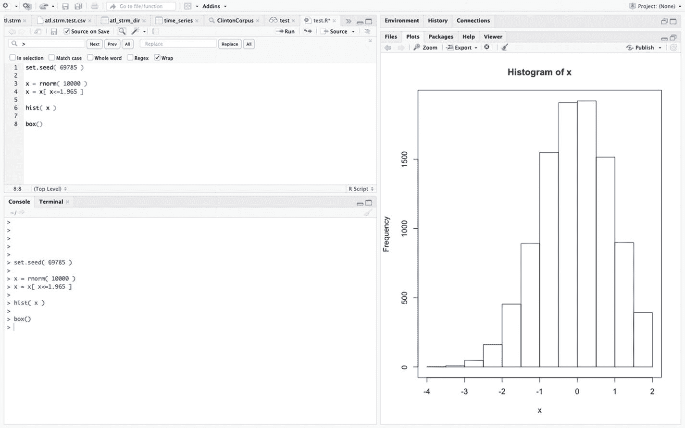

# 嵌套 `for` 循环

有时，我们需要计算矩阵各列之间的差值。在此示例中，使用嵌套的 `for` 循环来查找这些差值。

首先，生成一个包含两行四列的矩阵 `x`，并为它指定列名。接着，显示该矩阵。然后，生成一个包含两行六列的零矩阵 `xp`，用于存放差值结果，并为该矩阵指定空列名。

接下来，将计数器 `k`（用于矩阵 `xp` 的列）设置为零。随着两个 `for` 循环的递增，`k` 在每个步骤中都会增加一。

然后，运行这两个 `for` 循环。在循环中，用矩阵 `x` 中不同列之间的差值填充 `xp` 的元素。这两个循环遍历矩阵 `x` 的列，确保不会重复列组合，并且两列永远不会相同。在每一步中，根据 `x` 中的名称为 `xp` 的列分配名称。

最后，显示结果矩阵 `xp`。示例如下：

```
> x = matrix( 1:8, 2, 4 )
> colnames( x ) = paste( "c", 1:4, sep="" )
> x
c1 c2 c3 c4
[1,]  1  3  5  7
[2,]  2  4  6  8
> xp = matrix( 0, 2, 6 )
> colnames( xp ) = rep( "", 6 )
> xp
[1,] 0 0 0 0 0 0
[2,] 0 0 0 0 0 0
> k=0
> for ( i in 1:3 ) {
+   for ( j in (i+1):4 ) {
+     k = k+1
+     xp[,k] = x[,i]-x[,j]
+     colnames( xp )[k] = paste( colnames(x)[i], "-",
colnames(x)[j], sep="" )
+   }
+ }
> xp
c1-c2 c1-c3 c1-c4 c2-c3 c2-c4 c3-c4
[1,]    -2    -4    -6    -2    -4    -2
[2,]    -2    -4    -6    -2    -4    -2
```

请注意，`xp` 的列数等于 `p(p-1)/2`，其中 `p` 是 `x` 的列数。

## 使用索引

要使用索引解决此问题，需要创建两个索引向量。

首先，生成初始矩阵 `x`，为其指定列名并显示。然后，创建两个长度相同的索引集合 `ind.1` 和 `ind.2`。这两个集合中的相应索引永远不会相同，并且所有可能的组合都存在且仅出现一次。

接下来，通过从第一个索引集合中的 `x` 列中减去第二个索引集合中的 `x` 列，来创建结果矩阵 `xp`。然后，使用 `paste()` 和两个索引集创建并分配 `xp` 的列名。

最后，显示矩阵 `xp`。示例如下：

```
> x = matrix( 1:8, 2, 4 )
> colnames( x ) = paste( "c", 1:4, sep="" )
> x
c1 c2 c3 c4
[1,]  1  3  5  7
[2,]  2  4  6  8
> ind.1 = rep( 1:3, 3:1 )
> ind.1
[1] 1 1 1 2 2 3
> ind.2 = numeric( 0 )
> for( i in 2:4 ) ind.2 = c( ind.2, i:4 )
> ind.2
[1] 2 3 4 3 4 4
> xp = x[,ind.1] - x[,ind.2]
> colnames( xp ) = paste( "c", ind.1, "-c", ind.2, sep="" )
> xp
c1-c2 c1-c3 c1-c4 c2-c3 c2-c4 c3-c4
[1,]    -2    -4    -6    -2    -4    -2
[2,]    -2    -4    -6    -2    -4    -2
```

请注意，使用 `for` 循环来创建第二个索引集。此外，在两个索引集中都重复了列索引。

对于大型矩阵，第二种方法比第一种方法更快。在我的计算机上，使用两种方法对两个各有 43,830 行和 35 列的矩阵进行了列差值计算。两种方法都得到了相同的 43,830 行乘 595 列的矩阵。循环方法耗时超过 1.0 分钟，而索引方法耗时不到 1.0 秒。

## `for` 循环、`if` 语句和 `next` 语句

在此示例中，生成标准正态随机数并与 1.965 进行比较。仅保留小于或等于 1.965 的那些值。

首先，将随机数生成器的种子设置为一个任意值。然后，将 `x` 设置为数值型的 `NULL` 值。在接下来的 `for` 循环中，进行 10,000 次迭代，每次迭代生成一个标准正态随机数。如果该数字大于 1.965，则开始下一个循环。否则，将该数字添加到一个数值向量中。绘制最终向量的直方图。结果见图 13-1。示例如下：

```
> set.seed( 69785 )
> x = numeric( 0 )
> for ( i in 1:10000 ) {
+   x2 = rnorm( 1 )
+   if ( x2>1.965 ) next
+   x = c( x, x2 )
+ }
> hist( x )
> box()
```



图 13-1

使用循环生成小于 1.965 的标准正态随机变量的直方图

## 使用索引

使用索引要简单得多。首先，将随机数生成器种子设置为与上一个示例相同的值。接下来，生成长度为 10,000 的标准正态随机变量向量。然后，仅保留向量中小于或等于 1.965 的那些值。最后，生成该向量的直方图。直方图如图 13-2 所示。示例如下：

```
> set.seed( 69785 )
> x = rnorm( 10000 )
> x = x[ x <= 1.965 ]
> hist( x )
> box()
```



图 13-2

使用索引生成小于 1.965 的标准正态随机变量的直方图

请注意，由于种子相同并且使用了相同的 10,000 个数字，因此两个直方图相同。

如果将上述示例中的 10,000 增加到 100,000，在我的计算机上，使用循环的方法大约需要 34 秒，而使用索引的方法需要不到 1 秒。


