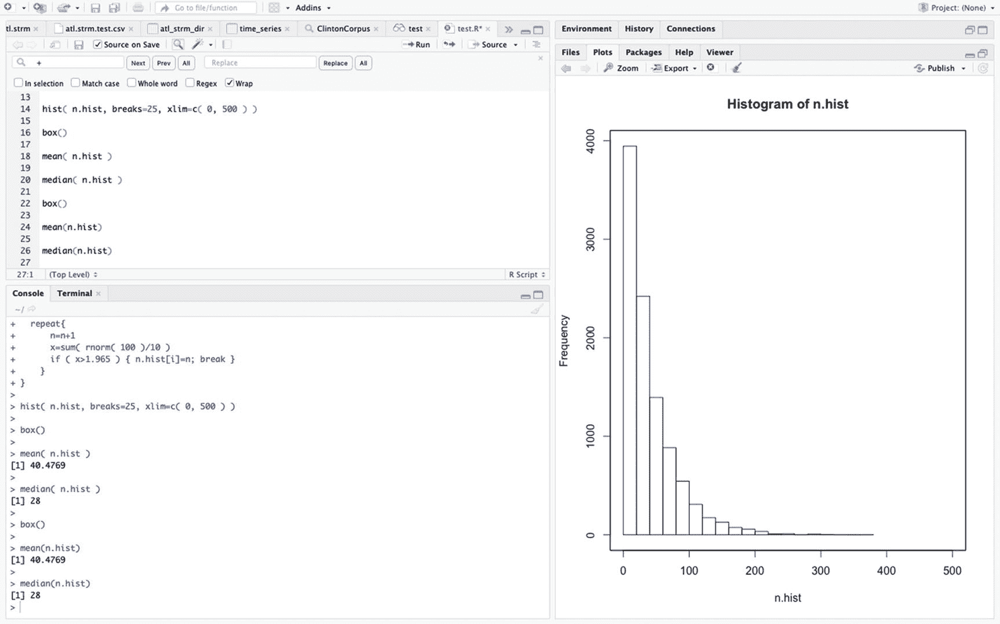
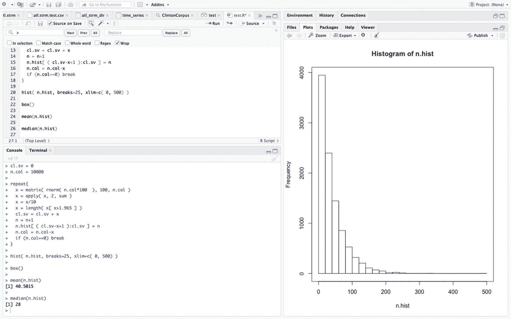

# “for”循环、“repeat”循环、“if”语句和“break”语句

在本例中，在一个 `repeat` 循环内生成大小为 100 的标准正态随机样本。该 `repeat` 循环位于一个执行 10,000 次迭代的 `for` 循环之内。

对于每个样本，样本总和除以十，然后与 1.965 进行比较。（由于生成的数字的期望值为零，标准误为 1，且这些数字相互独立，因此样本总和除以十是一个标准正态变量。）如果该值小于 1.965，则 `repeat` 循环继续。否则，`repeat` 循环停止，记录循环次数，并开始下一次 `for` 循环。最后，将循环次数的向量绘制成直方图，并找出这些次数的平均值和中位数。

首先，设置随机数生成器的种子。然后，创建一个向量 `n.hist` 来保存结果，并为 `for` 循环的每次迭代预留一个位置。接着，打开 `for` 循环，并将计数器 `n` 设为零。然后，打开 `repeat` 循环。

在 `repeat` 循环的开头，计数器 `n` 增加 1。然后，抽取样本，除以十，并求和。将结果赋值给 `x`。接着，在一个 `if` 语句中将 `x` 的值与 1.965 进行比较。如果该值大于 1.965，则将索引 `i` 对应的 `n.hist` 设为计数器 `n`，并通过 `break` 语句跳出 `repeat` 循环。否则，`repeat` 循环继续循环。

最后，运行 `hist()` 生成 `n.hist` 的直方图，运行 `mean()` 找出 `n.hist` 的平均值，并运行 `median()` 找出 `n.hist` 的中位数。直方图见图 13-4。示例如下：

```
> set.seed( 69785 )
> n.hist = numeric( 10000 )
> for ( i in 1:10000 ) {
+   n=0
+   repeat{
+     n=n+1
+     x=sum( rnorm( 100 )/10 )
+     if ( x>1.965 ) { n.hist[i]=n; break }
+   }
+ }
> hist( n.hist, breaks=25, xlim=c( 0, 500) )
> box()
> mean( n.hist )
[1] 40.4769
> median( n.hist )
[1] 28
```



图 13-3

对于 100 个标准正态变量之和除以 10 的结果超过 1.965 所需的次数——使用 `for` 循环

注意平均值接近 40，这相当于平均需要观察到一个概率为 0.0247 的事件所需的预期试验次数。然而，中位数要小得多，因为该分布高度偏斜。

## 使用索引

为了使用索引完成此示例，我们发现 `repeat` 循环是必需的，但可以省去 `for` 循环。

再次设置随机数生成器的种子——与示例第一部分相同的数字——并将 `n.hist` 定义为包含 10,000 个元素的 `numeric` 向量。然后，将计数器 `n` 设为零，计数器 `cl.sv` 设为零，计数器 `n.col` 设为 10,000。

接着，打开 `repeat` 循环。将矩阵 `x` 定义为一个具有 100 行和 `n.col` 列（初始为 10,000）的矩阵。`x` 的元素是随机生成的标准正态数字，元素数量为 100 乘以 `n.col` 的乘积。

接下来，使用 `apply()` 函数对矩阵的每一列求和，并将结果赋给 `x`。然后，将 `x` 除以 10。接着，找出 `x` 中大于 1.965 的元素组成的向量的长度，并将其赋给 `x`。

然后，将 `x` 加到 `cl.sv` 上，这样 `cl.sv` 就包含了已找到大于 1.965 结果的列数。接着，`n` 增加 1。接下来，将 `n.hist` 的某些值设为 `n`，其中使用 `cl.sv` 和 `x` 来指示在向量 `n.hist` 的什么位置放入 `n` 的值。

接着，`n.col` 减去 `x` 的值。`repeat` 循环持续进行，直到 `n.col` 等于零。在每次迭代中，`n` 增加 1。

使用 `hist()` 生成 `n.hist` 的直方图，使用 `mean()` 计算 `n.hist` 的平均值，使用 `median()` 计算 `n.hist` 的中位数。直方图见图 13-4。示例如下：

```
> set.seed( 69785 )
> n.hist = numeric( 10000 )
> n = 0
> cl.sv = 0
> n.col = 10000
> repeat{
+   x = matrix( rnorm( n.col*100  ), 100, n.col )
+   x = apply( x, 2, sum )
+   x = x/10
+   x = length( x[ x>1.965 ] )
+   cl.sv = cl.sv + x
+   n = n+1
+   n.hist[ ( cl.sv-x+1 ):cl.sv ] = n
+   n.col = n.col-x
+   if (n.col==0) break
+ }
> hist( n.hist, breaks=25, xlim=c( 0, 500) )
> box()
> mean(n.hist)
[1] 40.5015
> median(n.hist)
[1] 28
```



图 13-4

对于 100 个标准正态变量之和除以 10 的结果超过 1.965 所需的次数——使用索引

再次，平均值接近 40，中位数为 28。

两种方法所用时间大致相同。如果将上面的 10,000 替换为 100,000，那么在我的电脑上，循环方法大约需要 44 秒，索引方法大约需要 45 秒。

由于两种方法生成随机样本的过程不同，即使随机数生成器的种子相同，两种方法的结果也不完全相同。