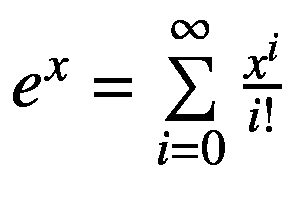
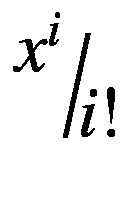
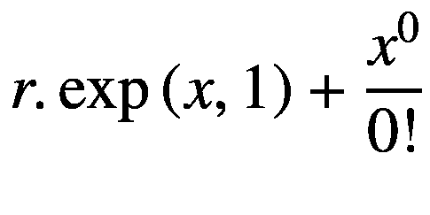
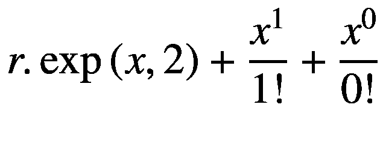
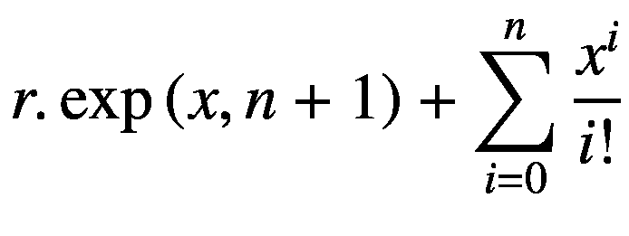
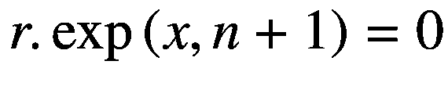

# 递归函数

R 语言中的函数可以递归地调用。递归函数是一种在满足条件之前会不断调用自身的函数。我们使用定义指数分布的级数来说明递归函数的工作原理。

回顾：



因此，我们希望创建一个函数，该函数在每一步中针对`i`从`0`、`1`一直到某个停止点`n`，累加  的值。由于  每一步都在减小，并最终变得任意小，因此我们使用  的大小来设定停止点。

该函数如下所示：

```
> r.exp =
function( x, i=0 ){
if ( abs( x^i/factorial( i ) ) > 1.0e-8 ) {
r.exp( x, i+1 ) + x^i/factorial( i )
}
else {

}
}
```

在递归的第一步，`i`等于零，所以 `r.exp()` 的值是



在第二步，其值为



如果`i`等于`n`是最后一步，此时  小于我们的停止点 `1.0e-8`，那么对于`i`等于`n`的情况，`r.exp()` 的值等于



但是



所以递归停止。由于函数中 `if` 部分的表达式是该函数最后执行的语句，因此函数会返回该结果。

为了理解这个函数的工作方式，我们令 `x` 等于一：

```
> r.exp(1)
[1] 2.718282
> exp(1)
[1] 2.718282
```

注意，当 `x` 等于一时，这个函数给出的结果与函数 `exp()` 相同。